# Livraison des fichiers du site

Chaque fichier ci-dessous est complet et prêt à remplacer le fichier du même nom dans `store/site/`.
Encodage : UTF-8. Aucune dépendance externe.

## `index.html`

```html
<!doctype html>
<html lang="fr">
<head>
  <meta charset="UTF-8">
  <meta name="viewport" content="width=device-width, initial-scale=1">
  <title>Diiwaanu Xassida Yi — Application Android gratuite : khassaïdes, prières et calendrier mouride</title>
  <meta name="description" content="Khassaïdes, heures de prière hors ligne, calendrier mouride, Qibla, nafilas et 99 Noms d’Allah dans une application Android gratuite, sans publicité ni compte.">
  <meta name="keywords" content="khassaïdes, heures de prière hors ligne, calendrier mouride, Serigne Touba, Qibla, nafilas, 99 Noms d’Allah, application Android gratuite">
  <meta name="theme-color" content="#0B1E15">
  <link rel="canonical" href="https://diiwaanu-xassida-yi.com/">
  <meta property="og:type" content="website">
  <meta property="og:url" content="https://diiwaanu-xassida-yi.com/">
  <meta property="og:title" content="Diiwaanu Xassida Yi — Application Android gratuite">
  <meta property="og:description" content="Khassaïdes, prières, calendrier mouride et connaissance, hors ligne et sans publicité.">
  <meta property="og:image" content="https://diiwaanu-xassida-yi.com/assets/app-icon.png">
  <meta name="twitter:card" content="summary">
  <link rel="icon" type="image/png" href="assets/app-icon.png">
  <link rel="stylesheet" href="assets/css/site.css">
  <script src="assets/js/site.js" defer></script>
</head>
<body id="haut">
<a class="skip-link" href="#contenu">Aller au contenu</a>

<header class="site-header">
  <div class="wrap">
    <nav class="site-nav" aria-label="Navigation principale">
      <a class="brand" href="#accueil">
        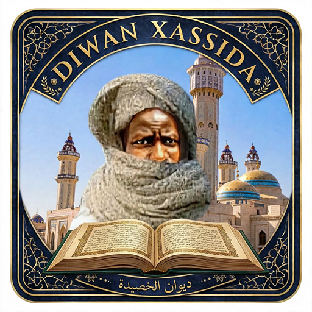
        <span>Diiwaanu Xassida Yi</span>
      </a>
      <button class="menu-toggle" type="button" data-menu-toggle
              aria-expanded="false" aria-controls="site-menu" aria-label="Ouvrir le menu">
        <span aria-hidden="true">☰</span><span class="menu-label">Menu</span>
      </button>
    </nav>

    <noscript>
      <nav class="noscript-nav" aria-label="Navigation sans JavaScript">
        <a href="#accueil">Accueil</a>
        <a href="rubriques.html">Rubriques</a>
        <a href="bibliotheque.html">Bibliothèque</a>
        <a href="prieres.html">Prières</a>
        <a href="nafilas.html">Nafilas</a>
        <a href="nafila-du-jour.html">Nafila du jour</a>
        <a href="99-noms.html">99 Noms</a>
        <a href="xam-yoonwi.html">XAM YOONWI</a>
        <a href="#contact">Contact</a>
      </nav>
    </noscript>

    <div class="hero-grid" id="accueil">
      <div class="hero-portrait">
        <div class="portrait-frame">
          
        </div>
        <p class="portrait-caption">Serigne Touba · image de l’application</p>
      </div>

      <div class="hero-copy">
        <p class="eyebrow">Application Android gratuite · hors ligne</p>
        <h1>Diiwaanu <span>Xassida Yi</span></h1>
        <p class="lead">Les khassaïdes, les heures de prière et le calendrier mouride réunis dans une seule application Android, sans publicité ni compte.</p>
        <p class="nonprofit">But non lucratif — Uniquement pour servir Serigne Touba</p>

        <div class="hero-actions">
          <!-- Avant publication : statut désactivé. Après validation, remplacer
               ce <span> par le lien Play ; garder la mention de version ci-dessous. -->
          <span class="btn btn-gold" id="play-store" data-play-status aria-disabled="true">Bientôt sur Google Play</span>
          <a class="btn btn-gold-outline" href="#notification">Être informé de la sortie</a>
        </div>
        <p class="play-version">Version 1.0 · Android</p>

        <div class="langues" aria-label="Accroche en wolof et en anglais">
          <p><b>Wolof</b> Xassida yi, waxtu julli yi ak arminaayu julit yi ci ap jëfandikukaay bu bees, te ñàkk nett.</p>
          <p><b>English</b> Qasā’id, offline prayer times, and Mouride calendar in one free, ad-free Android app.</p>
        </div>

        <p class="ornament-strip" aria-hidden="true">◆ ◆ ◆</p>
        <p class="note-links">Découvrir <a href="rubriques.html">toutes les rubriques</a> · <a href="bibliotheque.html">la bibliothèque</a> · <a href="#faq">la FAQ</a></p>
      </div>
    </div>
  </div>
</header>

<div class="menu-backdrop" data-menu-backdrop aria-hidden="true"></div>
<aside id="site-menu" class="menu-panel" aria-label="Menu du site" aria-hidden="true">
  <div class="menu-panel-head">
    <strong>Diiwaanu Xassida Yi</strong>
    <button class="menu-close" type="button" data-menu-close aria-label="Fermer le menu">×</button>
  </div>
  <nav aria-label="Liens du site">
    <ul>
      <li><a href="#accueil" aria-current="page">Accueil</a></li>
      <li><a href="rubriques.html">Rubriques</a></li>
      <li><a href="bibliotheque.html">Bibliothèque</a></li>
      <li><a href="prieres.html">Prières</a></li>
      <li><a href="nafilas.html">Nafilas</a></li>
      <li><a href="nafila-du-jour.html">Nafila du jour</a></li>
      <li><a href="99-noms.html">99 Noms</a></li>
      <li><a href="xam-yoonwi.html">XAM YOONWI</a></li>
      <li><a href="#contact">Contact</a></li>
    </ul>
  </nav>
  <p class="menu-note">Application gratuite, hors ligne et sans publicité.</p>
</aside>

<main id="contenu">
  <section id="fonctionnalites">
    <div class="wrap">
      <div class="section-head">
        <span class="kicker">Ce que contient l’application</span>
        <h2>Tout ce qu’il faut, sans connexion</h2>
        <p>Khassaïdes, heures de prière hors ligne, calendrier mouride, Qibla, nafilas, 99 Noms d’Allah, XAM YOONWI et PDF téléchargés : rien n’est envoyé à un serveur, aucune donnée personnelle n’est collectée.</p>
      </div>

      <div class="features">
        <article class="card"><div class="mark" aria-hidden="true">1</div><h3>Un seul menu, tous les accès</h3><p>Le bouton flottant « Tous les accès » regroupe toutes les fenêtres et ouvre directement le bon écran, sans changer la barre du bas.</p></article>
        <article class="card"><div class="mark" aria-hidden="true">2</div><h3>Bibliothèque et lecture intégrée</h3><p>Les khassaïdes se lisent dans l’application, en ligne ou après téléchargement. Recherche par nom, micro, filtres et favoris.</p></article>
        <article class="card"><div class="mark" aria-hidden="true">3</div><h3>Mes PDF téléchargés</h3><p>Consultez et gérez vos PDF enregistrés depuis « Mes PDF » : ouverture dans le lecteur intégré, sans historique envoyé ni besoin de réseau.</p></article>
        <article class="card"><div class="mark" aria-hidden="true">4</div><h3>Heures de prière et widget</h3><p>Horaires calculés hors ligne pour la ville choisie manuellement, sans GPS. Le widget affiche les cinq prières et la prochaine.</p></article>
        <article class="card"><div class="mark" aria-hidden="true">5</div><h3>Calendrier et Qibla</h3><p>Événements mourides et religieux, compte à rebours, direction de la Qibla avec boussole vivante et repli statique.</p></article>
        <article class="card"><div class="mark" aria-hidden="true">6</div><h3>Nafila du jour</h3><p>Les sept fiches de la semaine se feuillètent en français, wolof et anglais. L’écran s’ouvre sur le jour du téléphone.</p></article>
        <article class="card"><div class="mark" aria-hidden="true">7</div><h3>Nafilas R et 99 Noms</h3><p>Les trente nuits de nafilas en texte, et les Noms d’Allah en arabe, transcription latine et français.</p></article>
        <article class="card"><div class="mark" aria-hidden="true">8</div><h3>XAM YOONWI</h3><p>Trente chapitres en texte pour découvrir la vie, les enseignements, Touba, les Khalifes et la famille de Serigne Touba.</p></article>
        <article class="card"><div class="mark" aria-hidden="true">9</div><h3>Thèmes et confort de lecture</h3><p>Sombre par défaut, clair ou automatique ; taille du texte ajustable ; respect du réglage « Réduire le mouvement ».</p></article>
      </div>
    </div>
  </section>

  <section id="rubriques-site">
    <div class="wrap">
      <div class="section-head">
        <span class="kicker">Rubriques du site</span>
        <h2>Le contenu reste accessible</h2>
        <p>La bibliothèque de khassaïdes et les six rubriques du site restent ouvertes à tous. Ce sont des pages réelles, sans compte, sans publicité et sans fonction interactive inventée.</p>
      </div>

      <div class="features rubrique-grid">
        <article class="card"><div class="mark" aria-hidden="true">01</div><h3>Bibliothèque</h3><p>Les khassaïdes classés par langue puis par ordre alphabétique, avec accès direct aux PDF.</p><p><a class="btn btn-gold-outline" href="bibliotheque.html">Ouvrir la bibliothèque →</a></p></article>
        <article class="card"><div class="mark" aria-hidden="true">02</div><h3>Prières</h3><p>Horaires hors ligne, villes choisies manuellement, calendrier, Qibla et widget.</p><p><a class="btn btn-gold-outline" href="prieres.html">Voir les prières →</a></p></article>
        <article class="card"><div class="mark" aria-hidden="true">03</div><h3>Nafilas</h3><p>Les 30 nuits de nafilas en texte seul, avec invocations, répétitions et bienfaits.</p><p><a class="btn btn-gold-outline" href="nafilas.html">Lire les nafilas →</a></p></article>
        <article class="card"><div class="mark" aria-hidden="true">04</div><h3>Nafila du jour</h3><p>Les sept fiches de la semaine en français, wolof et anglais.</p><p><a class="btn btn-gold-outline" href="nafila-du-jour.html">Lire la fiche du jour →</a></p></article>
        <article class="card"><div class="mark" aria-hidden="true">05</div><h3>99 Noms</h3><p>Noms d’Allah en arabe, transcription latine, français et dhikr quand il figure.</p><p><a class="btn btn-gold-outline" href="99-noms.html">Voir les 99 Noms →</a></p></article>
        <article class="card"><div class="mark" aria-hidden="true">06</div><h3>XAM YOONWI</h3><p>30 chapitres sur Serigne Touba, ses enseignements, Touba, le Grand Magal et sa famille.</p><p><a class="btn btn-gold-outline" href="xam-yoonwi.html">Lire les chapitres →</a></p></article>
      </div>
      <p class="note-links">Voir aussi <a href="rubriques.html">la page des rubriques et leurs aperçus</a>.</p>
    </div>
  </section>

  <section class="shots-section" id="apercus">
    <div class="wrap">
      <div class="section-head">
        <span class="kicker">Aperçus</span>
        <h2>L’application en images</h2>
        <p>Onze vues légendées, prises directement dans l’application. Sur mobile, faites glisser horizontalement ; cliquez sur une capture pour l’ouvrir en grand.</p>
      </div>
      <div class="phone-strip" aria-label="Captures de l’application">
        <figure><a href="assets/screenshots/v2/01_bibliotheque.png" target="_blank" rel="noopener"><span class="phone">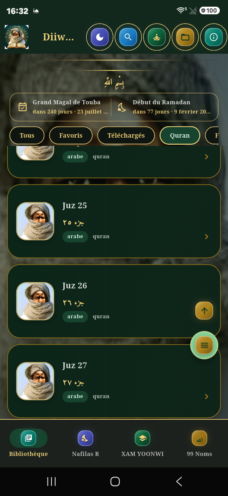</span></a><figcaption>Bibliothèque</figcaption></figure>
        <figure><a href="assets/screenshots/v2/02_prieres.png" target="_blank" rel="noopener"><span class="phone">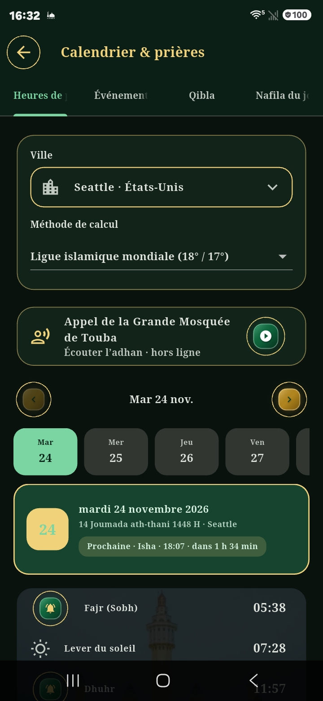</span></a><figcaption>Heures de prière</figcaption></figure>
        <figure><a href="assets/screenshots/v2/03_fiche.png" target="_blank" rel="noopener"><span class="phone">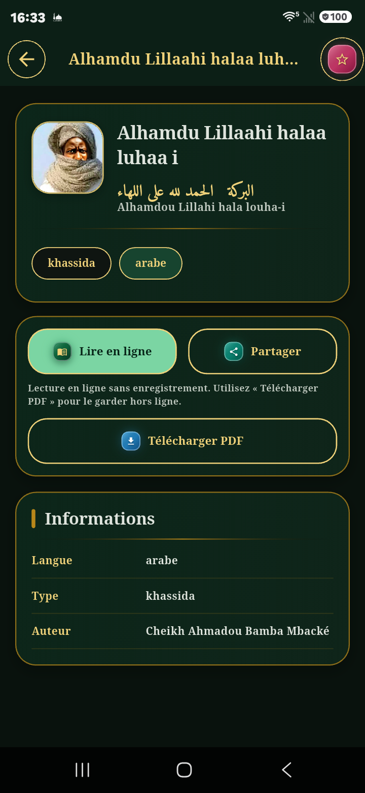</span></a><figcaption>Fiche du livre</figcaption></figure>
        <figure><a href="assets/screenshots/v2/04_evenements.png" target="_blank" rel="noopener"><span class="phone">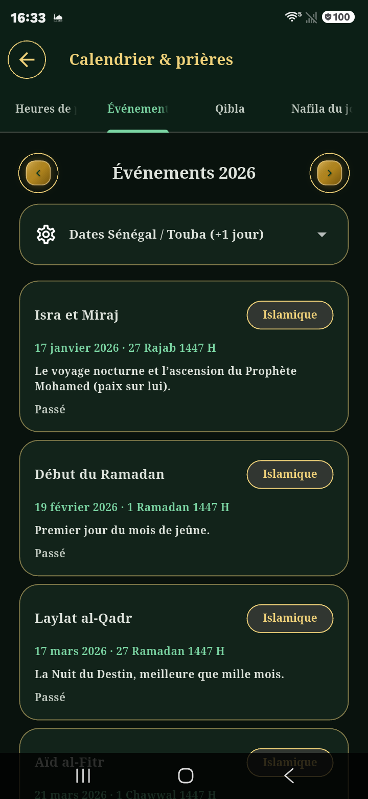</span></a><figcaption>Événements</figcaption></figure>
        <figure><a href="assets/screenshots/v2/05_a_propos.png" target="_blank" rel="noopener"><span class="phone">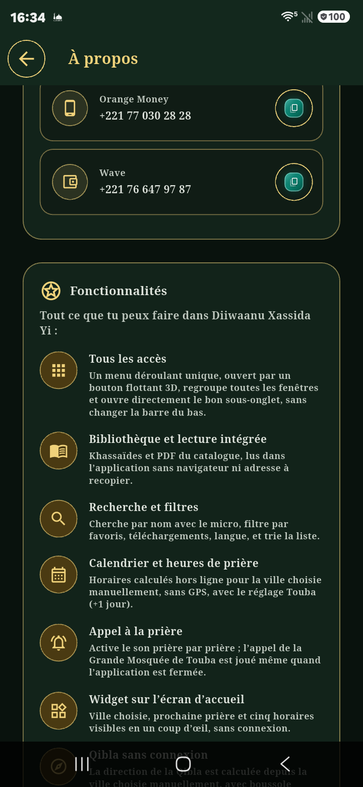</span></a><figcaption>À propos</figcaption></figure>
        <figure><a href="assets/screenshots/v2/06_99_noms.png" target="_blank" rel="noopener"><span class="phone">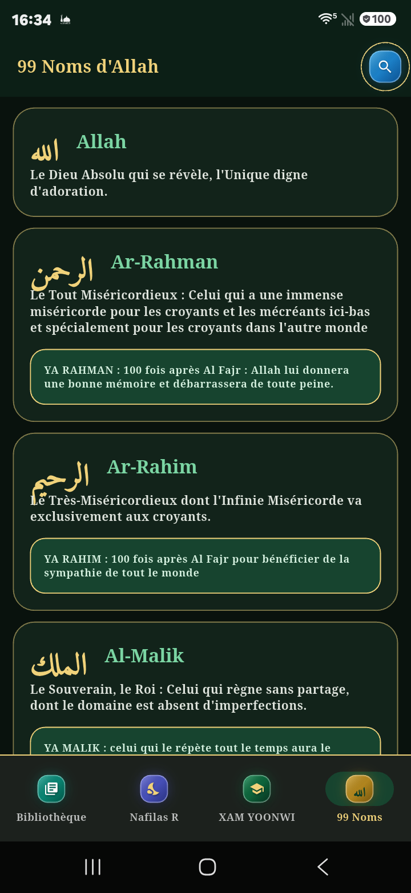</span></a><figcaption>99 Noms</figcaption></figure>
        <figure><a href="assets/screenshots/v2/07_nafilas_ramadan.png" target="_blank" rel="noopener"><span class="phone">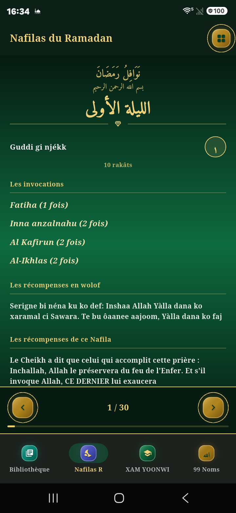</span></a><figcaption>Nafilas R</figcaption></figure>
        <figure><a href="assets/screenshots/v2/08_mes_pdf.png" target="_blank" rel="noopener"><span class="phone">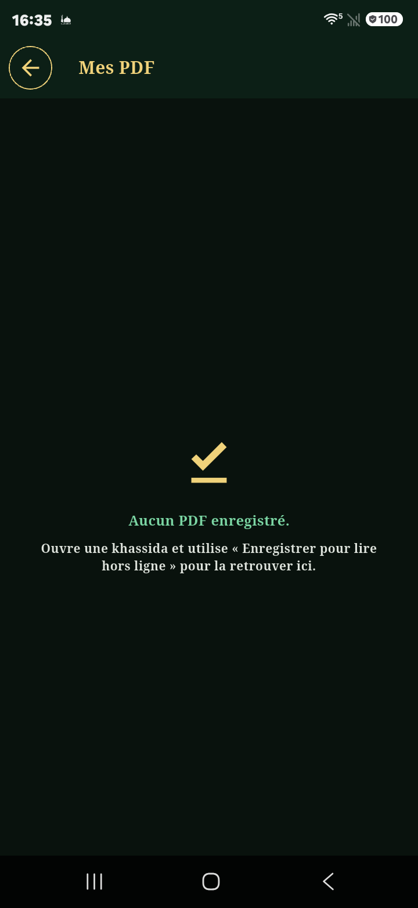</span></a><figcaption>Mes PDF</figcaption></figure>
        <figure><a href="assets/screenshots/v2/09_xam_yoonwi.png" target="_blank" rel="noopener"><span class="phone">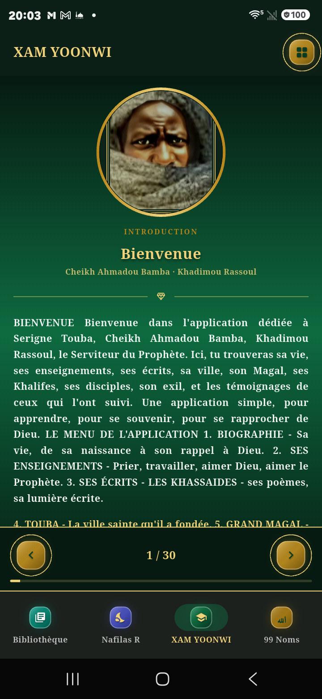</span></a><figcaption>XAM YOONWI</figcaption></figure>
        <figure><a href="assets/screenshots/v2/10_qibla.png" target="_blank" rel="noopener"><span class="phone">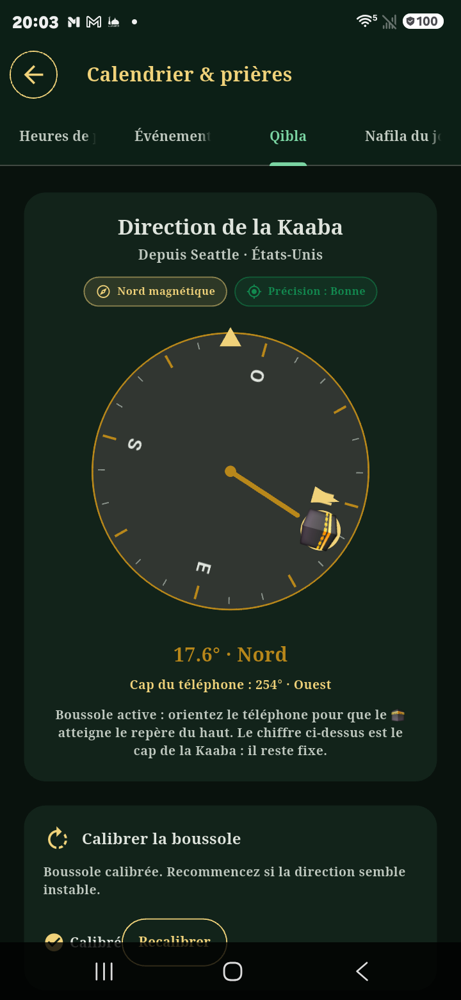</span></a><figcaption>Qibla</figcaption></figure>
        <figure><a href="assets/screenshots/v2/11_nafila_du_jour.png" target="_blank" rel="noopener"><span class="phone">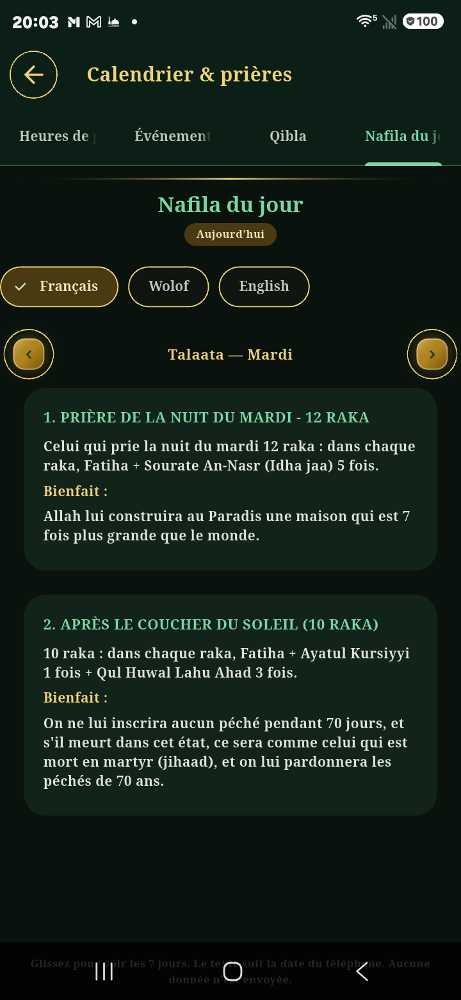</span></a><figcaption>Nafila du jour</figcaption></figure>
      </div>
      <p class="zoom-hint">Cliquer sur une capture pour l’ouvrir en grand et lire le texte.</p>
    </div>
  </section>

  <section class="notify-section" id="notification">
    <div class="wrap">
      <div class="notify">
        <h3>Être informé de la sortie</h3>
        <p>L’application est prête et signée ; la publication attend la validation du compte Google Play. Laissez votre e-mail : un message pré-rempli s’ouvrira dans votre messagerie. Aucune adresse n’est stockée sur ce site.</p>
        <form class="notify-form" id="notify-form">
          <label for="notify-email">Votre adresse e-mail</label>
          <input id="notify-email" name="email" type="email" required autocomplete="email" placeholder="vous@exemple.com">
          <button class="btn btn-gold" type="submit">Être informé de la sortie</button>
          <p class="form-status" id="form-status" role="status" aria-live="polite"></p>
          <small>Vous pouvez aussi écrire directement à <a href="mailto:beguefallou@gmail.com">beguefallou@gmail.com</a>.</small>
        </form>
      </div>
    </div>
  </section>

  <section class="faq" id="faq">
    <div class="wrap">
      <div class="section-head">
        <span class="kicker">Questions fréquentes</span>
        <h2>En bref, avant de télécharger</h2>
        <p>Trois réponses simples sur le fonctionnement hors ligne, le choix de la ville et la confidentialité.</p>
      </div>
      <div class="faq-list">
        <details>
          <summary>L’application fonctionne-t-elle vraiment sans Internet ?</summary>
          <p>Oui. Les khassaïdes, les heures de prière, le calendrier mouride, la Qibla, les nafilas, les 99 Noms d’Allah, XAM YOONWI et les PDF déjà téléchargés sont consultables hors ligne. Aucun serveur n’est interrogé pour afficher ces rubriques.</p>
        </details>
        <details>
          <summary>Faut-il activer le GPS pour les prières ou la Qibla ?</summary>
          <p>Non. La ville est choisie manuellement dans une liste. Les horaires en sont calculés sur le téléphone. Pour la Qibla, les capteurs rendent la boussole vivante quand ils sont disponibles ; sinon, un repère statique prend le relais. Aucune position n’est demandée ni enregistrée.</p>
        </details>
        <details>
          <summary>L’application collecte-t-elle des données personnelles ?</summary>
          <p>Non. Pas de compte, pas de publicité, pas d’analytique et pas de télémétrie. Les préférences restent sur l’appareil. La <a href="https://fgsfalilou.github.io/khassida-privacy/">politique de confidentialité</a> est publique et inchangée.</p>
        </details>
      </div>
    </div>
  </section>

  <section class="contact" id="contact">
    <div class="wrap">
      <div class="section-head">
        <span class="kicker">Contact</span>
        <h2>Une question, une demande ?</h2>
        <p>Application réalisée par Mouhamadou Falilou Seye. Écrivez par e-mail pour les retours, les signalements de traduction et les demandes liées aux droits. Réservez WhatsApp aux questions pratiques.</p>
      </div>
      <div class="contact-grid">
        <div class="panel">
          <h3>E-mails</h3>
          <p>Retours, droits et traductions.</p>
          <ul>
            <li><a href="mailto:beguefallou@gmail.com">beguefallou@gmail.com</a></li>
            <li><a href="mailto:talibeserignefalilou@gmail.com">talibeserignefalilou@gmail.com</a></li>
            <li><a href="mailto:falloubeguefallou@gmail.com">falloubeguefallou@gmail.com</a></li>
          </ul>
        </div>
        <div class="panel">
          <h3>WhatsApp</h3>
          <p>Questions rapides et avis de sortie.</p>
          <ul>
            <li><a href="https://wa.me/13018578776">+1 301 857 8776</a></li>
            <li><a href="https://wa.me/14259543121">+1 425 954 3121</a></li>
            <li><a href="https://wa.me/221770302828">+221 77 030 2828</a></li>
          </ul>
        </div>
      </div>
    </div>
  </section>
</main>

<footer>
  <div class="wrap">
    <div class="foot-grid">
      <div><strong>Diiwaanu Xassida Yi</strong><br>Application Android gratuite, hors ligne et sans publicité.</div>
      <div class="foot-links">
        <a href="rubriques.html">Rubriques</a>
        <a href="bibliotheque.html">Bibliothèque</a>
        <a href="prieres.html">Prières</a>
        <a href="nafilas.html">Nafilas</a>
        <a href="nafila-du-jour.html">Nafila du jour</a>
        <a href="99-noms.html">99 Noms</a>
        <a href="xam-yoonwi.html">XAM YOONWI</a>
        <a href="#faq">Questions fréquentes</a>
      </div>
    </div>
    <p class="privacy"><a href="https://fgsfalilou.github.io/khassida-privacy/">Politique de confidentialité</a> — aucune donnée personnelle collectée.</p>
    <div class="line">Réalisé par Mouhamadou Falilou Seye. Les traductions et transcriptions restent la propriété de leurs auteurs respectifs ; retrait sur simple demande.</div>
  </div>
</footer>

</body>
</html>
```

## `bibliotheque.html`

```html
<!doctype html>
<html lang="fr">
<head>
  <meta charset="UTF-8">
  <meta name="viewport" content="width=device-width, initial-scale=1">
  <title>Bibliothèque de khassaïdes — Diiwaanu Xassida Yi</title>
  <meta name="description" content="Bibliothèque compacte des khassaïdes : recherche, filtres par langue, index alphabétique et lecture directe des PDF.">
  <link rel="canonical" href="https://diiwaanu-xassida-yi.com/bibliotheque.html">
  <meta property="og:url" content="https://diiwaanu-xassida-yi.com/bibliotheque.html">
  <meta property="og:type" content="website">
  <meta property="og:title" content="Bibliothèque de khassaïdes — Diiwaanu Xassida Yi">
  <meta property="og:description" content="Bibliothèque compacte des khassaïdes : recherche, filtres par langue, index alphabétique et lecture directe des PDF.">
  <meta property="og:image" content="https://diiwaanu-xassida-yi.com/assets/app-icon.png">
  <meta name="theme-color" content="#0B1E15">
  <link rel="icon" type="image/png" href="assets/app-icon.png">
  <link rel="stylesheet" href="assets/css/site.css">
  <script src="assets/js/site.js" defer></script>
</head>
<body id="haut">
<a class="skip-link" href="#contenu">Aller au contenu</a>
<header class="site-header">
  <div class="wrap">
    <nav class="site-nav" aria-label="Navigation principale">
      <a class="brand" href="index.html">
        
        <span>Diiwaanu Xassida Yi</span>
      </a>
      <button class="menu-toggle" type="button" data-menu-toggle
              aria-expanded="false" aria-controls="site-menu" aria-label="Ouvrir le menu">
        <span aria-hidden="true">☰</span><span class="menu-label">Menu</span>
      </button>
    </nav>

    <noscript>
      <nav class="noscript-nav" aria-label="Navigation sans JavaScript">
        <a href="index.html">Accueil</a>
        <a href="rubriques.html">Rubriques</a>
        <a href="bibliotheque.html" aria-current="page">Bibliothèque</a>
        <a href="prieres.html">Prières</a>
        <a href="nafilas.html">Nafilas</a>
        <a href="nafila-du-jour.html">Nafila du jour</a>
        <a href="99-noms.html">99 Noms</a>
        <a href="xam-yoonwi.html">XAM YOONWI</a>
        <a href="index.html#contact">Contact</a>
      </nav>
    </noscript>

    <div class="hero">
      <p class="eyebrow">Bibliothèque</p>
      <h1>Les khassaïdes,<br><span>à portée de main</span></h1>
      <p class="lead">Liste compacte, classée par langue puis par ordre alphabétique. Cherchez un titre, choisissez une langue, ouvrez le PDF.</p>
      
      <p class="ornament" aria-hidden="true">◆ ◆ ◆</p>
    </div>
  </div>
</header>

<div class="menu-backdrop" data-menu-backdrop aria-hidden="true"></div>
<aside id="site-menu" class="menu-panel" aria-label="Menu du site" aria-hidden="true">
  <div class="menu-panel-head">
    <strong>Diiwaanu Xassida Yi</strong>
    <button class="menu-close" type="button" data-menu-close aria-label="Fermer le menu">×</button>
  </div>
  <nav aria-label="Liens du site">
    <ul>
      <li><a href="index.html">Accueil</a></li>
        <li><a href="rubriques.html">Rubriques</a></li>
        <li><a href="bibliotheque.html" aria-current="page">Bibliothèque</a></li>
        <li><a href="prieres.html">Prières</a></li>
        <li><a href="nafilas.html">Nafilas</a></li>
        <li><a href="nafila-du-jour.html">Nafila du jour</a></li>
        <li><a href="99-noms.html">99 Noms</a></li>
        <li><a href="xam-yoonwi.html">XAM YOONWI</a></li>
        <li><a href="index.html#contact">Contact</a></li>
    </ul>
  </nav>
  <p class="menu-note">Application gratuite, hors ligne et sans publicité.</p>
</aside>

<main id="contenu">
  <div class="wrap">
    <section class="library-toolbar" aria-label="Outils de la bibliothèque">
      <div class="search-wrap">
        <label class="sr-only" for="book-search">Rechercher un khassaïde</label>
        <input id="book-search" type="search" placeholder="Rechercher un khassaïde…" autocomplete="off">
      </div>
      <div class="filter-row" role="group" aria-label="Filtrer par langue">
        <button class="filter-chip" type="button" data-lang="Toutes" aria-pressed="true">Toutes</button>
        <button class="filter-chip" type="button" data-lang="arabe" aria-pressed="false">Arabe</button>
          <button class="filter-chip" type="button" data-lang="francais" aria-pressed="false">Français</button>
          <button class="filter-chip" type="button" data-lang="wolof" aria-pressed="false">Wolof</button>
          <button class="filter-chip" type="button" data-lang="anglais" aria-pressed="false">Anglais</button>
          <button class="filter-chip" type="button" data-lang="khassida" aria-pressed="false">Khassida</button>
      </div>
      <div class="alpha-index" id="alpha-index" role="group" aria-label="Index alphabétique"></div>
    </section>

    <p class="result-count" id="book-count" role="status" aria-live="polite"></p>

    <ul class="book-list" id="book-list">
        <li class="book-row"
            data-title="Abuu Bakrin"
            data-lang="arabe"
            data-letter="A">
          <div>
            <h3>Abuu Bakrin</h3>
            <p class="book-meta"><span class="book-lang">Arabe</span><span>khassaïde</span></p>
          </div>
          <div class="links"><a class="read" href="https:&#47;&#47;pub-f07ad970b3b84dfa8539a6cf6ce3f5b3.r2.dev&#47;BOOKS&#47;Abuu%20Bakrin.pdf" target="_blank" rel="noopener">Lire le PDF <span aria-hidden="true">↗</span></a></div>
        </li>
        <li class="book-row"
            data-title="Achiinou mouhdiamatane"
            data-lang="arabe"
            data-letter="A">
          <div>
            <h3>Achiinou mouhdiamatane</h3>
            <p class="book-meta"><span class="book-lang">Arabe</span><span>khassaïde</span></p>
          </div>
          <div class="links"><a class="read" href="https:&#47;&#47;pub-f07ad970b3b84dfa8539a6cf6ce3f5b3.r2.dev&#47;BOOKS&#47;Achiinou_mouhdiamatane.pdf" target="_blank" rel="noopener">Lire le PDF <span aria-hidden="true">↗</span></a></div>
        </li>
        <li class="book-row"
            data-title="Achiinu"
            data-lang="arabe"
            data-letter="A">
          <div>
            <h3>Achiinu</h3>
            <p class="book-meta"><span class="book-lang">Arabe</span><span>khassaïde</span></p>
          </div>
          <div class="links"><a class="read" href="https:&#47;&#47;pub-f07ad970b3b84dfa8539a6cf6ce3f5b3.r2.dev&#47;BOOKS&#47;Achiinu.pdf" target="_blank" rel="noopener">Lire le PDF <span aria-hidden="true">↗</span></a></div>
        </li>
        <li class="book-row"
            data-title="Afalaa taskuruuna"
            data-lang="arabe"
            data-letter="A">
          <div>
            <h3>Afalaa taskuruuna</h3>
            <p class="book-meta"><span class="book-lang">Arabe</span><span>khassaïde</span></p>
          </div>
          <div class="links"><a class="read" href="https:&#47;&#47;pub-f07ad970b3b84dfa8539a6cf6ce3f5b3.r2.dev&#47;BOOKS&#47;Afala%20tachkuruna.pdf" target="_blank" rel="noopener">Lire le PDF <span aria-hidden="true">↗</span></a></div>
        </li>
        <li class="book-row"
            data-title="Afdalu Ziaara wa afdalu hadiiya"
            data-lang="arabe"
            data-letter="A">
          <div>
            <h3>Afdalu Ziaara wa afdalu hadiiya</h3>
            <p class="book-meta"><span class="book-lang">Arabe</span><span>khassaïde</span></p>
          </div>
          <div class="links"><a class="read" href="https:&#47;&#47;pub-f07ad970b3b84dfa8539a6cf6ce3f5b3.r2.dev&#47;BOOKS&#47;%D8%A7%D9%94%D9%81%D8%B6%D9%84%20%D8%A7%D9%84%D8%B2%D9%8A%D8%A7%D8%B1%D9%87%20%D8%A7%D9%94%D9%88%20%D8%A7%D9%94%D9%81%D8%B6%D9%84%20%D8%A7%D9%84%D9%87%D8%AF%D9%8A%D9%87.pdf" target="_blank" rel="noopener">Lire le PDF <span aria-hidden="true">↗</span></a></div>
        </li>
        <li class="book-row"
            data-title="Ahaasaniil baaxi"
            data-lang="arabe"
            data-letter="A">
          <div>
            <h3>Ahaasaniil baaxi</h3>
            <p class="book-meta"><span class="book-lang">Arabe</span><span>khassaïde</span></p>
          </div>
          <div class="links"><a class="read" href="https:&#47;&#47;pub-f07ad970b3b84dfa8539a6cf6ce3f5b3.r2.dev&#47;BOOKS&#47;Ahazani_baaxi_1.pdf" target="_blank" rel="noopener">Partie 1 <span aria-hidden="true">↗</span></a> <a class="read" href="https:&#47;&#47;pub-f07ad970b3b84dfa8539a6cf6ce3f5b3.r2.dev&#47;BOOKS&#47;Ahazani_baaxi_2.pdf" target="_blank" rel="noopener">Partie 2 <span aria-hidden="true">↗</span></a></div>
        </li>
        <li class="book-row"
            data-title="Ahbabtu fataha"
            data-lang="arabe"
            data-letter="A">
          <div>
            <h3>Ahbabtu fataha</h3>
            <p class="book-meta"><span class="book-lang">Arabe</span><span>khassaïde</span></p>
          </div>
          <div class="links"><a class="read" href="https:&#47;&#47;pub-f07ad970b3b84dfa8539a6cf6ce3f5b3.r2.dev&#47;BOOKS&#47;Ahbabtou%2Bfatahan.pdf" target="_blank" rel="noopener">Lire le PDF <span aria-hidden="true">↗</span></a></div>
        </li>
        <li class="book-row"
            data-title="Ahlu Badr"
            data-lang="arabe"
            data-letter="A">
          <div>
            <h3>Ahlu Badr</h3>
            <p class="book-meta"><span class="book-lang">Arabe</span><span>khassaïde</span></p>
          </div>
          <div class="links"><a class="read" href="https:&#47;&#47;pub-f07ad970b3b84dfa8539a6cf6ce3f5b3.r2.dev&#47;BOOKS&#47;Ahlu%20Badr.pdf" target="_blank" rel="noopener">Lire le PDF <span aria-hidden="true">↗</span></a></div>
        </li>
        <li class="book-row"
            data-title="Ahmadu Muxniyan"
            data-lang="arabe"
            data-letter="A">
          <div>
            <h3>Ahmadu Muxniyan</h3>
            <p class="book-meta"><span class="book-lang">Arabe</span><span>khassaïde</span></p>
          </div>
          <div class="links"><a class="read" href="https:&#47;&#47;pub-f07ad970b3b84dfa8539a6cf6ce3f5b3.r2.dev&#47;BOOKS&#47;Ahmadu_Muhniyan_1.pdf" target="_blank" rel="noopener">Partie 1 <span aria-hidden="true">↗</span></a> <a class="read" href="https:&#47;&#47;pub-f07ad970b3b84dfa8539a6cf6ce3f5b3.r2.dev&#47;BOOKS&#47;Ahmadu_Muhniyan_2.pdf" target="_blank" rel="noopener">Partie 2 <span aria-hidden="true">↗</span></a> <a class="read" href="https:&#47;&#47;pub-f07ad970b3b84dfa8539a6cf6ce3f5b3.r2.dev&#47;BOOKS&#47;Ahmadu_Muhniyan_3.pdf" target="_blank" rel="noopener">Partie 3 <span aria-hidden="true">↗</span></a> <a class="read" href="https:&#47;&#47;pub-f07ad970b3b84dfa8539a6cf6ce3f5b3.r2.dev&#47;BOOKS&#47;%D8%A7%D9%94%D8%AD%D9%85%D8%AF%20%D9%85%D8%BA%D9%86%D9%8A%D8%A7.pdf" target="_blank" rel="noopener">Partie 4 <span aria-hidden="true">↗</span></a> <a class="read" href="https:&#47;&#47;pub-f07ad970b3b84dfa8539a6cf6ce3f5b3.r2.dev&#47;BOOKS&#47;Ahmadou%20Moughniyane%20Serigne%20abdou%20Rahmane%20Mback%C3%A9.pdf" target="_blank" rel="noopener">Partie 5 <span aria-hidden="true">↗</span></a></div>
        </li>
        <li class="book-row"
            data-title="Ahuusu Bil Laahi Min Maylii"
            data-lang="arabe"
            data-letter="A">
          <div>
            <h3>Ahuusu Bil Laahi Min Maylii</h3>
            <p class="book-meta"><span class="book-lang">Arabe</span><span>khassaïde</span></p>
          </div>
          <div class="links"><a class="read" href="https:&#47;&#47;pub-f07ad970b3b84dfa8539a6cf6ce3f5b3.r2.dev&#47;BOOKS&#47;Ahonzu_Bilahi_Min_Mayli_1.pdf" target="_blank" rel="noopener">Partie 1 <span aria-hidden="true">↗</span></a> <a class="read" href="https:&#47;&#47;pub-f07ad970b3b84dfa8539a6cf6ce3f5b3.r2.dev&#47;BOOKS&#47;Ahonzu_Bilahi_Min_Mayli_2.pdf" target="_blank" rel="noopener">Partie 2 <span aria-hidden="true">↗</span></a> <a class="read" href="https:&#47;&#47;pub-f07ad970b3b84dfa8539a6cf6ce3f5b3.r2.dev&#47;BOOKS&#47;Ahonzu_Bilahi_Min_Mayli_3.pdf" target="_blank" rel="noopener">Partie 3 <span aria-hidden="true">↗</span></a> <a class="read" href="https:&#47;&#47;pub-f07ad970b3b84dfa8539a6cf6ce3f5b3.r2.dev&#47;BOOKS&#47;%D8%A7%D9%94%D8%B9%D9%88%D8%B0%20%D8%A8%D8%A7%D9%84%D9%84%D9%87%20%D9%85%D9%86%20%D9%85%D9%8A%D9%84%D9%8A.pdf" target="_blank" rel="noopener">Partie 4 <span aria-hidden="true">↗</span></a></div>
        </li>
        <li class="book-row"
            data-title="Ahuusu bil Laahi sil wujuudi"
            data-lang="arabe"
            data-letter="A">
          <div>
            <h3>Ahuusu bil Laahi sil wujuudi</h3>
            <p class="book-meta"><span class="book-lang">Arabe</span><span>khassaïde</span></p>
          </div>
          <div class="links"><a class="read" href="https:&#47;&#47;pub-f07ad970b3b84dfa8539a6cf6ce3f5b3.r2.dev&#47;BOOKS&#47;Ahonzu_bilahi_1.pdf" target="_blank" rel="noopener">Partie 1 <span aria-hidden="true">↗</span></a> <a class="read" href="https:&#47;&#47;pub-f07ad970b3b84dfa8539a6cf6ce3f5b3.r2.dev&#47;BOOKS&#47;Ahonzu_bilahi_2.pdf" target="_blank" rel="noopener">Partie 2 <span aria-hidden="true">↗</span></a> <a class="read" href="https:&#47;&#47;pub-f07ad970b3b84dfa8539a6cf6ce3f5b3.r2.dev&#47;BOOKS&#47;Ahonzu_bilahi_3.pdf" target="_blank" rel="noopener">Partie 3 <span aria-hidden="true">↗</span></a> <a class="read" href="https:&#47;&#47;pub-f07ad970b3b84dfa8539a6cf6ce3f5b3.r2.dev&#47;BOOKS&#47;Ahonzu%20Billaahi.pdf" target="_blank" rel="noopener">Partie 4 <span aria-hidden="true">↗</span></a></div>
        </li>
        <li class="book-row"
            data-title="Ahyaytu mawlidan nabii"
            data-lang="arabe"
            data-letter="A">
          <div>
            <h3>Ahyaytu mawlidan nabii</h3>
            <p class="book-meta"><span class="book-lang">Arabe</span><span>khassaïde</span></p>
          </div>
          <div class="links"><a class="read" href="https:&#47;&#47;pub-f07ad970b3b84dfa8539a6cf6ce3f5b3.r2.dev&#47;BOOKS&#47;Ahyaytu%20mawlidinabi.pdf" target="_blank" rel="noopener">Lire le PDF <span aria-hidden="true">↗</span></a></div>
        </li>
        <li class="book-row"
            data-title="AJAABANI RABBU SAMAA"
            data-lang="arabe"
            data-letter="A">
          <div>
            <h3>AJAABANI RABBU SAMAA</h3>
            <p class="book-meta"><span class="book-lang">Arabe</span><span>khassaïde</span></p>
          </div>
          <div class="links"><a class="read" href="https:&#47;&#47;pub-f07ad970b3b84dfa8539a6cf6ce3f5b3.r2.dev&#47;BOOKS&#47;AJAABANI_RABBU_SAMAA.pdf" target="_blank" rel="noopener">Lire le PDF <span aria-hidden="true">↗</span></a></div>
        </li>
        <li class="book-row"
            data-title="Ajaabanii Rabbus samaa"
            data-lang="arabe"
            data-letter="A">
          <div>
            <h3>Ajaabanii Rabbus samaa</h3>
            <p class="book-meta"><span class="book-lang">Arabe</span><span>khassaïde</span></p>
          </div>
          <div class="links"><a class="read" href="https:&#47;&#47;pub-f07ad970b3b84dfa8539a6cf6ce3f5b3.r2.dev&#47;BOOKS&#47;Ajabani_Raboussama_1.pdf" target="_blank" rel="noopener">Partie 1 <span aria-hidden="true">↗</span></a> <a class="read" href="https:&#47;&#47;pub-f07ad970b3b84dfa8539a6cf6ce3f5b3.r2.dev&#47;BOOKS&#47;Ajabani_Raboussama_2.pdf" target="_blank" rel="noopener">Partie 2 <span aria-hidden="true">↗</span></a> <a class="read" href="https:&#47;&#47;pub-f07ad970b3b84dfa8539a6cf6ce3f5b3.r2.dev&#47;BOOKS&#47;Ajabani_Raboussama_3.pdf" target="_blank" rel="noopener">Partie 3 <span aria-hidden="true">↗</span></a></div>
        </li>
        <li class="book-row"
            data-title="Ajaabanii xayru baaxin"
            data-lang="arabe"
            data-letter="A">
          <div>
            <h3>Ajaabanii xayru baaxin</h3>
            <p class="book-meta"><span class="book-lang">Arabe</span><span>khassaïde</span></p>
          </div>
          <div class="links"><a class="read" href="https:&#47;&#47;pub-f07ad970b3b84dfa8539a6cf6ce3f5b3.r2.dev&#47;BOOKS&#47;Ajabani_xayru_baaqin_1.pdf" target="_blank" rel="noopener">Partie 1 <span aria-hidden="true">↗</span></a> <a class="read" href="https:&#47;&#47;pub-f07ad970b3b84dfa8539a6cf6ce3f5b3.r2.dev&#47;BOOKS&#47;Ajabani_xayru_baaqin_2.pdf" target="_blank" rel="noopener">Partie 2 <span aria-hidden="true">↗</span></a> <a class="read" href="https:&#47;&#47;pub-f07ad970b3b84dfa8539a6cf6ce3f5b3.r2.dev&#47;BOOKS&#47;yaa%20mane%20bi%20ame_adjabani%20khayrou%20bahine.pdf" target="_blank" rel="noopener">Partie 3 <span aria-hidden="true">↗</span></a></div>
        </li>
        <li class="book-row"
            data-title="Al ayyaami kullihaa"
            data-lang="arabe"
            data-letter="A">
          <div>
            <h3>Al ayyaami kullihaa</h3>
            <p class="book-meta"><span class="book-lang">Arabe</span><span>khassaïde</span></p>
          </div>
          <div class="links"><a class="read" href="https:&#47;&#47;pub-f07ad970b3b84dfa8539a6cf6ce3f5b3.r2.dev&#47;BOOKS&#47;Al%20ayaami%20kulliha.pdf" target="_blank" rel="noopener">Lire le PDF <span aria-hidden="true">↗</span></a></div>
        </li>
        <li class="book-row"
            data-title="Al Barakah"
            data-lang="arabe"
            data-letter="A">
          <div>
            <h3>Al Barakah</h3>
            <p class="book-meta"><span class="book-lang">Arabe</span><span>khassaïde</span></p>
          </div>
          <div class="links"><a class="read" href="https:&#47;&#47;pub-f07ad970b3b84dfa8539a6cf6ce3f5b3.r2.dev&#47;BOOKS&#47;Al%20Baraka.pdf" target="_blank" rel="noopener">Lire le PDF <span aria-hidden="true">↗</span></a></div>
        </li>
        <li class="book-row"
            data-title="Al haqu min rabbikum"
            data-lang="arabe"
            data-letter="A">
          <div>
            <h3>Al haqu min rabbikum</h3>
            <p class="book-meta"><span class="book-lang">Arabe</span><span>khassaïde</span></p>
          </div>
          <div class="links"><a class="read" href="https:&#47;&#47;pub-f07ad970b3b84dfa8539a6cf6ce3f5b3.r2.dev&#47;BOOKS&#47;AL_HAQQU_MIN_RABBIKUM.pdf" target="_blank" rel="noopener">Lire le PDF <span aria-hidden="true">↗</span></a></div>
        </li>
        <li class="book-row"
            data-title="Al Minahul Miskiyyah"
            data-lang="arabe"
            data-letter="A">
          <div>
            <h3>Al Minahul Miskiyyah</h3>
            <p class="book-meta"><span class="book-lang">Arabe</span><span>khassaïde</span></p>
          </div>
          <div class="links"><a class="read" href="https:&#47;&#47;pub-f07ad970b3b84dfa8539a6cf6ce3f5b3.r2.dev&#47;BOOKS&#47;Al-Minahul-Miskiyyah.pdf" target="_blank" rel="noopener">Lire le PDF <span aria-hidden="true">↗</span></a></div>
        </li>
        <li class="book-row"
            data-title="Al Muhaymin"
            data-lang="arabe"
            data-letter="A">
          <div>
            <h3>Al Muhaymin</h3>
            <p class="book-meta"><span class="book-lang">Arabe</span><span>khassaïde</span></p>
          </div>
          <div class="links"><a class="read" href="https:&#47;&#47;pub-f07ad970b3b84dfa8539a6cf6ce3f5b3.r2.dev&#47;BOOKS&#47;Al%20Muhaymin.pdf" target="_blank" rel="noopener">Lire le PDF <span aria-hidden="true">↗</span></a></div>
        </li>
        <li class="book-row"
            data-title="Al Mujiibu"
            data-lang="arabe"
            data-letter="A">
          <div>
            <h3>Al Mujiibu</h3>
            <p class="book-meta"><span class="book-lang">Arabe</span><span>khassaïde</span></p>
          </div>
          <div class="links"><a class="read" href="https:&#47;&#47;pub-f07ad970b3b84dfa8539a6cf6ce3f5b3.r2.dev&#47;BOOKS&#47;AL%20MUJIIBU.pdf" target="_blank" rel="noopener">Lire le PDF <span aria-hidden="true">↗</span></a></div>
        </li>
        <li class="book-row"
            data-title="Al Xariibu"
            data-lang="arabe"
            data-letter="A">
          <div>
            <h3>Al Xariibu</h3>
            <p class="book-meta"><span class="book-lang">Arabe</span><span>khassaïde</span></p>
          </div>
          <div class="links"><a class="read" href="https:&#47;&#47;pub-f07ad970b3b84dfa8539a6cf6ce3f5b3.r2.dev&#47;BOOKS&#47;AL%20QARIIBU.pdf" target="_blank" rel="noopener">Lire le PDF <span aria-hidden="true">↗</span></a></div>
        </li>
        <li class="book-row"
            data-title="Al xariibu - Al mujiibu"
            data-lang="arabe"
            data-letter="A">
          <div>
            <h3>Al xariibu - Al mujiibu</h3>
            <p class="book-meta"><span class="book-lang">Arabe</span><span>khassaïde</span></p>
          </div>
          <div class="links"><a class="read" href="https:&#47;&#47;pub-f07ad970b3b84dfa8539a6cf6ce3f5b3.r2.dev&#47;BOOKS&#47;Al%20kharibu-%20Al%20mujiibu.pdf" target="_blank" rel="noopener">Lire le PDF <span aria-hidden="true">↗</span></a></div>
        </li>
        <li class="book-row"
            data-title="Alaa Innanii Arjuu"
            data-lang="arabe"
            data-letter="A">
          <div>
            <h3>Alaa Innanii Arjuu</h3>
            <p class="book-meta"><span class="book-lang">Arabe</span><span>khassaïde</span></p>
          </div>
          <div class="links"><a class="read" href="https:&#47;&#47;pub-f07ad970b3b84dfa8539a6cf6ce3f5b3.r2.dev&#47;BOOKS&#47;Alaa_Innanii_Arjuu.pdf" target="_blank" rel="noopener">Lire le PDF <span aria-hidden="true">↗</span></a></div>
        </li>
        <li class="book-row"
            data-title="Alaa Innanii usnii - Alaa Innanii Arjuu"
            data-lang="arabe"
            data-letter="A">
          <div>
            <h3>Alaa Innanii usnii - Alaa Innanii Arjuu</h3>
            <p class="book-meta"><span class="book-lang">Arabe</span><span>khassaïde</span></p>
          </div>
          <div class="links"><a class="read" href="https:&#47;&#47;pub-f07ad970b3b84dfa8539a6cf6ce3f5b3.r2.dev&#47;BOOKS&#47;Alaa_Inani_Ousni-Alaa_Inani_Arjo_1.pdf" target="_blank" rel="noopener">Partie 1 <span aria-hidden="true">↗</span></a> <a class="read" href="https:&#47;&#47;pub-f07ad970b3b84dfa8539a6cf6ce3f5b3.r2.dev&#47;BOOKS&#47;Alaa%20Innanii%20Uznii%201.pdf" target="_blank" rel="noopener">Partie 2 <span aria-hidden="true">↗</span></a> <a class="read" href="https:&#47;&#47;pub-f07ad970b3b84dfa8539a6cf6ce3f5b3.r2.dev&#47;BOOKS&#47;Ala%20inani%20ousni-%20Ala%20inani%20arjo.pdf" target="_blank" rel="noopener">Partie 3 <span aria-hidden="true">↗</span></a> <a class="read" href="https:&#47;&#47;pub-f07ad970b3b84dfa8539a6cf6ce3f5b3.r2.dev&#47;BOOKS&#47;Alaa%20Innanii%20Uznii.pdf" target="_blank" rel="noopener">Partie 4 <span aria-hidden="true">↗</span></a> <a class="read" href="https:&#47;&#47;pub-f07ad970b3b84dfa8539a6cf6ce3f5b3.r2.dev&#47;BOOKS&#47;Alaa_Inani_Ousni_Alaa_Inani_Arju_Ed_Srn_Saliou_Mbacke.pdf" target="_blank" rel="noopener">Partie 5 <span aria-hidden="true">↗</span></a></div>
        </li>
        <li class="book-row"
            data-title="Alam nasrah"
            data-lang="arabe"
            data-letter="A">
          <div>
            <h3>Alam nasrah</h3>
            <p class="book-meta"><span class="book-lang">Arabe</span><span>khassaïde</span></p>
          </div>
          <div class="links"><a class="read" href="https:&#47;&#47;pub-f07ad970b3b84dfa8539a6cf6ce3f5b3.r2.dev&#47;BOOKS&#47;Alam%20nashra.pdf" target="_blank" rel="noopener">Lire le PDF <span aria-hidden="true">↗</span></a></div>
        </li>
        <li class="book-row"
            data-title="Albaaxii"
            data-lang="arabe"
            data-letter="A">
          <div>
            <h3>Albaaxii</h3>
            <p class="book-meta"><span class="book-lang">Arabe</span><span>khassaïde</span></p>
          </div>
          <div class="links"><a class="read" href="https:&#47;&#47;pub-f07ad970b3b84dfa8539a6cf6ce3f5b3.r2.dev&#47;BOOKS&#47;Albaaqii.pdf" target="_blank" rel="noopener">Lire le PDF <span aria-hidden="true">↗</span></a></div>
        </li>
        <li class="book-row"
            data-title="Albarakah"
            data-lang="arabe"
            data-letter="A">
          <div>
            <h3>Albarakah</h3>
            <p class="book-meta"><span class="book-lang">Arabe</span><span>khassaïde</span></p>
          </div>
          <div class="links"><a class="read" href="https:&#47;&#47;pub-f07ad970b3b84dfa8539a6cf6ce3f5b3.r2.dev&#47;BOOKS&#47;Albaraka.pdf" target="_blank" rel="noopener">Lire le PDF <span aria-hidden="true">↗</span></a></div>
        </li>
        <li class="book-row"
            data-title="Alfahru"
            data-lang="arabe"
            data-letter="A">
          <div>
            <h3>Alfahru</h3>
            <p class="book-meta"><span class="book-lang">Arabe</span><span>khassaïde</span></p>
          </div>
          <div class="links"><a class="read" href="https:&#47;&#47;pub-f07ad970b3b84dfa8539a6cf6ce3f5b3.r2.dev&#47;BOOKS&#47;Alfahru.pdf" target="_blank" rel="noopener">Lire le PDF <span aria-hidden="true">↗</span></a></div>
        </li>
        <li class="book-row"
            data-title="Alhamdu Lillaahi halaa luhaa i"
            data-lang="arabe"
            data-letter="A">
          <div>
            <h3>Alhamdu Lillaahi halaa luhaa i</h3>
            <p class="book-meta"><span class="book-lang">Arabe</span><span>khassaïde</span></p>
          </div>
          <div class="links"><a class="read" href="https:&#47;&#47;pub-f07ad970b3b84dfa8539a6cf6ce3f5b3.r2.dev&#47;BOOKS&#47;Alhamdou_Lillahi_hala_louha-i_1.pdf" target="_blank" rel="noopener">Lire le PDF <span aria-hidden="true">↗</span></a></div>
        </li>
        <li class="book-row"
            data-title="Alhamdu Lillaahi lasii mataa sahab"
            data-lang="arabe"
            data-letter="A">
          <div>
            <h3>Alhamdu Lillaahi lasii mataa sahab</h3>
            <p class="book-meta"><span class="book-lang">Arabe</span><span>khassaïde</span></p>
          </div>
          <div class="links"><a class="read" href="https:&#47;&#47;pub-f07ad970b3b84dfa8539a6cf6ce3f5b3.r2.dev&#47;BOOKS&#47;Alhamdoulilahi%20lezi%20mate%20zahab.pdf" target="_blank" rel="noopener">Lire le PDF <span aria-hidden="true">↗</span></a></div>
        </li>
        <li class="book-row"
            data-title="Alhamdu Lillaahi lasii yujaasii"
            data-lang="arabe"
            data-letter="A">
          <div>
            <h3>Alhamdu Lillaahi lasii yujaasii</h3>
            <p class="book-meta"><span class="book-lang">Arabe</span><span>khassaïde</span></p>
          </div>
          <div class="links"><a class="read" href="https:&#47;&#47;pub-f07ad970b3b84dfa8539a6cf6ce3f5b3.r2.dev&#47;BOOKS&#47;Alhamdou_lilahi_lazi_youdiaassi_1.pdf" target="_blank" rel="noopener">Lire le PDF <span aria-hidden="true">↗</span></a></div>
        </li>
        <li class="book-row"
            data-title="Alhamdu Lillaahi rabbil haalamiina"
            data-lang="arabe"
            data-letter="A">
          <div>
            <h3>Alhamdu Lillaahi rabbil haalamiina</h3>
            <p class="book-meta"><span class="book-lang">Arabe</span><span>khassaïde</span></p>
          </div>
          <div class="links"><a class="read" href="https:&#47;&#47;pub-f07ad970b3b84dfa8539a6cf6ce3f5b3.r2.dev&#47;BOOKS&#47;Alhamdoulilaahi%20rabbil%20hanlamiina.pdf" target="_blank" rel="noopener">Lire le PDF <span aria-hidden="true">↗</span></a></div>
        </li>
        <li class="book-row"
            data-title="Alhamdu Lillaahi wahdahuu"
            data-lang="arabe"
            data-letter="A">
          <div>
            <h3>Alhamdu Lillaahi wahdahuu</h3>
            <p class="book-meta"><span class="book-lang">Arabe</span><span>khassaïde</span></p>
          </div>
          <div class="links"><a class="read" href="https:&#47;&#47;pub-f07ad970b3b84dfa8539a6cf6ce3f5b3.r2.dev&#47;BOOKS&#47;Alhamdulilaahi_wahdaxo_1.pdf" target="_blank" rel="noopener">Partie 1 <span aria-hidden="true">↗</span></a> <a class="read" href="https:&#47;&#47;pub-f07ad970b3b84dfa8539a6cf6ce3f5b3.r2.dev&#47;BOOKS&#47;Alhamdulilaahi_wahdaxo_3.pdf" target="_blank" rel="noopener">Partie 2 <span aria-hidden="true">↗</span></a></div>
        </li>
        <li class="book-row"
            data-title="Alhamdulilaahi waxdaxóo"
            data-lang="arabe"
            data-letter="A">
          <div>
            <h3>Alhamdulilaahi waxdaxóo</h3>
            <p class="book-meta"><span class="book-lang">Arabe</span><span>khassaïde</span></p>
          </div>
          <div class="links"><a class="read" href="https:&#47;&#47;pub-f07ad970b3b84dfa8539a6cf6ce3f5b3.r2.dev&#47;BOOKS&#47;Alhamdulilaahi_waxdaxoo.pdf" target="_blank" rel="noopener">Lire le PDF <span aria-hidden="true">↗</span></a></div>
        </li>
        <li class="book-row"
            data-title="Alif Laam miim saalikal kitaabu"
            data-lang="arabe"
            data-letter="A">
          <div>
            <h3>Alif Laam miim saalikal kitaabu</h3>
            <p class="book-meta"><span class="book-lang">Arabe</span><span>khassaïde</span></p>
          </div>
          <div class="links"><a class="read" href="https:&#47;&#47;pub-f07ad970b3b84dfa8539a6cf6ce3f5b3.r2.dev&#47;BOOKS&#47;Alif%20Laam%20miim%20zaalikal%20kitaabu.pdf" target="_blank" rel="noopener">Lire le PDF <span aria-hidden="true">↗</span></a></div>
        </li>
        <li class="book-row"
            data-title="Alif laam miim...Taa siin miim"
            data-lang="arabe"
            data-letter="A">
          <div>
            <h3>Alif laam miim...Taa siin miim</h3>
            <p class="book-meta"><span class="book-lang">Arabe</span><span>khassaïde</span></p>
          </div>
          <div class="links"><a class="read" href="https:&#47;&#47;pub-f07ad970b3b84dfa8539a6cf6ce3f5b3.r2.dev&#47;BOOKS&#47;Alif%20laam%20miim...Ta%20siin%20miim.pdf" target="_blank" rel="noopener">Lire le PDF <span aria-hidden="true">↗</span></a></div>
        </li>
        <li class="book-row"
            data-title="Allaahu"
            data-lang="arabe"
            data-letter="A">
          <div>
            <h3>Allaahu</h3>
            <p class="book-meta"><span class="book-lang">Arabe</span><span>khassaïde</span></p>
          </div>
          <div class="links"><a class="read" href="https:&#47;&#47;pub-f07ad970b3b84dfa8539a6cf6ce3f5b3.r2.dev&#47;BOOKS&#47;Allaahu.pdf" target="_blank" rel="noopener">Lire le PDF <span aria-hidden="true">↗</span></a></div>
        </li>
        <li class="book-row"
            data-title="Allaahu Ajaabanii"
            data-lang="arabe"
            data-letter="A">
          <div>
            <h3>Allaahu Ajaabanii</h3>
            <p class="book-meta"><span class="book-lang">Arabe</span><span>khassaïde</span></p>
          </div>
          <div class="links"><a class="read" href="https:&#47;&#47;pub-f07ad970b3b84dfa8539a6cf6ce3f5b3.r2.dev&#47;BOOKS&#47;ALLAAHU_Ajabani.pdf" target="_blank" rel="noopener">Lire le PDF <span aria-hidden="true">↗</span></a></div>
        </li>
        <li class="book-row"
            data-title="ALLAAHU ila Siwaaya"
            data-lang="arabe"
            data-letter="A">
          <div>
            <h3>ALLAAHU ila Siwaaya</h3>
            <p class="book-meta"><span class="book-lang">Arabe</span><span>khassaïde</span></p>
          </div>
          <div class="links"><a class="read" href="https:&#47;&#47;pub-f07ad970b3b84dfa8539a6cf6ce3f5b3.r2.dev&#47;BOOKS&#47;ALLAAHU_ila%20Siwa.pdf" target="_blank" rel="noopener">Lire le PDF <span aria-hidden="true">↗</span></a></div>
        </li>
        <li class="book-row"
            data-title="Allaahu kun fayakuun Usnii Halaa"
            data-lang="arabe"
            data-letter="A">
          <div>
            <h3>Allaahu kun fayakuun Usnii Halaa</h3>
            <p class="book-meta"><span class="book-lang">Arabe</span><span>khassaïde</span></p>
          </div>
          <div class="links"><a class="read" href="https:&#47;&#47;pub-f07ad970b3b84dfa8539a6cf6ce3f5b3.r2.dev&#47;BOOKS&#47;Alaahu_kun_fayakun_Usni_Hala_1.pdf" target="_blank" rel="noopener">Partie 1 <span aria-hidden="true">↗</span></a> <a class="read" href="https:&#47;&#47;pub-f07ad970b3b84dfa8539a6cf6ce3f5b3.r2.dev&#47;BOOKS&#47;Alaahu_kun_fayakun_Usni_Hala_2.pdf" target="_blank" rel="noopener">Partie 2 <span aria-hidden="true">↗</span></a> <a class="read" href="https:&#47;&#47;pub-f07ad970b3b84dfa8539a6cf6ce3f5b3.r2.dev&#47;BOOKS&#47;Alaahu_kun_fayakun_Usni_Hala_3.pdf" target="_blank" rel="noopener">Partie 3 <span aria-hidden="true">↗</span></a></div>
        </li>
        <li class="book-row"
            data-title="Allaahu min kulli kariim"
            data-lang="arabe"
            data-letter="A">
          <div>
            <h3>Allaahu min kulli kariim</h3>
            <p class="book-meta"><span class="book-lang">Arabe</span><span>khassaïde</span></p>
          </div>
          <div class="links"><a class="read" href="https:&#47;&#47;pub-f07ad970b3b84dfa8539a6cf6ce3f5b3.r2.dev&#47;BOOKS&#47;Allaahu_min_kulli_kariim.pdf" target="_blank" rel="noopener">Lire le PDF <span aria-hidden="true">↗</span></a></div>
        </li>
        <li class="book-row"
            data-title="Allaahu min kulli kariimin"
            data-lang="arabe"
            data-letter="A">
          <div>
            <h3>Allaahu min kulli kariimin</h3>
            <p class="book-meta"><span class="book-lang">Arabe</span><span>khassaïde</span></p>
          </div>
          <div class="links"><a class="read" href="https:&#47;&#47;pub-f07ad970b3b84dfa8539a6cf6ce3f5b3.r2.dev&#47;BOOKS&#47;Allaahu_min_kulli_kariimin_1.pdf" target="_blank" rel="noopener">Partie 1 <span aria-hidden="true">↗</span></a> <a class="read" href="https:&#47;&#47;pub-f07ad970b3b84dfa8539a6cf6ce3f5b3.r2.dev&#47;BOOKS&#47;Allaahu_min_kulli_kariimin_2.pdf" target="_blank" rel="noopener">Partie 2 <span aria-hidden="true">↗</span></a> <a class="read" href="https:&#47;&#47;pub-f07ad970b3b84dfa8539a6cf6ce3f5b3.r2.dev&#47;BOOKS&#47;%D8%A3%D9%84%D9%85%20%D8%A5%D9%86%D9%85%D8%A7%20%D8%A7%D9%84%D8%B3%D8%A8%D9%8A%D9%84%20%D9%88%D9%84%D8%A7%20%D8%AA%D8%AC%D8%A7%D8%AF%D9%84%D9%88%D8%A7%20.pdf" target="_blank" rel="noopener">Partie 3 <span aria-hidden="true">↗</span></a></div>
        </li>
        <li class="book-row"
            data-title="Allaahu Muhammad (Allahu qad jahalani xadiima)"
            data-lang="arabe"
            data-letter="A">
          <div>
            <h3>Allaahu Muhammad (Allahu qad jahalani xadiima)</h3>
            <p class="book-meta"><span class="book-lang">Arabe</span><span>khassaïde</span></p>
          </div>
          <div class="links"><a class="read" href="https:&#47;&#47;pub-f07ad970b3b84dfa8539a6cf6ce3f5b3.r2.dev&#47;BOOKS&#47;Allaahu%20MUHAMMAD.pdf" target="_blank" rel="noopener">Lire le PDF <span aria-hidden="true">↗</span></a></div>
        </li>
        <li class="book-row"
            data-title="Allaahu Muhammadu (Awsil bihaqqi wajhikal kariimi)"
            data-lang="arabe"
            data-letter="A">
          <div>
            <h3>Allaahu Muhammadu (Awsil bihaqqi wajhikal kariimi)</h3>
            <p class="book-meta"><span class="book-lang">Arabe</span><span>khassaïde</span></p>
          </div>
          <div class="links"><a class="read" href="https:&#47;&#47;pub-f07ad970b3b84dfa8539a6cf6ce3f5b3.r2.dev&#47;BOOKS&#47;Allaahu%20MUHAMMADU.pdf" target="_blank" rel="noopener">Lire le PDF <span aria-hidden="true">↗</span></a></div>
        </li>
        <li class="book-row"
            data-title="Allaahu Muhammadun (Allaahu afdalu min zul hawfi had laja&#39;a)"
            data-lang="arabe"
            data-letter="A">
          <div>
            <h3>Allaahu Muhammadun (Allaahu afdalu min zul hawfi had laja&#39;a)</h3>
            <p class="book-meta"><span class="book-lang">Arabe</span><span>khassaïde</span></p>
          </div>
          <div class="links"><a class="read" href="https:&#47;&#47;pub-f07ad970b3b84dfa8539a6cf6ce3f5b3.r2.dev&#47;BOOKS&#47;ALLAAHU%20MUHAMMADUN.pdf" target="_blank" rel="noopener">Lire le PDF <span aria-hidden="true">↗</span></a></div>
        </li>
        <li class="book-row"
            data-title="Allaahu Qaaliqu"
            data-lang="arabe"
            data-letter="A">
          <div>
            <h3>Allaahu Qaaliqu</h3>
            <p class="book-meta"><span class="book-lang">Arabe</span><span>khassaïde</span></p>
          </div>
          <div class="links"><a class="read" href="https:&#47;&#47;pub-f07ad970b3b84dfa8539a6cf6ce3f5b3.r2.dev&#47;BOOKS&#47;Allaahu-Qaaliqu-ar.pdf" target="_blank" rel="noopener">Lire le PDF <span aria-hidden="true">↗</span></a></div>
        </li>
        <li class="book-row"
            data-title="Allaahu Shaahidun"
            data-lang="arabe"
            data-letter="A">
          <div>
            <h3>Allaahu Shaahidun</h3>
            <p class="book-meta"><span class="book-lang">Arabe</span><span>khassaïde</span></p>
          </div>
          <div class="links"><a class="read" href="https:&#47;&#47;pub-f07ad970b3b84dfa8539a6cf6ce3f5b3.r2.dev&#47;BOOKS&#47;Allaahu-Chaahidun-ar.pdf" target="_blank" rel="noopener">Lire le PDF <span aria-hidden="true">↗</span></a></div>
        </li>
        <li class="book-row"
            data-title="Allaahu-Ilan Nabi xudta salati"
            data-lang="arabe"
            data-letter="A">
          <div>
            <h3>Allaahu-Ilan Nabi xudta salati</h3>
            <p class="book-meta"><span class="book-lang">Arabe</span><span>khassaïde</span></p>
          </div>
          <div class="links"><a class="read" href="https:&#47;&#47;pub-f07ad970b3b84dfa8539a6cf6ce3f5b3.r2.dev&#47;BOOKS&#47;Allaahu-Ilan%20Nabi%20xudta%20salati.pdf" target="_blank" rel="noopener">Lire le PDF <span aria-hidden="true">↗</span></a></div>
        </li>
        <li class="book-row"
            data-title="Allahou"
            data-lang="arabe"
            data-letter="A">
          <div>
            <h3>Allahou</h3>
            <p class="book-meta"><span class="book-lang">Arabe</span><span>khassaïde</span></p>
          </div>
          <div class="links"><a class="read" href="https:&#47;&#47;pub-f07ad970b3b84dfa8539a6cf6ce3f5b3.r2.dev&#47;BOOKS&#47;Allahou.pdf" target="_blank" rel="noopener">Lire le PDF <span aria-hidden="true">↗</span></a></div>
        </li>
        <li class="book-row"
            data-title="Allahou Muhammadu (Allahu baaqin kariimine)"
            data-lang="arabe"
            data-letter="A">
          <div>
            <h3>Allahou Muhammadu (Allahu baaqin kariimine)</h3>
            <p class="book-meta"><span class="book-lang">Arabe</span><span>khassaïde</span></p>
          </div>
          <div class="links"><a class="read" href="https:&#47;&#47;pub-f07ad970b3b84dfa8539a6cf6ce3f5b3.r2.dev&#47;BOOKS&#47;Allahou%20Mouhamadou.pdf" target="_blank" rel="noopener">Lire le PDF <span aria-hidden="true">↗</span></a></div>
        </li>
        <li class="book-row"
            data-title="Allahu - Allahu"
            data-lang="arabe"
            data-letter="A">
          <div>
            <h3>Allahu - Allahu</h3>
            <p class="book-meta"><span class="book-lang">Arabe</span><span>khassaïde</span></p>
          </div>
          <div class="links"><a class="read" href="https:&#47;&#47;pub-f07ad970b3b84dfa8539a6cf6ce3f5b3.r2.dev&#47;BOOKS&#47;Allahu%20-%20Allahu.pdf" target="_blank" rel="noopener">Lire le PDF <span aria-hidden="true">↗</span></a></div>
        </li>
        <li class="book-row"
            data-title="Allahu Mouhammadu (Akmanii Laahul mukarimu lil Ahad)"
            data-lang="arabe"
            data-letter="A">
          <div>
            <h3>Allahu Mouhammadu (Akmanii Laahul mukarimu lil Ahad)</h3>
            <p class="book-meta"><span class="book-lang">Arabe</span><span>khassaïde</span></p>
          </div>
          <div class="links"><a class="read" href="https:&#47;&#47;pub-f07ad970b3b84dfa8539a6cf6ce3f5b3.r2.dev&#47;BOOKS&#47;Allahu%20Mouhamadu.pdf" target="_blank" rel="noopener">Lire le PDF <span aria-hidden="true">↗</span></a></div>
        </li>
        <li class="book-row"
            data-title="Allahu Muhammad (Ila siwaaya bis shaqaa-i)"
            data-lang="arabe"
            data-letter="A">
          <div>
            <h3>Allahu Muhammad (Ila siwaaya bis shaqaa-i)</h3>
            <p class="book-meta"><span class="book-lang">Arabe</span><span>khassaïde</span></p>
          </div>
          <div class="links"><a class="read" href="https:&#47;&#47;pub-f07ad970b3b84dfa8539a6cf6ce3f5b3.r2.dev&#47;BOOKS&#47;Allahu%20Muhammad.pdf" target="_blank" rel="noopener">Lire le PDF <span aria-hidden="true">↗</span></a></div>
        </li>
        <li class="book-row"
            data-title="Allahu Muhammadu"
            data-lang="arabe"
            data-letter="A">
          <div>
            <h3>Allahu Muhammadu</h3>
            <p class="book-meta"><span class="book-lang">Arabe</span><span>khassaïde</span></p>
          </div>
          <div class="links"><a class="read" href="https:&#47;&#47;pub-f07ad970b3b84dfa8539a6cf6ce3f5b3.r2.dev&#47;BOOKS&#47;%D8%A7%D9%84%D9%84%D9%87%20%D9%85%D8%AD%D9%85%D8%AF.pdf" target="_blank" rel="noopener">Lire le PDF <span aria-hidden="true">↗</span></a></div>
        </li>
        <li class="book-row"
            data-title="Allahu Rahmaanur Rahiimu"
            data-lang="arabe"
            data-letter="A">
          <div>
            <h3>Allahu Rahmaanur Rahiimu</h3>
            <p class="book-meta"><span class="book-lang">Arabe</span><span>khassaïde</span></p>
          </div>
          <div class="links"><a class="read" href="https:&#47;&#47;pub-f07ad970b3b84dfa8539a6cf6ce3f5b3.r2.dev&#47;BOOKS&#47;Allahu%20Rahmaanur%20Rahiimu.pdf" target="_blank" rel="noopener">Lire le PDF <span aria-hidden="true">↗</span></a></div>
        </li>
        <li class="book-row"
            data-title="Allahu Rahmanu"
            data-lang="arabe"
            data-letter="A">
          <div>
            <h3>Allahu Rahmanu</h3>
            <p class="book-meta"><span class="book-lang">Arabe</span><span>khassaïde</span></p>
          </div>
          <div class="links"><a class="read" href="https:&#47;&#47;pub-f07ad970b3b84dfa8539a6cf6ce3f5b3.r2.dev&#47;BOOKS&#47;Allahu%20Rahmanu.pdf" target="_blank" rel="noopener">Lire le PDF <span aria-hidden="true">↗</span></a></div>
        </li>
        <li class="book-row"
            data-title="Allahu xayrur raaziqiin"
            data-lang="arabe"
            data-letter="A">
          <div>
            <h3>Allahu xayrur raaziqiin</h3>
            <p class="book-meta"><span class="book-lang">Arabe</span><span>khassaïde</span></p>
          </div>
          <div class="links"><a class="read" href="https:&#47;&#47;pub-f07ad970b3b84dfa8539a6cf6ce3f5b3.r2.dev&#47;BOOKS&#47;Allahu%20xayrur%20raaziqiin.pdf" target="_blank" rel="noopener">Lire le PDF <span aria-hidden="true">↗</span></a></div>
        </li>
        <li class="book-row"
            data-title="Allahu- Ajabanil mulku"
            data-lang="arabe"
            data-letter="A">
          <div>
            <h3>Allahu- Ajabanil mulku</h3>
            <p class="book-meta"><span class="book-lang">Arabe</span><span>khassaïde</span></p>
          </div>
          <div class="links"><a class="read" href="https:&#47;&#47;pub-f07ad970b3b84dfa8539a6cf6ce3f5b3.r2.dev&#47;BOOKS&#47;Allahu-%20Ajabanil%20mulku.pdf" target="_blank" rel="noopener">Lire le PDF <span aria-hidden="true">↗</span></a></div>
        </li>
        <li class="book-row"
            data-title="Allahu- Ila siwaaya"
            data-lang="arabe"
            data-letter="A">
          <div>
            <h3>Allahu- Ila siwaaya</h3>
            <p class="book-meta"><span class="book-lang">Arabe</span><span>khassaïde</span></p>
          </div>
          <div class="links"><a class="read" href="https:&#47;&#47;pub-f07ad970b3b84dfa8539a6cf6ce3f5b3.r2.dev&#47;BOOKS&#47;ALLAAHU.pdf" target="_blank" rel="noopener">Lire le PDF <span aria-hidden="true">↗</span></a></div>
        </li>
        <li class="book-row"
            data-title="Allahul Khariibu"
            data-lang="arabe"
            data-letter="A">
          <div>
            <h3>Allahul Khariibu</h3>
            <p class="book-meta"><span class="book-lang">Arabe</span><span>khassaïde</span></p>
          </div>
          <div class="links"><a class="read" href="https:&#47;&#47;pub-f07ad970b3b84dfa8539a6cf6ce3f5b3.r2.dev&#47;BOOKS&#47;Allahul%20Khariibu.pdf" target="_blank" rel="noopener">Lire le PDF <span aria-hidden="true">↗</span></a></div>
        </li>
        <li class="book-row"
            data-title="Allahuma"
            data-lang="arabe"
            data-letter="A">
          <div>
            <h3>Allahuma</h3>
            <p class="book-meta"><span class="book-lang">Arabe</span><span>khassaïde</span></p>
          </div>
          <div class="links"><a class="read" href="https:&#47;&#47;pub-f07ad970b3b84dfa8539a6cf6ce3f5b3.r2.dev&#47;BOOKS&#47;Allahuma.pdf" target="_blank" rel="noopener">Lire le PDF <span aria-hidden="true">↗</span></a></div>
        </li>
        <li class="book-row"
            data-title="Allahumal LAAHU"
            data-lang="arabe"
            data-letter="A">
          <div>
            <h3>Allahumal LAAHU</h3>
            <p class="book-meta"><span class="book-lang">Arabe</span><span>khassaïde</span></p>
          </div>
          <div class="links"><a class="read" href="https:&#47;&#47;pub-f07ad970b3b84dfa8539a6cf6ce3f5b3.r2.dev&#47;BOOKS&#47;Allahumal%20LAAHU.pdf" target="_blank" rel="noopener">Lire le PDF <span aria-hidden="true">↗</span></a></div>
        </li>
        <li class="book-row"
            data-title="Almujaawir"
            data-lang="arabe"
            data-letter="A">
          <div>
            <h3>Almujaawir</h3>
            <p class="book-meta"><span class="book-lang">Arabe</span><span>khassaïde</span></p>
          </div>
          <div class="links"><a class="read" href="https:&#47;&#47;pub-f07ad970b3b84dfa8539a6cf6ce3f5b3.r2.dev&#47;BOOKS&#47;Almujaawir.pdf" target="_blank" rel="noopener">Lire le PDF <span aria-hidden="true">↗</span></a></div>
        </li>
        <li class="book-row"
            data-title="Alquraan"
            data-lang="arabe"
            data-letter="A">
          <div>
            <h3>Alquraan</h3>
            <p class="book-meta"><span class="book-lang">Arabe</span><span>khassaïde</span></p>
          </div>
          <div class="links"><a class="read" href="https:&#47;&#47;pub-f07ad970b3b84dfa8539a6cf6ce3f5b3.r2.dev&#47;BOOKS&#47;Alquraan.pdf" target="_blank" rel="noopener">Lire le PDF <span aria-hidden="true">↗</span></a></div>
        </li>
        <li class="book-row"
            data-title="AlQuran ar Mushaf AlMadinah Warsh"
            data-lang="arabe"
            data-letter="A">
          <div>
            <h3>AlQuran ar Mushaf AlMadinah Warsh</h3>
            <p class="book-meta"><span class="book-lang">Arabe</span><span>khassaïde</span></p>
          </div>
          <div class="links"><a class="read" href="https:&#47;&#47;pub-f07ad970b3b84dfa8539a6cf6ce3f5b3.r2.dev&#47;BOOKS&#47;AlQuran_ar_Mushaf_AlMadinah_Warsh.pdf" target="_blank" rel="noopener">Lire le PDF <span aria-hidden="true">↗</span></a></div>
        </li>
        <li class="book-row"
            data-title="Alxaadii"
            data-lang="arabe"
            data-letter="A">
          <div>
            <h3>Alxaadii</h3>
            <p class="book-meta"><span class="book-lang">Arabe</span><span>khassaïde</span></p>
          </div>
          <div class="links"><a class="read" href="https:&#47;&#47;pub-f07ad970b3b84dfa8539a6cf6ce3f5b3.r2.dev&#47;BOOKS&#47;Alxaadii.pdf" target="_blank" rel="noopener">Lire le PDF <span aria-hidden="true">↗</span></a></div>
        </li>
        <li class="book-row"
            data-title="Alxuraan"
            data-lang="arabe"
            data-letter="A">
          <div>
            <h3>Alxuraan</h3>
            <p class="book-meta"><span class="book-lang">Arabe</span><span>khassaïde</span></p>
          </div>
          <div class="links"><a class="read" href="https:&#47;&#47;pub-f07ad970b3b84dfa8539a6cf6ce3f5b3.r2.dev&#47;BOOKS&#47;Al%20Quraane.pdf" target="_blank" rel="noopener">Lire le PDF <span aria-hidden="true">↗</span></a></div>
        </li>
        <li class="book-row"
            data-title="Alxuraan (wars)"
            data-lang="arabe"
            data-letter="A">
          <div>
            <h3>Alxuraan (wars)</h3>
            <p class="book-meta"><span class="book-lang">Arabe</span><span>khassaïde</span></p>
          </div>
          <div class="links"><a class="read" href="https:&#47;&#47;pub-f07ad970b3b84dfa8539a6cf6ce3f5b3.r2.dev&#47;BOOKS&#47;Kamilou%20warse.pdf" target="_blank" rel="noopener">Lire le PDF <span aria-hidden="true">↗</span></a></div>
        </li>
        <li class="book-row"
            data-title="Alxuraan mbindum Daaru Minnan"
            data-lang="arabe"
            data-letter="A">
          <div>
            <h3>Alxuraan mbindum Daaru Minnan</h3>
            <p class="book-meta"><span class="book-lang">Arabe</span><span>khassaïde</span></p>
          </div>
          <div class="links"><a class="read" href="https:&#47;&#47;pub-f07ad970b3b84dfa8539a6cf6ce3f5b3.r2.dev&#47;BOOKS&#47;Al-quran-Caligraphie_Darou_Minan.pdf" target="_blank" rel="noopener">Lire le PDF <span aria-hidden="true">↗</span></a></div>
        </li>
        <li class="book-row"
            data-title="Anna kaatiba xaazihil xuruufa min Ahli Badrin"
            data-lang="arabe"
            data-letter="A">
          <div>
            <h3>Anna kaatiba xaazihil xuruufa min Ahli Badrin</h3>
            <p class="book-meta"><span class="book-lang">Arabe</span><span>khassaïde</span></p>
          </div>
          <div class="links"><a class="read" href="https:&#47;&#47;pub-f07ad970b3b84dfa8539a6cf6ce3f5b3.r2.dev&#47;BOOKS&#47;Anna%20kaatiba%20xaazihil%20xuruufa%20min%20Ahli%20Badrin.pdf" target="_blank" rel="noopener">Lire le PDF <span aria-hidden="true">↗</span></a></div>
        </li>
        <li class="book-row"
            data-title="Annabtu ilal baaqi"
            data-lang="arabe"
            data-letter="A">
          <div>
            <h3>Annabtu ilal baaqi</h3>
            <p class="book-meta"><span class="book-lang">Arabe</span><span>khassaïde</span></p>
          </div>
          <div class="links"><a class="read" href="https:&#47;&#47;pub-f07ad970b3b84dfa8539a6cf6ce3f5b3.r2.dev&#47;BOOKS&#47;Anabtou%20ilal%20Baaqii.pdf" target="_blank" rel="noopener">Lire le PDF <span aria-hidden="true">↗</span></a></div>
        </li>
        <li class="book-row"
            data-title="Anta nabiyyunaa faqat"
            data-lang="arabe"
            data-letter="A">
          <div>
            <h3>Anta nabiyyunaa faqat</h3>
            <p class="book-meta"><span class="book-lang">Arabe</span><span>khassaïde</span></p>
          </div>
          <div class="links"><a class="read" href="https:&#47;&#47;pub-f07ad970b3b84dfa8539a6cf6ce3f5b3.r2.dev&#47;BOOKS&#47;Anta_nabiyyunaa_faqat_1.pdf" target="_blank" rel="noopener">Partie 1 <span aria-hidden="true">↗</span></a> <a class="read" href="https:&#47;&#47;pub-f07ad970b3b84dfa8539a6cf6ce3f5b3.r2.dev&#47;BOOKS&#47;anta_nabiyuna_faqat.pdf" target="_blank" rel="noopener">Partie 2 <span aria-hidden="true">↗</span></a></div>
        </li>
        <li class="book-row"
            data-title="Anta Rabbi"
            data-lang="arabe"
            data-letter="A">
          <div>
            <h3>Anta Rabbi</h3>
            <p class="book-meta"><span class="book-lang">Arabe</span><span>khassaïde</span></p>
          </div>
          <div class="links"><a class="read" href="https:&#47;&#47;pub-f07ad970b3b84dfa8539a6cf6ce3f5b3.r2.dev&#47;BOOKS&#47;Anta_Rabbii_1.pdf" target="_blank" rel="noopener">Partie 1 <span aria-hidden="true">↗</span></a> <a class="read" href="https:&#47;&#47;pub-f07ad970b3b84dfa8539a6cf6ce3f5b3.r2.dev&#47;BOOKS&#47;Anta_Rabbii_2.pdf" target="_blank" rel="noopener">Partie 2 <span aria-hidden="true">↗</span></a></div>
        </li>
        <li class="book-row"
            data-title="Ar rahmaanu ar-rahiimu"
            data-lang="arabe"
            data-letter="A">
          <div>
            <h3>Ar rahmaanu ar-rahiimu</h3>
            <p class="book-meta"><span class="book-lang">Arabe</span><span>khassaïde</span></p>
          </div>
          <div class="links"><a class="read" href="https:&#47;&#47;pub-f07ad970b3b84dfa8539a6cf6ce3f5b3.r2.dev&#47;BOOKS&#47;AR-RAHMAANU%20AR-RAHIIMU.pdf" target="_blank" rel="noopener">Lire le PDF <span aria-hidden="true">↗</span></a></div>
        </li>
        <li class="book-row"
            data-title="As haba baaxin"
            data-lang="arabe"
            data-letter="A">
          <div>
            <h3>As haba baaxin</h3>
            <p class="book-meta"><span class="book-lang">Arabe</span><span>khassaïde</span></p>
          </div>
          <div class="links"><a class="read" href="https:&#47;&#47;pub-f07ad970b3b84dfa8539a6cf6ce3f5b3.r2.dev&#47;BOOKS&#47;Azxaba%20BAAQIN.pdf" target="_blank" rel="noopener">Lire le PDF <span aria-hidden="true">↗</span></a></div>
        </li>
        <li class="book-row"
            data-title="Asadun yazubbu"
            data-lang="arabe"
            data-letter="A">
          <div>
            <h3>Asadun yazubbu</h3>
            <p class="book-meta"><span class="book-lang">Arabe</span><span>khassaïde</span></p>
          </div>
          <div class="links"><a class="read" href="https:&#47;&#47;pub-f07ad970b3b84dfa8539a6cf6ce3f5b3.r2.dev&#47;BOOKS&#47;Asadun%20yazubbu.pdf" target="_blank" rel="noopener">Lire le PDF <span aria-hidden="true">↗</span></a></div>
        </li>
        <li class="book-row"
            data-title="Asbata Shahbaanu masasin"
            data-lang="arabe"
            data-letter="A">
          <div>
            <h3>Asbata Shahbaanu masasin</h3>
            <p class="book-meta"><span class="book-lang">Arabe</span><span>khassaïde</span></p>
          </div>
          <div class="links"><a class="read" href="https:&#47;&#47;pub-f07ad970b3b84dfa8539a6cf6ce3f5b3.r2.dev&#47;BOOKS&#47;Asbata%20Shahbaanu%20masasin.pdf" target="_blank" rel="noopener">Lire le PDF <span aria-hidden="true">↗</span></a></div>
        </li>
        <li class="book-row"
            data-title="Ashinu muhjamatan"
            data-lang="arabe"
            data-letter="A">
          <div>
            <h3>Ashinu muhjamatan</h3>
            <p class="book-meta"><span class="book-lang">Arabe</span><span>khassaïde</span></p>
          </div>
          <div class="links"><a class="read" href="https:&#47;&#47;pub-f07ad970b3b84dfa8539a6cf6ce3f5b3.r2.dev&#47;BOOKS&#47;Ashinu%20muhjamatan_1.pdf" target="_blank" rel="noopener">Partie 1 <span aria-hidden="true">↗</span></a> <a class="read" href="https:&#47;&#47;pub-f07ad970b3b84dfa8539a6cf6ce3f5b3.r2.dev&#47;BOOKS&#47;Ashinu%20muhjamatan_2.pdf" target="_blank" rel="noopener">Partie 2 <span aria-hidden="true">↗</span></a></div>
        </li>
        <li class="book-row"
            data-title="Askurul laha"
            data-lang="arabe"
            data-letter="A">
          <div>
            <h3>Askurul laha</h3>
            <p class="book-meta"><span class="book-lang">Arabe</span><span>khassaïde</span></p>
          </div>
          <div class="links"><a class="read" href="https:&#47;&#47;pub-f07ad970b3b84dfa8539a6cf6ce3f5b3.r2.dev&#47;BOOKS&#47;Achkouroul%20laha.pdf" target="_blank" rel="noopener">Lire le PDF <span aria-hidden="true">↗</span></a></div>
        </li>
        <li class="book-row"
            data-title="Asma-u Alhli badrine Kiram"
            data-lang="arabe"
            data-letter="A">
          <div>
            <h3>Asma-u Alhli badrine Kiram</h3>
            <p class="book-meta"><span class="book-lang">Arabe</span><span>khassaïde</span></p>
          </div>
          <div class="links"><a class="read" href="https:&#47;&#47;pub-f07ad970b3b84dfa8539a6cf6ce3f5b3.r2.dev&#47;BOOKS&#47;Asma-u_Alhli_badrine_Kiram_1.pdf" target="_blank" rel="noopener">Partie 1 <span aria-hidden="true">↗</span></a> <a class="read" href="https:&#47;&#47;pub-f07ad970b3b84dfa8539a6cf6ce3f5b3.r2.dev&#47;BOOKS&#47;Asma-u_Alhli_badrine_Kiram_2.pdf" target="_blank" rel="noopener">Partie 2 <span aria-hidden="true">↗</span></a> <a class="read" href="https:&#47;&#47;pub-f07ad970b3b84dfa8539a6cf6ce3f5b3.r2.dev&#47;BOOKS&#47;Asma-u_Alhli_badrine_Kiram_3.pdf" target="_blank" rel="noopener">Partie 3 <span aria-hidden="true">↗</span></a> <a class="read" href="https:&#47;&#47;pub-f07ad970b3b84dfa8539a6cf6ce3f5b3.r2.dev&#47;BOOKS&#47;Asma-u_Alhli_badrine_Kiram_4.pdf" target="_blank" rel="noopener">Partie 4 <span aria-hidden="true">↗</span></a></div>
        </li>
        <li class="book-row"
            data-title="Asma-ul lahi husnaa"
            data-lang="arabe"
            data-letter="A">
          <div>
            <h3>Asma-ul lahi husnaa</h3>
            <p class="book-meta"><span class="book-lang">Arabe</span><span>khassaïde</span></p>
          </div>
          <div class="links"><a class="read" href="https:&#47;&#47;pub-f07ad970b3b84dfa8539a6cf6ce3f5b3.r2.dev&#47;BOOKS&#47;Asma-ul_lahi_husnaa_1.pdf" target="_blank" rel="noopener">Partie 1 <span aria-hidden="true">↗</span></a> <a class="read" href="https:&#47;&#47;pub-f07ad970b3b84dfa8539a6cf6ce3f5b3.r2.dev&#47;BOOKS&#47;Asma-ul_lahi_husnaa_2.pdf" target="_blank" rel="noopener">Partie 2 <span aria-hidden="true">↗</span></a> <a class="read" href="https:&#47;&#47;pub-f07ad970b3b84dfa8539a6cf6ce3f5b3.r2.dev&#47;BOOKS&#47;Asma-ul_lahi_husnaa_3.pdf" target="_blank" rel="noopener">Partie 3 <span aria-hidden="true">↗</span></a></div>
        </li>
        <li class="book-row"
            data-title="Asmahi-enhlou badrine-ar"
            data-lang="arabe"
            data-letter="A">
          <div>
            <h3>Asmahi-enhlou badrine-ar</h3>
            <p class="book-meta"><span class="book-lang">Arabe</span><span>khassaïde</span></p>
          </div>
          <div class="links"><a class="read" href="https:&#47;&#47;pub-f07ad970b3b84dfa8539a6cf6ce3f5b3.r2.dev&#47;BOOKS&#47;Asmahi_enhlou_badrine_ar.pdf" target="_blank" rel="noopener">Lire le PDF <span aria-hidden="true">↗</span></a></div>
        </li>
        <li class="book-row"
            data-title="Asmaou tahlil"
            data-lang="arabe"
            data-letter="A">
          <div>
            <h3>Asmaou tahlil</h3>
            <p class="book-meta"><span class="book-lang">Arabe</span><span>khassaïde</span></p>
          </div>
          <div class="links"><a class="read" href="https:&#47;&#47;pub-f07ad970b3b84dfa8539a6cf6ce3f5b3.r2.dev&#47;BOOKS&#47;Asmaou_tahlil_1.pdf" target="_blank" rel="noopener">Partie 1 <span aria-hidden="true">↗</span></a> <a class="read" href="https:&#47;&#47;pub-f07ad970b3b84dfa8539a6cf6ce3f5b3.r2.dev&#47;BOOKS&#47;Asmaou_tahlil_2.pdf" target="_blank" rel="noopener">Partie 2 <span aria-hidden="true">↗</span></a></div>
        </li>
        <li class="book-row"
            data-title="Assiiru mahal abrari"
            data-lang="arabe"
            data-letter="A">
          <div>
            <h3>Assiiru mahal abrari</h3>
            <p class="book-meta"><span class="book-lang">Arabe</span><span>khassaïde</span></p>
          </div>
          <div class="links"><a class="read" href="https:&#47;&#47;pub-f07ad970b3b84dfa8539a6cf6ce3f5b3.r2.dev&#47;BOOKS&#47;Assiiru_1.pdf" target="_blank" rel="noopener">Partie 1 <span aria-hidden="true">↗</span></a> <a class="read" href="https:&#47;&#47;pub-f07ad970b3b84dfa8539a6cf6ce3f5b3.r2.dev&#47;BOOKS&#47;Assiiru_2.pdf" target="_blank" rel="noopener">Partie 2 <span aria-hidden="true">↗</span></a> <a class="read" href="https:&#47;&#47;pub-f07ad970b3b84dfa8539a6cf6ce3f5b3.r2.dev&#47;BOOKS&#47;Assiiru_3.pdf" target="_blank" rel="noopener">Partie 3 <span aria-hidden="true">↗</span></a></div>
        </li>
        <li class="book-row"
            data-title="Astahfirou laha bihi"
            data-lang="arabe"
            data-letter="A">
          <div>
            <h3>Astahfirou laha bihi</h3>
            <p class="book-meta"><span class="book-lang">Arabe</span><span>khassaïde</span></p>
          </div>
          <div class="links"><a class="read" href="https:&#47;&#47;pub-f07ad970b3b84dfa8539a6cf6ce3f5b3.r2.dev&#47;BOOKS&#47;Astahfirou_laha_bihi.pdf" target="_blank" rel="noopener">Lire le PDF <span aria-hidden="true">↗</span></a></div>
        </li>
        <li class="book-row"
            data-title="Astahfiroulaaha Bixii"
            data-lang="arabe"
            data-letter="A">
          <div>
            <h3>Astahfiroulaaha Bixii</h3>
            <p class="book-meta"><span class="book-lang">Arabe</span><span>khassaïde</span></p>
          </div>
          <div class="links"><a class="read" href="https:&#47;&#47;pub-f07ad970b3b84dfa8539a6cf6ce3f5b3.r2.dev&#47;BOOKS&#47;Astahfiroulaaha_Bixii.pdf" target="_blank" rel="noopener">Lire le PDF <span aria-hidden="true">↗</span></a></div>
        </li>
        <li class="book-row"
            data-title="Astaxfirul Laaha bihii"
            data-lang="arabe"
            data-letter="A">
          <div>
            <h3>Astaxfirul Laaha bihii</h3>
            <p class="book-meta"><span class="book-lang">Arabe</span><span>khassaïde</span></p>
          </div>
          <div class="links"><a class="read" href="https:&#47;&#47;pub-f07ad970b3b84dfa8539a6cf6ce3f5b3.r2.dev&#47;BOOKS&#47;Astahfirul_laha_bihi_1.pdf" target="_blank" rel="noopener">Partie 1 <span aria-hidden="true">↗</span></a> <a class="read" href="https:&#47;&#47;pub-f07ad970b3b84dfa8539a6cf6ce3f5b3.r2.dev&#47;BOOKS&#47;Astahfirul_laha_bihi_10.pdf" target="_blank" rel="noopener">Partie 2 <span aria-hidden="true">↗</span></a> <a class="read" href="https:&#47;&#47;pub-f07ad970b3b84dfa8539a6cf6ce3f5b3.r2.dev&#47;BOOKS&#47;Astahfirul_laha_bihi_2.pdf" target="_blank" rel="noopener">Partie 3 <span aria-hidden="true">↗</span></a> <a class="read" href="https:&#47;&#47;pub-f07ad970b3b84dfa8539a6cf6ce3f5b3.r2.dev&#47;BOOKS&#47;Astahfirul_laha_bihi_3.pdf" target="_blank" rel="noopener">Partie 4 <span aria-hidden="true">↗</span></a> <a class="read" href="https:&#47;&#47;pub-f07ad970b3b84dfa8539a6cf6ce3f5b3.r2.dev&#47;BOOKS&#47;Astahfirul_laha_bihi_4.pdf" target="_blank" rel="noopener">Partie 5 <span aria-hidden="true">↗</span></a> <a class="read" href="https:&#47;&#47;pub-f07ad970b3b84dfa8539a6cf6ce3f5b3.r2.dev&#47;BOOKS&#47;Astahfirul_laha_bihi_5.pdf" target="_blank" rel="noopener">Partie 6 <span aria-hidden="true">↗</span></a> <a class="read" href="https:&#47;&#47;pub-f07ad970b3b84dfa8539a6cf6ce3f5b3.r2.dev&#47;BOOKS&#47;Astahfirul_laha_bihi_6.pdf" target="_blank" rel="noopener">Partie 7 <span aria-hidden="true">↗</span></a> <a class="read" href="https:&#47;&#47;pub-f07ad970b3b84dfa8539a6cf6ce3f5b3.r2.dev&#47;BOOKS&#47;Astahfirul_laha_bihi_7.pdf" target="_blank" rel="noopener">Partie 8 <span aria-hidden="true">↗</span></a> <a class="read" href="https:&#47;&#47;pub-f07ad970b3b84dfa8539a6cf6ce3f5b3.r2.dev&#47;BOOKS&#47;Astahfirul_laha_bihi_8.pdf" target="_blank" rel="noopener">Partie 9 <span aria-hidden="true">↗</span></a> <a class="read" href="https:&#47;&#47;pub-f07ad970b3b84dfa8539a6cf6ce3f5b3.r2.dev&#47;BOOKS&#47;Astahfirul_laha_bihi_9.pdf" target="_blank" rel="noopener">Partie 10 <span aria-hidden="true">↗</span></a> <a class="read" href="https:&#47;&#47;pub-f07ad970b3b84dfa8539a6cf6ce3f5b3.r2.dev&#47;BOOKS&#47;astaghfiroulah.pdf" target="_blank" rel="noopener">Partie 11 <span aria-hidden="true">↗</span></a> <a class="read" href="https:&#47;&#47;pub-f07ad970b3b84dfa8539a6cf6ce3f5b3.r2.dev&#47;BOOKS&#47;%D8%A3%D8%B3%D8%AA%D8%BA%D9%81%D8%B1_%D8%A7%D9%84%D9%84%D9%87_%D8%A8%D9%87_%D9%A2_%D8%A8%D8%AE%D8%B7_%D8%A7%D9%84%D9%85%D9%86%D8%B5%D9%88%D8%B1_%D8%A7%D9%84%D8%AA%D8%A7%D8%AC%D8%B1.pdf" target="_blank" rel="noopener">Partie 12 <span aria-hidden="true">↗</span></a></div>
        </li>
        <li class="book-row"
            data-title="Atlubu minka"
            data-lang="arabe"
            data-letter="A">
          <div>
            <h3>Atlubu minka</h3>
            <p class="book-meta"><span class="book-lang">Arabe</span><span>khassaïde</span></p>
          </div>
          <div class="links"><a class="read" href="https:&#47;&#47;pub-f07ad970b3b84dfa8539a6cf6ce3f5b3.r2.dev&#47;BOOKS&#47;Atlubu%20minka.pdf" target="_blank" rel="noopener">Partie 1 <span aria-hidden="true">↗</span></a> <a class="read" href="https:&#47;&#47;pub-f07ad970b3b84dfa8539a6cf6ce3f5b3.r2.dev&#47;BOOKS&#47;Xasida_Allaah.pdf" target="_blank" rel="noopener">Partie 2 <span aria-hidden="true">↗</span></a></div>
        </li>
        <li class="book-row"
            data-title="Attaaba Lil Mamara"
            data-lang="arabe"
            data-letter="A">
          <div>
            <h3>Attaaba Lil Mamara</h3>
            <p class="book-meta"><span class="book-lang">Arabe</span><span>khassaïde</span></p>
          </div>
          <div class="links"><a class="read" href="https:&#47;&#47;pub-f07ad970b3b84dfa8539a6cf6ce3f5b3.r2.dev&#47;BOOKS&#47;Attaaba_1.pdf" target="_blank" rel="noopener">Partie 1 <span aria-hidden="true">↗</span></a> <a class="read" href="https:&#47;&#47;pub-f07ad970b3b84dfa8539a6cf6ce3f5b3.r2.dev&#47;BOOKS&#47;Attaaba_2.pdf" target="_blank" rel="noopener">Partie 2 <span aria-hidden="true">↗</span></a> <a class="read" href="https:&#47;&#47;pub-f07ad970b3b84dfa8539a6cf6ce3f5b3.r2.dev&#47;BOOKS&#47;Xasida%20Ataaba%20Lil%20mamarra.pdf" target="_blank" rel="noopener">Partie 3 <span aria-hidden="true">↗</span></a></div>
        </li>
        <li class="book-row"
            data-title="Axiru zaman"
            data-lang="arabe"
            data-letter="A">
          <div>
            <h3>Axiru zaman</h3>
            <p class="book-meta"><span class="book-lang">Arabe</span><span>khassaïde</span></p>
          </div>
          <div class="links"><a class="read" href="https:&#47;&#47;pub-f07ad970b3b84dfa8539a6cf6ce3f5b3.r2.dev&#47;BOOKS&#47;Khasida%20Akhirou%20Zaman.pdf" target="_blank" rel="noopener">Lire le PDF <span aria-hidden="true">↗</span></a></div>
        </li>
        <li class="book-row"
            data-title="Axnaaniyal"
            data-lang="arabe"
            data-letter="A">
          <div>
            <h3>Axnaaniyal</h3>
            <p class="book-meta"><span class="book-lang">Arabe</span><span>khassaïde</span></p>
          </div>
          <div class="links"><a class="read" href="https:&#47;&#47;pub-f07ad970b3b84dfa8539a6cf6ce3f5b3.r2.dev&#47;BOOKS&#47;Ahnaniyal.pdf" target="_blank" rel="noopener">Lire le PDF <span aria-hidden="true">↗</span></a></div>
        </li>
        <li class="book-row"
            data-title="Ayassa Minilahu"
            data-lang="arabe"
            data-letter="A">
          <div>
            <h3>Ayassa Minilahu</h3>
            <p class="book-meta"><span class="book-lang">Arabe</span><span>khassaïde</span></p>
          </div>
          <div class="links"><a class="read" href="https:&#47;&#47;pub-f07ad970b3b84dfa8539a6cf6ce3f5b3.r2.dev&#47;BOOKS&#47;Ayassa_Minilahu_1.pdf" target="_blank" rel="noopener">Partie 1 <span aria-hidden="true">↗</span></a> <a class="read" href="https:&#47;&#47;pub-f07ad970b3b84dfa8539a6cf6ce3f5b3.r2.dev&#47;BOOKS&#47;Ayassa_Minilahu_2.pdf" target="_blank" rel="noopener">Partie 2 <span aria-hidden="true">↗</span></a> <a class="read" href="https:&#47;&#47;pub-f07ad970b3b84dfa8539a6cf6ce3f5b3.r2.dev&#47;BOOKS&#47;Ayassa_Minilahu_3.pdf" target="_blank" rel="noopener">Partie 3 <span aria-hidden="true">↗</span></a> <a class="read" href="https:&#47;&#47;pub-f07ad970b3b84dfa8539a6cf6ce3f5b3.r2.dev&#47;BOOKS&#47;Ayassa_Minilahu_4.pdf" target="_blank" rel="noopener">Partie 4 <span aria-hidden="true">↗</span></a></div>
        </li>
        <li class="book-row"
            data-title="Azhaba shahbaanu masasin"
            data-lang="arabe"
            data-letter="A">
          <div>
            <h3>Azhaba shahbaanu masasin</h3>
            <p class="book-meta"><span class="book-lang">Arabe</span><span>khassaïde</span></p>
          </div>
          <div class="links"><a class="read" href="https:&#47;&#47;pub-f07ad970b3b84dfa8539a6cf6ce3f5b3.r2.dev&#47;BOOKS&#47;Azhaba%20shahbaanu%20masasin.pdf" target="_blank" rel="noopener">Lire le PDF <span aria-hidden="true">↗</span></a></div>
        </li>
        <li class="book-row"
            data-title="Baahal haliimu"
            data-lang="arabe"
            data-letter="B">
          <div>
            <h3>Baahal haliimu</h3>
            <p class="book-meta"><span class="book-lang">Arabe</span><span>khassaïde</span></p>
          </div>
          <div class="links"><a class="read" href="https:&#47;&#47;pub-f07ad970b3b84dfa8539a6cf6ce3f5b3.r2.dev&#47;BOOKS&#47;%D8%A8%D8%A7%D8%B9%20%D8%A7%D9%84%D8%B9%D9%84%D9%8A%D9%85%20.pdf" target="_blank" rel="noopener">Lire le PDF <span aria-hidden="true">↗</span></a></div>
        </li>
        <li class="book-row"
            data-title="Baayahtu Xayral Waraa"
            data-lang="arabe"
            data-letter="B">
          <div>
            <h3>Baayahtu Xayral Waraa</h3>
            <p class="book-meta"><span class="book-lang">Arabe</span><span>khassaïde</span></p>
          </div>
          <div class="links"><a class="read" href="https:&#47;&#47;pub-f07ad970b3b84dfa8539a6cf6ce3f5b3.r2.dev&#47;BOOKS&#47;BaayahtuXayralWaraa.pdf" target="_blank" rel="noopener">Partie 1 <span aria-hidden="true">↗</span></a> <a class="read" href="https:&#47;&#47;pub-f07ad970b3b84dfa8539a6cf6ce3f5b3.r2.dev&#47;BOOKS&#47;Baayahtou%20khayra.pdf" target="_blank" rel="noopener">Partie 2 <span aria-hidden="true">↗</span></a></div>
        </li>
        <li class="book-row"
            data-title="Bah bakhaa"
            data-lang="arabe"
            data-letter="B">
          <div>
            <h3>Bah bakhaa</h3>
            <p class="book-meta"><span class="book-lang">Arabe</span><span>khassaïde</span></p>
          </div>
          <div class="links"><a class="read" href="https:&#47;&#47;pub-f07ad970b3b84dfa8539a6cf6ce3f5b3.r2.dev&#47;BOOKS&#47;Bah_bakhaa_3.pdf" target="_blank" rel="noopener">Lire le PDF <span aria-hidden="true">↗</span></a></div>
        </li>
        <li class="book-row"
            data-title="Bakh Bakhaa"
            data-lang="arabe"
            data-letter="B">
          <div>
            <h3>Bakh Bakhaa</h3>
            <p class="book-meta"><span class="book-lang">Arabe</span><span>khassaïde</span></p>
          </div>
          <div class="links"><a class="read" href="https:&#47;&#47;pub-f07ad970b3b84dfa8539a6cf6ce3f5b3.r2.dev&#47;BOOKS&#47;Bakh_Bakhaa_1.pdf" target="_blank" rel="noopener">Partie 1 <span aria-hidden="true">↗</span></a> <a class="read" href="https:&#47;&#47;pub-f07ad970b3b84dfa8539a6cf6ce3f5b3.r2.dev&#47;BOOKS&#47;Bakh_Bakhaa_2.pdf" target="_blank" rel="noopener">Partie 2 <span aria-hidden="true">↗</span></a></div>
        </li>
        <li class="book-row"
            data-title="Balsasin"
            data-lang="arabe"
            data-letter="B">
          <div>
            <h3>Balsasin</h3>
            <p class="book-meta"><span class="book-lang">Arabe</span><span>khassaïde</span></p>
          </div>
          <div class="links"><a class="read" href="https:&#47;&#47;pub-f07ad970b3b84dfa8539a6cf6ce3f5b3.r2.dev&#47;BOOKS&#47;Balsasin.pdf" target="_blank" rel="noopener">Lire le PDF <span aria-hidden="true">↗</span></a></div>
        </li>
        <li class="book-row"
            data-title="Bantasakhada"
            data-lang="arabe"
            data-letter="B">
          <div>
            <h3>Bantasakhada</h3>
            <p class="book-meta"><span class="book-lang">Arabe</span><span>khassaïde</span></p>
          </div>
          <div class="links"><a class="read" href="https:&#47;&#47;pub-f07ad970b3b84dfa8539a6cf6ce3f5b3.r2.dev&#47;BOOKS&#47;Bantasakhada.pdf" target="_blank" rel="noopener">Lire le PDF <span aria-hidden="true">↗</span></a></div>
        </li>
        <li class="book-row"
            data-title="Baqiitu Mahsuuman bika"
            data-lang="arabe"
            data-letter="B">
          <div>
            <h3>Baqiitu Mahsuuman bika</h3>
            <p class="book-meta"><span class="book-lang">Arabe</span><span>khassaïde</span></p>
          </div>
          <div class="links"><a class="read" href="https:&#47;&#47;pub-f07ad970b3b84dfa8539a6cf6ce3f5b3.r2.dev&#47;BOOKS&#47;Baqiitu%20Mahsuuman%20bika.pdf" target="_blank" rel="noopener">Lire le PDF <span aria-hidden="true">↗</span></a></div>
        </li>
        <li class="book-row"
            data-title="Barakatu lazil wujoodu"
            data-lang="arabe"
            data-letter="B">
          <div>
            <h3>Barakatu lazil wujoodu</h3>
            <p class="book-meta"><span class="book-lang">Arabe</span><span>khassaïde</span></p>
          </div>
          <div class="links"><a class="read" href="https:&#47;&#47;pub-f07ad970b3b84dfa8539a6cf6ce3f5b3.r2.dev&#47;BOOKS&#47;Barakatu_lazil_wujoodu_1.pdf" target="_blank" rel="noopener">Partie 1 <span aria-hidden="true">↗</span></a> <a class="read" href="https:&#47;&#47;pub-f07ad970b3b84dfa8539a6cf6ce3f5b3.r2.dev&#47;BOOKS&#47;Barakatu_lazil_wujoodu_2.pdf" target="_blank" rel="noopener">Partie 2 <span aria-hidden="true">↗</span></a> <a class="read" href="https:&#47;&#47;pub-f07ad970b3b84dfa8539a6cf6ce3f5b3.r2.dev&#47;BOOKS&#47;Barakatul_Lezii.pdf" target="_blank" rel="noopener">Partie 3 <span aria-hidden="true">↗</span></a></div>
        </li>
        <li class="book-row"
            data-title="Barzan jiyu"
            data-lang="arabe"
            data-letter="B">
          <div>
            <h3>Barzan jiyu</h3>
            <p class="book-meta"><span class="book-lang">Arabe</span><span>khassaïde</span></p>
          </div>
          <div class="links"><a class="read" href="https:&#47;&#47;pub-f07ad970b3b84dfa8539a6cf6ce3f5b3.r2.dev&#47;BOOKS&#47;Barzan%20jiyu.pdf" target="_blank" rel="noopener">Lire le PDF <span aria-hidden="true">↗</span></a></div>
        </li>
        <li class="book-row"
            data-title="Bi Bismillaahi Rahmaanir Rahiimi"
            data-lang="arabe"
            data-letter="B">
          <div>
            <h3>Bi Bismillaahi Rahmaanir Rahiimi</h3>
            <p class="book-meta"><span class="book-lang">Arabe</span><span>khassaïde</span></p>
          </div>
          <div class="links"><a class="read" href="https:&#47;&#47;pub-f07ad970b3b84dfa8539a6cf6ce3f5b3.r2.dev&#47;BOOKS&#47;Bi%20Bismillaahi%20Rahmaanir%20Rahiimi.pdf" target="_blank" rel="noopener">Lire le PDF <span aria-hidden="true">↗</span></a></div>
        </li>
        <li class="book-row"
            data-title="Bi Muhammadin- Unbihtu"
            data-lang="arabe"
            data-letter="B">
          <div>
            <h3>Bi Muhammadin- Unbihtu</h3>
            <p class="book-meta"><span class="book-lang">Arabe</span><span>khassaïde</span></p>
          </div>
          <div class="links"><a class="read" href="https:&#47;&#47;pub-f07ad970b3b84dfa8539a6cf6ce3f5b3.r2.dev&#47;BOOKS&#47;Bi%20MUHAMMADIN_UNBIHTU.pdf" target="_blank" rel="noopener">Lire le PDF <span aria-hidden="true">↗</span></a></div>
        </li>
        <li class="book-row"
            data-title="Bi yawmil ahadi Safar"
            data-lang="arabe"
            data-letter="B">
          <div>
            <h3>Bi yawmil ahadi Safar</h3>
            <p class="book-meta"><span class="book-lang">Arabe</span><span>khassaïde</span></p>
          </div>
          <div class="links"><a class="read" href="https:&#47;&#47;pub-f07ad970b3b84dfa8539a6cf6ce3f5b3.r2.dev&#47;BOOKS&#47;Bi%20yawmil%20ahadi%20Safar.pdf" target="_blank" rel="noopener">Lire le PDF <span aria-hidden="true">↗</span></a></div>
        </li>
        <li class="book-row"
            data-title="Bidaayatul xidma"
            data-lang="arabe"
            data-letter="B">
          <div>
            <h3>Bidaayatul xidma</h3>
            <p class="book-meta"><span class="book-lang">Arabe</span><span>khassaïde</span></p>
          </div>
          <div class="links"><a class="read" href="https:&#47;&#47;pub-f07ad970b3b84dfa8539a6cf6ce3f5b3.r2.dev&#47;BOOKS&#47;Bidaayatul-khidma-ar.pdf" target="_blank" rel="noopener">Lire le PDF <span aria-hidden="true">↗</span></a></div>
        </li>
        <li class="book-row"
            data-title="Bifadlil Laahi Ajib"
            data-lang="arabe"
            data-letter="B">
          <div>
            <h3>Bifadlil Laahi Ajib</h3>
            <p class="book-meta"><span class="book-lang">Arabe</span><span>khassaïde</span></p>
          </div>
          <div class="links"><a class="read" href="https:&#47;&#47;pub-f07ad970b3b84dfa8539a6cf6ce3f5b3.r2.dev&#47;BOOKS&#47;Bifadlil%20Laahi%20Ajib.pdf" target="_blank" rel="noopener">Lire le PDF <span aria-hidden="true">↗</span></a></div>
        </li>
        <li class="book-row"
            data-title="Bihaqi"
            data-lang="arabe"
            data-letter="B">
          <div>
            <h3>Bihaqi</h3>
            <p class="book-meta"><span class="book-lang">Arabe</span><span>khassaïde</span></p>
          </div>
          <div class="links"><a class="read" href="https:&#47;&#47;pub-f07ad970b3b84dfa8539a6cf6ce3f5b3.r2.dev&#47;BOOKS&#47;Bihaqi_1.pdf" target="_blank" rel="noopener">Partie 1 <span aria-hidden="true">↗</span></a> <a class="read" href="https:&#47;&#47;pub-f07ad970b3b84dfa8539a6cf6ce3f5b3.r2.dev&#47;BOOKS&#47;Bihaqi_2.pdf" target="_blank" rel="noopener">Partie 2 <span aria-hidden="true">↗</span></a></div>
        </li>
        <li class="book-row"
            data-title="Billeuzi zaba"
            data-lang="arabe"
            data-letter="B">
          <div>
            <h3>Billeuzi zaba</h3>
            <p class="book-meta"><span class="book-lang">Arabe</span><span>khassaïde</span></p>
          </div>
          <div class="links"><a class="read" href="https:&#47;&#47;pub-f07ad970b3b84dfa8539a6cf6ce3f5b3.r2.dev&#47;BOOKS&#47;Billazi_zaba.pdf" target="_blank" rel="noopener">Lire le PDF <span aria-hidden="true">↗</span></a></div>
        </li>
        <li class="book-row"
            data-title="binihmati minal Laahi"
            data-lang="arabe"
            data-letter="B">
          <div>
            <h3>binihmati minal Laahi</h3>
            <p class="book-meta"><span class="book-lang">Arabe</span><span>khassaïde</span></p>
          </div>
          <div class="links"><a class="read" href="https:&#47;&#47;pub-f07ad970b3b84dfa8539a6cf6ce3f5b3.r2.dev&#47;BOOKS&#47;%D8%A8%D9%86%D8%B9%D9%85%D8%A9%20%D9%85%D9%86%20%D8%A7%D9%84%D9%84%D9%87.pdf" target="_blank" rel="noopener">Lire le PDF <span aria-hidden="true">↗</span></a></div>
        </li>
        <li class="book-row"
            data-title="Bisahri ramadaana masasin"
            data-lang="arabe"
            data-letter="B">
          <div>
            <h3>Bisahri ramadaana masasin</h3>
            <p class="book-meta"><span class="book-lang">Arabe</span><span>khassaïde</span></p>
          </div>
          <div class="links"><a class="read" href="https:&#47;&#47;pub-f07ad970b3b84dfa8539a6cf6ce3f5b3.r2.dev&#47;BOOKS&#47;Bisaxri_ramadaani_masasin_1.pdf" target="_blank" rel="noopener">Partie 1 <span aria-hidden="true">↗</span></a> <a class="read" href="https:&#47;&#47;pub-f07ad970b3b84dfa8539a6cf6ce3f5b3.r2.dev&#47;BOOKS&#47;Bisaxri_ramadaani_masasin_2.pdf" target="_blank" rel="noopener">Partie 2 <span aria-hidden="true">↗</span></a> <a class="read" href="https:&#47;&#47;pub-f07ad970b3b84dfa8539a6cf6ce3f5b3.r2.dev&#47;BOOKS&#47;%D8%A8%D8%B4%D9%87%D8%B1%20%D8%B1%D9%85%D8%B6%D8%A7%D9%86%20%D9%85%D8%B3%D8%B4.pdf" target="_blank" rel="noopener">Partie 3 <span aria-hidden="true">↗</span></a></div>
        </li>
        <li class="book-row"
            data-title="Bisaxri Ramadaani masasin basmaltu"
            data-lang="arabe"
            data-letter="B">
          <div>
            <h3>Bisaxri Ramadaani masasin basmaltu</h3>
            <p class="book-meta"><span class="book-lang">Arabe</span><span>khassaïde</span></p>
          </div>
          <div class="links"><a class="read" href="https:&#47;&#47;pub-f07ad970b3b84dfa8539a6cf6ce3f5b3.r2.dev&#47;BOOKS&#47;Bisaxri%20Ramadaani%20masasin_basmaltu.pdf" target="_blank" rel="noopener">Lire le PDF <span aria-hidden="true">↗</span></a></div>
        </li>
        <li class="book-row"
            data-title="Bismil ilaahi ikfini"
            data-lang="arabe"
            data-letter="B">
          <div>
            <h3>Bismil ilaahi ikfini</h3>
            <p class="book-meta"><span class="book-lang">Arabe</span><span>khassaïde</span></p>
          </div>
          <div class="links"><a class="read" href="https:&#47;&#47;pub-f07ad970b3b84dfa8539a6cf6ce3f5b3.r2.dev&#47;BOOKS&#47;Bismil_ilaahi_ikfini_1.pdf" target="_blank" rel="noopener">Partie 1 <span aria-hidden="true">↗</span></a> <a class="read" href="https:&#47;&#47;pub-f07ad970b3b84dfa8539a6cf6ce3f5b3.r2.dev&#47;BOOKS&#47;Bismil_ilaahi_ikfini_2.pdf" target="_blank" rel="noopener">Partie 2 <span aria-hidden="true">↗</span></a> <a class="read" href="https:&#47;&#47;pub-f07ad970b3b84dfa8539a6cf6ce3f5b3.r2.dev&#47;BOOKS&#47;Bismil_ilaahi_ikfini_3.pdf" target="_blank" rel="noopener">Partie 3 <span aria-hidden="true">↗</span></a> <a class="read" href="https:&#47;&#47;pub-f07ad970b3b84dfa8539a6cf6ce3f5b3.r2.dev&#47;BOOKS&#47;Bismil_ilaahi_ikfini_4.pdf" target="_blank" rel="noopener">Partie 4 <span aria-hidden="true">↗</span></a></div>
        </li>
        <li class="book-row"
            data-title="bismil Ilaahi-ibtidaa&#39;i"
            data-lang="arabe"
            data-letter="B">
          <div>
            <h3>bismil Ilaahi-ibtidaa&#39;i</h3>
            <p class="book-meta"><span class="book-lang">Arabe</span><span>khassaïde</span></p>
          </div>
          <div class="links"><a class="read" href="https:&#47;&#47;pub-f07ad970b3b84dfa8539a6cf6ce3f5b3.r2.dev&#47;BOOKS&#47;%D8%A8%D8%B3%D9%85%20%D8%A7%D9%84%D9%84%D9%87%20%D8%A7%D8%A8%D8%AA%D8%AF%D8%A7%D9%8A%D9%94%D9%8A.pdf" target="_blank" rel="noopener">Lire le PDF <span aria-hidden="true">↗</span></a></div>
        </li>
        <li class="book-row"
            data-title="Bismilaahil lezi"
            data-lang="arabe"
            data-letter="B">
          <div>
            <h3>Bismilaahil lezi</h3>
            <p class="book-meta"><span class="book-lang">Arabe</span><span>khassaïde</span></p>
          </div>
          <div class="links"><a class="read" href="https:&#47;&#47;pub-f07ad970b3b84dfa8539a6cf6ce3f5b3.r2.dev&#47;BOOKS&#47;Bismilaahil_lezi_1.pdf" target="_blank" rel="noopener">Partie 1 <span aria-hidden="true">↗</span></a> <a class="read" href="https:&#47;&#47;pub-f07ad970b3b84dfa8539a6cf6ce3f5b3.r2.dev&#47;BOOKS&#47;Bismilaahil_lezi_2.pdf" target="_blank" rel="noopener">Partie 2 <span aria-hidden="true">↗</span></a></div>
        </li>
        <li class="book-row"
            data-title="Bismilaahir rahmaanir rahiimi"
            data-lang="arabe"
            data-letter="B">
          <div>
            <h3>Bismilaahir rahmaanir rahiimi</h3>
            <p class="book-meta"><span class="book-lang">Arabe</span><span>khassaïde</span></p>
          </div>
          <div class="links"><a class="read" href="https:&#47;&#47;pub-f07ad970b3b84dfa8539a6cf6ce3f5b3.r2.dev&#47;BOOKS&#47;Bismilaahir%20rahmaanir%20rahiimi_2.pdf" target="_blank" rel="noopener">Lire le PDF <span aria-hidden="true">↗</span></a></div>
        </li>
        <li class="book-row"
            data-title="Bismilahi bil hamdi"
            data-lang="arabe"
            data-letter="B">
          <div>
            <h3>Bismilahi bil hamdi</h3>
            <p class="book-meta"><span class="book-lang">Arabe</span><span>khassaïde</span></p>
          </div>
          <div class="links"><a class="read" href="https:&#47;&#47;pub-f07ad970b3b84dfa8539a6cf6ce3f5b3.r2.dev&#47;BOOKS&#47;Bismilahi_Maliki_Kariimi.pdf" target="_blank" rel="noopener">Lire le PDF <span aria-hidden="true">↗</span></a></div>
        </li>
        <li class="book-row"
            data-title="Bismilahil haliimi"
            data-lang="arabe"
            data-letter="B">
          <div>
            <h3>Bismilahil haliimi</h3>
            <p class="book-meta"><span class="book-lang">Arabe</span><span>khassaïde</span></p>
          </div>
          <div class="links"><a class="read" href="https:&#47;&#47;pub-f07ad970b3b84dfa8539a6cf6ce3f5b3.r2.dev&#47;BOOKS&#47;BISMIL%20HANLIIMI.pdf" target="_blank" rel="noopener">Lire le PDF <span aria-hidden="true">↗</span></a></div>
        </li>
        <li class="book-row"
            data-title="Bismillaahi madaytu bilaa waqfin"
            data-lang="arabe"
            data-letter="B">
          <div>
            <h3>Bismillaahi madaytu bilaa waqfin</h3>
            <p class="book-meta"><span class="book-lang">Arabe</span><span>khassaïde</span></p>
          </div>
          <div class="links"><a class="read" href="https:&#47;&#47;pub-f07ad970b3b84dfa8539a6cf6ce3f5b3.r2.dev&#47;BOOKS&#47;Bismillaahi%20madaytu%20bilaa%20waqfin.pdf" target="_blank" rel="noopener">Lire le PDF <span aria-hidden="true">↗</span></a></div>
        </li>
        <li class="book-row"
            data-title="Bouchraa lana"
            data-lang="arabe"
            data-letter="B">
          <div>
            <h3>Bouchraa lana</h3>
            <p class="book-meta"><span class="book-lang">Arabe</span><span>khassaïde</span></p>
          </div>
          <div class="links"><a class="read" href="https:&#47;&#47;pub-f07ad970b3b84dfa8539a6cf6ce3f5b3.r2.dev&#47;BOOKS&#47;Bouchraa_lana_1.pdf" target="_blank" rel="noopener">Partie 1 <span aria-hidden="true">↗</span></a> <a class="read" href="https:&#47;&#47;pub-f07ad970b3b84dfa8539a6cf6ce3f5b3.r2.dev&#47;BOOKS&#47;Bouchraa_lana_2.pdf" target="_blank" rel="noopener">Partie 2 <span aria-hidden="true">↗</span></a> <a class="read" href="https:&#47;&#47;pub-f07ad970b3b84dfa8539a6cf6ce3f5b3.r2.dev&#47;BOOKS&#47;Bouchraa_lana_3.pdf" target="_blank" rel="noopener">Partie 3 <span aria-hidden="true">↗</span></a> <a class="read" href="https:&#47;&#47;pub-f07ad970b3b84dfa8539a6cf6ce3f5b3.r2.dev&#47;BOOKS&#47;Bouchraa_lana_4.pdf" target="_blank" rel="noopener">Partie 4 <span aria-hidden="true">↗</span></a></div>
        </li>
        <li class="book-row"
            data-title="Busaaraatin"
            data-lang="arabe"
            data-letter="B">
          <div>
            <h3>Busaaraatin</h3>
            <p class="book-meta"><span class="book-lang">Arabe</span><span>khassaïde</span></p>
          </div>
          <div class="links"><a class="read" href="https:&#47;&#47;pub-f07ad970b3b84dfa8539a6cf6ce3f5b3.r2.dev&#47;BOOKS&#47;Busaaraatin.pdf" target="_blank" rel="noopener">Lire le PDF <span aria-hidden="true">↗</span></a></div>
        </li>
        <li class="book-row"
            data-title="Bushraanaa jamsashunaa"
            data-lang="arabe"
            data-letter="B">
          <div>
            <h3>Bushraanaa jamsashunaa</h3>
            <p class="book-meta"><span class="book-lang">Arabe</span><span>khassaïde</span></p>
          </div>
          <div class="links"><a class="read" href="https:&#47;&#47;pub-f07ad970b3b84dfa8539a6cf6ce3f5b3.r2.dev&#47;BOOKS&#47;Bushraanaa%20jamsashunaa.pdf" target="_blank" rel="noopener">Lire le PDF <span aria-hidden="true">↗</span></a></div>
        </li>
        <li class="book-row"
            data-title="Chahbanu Bamsachine Kouniyyi"
            data-lang="arabe"
            data-letter="C">
          <div>
            <h3>Chahbanu Bamsachine Kouniyyi</h3>
            <p class="book-meta"><span class="book-lang">Arabe</span><span>khassaïde</span></p>
          </div>
          <div class="links"><a class="read" href="https:&#47;&#47;pub-f07ad970b3b84dfa8539a6cf6ce3f5b3.r2.dev&#47;BOOKS&#47;ChahbanuBamsachineKouniyyi.pdf" target="_blank" rel="noopener">Lire le PDF <span aria-hidden="true">↗</span></a></div>
        </li>
        <li class="book-row"
            data-title="Chahrou Safar"
            data-lang="arabe"
            data-letter="C">
          <div>
            <h3>Chahrou Safar</h3>
            <p class="book-meta"><span class="book-lang">Arabe</span><span>khassaïde</span></p>
          </div>
          <div class="links"><a class="read" href="https:&#47;&#47;pub-f07ad970b3b84dfa8539a6cf6ce3f5b3.r2.dev&#47;BOOKS&#47;ChahrouSafar.pdf" target="_blank" rel="noopener">Lire le PDF <span aria-hidden="true">↗</span></a></div>
        </li>
        <li class="book-row"
            data-title="Diamsachin"
            data-lang="arabe"
            data-letter="D">
          <div>
            <h3>Diamsachin</h3>
            <p class="book-meta"><span class="book-lang">Arabe</span><span>khassaïde</span></p>
          </div>
          <div class="links"><a class="read" href="https:&#47;&#47;pub-f07ad970b3b84dfa8539a6cf6ce3f5b3.r2.dev&#47;BOOKS&#47;Diamsachin.pdf" target="_blank" rel="noopener">Lire le PDF <span aria-hidden="true">↗</span></a></div>
        </li>
        <li class="book-row"
            data-title="Diiwaan Muxaddimaatul xidma"
            data-lang="arabe"
            data-letter="D">
          <div>
            <h3>Diiwaan Muxaddimaatul xidma</h3>
            <p class="book-meta"><span class="book-lang">Arabe</span><span>khassaïde</span></p>
          </div>
          <div class="links"><a class="read" href="https:&#47;&#47;pub-f07ad970b3b84dfa8539a6cf6ce3f5b3.r2.dev&#47;BOOKS&#47;%D9%82%D8%B5%D8%A7%D9%8A%D9%94%D8%AF%20%D9%85%D8%AA%D9%86%D9%88%D8%B9%D8%A9.pdf" target="_blank" rel="noopener">Lire le PDF <span aria-hidden="true">↗</span></a></div>
        </li>
        <li class="book-row"
            data-title="Diiwaan1-Diiwaanul Qur aaniyyati"
            data-lang="arabe"
            data-letter="D">
          <div>
            <h3>Diiwaan1-Diiwaanul Qur aaniyyati</h3>
            <p class="book-meta"><span class="book-lang">Arabe</span><span>khassaïde</span></p>
          </div>
          <div class="links"><a class="read" href="https:&#47;&#47;pub-f07ad970b3b84dfa8539a6cf6ce3f5b3.r2.dev&#47;BOOKS&#47;Diiwaan1-Diiwaanul%20Qur_aaniyyati.pdf" target="_blank" rel="noopener">Lire le PDF <span aria-hidden="true">↗</span></a></div>
        </li>
        <li class="book-row"
            data-title="Diiwaan2-Diiwaanul amdahin nubawiyyati"
            data-lang="arabe"
            data-letter="D">
          <div>
            <h3>Diiwaan2-Diiwaanul amdahin nubawiyyati</h3>
            <p class="book-meta"><span class="book-lang">Arabe</span><span>khassaïde</span></p>
          </div>
          <div class="links"><a class="read" href="https:&#47;&#47;pub-f07ad970b3b84dfa8539a6cf6ce3f5b3.r2.dev&#47;BOOKS&#47;Diiwaan2-Diiwaanul%20amdahin%20nubawiyyati.pdf" target="_blank" rel="noopener">Lire le PDF <span aria-hidden="true">↗</span></a></div>
        </li>
        <li class="book-row"
            data-title="Diiwaan3-Diiwaanu maraaqiil amri was sahaadah"
            data-lang="arabe"
            data-letter="D">
          <div>
            <h3>Diiwaan3-Diiwaanu maraaqiil amri was sahaadah</h3>
            <p class="book-meta"><span class="book-lang">Arabe</span><span>khassaïde</span></p>
          </div>
          <div class="links"><a class="read" href="https:&#47;&#47;pub-f07ad970b3b84dfa8539a6cf6ce3f5b3.r2.dev&#47;BOOKS&#47;Diiwaan3-Diiwaanu%20maraaqiil%20amri%20was%20sahaadah.pdf" target="_blank" rel="noopener">Lire le PDF <span aria-hidden="true">↗</span></a></div>
        </li>
        <li class="book-row"
            data-title="Diiwaan4-Diiwaanul Fuyodaatir Rabbaaniyyati"
            data-lang="arabe"
            data-letter="D">
          <div>
            <h3>Diiwaan4-Diiwaanul Fuyodaatir Rabbaaniyyati</h3>
            <p class="book-meta"><span class="book-lang">Arabe</span><span>khassaïde</span></p>
          </div>
          <div class="links"><a class="read" href="https:&#47;&#47;pub-f07ad970b3b84dfa8539a6cf6ce3f5b3.r2.dev&#47;BOOKS&#47;Diiwaan4-Diiwaanul%20Fuyodaatir%20Rabbaaniyyati.pdf" target="_blank" rel="noopener">Lire le PDF <span aria-hidden="true">↗</span></a></div>
        </li>
        <li class="book-row"
            data-title="Diiwaan5-Diiwaanul qacaaidil mutarrazati"
            data-lang="arabe"
            data-letter="D">
          <div>
            <h3>Diiwaan5-Diiwaanul qacaaidil mutarrazati</h3>
            <p class="book-meta"><span class="book-lang">Arabe</span><span>khassaïde</span></p>
          </div>
          <div class="links"><a class="read" href="https:&#47;&#47;pub-f07ad970b3b84dfa8539a6cf6ce3f5b3.r2.dev&#47;BOOKS&#47;Diiwaan5-Diiwaanul%20qacaaidil%20mutarrazati.pdf" target="_blank" rel="noopener">Lire le PDF <span aria-hidden="true">↗</span></a></div>
        </li>
        <li class="book-row"
            data-title="Diiwaan6-Diiwaanul Fuyodaatir Rabbaaniyyati Fi Zikri Wa Choukri Wa t Tahadduthi Bin Nihami"
            data-lang="arabe"
            data-letter="D">
          <div>
            <h3>Diiwaan6-Diiwaanul Fuyodaatir Rabbaaniyyati Fi Zikri Wa Choukri Wa t Tahadduthi Bin Nihami</h3>
            <p class="book-meta"><span class="book-lang">Arabe</span><span>khassaïde</span></p>
          </div>
          <div class="links"><a class="read" href="https:&#47;&#47;pub-f07ad970b3b84dfa8539a6cf6ce3f5b3.r2.dev&#47;BOOKS&#47;Diiwaan6-Diiwaanul%20Fuyodaatir%20Rabbaaniyyati%20Fi%20Zikri%20Wa%20Choukri%20Wa%20t%20Tahadduthi%20Bin%20Nihami.pdf" target="_blank" rel="noopener">Lire le PDF <span aria-hidden="true">↗</span></a></div>
        </li>
        <li class="book-row"
            data-title="Diiwaan7-Madjmohati"
            data-lang="arabe"
            data-letter="D">
          <div>
            <h3>Diiwaan7-Madjmohati</h3>
            <p class="book-meta"><span class="book-lang">Arabe</span><span>khassaïde</span></p>
          </div>
          <div class="links"><a class="read" href="https:&#47;&#47;pub-f07ad970b3b84dfa8539a6cf6ce3f5b3.r2.dev&#47;BOOKS&#47;Diiwaan7-Madjmohati.pdf" target="_blank" rel="noopener">Lire le PDF <span aria-hidden="true">↗</span></a></div>
        </li>
        <li class="book-row"
            data-title="Diiwan As haabul jannati"
            data-lang="arabe"
            data-letter="D">
          <div>
            <h3>Diiwan As haabul jannati</h3>
            <p class="book-meta"><span class="book-lang">Arabe</span><span>khassaïde</span></p>
          </div>
          <div class="links"><a class="read" href="https:&#47;&#47;pub-f07ad970b3b84dfa8539a6cf6ce3f5b3.r2.dev&#47;BOOKS&#47;As-haabul_jannati_1.pdf" target="_blank" rel="noopener">Lire le PDF <span aria-hidden="true">↗</span></a></div>
        </li>
        <li class="book-row"
            data-title="Diiwane Inna ma amraho"
            data-lang="arabe"
            data-letter="D">
          <div>
            <h3>Diiwane Inna ma amraho</h3>
            <p class="book-meta"><span class="book-lang">Arabe</span><span>khassaïde</span></p>
          </div>
          <div class="links"><a class="read" href="https:&#47;&#47;pub-f07ad970b3b84dfa8539a6cf6ce3f5b3.r2.dev&#47;BOOKS&#47;Diiwane_Inna%20ma%20amraho.pdf" target="_blank" rel="noopener">Lire le PDF <span aria-hidden="true">↗</span></a></div>
        </li>
        <li class="book-row"
            data-title="Diiwanu arfu Safar01"
            data-lang="arabe"
            data-letter="D">
          <div>
            <h3>Diiwanu arfu Safar01</h3>
            <p class="book-meta"><span class="book-lang">Arabe</span><span>khassaïde</span></p>
          </div>
          <div class="links"><a class="read" href="https:&#47;&#47;pub-f07ad970b3b84dfa8539a6cf6ce3f5b3.r2.dev&#47;BOOKS&#47;Diiwanu%20arfu%20Safar01.pdf" target="_blank" rel="noopener">Lire le PDF <span aria-hidden="true">↗</span></a></div>
        </li>
        <li class="book-row"
            data-title="Diiwanu arfu Safar02"
            data-lang="arabe"
            data-letter="D">
          <div>
            <h3>Diiwanu arfu Safar02</h3>
            <p class="book-meta"><span class="book-lang">Arabe</span><span>khassaïde</span></p>
          </div>
          <div class="links"><a class="read" href="https:&#47;&#47;pub-f07ad970b3b84dfa8539a6cf6ce3f5b3.r2.dev&#47;BOOKS&#47;Diiwanu%20arfu%20Safar02.pdf" target="_blank" rel="noopener">Lire le PDF <span aria-hidden="true">↗</span></a></div>
        </li>
        <li class="book-row"
            data-title="Diiwanu arfu Safar03"
            data-lang="arabe"
            data-letter="D">
          <div>
            <h3>Diiwanu arfu Safar03</h3>
            <p class="book-meta"><span class="book-lang">Arabe</span><span>khassaïde</span></p>
          </div>
          <div class="links"><a class="read" href="https:&#47;&#47;pub-f07ad970b3b84dfa8539a6cf6ce3f5b3.r2.dev&#47;BOOKS&#47;Diiwanu%20arfu%20Safar03.pdf" target="_blank" rel="noopener">Lire le PDF <span aria-hidden="true">↗</span></a></div>
        </li>
        <li class="book-row"
            data-title="Diwaan khassaides ramadhaan"
            data-lang="arabe"
            data-letter="D">
          <div>
            <h3>Diwaan khassaides ramadhaan</h3>
            <p class="book-meta"><span class="book-lang">Arabe</span><span>khassaïde</span></p>
          </div>
          <div class="links"><a class="read" href="https:&#47;&#47;pub-f07ad970b3b84dfa8539a6cf6ce3f5b3.r2.dev&#47;BOOKS&#47;Diwan-khassaides-ramadhaan.pdf" target="_blank" rel="noopener">Lire le PDF <span aria-hidden="true">↗</span></a></div>
        </li>
        <li class="book-row"
            data-title="Diwaan qur-aaniyati"
            data-lang="arabe"
            data-letter="D">
          <div>
            <h3>Diwaan qur-aaniyati</h3>
            <p class="book-meta"><span class="book-lang">Arabe</span><span>khassaïde</span></p>
          </div>
          <div class="links"><a class="read" href="https:&#47;&#47;pub-f07ad970b3b84dfa8539a6cf6ce3f5b3.r2.dev&#47;BOOKS&#47;Diwan_qur-aaniyati.pdf" target="_blank" rel="noopener">Lire le PDF <span aria-hidden="true">↗</span></a></div>
        </li>
        <li class="book-row"
            data-title="Diwaan Rabi-u çani"
            data-lang="arabe"
            data-letter="D">
          <div>
            <h3>Diwaan Rabi-u çani</h3>
            <p class="book-meta"><span class="book-lang">Arabe</span><span>khassaïde</span></p>
          </div>
          <div class="links"><a class="read" href="https:&#47;&#47;pub-f07ad970b3b84dfa8539a6cf6ce3f5b3.r2.dev&#47;BOOKS&#47;Rabi-uthani.pdf" target="_blank" rel="noopener">Lire le PDF <span aria-hidden="true">↗</span></a></div>
        </li>
        <li class="book-row"
            data-title="Diwaan Soulamoul"
            data-lang="arabe"
            data-letter="D">
          <div>
            <h3>Diwaan Soulamoul</h3>
            <p class="book-meta"><span class="book-lang">Arabe</span><span>khassaïde</span></p>
          </div>
          <div class="links"><a class="read" href="https:&#47;&#47;pub-f07ad970b3b84dfa8539a6cf6ce3f5b3.r2.dev&#47;BOOKS&#47;Diwaan%20Soulamoul.pdf" target="_blank" rel="noopener">Lire le PDF <span aria-hidden="true">↗</span></a></div>
        </li>
        <li class="book-row"
            data-title="Diwaan-rabiulawal-2"
            data-lang="arabe"
            data-letter="D">
          <div>
            <h3>Diwaan-rabiulawal-2</h3>
            <p class="book-meta"><span class="book-lang">Arabe</span><span>khassaïde</span></p>
          </div>
          <div class="links"><a class="read" href="https:&#47;&#47;pub-f07ad970b3b84dfa8539a6cf6ce3f5b3.r2.dev&#47;BOOKS&#47;Diwaan-rabiulawal-2.pdf" target="_blank" rel="noopener">Lire le PDF <span aria-hidden="true">↗</span></a></div>
        </li>
        <li class="book-row"
            data-title="Diwaane Safar"
            data-lang="arabe"
            data-letter="D">
          <div>
            <h3>Diwaane Safar</h3>
            <p class="book-meta"><span class="book-lang">Arabe</span><span>khassaïde</span></p>
          </div>
          <div class="links"><a class="read" href="https:&#47;&#47;pub-f07ad970b3b84dfa8539a6cf6ce3f5b3.r2.dev&#47;BOOKS&#47;Safar.pdf" target="_blank" rel="noopener">Lire le PDF <span aria-hidden="true">↗</span></a></div>
        </li>
        <li class="book-row"
            data-title="Diwaaner tursi"
            data-lang="arabe"
            data-letter="D">
          <div>
            <h3>Diwaaner tursi</h3>
            <p class="book-meta"><span class="book-lang">Arabe</span><span>khassaïde</span></p>
          </div>
          <div class="links"><a class="read" href="https:&#47;&#47;pub-f07ad970b3b84dfa8539a6cf6ce3f5b3.r2.dev&#47;BOOKS&#47;Diwan_Tursi.pdf" target="_blank" rel="noopener">Lire le PDF <span aria-hidden="true">↗</span></a></div>
        </li>
        <li class="book-row"
            data-title="Diwan Rabiihil Awwal"
            data-lang="arabe"
            data-letter="D">
          <div>
            <h3>Diwan Rabiihil Awwal</h3>
            <p class="book-meta"><span class="book-lang">Arabe</span><span>khassaïde</span></p>
          </div>
          <div class="links"><a class="read" href="https:&#47;&#47;pub-f07ad970b3b84dfa8539a6cf6ce3f5b3.r2.dev&#47;BOOKS&#47;Diwan-Rabiihil-Awwal-ar.pdf" target="_blank" rel="noopener">Lire le PDF <span aria-hidden="true">↗</span></a></div>
        </li>
        <li class="book-row"
            data-title="Diwan Ramadan"
            data-lang="arabe"
            data-letter="D">
          <div>
            <h3>Diwan Ramadan</h3>
            <p class="book-meta"><span class="book-lang">Arabe</span><span>khassaïde</span></p>
          </div>
          <div class="links"><a class="read" href="https:&#47;&#47;pub-f07ad970b3b84dfa8539a6cf6ce3f5b3.r2.dev&#47;BOOKS&#47;Diwan%20Ramadan.pdf" target="_blank" rel="noopener">Lire le PDF <span aria-hidden="true">↗</span></a></div>
        </li>
        <li class="book-row"
            data-title="Diwan wainakalahla"
            data-lang="arabe"
            data-letter="D">
          <div>
            <h3>Diwan wainakalahla</h3>
            <p class="book-meta"><span class="book-lang">Arabe</span><span>khassaïde</span></p>
          </div>
          <div class="links"><a class="read" href="https:&#47;&#47;pub-f07ad970b3b84dfa8539a6cf6ce3f5b3.r2.dev&#47;BOOKS&#47;diwan-wainakalahla_1.pdf" target="_blank" rel="noopener">Partie 1 <span aria-hidden="true">↗</span></a> <a class="read" href="https:&#47;&#47;pub-f07ad970b3b84dfa8539a6cf6ce3f5b3.r2.dev&#47;BOOKS&#47;diwan-wainakalahla_2.pdf" target="_blank" rel="noopener">Partie 2 <span aria-hidden="true">↗</span></a></div>
        </li>
        <li class="book-row"
            data-title="Diwane Rabiul awal"
            data-lang="arabe"
            data-letter="D">
          <div>
            <h3>Diwane Rabiul awal</h3>
            <p class="book-meta"><span class="book-lang">Arabe</span><span>khassaïde</span></p>
          </div>
          <div class="links"><a class="read" href="https:&#47;&#47;pub-f07ad970b3b84dfa8539a6cf6ce3f5b3.r2.dev&#47;BOOKS&#47;Rabiulawal.pdf" target="_blank" rel="noopener">Lire le PDF <span aria-hidden="true">↗</span></a></div>
        </li>
        <li class="book-row"
            data-title="Dole 200 khassida"
            data-lang="arabe"
            data-letter="D">
          <div>
            <h3>Dole 200 khassida</h3>
            <p class="book-meta"><span class="book-lang">Arabe</span><span>khassaïde</span></p>
          </div>
          <div class="links"><a class="read" href="https:&#47;&#47;pub-f07ad970b3b84dfa8539a6cf6ce3f5b3.r2.dev&#47;BOOKS&#47;Dole%20200%20khassida%20.pdf" target="_blank" rel="noopener">Lire le PDF <span aria-hidden="true">↗</span></a></div>
        </li>
        <li class="book-row"
            data-title="Doll Biss Bi"
            data-lang="arabe"
            data-letter="D">
          <div>
            <h3>Doll Biss Bi</h3>
            <p class="book-meta"><span class="book-lang">Arabe</span><span>khassaïde</span></p>
          </div>
          <div class="links"><a class="read" href="https:&#47;&#47;pub-f07ad970b3b84dfa8539a6cf6ce3f5b3.r2.dev&#47;BOOKS&#47;Doll_Biss_Bi.pdf" target="_blank" rel="noopener">Lire le PDF <span aria-hidden="true">↗</span></a></div>
        </li>
        <li class="book-row"
            data-title="Dollu gammu"
            data-lang="arabe"
            data-letter="D">
          <div>
            <h3>Dollu gammu</h3>
            <p class="book-meta"><span class="book-lang">Arabe</span><span>khassaïde</span></p>
          </div>
          <div class="links"><a class="read" href="https:&#47;&#47;pub-f07ad970b3b84dfa8539a6cf6ce3f5b3.r2.dev&#47;BOOKS&#47;Dollu%20gammu.pdf" target="_blank" rel="noopener">Lire le PDF <span aria-hidden="true">↗</span></a></div>
        </li>
        <li class="book-row"
            data-title="Dollu Xassaides"
            data-lang="arabe"
            data-letter="D">
          <div>
            <h3>Dollu Xassaides</h3>
            <p class="book-meta"><span class="book-lang">Arabe</span><span>khassaïde</span></p>
          </div>
          <div class="links"><a class="read" href="https:&#47;&#47;pub-f07ad970b3b84dfa8539a6cf6ce3f5b3.r2.dev&#47;BOOKS&#47;Dol-TABLE%20DES%20MATIERES.pdf" target="_blank" rel="noopener">Partie 1 <span aria-hidden="true">↗</span></a> <a class="read" href="https:&#47;&#47;pub-f07ad970b3b84dfa8539a6cf6ce3f5b3.r2.dev&#47;BOOKS&#47;Dol1.pdf" target="_blank" rel="noopener">Partie 2 <span aria-hidden="true">↗</span></a> <a class="read" href="https:&#47;&#47;pub-f07ad970b3b84dfa8539a6cf6ce3f5b3.r2.dev&#47;BOOKS&#47;Dol2.pdf" target="_blank" rel="noopener">Partie 3 <span aria-hidden="true">↗</span></a> <a class="read" href="https:&#47;&#47;pub-f07ad970b3b84dfa8539a6cf6ce3f5b3.r2.dev&#47;BOOKS&#47;Dol3.pdf" target="_blank" rel="noopener">Partie 4 <span aria-hidden="true">↗</span></a> <a class="read" href="https:&#47;&#47;pub-f07ad970b3b84dfa8539a6cf6ce3f5b3.r2.dev&#47;BOOKS&#47;Dol4.pdf" target="_blank" rel="noopener">Partie 5 <span aria-hidden="true">↗</span></a> <a class="read" href="https:&#47;&#47;pub-f07ad970b3b84dfa8539a6cf6ce3f5b3.r2.dev&#47;BOOKS&#47;Dol5.pdf" target="_blank" rel="noopener">Partie 6 <span aria-hidden="true">↗</span></a> <a class="read" href="https:&#47;&#47;pub-f07ad970b3b84dfa8539a6cf6ce3f5b3.r2.dev&#47;BOOKS&#47;Dol6.pdf" target="_blank" rel="noopener">Partie 7 <span aria-hidden="true">↗</span></a></div>
        </li>
        <li class="book-row"
            data-title="Dollu xassaides"
            data-lang="arabe"
            data-letter="D">
          <div>
            <h3>Dollu xassaides</h3>
            <p class="book-meta"><span class="book-lang">Arabe</span><span>khassaïde</span></p>
          </div>
          <div class="links"><a class="read" href="https:&#47;&#47;pub-f07ad970b3b84dfa8539a6cf6ce3f5b3.r2.dev&#47;BOOKS&#47;Dolu%20xassaides.pdf" target="_blank" rel="noopener">Lire le PDF <span aria-hidden="true">↗</span></a></div>
        </li>
        <li class="book-row"
            data-title="Doua-ou mousammaa Wesaru Gabong"
            data-lang="arabe"
            data-letter="D">
          <div>
            <h3>Doua-ou mousammaa Wesaru Gabong</h3>
            <p class="book-meta"><span class="book-lang">Arabe</span><span>khassaïde</span></p>
          </div>
          <div class="links"><a class="read" href="https:&#47;&#47;pub-f07ad970b3b84dfa8539a6cf6ce3f5b3.r2.dev&#47;BOOKS&#47;Wesaru%20Gabong.pdf" target="_blank" rel="noopener">Lire le PDF <span aria-hidden="true">↗</span></a></div>
        </li>
        <li class="book-row"
            data-title="Dua ul Kabir"
            data-lang="arabe"
            data-letter="D">
          <div>
            <h3>Dua ul Kabir</h3>
            <p class="book-meta"><span class="book-lang">Arabe</span><span>khassaïde</span></p>
          </div>
          <div class="links"><a class="read" href="https:&#47;&#47;pub-f07ad970b3b84dfa8539a6cf6ce3f5b3.r2.dev&#47;BOOKS&#47;Dua_ul_Kabir_1.pdf" target="_blank" rel="noopener">Partie 1 <span aria-hidden="true">↗</span></a> <a class="read" href="https:&#47;&#47;pub-f07ad970b3b84dfa8539a6cf6ce3f5b3.r2.dev&#47;BOOKS&#47;Dua_ul_Kabir_2.pdf" target="_blank" rel="noopener">Partie 2 <span aria-hidden="true">↗</span></a></div>
        </li>
        <li class="book-row"
            data-title="Durrussamin"
            data-lang="arabe"
            data-letter="D">
          <div>
            <h3>Durrussamin</h3>
            <p class="book-meta"><span class="book-lang">Arabe</span><span>khassaïde</span></p>
          </div>
          <div class="links"><a class="read" href="https:&#47;&#47;pub-f07ad970b3b84dfa8539a6cf6ce3f5b3.r2.dev&#47;BOOKS&#47;Durrussamin_1.pdf" target="_blank" rel="noopener">Partie 1 <span aria-hidden="true">↗</span></a> <a class="read" href="https:&#47;&#47;pub-f07ad970b3b84dfa8539a6cf6ce3f5b3.r2.dev&#47;BOOKS&#47;Durrussamin_2.pdf" target="_blank" rel="noopener">Partie 2 <span aria-hidden="true">↗</span></a></div>
        </li>
        <li class="book-row"
            data-title="Fa Ahyaynaaxu"
            data-lang="arabe"
            data-letter="F">
          <div>
            <h3>Fa Ahyaynaaxu</h3>
            <p class="book-meta"><span class="book-lang">Arabe</span><span>khassaïde</span></p>
          </div>
          <div class="links"><a class="read" href="https:&#47;&#47;pub-f07ad970b3b84dfa8539a6cf6ce3f5b3.r2.dev&#47;BOOKS&#47;Fa_Ahyaynaaxu.pdf" target="_blank" rel="noopener">Lire le PDF <span aria-hidden="true">↗</span></a></div>
        </li>
        <li class="book-row"
            data-title="Fa inna mahal husri yusra"
            data-lang="arabe"
            data-letter="F">
          <div>
            <h3>Fa inna mahal husri yusra</h3>
            <p class="book-meta"><span class="book-lang">Arabe</span><span>khassaïde</span></p>
          </div>
          <div class="links"><a class="read" href="https:&#47;&#47;pub-f07ad970b3b84dfa8539a6cf6ce3f5b3.r2.dev&#47;BOOKS&#47;%D9%81%D8%A5%D9%86_%D9%85%D8%B9_%D8%A7%D9%84%D8%B9%D8%B3%D8%B1_%D9%8A%D8%B3%D8%B1%D8%A7_%D8%A5%D9%86_%D9%85%D8%B9_%D8%A7%D9%84%D8%B9%D8%B3%D8%B1_%D9%8A%D8%B3%D8%B1%D8%A7.pdf" target="_blank" rel="noopener">Lire le PDF <span aria-hidden="true">↗</span></a></div>
        </li>
        <li class="book-row"
            data-title="Fa inna mahal husri yusran inna mahal husri yusran"
            data-lang="arabe"
            data-letter="F">
          <div>
            <h3>Fa inna mahal husri yusran inna mahal husri yusran</h3>
            <p class="book-meta"><span class="book-lang">Arabe</span><span>khassaïde</span></p>
          </div>
          <div class="links"><a class="read" href="https:&#47;&#47;pub-f07ad970b3b84dfa8539a6cf6ce3f5b3.r2.dev&#47;BOOKS&#47;%D9%81%D8%A7%D9%95%D9%86%20%D9%85%D8%B9%20%D8%A7%D9%84%D8%B9%D8%B3%D8%B1%20%D9%8A%D8%B3%D8%B1%D8%A7%20%D8%A7%D9%95%D9%86%20%D9%85%D8%B9%20%D8%A7%D9%84%D8%B9%D8%B3%D8%B1%20%D9%8A%D8%B3%D8%B1%D8%A7.pdf" target="_blank" rel="noopener">Lire le PDF <span aria-hidden="true">↗</span></a></div>
        </li>
        <li class="book-row"
            data-title="Faakha diamiha"
            data-lang="arabe"
            data-letter="F">
          <div>
            <h3>Faakha diamiha</h3>
            <p class="book-meta"><span class="book-lang">Arabe</span><span>khassaïde</span></p>
          </div>
          <div class="links"><a class="read" href="https:&#47;&#47;pub-f07ad970b3b84dfa8539a6cf6ce3f5b3.r2.dev&#47;BOOKS&#47;Faakha%20diamiha.pdf" target="_blank" rel="noopener">Partie 1 <span aria-hidden="true">↗</span></a> <a class="read" href="https:&#47;&#47;pub-f07ad970b3b84dfa8539a6cf6ce3f5b3.r2.dev&#47;BOOKS&#47;faqad%20jaa%20a%20kum%20Basiirun.pdf" target="_blank" rel="noopener">Partie 2 <span aria-hidden="true">↗</span></a></div>
        </li>
        <li class="book-row"
            data-title="Faatihatul Kitaab"
            data-lang="arabe"
            data-letter="F">
          <div>
            <h3>Faatihatul Kitaab</h3>
            <p class="book-meta"><span class="book-lang">Arabe</span><span>khassaïde</span></p>
          </div>
          <div class="links"><a class="read" href="https:&#47;&#47;pub-f07ad970b3b84dfa8539a6cf6ce3f5b3.r2.dev&#47;BOOKS&#47;FAATIHATUL%20KITAAB.pdf" target="_blank" rel="noopener">Lire le PDF <span aria-hidden="true">↗</span></a></div>
        </li>
        <li class="book-row"
            data-title="Faaza Umriya bi chawwaaliya"
            data-lang="arabe"
            data-letter="F">
          <div>
            <h3>Faaza Umriya bi chawwaaliya</h3>
            <p class="book-meta"><span class="book-lang">Arabe</span><span>khassaïde</span></p>
          </div>
          <div class="links"><a class="read" href="https:&#47;&#47;pub-f07ad970b3b84dfa8539a6cf6ce3f5b3.r2.dev&#47;BOOKS&#47;Faaza%20Umriya%20bi%20chawwaaliya.pdf" target="_blank" rel="noopener">Lire le PDF <span aria-hidden="true">↗</span></a></div>
        </li>
        <li class="book-row"
            data-title="Faazal laziina"
            data-lang="arabe"
            data-letter="F">
          <div>
            <h3>Faazal laziina</h3>
            <p class="book-meta"><span class="book-lang">Arabe</span><span>khassaïde</span></p>
          </div>
          <div class="links"><a class="read" href="https:&#47;&#47;pub-f07ad970b3b84dfa8539a6cf6ce3f5b3.r2.dev&#47;BOOKS&#47;Faazal_laziina_1.pdf" target="_blank" rel="noopener">Partie 1 <span aria-hidden="true">↗</span></a> <a class="read" href="https:&#47;&#47;pub-f07ad970b3b84dfa8539a6cf6ce3f5b3.r2.dev&#47;BOOKS&#47;Faazal_laziina_2.pdf" target="_blank" rel="noopener">Partie 2 <span aria-hidden="true">↗</span></a></div>
        </li>
        <li class="book-row"
            data-title="Faazat qilaami"
            data-lang="arabe"
            data-letter="F">
          <div>
            <h3>Faazat qilaami</h3>
            <p class="book-meta"><span class="book-lang">Arabe</span><span>khassaïde</span></p>
          </div>
          <div class="links"><a class="read" href="https:&#47;&#47;pub-f07ad970b3b84dfa8539a6cf6ce3f5b3.r2.dev&#47;BOOKS&#47;Faazat_qilaami_1.pdf" target="_blank" rel="noopener">Partie 1 <span aria-hidden="true">↗</span></a> <a class="read" href="https:&#47;&#47;pub-f07ad970b3b84dfa8539a6cf6ce3f5b3.r2.dev&#47;BOOKS&#47;Faazat_qilaami_2.pdf" target="_blank" rel="noopener">Partie 2 <span aria-hidden="true">↗</span></a></div>
        </li>
        <li class="book-row"
            data-title="Fabuhital lazii kafara"
            data-lang="arabe"
            data-letter="F">
          <div>
            <h3>Fabuhital lazii kafara</h3>
            <p class="book-meta"><span class="book-lang">Arabe</span><span>khassaïde</span></p>
          </div>
          <div class="links"><a class="read" href="https:&#47;&#47;pub-f07ad970b3b84dfa8539a6cf6ce3f5b3.r2.dev&#47;BOOKS&#47;Fabuhital_lazii_kafara_1.pdf" target="_blank" rel="noopener">Partie 1 <span aria-hidden="true">↗</span></a> <a class="read" href="https:&#47;&#47;pub-f07ad970b3b84dfa8539a6cf6ce3f5b3.r2.dev&#47;BOOKS&#47;Fabuhital_lazii_kafara_2.pdf" target="_blank" rel="noopener">Partie 2 <span aria-hidden="true">↗</span></a> <a class="read" href="https:&#47;&#47;pub-f07ad970b3b84dfa8539a6cf6ce3f5b3.r2.dev&#47;BOOKS&#47;%D9%82%D8%B5%D9%8A%D8%AF%D8%A9%20%D9%81%D8%A8%D9%87%D8%AA%20%D8%A7%D9%84%D8%B0%D9%8A%20%D9%83%D9%81%D8%B1%20.pdf" target="_blank" rel="noopener">Partie 3 <span aria-hidden="true">↗</span></a></div>
        </li>
        <li class="book-row"
            data-title="Fajaa ani"
            data-lang="arabe"
            data-letter="F">
          <div>
            <h3>Fajaa ani</h3>
            <p class="book-meta"><span class="book-lang">Arabe</span><span>khassaïde</span></p>
          </div>
          <div class="links"><a class="read" href="https:&#47;&#47;pub-f07ad970b3b84dfa8539a6cf6ce3f5b3.r2.dev&#47;BOOKS&#47;FAJAA_ANI.pdf" target="_blank" rel="noopener">Lire le PDF <span aria-hidden="true">↗</span></a></div>
        </li>
        <li class="book-row"
            data-title="faman saa&#39;a falyuumin"
            data-lang="arabe"
            data-letter="F">
          <div>
            <h3>faman saa&#39;a falyuumin</h3>
            <p class="book-meta"><span class="book-lang">Arabe</span><span>khassaïde</span></p>
          </div>
          <div class="links"><a class="read" href="https:&#47;&#47;pub-f07ad970b3b84dfa8539a6cf6ce3f5b3.r2.dev&#47;BOOKS&#47;__%D9%81%D9%85%D9%86%20%D8%B4%D8%A7%D8%A1%20%D9%81%D9%84%D9%8A%D9%88%D9%85%D9%86%20_.pdf" target="_blank" rel="noopener">Lire le PDF <span aria-hidden="true">↗</span></a></div>
        </li>
        <li class="book-row"
            data-title="Fariha Xayru Mursali"
            data-lang="arabe"
            data-letter="F">
          <div>
            <h3>Fariha Xayru Mursali</h3>
            <p class="book-meta"><span class="book-lang">Arabe</span><span>khassaïde</span></p>
          </div>
          <div class="links"><a class="read" href="https:&#47;&#47;pub-f07ad970b3b84dfa8539a6cf6ce3f5b3.r2.dev&#47;BOOKS&#47;Fariha%20Xayru%20Mursali.pdf" target="_blank" rel="noopener">Lire le PDF <span aria-hidden="true">↗</span></a></div>
        </li>
        <li class="book-row"
            data-title="Fariha xayrul basari"
            data-lang="arabe"
            data-letter="F">
          <div>
            <h3>Fariha xayrul basari</h3>
            <p class="book-meta"><span class="book-lang">Arabe</span><span>khassaïde</span></p>
          </div>
          <div class="links"><a class="read" href="https:&#47;&#47;pub-f07ad970b3b84dfa8539a6cf6ce3f5b3.r2.dev&#47;BOOKS&#47;Fariha%20xayrul%20basari.pdf" target="_blank" rel="noopener">Lire le PDF <span aria-hidden="true">↗</span></a></div>
        </li>
        <li class="book-row"
            data-title="Farrij Bijaahil Mustafa"
            data-lang="arabe"
            data-letter="F">
          <div>
            <h3>Farrij Bijaahil Mustafa</h3>
            <p class="book-meta"><span class="book-lang">Arabe</span><span>khassaïde</span></p>
          </div>
          <div class="links"><a class="read" href="https:&#47;&#47;pub-f07ad970b3b84dfa8539a6cf6ce3f5b3.r2.dev&#47;BOOKS&#47;Farij_Bijahil_Mustafa_1.pdf" target="_blank" rel="noopener">Partie 1 <span aria-hidden="true">↗</span></a> <a class="read" href="https:&#47;&#47;pub-f07ad970b3b84dfa8539a6cf6ce3f5b3.r2.dev&#47;BOOKS&#47;Farij_Bijahil_Mustafa_2.pdf" target="_blank" rel="noopener">Partie 2 <span aria-hidden="true">↗</span></a> <a class="read" href="https:&#47;&#47;pub-f07ad970b3b84dfa8539a6cf6ce3f5b3.r2.dev&#47;BOOKS&#47;farrij_bijahi_mustafa.pdf" target="_blank" rel="noopener">Partie 3 <span aria-hidden="true">↗</span></a> <a class="read" href="https:&#47;&#47;pub-f07ad970b3b84dfa8539a6cf6ce3f5b3.r2.dev&#47;BOOKS&#47;Farij_Bijahil_Mustafa_4.pdf" target="_blank" rel="noopener">Partie 4 <span aria-hidden="true">↗</span></a> <a class="read" href="https:&#47;&#47;pub-f07ad970b3b84dfa8539a6cf6ce3f5b3.r2.dev&#47;BOOKS&#47;%D8%AD%D8%B3%D8%A8%D9%86%D8%A7%20%D8%A7%D9%84%D9%84%D9%87%20%D9%88%20%D9%86%D8%B9%D9%85%20%D8%A7%D9%84%D9%88%D9%83%D9%8A%D9%84%20.pdf" target="_blank" rel="noopener">Partie 5 <span aria-hidden="true">↗</span></a></div>
        </li>
        <li class="book-row"
            data-title="Fasayakfiikahumul Laah"
            data-lang="arabe"
            data-letter="F">
          <div>
            <h3>Fasayakfiikahumul Laah</h3>
            <p class="book-meta"><span class="book-lang">Arabe</span><span>khassaïde</span></p>
          </div>
          <div class="links"><a class="read" href="https:&#47;&#47;pub-f07ad970b3b84dfa8539a6cf6ce3f5b3.r2.dev&#47;BOOKS&#47;%D9%81%D8%B3%D9%8A%D9%83%D9%81%D9%8A%D9%83%D9%87%D9%85%20%D8%A7%D9%84%D9%84%D9%87%20Fasayakfiikaxumul_LAAH.pdf" target="_blank" rel="noopener">Lire le PDF <span aria-hidden="true">↗</span></a></div>
        </li>
        <li class="book-row"
            data-title="Fastaqim kamaa umirta"
            data-lang="arabe"
            data-letter="F">
          <div>
            <h3>Fastaqim kamaa umirta</h3>
            <p class="book-meta"><span class="book-lang">Arabe</span><span>khassaïde</span></p>
          </div>
          <div class="links"><a class="read" href="https:&#47;&#47;pub-f07ad970b3b84dfa8539a6cf6ce3f5b3.r2.dev&#47;BOOKS&#47;Fastaqim%20kamaa%20umirta.pdf" target="_blank" rel="noopener">Lire le PDF <span aria-hidden="true">↗</span></a></div>
        </li>
        <li class="book-row"
            data-title="Fathil fattaah fii madhil miftaah"
            data-lang="arabe"
            data-letter="F">
          <div>
            <h3>Fathil fattaah fii madhil miftaah</h3>
            <p class="book-meta"><span class="book-lang">Arabe</span><span>khassaïde</span></p>
          </div>
          <div class="links"><a class="read" href="https:&#47;&#47;pub-f07ad970b3b84dfa8539a6cf6ce3f5b3.r2.dev&#47;BOOKS&#47;Fathil%20fattah%20fii%20madhil%20miftah.pdf" target="_blank" rel="noopener">Partie 1 <span aria-hidden="true">↗</span></a> <a class="read" href="https:&#47;&#47;pub-f07ad970b3b84dfa8539a6cf6ce3f5b3.r2.dev&#47;BOOKS&#47;%D9%81%D8%AA%D8%AD%20%D8%A7%D9%84%D9%81%D8%AA%D8%A7%D8%AD%20%D9%81%D9%8A%20%D9%85%D8%AF%D8%AD%20%D8%A7%D9%84%D9%85%D9%81%D8%AA%D8%A7%D8%AD.pdf" target="_blank" rel="noopener">Partie 2 <span aria-hidden="true">↗</span></a></div>
        </li>
        <li class="book-row"
            data-title="FATHUL FATTAH"
            data-lang="arabe"
            data-letter="F">
          <div>
            <h3>FATHUL FATTAH</h3>
            <p class="book-meta"><span class="book-lang">Arabe</span><span>khassaïde</span></p>
          </div>
          <div class="links"><a class="read" href="https:&#47;&#47;pub-f07ad970b3b84dfa8539a6cf6ce3f5b3.r2.dev&#47;BOOKS&#47;FATHUL_FATTAH.pdf" target="_blank" rel="noopener">Lire le PDF <span aria-hidden="true">↗</span></a></div>
        </li>
        <li class="book-row"
            data-title="Fathul fattah fi khidmatil miftah"
            data-lang="arabe"
            data-letter="F">
          <div>
            <h3>Fathul fattah fi khidmatil miftah</h3>
            <p class="book-meta"><span class="book-lang">Arabe</span><span>khassaïde</span></p>
          </div>
          <div class="links"><a class="read" href="https:&#47;&#47;pub-f07ad970b3b84dfa8539a6cf6ce3f5b3.r2.dev&#47;BOOKS&#47;Fathul%20fatah%20fi%20khidmatil%20miftah.pdf" target="_blank" rel="noopener">Lire le PDF <span aria-hidden="true">↗</span></a></div>
        </li>
        <li class="book-row"
            data-title="Fathul Ghafar"
            data-lang="arabe"
            data-letter="F">
          <div>
            <h3>Fathul Ghafar</h3>
            <p class="book-meta"><span class="book-lang">Arabe</span><span>khassaïde</span></p>
          </div>
          <div class="links"><a class="read" href="https:&#47;&#47;pub-f07ad970b3b84dfa8539a6cf6ce3f5b3.r2.dev&#47;BOOKS&#47;Fathoul%20Ghafar.pdf" target="_blank" rel="noopener">Partie 1 <span aria-hidden="true">↗</span></a> <a class="read" href="https:&#47;&#47;pub-f07ad970b3b84dfa8539a6cf6ce3f5b3.r2.dev&#47;BOOKS&#47;fathul_gahfar.pdf" target="_blank" rel="noopener">Partie 2 <span aria-hidden="true">↗</span></a></div>
        </li>
        <li class="book-row"
            data-title="Fathul kariimil Akram"
            data-lang="arabe"
            data-letter="F">
          <div>
            <h3>Fathul kariimil Akram</h3>
            <p class="book-meta"><span class="book-lang">Arabe</span><span>khassaïde</span></p>
          </div>
          <div class="links"><a class="read" href="https:&#47;&#47;pub-f07ad970b3b84dfa8539a6cf6ce3f5b3.r2.dev&#47;BOOKS&#47;CamScanner%2026-10-2024%2000.44.pdf" target="_blank" rel="noopener">Lire le PDF <span aria-hidden="true">↗</span></a></div>
        </li>
        <li class="book-row"
            data-title="Fathul Manaan"
            data-lang="arabe"
            data-letter="F">
          <div>
            <h3>Fathul Manaan</h3>
            <p class="book-meta"><span class="book-lang">Arabe</span><span>khassaïde</span></p>
          </div>
          <div class="links"><a class="read" href="https:&#47;&#47;pub-f07ad970b3b84dfa8539a6cf6ce3f5b3.r2.dev&#47;BOOKS&#47;Fathul%20Manan.pdf" target="_blank" rel="noopener">Partie 1 <span aria-hidden="true">↗</span></a> <a class="read" href="https:&#47;&#47;pub-f07ad970b3b84dfa8539a6cf6ce3f5b3.r2.dev&#47;BOOKS&#47;fathul_manane.pdf" target="_blank" rel="noopener">Partie 2 <span aria-hidden="true">↗</span></a></div>
        </li>
        <li class="book-row"
            data-title="Fathul mukarrimi"
            data-lang="arabe"
            data-letter="F">
          <div>
            <h3>Fathul mukarrimi</h3>
            <p class="book-meta"><span class="book-lang">Arabe</span><span>khassaïde</span></p>
          </div>
          <div class="links"><a class="read" href="https:&#47;&#47;pub-f07ad970b3b84dfa8539a6cf6ce3f5b3.r2.dev&#47;BOOKS&#47;Fathoul-Moukarrimi-ar.pdf" target="_blank" rel="noopener">Lire le PDF <span aria-hidden="true">↗</span></a></div>
        </li>
        <li class="book-row"
            data-title="Fawzul Mutih"
            data-lang="arabe"
            data-letter="F">
          <div>
            <h3>Fawzul Mutih</h3>
            <p class="book-meta"><span class="book-lang">Arabe</span><span>khassaïde</span></p>
          </div>
          <div class="links"><a class="read" href="https:&#47;&#47;pub-f07ad970b3b84dfa8539a6cf6ce3f5b3.r2.dev&#47;BOOKS&#47;Fawzul%20Mutih.pdf" target="_blank" rel="noopener">Partie 1 <span aria-hidden="true">↗</span></a> <a class="read" href="https:&#47;&#47;pub-f07ad970b3b84dfa8539a6cf6ce3f5b3.r2.dev&#47;BOOKS&#47;fawzulmutih.pdf" target="_blank" rel="noopener">Partie 2 <span aria-hidden="true">↗</span></a> <a class="read" href="https:&#47;&#47;pub-f07ad970b3b84dfa8539a6cf6ce3f5b3.r2.dev&#47;BOOKS&#47;Fawzul%20Mutih.pdf" target="_blank" rel="noopener">Partie 1 <span aria-hidden="true">↗</span></a></div>
        </li>
        <li class="book-row"
            data-title="Faydul haniyyal mughni"
            data-lang="arabe"
            data-letter="F">
          <div>
            <h3>Faydul haniyyal mughni</h3>
            <p class="book-meta"><span class="book-lang">Arabe</span><span>khassaïde</span></p>
          </div>
          <div class="links"><a class="read" href="https:&#47;&#47;pub-f07ad970b3b84dfa8539a6cf6ce3f5b3.r2.dev&#47;BOOKS&#47;Faydul%20haniyyal%20mughni.pdf" target="_blank" rel="noopener">Lire le PDF <span aria-hidden="true">↗</span></a></div>
        </li>
        <li class="book-row"
            data-title="Fi cheuhri ramadaana haama alssachin"
            data-lang="arabe"
            data-letter="F">
          <div>
            <h3>Fi cheuhri ramadaana haama alssachin</h3>
            <p class="book-meta"><span class="book-lang">Arabe</span><span>khassaïde</span></p>
          </div>
          <div class="links"><a class="read" href="https:&#47;&#47;pub-f07ad970b3b84dfa8539a6cf6ce3f5b3.r2.dev&#47;BOOKS&#47;Fi%20cheuhri%20ramadaana%20haama%20alssachin.pdf" target="_blank" rel="noopener">Lire le PDF <span aria-hidden="true">↗</span></a></div>
        </li>
        <li class="book-row"
            data-title="Fihi shifa un lin naas"
            data-lang="arabe"
            data-letter="F">
          <div>
            <h3>Fihi shifa un lin naas</h3>
            <p class="book-meta"><span class="book-lang">Arabe</span><span>khassaïde</span></p>
          </div>
          <div class="links"><a class="read" href="https:&#47;&#47;pub-f07ad970b3b84dfa8539a6cf6ce3f5b3.r2.dev&#47;BOOKS&#47;Fihi_shifa_un_lin_naas_1.pdf" target="_blank" rel="noopener">Partie 1 <span aria-hidden="true">↗</span></a> <a class="read" href="https:&#47;&#47;pub-f07ad970b3b84dfa8539a6cf6ce3f5b3.r2.dev&#47;BOOKS&#47;Fihi_shifa_un_lin_naas_2.pdf" target="_blank" rel="noopener">Partie 2 <span aria-hidden="true">↗</span></a> <a class="read" href="https:&#47;&#47;pub-f07ad970b3b84dfa8539a6cf6ce3f5b3.r2.dev&#47;BOOKS&#47;Fihi_shifa_un_lin_naas_3.pdf" target="_blank" rel="noopener">Partie 3 <span aria-hidden="true">↗</span></a></div>
        </li>
        <li class="book-row"
            data-title="Fouki salatou"
            data-lang="arabe"
            data-letter="F">
          <div>
            <h3>Fouki salatou</h3>
            <p class="book-meta"><span class="book-lang">Arabe</span><span>khassaïde</span></p>
          </div>
          <div class="links"><a class="read" href="https:&#47;&#47;pub-f07ad970b3b84dfa8539a6cf6ce3f5b3.r2.dev&#47;BOOKS&#47;Fouki_salatou.pdf" target="_blank" rel="noopener">Lire le PDF <span aria-hidden="true">↗</span></a></div>
        </li>
        <li class="book-row"
            data-title="Fulkul mashun-1"
            data-lang="arabe"
            data-letter="F">
          <div>
            <h3>Fulkul mashun-1</h3>
            <p class="book-meta"><span class="book-lang">Arabe</span><span>khassaïde</span></p>
          </div>
          <div class="links"><a class="read" href="https:&#47;&#47;pub-f07ad970b3b84dfa8539a6cf6ce3f5b3.r2.dev&#47;BOOKS&#47;Fulkul_mashun-1.pdf" target="_blank" rel="noopener">Lire le PDF <span aria-hidden="true">↗</span></a></div>
        </li>
        <li class="book-row"
            data-title="Fulkul mashun-2"
            data-lang="arabe"
            data-letter="F">
          <div>
            <h3>Fulkul mashun-2</h3>
            <p class="book-meta"><span class="book-lang">Arabe</span><span>khassaïde</span></p>
          </div>
          <div class="links"><a class="read" href="https:&#47;&#47;pub-f07ad970b3b84dfa8539a6cf6ce3f5b3.r2.dev&#47;BOOKS&#47;Fulkul_mashun-2.pdf" target="_blank" rel="noopener">Lire le PDF <span aria-hidden="true">↗</span></a></div>
        </li>
        <li class="book-row"
            data-title="Full Dolle XassiDa"
            data-lang="arabe"
            data-letter="F">
          <div>
            <h3>Full Dolle XassiDa</h3>
            <p class="book-meta"><span class="book-lang">Arabe</span><span>khassaïde</span></p>
          </div>
          <div class="links"><a class="read" href="https:&#47;&#47;pub-f07ad970b3b84dfa8539a6cf6ce3f5b3.r2.dev&#47;BOOKS&#47;Full_Dolle_XassiDa.pdf" target="_blank" rel="noopener">Lire le PDF <span aria-hidden="true">↗</span></a></div>
        </li>
        <li class="book-row"
            data-title="Fusti"
            data-lang="arabe"
            data-letter="F">
          <div>
            <h3>Fusti</h3>
            <p class="book-meta"><span class="book-lang">Arabe</span><span>khassaïde</span></p>
          </div>
          <div class="links"><a class="read" href="https:&#47;&#47;pub-f07ad970b3b84dfa8539a6cf6ce3f5b3.r2.dev&#47;BOOKS&#47;FUZTY.pdf" target="_blank" rel="noopener">Partie 1 <span aria-hidden="true">↗</span></a> <a class="read" href="https:&#47;&#47;pub-f07ad970b3b84dfa8539a6cf6ce3f5b3.r2.dev&#47;BOOKS&#47;fuzti.pdf" target="_blank" rel="noopener">Partie 2 <span aria-hidden="true">↗</span></a></div>
        </li>
        <li class="book-row"
            data-title="Futuuhul Mukarrim Fii amdaahil mukarram"
            data-lang="arabe"
            data-letter="F">
          <div>
            <h3>Futuuhul Mukarrim Fii amdaahil mukarram</h3>
            <p class="book-meta"><span class="book-lang">Arabe</span><span>khassaïde</span></p>
          </div>
          <div class="links"><a class="read" href="https:&#47;&#47;pub-f07ad970b3b84dfa8539a6cf6ce3f5b3.r2.dev&#47;BOOKS&#47;%D9%81%D8%AA%D9%88%D8%AD%20%D8%A7%D9%84%D9%85%D9%83%D8%B1%D9%85%20%D9%81%D9%8A%20%D8%A7%D9%94%D9%85%D8%AF%D8%A7%D8%AD%20%D8%A7%D9%84%D9%85%D9%83%D8%B1%D9%8E%D9%91%D9%85.pdf" target="_blank" rel="noopener">Lire le PDF <span aria-hidden="true">↗</span></a></div>
        </li>
        <li class="book-row"
            data-title="Fuzti-Felicite-A-Toi-Marie"
            data-lang="arabe"
            data-letter="F">
          <div>
            <h3>Fuzti-Felicite-A-Toi-Marie</h3>
            <p class="book-meta"><span class="book-lang">Arabe</span><span>khassaïde</span></p>
          </div>
          <div class="links"><a class="read" href="https:&#47;&#47;pub-f07ad970b3b84dfa8539a6cf6ce3f5b3.r2.dev&#47;BOOKS&#47;Fuzti-Felicite-A-Toi-Marie.pdf" target="_blank" rel="noopener">Lire le PDF <span aria-hidden="true">↗</span></a></div>
        </li>
        <li class="book-row"
            data-title="Haajat Khassa-idi"
            data-lang="arabe"
            data-letter="H">
          <div>
            <h3>Haajat Khassa-idi</h3>
            <p class="book-meta"><span class="book-lang">Arabe</span><span>khassaïde</span></p>
          </div>
          <div class="links"><a class="read" href="https:&#47;&#47;pub-f07ad970b3b84dfa8539a6cf6ce3f5b3.r2.dev&#47;BOOKS&#47;Haajat_Khassa-idi.pdf" target="_blank" rel="noopener">Lire le PDF <span aria-hidden="true">↗</span></a></div>
        </li>
        <li class="book-row"
            data-title="Haama Daksasin"
            data-lang="arabe"
            data-letter="H">
          <div>
            <h3>Haama Daksasin</h3>
            <p class="book-meta"><span class="book-lang">Arabe</span><span>khassaïde</span></p>
          </div>
          <div class="links"><a class="read" href="https:&#47;&#47;pub-f07ad970b3b84dfa8539a6cf6ce3f5b3.r2.dev&#47;BOOKS&#47;Hama%20Daksashin.pdf" target="_blank" rel="noopener">Partie 1 <span aria-hidden="true">↗</span></a> <a class="read" href="https:&#47;&#47;pub-f07ad970b3b84dfa8539a6cf6ce3f5b3.r2.dev&#47;BOOKS&#47;HAMA%20DAKSACHIN20170125160137487.pdf" target="_blank" rel="noopener">Partie 2 <span aria-hidden="true">↗</span></a></div>
        </li>
        <li class="book-row"
            data-title="Haama Saxidnaa bikaram"
            data-lang="arabe"
            data-letter="H">
          <div>
            <h3>Haama Saxidnaa bikaram</h3>
            <p class="book-meta"><span class="book-lang">Arabe</span><span>khassaïde</span></p>
          </div>
          <div class="links"><a class="read" href="https:&#47;&#47;pub-f07ad970b3b84dfa8539a6cf6ce3f5b3.r2.dev&#47;BOOKS&#47;Haama_Saxidnaa_bikaramin_1.pdf" target="_blank" rel="noopener">Partie 1 <span aria-hidden="true">↗</span></a> <a class="read" href="https:&#47;&#47;pub-f07ad970b3b84dfa8539a6cf6ce3f5b3.r2.dev&#47;BOOKS&#47;Haama_Saxidnaa_bikaramin_2.pdf" target="_blank" rel="noopener">Partie 2 <span aria-hidden="true">↗</span></a> <a class="read" href="https:&#47;&#47;pub-f07ad970b3b84dfa8539a6cf6ce3f5b3.r2.dev&#47;BOOKS&#47;Hama%20shahidnaa%20bi%20karam_%20honzu%20birabbikum.pdf" target="_blank" rel="noopener">Partie 3 <span aria-hidden="true">↗</span></a></div>
        </li>
        <li class="book-row"
            data-title="Hada ihul Fada il"
            data-lang="arabe"
            data-letter="H">
          <div>
            <h3>Hada ihul Fada il</h3>
            <p class="book-meta"><span class="book-lang">Arabe</span><span>khassaïde</span></p>
          </div>
          <div class="links"><a class="read" href="https:&#47;&#47;pub-f07ad970b3b84dfa8539a6cf6ce3f5b3.r2.dev&#47;BOOKS&#47;Hada_ihul_Fada_il_1.pdf" target="_blank" rel="noopener">Partie 1 <span aria-hidden="true">↗</span></a> <a class="read" href="https:&#47;&#47;pub-f07ad970b3b84dfa8539a6cf6ce3f5b3.r2.dev&#47;BOOKS&#47;Hada_ihul_Fada_il_2.pdf" target="_blank" rel="noopener">Partie 2 <span aria-hidden="true">↗</span></a></div>
        </li>
        <li class="book-row"
            data-title="Hadaanii"
            data-lang="arabe"
            data-letter="H">
          <div>
            <h3>Hadaanii</h3>
            <p class="book-meta"><span class="book-lang">Arabe</span><span>khassaïde</span></p>
          </div>
          <div class="links"><a class="read" href="https:&#47;&#47;pub-f07ad970b3b84dfa8539a6cf6ce3f5b3.r2.dev&#47;BOOKS&#47;Hadaanii-ar.pdf" target="_blank" rel="noopener">Lire le PDF <span aria-hidden="true">↗</span></a></div>
        </li>
        <li class="book-row"
            data-title="Hadiyati"
            data-lang="arabe"
            data-letter="H">
          <div>
            <h3>Hadiyati</h3>
            <p class="book-meta"><span class="book-lang">Arabe</span><span>khassaïde</span></p>
          </div>
          <div class="links"><a class="read" href="https:&#47;&#47;pub-f07ad970b3b84dfa8539a6cf6ce3f5b3.r2.dev&#47;BOOKS&#47;Hadiyati.pdf" target="_blank" rel="noopener">Lire le PDF <span aria-hidden="true">↗</span></a></div>
        </li>
        <li class="book-row"
            data-title="Halal muntakha Qayril"
            data-lang="arabe"
            data-letter="H">
          <div>
            <h3>Halal muntakha Qayril</h3>
            <p class="book-meta"><span class="book-lang">Arabe</span><span>khassaïde</span></p>
          </div>
          <div class="links"><a class="read" href="https:&#47;&#47;pub-f07ad970b3b84dfa8539a6cf6ce3f5b3.r2.dev&#47;BOOKS&#47;Halal_muntakha_Qayril_2.pdf" target="_blank" rel="noopener">Lire le PDF <span aria-hidden="true">↗</span></a></div>
        </li>
        <li class="book-row"
            data-title="Halal muntakha Qayril-yakitaabal kariimi-kunkaatimane"
            data-lang="arabe"
            data-letter="H">
          <div>
            <h3>Halal muntakha Qayril-yakitaabal kariimi-kunkaatimane</h3>
            <p class="book-meta"><span class="book-lang">Arabe</span><span>khassaïde</span></p>
          </div>
          <div class="links"><a class="read" href="https:&#47;&#47;pub-f07ad970b3b84dfa8539a6cf6ce3f5b3.r2.dev&#47;BOOKS&#47;Halal_muntakha_Qayril-yakitaabal_kariimi-kunkaatimane.pdf" target="_blank" rel="noopener">Lire le PDF <span aria-hidden="true">↗</span></a></div>
        </li>
        <li class="book-row"
            data-title="HALAMAN HALAYYA"
            data-lang="arabe"
            data-letter="H">
          <div>
            <h3>HALAMAN HALAYYA</h3>
            <p class="book-meta"><span class="book-lang">Arabe</span><span>khassaïde</span></p>
          </div>
          <div class="links"><a class="read" href="https:&#47;&#47;pub-f07ad970b3b84dfa8539a6cf6ce3f5b3.r2.dev&#47;BOOKS&#47;HALAMAN_HALAYYA.pdf" target="_blank" rel="noopener">Lire le PDF <span aria-hidden="true">↗</span></a></div>
        </li>
        <li class="book-row"
            data-title="Halayka yaa moukhtarou"
            data-lang="arabe"
            data-letter="H">
          <div>
            <h3>Halayka yaa moukhtarou</h3>
            <p class="book-meta"><span class="book-lang">Arabe</span><span>khassaïde</span></p>
          </div>
          <div class="links"><a class="read" href="https:&#47;&#47;pub-f07ad970b3b84dfa8539a6cf6ce3f5b3.r2.dev&#47;BOOKS&#47;Halayka%20yaa%20moukhtarou.pdf" target="_blank" rel="noopener">Lire le PDF <span aria-hidden="true">↗</span></a></div>
        </li>
        <li class="book-row"
            data-title="Hamdan liman awrasanaal kitaabaa"
            data-lang="arabe"
            data-letter="H">
          <div>
            <h3>Hamdan liman awrasanaal kitaabaa</h3>
            <p class="book-meta"><span class="book-lang">Arabe</span><span>khassaïde</span></p>
          </div>
          <div class="links"><a class="read" href="https:&#47;&#47;pub-f07ad970b3b84dfa8539a6cf6ce3f5b3.r2.dev&#47;BOOKS&#47;Hamdan%20liman%20awrassanal%20kitaaba.pdf" target="_blank" rel="noopener">Lire le PDF <span aria-hidden="true">↗</span></a></div>
        </li>
        <li class="book-row"
            data-title="Hamdi wa shukri"
            data-lang="arabe"
            data-letter="H">
          <div>
            <h3>Hamdi wa shukri</h3>
            <p class="book-meta"><span class="book-lang">Arabe</span><span>khassaïde</span></p>
          </div>
          <div class="links"><a class="read" href="https:&#47;&#47;pub-f07ad970b3b84dfa8539a6cf6ce3f5b3.r2.dev&#47;BOOKS&#47;hamndii_wa_sukri_liman.pdf" target="_blank" rel="noopener">Partie 1 <span aria-hidden="true">↗</span></a> <a class="read" href="https:&#47;&#47;pub-f07ad970b3b84dfa8539a6cf6ce3f5b3.r2.dev&#47;BOOKS&#47;Hamdi-wa-choukri.pdf" target="_blank" rel="noopener">Partie 2 <span aria-hidden="true">↗</span></a></div>
        </li>
        <li class="book-row"
            data-title="Hamidtou rabi"
            data-lang="arabe"
            data-letter="H">
          <div>
            <h3>Hamidtou rabi</h3>
            <p class="book-meta"><span class="book-lang">Arabe</span><span>khassaïde</span></p>
          </div>
          <div class="links"><a class="read" href="https:&#47;&#47;pub-f07ad970b3b84dfa8539a6cf6ce3f5b3.r2.dev&#47;BOOKS&#47;Hamidtou%20rabi.pdf" target="_blank" rel="noopener">Lire le PDF <span aria-hidden="true">↗</span></a></div>
        </li>
        <li class="book-row"
            data-title="Hamidtu Mane Amdi Mustapha"
            data-lang="arabe"
            data-letter="H">
          <div>
            <h3>Hamidtu Mane Amdi Mustapha</h3>
            <p class="book-meta"><span class="book-lang">Arabe</span><span>khassaïde</span></p>
          </div>
          <div class="links"><a class="read" href="https:&#47;&#47;pub-f07ad970b3b84dfa8539a6cf6ce3f5b3.r2.dev&#47;BOOKS&#47;Hamidtu_Mane_Amdi_Mustapha.pdf" target="_blank" rel="noopener">Lire le PDF <span aria-hidden="true">↗</span></a></div>
        </li>
        <li class="book-row"
            data-title="Hammat Sulayma"
            data-lang="arabe"
            data-letter="H">
          <div>
            <h3>Hammat Sulayma</h3>
            <p class="book-meta"><span class="book-lang">Arabe</span><span>khassaïde</span></p>
          </div>
          <div class="links"><a class="read" href="https:&#47;&#47;pub-f07ad970b3b84dfa8539a6cf6ce3f5b3.r2.dev&#47;BOOKS&#47;Hamat_Sulayma_1.pdf" target="_blank" rel="noopener">Partie 1 <span aria-hidden="true">↗</span></a> <a class="read" href="https:&#47;&#47;pub-f07ad970b3b84dfa8539a6cf6ce3f5b3.r2.dev&#47;BOOKS&#47;Hamat_Sulayma_2.pdf" target="_blank" rel="noopener">Partie 2 <span aria-hidden="true">↗</span></a> <a class="read" href="https:&#47;&#47;pub-f07ad970b3b84dfa8539a6cf6ce3f5b3.r2.dev&#47;BOOKS&#47;Hamat_Sulayma_3.pdf" target="_blank" rel="noopener">Partie 3 <span aria-hidden="true">↗</span></a> <a class="read" href="https:&#47;&#47;pub-f07ad970b3b84dfa8539a6cf6ce3f5b3.r2.dev&#47;BOOKS&#47;hammat_sulayma.pdf" target="_blank" rel="noopener">Partie 4 <span aria-hidden="true">↗</span></a></div>
        </li>
        <li class="book-row"
            data-title="Hanliyun"
            data-lang="arabe"
            data-letter="H">
          <div>
            <h3>Hanliyun</h3>
            <p class="book-meta"><span class="book-lang">Arabe</span><span>khassaïde</span></p>
          </div>
          <div class="links"><a class="read" href="https:&#47;&#47;pub-f07ad970b3b84dfa8539a6cf6ce3f5b3.r2.dev&#47;BOOKS&#47;Hanliyun.pdf" target="_blank" rel="noopener">Lire le PDF <span aria-hidden="true">↗</span></a></div>
        </li>
        <li class="book-row"
            data-title="Hasbounallaha wa nihmal wakil - Hamdan lirabbi"
            data-lang="arabe"
            data-letter="H">
          <div>
            <h3>Hasbounallaha wa nihmal wakil - Hamdan lirabbi</h3>
            <p class="book-meta"><span class="book-lang">Arabe</span><span>khassaïde</span></p>
          </div>
          <div class="links"><a class="read" href="https:&#47;&#47;pub-f07ad970b3b84dfa8539a6cf6ce3f5b3.r2.dev&#47;BOOKS&#47;Hasbounallaha%20-%20Hamdan.pdf" target="_blank" rel="noopener">Lire le PDF <span aria-hidden="true">↗</span></a></div>
        </li>
        <li class="book-row"
            data-title="Hasbounallaha wa nihmal wakil - Hamidtu Man Yuhsimuni"
            data-lang="arabe"
            data-letter="H">
          <div>
            <h3>Hasbounallaha wa nihmal wakil - Hamidtu Man Yuhsimuni</h3>
            <p class="book-meta"><span class="book-lang">Arabe</span><span>khassaïde</span></p>
          </div>
          <div class="links"><a class="read" href="https:&#47;&#47;pub-f07ad970b3b84dfa8539a6cf6ce3f5b3.r2.dev&#47;BOOKS&#47;Hamidtu_Man_Yuhsimuni_1.pdf" target="_blank" rel="noopener">Partie 1 <span aria-hidden="true">↗</span></a> <a class="read" href="https:&#47;&#47;pub-f07ad970b3b84dfa8539a6cf6ce3f5b3.r2.dev&#47;BOOKS&#47;Hamidtu_Man_Yuhsimuni_2.pdf" target="_blank" rel="noopener">Partie 2 <span aria-hidden="true">↗</span></a> <a class="read" href="https:&#47;&#47;pub-f07ad970b3b84dfa8539a6cf6ce3f5b3.r2.dev&#47;BOOKS&#47;Hamidtu_Man_Yuhsimuni_3.pdf" target="_blank" rel="noopener">Partie 3 <span aria-hidden="true">↗</span></a> <a class="read" href="https:&#47;&#47;pub-f07ad970b3b84dfa8539a6cf6ce3f5b3.r2.dev&#47;BOOKS&#47;%D8%AD%D8%B3%D8%A8%D9%86%D8%A7%20%D8%A7%D9%84%D9%84%D9%87%20%D9%88%20%D9%86%D8%B9%D9%85%20%D8%A7%D9%84%D9%88%D9%83%D9%8A%D9%84%20.pdf" target="_blank" rel="noopener">Partie 4 <span aria-hidden="true">↗</span></a></div>
        </li>
        <li class="book-row"
            data-title="Hasbounallaha wa nihmal wakil - Hout yaa hafiz"
            data-lang="arabe"
            data-letter="H">
          <div>
            <h3>Hasbounallaha wa nihmal wakil - Hout yaa hafiz</h3>
            <p class="book-meta"><span class="book-lang">Arabe</span><span>khassaïde</span></p>
          </div>
          <div class="links"><a class="read" href="https:&#47;&#47;pub-f07ad970b3b84dfa8539a6cf6ce3f5b3.r2.dev&#47;BOOKS&#47;Hasbounallaha%20-%20Hout%202.pdf" target="_blank" rel="noopener">Lire le PDF <span aria-hidden="true">↗</span></a></div>
        </li>
        <li class="book-row"
            data-title="Haynu rahmati"
            data-lang="arabe"
            data-letter="H">
          <div>
            <h3>Haynu rahmati</h3>
            <p class="book-meta"><span class="book-lang">Arabe</span><span>khassaïde</span></p>
          </div>
          <div class="links"><a class="read" href="https:&#47;&#47;pub-f07ad970b3b84dfa8539a6cf6ce3f5b3.r2.dev&#47;BOOKS&#47;Haynu_rahmati_1.pdf" target="_blank" rel="noopener">Partie 1 <span aria-hidden="true">↗</span></a> <a class="read" href="https:&#47;&#47;pub-f07ad970b3b84dfa8539a6cf6ce3f5b3.r2.dev&#47;BOOKS&#47;Alhamdulilaahi_wahdaxo_2.pdf" target="_blank" rel="noopener">Partie 2 <span aria-hidden="true">↗</span></a></div>
        </li>
        <li class="book-row"
            data-title="Hazal Hawli"
            data-lang="arabe"
            data-letter="H">
          <div>
            <h3>Hazal Hawli</h3>
            <p class="book-meta"><span class="book-lang">Arabe</span><span>khassaïde</span></p>
          </div>
          <div class="links"><a class="read" href="https:&#47;&#47;pub-f07ad970b3b84dfa8539a6cf6ce3f5b3.r2.dev&#47;BOOKS&#47;Hazal%20Hawli.pdf" target="_blank" rel="noopener">Lire le PDF <span aria-hidden="true">↗</span></a></div>
        </li>
        <li class="book-row"
            data-title="Hijaabu daarayni"
            data-lang="arabe"
            data-letter="H">
          <div>
            <h3>Hijaabu daarayni</h3>
            <p class="book-meta"><span class="book-lang">Arabe</span><span>khassaïde</span></p>
          </div>
          <div class="links"><a class="read" href="https:&#47;&#47;pub-f07ad970b3b84dfa8539a6cf6ce3f5b3.r2.dev&#47;BOOKS&#47;Hidjabou%20Darayni.pdf" target="_blank" rel="noopener">Partie 1 <span aria-hidden="true">↗</span></a> <a class="read" href="https:&#47;&#47;pub-f07ad970b3b84dfa8539a6cf6ce3f5b3.r2.dev&#47;BOOKS&#47;Ijabou%20Dareyni.pdf" target="_blank" rel="noopener">Partie 2 <span aria-hidden="true">↗</span></a> <a class="read" href="https:&#47;&#47;pub-f07ad970b3b84dfa8539a6cf6ce3f5b3.r2.dev&#47;BOOKS&#47;Hijaabu%20daarayni.pdf" target="_blank" rel="noopener">Partie 3 <span aria-hidden="true">↗</span></a></div>
        </li>
        <li class="book-row"
            data-title="Hisnul Abraar"
            data-lang="arabe"
            data-letter="H">
          <div>
            <h3>Hisnul Abraar</h3>
            <p class="book-meta"><span class="book-lang">Arabe</span><span>khassaïde</span></p>
          </div>
          <div class="links"><a class="read" href="https:&#47;&#47;pub-f07ad970b3b84dfa8539a6cf6ce3f5b3.r2.dev&#47;BOOKS&#47;Hisnul_Abrar_2.pdf" target="_blank" rel="noopener">Partie 1 <span aria-hidden="true">↗</span></a> <a class="read" href="https:&#47;&#47;pub-f07ad970b3b84dfa8539a6cf6ce3f5b3.r2.dev&#47;BOOKS&#47;Hisnul_Abrar_3.pdf" target="_blank" rel="noopener">Partie 2 <span aria-hidden="true">↗</span></a> <a class="read" href="https:&#47;&#47;pub-f07ad970b3b84dfa8539a6cf6ce3f5b3.r2.dev&#47;BOOKS&#47;Hisnoul%20Abrar.pdf" target="_blank" rel="noopener">Partie 3 <span aria-hidden="true">↗</span></a> <a class="read" href="https:&#47;&#47;pub-f07ad970b3b84dfa8539a6cf6ce3f5b3.r2.dev&#47;BOOKS&#47;hisnul_abrar.pdf" target="_blank" rel="noopener">Partie 4 <span aria-hidden="true">↗</span></a> <a class="read" href="https:&#47;&#47;pub-f07ad970b3b84dfa8539a6cf6ce3f5b3.r2.dev&#47;BOOKS&#47;%D8%AD%D8%B5%D9%86%20%D8%A7%D9%84%D8%A7%D9%94%D8%A8%D8%B1%D8%A7%D8%B1.pdf" target="_blank" rel="noopener">Partie 5 <span aria-hidden="true">↗</span></a></div>
        </li>
        <li class="book-row"
            data-title="Hisnul Jalil"
            data-lang="arabe"
            data-letter="H">
          <div>
            <h3>Hisnul Jalil</h3>
            <p class="book-meta"><span class="book-lang">Arabe</span><span>khassaïde</span></p>
          </div>
          <div class="links"><a class="read" href="https:&#47;&#47;pub-f07ad970b3b84dfa8539a6cf6ce3f5b3.r2.dev&#47;BOOKS&#47;hisnoul%20dialiil%20fi%20Awahilii.pdf" target="_blank" rel="noopener">Lire le PDF <span aria-hidden="true">↗</span></a></div>
        </li>
        <li class="book-row"
            data-title="Hubbaxo"
            data-lang="arabe"
            data-letter="H">
          <div>
            <h3>Hubbaxo</h3>
            <p class="book-meta"><span class="book-lang">Arabe</span><span>khassaïde</span></p>
          </div>
          <div class="links"><a class="read" href="https:&#47;&#47;pub-f07ad970b3b84dfa8539a6cf6ce3f5b3.r2.dev&#47;BOOKS&#47;Hubbaxuu.pdf" target="_blank" rel="noopener">Lire le PDF <span aria-hidden="true">↗</span></a></div>
        </li>
        <li class="book-row"
            data-title="Huqal Bukaa u"
            data-lang="arabe"
            data-letter="H">
          <div>
            <h3>Huqal Bukaa u</h3>
            <p class="book-meta"><span class="book-lang">Arabe</span><span>khassaïde</span></p>
          </div>
          <div class="links"><a class="read" href="https:&#47;&#47;pub-f07ad970b3b84dfa8539a6cf6ce3f5b3.r2.dev&#47;BOOKS&#47;Huqqal_Bukaa_u_1.pdf" target="_blank" rel="noopener">Partie 1 <span aria-hidden="true">↗</span></a> <a class="read" href="https:&#47;&#47;pub-f07ad970b3b84dfa8539a6cf6ce3f5b3.r2.dev&#47;BOOKS&#47;Huqqal_Bukaa_u_2.pdf" target="_blank" rel="noopener">Partie 2 <span aria-hidden="true">↗</span></a> <a class="read" href="https:&#47;&#47;pub-f07ad970b3b84dfa8539a6cf6ce3f5b3.r2.dev&#47;BOOKS&#47;huqa.pdf" target="_blank" rel="noopener">Partie 3 <span aria-hidden="true">↗</span></a></div>
        </li>
        <li class="book-row"
            data-title="Husmaan"
            data-lang="arabe"
            data-letter="H">
          <div>
            <h3>Husmaan</h3>
            <p class="book-meta"><span class="book-lang">Arabe</span><span>khassaïde</span></p>
          </div>
          <div class="links"><a class="read" href="https:&#47;&#47;pub-f07ad970b3b84dfa8539a6cf6ce3f5b3.r2.dev&#47;BOOKS&#47;Hunsmaan.pdf" target="_blank" rel="noopener">Lire le PDF <span aria-hidden="true">↗</span></a></div>
        </li>
        <li class="book-row"
            data-title="Ihdi jami hana"
            data-lang="arabe"
            data-letter="I">
          <div>
            <h3>Ihdi jami hana</h3>
            <p class="book-meta"><span class="book-lang">Arabe</span><span>khassaïde</span></p>
          </div>
          <div class="links"><a class="read" href="https:&#47;&#47;pub-f07ad970b3b84dfa8539a6cf6ce3f5b3.r2.dev&#47;BOOKS&#47;Ihdi_jami_1.pdf" target="_blank" rel="noopener">Partie 1 <span aria-hidden="true">↗</span></a> <a class="read" href="https:&#47;&#47;pub-f07ad970b3b84dfa8539a6cf6ce3f5b3.r2.dev&#47;BOOKS&#47;Ihdi_jami_2.pdf" target="_blank" rel="noopener">Partie 2 <span aria-hidden="true">↗</span></a></div>
        </li>
        <li class="book-row"
            data-title="ihdinaa siraatika bika"
            data-lang="arabe"
            data-letter="I">
          <div>
            <h3>ihdinaa siraatika bika</h3>
            <p class="book-meta"><span class="book-lang">Arabe</span><span>khassaïde</span></p>
          </div>
          <div class="links"><a class="read" href="https:&#47;&#47;pub-f07ad970b3b84dfa8539a6cf6ce3f5b3.r2.dev&#47;BOOKS&#47;IHDINAA%20SIRAATIKA%20BIKA.pdf" target="_blank" rel="noopener">Lire le PDF <span aria-hidden="true">↗</span></a></div>
        </li>
        <li class="book-row"
            data-title="Ihfaz Liwajhikal kariimi"
            data-lang="arabe"
            data-letter="I">
          <div>
            <h3>Ihfaz Liwajhikal kariimi</h3>
            <p class="book-meta"><span class="book-lang">Arabe</span><span>khassaïde</span></p>
          </div>
          <div class="links"><a class="read" href="https:&#47;&#47;pub-f07ad970b3b84dfa8539a6cf6ce3f5b3.r2.dev&#47;BOOKS&#47;Allaahu_ihfaz.pdf" target="_blank" rel="noopener">Lire le PDF <span aria-hidden="true">↗</span></a></div>
        </li>
        <li class="book-row"
            data-title="Ila hayrina qad wajahal"
            data-lang="arabe"
            data-letter="I">
          <div>
            <h3>Ila hayrina qad wajahal</h3>
            <p class="book-meta"><span class="book-lang">Arabe</span><span>khassaïde</span></p>
          </div>
          <div class="links"><a class="read" href="https:&#47;&#47;pub-f07ad970b3b84dfa8539a6cf6ce3f5b3.r2.dev&#47;BOOKS&#47;Ila%20hayrina%20Khad%20wa%20djahal.pdf" target="_blank" rel="noopener">Partie 1 <span aria-hidden="true">↗</span></a> <a class="read" href="https:&#47;&#47;pub-f07ad970b3b84dfa8539a6cf6ce3f5b3.r2.dev&#47;BOOKS&#47;ila_khayrina.pdf" target="_blank" rel="noopener">Partie 2 <span aria-hidden="true">↗</span></a></div>
        </li>
        <li class="book-row"
            data-title="Ila muhiidin"
            data-lang="arabe"
            data-letter="I">
          <div>
            <h3>Ila muhiidin</h3>
            <p class="book-meta"><span class="book-lang">Arabe</span><span>khassaïde</span></p>
          </div>
          <div class="links"><a class="read" href="https:&#47;&#47;pub-f07ad970b3b84dfa8539a6cf6ce3f5b3.r2.dev&#47;BOOKS&#47;Ila_mouhidine.pdf" target="_blank" rel="noopener">Lire le PDF <span aria-hidden="true">↗</span></a></div>
        </li>
        <li class="book-row"
            data-title="Ila nabiyin"
            data-lang="arabe"
            data-letter="I">
          <div>
            <h3>Ila nabiyin</h3>
            <p class="book-meta"><span class="book-lang">Arabe</span><span>khassaïde</span></p>
          </div>
          <div class="links"><a class="read" href="https:&#47;&#47;pub-f07ad970b3b84dfa8539a6cf6ce3f5b3.r2.dev&#47;BOOKS&#47;Ila%20nabiyin.pdf" target="_blank" rel="noopener">Lire le PDF <span aria-hidden="true">↗</span></a></div>
        </li>
        <li class="book-row"
            data-title="Ilal mustapha wajahtu madhan mahal qurbi"
            data-lang="arabe"
            data-letter="I">
          <div>
            <h3>Ilal mustapha wajahtu madhan mahal qurbi</h3>
            <p class="book-meta"><span class="book-lang">Arabe</span><span>khassaïde</span></p>
          </div>
          <div class="links"><a class="read" href="https:&#47;&#47;pub-f07ad970b3b84dfa8539a6cf6ce3f5b3.r2.dev&#47;BOOKS&#47;Ilal%20mustapha%20wajahtu%20madhan%20mahal%20qurbi.pdf" target="_blank" rel="noopener">Partie 1 <span aria-hidden="true">↗</span></a> <a class="read" href="https:&#47;&#47;pub-f07ad970b3b84dfa8539a6cf6ce3f5b3.r2.dev&#47;BOOKS&#47;Ilal%20Mustafaa.pdf" target="_blank" rel="noopener">Partie 2 <span aria-hidden="true">↗</span></a></div>
        </li>
        <li class="book-row"
            data-title="Ilayka yaa rabbal wara"
            data-lang="arabe"
            data-letter="I">
          <div>
            <h3>Ilayka yaa rabbal wara</h3>
            <p class="book-meta"><span class="book-lang">Arabe</span><span>khassaïde</span></p>
          </div>
          <div class="links"><a class="read" href="https:&#47;&#47;pub-f07ad970b3b84dfa8539a6cf6ce3f5b3.r2.dev&#47;BOOKS&#47;Ilayka%20Yaa%20RABBAL%20waraa.pdf" target="_blank" rel="noopener">Lire le PDF <span aria-hidden="true">↗</span></a></div>
        </li>
        <li class="book-row"
            data-title="Ileyka Yaa \u0026 hadiyati"
            data-lang="arabe"
            data-letter="I">
          <div>
            <h3>Ileyka Yaa \u0026 hadiyati</h3>
            <p class="book-meta"><span class="book-lang">Arabe</span><span>khassaïde</span></p>
          </div>
          <div class="links"><a class="read" href="https:&#47;&#47;pub-f07ad970b3b84dfa8539a6cf6ce3f5b3.r2.dev&#47;BOOKS&#47;Ileyka%20Yaa%20-%20hadiyati.pdf" target="_blank" rel="noopener">Lire le PDF <span aria-hidden="true">↗</span></a></div>
        </li>
        <li class="book-row"
            data-title="Ilhaamul illah - Ilhamul Latiif"
            data-lang="arabe"
            data-letter="I">
          <div>
            <h3>Ilhaamul illah - Ilhamul Latiif</h3>
            <p class="book-meta"><span class="book-lang">Arabe</span><span>khassaïde</span></p>
          </div>
          <div class="links"><a class="read" href="https:&#47;&#47;pub-f07ad970b3b84dfa8539a6cf6ce3f5b3.r2.dev&#47;BOOKS&#47;Ilhaamu%20Ilaa%20Ilhaamu%20Latiif.pdf" target="_blank" rel="noopener">Lire le PDF <span aria-hidden="true">↗</span></a></div>
        </li>
        <li class="book-row"
            data-title="Ilhaamul illah - Wajaba hamdu xaaliqil rahmani"
            data-lang="arabe"
            data-letter="I">
          <div>
            <h3>Ilhaamul illah - Wajaba hamdu xaaliqil rahmani</h3>
            <p class="book-meta"><span class="book-lang">Arabe</span><span>khassaïde</span></p>
          </div>
          <div class="links"><a class="read" href="https:&#47;&#47;pub-f07ad970b3b84dfa8539a6cf6ce3f5b3.r2.dev&#47;BOOKS&#47;Wadiaba%20hamdou%20haaliqil.pdf" target="_blank" rel="noopener">Partie 1 <span aria-hidden="true">↗</span></a> <a class="read" href="https:&#47;&#47;pub-f07ad970b3b84dfa8539a6cf6ce3f5b3.r2.dev&#47;BOOKS&#47;%D9%88%D8%AC%D8%A8%20%D8%AD%D9%85%D8%AF%20%D8%A7%D9%84%D8%AE%D8%A7%D9%84%D9%82.pdf" target="_blank" rel="noopener">Partie 2 <span aria-hidden="true">↗</span></a></div>
        </li>
        <li class="book-row"
            data-title="Inal laha astaraa"
            data-lang="arabe"
            data-letter="I">
          <div>
            <h3>Inal laha astaraa</h3>
            <p class="book-meta"><span class="book-lang">Arabe</span><span>khassaïde</span></p>
          </div>
          <div class="links"><a class="read" href="https:&#47;&#47;pub-f07ad970b3b84dfa8539a6cf6ce3f5b3.r2.dev&#47;BOOKS&#47;%D8%A5%D9%86%20%D8%A7%D9%84%D9%84%D9%87%20%D8%A7%D8%B4%D8%AA%D8%B1%D9%89.pdf" target="_blank" rel="noopener">Lire le PDF <span aria-hidden="true">↗</span></a></div>
        </li>
        <li class="book-row"
            data-title="Inna Laaha yabsutu rizqa"
            data-lang="arabe"
            data-letter="I">
          <div>
            <h3>Inna Laaha yabsutu rizqa</h3>
            <p class="book-meta"><span class="book-lang">Arabe</span><span>khassaïde</span></p>
          </div>
          <div class="links"><a class="read" href="https:&#47;&#47;pub-f07ad970b3b84dfa8539a6cf6ce3f5b3.r2.dev&#47;BOOKS&#47;Inna%20Laaha%20yabsutu%20rizqa.pdf" target="_blank" rel="noopener">Lire le PDF <span aria-hidden="true">↗</span></a></div>
        </li>
        <li class="book-row"
            data-title="Inna laziina yubayihonaka"
            data-lang="arabe"
            data-letter="I">
          <div>
            <h3>Inna laziina yubayihonaka</h3>
            <p class="book-meta"><span class="book-lang">Arabe</span><span>khassaïde</span></p>
          </div>
          <div class="links"><a class="read" href="https:&#47;&#47;pub-f07ad970b3b84dfa8539a6cf6ce3f5b3.r2.dev&#47;BOOKS&#47;Inna%20laziina%20youbaayihounaka.pdf" target="_blank" rel="noopener">Lire le PDF <span aria-hidden="true">↗</span></a></div>
        </li>
        <li class="book-row"
            data-title="Inna ma amaraho"
            data-lang="arabe"
            data-letter="I">
          <div>
            <h3>Inna ma amaraho</h3>
            <p class="book-meta"><span class="book-lang">Arabe</span><span>khassaïde</span></p>
          </div>
          <div class="links"><a class="read" href="https:&#47;&#47;pub-f07ad970b3b84dfa8539a6cf6ce3f5b3.r2.dev&#47;BOOKS&#47;Inna%20ma%20aradaho.pdf" target="_blank" rel="noopener">Lire le PDF <span aria-hidden="true">↗</span></a></div>
        </li>
        <li class="book-row"
            data-title="Innabni Habdillahi"
            data-lang="arabe"
            data-letter="I">
          <div>
            <h3>Innabni Habdillahi</h3>
            <p class="book-meta"><span class="book-lang">Arabe</span><span>khassaïde</span></p>
          </div>
          <div class="links"><a class="read" href="https:&#47;&#47;pub-f07ad970b3b84dfa8539a6cf6ce3f5b3.r2.dev&#47;BOOKS&#47;Innabna%20Habdillahi.pdf" target="_blank" rel="noopener">Partie 1 <span aria-hidden="true">↗</span></a> <a class="read" href="https:&#47;&#47;pub-f07ad970b3b84dfa8539a6cf6ce3f5b3.r2.dev&#47;BOOKS&#47;Inabni%20Abdillahi.pdf" target="_blank" rel="noopener">Partie 2 <span aria-hidden="true">↗</span></a> <a class="read" href="https:&#47;&#47;pub-f07ad970b3b84dfa8539a6cf6ce3f5b3.r2.dev&#47;BOOKS&#47;InnabnaHabdillahi.pdf" target="_blank" rel="noopener">Partie 3 <span aria-hidden="true">↗</span></a> <a class="read" href="https:&#47;&#47;pub-f07ad970b3b84dfa8539a6cf6ce3f5b3.r2.dev&#47;BOOKS&#47;__%D9%82%D8%B5%D9%8A%D8%AF%D8%A9%20%D8%A5%D9%86%20%D8%A7%D8%A8%D9%86%20%D8%B9%D8%A8%D8%AF%20%D8%A7%D9%84%D9%84%D9%87_.pdf" target="_blank" rel="noopener">Partie 4 <span aria-hidden="true">↗</span></a></div>
        </li>
        <li class="book-row"
            data-title="Innamaa amruhuu isaa araada shay-an"
            data-lang="arabe"
            data-letter="I">
          <div>
            <h3>Innamaa amruhuu isaa araada shay-an</h3>
            <p class="book-meta"><span class="book-lang">Arabe</span><span>khassaïde</span></p>
          </div>
          <div class="links"><a class="read" href="https:&#47;&#47;pub-f07ad970b3b84dfa8539a6cf6ce3f5b3.r2.dev&#47;BOOKS&#47;Inna%20ma%20amruho%20isa%20arada%20shay%20ane.pdf" target="_blank" rel="noopener">Lire le PDF <span aria-hidden="true">↗</span></a></div>
        </li>
        <li class="book-row"
            data-title="Innanii Huztu"
            data-lang="arabe"
            data-letter="I">
          <div>
            <h3>Innanii Huztu</h3>
            <p class="book-meta"><span class="book-lang">Arabe</span><span>khassaïde</span></p>
          </div>
          <div class="links"><a class="read" href="https:&#47;&#47;pub-f07ad970b3b84dfa8539a6cf6ce3f5b3.r2.dev&#47;BOOKS&#47;Innanii%20Huztu.pdf" target="_blank" rel="noopener">Partie 1 <span aria-hidden="true">↗</span></a> <a class="read" href="https:&#47;&#47;pub-f07ad970b3b84dfa8539a6cf6ce3f5b3.r2.dev&#47;BOOKS&#47;inani_houstou.pdf" target="_blank" rel="noopener">Partie 2 <span aria-hidden="true">↗</span></a> <a class="read" href="https:&#47;&#47;pub-f07ad970b3b84dfa8539a6cf6ce3f5b3.r2.dev&#47;BOOKS&#47;%D8%A5%D9%86%D9%91%D9%86%D9%8A%20%D8%B9%D8%B0%D8%AA.pdf" target="_blank" rel="noopener">Partie 3 <span aria-hidden="true">↗</span></a></div>
        </li>
        <li class="book-row"
            data-title="Inni aqulu"
            data-lang="arabe"
            data-letter="I">
          <div>
            <h3>Inni aqulu</h3>
            <p class="book-meta"><span class="book-lang">Arabe</span><span>khassaïde</span></p>
          </div>
          <div class="links"><a class="read" href="https:&#47;&#47;pub-f07ad970b3b84dfa8539a6cf6ce3f5b3.r2.dev&#47;BOOKS&#47;Inni%20aqulu.pdf" target="_blank" rel="noopener">Partie 1 <span aria-hidden="true">↗</span></a> <a class="read" href="https:&#47;&#47;pub-f07ad970b3b84dfa8539a6cf6ce3f5b3.r2.dev&#47;BOOKS&#47;Inni-Akholou.pdf" target="_blank" rel="noopener">Partie 2 <span aria-hidden="true">↗</span></a></div>
        </li>
        <li class="book-row"
            data-title="Inni uqatibun nasaaraa turra"
            data-lang="arabe"
            data-letter="I">
          <div>
            <h3>Inni uqatibun nasaaraa turra</h3>
            <p class="book-meta"><span class="book-lang">Arabe</span><span>khassaïde</span></p>
          </div>
          <div class="links"><a class="read" href="https:&#47;&#47;pub-f07ad970b3b84dfa8539a6cf6ce3f5b3.r2.dev&#47;BOOKS&#47;Ini%20oukhatiboul%20nasaaraa.pdf" target="_blank" rel="noopener">Partie 1 <span aria-hidden="true">↗</span></a> <a class="read" href="https:&#47;&#47;pub-f07ad970b3b84dfa8539a6cf6ce3f5b3.r2.dev&#47;BOOKS&#47;Innii-Ukhaatibu-ar.pdf" target="_blank" rel="noopener">Partie 2 <span aria-hidden="true">↗</span></a></div>
        </li>
        <li class="book-row"
            data-title="Innii Laxillun (Innaa Nahnu Nazzalnaz Zikra Wa Innaa Lahuu Lahaafizuun)"
            data-lang="arabe"
            data-letter="I">
          <div>
            <h3>Innii Laxillun (Innaa Nahnu Nazzalnaz Zikra Wa Innaa Lahuu Lahaafizuun)</h3>
            <p class="book-meta"><span class="book-lang">Arabe</span><span>khassaïde</span></p>
          </div>
          <div class="links"><a class="read" href="https:&#47;&#47;pub-f07ad970b3b84dfa8539a6cf6ce3f5b3.r2.dev&#47;BOOKS&#47;Innii_Laxillun_(Innaa_Nahnu_Nazzalnaz_Zikra_Wa_Innaa_Lahuu_Lahaafizuun).pdf" target="_blank" rel="noopener">Lire le PDF <span aria-hidden="true">↗</span></a></div>
        </li>
        <li class="book-row"
            data-title="Iqra Wa rabbukal Akramu"
            data-lang="arabe"
            data-letter="I">
          <div>
            <h3>Iqra Wa rabbukal Akramu</h3>
            <p class="book-meta"><span class="book-lang">Arabe</span><span>khassaïde</span></p>
          </div>
          <div class="links"><a class="read" href="https:&#47;&#47;pub-f07ad970b3b84dfa8539a6cf6ce3f5b3.r2.dev&#47;BOOKS&#47;Iqra_Wa_raboukal_Akramou.pdf" target="_blank" rel="noopener">Lire le PDF <span aria-hidden="true">↗</span></a></div>
        </li>
        <li class="book-row"
            data-title="Iqra wa rabbukal akramu"
            data-lang="arabe"
            data-letter="I">
          <div>
            <h3>Iqra wa rabbukal akramu</h3>
            <p class="book-meta"><span class="book-lang">Arabe</span><span>khassaïde</span></p>
          </div>
          <div class="links"><a class="read" href="https:&#47;&#47;pub-f07ad970b3b84dfa8539a6cf6ce3f5b3.r2.dev&#47;BOOKS&#47;Ikra%20wa%20rabbukal%20akramu.pdf" target="_blank" rel="noopener">Lire le PDF <span aria-hidden="true">↗</span></a></div>
        </li>
        <li class="book-row"
            data-title="Iqra wa rabbukal akramu alif lam mim zaalikal kitabu laarayba"
            data-lang="arabe"
            data-letter="I">
          <div>
            <h3>Iqra wa rabbukal akramu alif lam mim zaalikal kitabu laarayba</h3>
            <p class="book-meta"><span class="book-lang">Arabe</span><span>khassaïde</span></p>
          </div>
          <div class="links"><a class="read" href="https:&#47;&#47;pub-f07ad970b3b84dfa8539a6cf6ce3f5b3.r2.dev&#47;BOOKS&#47;Iqra%20wa%20rabboukal%20akramou%20alif%20lam%20mim%20zalikal%20kitabou%20laarayba.pdf" target="_blank" rel="noopener">Lire le PDF <span aria-hidden="true">↗</span></a></div>
        </li>
        <li class="book-row"
            data-title="Irwaawun naddym"
            data-lang="arabe"
            data-letter="I">
          <div>
            <h3>Irwaawun naddym</h3>
            <p class="book-meta"><span class="book-lang">Arabe</span><span>khassaïde</span></p>
          </div>
          <div class="links"><a class="read" href="https:&#47;&#47;pub-f07ad970b3b84dfa8539a6cf6ce3f5b3.r2.dev&#47;BOOKS&#47;Irwaawun_naddym.pdf" target="_blank" rel="noopener">Lire le PDF <span aria-hidden="true">↗</span></a></div>
        </li>
        <li class="book-row"
            data-title="Islaahud daarayni"
            data-lang="arabe"
            data-letter="I">
          <div>
            <h3>Islaahud daarayni</h3>
            <p class="book-meta"><span class="book-lang">Arabe</span><span>khassaïde</span></p>
          </div>
          <div class="links"><a class="read" href="https:&#47;&#47;pub-f07ad970b3b84dfa8539a6cf6ce3f5b3.r2.dev&#47;BOOKS&#47;Islaahud-Daarayni.pdf" target="_blank" rel="noopener">Partie 1 <span aria-hidden="true">↗</span></a> <a class="read" href="https:&#47;&#47;pub-f07ad970b3b84dfa8539a6cf6ce3f5b3.r2.dev&#47;BOOKS&#47;%D8%A7%D9%95%D8%B5%D9%84%D8%A7%D8%AD%20%D8%A7%D9%84%D8%AF%D8%A7%D8%B1%D9%8A%D9%86%20(3).pdf" target="_blank" rel="noopener">Partie 2 <span aria-hidden="true">↗</span></a></div>
        </li>
        <li class="book-row"
            data-title="Israfiil"
            data-lang="arabe"
            data-letter="I">
          <div>
            <h3>Israfiil</h3>
            <p class="book-meta"><span class="book-lang">Arabe</span><span>khassaïde</span></p>
          </div>
          <div class="links"><a class="read" href="https:&#47;&#47;pub-f07ad970b3b84dfa8539a6cf6ce3f5b3.r2.dev&#47;BOOKS&#47;ISRAAFIIL.pdf" target="_blank" rel="noopener">Lire le PDF <span aria-hidden="true">↗</span></a></div>
        </li>
        <li class="book-row"
            data-title="Ixlaas"
            data-lang="arabe"
            data-letter="I">
          <div>
            <h3>Ixlaas</h3>
            <p class="book-meta"><span class="book-lang">Arabe</span><span>khassaïde</span></p>
          </div>
          <div class="links"><a class="read" href="https:&#47;&#47;pub-f07ad970b3b84dfa8539a6cf6ce3f5b3.r2.dev&#47;BOOKS&#47;Ikhlass.pdf" target="_blank" rel="noopener">Partie 1 <span aria-hidden="true">↗</span></a> <a class="read" href="https:&#47;&#47;pub-f07ad970b3b84dfa8539a6cf6ce3f5b3.r2.dev&#47;BOOKS&#47;%D9%82%D9%84%20%D9%87%D9%88%20%D8%A7%D9%84%D9%84%D9%87%20%D8%A7%D9%94%D8%AD%D8%AF.pdf" target="_blank" rel="noopener">Partie 2 <span aria-hidden="true">↗</span></a></div>
        </li>
        <li class="book-row"
            data-title="Jaada lanaa bikazi rajabiin"
            data-lang="arabe"
            data-letter="J">
          <div>
            <h3>Jaada lanaa bikazi rajabiin</h3>
            <p class="book-meta"><span class="book-lang">Arabe</span><span>khassaïde</span></p>
          </div>
          <div class="links"><a class="read" href="https:&#47;&#47;pub-f07ad970b3b84dfa8539a6cf6ce3f5b3.r2.dev&#47;BOOKS&#47;Jaada%20lanaa%20bikazi%20rajabiin.pdf" target="_blank" rel="noopener">Lire le PDF <span aria-hidden="true">↗</span></a></div>
        </li>
        <li class="book-row"
            data-title="Jaalibatu massarah"
            data-lang="arabe"
            data-letter="J">
          <div>
            <h3>Jaalibatu massarah</h3>
            <p class="book-meta"><span class="book-lang">Arabe</span><span>khassaïde</span></p>
          </div>
          <div class="links"><a class="read" href="https:&#47;&#47;pub-f07ad970b3b84dfa8539a6cf6ce3f5b3.r2.dev&#47;BOOKS&#47;Jalibatu%20massara.pdf" target="_blank" rel="noopener">Partie 1 <span aria-hidden="true">↗</span></a> <a class="read" href="https:&#47;&#47;pub-f07ad970b3b84dfa8539a6cf6ce3f5b3.r2.dev&#47;BOOKS&#47;jalibatul_massarah.pdf" target="_blank" rel="noopener">Partie 2 <span aria-hidden="true">↗</span></a></div>
        </li>
        <li class="book-row"
            data-title="Jaalibatul Burur"
            data-lang="arabe"
            data-letter="J">
          <div>
            <h3>Jaalibatul Burur</h3>
            <p class="book-meta"><span class="book-lang">Arabe</span><span>khassaïde</span></p>
          </div>
          <div class="links"><a class="read" href="https:&#47;&#47;pub-f07ad970b3b84dfa8539a6cf6ce3f5b3.r2.dev&#47;BOOKS&#47;Jaalibatul_Burur_1.pdf" target="_blank" rel="noopener">Partie 1 <span aria-hidden="true">↗</span></a> <a class="read" href="https:&#47;&#47;pub-f07ad970b3b84dfa8539a6cf6ce3f5b3.r2.dev&#47;BOOKS&#47;Jaalibatul_Burur_2.pdf" target="_blank" rel="noopener">Partie 2 <span aria-hidden="true">↗</span></a> <a class="read" href="https:&#47;&#47;pub-f07ad970b3b84dfa8539a6cf6ce3f5b3.r2.dev&#47;BOOKS&#47;jalibatul_burur.pdf" target="_blank" rel="noopener">Partie 3 <span aria-hidden="true">↗</span></a></div>
        </li>
        <li class="book-row"
            data-title="Jaalibatul Maraaxib"
            data-lang="arabe"
            data-letter="J">
          <div>
            <h3>Jaalibatul Maraaxib</h3>
            <p class="book-meta"><span class="book-lang">Arabe</span><span>khassaïde</span></p>
          </div>
          <div class="links"><a class="read" href="https:&#47;&#47;pub-f07ad970b3b84dfa8539a6cf6ce3f5b3.r2.dev&#47;BOOKS&#47;Jaalibatul_Maraaxib_1.pdf" target="_blank" rel="noopener">Partie 1 <span aria-hidden="true">↗</span></a> <a class="read" href="https:&#47;&#47;pub-f07ad970b3b84dfa8539a6cf6ce3f5b3.r2.dev&#47;BOOKS&#47;Jaalibatul_Maraaxib_2.pdf" target="_blank" rel="noopener">Partie 2 <span aria-hidden="true">↗</span></a> <a class="read" href="https:&#47;&#47;pub-f07ad970b3b84dfa8539a6cf6ce3f5b3.r2.dev&#47;BOOKS&#47;Jaalibatul_Maraaxib_3.pdf" target="_blank" rel="noopener">Partie 3 <span aria-hidden="true">↗</span></a> <a class="read" href="https:&#47;&#47;pub-f07ad970b3b84dfa8539a6cf6ce3f5b3.r2.dev&#47;BOOKS&#47;Jaalibatul_Maraaxib_5.pdf" target="_blank" rel="noopener">Partie 4 <span aria-hidden="true">↗</span></a> <a class="read" href="https:&#47;&#47;pub-f07ad970b3b84dfa8539a6cf6ce3f5b3.r2.dev&#47;BOOKS&#47;Jaalibatul_Maraaxib_6.pdf" target="_blank" rel="noopener">Partie 5 <span aria-hidden="true">↗</span></a> <a class="read" href="https:&#47;&#47;pub-f07ad970b3b84dfa8539a6cf6ce3f5b3.r2.dev&#47;BOOKS&#47;Jaalibatul_Maraaxib_7.pdf" target="_blank" rel="noopener">Partie 6 <span aria-hidden="true">↗</span></a> <a class="read" href="https:&#47;&#47;pub-f07ad970b3b84dfa8539a6cf6ce3f5b3.r2.dev&#47;BOOKS&#47;Jaalibatul_Maraaxib_8.pdf" target="_blank" rel="noopener">Partie 7 <span aria-hidden="true">↗</span></a> <a class="read" href="https:&#47;&#47;pub-f07ad970b3b84dfa8539a6cf6ce3f5b3.r2.dev&#47;BOOKS&#47;Jaalibatul_Maraaxib_9.pdf" target="_blank" rel="noopener">Partie 8 <span aria-hidden="true">↗</span></a> <a class="read" href="https:&#47;&#47;pub-f07ad970b3b84dfa8539a6cf6ce3f5b3.r2.dev&#47;BOOKS&#47;Jaalibatul_Maraaxib_4.pdf" target="_blank" rel="noopener">Partie 9 <span aria-hidden="true">↗</span></a> <a class="read" href="https:&#47;&#47;pub-f07ad970b3b84dfa8539a6cf6ce3f5b3.r2.dev&#47;BOOKS&#47;Jaalibatul%20Maraaxib%20Sr%20Mansuur%20Njaay.pdf" target="_blank" rel="noopener">Partie 10 <span aria-hidden="true">↗</span></a></div>
        </li>
        <li class="book-row"
            data-title="Jaawartou Calligraphie de Ch. Abdoul Ahad"
            data-lang="arabe"
            data-letter="J">
          <div>
            <h3>Jaawartou Calligraphie de Ch. Abdoul Ahad</h3>
            <p class="book-meta"><span class="book-lang">Arabe</span><span>khassaïde</span></p>
          </div>
          <div class="links"><a class="read" href="https:&#47;&#47;pub-f07ad970b3b84dfa8539a6cf6ce3f5b3.r2.dev&#47;BOOKS&#47;Calligraphie%20de%20Ch.%20Abdoul%20Ahad.pdf" target="_blank" rel="noopener">Lire le PDF <span aria-hidden="true">↗</span></a></div>
        </li>
        <li class="book-row"
            data-title="jamsasunaa busraanaa busraanaa jamsasunaa"
            data-lang="arabe"
            data-letter="J">
          <div>
            <h3>jamsasunaa busraanaa busraanaa jamsasunaa</h3>
            <p class="book-meta"><span class="book-lang">Arabe</span><span>khassaïde</span></p>
          </div>
          <div class="links"><a class="read" href="https:&#47;&#47;pub-f07ad970b3b84dfa8539a6cf6ce3f5b3.r2.dev&#47;BOOKS&#47;__%D8%AC%D9%85%D8%B3%D8%B4%D9%86%D8%A7_%D8%A8%D8%B4%D8%B1%D8%A7%D9%86%D8%A7%D8%8C_%D8%A8%D8%B4%D8%B1%D8%A7%D9%86%D8%A7_%D8%AC%D9%85%D8%B3%D8%B4%D9%86%D8%A7__.pdf" target="_blank" rel="noopener">Lire le PDF <span aria-hidden="true">↗</span></a></div>
        </li>
        <li class="book-row"
            data-title="Jannatul haajila"
            data-lang="arabe"
            data-letter="J">
          <div>
            <h3>Jannatul haajila</h3>
            <p class="book-meta"><span class="book-lang">Arabe</span><span>khassaïde</span></p>
          </div>
          <div class="links"><a class="read" href="https:&#47;&#47;pub-f07ad970b3b84dfa8539a6cf6ce3f5b3.r2.dev&#47;BOOKS&#47;Janatul_haajila_1.pdf" target="_blank" rel="noopener">Partie 1 <span aria-hidden="true">↗</span></a> <a class="read" href="https:&#47;&#47;pub-f07ad970b3b84dfa8539a6cf6ce3f5b3.r2.dev&#47;BOOKS&#47;Janatul_haajila_2.pdf" target="_blank" rel="noopener">Partie 2 <span aria-hidden="true">↗</span></a> <a class="read" href="https:&#47;&#47;pub-f07ad970b3b84dfa8539a6cf6ce3f5b3.r2.dev&#47;BOOKS&#47;janatul_hajilah.pdf" target="_blank" rel="noopener">Partie 3 <span aria-hidden="true">↗</span></a> <a class="read" href="https:&#47;&#47;pub-f07ad970b3b84dfa8539a6cf6ce3f5b3.r2.dev&#47;BOOKS&#47;jannatu%20haajila%20Seugn%20Abdu%20Rahmaan.pdf" target="_blank" rel="noopener">Partie 4 <span aria-hidden="true">↗</span></a></div>
        </li>
        <li class="book-row"
            data-title="Jasbul xuluub"
            data-lang="arabe"
            data-letter="J">
          <div>
            <h3>Jasbul xuluub</h3>
            <p class="book-meta"><span class="book-lang">Arabe</span><span>khassaïde</span></p>
          </div>
          <div class="links"><a class="read" href="https:&#47;&#47;pub-f07ad970b3b84dfa8539a6cf6ce3f5b3.r2.dev&#47;BOOKS&#47;Jazbul_Xulub_1.pdf" target="_blank" rel="noopener">Partie 1 <span aria-hidden="true">↗</span></a> <a class="read" href="https:&#47;&#47;pub-f07ad970b3b84dfa8539a6cf6ce3f5b3.r2.dev&#47;BOOKS&#47;Jazbul_Xulub_3.pdf" target="_blank" rel="noopener">Partie 2 <span aria-hidden="true">↗</span></a> <a class="read" href="https:&#47;&#47;pub-f07ad970b3b84dfa8539a6cf6ce3f5b3.r2.dev&#47;BOOKS&#47;Jazbul_Xulub_4.pdf" target="_blank" rel="noopener">Partie 3 <span aria-hidden="true">↗</span></a> <a class="read" href="https:&#47;&#47;pub-f07ad970b3b84dfa8539a6cf6ce3f5b3.r2.dev&#47;BOOKS&#47;Jazbul_Xulub_5.pdf" target="_blank" rel="noopener">Partie 4 <span aria-hidden="true">↗</span></a> <a class="read" href="https:&#47;&#47;pub-f07ad970b3b84dfa8539a6cf6ce3f5b3.r2.dev&#47;BOOKS&#47;Jazbul_Xulub_6.pdf" target="_blank" rel="noopener">Partie 5 <span aria-hidden="true">↗</span></a> <a class="read" href="https:&#47;&#47;pub-f07ad970b3b84dfa8539a6cf6ce3f5b3.r2.dev&#47;BOOKS&#47;Jazbul_Xulub_7.pdf" target="_blank" rel="noopener">Partie 6 <span aria-hidden="true">↗</span></a> <a class="read" href="https:&#47;&#47;pub-f07ad970b3b84dfa8539a6cf6ce3f5b3.r2.dev&#47;BOOKS&#47;jazbu.pdf" target="_blank" rel="noopener">Partie 7 <span aria-hidden="true">↗</span></a> <a class="read" href="https:&#47;&#47;pub-f07ad970b3b84dfa8539a6cf6ce3f5b3.r2.dev&#47;BOOKS&#47;%D8%AC%D8%B0%D8%A8%20%D8%A7%D9%84%D9%82%D9%84%D9%88%D8%A8.pdf" target="_blank" rel="noopener">Partie 8 <span aria-hidden="true">↗</span></a> <a class="read" href="https:&#47;&#47;pub-f07ad970b3b84dfa8539a6cf6ce3f5b3.r2.dev&#47;BOOKS&#47;jazbul%20qulo%CC%81ob.pdf" target="_blank" rel="noopener">Partie 9 <span aria-hidden="true">↗</span></a></div>
        </li>
        <li class="book-row"
            data-title="Jawaabu Sokhna Penda DIOP"
            data-lang="arabe"
            data-letter="J">
          <div>
            <h3>Jawaabu Sokhna Penda DIOP</h3>
            <p class="book-meta"><span class="book-lang">Arabe</span><span>khassaïde</span></p>
          </div>
          <div class="links"><a class="read" href="https:&#47;&#47;pub-f07ad970b3b84dfa8539a6cf6ce3f5b3.r2.dev&#47;BOOKS&#47;Jawaabu_Sokhna_Penda_DIOP.pdf" target="_blank" rel="noopener">Lire le PDF <span aria-hidden="true">↗</span></a></div>
        </li>
        <li class="book-row"
            data-title="Jawartul Laha"
            data-lang="arabe"
            data-letter="J">
          <div>
            <h3>Jawartul Laha</h3>
            <p class="book-meta"><span class="book-lang">Arabe</span><span>khassaïde</span></p>
          </div>
          <div class="links"><a class="read" href="https:&#47;&#47;pub-f07ad970b3b84dfa8539a6cf6ce3f5b3.r2.dev&#47;BOOKS&#47;Jawartul_Laha_1.pdf" target="_blank" rel="noopener">Partie 1 <span aria-hidden="true">↗</span></a> <a class="read" href="https:&#47;&#47;pub-f07ad970b3b84dfa8539a6cf6ce3f5b3.r2.dev&#47;BOOKS&#47;Jawartul_Laha_10.pdf" target="_blank" rel="noopener">Partie 2 <span aria-hidden="true">↗</span></a> <a class="read" href="https:&#47;&#47;pub-f07ad970b3b84dfa8539a6cf6ce3f5b3.r2.dev&#47;BOOKS&#47;Jawartul_Laha_2.pdf" target="_blank" rel="noopener">Partie 3 <span aria-hidden="true">↗</span></a> <a class="read" href="https:&#47;&#47;pub-f07ad970b3b84dfa8539a6cf6ce3f5b3.r2.dev&#47;BOOKS&#47;Jawartul_Laha_3.pdf" target="_blank" rel="noopener">Partie 4 <span aria-hidden="true">↗</span></a> <a class="read" href="https:&#47;&#47;pub-f07ad970b3b84dfa8539a6cf6ce3f5b3.r2.dev&#47;BOOKS&#47;Jawartul_Laha_4.pdf" target="_blank" rel="noopener">Partie 5 <span aria-hidden="true">↗</span></a> <a class="read" href="https:&#47;&#47;pub-f07ad970b3b84dfa8539a6cf6ce3f5b3.r2.dev&#47;BOOKS&#47;Jawartul_Laha_5.pdf" target="_blank" rel="noopener">Partie 6 <span aria-hidden="true">↗</span></a> <a class="read" href="https:&#47;&#47;pub-f07ad970b3b84dfa8539a6cf6ce3f5b3.r2.dev&#47;BOOKS&#47;Jawartul_Laha_6.pdf" target="_blank" rel="noopener">Partie 7 <span aria-hidden="true">↗</span></a> <a class="read" href="https:&#47;&#47;pub-f07ad970b3b84dfa8539a6cf6ce3f5b3.r2.dev&#47;BOOKS&#47;Jawartul_Laha_7.pdf" target="_blank" rel="noopener">Partie 8 <span aria-hidden="true">↗</span></a> <a class="read" href="https:&#47;&#47;pub-f07ad970b3b84dfa8539a6cf6ce3f5b3.r2.dev&#47;BOOKS&#47;Jawartul_Laha_8.pdf" target="_blank" rel="noopener">Partie 9 <span aria-hidden="true">↗</span></a> <a class="read" href="https:&#47;&#47;pub-f07ad970b3b84dfa8539a6cf6ce3f5b3.r2.dev&#47;BOOKS&#47;Jawartul_Laha_9.pdf" target="_blank" rel="noopener">Partie 10 <span aria-hidden="true">↗</span></a> <a class="read" href="https:&#47;&#47;pub-f07ad970b3b84dfa8539a6cf6ce3f5b3.r2.dev&#47;BOOKS&#47;jawartou.pdf" target="_blank" rel="noopener">Partie 11 <span aria-hidden="true">↗</span></a></div>
        </li>
        <li class="book-row"
            data-title="Jawharun nafis"
            data-lang="arabe"
            data-letter="J">
          <div>
            <h3>Jawharun nafis</h3>
            <p class="book-meta"><span class="book-lang">Arabe</span><span>khassaïde</span></p>
          </div>
          <div class="links"><a class="read" href="https:&#47;&#47;pub-f07ad970b3b84dfa8539a6cf6ce3f5b3.r2.dev&#47;BOOKS&#47;JAWHAR_J.pdf" target="_blank" rel="noopener">Partie 1 <span aria-hidden="true">↗</span></a> <a class="read" href="https:&#47;&#47;pub-f07ad970b3b84dfa8539a6cf6ce3f5b3.r2.dev&#47;BOOKS&#47;Jeuwharoune%20nafis.pdf" target="_blank" rel="noopener">Partie 2 <span aria-hidden="true">↗</span></a></div>
        </li>
        <li class="book-row"
            data-title="Jazaa u Xamiisi rajabii"
            data-lang="arabe"
            data-letter="J">
          <div>
            <h3>Jazaa u Xamiisi rajabii</h3>
            <p class="book-meta"><span class="book-lang">Arabe</span><span>khassaïde</span></p>
          </div>
          <div class="links"><a class="read" href="https:&#47;&#47;pub-f07ad970b3b84dfa8539a6cf6ce3f5b3.r2.dev&#47;BOOKS&#47;Jazaa%20u%20Xamiisi%20rajabii.pdf" target="_blank" rel="noopener">Lire le PDF <span aria-hidden="true">↗</span></a></div>
        </li>
        <li class="book-row"
            data-title="Jazaahul ihsaan lil xuddaami - alhamdulilaahi lazi"
            data-lang="arabe"
            data-letter="J">
          <div>
            <h3>Jazaahul ihsaan lil xuddaami - alhamdulilaahi lazi</h3>
            <p class="book-meta"><span class="book-lang">Arabe</span><span>khassaïde</span></p>
          </div>
          <div class="links"><a class="read" href="https:&#47;&#47;pub-f07ad970b3b84dfa8539a6cf6ce3f5b3.r2.dev&#47;BOOKS&#47;Jazaa-ul-ihsaan.pdf" target="_blank" rel="noopener">Partie 1 <span aria-hidden="true">↗</span></a> <a class="read" href="https:&#47;&#47;pub-f07ad970b3b84dfa8539a6cf6ce3f5b3.r2.dev&#47;BOOKS&#47;Jazaa%20ul%20Lihsaani%20Lil%20Xuddaami.pdf" target="_blank" rel="noopener">Partie 2 <span aria-hidden="true">↗</span></a></div>
        </li>
        <li class="book-row"
            data-title="Jazbatus Sikhaar"
            data-lang="arabe"
            data-letter="J">
          <div>
            <h3>Jazbatus Sikhaar</h3>
            <p class="book-meta"><span class="book-lang">Arabe</span><span>khassaïde</span></p>
          </div>
          <div class="links"><a class="read" href="https:&#47;&#47;pub-f07ad970b3b84dfa8539a6cf6ce3f5b3.r2.dev&#47;BOOKS&#47;Jazbatus-Sikhaar-ar.pdf" target="_blank" rel="noopener">Lire le PDF <span aria-hidden="true">↗</span></a></div>
        </li>
        <li class="book-row"
            data-title="Jibriil"
            data-lang="arabe"
            data-letter="J">
          <div>
            <h3>Jibriil</h3>
            <p class="book-meta"><span class="book-lang">Arabe</span><span>khassaïde</span></p>
          </div>
          <div class="links"><a class="read" href="https:&#47;&#47;pub-f07ad970b3b84dfa8539a6cf6ce3f5b3.r2.dev&#47;BOOKS&#47;Jibriil.pdf" target="_blank" rel="noopener">Lire le PDF <span aria-hidden="true">↗</span></a></div>
        </li>
        <li class="book-row"
            data-title="Jumaada-shaaniyah"
            data-lang="arabe"
            data-letter="J">
          <div>
            <h3>Jumaada-shaaniyah</h3>
            <p class="book-meta"><span class="book-lang">Arabe</span><span>khassaïde</span></p>
          </div>
          <div class="links"><a class="read" href="https:&#47;&#47;pub-f07ad970b3b84dfa8539a6cf6ce3f5b3.r2.dev&#47;BOOKS&#47;Jumaada-shaaniyah.pdf" target="_blank" rel="noopener">Lire le PDF <span aria-hidden="true">↗</span></a></div>
        </li>
        <li class="book-row"
            data-title="Junatan liman nazamaho"
            data-lang="arabe"
            data-letter="J">
          <div>
            <h3>Junatan liman nazamaho</h3>
            <p class="book-meta"><span class="book-lang">Arabe</span><span>khassaïde</span></p>
          </div>
          <div class="links"><a class="read" href="https:&#47;&#47;pub-f07ad970b3b84dfa8539a6cf6ce3f5b3.r2.dev&#47;BOOKS&#47;%D8%AC%D9%86%D8%A9%20%D9%84%D9%85%D9%86%20%D9%86%D8%B8%D9%85%D9%87.pdf" target="_blank" rel="noopener">Lire le PDF <span aria-hidden="true">↗</span></a></div>
        </li>
        <li class="book-row"
            data-title="Juz 1"
            data-lang="arabe"
            data-letter="J">
          <div>
            <h3>Juz 1</h3>
            <p class="book-meta"><span class="book-lang">Arabe</span><span>khassaïde</span></p>
          </div>
          <div class="links"><a class="read" href="https:&#47;&#47;pub-f07ad970b3b84dfa8539a6cf6ce3f5b3.r2.dev&#47;BOOKS&#47;01-quran1-ar.pdf" target="_blank" rel="noopener">Lire le PDF <span aria-hidden="true">↗</span></a></div>
        </li>
        <li class="book-row"
            data-title="Juz 10"
            data-lang="arabe"
            data-letter="J">
          <div>
            <h3>Juz 10</h3>
            <p class="book-meta"><span class="book-lang">Arabe</span><span>khassaïde</span></p>
          </div>
          <div class="links"><a class="read" href="https:&#47;&#47;pub-f07ad970b3b84dfa8539a6cf6ce3f5b3.r2.dev&#47;BOOKS&#47;10-quran10-ar.pdf" target="_blank" rel="noopener">Lire le PDF <span aria-hidden="true">↗</span></a></div>
        </li>
        <li class="book-row"
            data-title="Juz 11"
            data-lang="arabe"
            data-letter="J">
          <div>
            <h3>Juz 11</h3>
            <p class="book-meta"><span class="book-lang">Arabe</span><span>khassaïde</span></p>
          </div>
          <div class="links"><a class="read" href="https:&#47;&#47;pub-f07ad970b3b84dfa8539a6cf6ce3f5b3.r2.dev&#47;BOOKS&#47;11-quran11-ar.pdf" target="_blank" rel="noopener">Lire le PDF <span aria-hidden="true">↗</span></a></div>
        </li>
        <li class="book-row"
            data-title="Juz 12"
            data-lang="arabe"
            data-letter="J">
          <div>
            <h3>Juz 12</h3>
            <p class="book-meta"><span class="book-lang">Arabe</span><span>khassaïde</span></p>
          </div>
          <div class="links"><a class="read" href="https:&#47;&#47;pub-f07ad970b3b84dfa8539a6cf6ce3f5b3.r2.dev&#47;BOOKS&#47;12-quran12-ar.pdf" target="_blank" rel="noopener">Lire le PDF <span aria-hidden="true">↗</span></a></div>
        </li>
        <li class="book-row"
            data-title="Juz 13"
            data-lang="arabe"
            data-letter="J">
          <div>
            <h3>Juz 13</h3>
            <p class="book-meta"><span class="book-lang">Arabe</span><span>khassaïde</span></p>
          </div>
          <div class="links"><a class="read" href="https:&#47;&#47;pub-f07ad970b3b84dfa8539a6cf6ce3f5b3.r2.dev&#47;BOOKS&#47;13-quran13-ar.pdf" target="_blank" rel="noopener">Lire le PDF <span aria-hidden="true">↗</span></a></div>
        </li>
        <li class="book-row"
            data-title="Juz 14"
            data-lang="arabe"
            data-letter="J">
          <div>
            <h3>Juz 14</h3>
            <p class="book-meta"><span class="book-lang">Arabe</span><span>khassaïde</span></p>
          </div>
          <div class="links"><a class="read" href="https:&#47;&#47;pub-f07ad970b3b84dfa8539a6cf6ce3f5b3.r2.dev&#47;BOOKS&#47;14-quran14-ar.pdf" target="_blank" rel="noopener">Lire le PDF <span aria-hidden="true">↗</span></a></div>
        </li>
        <li class="book-row"
            data-title="Juz 15"
            data-lang="arabe"
            data-letter="J">
          <div>
            <h3>Juz 15</h3>
            <p class="book-meta"><span class="book-lang">Arabe</span><span>khassaïde</span></p>
          </div>
          <div class="links"><a class="read" href="https:&#47;&#47;pub-f07ad970b3b84dfa8539a6cf6ce3f5b3.r2.dev&#47;BOOKS&#47;15-quran15-ar.pdf" target="_blank" rel="noopener">Lire le PDF <span aria-hidden="true">↗</span></a></div>
        </li>
        <li class="book-row"
            data-title="Juz 16"
            data-lang="arabe"
            data-letter="J">
          <div>
            <h3>Juz 16</h3>
            <p class="book-meta"><span class="book-lang">Arabe</span><span>khassaïde</span></p>
          </div>
          <div class="links"><a class="read" href="https:&#47;&#47;pub-f07ad970b3b84dfa8539a6cf6ce3f5b3.r2.dev&#47;BOOKS&#47;16-quran16-ar.pdf" target="_blank" rel="noopener">Lire le PDF <span aria-hidden="true">↗</span></a></div>
        </li>
        <li class="book-row"
            data-title="Juz 17"
            data-lang="arabe"
            data-letter="J">
          <div>
            <h3>Juz 17</h3>
            <p class="book-meta"><span class="book-lang">Arabe</span><span>khassaïde</span></p>
          </div>
          <div class="links"><a class="read" href="https:&#47;&#47;pub-f07ad970b3b84dfa8539a6cf6ce3f5b3.r2.dev&#47;BOOKS&#47;17-quran17-ar.pdf" target="_blank" rel="noopener">Lire le PDF <span aria-hidden="true">↗</span></a></div>
        </li>
        <li class="book-row"
            data-title="Juz 18"
            data-lang="arabe"
            data-letter="J">
          <div>
            <h3>Juz 18</h3>
            <p class="book-meta"><span class="book-lang">Arabe</span><span>khassaïde</span></p>
          </div>
          <div class="links"><a class="read" href="https:&#47;&#47;pub-f07ad970b3b84dfa8539a6cf6ce3f5b3.r2.dev&#47;BOOKS&#47;18-quran18-ar.pdf" target="_blank" rel="noopener">Lire le PDF <span aria-hidden="true">↗</span></a></div>
        </li>
        <li class="book-row"
            data-title="Juz 19"
            data-lang="arabe"
            data-letter="J">
          <div>
            <h3>Juz 19</h3>
            <p class="book-meta"><span class="book-lang">Arabe</span><span>khassaïde</span></p>
          </div>
          <div class="links"><a class="read" href="https:&#47;&#47;pub-f07ad970b3b84dfa8539a6cf6ce3f5b3.r2.dev&#47;BOOKS&#47;19-quran19-ar.pdf" target="_blank" rel="noopener">Lire le PDF <span aria-hidden="true">↗</span></a></div>
        </li>
        <li class="book-row"
            data-title="Juz 2"
            data-lang="arabe"
            data-letter="J">
          <div>
            <h3>Juz 2</h3>
            <p class="book-meta"><span class="book-lang">Arabe</span><span>khassaïde</span></p>
          </div>
          <div class="links"><a class="read" href="https:&#47;&#47;pub-f07ad970b3b84dfa8539a6cf6ce3f5b3.r2.dev&#47;BOOKS&#47;02-quran2-ar.pdf" target="_blank" rel="noopener">Lire le PDF <span aria-hidden="true">↗</span></a></div>
        </li>
        <li class="book-row"
            data-title="Juz 20"
            data-lang="arabe"
            data-letter="J">
          <div>
            <h3>Juz 20</h3>
            <p class="book-meta"><span class="book-lang">Arabe</span><span>khassaïde</span></p>
          </div>
          <div class="links"><a class="read" href="https:&#47;&#47;pub-f07ad970b3b84dfa8539a6cf6ce3f5b3.r2.dev&#47;BOOKS&#47;20-quran20-ar.pdf" target="_blank" rel="noopener">Lire le PDF <span aria-hidden="true">↗</span></a></div>
        </li>
        <li class="book-row"
            data-title="Juz 21"
            data-lang="arabe"
            data-letter="J">
          <div>
            <h3>Juz 21</h3>
            <p class="book-meta"><span class="book-lang">Arabe</span><span>khassaïde</span></p>
          </div>
          <div class="links"><a class="read" href="https:&#47;&#47;pub-f07ad970b3b84dfa8539a6cf6ce3f5b3.r2.dev&#47;BOOKS&#47;21-quran21-ar.pdf" target="_blank" rel="noopener">Lire le PDF <span aria-hidden="true">↗</span></a></div>
        </li>
        <li class="book-row"
            data-title="Juz 22"
            data-lang="arabe"
            data-letter="J">
          <div>
            <h3>Juz 22</h3>
            <p class="book-meta"><span class="book-lang">Arabe</span><span>khassaïde</span></p>
          </div>
          <div class="links"><a class="read" href="https:&#47;&#47;pub-f07ad970b3b84dfa8539a6cf6ce3f5b3.r2.dev&#47;BOOKS&#47;22-quran22-ar.pdf" target="_blank" rel="noopener">Lire le PDF <span aria-hidden="true">↗</span></a></div>
        </li>
        <li class="book-row"
            data-title="Juz 23"
            data-lang="arabe"
            data-letter="J">
          <div>
            <h3>Juz 23</h3>
            <p class="book-meta"><span class="book-lang">Arabe</span><span>khassaïde</span></p>
          </div>
          <div class="links"><a class="read" href="https:&#47;&#47;pub-f07ad970b3b84dfa8539a6cf6ce3f5b3.r2.dev&#47;BOOKS&#47;23-quran23-ar.pdf" target="_blank" rel="noopener">Lire le PDF <span aria-hidden="true">↗</span></a></div>
        </li>
        <li class="book-row"
            data-title="Juz 24"
            data-lang="arabe"
            data-letter="J">
          <div>
            <h3>Juz 24</h3>
            <p class="book-meta"><span class="book-lang">Arabe</span><span>khassaïde</span></p>
          </div>
          <div class="links"><a class="read" href="https:&#47;&#47;pub-f07ad970b3b84dfa8539a6cf6ce3f5b3.r2.dev&#47;BOOKS&#47;24-quran24-ar.pdf" target="_blank" rel="noopener">Lire le PDF <span aria-hidden="true">↗</span></a></div>
        </li>
        <li class="book-row"
            data-title="Juz 25"
            data-lang="arabe"
            data-letter="J">
          <div>
            <h3>Juz 25</h3>
            <p class="book-meta"><span class="book-lang">Arabe</span><span>khassaïde</span></p>
          </div>
          <div class="links"><a class="read" href="https:&#47;&#47;pub-f07ad970b3b84dfa8539a6cf6ce3f5b3.r2.dev&#47;BOOKS&#47;25-quran25-ar.pdf" target="_blank" rel="noopener">Lire le PDF <span aria-hidden="true">↗</span></a></div>
        </li>
        <li class="book-row"
            data-title="Juz 26"
            data-lang="arabe"
            data-letter="J">
          <div>
            <h3>Juz 26</h3>
            <p class="book-meta"><span class="book-lang">Arabe</span><span>khassaïde</span></p>
          </div>
          <div class="links"><a class="read" href="https:&#47;&#47;pub-f07ad970b3b84dfa8539a6cf6ce3f5b3.r2.dev&#47;BOOKS&#47;26-quran26-ar.pdf" target="_blank" rel="noopener">Lire le PDF <span aria-hidden="true">↗</span></a></div>
        </li>
        <li class="book-row"
            data-title="Juz 27"
            data-lang="arabe"
            data-letter="J">
          <div>
            <h3>Juz 27</h3>
            <p class="book-meta"><span class="book-lang">Arabe</span><span>khassaïde</span></p>
          </div>
          <div class="links"><a class="read" href="https:&#47;&#47;pub-f07ad970b3b84dfa8539a6cf6ce3f5b3.r2.dev&#47;BOOKS&#47;27-quran27-ar.pdf" target="_blank" rel="noopener">Lire le PDF <span aria-hidden="true">↗</span></a></div>
        </li>
        <li class="book-row"
            data-title="Juz 28"
            data-lang="arabe"
            data-letter="J">
          <div>
            <h3>Juz 28</h3>
            <p class="book-meta"><span class="book-lang">Arabe</span><span>khassaïde</span></p>
          </div>
          <div class="links"><a class="read" href="https:&#47;&#47;pub-f07ad970b3b84dfa8539a6cf6ce3f5b3.r2.dev&#47;BOOKS&#47;28-quran28-ar.pdf" target="_blank" rel="noopener">Lire le PDF <span aria-hidden="true">↗</span></a></div>
        </li>
        <li class="book-row"
            data-title="Juz 29"
            data-lang="arabe"
            data-letter="J">
          <div>
            <h3>Juz 29</h3>
            <p class="book-meta"><span class="book-lang">Arabe</span><span>khassaïde</span></p>
          </div>
          <div class="links"><a class="read" href="https:&#47;&#47;pub-f07ad970b3b84dfa8539a6cf6ce3f5b3.r2.dev&#47;BOOKS&#47;29-quran29-ar.pdf" target="_blank" rel="noopener">Lire le PDF <span aria-hidden="true">↗</span></a></div>
        </li>
        <li class="book-row"
            data-title="Juz 3"
            data-lang="arabe"
            data-letter="J">
          <div>
            <h3>Juz 3</h3>
            <p class="book-meta"><span class="book-lang">Arabe</span><span>khassaïde</span></p>
          </div>
          <div class="links"><a class="read" href="https:&#47;&#47;pub-f07ad970b3b84dfa8539a6cf6ce3f5b3.r2.dev&#47;BOOKS&#47;03-quran3-ar.pdf" target="_blank" rel="noopener">Lire le PDF <span aria-hidden="true">↗</span></a></div>
        </li>
        <li class="book-row"
            data-title="Juz 30"
            data-lang="arabe"
            data-letter="J">
          <div>
            <h3>Juz 30</h3>
            <p class="book-meta"><span class="book-lang">Arabe</span><span>khassaïde</span></p>
          </div>
          <div class="links"><a class="read" href="https:&#47;&#47;pub-f07ad970b3b84dfa8539a6cf6ce3f5b3.r2.dev&#47;BOOKS&#47;30-quran30-ar.pdf" target="_blank" rel="noopener">Lire le PDF <span aria-hidden="true">↗</span></a></div>
        </li>
        <li class="book-row"
            data-title="Juz 4"
            data-lang="arabe"
            data-letter="J">
          <div>
            <h3>Juz 4</h3>
            <p class="book-meta"><span class="book-lang">Arabe</span><span>khassaïde</span></p>
          </div>
          <div class="links"><a class="read" href="https:&#47;&#47;pub-f07ad970b3b84dfa8539a6cf6ce3f5b3.r2.dev&#47;BOOKS&#47;04-quran4-ar.pdf" target="_blank" rel="noopener">Lire le PDF <span aria-hidden="true">↗</span></a></div>
        </li>
        <li class="book-row"
            data-title="Juz 5"
            data-lang="arabe"
            data-letter="J">
          <div>
            <h3>Juz 5</h3>
            <p class="book-meta"><span class="book-lang">Arabe</span><span>khassaïde</span></p>
          </div>
          <div class="links"><a class="read" href="https:&#47;&#47;pub-f07ad970b3b84dfa8539a6cf6ce3f5b3.r2.dev&#47;BOOKS&#47;05-quran5-ar.pdf" target="_blank" rel="noopener">Lire le PDF <span aria-hidden="true">↗</span></a></div>
        </li>
        <li class="book-row"
            data-title="Juz 6"
            data-lang="arabe"
            data-letter="J">
          <div>
            <h3>Juz 6</h3>
            <p class="book-meta"><span class="book-lang">Arabe</span><span>khassaïde</span></p>
          </div>
          <div class="links"><a class="read" href="https:&#47;&#47;pub-f07ad970b3b84dfa8539a6cf6ce3f5b3.r2.dev&#47;BOOKS&#47;06-quran6-ar.pdf" target="_blank" rel="noopener">Lire le PDF <span aria-hidden="true">↗</span></a></div>
        </li>
        <li class="book-row"
            data-title="Juz 7"
            data-lang="arabe"
            data-letter="J">
          <div>
            <h3>Juz 7</h3>
            <p class="book-meta"><span class="book-lang">Arabe</span><span>khassaïde</span></p>
          </div>
          <div class="links"><a class="read" href="https:&#47;&#47;pub-f07ad970b3b84dfa8539a6cf6ce3f5b3.r2.dev&#47;BOOKS&#47;07-quran7-ar.pdf" target="_blank" rel="noopener">Lire le PDF <span aria-hidden="true">↗</span></a></div>
        </li>
        <li class="book-row"
            data-title="Juz 8"
            data-lang="arabe"
            data-letter="J">
          <div>
            <h3>Juz 8</h3>
            <p class="book-meta"><span class="book-lang">Arabe</span><span>khassaïde</span></p>
          </div>
          <div class="links"><a class="read" href="https:&#47;&#47;pub-f07ad970b3b84dfa8539a6cf6ce3f5b3.r2.dev&#47;BOOKS&#47;08-quran8-ar.pdf" target="_blank" rel="noopener">Lire le PDF <span aria-hidden="true">↗</span></a></div>
        </li>
        <li class="book-row"
            data-title="Juz 9"
            data-lang="arabe"
            data-letter="J">
          <div>
            <h3>Juz 9</h3>
            <p class="book-meta"><span class="book-lang">Arabe</span><span>khassaïde</span></p>
          </div>
          <div class="links"><a class="read" href="https:&#47;&#47;pub-f07ad970b3b84dfa8539a6cf6ce3f5b3.r2.dev&#47;BOOKS&#47;09-quran9-ar.pdf" target="_blank" rel="noopener">Lire le PDF <span aria-hidden="true">↗</span></a></div>
        </li>
        <li class="book-row"
            data-title="Kaamil mbindum Sëñ Jëmbu"
            data-lang="arabe"
            data-letter="K">
          <div>
            <h3>Kaamil mbindum Sëñ Jëmbu</h3>
            <p class="book-meta"><span class="book-lang">Arabe</span><span>khassaïde</span></p>
          </div>
          <div class="links"><a class="read" href="https:&#47;&#47;pub-f07ad970b3b84dfa8539a6cf6ce3f5b3.r2.dev&#47;BOOKS&#47;Alxuraan.pdf" target="_blank" rel="noopener">Lire le PDF <span aria-hidden="true">↗</span></a></div>
        </li>
        <li class="book-row"
            data-title="Kaamil mbindum Sëñ Samba Jaañ"
            data-lang="arabe"
            data-letter="K">
          <div>
            <h3>Kaamil mbindum Sëñ Samba Jaañ</h3>
            <p class="book-meta"><span class="book-lang">Arabe</span><span>khassaïde</span></p>
          </div>
          <div class="links"><a class="read" href="https:&#47;&#47;pub-f07ad970b3b84dfa8539a6cf6ce3f5b3.r2.dev&#47;BOOKS&#47;kaamil.pdf" target="_blank" rel="noopener">Lire le PDF <span aria-hidden="true">↗</span></a></div>
        </li>
        <li class="book-row"
            data-title="Kaamil S AbdouLahad Souhibu Mbacke"
            data-lang="arabe"
            data-letter="K">
          <div>
            <h3>Kaamil S AbdouLahad Souhibu Mbacke</h3>
            <p class="book-meta"><span class="book-lang">Arabe</span><span>khassaïde</span></p>
          </div>
          <div class="links"><a class="read" href="https:&#47;&#47;pub-f07ad970b3b84dfa8539a6cf6ce3f5b3.r2.dev&#47;BOOKS&#47;Kaamil%20S%20AbdouLahad%20Souhibu%20Mbacke.pdf" target="_blank" rel="noopener">Lire le PDF <span aria-hidden="true">↗</span></a></div>
        </li>
        <li class="book-row"
            data-title="Kaamil S Hamidun LO"
            data-lang="arabe"
            data-letter="K">
          <div>
            <h3>Kaamil S Hamidun LO</h3>
            <p class="book-meta"><span class="book-lang">Arabe</span><span>khassaïde</span></p>
          </div>
          <div class="links"><a class="read" href="https:&#47;&#47;pub-f07ad970b3b84dfa8539a6cf6ce3f5b3.r2.dev&#47;BOOKS&#47;Kamil%20S.%20Amidou%20Lo-866.pdf" target="_blank" rel="noopener">Lire le PDF <span aria-hidden="true">↗</span></a></div>
        </li>
        <li class="book-row"
            data-title="Kaamil warch"
            data-lang="arabe"
            data-letter="K">
          <div>
            <h3>Kaamil warch</h3>
            <p class="book-meta"><span class="book-lang">Arabe</span><span>khassaïde</span></p>
          </div>
          <div class="links"><a class="read" href="https:&#47;&#47;pub-f07ad970b3b84dfa8539a6cf6ce3f5b3.r2.dev&#47;BOOKS&#47;Kaamil%20warch.pdf" target="_blank" rel="noopener">Lire le PDF <span aria-hidden="true">↗</span></a></div>
        </li>
        <li class="book-row"
            data-title="Kanzul Muhtadine"
            data-lang="arabe"
            data-letter="K">
          <div>
            <h3>Kanzul Muhtadine</h3>
            <p class="book-meta"><span class="book-lang">Arabe</span><span>khassaïde</span></p>
          </div>
          <div class="links"><a class="read" href="https:&#47;&#47;pub-f07ad970b3b84dfa8539a6cf6ce3f5b3.r2.dev&#47;BOOKS&#47;Kanzoul%20Mouhtadine%20(Edition%20Che%CC%81rif%20Abdoulaye%20Thiaw%20Laye).pdf" target="_blank" rel="noopener">Partie 1 <span aria-hidden="true">↗</span></a> <a class="read" href="https:&#47;&#47;pub-f07ad970b3b84dfa8539a6cf6ce3f5b3.r2.dev&#47;BOOKS&#47;Kanzul-ar.pdf" target="_blank" rel="noopener">Partie 2 <span aria-hidden="true">↗</span></a></div>
        </li>
        <li class="book-row"
            data-title="Karamu ManKhalakha"
            data-lang="arabe"
            data-letter="K">
          <div>
            <h3>Karamu ManKhalakha</h3>
            <p class="book-meta"><span class="book-lang">Arabe</span><span>khassaïde</span></p>
          </div>
          <div class="links"><a class="read" href="https:&#47;&#47;pub-f07ad970b3b84dfa8539a6cf6ce3f5b3.r2.dev&#47;BOOKS&#47;Karamu-ManKhalakha-ar.pdf" target="_blank" rel="noopener">Lire le PDF <span aria-hidden="true">↗</span></a></div>
        </li>
        <li class="book-row"
            data-title="Kawine liyal"
            data-lang="arabe"
            data-letter="K">
          <div>
            <h3>Kawine liyal</h3>
            <p class="book-meta"><span class="book-lang">Arabe</span><span>khassaïde</span></p>
          </div>
          <div class="links"><a class="read" href="https:&#47;&#47;pub-f07ad970b3b84dfa8539a6cf6ce3f5b3.r2.dev&#47;BOOKS&#47;Kawine_liyal_1.pdf" target="_blank" rel="noopener">Partie 1 <span aria-hidden="true">↗</span></a> <a class="read" href="https:&#47;&#47;pub-f07ad970b3b84dfa8539a6cf6ce3f5b3.r2.dev&#47;BOOKS&#47;Kawine_liyal_2.pdf" target="_blank" rel="noopener">Partie 2 <span aria-hidden="true">↗</span></a> <a class="read" href="https:&#47;&#47;pub-f07ad970b3b84dfa8539a6cf6ce3f5b3.r2.dev&#47;BOOKS&#47;Kawine_liyal_3.pdf" target="_blank" rel="noopener">Partie 3 <span aria-hidden="true">↗</span></a> <a class="read" href="https:&#47;&#47;pub-f07ad970b3b84dfa8539a6cf6ce3f5b3.r2.dev&#47;BOOKS&#47;Kawine_liyal_4.pdf" target="_blank" rel="noopener">Partie 4 <span aria-hidden="true">↗</span></a></div>
        </li>
        <li class="book-row"
            data-title="Kazu RAJAB"
            data-lang="arabe"
            data-letter="K">
          <div>
            <h3>Kazu RAJAB</h3>
            <p class="book-meta"><span class="book-lang">Arabe</span><span>khassaïde</span></p>
          </div>
          <div class="links"><a class="read" href="https:&#47;&#47;pub-f07ad970b3b84dfa8539a6cf6ce3f5b3.r2.dev&#47;BOOKS&#47;Kazu%20RAJAB.pdf" target="_blank" rel="noopener">Lire le PDF <span aria-hidden="true">↗</span></a></div>
        </li>
        <li class="book-row"
            data-title="Kazu Saxril Laahi Rajab"
            data-lang="arabe"
            data-letter="K">
          <div>
            <h3>Kazu Saxril Laahi Rajab</h3>
            <p class="book-meta"><span class="book-lang">Arabe</span><span>khassaïde</span></p>
          </div>
          <div class="links"><a class="read" href="https:&#47;&#47;pub-f07ad970b3b84dfa8539a6cf6ce3f5b3.r2.dev&#47;BOOKS&#47;Kazu%20Saxril%20Laahi%20Rajab.pdf" target="_blank" rel="noopener">Lire le PDF <span aria-hidden="true">↗</span></a></div>
        </li>
        <li class="book-row"
            data-title="Khaatimatu Munaajaatii"
            data-lang="arabe"
            data-letter="K">
          <div>
            <h3>Khaatimatu Munaajaatii</h3>
            <p class="book-meta"><span class="book-lang">Arabe</span><span>khassaïde</span></p>
          </div>
          <div class="links"><a class="read" href="https:&#47;&#47;pub-f07ad970b3b84dfa8539a6cf6ce3f5b3.r2.dev&#47;BOOKS&#47;Khaatimatu%20Munaajaatii.pdf" target="_blank" rel="noopener">Lire le PDF <span aria-hidden="true">↗</span></a></div>
        </li>
        <li class="book-row"
            data-title="Khamsatou Ridjal"
            data-lang="arabe"
            data-letter="K">
          <div>
            <h3>Khamsatou Ridjal</h3>
            <p class="book-meta"><span class="book-lang">Arabe</span><span>khassaïde</span></p>
          </div>
          <div class="links"><a class="read" href="https:&#47;&#47;pub-f07ad970b3b84dfa8539a6cf6ce3f5b3.r2.dev&#47;BOOKS&#47;Khamsatou%20Ridjal.pdf" target="_blank" rel="noopener">Lire le PDF <span aria-hidden="true">↗</span></a></div>
        </li>
        <li class="book-row"
            data-title="Khassida Mawlidi Nabii"
            data-lang="arabe"
            data-letter="K">
          <div>
            <h3>Khassida Mawlidi Nabii</h3>
            <p class="book-meta"><span class="book-lang">Arabe</span><span>khassaïde</span></p>
          </div>
          <div class="links"><a class="read" href="https:&#47;&#47;pub-f07ad970b3b84dfa8539a6cf6ce3f5b3.r2.dev&#47;BOOKS&#47;Khassida_Mawlidi_Nabii.pdf" target="_blank" rel="noopener">Lire le PDF <span aria-hidden="true">↗</span></a></div>
        </li>
        <li class="book-row"
            data-title="Khassida ramadane"
            data-lang="arabe"
            data-letter="K">
          <div>
            <h3>Khassida ramadane</h3>
            <p class="book-meta"><span class="book-lang">Arabe</span><span>khassaïde</span></p>
          </div>
          <div class="links"><a class="read" href="https:&#47;&#47;pub-f07ad970b3b84dfa8539a6cf6ce3f5b3.r2.dev&#47;BOOKS&#47;Khassida_ramadane.pdf" target="_blank" rel="noopener">Lire le PDF <span aria-hidden="true">↗</span></a></div>
        </li>
        <li class="book-row"
            data-title="Khassida taani"
            data-lang="arabe"
            data-letter="K">
          <div>
            <h3>Khassida taani</h3>
            <p class="book-meta"><span class="book-lang">Arabe</span><span>khassaïde</span></p>
          </div>
          <div class="links"><a class="read" href="https:&#47;&#47;pub-f07ad970b3b84dfa8539a6cf6ce3f5b3.r2.dev&#47;BOOKS&#47;Khassida%20taani.pdf" target="_blank" rel="noopener">Lire le PDF <span aria-hidden="true">↗</span></a></div>
        </li>
        <li class="book-row"
            data-title="Khatmoul khur-ane"
            data-lang="arabe"
            data-letter="K">
          <div>
            <h3>Khatmoul khur-ane</h3>
            <p class="book-meta"><span class="book-lang">Arabe</span><span>khassaïde</span></p>
          </div>
          <div class="links"><a class="read" href="https:&#47;&#47;pub-f07ad970b3b84dfa8539a6cf6ce3f5b3.r2.dev&#47;BOOKS&#47;Khatmoul_khur-ane.pdf" target="_blank" rel="noopener">Lire le PDF <span aria-hidden="true">↗</span></a></div>
        </li>
        <li class="book-row"
            data-title="Khoulnaa yaa naarou kunii"
            data-lang="arabe"
            data-letter="K">
          <div>
            <h3>Khoulnaa yaa naarou kunii</h3>
            <p class="book-meta"><span class="book-lang">Arabe</span><span>khassaïde</span></p>
          </div>
          <div class="links"><a class="read" href="https:&#47;&#47;pub-f07ad970b3b84dfa8539a6cf6ce3f5b3.r2.dev&#47;BOOKS&#47;Khoulnaa%20yaa%20naarou%20kunii.pdf" target="_blank" rel="noopener">Lire le PDF <span aria-hidden="true">↗</span></a></div>
        </li>
        <li class="book-row"
            data-title="Khouratu ayni (arabe)"
            data-lang="arabe"
            data-letter="K">
          <div>
            <h3>Khouratu ayni (arabe)</h3>
            <p class="book-meta"><span class="book-lang">Arabe</span><span>khassaïde</span></p>
          </div>
          <div class="links"><a class="read" href="https:&#47;&#47;pub-f07ad970b3b84dfa8539a6cf6ce3f5b3.r2.dev&#47;BOOKS&#47;Khouratu%20ayni%20(arabe).pdf" target="_blank" rel="noopener">Lire le PDF <span aria-hidden="true">↗</span></a></div>
        </li>
        <li class="book-row"
            data-title="Khoutbay Aldjuma yi"
            data-lang="arabe"
            data-letter="K">
          <div>
            <h3>Khoutbay Aldjuma yi</h3>
            <p class="book-meta"><span class="book-lang">Arabe</span><span>khassaïde</span></p>
          </div>
          <div class="links"><a class="read" href="https:&#47;&#47;pub-f07ad970b3b84dfa8539a6cf6ce3f5b3.r2.dev&#47;BOOKS&#47;Khoutbay%20Aldjuma%20yi.pdf" target="_blank" rel="noopener">Lire le PDF <span aria-hidden="true">↗</span></a></div>
        </li>
        <li class="book-row"
            data-title="Kitaabul Mahbob - Al muhayminu"
            data-lang="arabe"
            data-letter="K">
          <div>
            <h3>Kitaabul Mahbob - Al muhayminu</h3>
            <p class="book-meta"><span class="book-lang">Arabe</span><span>khassaïde</span></p>
          </div>
          <div class="links"><a class="read" href="https:&#47;&#47;pub-f07ad970b3b84dfa8539a6cf6ce3f5b3.r2.dev&#47;BOOKS&#47;Kitaabul-Mmahbob%2BAl-muhayminu-ar.pdf" target="_blank" rel="noopener">Lire le PDF <span aria-hidden="true">↗</span></a></div>
        </li>
        <li class="book-row"
            data-title="Kitabou rabi"
            data-lang="arabe"
            data-letter="K">
          <div>
            <h3>Kitabou rabi</h3>
            <p class="book-meta"><span class="book-lang">Arabe</span><span>khassaïde</span></p>
          </div>
          <div class="links"><a class="read" href="https:&#47;&#47;pub-f07ad970b3b84dfa8539a6cf6ce3f5b3.r2.dev&#47;BOOKS&#47;Kiitabou%20rabi.pdf" target="_blank" rel="noopener">Lire le PDF <span aria-hidden="true">↗</span></a></div>
        </li>
        <li class="book-row"
            data-title="Kufitu"
            data-lang="arabe"
            data-letter="K">
          <div>
            <h3>Kufitu</h3>
            <p class="book-meta"><span class="book-lang">Arabe</span><span>khassaïde</span></p>
          </div>
          <div class="links"><a class="read" href="https:&#47;&#47;pub-f07ad970b3b84dfa8539a6cf6ce3f5b3.r2.dev&#47;BOOKS&#47;Kufitu.pdf" target="_blank" rel="noopener">Partie 1 <span aria-hidden="true">↗</span></a> <a class="read" href="https:&#47;&#47;pub-f07ad970b3b84dfa8539a6cf6ce3f5b3.r2.dev&#47;BOOKS&#47;Kufiitu.pdf" target="_blank" rel="noopener">Partie 2 <span aria-hidden="true">↗</span></a></div>
        </li>
        <li class="book-row"
            data-title="kulliyati haabidah wa kulliyati xaalisah"
            data-lang="arabe"
            data-letter="K">
          <div>
            <h3>kulliyati haabidah wa kulliyati xaalisah</h3>
            <p class="book-meta"><span class="book-lang">Arabe</span><span>khassaïde</span></p>
          </div>
          <div class="links"><a class="read" href="https:&#47;&#47;pub-f07ad970b3b84dfa8539a6cf6ce3f5b3.r2.dev&#47;BOOKS&#47;__%D9%83%D9%84%D9%8A%D8%AA%D9%8A%20%D8%B9%D8%A7%D8%A8%D8%AF%D8%A9%20%D9%88%20%D9%83%D9%84%D9%8A%D8%AA%D9%8A%20%D8%AE%D8%A7%D9%84%D8%B5%D9%87_.pdf" target="_blank" rel="noopener">Lire le PDF <span aria-hidden="true">↗</span></a></div>
        </li>
        <li class="book-row"
            data-title="kulliyyatii haabidah"
            data-lang="arabe"
            data-letter="K">
          <div>
            <h3>kulliyyatii haabidah</h3>
            <p class="book-meta"><span class="book-lang">Arabe</span><span>khassaïde</span></p>
          </div>
          <div class="links"><a class="read" href="https:&#47;&#47;pub-f07ad970b3b84dfa8539a6cf6ce3f5b3.r2.dev&#47;BOOKS&#47;__%D9%83%D9%84%D9%8A%D8%AA%D9%8A%20%D8%B9%D8%A7%D8%A8%D8%AF%D8%A9_.pdf" target="_blank" rel="noopener">Lire le PDF <span aria-hidden="true">↗</span></a></div>
        </li>
        <li class="book-row"
            data-title="kulliyyatii xaalisah"
            data-lang="arabe"
            data-letter="K">
          <div>
            <h3>kulliyyatii xaalisah</h3>
            <p class="book-meta"><span class="book-lang">Arabe</span><span>khassaïde</span></p>
          </div>
          <div class="links"><a class="read" href="https:&#47;&#47;pub-f07ad970b3b84dfa8539a6cf6ce3f5b3.r2.dev&#47;BOOKS&#47;__%D9%83%D9%84%D9%8A%D8%AA%D9%8A%20%D8%AE%D8%A7%D9%84%D8%B5%D9%87_%20(2).pdf" target="_blank" rel="noopener">Lire le PDF <span aria-hidden="true">↗</span></a></div>
        </li>
        <li class="book-row"
            data-title="Kun Kaatiman"
            data-lang="arabe"
            data-letter="K">
          <div>
            <h3>Kun Kaatiman</h3>
            <p class="book-meta"><span class="book-lang">Arabe</span><span>khassaïde</span></p>
          </div>
          <div class="links"><a class="read" href="https:&#47;&#47;pub-f07ad970b3b84dfa8539a6cf6ce3f5b3.r2.dev&#47;BOOKS&#47;Kun%20Kaatiman.pdf" target="_blank" rel="noopener">Lire le PDF <span aria-hidden="true">↗</span></a></div>
        </li>
        <li class="book-row"
            data-title="La ilaha ila anta subhaanaka inni kuntu mina-zaalimine"
            data-lang="arabe"
            data-letter="L">
          <div>
            <h3>La ilaha ila anta subhaanaka inni kuntu mina-zaalimine</h3>
            <p class="book-meta"><span class="book-lang">Arabe</span><span>khassaïde</span></p>
          </div>
          <div class="links"><a class="read" href="https:&#47;&#47;pub-f07ad970b3b84dfa8539a6cf6ce3f5b3.r2.dev&#47;BOOKS&#47;La%20ilaha%20ila%20anta%20subhaanaka%20inni%20kuntu%20mina-zaalimine.pdf" target="_blank" rel="noopener">Lire le PDF <span aria-hidden="true">↗</span></a></div>
        </li>
        <li class="book-row"
            data-title="La in sakartum La aziidan nakum"
            data-lang="arabe"
            data-letter="L">
          <div>
            <h3>La in sakartum La aziidan nakum</h3>
            <p class="book-meta"><span class="book-lang">Arabe</span><span>khassaïde</span></p>
          </div>
          <div class="links"><a class="read" href="https:&#47;&#47;pub-f07ad970b3b84dfa8539a6cf6ce3f5b3.r2.dev&#47;BOOKS&#47;La%20in%20sakartum%20La%20aziidan%20nakum.pdf" target="_blank" rel="noopener">Partie 1 <span aria-hidden="true">↗</span></a> <a class="read" href="https:&#47;&#47;pub-f07ad970b3b84dfa8539a6cf6ce3f5b3.r2.dev&#47;BOOKS&#47;La-in%20Shakartum.pdf" target="_blank" rel="noopener">Partie 2 <span aria-hidden="true">↗</span></a></div>
        </li>
        <li class="book-row"
            data-title="Laa rayba fiixi"
            data-lang="arabe"
            data-letter="L">
          <div>
            <h3>Laa rayba fiixi</h3>
            <p class="book-meta"><span class="book-lang">Arabe</span><span>khassaïde</span></p>
          </div>
          <div class="links"><a class="read" href="https:&#47;&#47;pub-f07ad970b3b84dfa8539a6cf6ce3f5b3.r2.dev&#47;BOOKS&#47;Laa%20rayba%20fiixi.pdf" target="_blank" rel="noopener">Lire le PDF <span aria-hidden="true">↗</span></a></div>
        </li>
        <li class="book-row"
            data-title="Laa shaka an-nal Muntaqa"
            data-lang="arabe"
            data-letter="L">
          <div>
            <h3>Laa shaka an-nal Muntaqa</h3>
            <p class="book-meta"><span class="book-lang">Arabe</span><span>khassaïde</span></p>
          </div>
          <div class="links"><a class="read" href="https:&#47;&#47;pub-f07ad970b3b84dfa8539a6cf6ce3f5b3.r2.dev&#47;BOOKS&#47;La%20shaka%20xassida%20.pdf" target="_blank" rel="noopener">Lire le PDF <span aria-hidden="true">↗</span></a></div>
        </li>
        <li class="book-row"
            data-title="Laa taxaf"
            data-lang="arabe"
            data-letter="L">
          <div>
            <h3>Laa taxaf</h3>
            <p class="book-meta"><span class="book-lang">Arabe</span><span>khassaïde</span></p>
          </div>
          <div class="links"><a class="read" href="https:&#47;&#47;pub-f07ad970b3b84dfa8539a6cf6ce3f5b3.r2.dev&#47;BOOKS&#47;Laa%20taxaf..pdf" target="_blank" rel="noopener">Partie 1 <span aria-hidden="true">↗</span></a> <a class="read" href="https:&#47;&#47;pub-f07ad970b3b84dfa8539a6cf6ce3f5b3.r2.dev&#47;BOOKS&#47;Laa-Takhaf.pdf" target="_blank" rel="noopener">Partie 2 <span aria-hidden="true">↗</span></a></div>
        </li>
        <li class="book-row"
            data-title="Laa yaatuuna"
            data-lang="arabe"
            data-letter="L">
          <div>
            <h3>Laa yaatuuna</h3>
            <p class="book-meta"><span class="book-lang">Arabe</span><span>khassaïde</span></p>
          </div>
          <div class="links"><a class="read" href="https:&#47;&#47;pub-f07ad970b3b84dfa8539a6cf6ce3f5b3.r2.dev&#47;BOOKS&#47;Laa%20yaatuuna..pdf" target="_blank" rel="noopener">Lire le PDF <span aria-hidden="true">↗</span></a></div>
        </li>
        <li class="book-row"
            data-title="Laa zamtu qabla yawmii"
            data-lang="arabe"
            data-letter="L">
          <div>
            <h3>Laa zamtu qabla yawmii</h3>
            <p class="book-meta"><span class="book-lang">Arabe</span><span>khassaïde</span></p>
          </div>
          <div class="links"><a class="read" href="https:&#47;&#47;pub-f07ad970b3b84dfa8539a6cf6ce3f5b3.r2.dev&#47;BOOKS&#47;Laa%20zamtu%20qabla%20yawmii.pdf" target="_blank" rel="noopener">Lire le PDF <span aria-hidden="true">↗</span></a></div>
        </li>
        <li class="book-row"
            data-title="Lahum daaru salaam"
            data-lang="arabe"
            data-letter="L">
          <div>
            <h3>Lahum daaru salaam</h3>
            <p class="book-meta"><span class="book-lang">Arabe</span><span>khassaïde</span></p>
          </div>
          <div class="links"><a class="read" href="https:&#47;&#47;pub-f07ad970b3b84dfa8539a6cf6ce3f5b3.r2.dev&#47;BOOKS&#47;Lahum%20daaru%20salaam.pdf" target="_blank" rel="noopener">Lire le PDF <span aria-hidden="true">↗</span></a></div>
        </li>
        <li class="book-row"
            data-title="Laka"
            data-lang="arabe"
            data-letter="L">
          <div>
            <h3>Laka</h3>
            <p class="book-meta"><span class="book-lang">Arabe</span><span>khassaïde</span></p>
          </div>
          <div class="links"><a class="read" href="https:&#47;&#47;pub-f07ad970b3b84dfa8539a6cf6ce3f5b3.r2.dev&#47;BOOKS&#47;Laka-ar.pdf" target="_blank" rel="noopener">Lire le PDF <span aria-hidden="true">↗</span></a></div>
        </li>
        <li class="book-row"
            data-title="Lam yabdu mislul mustafa"
            data-lang="arabe"
            data-letter="L">
          <div>
            <h3>Lam yabdu mislul mustafa</h3>
            <p class="book-meta"><span class="book-lang">Arabe</span><span>khassaïde</span></p>
          </div>
          <div class="links"><a class="read" href="https:&#47;&#47;pub-f07ad970b3b84dfa8539a6cf6ce3f5b3.r2.dev&#47;BOOKS&#47;Lam-yabdou-ar.pdf" target="_blank" rel="noopener">Partie 1 <span aria-hidden="true">↗</span></a> <a class="read" href="https:&#47;&#47;pub-f07ad970b3b84dfa8539a6cf6ce3f5b3.r2.dev&#47;BOOKS&#47;__%D9%84%D9%85%20%D9%8A%D8%A8%D8%AF.%20%D8%A7%D9%84%D9%84%D9%87_.pdf" target="_blank" rel="noopener">Partie 2 <span aria-hidden="true">↗</span></a> <a class="read" href="https:&#47;&#47;pub-f07ad970b3b84dfa8539a6cf6ce3f5b3.r2.dev&#47;BOOKS&#47;Lam%20yabdu%20Mislul%20MUSTAFAA.pdf" target="_blank" rel="noopener">Partie 3 <span aria-hidden="true">↗</span></a></div>
        </li>
        <li class="book-row"
            data-title="Lamyabdu"
            data-lang="arabe"
            data-letter="L">
          <div>
            <h3>Lamyabdu</h3>
            <p class="book-meta"><span class="book-lang">Arabe</span><span>khassaïde</span></p>
          </div>
          <div class="links"><a class="read" href="https:&#47;&#47;pub-f07ad970b3b84dfa8539a6cf6ce3f5b3.r2.dev&#47;BOOKS&#47;Lamyabdu.pdf" target="_blank" rel="noopener">Lire le PDF <span aria-hidden="true">↗</span></a></div>
        </li>
        <li class="book-row"
            data-title="Layantahi"
            data-lang="arabe"
            data-letter="L">
          <div>
            <h3>Layantahi</h3>
            <p class="book-meta"><span class="book-lang">Arabe</span><span>khassaïde</span></p>
          </div>
          <div class="links"><a class="read" href="https:&#47;&#47;pub-f07ad970b3b84dfa8539a6cf6ce3f5b3.r2.dev&#47;BOOKS&#47;Layantahi.pdf" target="_blank" rel="noopener">Lire le PDF <span aria-hidden="true">↗</span></a></div>
        </li>
        <li class="book-row"
            data-title="Laylatoul khadr"
            data-lang="arabe"
            data-letter="L">
          <div>
            <h3>Laylatoul khadr</h3>
            <p class="book-meta"><span class="book-lang">Arabe</span><span>khassaïde</span></p>
          </div>
          <div class="links"><a class="read" href="https:&#47;&#47;pub-f07ad970b3b84dfa8539a6cf6ce3f5b3.r2.dev&#47;BOOKS&#47;Laylatoul%20khadr.pdf" target="_blank" rel="noopener">Lire le PDF <span aria-hidden="true">↗</span></a></div>
        </li>
        <li class="book-row"
            data-title="Laylatul qadr xayrun min alfi saxrin"
            data-lang="arabe"
            data-letter="L">
          <div>
            <h3>Laylatul qadr xayrun min alfi saxrin</h3>
            <p class="book-meta"><span class="book-lang">Arabe</span><span>khassaïde</span></p>
          </div>
          <div class="links"><a class="read" href="https:&#47;&#47;pub-f07ad970b3b84dfa8539a6cf6ce3f5b3.r2.dev&#47;BOOKS&#47;Laylatul%20qadr%20xayrun%20min%20alfi%20saxrin.pdf" target="_blank" rel="noopener">Lire le PDF <span aria-hidden="true">↗</span></a></div>
        </li>
        <li class="book-row"
            data-title="Laylatul qadr xayrun min alfi Shahrin"
            data-lang="arabe"
            data-letter="L">
          <div>
            <h3>Laylatul qadr xayrun min alfi Shahrin</h3>
            <p class="book-meta"><span class="book-lang">Arabe</span><span>khassaïde</span></p>
          </div>
          <div class="links"><a class="read" href="https:&#47;&#47;pub-f07ad970b3b84dfa8539a6cf6ce3f5b3.r2.dev&#47;BOOKS&#47;Laylatul%20qadr%20xayrun%20min%20alfi%20Shahrin.pdf" target="_blank" rel="noopener">Lire le PDF <span aria-hidden="true">↗</span></a></div>
        </li>
        <li class="book-row"
            data-title="Laysal birru"
            data-lang="arabe"
            data-letter="L">
          <div>
            <h3>Laysal birru</h3>
            <p class="book-meta"><span class="book-lang">Arabe</span><span>khassaïde</span></p>
          </div>
          <div class="links"><a class="read" href="https:&#47;&#47;pub-f07ad970b3b84dfa8539a6cf6ce3f5b3.r2.dev&#47;BOOKS&#47;Laysal-birru-ar.pdf" target="_blank" rel="noopener">Lire le PDF <span aria-hidden="true">↗</span></a></div>
        </li>
        <li class="book-row"
            data-title="Layssal Birrou"
            data-lang="arabe"
            data-letter="L">
          <div>
            <h3>Layssal Birrou</h3>
            <p class="book-meta"><span class="book-lang">Arabe</span><span>khassaïde</span></p>
          </div>
          <div class="links"><a class="read" href="https:&#47;&#47;pub-f07ad970b3b84dfa8539a6cf6ce3f5b3.r2.dev&#47;BOOKS&#47;Layssa%20Birrou.pdf" target="_blank" rel="noopener">Lire le PDF <span aria-hidden="true">↗</span></a></div>
        </li>
        <li class="book-row"
            data-title="Lil Moustapha"
            data-lang="arabe"
            data-letter="L">
          <div>
            <h3>Lil Moustapha</h3>
            <p class="book-meta"><span class="book-lang">Arabe</span><span>khassaïde</span></p>
          </div>
          <div class="links"><a class="read" href="https:&#47;&#47;pub-f07ad970b3b84dfa8539a6cf6ce3f5b3.r2.dev&#47;BOOKS&#47;Lil%20Moustapha.pdf" target="_blank" rel="noopener">Lire le PDF <span aria-hidden="true">↗</span></a></div>
        </li>
        <li class="book-row"
            data-title="Lil Mustafa nawaytuma yujadidu"
            data-lang="arabe"
            data-letter="L">
          <div>
            <h3>Lil Mustafa nawaytuma yujadidu</h3>
            <p class="book-meta"><span class="book-lang">Arabe</span><span>khassaïde</span></p>
          </div>
          <div class="links"><a class="read" href="https:&#47;&#47;pub-f07ad970b3b84dfa8539a6cf6ce3f5b3.r2.dev&#47;BOOKS&#47;Lil%20Mustafa%20nawaytuma%20yujadidu.pdf" target="_blank" rel="noopener">Lire le PDF <span aria-hidden="true">↗</span></a></div>
        </li>
        <li class="book-row"
            data-title="Lil mustapha Nawaytu ma yujadidu"
            data-lang="arabe"
            data-letter="L">
          <div>
            <h3>Lil mustapha Nawaytu ma yujadidu</h3>
            <p class="book-meta"><span class="book-lang">Arabe</span><span>khassaïde</span></p>
          </div>
          <div class="links"><a class="read" href="https:&#47;&#47;pub-f07ad970b3b84dfa8539a6cf6ce3f5b3.r2.dev&#47;BOOKS&#47;Lil%20mustapha%20Nawaytu%20ma%20yujadidu.pdf" target="_blank" rel="noopener">Lire le PDF <span aria-hidden="true">↗</span></a></div>
        </li>
        <li class="book-row"
            data-title="Lil-Moustapha"
            data-lang="arabe"
            data-letter="L">
          <div>
            <h3>Lil-Moustapha</h3>
            <p class="book-meta"><span class="book-lang">Arabe</span><span>khassaïde</span></p>
          </div>
          <div class="links"><a class="read" href="https:&#47;&#47;pub-f07ad970b3b84dfa8539a6cf6ce3f5b3.r2.dev&#47;BOOKS&#47;Lil-Moustapha.pdf" target="_blank" rel="noopener">Lire le PDF <span aria-hidden="true">↗</span></a></div>
        </li>
        <li class="book-row"
            data-title="LILLAAHI Saxru ramadaana"
            data-lang="arabe"
            data-letter="L">
          <div>
            <h3>LILLAAHI Saxru ramadaana</h3>
            <p class="book-meta"><span class="book-lang">Arabe</span><span>khassaïde</span></p>
          </div>
          <div class="links"><a class="read" href="https:&#47;&#47;pub-f07ad970b3b84dfa8539a6cf6ce3f5b3.r2.dev&#47;BOOKS&#47;LILLAAHI%20Saxru%20ramadaana.pdf" target="_blank" rel="noopener">Lire le PDF <span aria-hidden="true">↗</span></a></div>
        </li>
        <li class="book-row"
            data-title="Lillahi kouli yati"
            data-lang="arabe"
            data-letter="L">
          <div>
            <h3>Lillahi kouli yati</h3>
            <p class="book-meta"><span class="book-lang">Arabe</span><span>khassaïde</span></p>
          </div>
          <div class="links"><a class="read" href="https:&#47;&#47;pub-f07ad970b3b84dfa8539a6cf6ce3f5b3.r2.dev&#47;BOOKS&#47;Lillahi%20kouli%20yati.pdf" target="_blank" rel="noopener">Partie 1 <span aria-hidden="true">↗</span></a> <a class="read" href="https:&#47;&#47;pub-f07ad970b3b84dfa8539a6cf6ce3f5b3.r2.dev&#47;BOOKS&#47;LAHAWLA%20WALA%20HUWATA.pdf" target="_blank" rel="noopener">Partie 2 <span aria-hidden="true">↗</span></a></div>
        </li>
        <li class="book-row"
            data-title="Lillahi Rabbil Lazii"
            data-lang="arabe"
            data-letter="L">
          <div>
            <h3>Lillahi Rabbil Lazii</h3>
            <p class="book-meta"><span class="book-lang">Arabe</span><span>khassaïde</span></p>
          </div>
          <div class="links"><a class="read" href="https:&#47;&#47;pub-f07ad970b3b84dfa8539a6cf6ce3f5b3.r2.dev&#47;BOOKS&#47;Lillahi%20Rabbil%20Lazii.pdf" target="_blank" rel="noopener">Partie 1 <span aria-hidden="true">↗</span></a> <a class="read" href="https:&#47;&#47;pub-f07ad970b3b84dfa8539a6cf6ce3f5b3.r2.dev&#47;BOOKS&#47;Lil-Lahi%20Rabil%20leuzi.pdf" target="_blank" rel="noopener">Partie 2 <span aria-hidden="true">↗</span></a> <a class="read" href="https:&#47;&#47;pub-f07ad970b3b84dfa8539a6cf6ce3f5b3.r2.dev&#47;BOOKS&#47;Lillahi%20Rabbil%20Leuzi.pdf" target="_blank" rel="noopener">Partie 3 <span aria-hidden="true">↗</span></a></div>
        </li>
        <li class="book-row"
            data-title="Limaahin Bashiirin"
            data-lang="arabe"
            data-letter="L">
          <div>
            <h3>Limaahin Bashiirin</h3>
            <p class="book-meta"><span class="book-lang">Arabe</span><span>khassaïde</span></p>
          </div>
          <div class="links"><a class="read" href="https:&#47;&#47;pub-f07ad970b3b84dfa8539a6cf6ce3f5b3.r2.dev&#47;BOOKS&#47;Limaahin%20Bachiirin.pdf" target="_blank" rel="noopener">Partie 1 <span aria-hidden="true">↗</span></a> <a class="read" href="https:&#47;&#47;pub-f07ad970b3b84dfa8539a6cf6ce3f5b3.r2.dev&#47;BOOKS&#47;limahin-bachiri-ar.pdf" target="_blank" rel="noopener">Partie 2 <span aria-hidden="true">↗</span></a> <a class="read" href="https:&#47;&#47;pub-f07ad970b3b84dfa8539a6cf6ce3f5b3.r2.dev&#47;BOOKS&#47;limahine_bashirine.pdf" target="_blank" rel="noopener">Partie 3 <span aria-hidden="true">↗</span></a></div>
        </li>
        <li class="book-row"
            data-title="Lirabin kariimin"
            data-lang="arabe"
            data-letter="L">
          <div>
            <h3>Lirabin kariimin</h3>
            <p class="book-meta"><span class="book-lang">Arabe</span><span>khassaïde</span></p>
          </div>
          <div class="links"><a class="read" href="https:&#47;&#47;pub-f07ad970b3b84dfa8539a6cf6ce3f5b3.r2.dev&#47;BOOKS&#47;Lirabin_kariimin_1.pdf" target="_blank" rel="noopener">Partie 1 <span aria-hidden="true">↗</span></a> <a class="read" href="https:&#47;&#47;pub-f07ad970b3b84dfa8539a6cf6ce3f5b3.r2.dev&#47;BOOKS&#47;Lirabin_kariimin_2.pdf" target="_blank" rel="noopener">Partie 2 <span aria-hidden="true">↗</span></a> <a class="read" href="https:&#47;&#47;pub-f07ad970b3b84dfa8539a6cf6ce3f5b3.r2.dev&#47;BOOKS&#47;Lainchakartum-ar.pdf" target="_blank" rel="noopener">Partie 3 <span aria-hidden="true">↗</span></a> <a class="read" href="https:&#47;&#47;pub-f07ad970b3b84dfa8539a6cf6ce3f5b3.r2.dev&#47;BOOKS&#47;Li%20Rabbin%20Kariimine.pdf" target="_blank" rel="noopener">Partie 4 <span aria-hidden="true">↗</span></a></div>
        </li>
        <li class="book-row"
            data-title="Lirabin khaforin"
            data-lang="arabe"
            data-letter="L">
          <div>
            <h3>Lirabin khaforin</h3>
            <p class="book-meta"><span class="book-lang">Arabe</span><span>khassaïde</span></p>
          </div>
          <div class="links"><a class="read" href="https:&#47;&#47;pub-f07ad970b3b84dfa8539a6cf6ce3f5b3.r2.dev&#47;BOOKS&#47;Lirabin_khaforin_1.pdf" target="_blank" rel="noopener">Partie 1 <span aria-hidden="true">↗</span></a> <a class="read" href="https:&#47;&#47;pub-f07ad970b3b84dfa8539a6cf6ce3f5b3.r2.dev&#47;BOOKS&#47;Lirabin_khaforin_2.pdf" target="_blank" rel="noopener">Partie 2 <span aria-hidden="true">↗</span></a> <a class="read" href="https:&#47;&#47;pub-f07ad970b3b84dfa8539a6cf6ce3f5b3.r2.dev&#47;BOOKS&#47;Lirabbin%20Qaffour.pdf" target="_blank" rel="noopener">Partie 3 <span aria-hidden="true">↗</span></a> <a class="read" href="https:&#47;&#47;pub-f07ad970b3b84dfa8539a6cf6ce3f5b3.r2.dev&#47;BOOKS&#47;Lirabbin%20Ghaforin.pdf" target="_blank" rel="noopener">Partie 4 <span aria-hidden="true">↗</span></a></div>
        </li>
        <li class="book-row"
            data-title="Liya Marhabam birajabi"
            data-lang="arabe"
            data-letter="L">
          <div>
            <h3>Liya Marhabam birajabi</h3>
            <p class="book-meta"><span class="book-lang">Arabe</span><span>khassaïde</span></p>
          </div>
          <div class="links"><a class="read" href="https:&#47;&#47;pub-f07ad970b3b84dfa8539a6cf6ce3f5b3.r2.dev&#47;BOOKS&#47;Liya%20Marhaban%20birajabii.pdf" target="_blank" rel="noopener">Lire le PDF <span aria-hidden="true">↗</span></a></div>
        </li>
        <li class="book-row"
            data-title="Liyahlaman naaziru"
            data-lang="arabe"
            data-letter="L">
          <div>
            <h3>Liyahlaman naaziru</h3>
            <p class="book-meta"><span class="book-lang">Arabe</span><span>khassaïde</span></p>
          </div>
          <div class="links"><a class="read" href="https:&#47;&#47;pub-f07ad970b3b84dfa8539a6cf6ce3f5b3.r2.dev&#47;BOOKS&#47;Liyahlaman%20naziri.pdf" target="_blank" rel="noopener">Partie 1 <span aria-hidden="true">↗</span></a> <a class="read" href="https:&#47;&#47;pub-f07ad970b3b84dfa8539a6cf6ce3f5b3.r2.dev&#47;BOOKS&#47;%D9%84%D9%8A%D8%B9%D9%84%D9%85%20%D8%A7%D9%84%D9%86%D8%A7%D8%B8%D8%B1.pdf" target="_blank" rel="noopener">Partie 2 <span aria-hidden="true">↗</span></a></div>
        </li>
        <li class="book-row"
            data-title="Liyane Qaada"
            data-lang="arabe"
            data-letter="L">
          <div>
            <h3>Liyane Qaada</h3>
            <p class="book-meta"><span class="book-lang">Arabe</span><span>khassaïde</span></p>
          </div>
          <div class="links"><a class="read" href="https:&#47;&#47;pub-f07ad970b3b84dfa8539a6cf6ce3f5b3.r2.dev&#47;BOOKS&#47;Liyan%20khaada.pdf" target="_blank" rel="noopener">Partie 1 <span aria-hidden="true">↗</span></a> <a class="read" href="https:&#47;&#47;pub-f07ad970b3b84dfa8539a6cf6ce3f5b3.r2.dev&#47;BOOKS&#47;Liyan-Qaada-ar.pdf" target="_blank" rel="noopener">Partie 2 <span aria-hidden="true">↗</span></a> <a class="read" href="https:&#47;&#47;pub-f07ad970b3b84dfa8539a6cf6ce3f5b3.r2.dev&#47;BOOKS&#47;Liyane%20Qaada%20mimmane%20Bil%20Leuzi.pdf" target="_blank" rel="noopener">Partie 3 <span aria-hidden="true">↗</span></a></div>
        </li>
        <li class="book-row"
            data-title="lénn ci ñaani at mi"
            data-lang="arabe"
            data-letter="L">
          <div>
            <h3>lénn ci ñaani at mi</h3>
            <p class="book-meta"><span class="book-lang">Arabe</span><span>khassaïde</span></p>
          </div>
          <div class="links"><a class="read" href="https:&#47;&#47;pub-f07ad970b3b84dfa8539a6cf6ce3f5b3.r2.dev&#47;BOOKS&#47;Te%CC%81ere%20l%C3%A9nn%20ci%20n%CC%83aani%20att%20mi.pdf" target="_blank" rel="noopener">Lire le PDF <span aria-hidden="true">↗</span></a></div>
        </li>
        <li class="book-row"
            data-title="Mabdaaloul khira-aati"
            data-lang="arabe"
            data-letter="M">
          <div>
            <h3>Mabdaaloul khira-aati</h3>
            <p class="book-meta"><span class="book-lang">Arabe</span><span>khassaïde</span></p>
          </div>
          <div class="links"><a class="read" href="https:&#47;&#47;pub-f07ad970b3b84dfa8539a6cf6ce3f5b3.r2.dev&#47;BOOKS&#47;Mabdaaloul%20khira-aati.pdf" target="_blank" rel="noopener">Lire le PDF <span aria-hidden="true">↗</span></a></div>
        </li>
        <li class="book-row"
            data-title="Mabdaloul khira-aati"
            data-lang="arabe"
            data-letter="M">
          <div>
            <h3>Mabdaloul khira-aati</h3>
            <p class="book-meta"><span class="book-lang">Arabe</span><span>khassaïde</span></p>
          </div>
          <div class="links"><a class="read" href="https:&#47;&#47;pub-f07ad970b3b84dfa8539a6cf6ce3f5b3.r2.dev&#47;BOOKS&#47;Mabdaloul%20khira-aati.pdf" target="_blank" rel="noopener">Lire le PDF <span aria-hidden="true">↗</span></a></div>
        </li>
        <li class="book-row"
            data-title="Madahtou"
            data-lang="arabe"
            data-letter="M">
          <div>
            <h3>Madahtou</h3>
            <p class="book-meta"><span class="book-lang">Arabe</span><span>khassaïde</span></p>
          </div>
          <div class="links"><a class="read" href="https:&#47;&#47;pub-f07ad970b3b84dfa8539a6cf6ce3f5b3.r2.dev&#47;BOOKS&#47;Madahtou.pdf" target="_blank" rel="noopener">Lire le PDF <span aria-hidden="true">↗</span></a></div>
        </li>
        <li class="book-row"
            data-title="Madahtu"
            data-lang="arabe"
            data-letter="M">
          <div>
            <h3>Madahtu</h3>
            <p class="book-meta"><span class="book-lang">Arabe</span><span>khassaïde</span></p>
          </div>
          <div class="links"><a class="read" href="https:&#47;&#47;pub-f07ad970b3b84dfa8539a6cf6ce3f5b3.r2.dev&#47;BOOKS&#47;Madahtu.pdf" target="_blank" rel="noopener">Lire le PDF <span aria-hidden="true">↗</span></a></div>
        </li>
        <li class="book-row"
            data-title="Madahtu-nabiyal"
            data-lang="arabe"
            data-letter="M">
          <div>
            <h3>Madahtu-nabiyal</h3>
            <p class="book-meta"><span class="book-lang">Arabe</span><span>khassaïde</span></p>
          </div>
          <div class="links"><a class="read" href="https:&#47;&#47;pub-f07ad970b3b84dfa8539a6cf6ce3f5b3.r2.dev&#47;BOOKS&#47;Madahtu-nabiyal.pdf" target="_blank" rel="noopener">Lire le PDF <span aria-hidden="true">↗</span></a></div>
        </li>
        <li class="book-row"
            data-title="Madal Xabiru-Lissanu Chukri"
            data-lang="arabe"
            data-letter="M">
          <div>
            <h3>Madal Xabiru-Lissanu Chukri</h3>
            <p class="book-meta"><span class="book-lang">Arabe</span><span>khassaïde</span></p>
          </div>
          <div class="links"><a class="read" href="https:&#47;&#47;pub-f07ad970b3b84dfa8539a6cf6ce3f5b3.r2.dev&#47;BOOKS&#47;Madal%20Xabiru-Lissanu%20Chukri.pdf" target="_blank" rel="noopener">Partie 1 <span aria-hidden="true">↗</span></a> <a class="read" href="https:&#47;&#47;pub-f07ad970b3b84dfa8539a6cf6ce3f5b3.r2.dev&#47;BOOKS&#47;Maddal%20habirou-Lissanou.pdf" target="_blank" rel="noopener">Partie 2 <span aria-hidden="true">↗</span></a> <a class="read" href="https:&#47;&#47;pub-f07ad970b3b84dfa8539a6cf6ce3f5b3.r2.dev&#47;BOOKS&#47;maddal-khabirou-ar.pdf" target="_blank" rel="noopener">Partie 3 <span aria-hidden="true">↗</span></a> <a class="read" href="https:&#47;&#47;pub-f07ad970b3b84dfa8539a6cf6ce3f5b3.r2.dev&#47;BOOKS&#47;MadalXabiru-LissanuChukri.pdf" target="_blank" rel="noopener">Partie 4 <span aria-hidden="true">↗</span></a></div>
        </li>
        <li class="book-row"
            data-title="Madaytu wa sarahtu shahbaana bisriya"
            data-lang="arabe"
            data-letter="M">
          <div>
            <h3>Madaytu wa sarahtu shahbaana bisriya</h3>
            <p class="book-meta"><span class="book-lang">Arabe</span><span>khassaïde</span></p>
          </div>
          <div class="links"><a class="read" href="https:&#47;&#47;pub-f07ad970b3b84dfa8539a6cf6ce3f5b3.r2.dev&#47;BOOKS&#47;Madaytu%20wa%20sarahtu%20shahbaana%20bisriya.pdf" target="_blank" rel="noopener">Lire le PDF <span aria-hidden="true">↗</span></a></div>
        </li>
        <li class="book-row"
            data-title="Madhu Nabiyil Muntaqa"
            data-lang="arabe"
            data-letter="M">
          <div>
            <h3>Madhu Nabiyil Muntaqa</h3>
            <p class="book-meta"><span class="book-lang">Arabe</span><span>khassaïde</span></p>
          </div>
          <div class="links"><a class="read" href="https:&#47;&#47;pub-f07ad970b3b84dfa8539a6cf6ce3f5b3.r2.dev&#47;BOOKS&#47;Madhu%20Nabiyil%20Muntaqa.pdf" target="_blank" rel="noopener">Lire le PDF <span aria-hidden="true">↗</span></a></div>
        </li>
        <li class="book-row"
            data-title="Madjmoatun Li Ahwaali Shaykhil Khadim"
            data-lang="arabe"
            data-letter="M">
          <div>
            <h3>Madjmoatun Li Ahwaali Shaykhil Khadim</h3>
            <p class="book-meta"><span class="book-lang">Arabe</span><span>khassaïde</span></p>
          </div>
          <div class="links"><a class="read" href="https:&#47;&#47;pub-f07ad970b3b84dfa8539a6cf6ce3f5b3.r2.dev&#47;BOOKS&#47;Madjmoatun_Li_Ahwaali_Shaykhil_Khadim_1.pdf" target="_blank" rel="noopener">Partie 1 <span aria-hidden="true">↗</span></a> <a class="read" href="https:&#47;&#47;pub-f07ad970b3b84dfa8539a6cf6ce3f5b3.r2.dev&#47;BOOKS&#47;Madjmoatun_Li_Ahwaali_Shaykhil_Khadim_2.pdf" target="_blank" rel="noopener">Partie 2 <span aria-hidden="true">↗</span></a> <a class="read" href="https:&#47;&#47;pub-f07ad970b3b84dfa8539a6cf6ce3f5b3.r2.dev&#47;BOOKS&#47;Madjmoatun_Li_Ahwaali_Shaykhil_Khadim_3.pdf" target="_blank" rel="noopener">Partie 3 <span aria-hidden="true">↗</span></a></div>
        </li>
        <li class="book-row"
            data-title="Madjmoatun Li Ahwaali Shaykhil Khadim et fin"
            data-lang="arabe"
            data-letter="M">
          <div>
            <h3>Madjmoatun Li Ahwaali Shaykhil Khadim et fin</h3>
            <p class="book-meta"><span class="book-lang">Arabe</span><span>khassaïde</span></p>
          </div>
          <div class="links"><a class="read" href="https:&#47;&#47;pub-f07ad970b3b84dfa8539a6cf6ce3f5b3.r2.dev&#47;BOOKS&#47;Madjmoatun_Li_Ahwaali_Shaykhil_Khadim_4_et_fin.pdf" target="_blank" rel="noopener">Lire le PDF <span aria-hidden="true">↗</span></a></div>
        </li>
        <li class="book-row"
            data-title="Mafaatihul Jinaan"
            data-lang="arabe"
            data-letter="M">
          <div>
            <h3>Mafaatihul Jinaan</h3>
            <p class="book-meta"><span class="book-lang">Arabe</span><span>khassaïde</span></p>
          </div>
          <div class="links"><a class="read" href="https:&#47;&#47;pub-f07ad970b3b84dfa8539a6cf6ce3f5b3.r2.dev&#47;BOOKS&#47;Mafaatihul_Jinaan_1.pdf" target="_blank" rel="noopener">Partie 1 <span aria-hidden="true">↗</span></a> <a class="read" href="https:&#47;&#47;pub-f07ad970b3b84dfa8539a6cf6ce3f5b3.r2.dev&#47;BOOKS&#47;Mafaatihul_Jinaan_3.pdf" target="_blank" rel="noopener">Partie 2 <span aria-hidden="true">↗</span></a> <a class="read" href="https:&#47;&#47;pub-f07ad970b3b84dfa8539a6cf6ce3f5b3.r2.dev&#47;BOOKS&#47;Mafaatihul_Jinaan_4.pdf" target="_blank" rel="noopener">Partie 3 <span aria-hidden="true">↗</span></a> <a class="read" href="https:&#47;&#47;pub-f07ad970b3b84dfa8539a6cf6ce3f5b3.r2.dev&#47;BOOKS&#47;Mafaatihul_Jinaan_5.pdf" target="_blank" rel="noopener">Partie 4 <span aria-hidden="true">↗</span></a> <a class="read" href="https:&#47;&#47;pub-f07ad970b3b84dfa8539a6cf6ce3f5b3.r2.dev&#47;BOOKS&#47;Mafaatihul_Jinaan_6.pdf" target="_blank" rel="noopener">Partie 5 <span aria-hidden="true">↗</span></a></div>
        </li>
        <li class="book-row"
            data-title="Mafatihul Bichri"
            data-lang="arabe"
            data-letter="M">
          <div>
            <h3>Mafatihul Bichri</h3>
            <p class="book-meta"><span class="book-lang">Arabe</span><span>khassaïde</span></p>
          </div>
          <div class="links"><a class="read" href="https:&#47;&#47;pub-f07ad970b3b84dfa8539a6cf6ce3f5b3.r2.dev&#47;BOOKS&#47;Mafatihul_Bichri_1.pdf" target="_blank" rel="noopener">Partie 1 <span aria-hidden="true">↗</span></a> <a class="read" href="https:&#47;&#47;pub-f07ad970b3b84dfa8539a6cf6ce3f5b3.r2.dev&#47;BOOKS&#47;Mafatihul_Bichri_10.pdf" target="_blank" rel="noopener">Partie 2 <span aria-hidden="true">↗</span></a> <a class="read" href="https:&#47;&#47;pub-f07ad970b3b84dfa8539a6cf6ce3f5b3.r2.dev&#47;BOOKS&#47;Mafatihul_Bichri_11.pdf" target="_blank" rel="noopener">Partie 3 <span aria-hidden="true">↗</span></a> <a class="read" href="https:&#47;&#47;pub-f07ad970b3b84dfa8539a6cf6ce3f5b3.r2.dev&#47;BOOKS&#47;Mafatihul_Bichri_2.pdf" target="_blank" rel="noopener">Partie 4 <span aria-hidden="true">↗</span></a> <a class="read" href="https:&#47;&#47;pub-f07ad970b3b84dfa8539a6cf6ce3f5b3.r2.dev&#47;BOOKS&#47;Mafatihul_Bichri_3.pdf" target="_blank" rel="noopener">Partie 5 <span aria-hidden="true">↗</span></a> <a class="read" href="https:&#47;&#47;pub-f07ad970b3b84dfa8539a6cf6ce3f5b3.r2.dev&#47;BOOKS&#47;Mafatihul_Bichri_4.pdf" target="_blank" rel="noopener">Partie 6 <span aria-hidden="true">↗</span></a> <a class="read" href="https:&#47;&#47;pub-f07ad970b3b84dfa8539a6cf6ce3f5b3.r2.dev&#47;BOOKS&#47;Mafatihul_Bichri_5.pdf" target="_blank" rel="noopener">Partie 7 <span aria-hidden="true">↗</span></a> <a class="read" href="https:&#47;&#47;pub-f07ad970b3b84dfa8539a6cf6ce3f5b3.r2.dev&#47;BOOKS&#47;Mafatihul_Bichri_6.pdf" target="_blank" rel="noopener">Partie 8 <span aria-hidden="true">↗</span></a> <a class="read" href="https:&#47;&#47;pub-f07ad970b3b84dfa8539a6cf6ce3f5b3.r2.dev&#47;BOOKS&#47;Mafatihul_Bichri_7.pdf" target="_blank" rel="noopener">Partie 9 <span aria-hidden="true">↗</span></a> <a class="read" href="https:&#47;&#47;pub-f07ad970b3b84dfa8539a6cf6ce3f5b3.r2.dev&#47;BOOKS&#47;Mafatihul_Bichri_8.pdf" target="_blank" rel="noopener">Partie 10 <span aria-hidden="true">↗</span></a> <a class="read" href="https:&#47;&#47;pub-f07ad970b3b84dfa8539a6cf6ce3f5b3.r2.dev&#47;BOOKS&#47;Mafatihul_Bichri_9.pdf" target="_blank" rel="noopener">Partie 11 <span aria-hidden="true">↗</span></a> <a class="read" href="https:&#47;&#47;pub-f07ad970b3b84dfa8539a6cf6ce3f5b3.r2.dev&#47;BOOKS&#47;Mafaatihul%20Bishri.pdf" target="_blank" rel="noopener">Partie 12 <span aria-hidden="true">↗</span></a> <a class="read" href="https:&#47;&#47;pub-f07ad970b3b84dfa8539a6cf6ce3f5b3.r2.dev&#47;BOOKS&#47;Mafaatihul%20Bichri%20Sr%20Mansuur%20Njaay.pdf" target="_blank" rel="noopener">Partie 13 <span aria-hidden="true">↗</span></a></div>
        </li>
        <li class="book-row"
            data-title="Mafatihul bichri (kubra)"
            data-lang="arabe"
            data-letter="M">
          <div>
            <h3>Mafatihul bichri (kubra)</h3>
            <p class="book-meta"><span class="book-lang">Arabe</span><span>khassaïde</span></p>
          </div>
          <div class="links"><a class="read" href="https:&#47;&#47;pub-f07ad970b3b84dfa8539a6cf6ce3f5b3.r2.dev&#47;BOOKS&#47;Mafatihul%20bishri_kubra.pdf" target="_blank" rel="noopener">Lire le PDF <span aria-hidden="true">↗</span></a></div>
        </li>
        <li class="book-row"
            data-title="Mafatikhoul Bichri"
            data-lang="arabe"
            data-letter="M">
          <div>
            <h3>Mafatikhoul Bichri</h3>
            <p class="book-meta"><span class="book-lang">Arabe</span><span>khassaïde</span></p>
          </div>
          <div class="links"><a class="read" href="https:&#47;&#47;pub-f07ad970b3b84dfa8539a6cf6ce3f5b3.r2.dev&#47;BOOKS&#47;MAFATIKHOUL%20BICHRI.pdf" target="_blank" rel="noopener">Lire le PDF <span aria-hidden="true">↗</span></a></div>
        </li>
        <li class="book-row"
            data-title="Maghalihul Niiran wa mafaatihul jinan"
            data-lang="arabe"
            data-letter="M">
          <div>
            <h3>Maghalihul Niiran wa mafaatihul jinan</h3>
            <p class="book-meta"><span class="book-lang">Arabe</span><span>khassaïde</span></p>
          </div>
          <div class="links"><a class="read" href="https:&#47;&#47;pub-f07ad970b3b84dfa8539a6cf6ce3f5b3.r2.dev&#47;BOOKS&#47;MAGHAALIKHUN-NIIRAAN-ar.pdf" target="_blank" rel="noopener">Partie 1 <span aria-hidden="true">↗</span></a> <a class="read" href="https:&#47;&#47;pub-f07ad970b3b84dfa8539a6cf6ce3f5b3.r2.dev&#47;BOOKS&#47;maghaliqu_niraan.pdf" target="_blank" rel="noopener">Partie 2 <span aria-hidden="true">↗</span></a></div>
        </li>
        <li class="book-row"
            data-title="Maha huyobi"
            data-lang="arabe"
            data-letter="M">
          <div>
            <h3>Maha huyobi</h3>
            <p class="book-meta"><span class="book-lang">Arabe</span><span>khassaïde</span></p>
          </div>
          <div class="links"><a class="read" href="https:&#47;&#47;pub-f07ad970b3b84dfa8539a6cf6ce3f5b3.r2.dev&#47;BOOKS&#47;Maha%20huyobi.pdf" target="_blank" rel="noopener">Lire le PDF <span aria-hidden="true">↗</span></a></div>
        </li>
        <li class="book-row"
            data-title="Mahawta"
            data-lang="arabe"
            data-letter="M">
          <div>
            <h3>Mahawta</h3>
            <p class="book-meta"><span class="book-lang">Arabe</span><span>khassaïde</span></p>
          </div>
          <div class="links"><a class="read" href="https:&#47;&#47;pub-f07ad970b3b84dfa8539a6cf6ce3f5b3.r2.dev&#47;BOOKS&#47;Mahawta.pdf" target="_blank" rel="noopener">Lire le PDF <span aria-hidden="true">↗</span></a></div>
        </li>
        <li class="book-row"
            data-title="Mahawtu bilLaahi tawajjuhad darar"
            data-lang="arabe"
            data-letter="M">
          <div>
            <h3>Mahawtu bilLaahi tawajjuhad darar</h3>
            <p class="book-meta"><span class="book-lang">Arabe</span><span>khassaïde</span></p>
          </div>
          <div class="links"><a class="read" href="https:&#47;&#47;pub-f07ad970b3b84dfa8539a6cf6ce3f5b3.r2.dev&#47;BOOKS&#47;%D9%85%D8%AD%D9%88%D8%AA%20%D8%A8%D8%A7%D9%84%D9%84%D9%87%20%D8%AA%D9%88%D8%AC%D9%87%20%D8%A7%D9%84%D8%B6%D8%B1%D8%B1.pdf" target="_blank" rel="noopener">Lire le PDF <span aria-hidden="true">↗</span></a></div>
        </li>
        <li class="book-row"
            data-title="Majmahou Noreyni"
            data-lang="arabe"
            data-letter="M">
          <div>
            <h3>Majmahou Noreyni</h3>
            <p class="book-meta"><span class="book-lang">Arabe</span><span>khassaïde</span></p>
          </div>
          <div class="links"><a class="read" href="https:&#47;&#47;pub-f07ad970b3b84dfa8539a6cf6ce3f5b3.r2.dev&#47;BOOKS&#47;Majmahou%20Noreyni.pdf" target="_blank" rel="noopener">Lire le PDF <span aria-hidden="true">↗</span></a></div>
        </li>
        <li class="book-row"
            data-title="MajmahunNoreyni"
            data-lang="arabe"
            data-letter="M">
          <div>
            <h3>MajmahunNoreyni</h3>
            <p class="book-meta"><span class="book-lang">Arabe</span><span>khassaïde</span></p>
          </div>
          <div class="links"><a class="read" href="https:&#47;&#47;pub-f07ad970b3b84dfa8539a6cf6ce3f5b3.r2.dev&#47;BOOKS&#47;MajmahunNoreyni.pdf" target="_blank" rel="noopener">Lire le PDF <span aria-hidden="true">↗</span></a></div>
        </li>
        <li class="book-row"
            data-title="Majmoha haleyka yaa muriidu"
            data-lang="arabe"
            data-letter="M">
          <div>
            <h3>Majmoha haleyka yaa muriidu</h3>
            <p class="book-meta"><span class="book-lang">Arabe</span><span>khassaïde</span></p>
          </div>
          <div class="links"><a class="read" href="https:&#47;&#47;pub-f07ad970b3b84dfa8539a6cf6ce3f5b3.r2.dev&#47;BOOKS&#47;alayka_yaa_muridu.pdf" target="_blank" rel="noopener">Lire le PDF <span aria-hidden="true">↗</span></a></div>
        </li>
        <li class="book-row"
            data-title="Majmohun norayni fii fawaidu daarayni"
            data-lang="arabe"
            data-letter="M">
          <div>
            <h3>Majmohun norayni fii fawaidu daarayni</h3>
            <p class="book-meta"><span class="book-lang">Arabe</span><span>khassaïde</span></p>
          </div>
          <div class="links"><a class="read" href="https:&#47;&#47;pub-f07ad970b3b84dfa8539a6cf6ce3f5b3.r2.dev&#47;BOOKS&#47;Majmohun-norayni-ar.pdf" target="_blank" rel="noopener">Lire le PDF <span aria-hidden="true">↗</span></a></div>
        </li>
        <li class="book-row"
            data-title="Majmuatul Mubaraka"
            data-lang="arabe"
            data-letter="M">
          <div>
            <h3>Majmuatul Mubaraka</h3>
            <p class="book-meta"><span class="book-lang">Arabe</span><span>khassaïde</span></p>
          </div>
          <div class="links"><a class="read" href="https:&#47;&#47;pub-f07ad970b3b84dfa8539a6cf6ce3f5b3.r2.dev&#47;BOOKS&#47;Sass%20bi%20-%20Majmouatou%20Moubaraka.pdf" target="_blank" rel="noopener">Lire le PDF <span aria-hidden="true">↗</span></a></div>
        </li>
        <li class="book-row"
            data-title="Makhal-Moustapha Hannile"
            data-lang="arabe"
            data-letter="M">
          <div>
            <h3>Makhal-Moustapha Hannile</h3>
            <p class="book-meta"><span class="book-lang">Arabe</span><span>khassaïde</span></p>
          </div>
          <div class="links"><a class="read" href="https:&#47;&#47;pub-f07ad970b3b84dfa8539a6cf6ce3f5b3.r2.dev&#47;BOOKS&#47;Makhal-Moustapha%20Hannile.pdf" target="_blank" rel="noopener">Lire le PDF <span aria-hidden="true">↗</span></a></div>
        </li>
        <li class="book-row"
            data-title="Malaktou ahmada midaadi wakhilam"
            data-lang="arabe"
            data-letter="M">
          <div>
            <h3>Malaktou ahmada midaadi wakhilam</h3>
            <p class="book-meta"><span class="book-lang">Arabe</span><span>khassaïde</span></p>
          </div>
          <div class="links"><a class="read" href="https:&#47;&#47;pub-f07ad970b3b84dfa8539a6cf6ce3f5b3.r2.dev&#47;BOOKS&#47;Malaktou%20ahmada%20midaadi%20wakhilam.pdf" target="_blank" rel="noopener">Lire le PDF <span aria-hidden="true">↗</span></a></div>
        </li>
        <li class="book-row"
            data-title="Man Jaa a Bil Hasanati"
            data-lang="arabe"
            data-letter="M">
          <div>
            <h3>Man Jaa a Bil Hasanati</h3>
            <p class="book-meta"><span class="book-lang">Arabe</span><span>khassaïde</span></p>
          </div>
          <div class="links"><a class="read" href="https:&#47;&#47;pub-f07ad970b3b84dfa8539a6cf6ce3f5b3.r2.dev&#47;BOOKS&#47;Man%20Jaa%20a%20Bil%20Hasanati.pdf" target="_blank" rel="noopener">Lire le PDF <span aria-hidden="true">↗</span></a></div>
        </li>
        <li class="book-row"
            data-title="Man kaana haduwan Lil LAAHI"
            data-lang="arabe"
            data-letter="M">
          <div>
            <h3>Man kaana haduwan Lil LAAHI</h3>
            <p class="book-meta"><span class="book-lang">Arabe</span><span>khassaïde</span></p>
          </div>
          <div class="links"><a class="read" href="https:&#47;&#47;pub-f07ad970b3b84dfa8539a6cf6ce3f5b3.r2.dev&#47;BOOKS&#47;Man%20kaana%20handuwan%20Lil%20LAAHI.pdf" target="_blank" rel="noopener">Lire le PDF <span aria-hidden="true">↗</span></a></div>
        </li>
        <li class="book-row"
            data-title="Mane Zannanii"
            data-lang="arabe"
            data-letter="M">
          <div>
            <h3>Mane Zannanii</h3>
            <p class="book-meta"><span class="book-lang">Arabe</span><span>khassaïde</span></p>
          </div>
          <div class="links"><a class="read" href="https:&#47;&#47;pub-f07ad970b3b84dfa8539a6cf6ce3f5b3.r2.dev&#47;BOOKS&#47;Man%20Zannanii.pdf" target="_blank" rel="noopener">Partie 1 <span aria-hidden="true">↗</span></a> <a class="read" href="https:&#47;&#47;pub-f07ad970b3b84dfa8539a6cf6ce3f5b3.r2.dev&#47;BOOKS&#47;manezanani.pdf" target="_blank" rel="noopener">Partie 2 <span aria-hidden="true">↗</span></a></div>
        </li>
        <li class="book-row"
            data-title="Maraamiya Indal LAAHI"
            data-lang="arabe"
            data-letter="M">
          <div>
            <h3>Maraamiya Indal LAAHI</h3>
            <p class="book-meta"><span class="book-lang">Arabe</span><span>khassaïde</span></p>
          </div>
          <div class="links"><a class="read" href="https:&#47;&#47;pub-f07ad970b3b84dfa8539a6cf6ce3f5b3.r2.dev&#47;BOOKS&#47;Maraamiya%20Indal%20LAAHI.pdf" target="_blank" rel="noopener">Lire le PDF <span aria-hidden="true">↗</span></a></div>
        </li>
        <li class="book-row"
            data-title="Maramiya"
            data-lang="arabe"
            data-letter="M">
          <div>
            <h3>Maramiya</h3>
            <p class="book-meta"><span class="book-lang">Arabe</span><span>khassaïde</span></p>
          </div>
          <div class="links"><a class="read" href="https:&#47;&#47;pub-f07ad970b3b84dfa8539a6cf6ce3f5b3.r2.dev&#47;BOOKS&#47;Maramiya.pdf" target="_blank" rel="noopener">Lire le PDF <span aria-hidden="true">↗</span></a></div>
        </li>
        <li class="book-row"
            data-title="Mashrabu Saafi"
            data-lang="arabe"
            data-letter="M">
          <div>
            <h3>Mashrabu Saafi</h3>
            <p class="book-meta"><span class="book-lang">Arabe</span><span>khassaïde</span></p>
          </div>
          <div class="links"><a class="read" href="https:&#47;&#47;pub-f07ad970b3b84dfa8539a6cf6ce3f5b3.r2.dev&#47;BOOKS&#47;Mashrabu_Saafi_1.pdf" target="_blank" rel="noopener">Partie 1 <span aria-hidden="true">↗</span></a> <a class="read" href="https:&#47;&#47;pub-f07ad970b3b84dfa8539a6cf6ce3f5b3.r2.dev&#47;BOOKS&#47;Mashrabu_Saafi_2.pdf" target="_blank" rel="noopener">Partie 2 <span aria-hidden="true">↗</span></a> <a class="read" href="https:&#47;&#47;pub-f07ad970b3b84dfa8539a6cf6ce3f5b3.r2.dev&#47;BOOKS&#47;Mashrabu_Saafi_3.pdf" target="_blank" rel="noopener">Partie 3 <span aria-hidden="true">↗</span></a> <a class="read" href="https:&#47;&#47;pub-f07ad970b3b84dfa8539a6cf6ce3f5b3.r2.dev&#47;BOOKS&#47;%D8%A7%D9%84%D9%85%D8%B4%D8%B1%D8%A8%20%D8%A7%D9%84%D8%B5%D8%A7%D9%81%D9%8A%20%D8%A8%D8%AE%D8%B7%20%D9%85%D9%86%D8%B5%D9%88%D8%B1%20%D8%AC%D8%A7%D9%8A%20%D9%86%D8%AF%D8%B1.pdf" target="_blank" rel="noopener">Partie 4 <span aria-hidden="true">↗</span></a></div>
        </li>
        <li class="book-row"
            data-title="Massalikul Jinane"
            data-lang="arabe"
            data-letter="M">
          <div>
            <h3>Massalikul Jinane</h3>
            <p class="book-meta"><span class="book-lang">Arabe</span><span>khassaïde</span></p>
          </div>
          <div class="links"><a class="read" href="https:&#47;&#47;pub-f07ad970b3b84dfa8539a6cf6ce3f5b3.r2.dev&#47;BOOKS&#47;masalik.pdf" target="_blank" rel="noopener">Partie 1 <span aria-hidden="true">↗</span></a> <a class="read" href="https:&#47;&#47;pub-f07ad970b3b84dfa8539a6cf6ce3f5b3.r2.dev&#47;BOOKS&#47;Masalikul-Jinaan-ar.pdf" target="_blank" rel="noopener">Partie 2 <span aria-hidden="true">↗</span></a></div>
        </li>
        <li class="book-row"
            data-title="Matlabou Shifay 2"
            data-lang="arabe"
            data-letter="M">
          <div>
            <h3>Matlabou Shifay 2</h3>
            <p class="book-meta"><span class="book-lang">Arabe</span><span>khassaïde</span></p>
          </div>
          <div class="links"><a class="read" href="https:&#47;&#47;pub-f07ad970b3b84dfa8539a6cf6ce3f5b3.r2.dev&#47;BOOKS&#47;Matlabou_Shifay_2.pdf" target="_blank" rel="noopener">Lire le PDF <span aria-hidden="true">↗</span></a></div>
        </li>
        <li class="book-row"
            data-title="Matlabul fawzayni"
            data-lang="arabe"
            data-letter="M">
          <div>
            <h3>Matlabul fawzayni</h3>
            <p class="book-meta"><span class="book-lang">Arabe</span><span>khassaïde</span></p>
          </div>
          <div class="links"><a class="read" href="https:&#47;&#47;pub-f07ad970b3b84dfa8539a6cf6ce3f5b3.r2.dev&#47;BOOKS&#47;Matlabul_Fawzeyni_1.pdf" target="_blank" rel="noopener">Partie 1 <span aria-hidden="true">↗</span></a> <a class="read" href="https:&#47;&#47;pub-f07ad970b3b84dfa8539a6cf6ce3f5b3.r2.dev&#47;BOOKS&#47;Matlabul_Fawzeyni_2.pdf" target="_blank" rel="noopener">Partie 2 <span aria-hidden="true">↗</span></a> <a class="read" href="https:&#47;&#47;pub-f07ad970b3b84dfa8539a6cf6ce3f5b3.r2.dev&#47;BOOKS&#47;Matlabul_Fawzeyni_3.pdf" target="_blank" rel="noopener">Partie 3 <span aria-hidden="true">↗</span></a> <a class="read" href="https:&#47;&#47;pub-f07ad970b3b84dfa8539a6cf6ce3f5b3.r2.dev&#47;BOOKS&#47;Matlabul_Fawzeyni_4.pdf" target="_blank" rel="noopener">Partie 4 <span aria-hidden="true">↗</span></a> <a class="read" href="https:&#47;&#47;pub-f07ad970b3b84dfa8539a6cf6ce3f5b3.r2.dev&#47;BOOKS&#47;Matlabul_Fawzeyni_5.pdf" target="_blank" rel="noopener">Partie 5 <span aria-hidden="true">↗</span></a> <a class="read" href="https:&#47;&#47;pub-f07ad970b3b84dfa8539a6cf6ce3f5b3.r2.dev&#47;BOOKS&#47;Matlabul_Fawzeyni_6.pdf" target="_blank" rel="noopener">Partie 6 <span aria-hidden="true">↗</span></a></div>
        </li>
        <li class="book-row"
            data-title="Matlabul Fawzeyni mustafal khadim"
            data-lang="arabe"
            data-letter="M">
          <div>
            <h3>Matlabul Fawzeyni mustafal khadim</h3>
            <p class="book-meta"><span class="book-lang">Arabe</span><span>khassaïde</span></p>
          </div>
          <div class="links"><a class="read" href="https:&#47;&#47;pub-f07ad970b3b84dfa8539a6cf6ce3f5b3.r2.dev&#47;BOOKS&#47;Matlabul_Fawzeyni_mustafal_khadim.pdf" target="_blank" rel="noopener">Lire le PDF <span aria-hidden="true">↗</span></a></div>
        </li>
        <li class="book-row"
            data-title="Matlabul Haafiya"
            data-lang="arabe"
            data-letter="M">
          <div>
            <h3>Matlabul Haafiya</h3>
            <p class="book-meta"><span class="book-lang">Arabe</span><span>khassaïde</span></p>
          </div>
          <div class="links"><a class="read" href="https:&#47;&#47;pub-f07ad970b3b84dfa8539a6cf6ce3f5b3.r2.dev&#47;BOOKS&#47;Matlabul_Haafiya_1.pdf" target="_blank" rel="noopener">Partie 1 <span aria-hidden="true">↗</span></a> <a class="read" href="https:&#47;&#47;pub-f07ad970b3b84dfa8539a6cf6ce3f5b3.r2.dev&#47;BOOKS&#47;Matlabul_Haafiya_2.pdf" target="_blank" rel="noopener">Partie 2 <span aria-hidden="true">↗</span></a> <a class="read" href="https:&#47;&#47;pub-f07ad970b3b84dfa8539a6cf6ce3f5b3.r2.dev&#47;BOOKS&#47;%D9%85%D8%B7%D9%84%D8%A8%20%D8%A7%D9%84%D8%B9%D8%A7%D9%81%D9%8A%D9%87.pdf" target="_blank" rel="noopener">Partie 3 <span aria-hidden="true">↗</span></a> <a class="read" href="https:&#47;&#47;pub-f07ad970b3b84dfa8539a6cf6ce3f5b3.r2.dev&#47;BOOKS&#47;xasida%20matlabul%20hanfiyati.pdf" target="_blank" rel="noopener">Partie 4 <span aria-hidden="true">↗</span></a></div>
        </li>
        <li class="book-row"
            data-title="Matlabul Magharil Asna"
            data-lang="arabe"
            data-letter="M">
          <div>
            <h3>Matlabul Magharil Asna</h3>
            <p class="book-meta"><span class="book-lang">Arabe</span><span>khassaïde</span></p>
          </div>
          <div class="links"><a class="read" href="https:&#47;&#47;pub-f07ad970b3b84dfa8539a6cf6ce3f5b3.r2.dev&#47;BOOKS&#47;Matlaboul%20Mougharil%20Asna.pdf" target="_blank" rel="noopener">Partie 1 <span aria-hidden="true">↗</span></a> <a class="read" href="https:&#47;&#47;pub-f07ad970b3b84dfa8539a6cf6ce3f5b3.r2.dev&#47;BOOKS&#47;%D9%85%D8%B7%D9%84%D8%A8%20%D8%A7%D9%84%D9%85%D9%82%D8%B1%20%D8%A7%D9%84%D8%A7%D9%94%D8%B3%D9%86%D9%89.pdf" target="_blank" rel="noopener">Partie 2 <span aria-hidden="true">↗</span></a> <a class="read" href="https:&#47;&#47;pub-f07ad970b3b84dfa8539a6cf6ce3f5b3.r2.dev&#47;BOOKS&#47;matlabul%20maqaril%20asnaa%20%D9%85%D8%B7%D9%84%D8%A8%20%D8%A7%D9%84%D9%85%D9%82%D8%B1%20%D8%A7%D9%84%D8%A3%D8%B3%D9%86%D9%89.pdf" target="_blank" rel="noopener">Partie 3 <span aria-hidden="true">↗</span></a></div>
        </li>
        <li class="book-row"
            data-title="Matlabul Taqabuli"
            data-lang="arabe"
            data-letter="M">
          <div>
            <h3>Matlabul Taqabuli</h3>
            <p class="book-meta"><span class="book-lang">Arabe</span><span>khassaïde</span></p>
          </div>
          <div class="links"><a class="read" href="https:&#47;&#47;pub-f07ad970b3b84dfa8539a6cf6ce3f5b3.r2.dev&#47;BOOKS&#47;Matlabul-Taqabuli-ar.pdf" target="_blank" rel="noopener">Partie 1 <span aria-hidden="true">↗</span></a> <a class="read" href="https:&#47;&#47;pub-f07ad970b3b84dfa8539a6cf6ce3f5b3.r2.dev&#47;BOOKS&#47;matlabu_taqabul.pdf" target="_blank" rel="noopener">Partie 2 <span aria-hidden="true">↗</span></a> <a class="read" href="https:&#47;&#47;pub-f07ad970b3b84dfa8539a6cf6ce3f5b3.r2.dev&#47;BOOKS&#47;Matlabu%20taqabbuli.pdf" target="_blank" rel="noopener">Partie 3 <span aria-hidden="true">↗</span></a></div>
        </li>
        <li class="book-row"
            data-title="Matlabush Shifa-i"
            data-lang="arabe"
            data-letter="M">
          <div>
            <h3>Matlabush Shifa-i</h3>
            <p class="book-meta"><span class="book-lang">Arabe</span><span>khassaïde</span></p>
          </div>
          <div class="links"><a class="read" href="https:&#47;&#47;pub-f07ad970b3b84dfa8539a6cf6ce3f5b3.r2.dev&#47;BOOKS&#47;Matlabush_Shifa-i_1.pdf" target="_blank" rel="noopener">Partie 1 <span aria-hidden="true">↗</span></a> <a class="read" href="https:&#47;&#47;pub-f07ad970b3b84dfa8539a6cf6ce3f5b3.r2.dev&#47;BOOKS&#47;Matlabush_Shifa-i_2.pdf" target="_blank" rel="noopener">Partie 2 <span aria-hidden="true">↗</span></a> <a class="read" href="https:&#47;&#47;pub-f07ad970b3b84dfa8539a6cf6ce3f5b3.r2.dev&#47;BOOKS&#47;Matlabush_Shifa-i_3.pdf" target="_blank" rel="noopener">Partie 3 <span aria-hidden="true">↗</span></a> <a class="read" href="https:&#47;&#47;pub-f07ad970b3b84dfa8539a6cf6ce3f5b3.r2.dev&#47;BOOKS&#47;Matlabush_Shifa-i_4.pdf" target="_blank" rel="noopener">Partie 4 <span aria-hidden="true">↗</span></a> <a class="read" href="https:&#47;&#47;pub-f07ad970b3b84dfa8539a6cf6ce3f5b3.r2.dev&#47;BOOKS&#47;Matlabush_Shifa-i_5.pdf" target="_blank" rel="noopener">Partie 5 <span aria-hidden="true">↗</span></a> <a class="read" href="https:&#47;&#47;pub-f07ad970b3b84dfa8539a6cf6ce3f5b3.r2.dev&#47;BOOKS&#47;Matlabush_Shifa-i_6.pdf" target="_blank" rel="noopener">Partie 6 <span aria-hidden="true">↗</span></a> <a class="read" href="https:&#47;&#47;pub-f07ad970b3b84dfa8539a6cf6ce3f5b3.r2.dev&#47;BOOKS&#47;Matlabush_Shifa-i_7.pdf" target="_blank" rel="noopener">Partie 7 <span aria-hidden="true">↗</span></a> <a class="read" href="https:&#47;&#47;pub-f07ad970b3b84dfa8539a6cf6ce3f5b3.r2.dev&#47;BOOKS&#47;Matlabush_Shifa-i_8.pdf" target="_blank" rel="noopener">Partie 8 <span aria-hidden="true">↗</span></a> <a class="read" href="https:&#47;&#47;pub-f07ad970b3b84dfa8539a6cf6ce3f5b3.r2.dev&#47;BOOKS&#47;Matlabush_Shifa-i_9.pdf" target="_blank" rel="noopener">Partie 9 <span aria-hidden="true">↗</span></a> <a class="read" href="https:&#47;&#47;pub-f07ad970b3b84dfa8539a6cf6ce3f5b3.r2.dev&#47;BOOKS&#47;matlabu_shifa.pdf" target="_blank" rel="noopener">Partie 10 <span aria-hidden="true">↗</span></a></div>
        </li>
        <li class="book-row"
            data-title="Mawahibal khadiimi"
            data-lang="arabe"
            data-letter="M">
          <div>
            <h3>Mawahibal khadiimi</h3>
            <p class="book-meta"><span class="book-lang">Arabe</span><span>khassaïde</span></p>
          </div>
          <div class="links"><a class="read" href="https:&#47;&#47;pub-f07ad970b3b84dfa8539a6cf6ce3f5b3.r2.dev&#47;BOOKS&#47;Mawahibal%20khadiimi.pdf" target="_blank" rel="noopener">Lire le PDF <span aria-hidden="true">↗</span></a></div>
        </li>
        <li class="book-row"
            data-title="Mawahibu naafih"
            data-lang="arabe"
            data-letter="M">
          <div>
            <h3>Mawahibu naafih</h3>
            <p class="book-meta"><span class="book-lang">Arabe</span><span>khassaïde</span></p>
          </div>
          <div class="links"><a class="read" href="https:&#47;&#47;pub-f07ad970b3b84dfa8539a6cf6ce3f5b3.r2.dev&#47;BOOKS&#47;Mawahibu_nafih_1.pdf" target="_blank" rel="noopener">Partie 1 <span aria-hidden="true">↗</span></a> <a class="read" href="https:&#47;&#47;pub-f07ad970b3b84dfa8539a6cf6ce3f5b3.r2.dev&#47;BOOKS&#47;Mawahibu_nafih_2.pdf" target="_blank" rel="noopener">Partie 2 <span aria-hidden="true">↗</span></a> <a class="read" href="https:&#47;&#47;pub-f07ad970b3b84dfa8539a6cf6ce3f5b3.r2.dev&#47;BOOKS&#47;Mawahibu_nafih_3.pdf" target="_blank" rel="noopener">Partie 3 <span aria-hidden="true">↗</span></a> <a class="read" href="https:&#47;&#47;pub-f07ad970b3b84dfa8539a6cf6ce3f5b3.r2.dev&#47;BOOKS&#47;Mawahibu_nafih_4.pdf" target="_blank" rel="noopener">Partie 4 <span aria-hidden="true">↗</span></a> <a class="read" href="https:&#47;&#47;pub-f07ad970b3b84dfa8539a6cf6ce3f5b3.r2.dev&#47;BOOKS&#47;Mawahibu_nafih_5.pdf" target="_blank" rel="noopener">Partie 5 <span aria-hidden="true">↗</span></a> <a class="read" href="https:&#47;&#47;pub-f07ad970b3b84dfa8539a6cf6ce3f5b3.r2.dev&#47;BOOKS&#47;Mawahibu_nafih_6.pdf" target="_blank" rel="noopener">Partie 6 <span aria-hidden="true">↗</span></a> <a class="read" href="https:&#47;&#47;pub-f07ad970b3b84dfa8539a6cf6ce3f5b3.r2.dev&#47;BOOKS&#47;Mawahibu_nafih_7.pdf" target="_blank" rel="noopener">Partie 7 <span aria-hidden="true">↗</span></a> <a class="read" href="https:&#47;&#47;pub-f07ad970b3b84dfa8539a6cf6ce3f5b3.r2.dev&#47;BOOKS&#47;Mawahibu_nafih_8.pdf" target="_blank" rel="noopener">Partie 8 <span aria-hidden="true">↗</span></a> <a class="read" href="https:&#47;&#47;pub-f07ad970b3b84dfa8539a6cf6ce3f5b3.r2.dev&#47;BOOKS&#47;Mawahibu_nafih_9.pdf" target="_blank" rel="noopener">Partie 9 <span aria-hidden="true">↗</span></a> <a class="read" href="https:&#47;&#47;pub-f07ad970b3b84dfa8539a6cf6ce3f5b3.r2.dev&#47;BOOKS&#47;mawahibu.pdf" target="_blank" rel="noopener">Partie 10 <span aria-hidden="true">↗</span></a></div>
        </li>
        <li class="book-row"
            data-title="Mawahibu-r Rahmaane"
            data-lang="arabe"
            data-letter="M">
          <div>
            <h3>Mawahibu-r Rahmaane</h3>
            <p class="book-meta"><span class="book-lang">Arabe</span><span>khassaïde</span></p>
          </div>
          <div class="links"><a class="read" href="https:&#47;&#47;pub-f07ad970b3b84dfa8539a6cf6ce3f5b3.r2.dev&#47;BOOKS&#47;%D9%85%D9%80%D9%80%D9%88%D8%A7%D9%87%D9%80%D9%80%D8%A8%20%D8%A7%D9%84%D9%80%D9%80%D8%B1%D8%AD%D9%85%D9%80%D9%80%D8%A7%D9%86.pdf" target="_blank" rel="noopener">Partie 1 <span aria-hidden="true">↗</span></a> <a class="read" href="https:&#47;&#47;pub-f07ad970b3b84dfa8539a6cf6ce3f5b3.r2.dev&#47;BOOKS&#47;mawahibu_rahman.pdf" target="_blank" rel="noopener">Partie 2 <span aria-hidden="true">↗</span></a></div>
        </li>
        <li class="book-row"
            data-title="Mawahibul quduss"
            data-lang="arabe"
            data-letter="M">
          <div>
            <h3>Mawahibul quduss</h3>
            <p class="book-meta"><span class="book-lang">Arabe</span><span>khassaïde</span></p>
          </div>
          <div class="links"><a class="read" href="https:&#47;&#47;pub-f07ad970b3b84dfa8539a6cf6ce3f5b3.r2.dev&#47;BOOKS&#47;Mawahibu_xudoss_1.pdf" target="_blank" rel="noopener">Partie 1 <span aria-hidden="true">↗</span></a> <a class="read" href="https:&#47;&#47;pub-f07ad970b3b84dfa8539a6cf6ce3f5b3.r2.dev&#47;BOOKS&#47;Mawahibu_xudoss_2.pdf" target="_blank" rel="noopener">Partie 2 <span aria-hidden="true">↗</span></a> <a class="read" href="https:&#47;&#47;pub-f07ad970b3b84dfa8539a6cf6ce3f5b3.r2.dev&#47;BOOKS&#47;mawahibul_qudos.pdf" target="_blank" rel="noopener">Partie 3 <span aria-hidden="true">↗</span></a></div>
        </li>
        <li class="book-row"
            data-title="Midaadi wa aqlaami"
            data-lang="arabe"
            data-letter="M">
          <div>
            <h3>Midaadi wa aqlaami</h3>
            <p class="book-meta"><span class="book-lang">Arabe</span><span>khassaïde</span></p>
          </div>
          <div class="links"><a class="read" href="https:&#47;&#47;pub-f07ad970b3b84dfa8539a6cf6ce3f5b3.r2.dev&#47;BOOKS&#47;Midaadii.pdf" target="_blank" rel="noopener">Partie 1 <span aria-hidden="true">↗</span></a> <a class="read" href="https:&#47;&#47;pub-f07ad970b3b84dfa8539a6cf6ce3f5b3.r2.dev&#47;BOOKS&#47;midadi.pdf" target="_blank" rel="noopener">Partie 2 <span aria-hidden="true">↗</span></a></div>
        </li>
        <li class="book-row"
            data-title="Miftahun nasri"
            data-lang="arabe"
            data-letter="M">
          <div>
            <h3>Miftahun nasri</h3>
            <p class="book-meta"><span class="book-lang">Arabe</span><span>khassaïde</span></p>
          </div>
          <div class="links"><a class="read" href="https:&#47;&#47;pub-f07ad970b3b84dfa8539a6cf6ce3f5b3.r2.dev&#47;BOOKS&#47;Miftahun_nasri_1.pdf" target="_blank" rel="noopener">Partie 1 <span aria-hidden="true">↗</span></a> <a class="read" href="https:&#47;&#47;pub-f07ad970b3b84dfa8539a6cf6ce3f5b3.r2.dev&#47;BOOKS&#47;Miftahun_nasri_3.pdf" target="_blank" rel="noopener">Partie 2 <span aria-hidden="true">↗</span></a> <a class="read" href="https:&#47;&#47;pub-f07ad970b3b84dfa8539a6cf6ce3f5b3.r2.dev&#47;BOOKS&#47;Miftahun_nasri_4.pdf" target="_blank" rel="noopener">Partie 3 <span aria-hidden="true">↗</span></a> <a class="read" href="https:&#47;&#47;pub-f07ad970b3b84dfa8539a6cf6ce3f5b3.r2.dev&#47;BOOKS&#47;Miftahun_nasri_5.pdf" target="_blank" rel="noopener">Partie 4 <span aria-hidden="true">↗</span></a> <a class="read" href="https:&#47;&#47;pub-f07ad970b3b84dfa8539a6cf6ce3f5b3.r2.dev&#47;BOOKS&#47;Miftahun_nasri_6.pdf" target="_blank" rel="noopener">Partie 5 <span aria-hidden="true">↗</span></a> <a class="read" href="https:&#47;&#47;pub-f07ad970b3b84dfa8539a6cf6ce3f5b3.r2.dev&#47;BOOKS&#47;Miftahun_nasri_7.pdf" target="_blank" rel="noopener">Partie 6 <span aria-hidden="true">↗</span></a></div>
        </li>
        <li class="book-row"
            data-title="Miikaayil"
            data-lang="arabe"
            data-letter="M">
          <div>
            <h3>Miikaayil</h3>
            <p class="book-meta"><span class="book-lang">Arabe</span><span>khassaïde</span></p>
          </div>
          <div class="links"><a class="read" href="https:&#47;&#47;pub-f07ad970b3b84dfa8539a6cf6ce3f5b3.r2.dev&#47;BOOKS&#47;Miikaayil.pdf" target="_blank" rel="noopener">Lire le PDF <span aria-hidden="true">↗</span></a></div>
        </li>
        <li class="book-row"
            data-title="Miim Raa Shiin"
            data-lang="arabe"
            data-letter="M">
          <div>
            <h3>Miim Raa Shiin</h3>
            <p class="book-meta"><span class="book-lang">Arabe</span><span>khassaïde</span></p>
          </div>
          <div class="links"><a class="read" href="https:&#47;&#47;pub-f07ad970b3b84dfa8539a6cf6ce3f5b3.r2.dev&#47;BOOKS&#47;Miim%20Raa%20Shiin.pdf" target="_blank" rel="noopener">Lire le PDF <span aria-hidden="true">↗</span></a></div>
        </li>
        <li class="book-row"
            data-title="Miimiya"
            data-lang="arabe"
            data-letter="M">
          <div>
            <h3>Miimiya</h3>
            <p class="book-meta"><span class="book-lang">Arabe</span><span>khassaïde</span></p>
          </div>
          <div class="links"><a class="read" href="https:&#47;&#47;pub-f07ad970b3b84dfa8539a6cf6ce3f5b3.r2.dev&#47;BOOKS&#47;Mimiya_1.pdf" target="_blank" rel="noopener">Partie 1 <span aria-hidden="true">↗</span></a> <a class="read" href="https:&#47;&#47;pub-f07ad970b3b84dfa8539a6cf6ce3f5b3.r2.dev&#47;BOOKS&#47;Mimiya_2.pdf" target="_blank" rel="noopener">Partie 2 <span aria-hidden="true">↗</span></a> <a class="read" href="https:&#47;&#47;pub-f07ad970b3b84dfa8539a6cf6ce3f5b3.r2.dev&#47;BOOKS&#47;Mimiya_3.pdf" target="_blank" rel="noopener">Partie 3 <span aria-hidden="true">↗</span></a> <a class="read" href="https:&#47;&#47;pub-f07ad970b3b84dfa8539a6cf6ce3f5b3.r2.dev&#47;BOOKS&#47;Mimiya_4.pdf" target="_blank" rel="noopener">Partie 4 <span aria-hidden="true">↗</span></a> <a class="read" href="https:&#47;&#47;pub-f07ad970b3b84dfa8539a6cf6ce3f5b3.r2.dev&#47;BOOKS&#47;mimiya.pdf" target="_blank" rel="noopener">Partie 5 <span aria-hidden="true">↗</span></a> <a class="read" href="https:&#47;&#47;pub-f07ad970b3b84dfa8539a6cf6ce3f5b3.r2.dev&#47;BOOKS&#47;%D9%88%D8%AC%D9%87%D8%AA%20%D9%83%D9%84%D9%8A%20%3D%20%D9%85%D9%8A%D9%85%D9%8A%D8%A9.pdf" target="_blank" rel="noopener">Partie 6 <span aria-hidden="true">↗</span></a></div>
        </li>
        <li class="book-row"
            data-title="Min Saxri ramadaana hanmi jamsasin.."
            data-lang="arabe"
            data-letter="M">
          <div>
            <h3>Min Saxri ramadaana hanmi jamsasin..</h3>
            <p class="book-meta"><span class="book-lang">Arabe</span><span>khassaïde</span></p>
          </div>
          <div class="links"><a class="read" href="https:&#47;&#47;pub-f07ad970b3b84dfa8539a6cf6ce3f5b3.r2.dev&#47;BOOKS&#47;Min%20Saxri%20ramadaana%20hanmi%20jamsasin...pdf" target="_blank" rel="noopener">Lire le PDF <span aria-hidden="true">↗</span></a></div>
        </li>
        <li class="book-row"
            data-title="Min Shawwaali hanmi jamsasin"
            data-lang="arabe"
            data-letter="M">
          <div>
            <h3>Min Shawwaali hanmi jamsasin</h3>
            <p class="book-meta"><span class="book-lang">Arabe</span><span>khassaïde</span></p>
          </div>
          <div class="links"><a class="read" href="https:&#47;&#47;pub-f07ad970b3b84dfa8539a6cf6ce3f5b3.r2.dev&#47;BOOKS&#47;Min%20Shawwaali%20hanmi%20jamsasin.pdf" target="_blank" rel="noopener">Lire le PDF <span aria-hidden="true">↗</span></a></div>
        </li>
        <li class="book-row"
            data-title="Minal Haqqi"
            data-lang="arabe"
            data-letter="M">
          <div>
            <h3>Minal Haqqi</h3>
            <p class="book-meta"><span class="book-lang">Arabe</span><span>khassaïde</span></p>
          </div>
          <div class="links"><a class="read" href="https:&#47;&#47;pub-f07ad970b3b84dfa8539a6cf6ce3f5b3.r2.dev&#47;BOOKS&#47;Minal%20Haqqi.pdf" target="_blank" rel="noopener">Partie 1 <span aria-hidden="true">↗</span></a> <a class="read" href="https:&#47;&#47;pub-f07ad970b3b84dfa8539a6cf6ce3f5b3.r2.dev&#47;BOOKS&#47;Minal-Haqqi.pdf" target="_blank" rel="noopener">Partie 2 <span aria-hidden="true">↗</span></a></div>
        </li>
        <li class="book-row"
            data-title="Minal ilaahi bi rassouli"
            data-lang="arabe"
            data-letter="M">
          <div>
            <h3>Minal ilaahi bi rassouli</h3>
            <p class="book-meta"><span class="book-lang">Arabe</span><span>khassaïde</span></p>
          </div>
          <div class="links"><a class="read" href="https:&#47;&#47;pub-f07ad970b3b84dfa8539a6cf6ce3f5b3.r2.dev&#47;BOOKS&#47;Minal_ilahi_bi_rassouli.pdf" target="_blank" rel="noopener">Lire le PDF <span aria-hidden="true">↗</span></a></div>
        </li>
        <li class="book-row"
            data-title="Minal Khadiimi ilal Mahdumi miizaanu"
            data-lang="arabe"
            data-letter="M">
          <div>
            <h3>Minal Khadiimi ilal Mahdumi miizaanu</h3>
            <p class="book-meta"><span class="book-lang">Arabe</span><span>khassaïde</span></p>
          </div>
          <div class="links"><a class="read" href="https:&#47;&#47;pub-f07ad970b3b84dfa8539a6cf6ce3f5b3.r2.dev&#47;BOOKS&#47;Minal_Khadiimi_ilal_Mahdumi_miizaanu.pdf" target="_blank" rel="noopener">Lire le PDF <span aria-hidden="true">↗</span></a></div>
        </li>
        <li class="book-row"
            data-title="Minal Lawhil Mahfuuzi"
            data-lang="arabe"
            data-letter="M">
          <div>
            <h3>Minal Lawhil Mahfuuzi</h3>
            <p class="book-meta"><span class="book-lang">Arabe</span><span>khassaïde</span></p>
          </div>
          <div class="links"><a class="read" href="https:&#47;&#47;pub-f07ad970b3b84dfa8539a6cf6ce3f5b3.r2.dev&#47;BOOKS&#47;Minal-Lawhil-Mahfuzin.pdf" target="_blank" rel="noopener">Partie 1 <span aria-hidden="true">↗</span></a> <a class="read" href="https:&#47;&#47;pub-f07ad970b3b84dfa8539a6cf6ce3f5b3.r2.dev&#47;BOOKS&#47;Minal%20lawhil%20Mahfuuzi.pdf" target="_blank" rel="noopener">Partie 2 <span aria-hidden="true">↗</span></a> <a class="read" href="https:&#47;&#47;pub-f07ad970b3b84dfa8539a6cf6ce3f5b3.r2.dev&#47;BOOKS&#47;minal%20lawhil%20mahfuuz%20%20%D9%85%D9%86%20%D8%A7%D9%84%D9%84%D9%88%D8%AD%20%D8%A7%D9%84%D9%85%D8%AD%D9%81%D9%88%D8%B8%20.pdf" target="_blank" rel="noopener">Partie 3 <span aria-hidden="true">↗</span></a></div>
        </li>
        <li class="book-row"
            data-title="Minanul Baaqil Qadiim"
            data-lang="arabe"
            data-letter="M">
          <div>
            <h3>Minanul Baaqil Qadiim</h3>
            <p class="book-meta"><span class="book-lang">Arabe</span><span>khassaïde</span></p>
          </div>
          <div class="links"><a class="read" href="https:&#47;&#47;pub-f07ad970b3b84dfa8539a6cf6ce3f5b3.r2.dev&#47;BOOKS&#47;Minanul_Baaqil_Qadiim_1.pdf" target="_blank" rel="noopener">Partie 1 <span aria-hidden="true">↗</span></a> <a class="read" href="https:&#47;&#47;pub-f07ad970b3b84dfa8539a6cf6ce3f5b3.r2.dev&#47;BOOKS&#47;Minanul_Baaqil_Qadiim_2.pdf" target="_blank" rel="noopener">Partie 2 <span aria-hidden="true">↗</span></a> <a class="read" href="https:&#47;&#47;pub-f07ad970b3b84dfa8539a6cf6ce3f5b3.r2.dev&#47;BOOKS&#47;Minanul_Baaqil_Qadiim_3.pdf" target="_blank" rel="noopener">Partie 3 <span aria-hidden="true">↗</span></a> <a class="read" href="https:&#47;&#47;pub-f07ad970b3b84dfa8539a6cf6ce3f5b3.r2.dev&#47;BOOKS&#47;Minanul_Baaqil_Qadiim_4.pdf" target="_blank" rel="noopener">Partie 4 <span aria-hidden="true">↗</span></a> <a class="read" href="https:&#47;&#47;pub-f07ad970b3b84dfa8539a6cf6ce3f5b3.r2.dev&#47;BOOKS&#47;Minanul_Baaqil_Qadiim_5.pdf" target="_blank" rel="noopener">Partie 5 <span aria-hidden="true">↗</span></a> <a class="read" href="https:&#47;&#47;pub-f07ad970b3b84dfa8539a6cf6ce3f5b3.r2.dev&#47;BOOKS&#47;minan.pdf" target="_blank" rel="noopener">Partie 6 <span aria-hidden="true">↗</span></a></div>
        </li>
        <li class="book-row"
            data-title="Moudda Hayaatii"
            data-lang="arabe"
            data-letter="M">
          <div>
            <h3>Moudda Hayaatii</h3>
            <p class="book-meta"><span class="book-lang">Arabe</span><span>khassaïde</span></p>
          </div>
          <div class="links"><a class="read" href="https:&#47;&#47;pub-f07ad970b3b84dfa8539a6cf6ce3f5b3.r2.dev&#47;BOOKS&#47;Moudda%20Hayaatii.pdf" target="_blank" rel="noopener">Lire le PDF <span aria-hidden="true">↗</span></a></div>
        </li>
        <li class="book-row"
            data-title="Mouhamadou Mad-ha Ahmada"
            data-lang="arabe"
            data-letter="M">
          <div>
            <h3>Mouhamadou Mad-ha Ahmada</h3>
            <p class="book-meta"><span class="book-lang">Arabe</span><span>khassaïde</span></p>
          </div>
          <div class="links"><a class="read" href="https:&#47;&#47;pub-f07ad970b3b84dfa8539a6cf6ce3f5b3.r2.dev&#47;BOOKS&#47;Mouhamadou%20Mad-ha%20Ahmada.pdf" target="_blank" rel="noopener">Lire le PDF <span aria-hidden="true">↗</span></a></div>
        </li>
        <li class="book-row"
            data-title="Mouhammad - Abu Bakr - Umar - haliyun"
            data-lang="arabe"
            data-letter="M">
          <div>
            <h3>Mouhammad - Abu Bakr - Umar - haliyun</h3>
            <p class="book-meta"><span class="book-lang">Arabe</span><span>khassaïde</span></p>
          </div>
          <div class="links"><a class="read" href="https:&#47;&#47;pub-f07ad970b3b84dfa8539a6cf6ce3f5b3.r2.dev&#47;BOOKS&#47;Muhamad_AbuBakr_Umar_Aliune.pdf" target="_blank" rel="noopener">Lire le PDF <span aria-hidden="true">↗</span></a></div>
        </li>
        <li class="book-row"
            data-title="Mudda Xayaatii"
            data-lang="arabe"
            data-letter="M">
          <div>
            <h3>Mudda Xayaatii</h3>
            <p class="book-meta"><span class="book-lang">Arabe</span><span>khassaïde</span></p>
          </div>
          <div class="links"><a class="read" href="https:&#47;&#47;pub-f07ad970b3b84dfa8539a6cf6ce3f5b3.r2.dev&#47;BOOKS&#47;Mudda%20Xayaatii.pdf" target="_blank" rel="noopener">Lire le PDF <span aria-hidden="true">↗</span></a></div>
        </li>
        <li class="book-row"
            data-title="Mudda xayaatii (1)"
            data-lang="arabe"
            data-letter="M">
          <div>
            <h3>Mudda xayaatii (1)</h3>
            <p class="book-meta"><span class="book-lang">Arabe</span><span>khassaïde</span></p>
          </div>
          <div class="links"><a class="read" href="https:&#47;&#47;pub-f07ad970b3b84dfa8539a6cf6ce3f5b3.r2.dev&#47;BOOKS&#47;Mudda%20xayaatii%20(1).pdf" target="_blank" rel="noopener">Lire le PDF <span aria-hidden="true">↗</span></a></div>
        </li>
        <li class="book-row"
            data-title="Muhamadikal Jamilou"
            data-lang="arabe"
            data-letter="M">
          <div>
            <h3>Muhamadikal Jamilou</h3>
            <p class="book-meta"><span class="book-lang">Arabe</span><span>khassaïde</span></p>
          </div>
          <div class="links"><a class="read" href="https:&#47;&#47;pub-f07ad970b3b84dfa8539a6cf6ce3f5b3.r2.dev&#47;BOOKS&#47;Muhamadikal%20Jamilou.pdf" target="_blank" rel="noopener">Lire le PDF <span aria-hidden="true">↗</span></a></div>
        </li>
        <li class="book-row"
            data-title="Muhamadu"
            data-lang="arabe"
            data-letter="M">
          <div>
            <h3>Muhamadu</h3>
            <p class="book-meta"><span class="book-lang">Arabe</span><span>khassaïde</span></p>
          </div>
          <div class="links"><a class="read" href="https:&#47;&#47;pub-f07ad970b3b84dfa8539a6cf6ce3f5b3.r2.dev&#47;BOOKS&#47;Muhamadu.pdf" target="_blank" rel="noopener">Lire le PDF <span aria-hidden="true">↗</span></a></div>
        </li>
        <li class="book-row"
            data-title="Muhamadun (Muhammaun çalla haleyhil laahu)"
            data-lang="arabe"
            data-letter="M">
          <div>
            <h3>Muhamadun (Muhammaun çalla haleyhil laahu)</h3>
            <p class="book-meta"><span class="book-lang">Arabe</span><span>khassaïde</span></p>
          </div>
          <div class="links"><a class="read" href="https:&#47;&#47;pub-f07ad970b3b84dfa8539a6cf6ce3f5b3.r2.dev&#47;BOOKS&#47;Mouhamadoun.pdf" target="_blank" rel="noopener">Lire le PDF <span aria-hidden="true">↗</span></a></div>
        </li>
        <li class="book-row"
            data-title="Muhamadun muhamadun (Midaadi wa aqlaami wa koullii lizil waraa)"
            data-lang="arabe"
            data-letter="M">
          <div>
            <h3>Muhamadun muhamadun (Midaadi wa aqlaami wa koullii lizil waraa)</h3>
            <p class="book-meta"><span class="book-lang">Arabe</span><span>khassaïde</span></p>
          </div>
          <div class="links"><a class="read" href="https:&#47;&#47;pub-f07ad970b3b84dfa8539a6cf6ce3f5b3.r2.dev&#47;BOOKS&#47;Muhamadun%20muhamadun%20.pdf" target="_blank" rel="noopener">Lire le PDF <span aria-hidden="true">↗</span></a></div>
        </li>
        <li class="book-row"
            data-title="Muhamadun Rasul"
            data-lang="arabe"
            data-letter="M">
          <div>
            <h3>Muhamadun Rasul</h3>
            <p class="book-meta"><span class="book-lang">Arabe</span><span>khassaïde</span></p>
          </div>
          <div class="links"><a class="read" href="https:&#47;&#47;pub-f07ad970b3b84dfa8539a6cf6ce3f5b3.r2.dev&#47;BOOKS&#47;Muhamadun%20Rasul.pdf" target="_blank" rel="noopener">Lire le PDF <span aria-hidden="true">↗</span></a></div>
        </li>
        <li class="book-row"
            data-title="MUHAMMAD"
            data-lang="arabe"
            data-letter="M">
          <div>
            <h3>MUHAMMAD</h3>
            <p class="book-meta"><span class="book-lang">Arabe</span><span>khassaïde</span></p>
          </div>
          <div class="links"><a class="read" href="https:&#47;&#47;pub-f07ad970b3b84dfa8539a6cf6ce3f5b3.r2.dev&#47;BOOKS&#47;MUHAMMAD.pdf" target="_blank" rel="noopener">Partie 1 <span aria-hidden="true">↗</span></a> <a class="read" href="https:&#47;&#47;pub-f07ad970b3b84dfa8539a6cf6ce3f5b3.r2.dev&#47;BOOKS&#47;Muhammad_1.pdf" target="_blank" rel="noopener">Partie 2 <span aria-hidden="true">↗</span></a></div>
        </li>
        <li class="book-row"
            data-title="Muhammad Muhammad - midaadi wa aqlaami wa kouli"
            data-lang="arabe"
            data-letter="M">
          <div>
            <h3>Muhammad Muhammad - midaadi wa aqlaami wa kouli</h3>
            <p class="book-meta"><span class="book-lang">Arabe</span><span>khassaïde</span></p>
          </div>
          <div class="links"><a class="read" href="https:&#47;&#47;pub-f07ad970b3b84dfa8539a6cf6ce3f5b3.r2.dev&#47;BOOKS&#47;Muhammad%20Muhammad.pdf" target="_blank" rel="noopener">Lire le PDF <span aria-hidden="true">↗</span></a></div>
        </li>
        <li class="book-row"
            data-title="Muhammad-Midaadi (wa aqlaami lakoum haama jayçashine)"
            data-lang="arabe"
            data-letter="M">
          <div>
            <h3>Muhammad-Midaadi (wa aqlaami lakoum haama jayçashine)</h3>
            <p class="book-meta"><span class="book-lang">Arabe</span><span>khassaïde</span></p>
          </div>
          <div class="links"><a class="read" href="https:&#47;&#47;pub-f07ad970b3b84dfa8539a6cf6ce3f5b3.r2.dev&#47;BOOKS&#47;Muhamad.pdf" target="_blank" rel="noopener">Partie 1 <span aria-hidden="true">↗</span></a> <a class="read" href="https:&#47;&#47;pub-f07ad970b3b84dfa8539a6cf6ce3f5b3.r2.dev&#47;BOOKS&#47;Muhammad_midaadii.pdf" target="_blank" rel="noopener">Partie 2 <span aria-hidden="true">↗</span></a></div>
        </li>
        <li class="book-row"
            data-title="Muhammadikal jamil"
            data-lang="arabe"
            data-letter="M">
          <div>
            <h3>Muhammadikal jamil</h3>
            <p class="book-meta"><span class="book-lang">Arabe</span><span>khassaïde</span></p>
          </div>
          <div class="links"><a class="read" href="https:&#47;&#47;pub-f07ad970b3b84dfa8539a6cf6ce3f5b3.r2.dev&#47;BOOKS&#47;MUHAMMADIKAL%20JAMIIL.pdf" target="_blank" rel="noopener">Lire le PDF <span aria-hidden="true">↗</span></a></div>
        </li>
        <li class="book-row"
            data-title="Muhammadu Rasuulul Laah - Maddaliyal muxtaaru min ilaahii"
            data-lang="arabe"
            data-letter="M">
          <div>
            <h3>Muhammadu Rasuulul Laah - Maddaliyal muxtaaru min ilaahii</h3>
            <p class="book-meta"><span class="book-lang">Arabe</span><span>khassaïde</span></p>
          </div>
          <div class="links"><a class="read" href="https:&#47;&#47;pub-f07ad970b3b84dfa8539a6cf6ce3f5b3.r2.dev&#47;BOOKS&#47;%D9%85%D8%AD%D9%85%D8%AF%20%D8%B1%D8%B3%D9%88%D9%84%20%D8%A7%D9%84%D9%84%D9%87%20.pdf" target="_blank" rel="noopener">Lire le PDF <span aria-hidden="true">↗</span></a></div>
        </li>
        <li class="book-row"
            data-title="Muhammadu Rasuulul Laah - Man sàkka fii kawni-ibn habdil Laah"
            data-lang="arabe"
            data-letter="M">
          <div>
            <h3>Muhammadu Rasuulul Laah - Man sàkka fii kawni-ibn habdil Laah</h3>
            <p class="book-meta"><span class="book-lang">Arabe</span><span>khassaïde</span></p>
          </div>
          <div class="links"><a class="read" href="https:&#47;&#47;pub-f07ad970b3b84dfa8539a6cf6ce3f5b3.r2.dev&#47;BOOKS&#47;Mouhamadou%20Rasulu%20Lah.pdf" target="_blank" rel="noopener">Lire le PDF <span aria-hidden="true">↗</span></a></div>
        </li>
        <li class="book-row"
            data-title="Muhammadun - Mane zanna annaka tuhaakil basharaa"
            data-lang="arabe"
            data-letter="M">
          <div>
            <h3>Muhammadun - Mane zanna annaka tuhaakil basharaa</h3>
            <p class="book-meta"><span class="book-lang">Arabe</span><span>khassaïde</span></p>
          </div>
          <div class="links"><a class="read" href="https:&#47;&#47;pub-f07ad970b3b84dfa8539a6cf6ce3f5b3.r2.dev&#47;BOOKS&#47;Muhammadun.pdf" target="_blank" rel="noopener">Lire le PDF <span aria-hidden="true">↗</span></a></div>
        </li>
        <li class="book-row"
            data-title="Muhammadun - Mawlidu hayril mursaliina Ahmadaa"
            data-lang="arabe"
            data-letter="M">
          <div>
            <h3>Muhammadun - Mawlidu hayril mursaliina Ahmadaa</h3>
            <p class="book-meta"><span class="book-lang">Arabe</span><span>khassaïde</span></p>
          </div>
          <div class="links"><a class="read" href="https:&#47;&#47;pub-f07ad970b3b84dfa8539a6cf6ce3f5b3.r2.dev&#47;BOOKS&#47;MUHAMMADUN%20(2).pdf" target="_blank" rel="noopener">Lire le PDF <span aria-hidden="true">↗</span></a></div>
        </li>
        <li class="book-row"
            data-title="Muhammadun muhammad - Mahaa bil &#39;alii &#39;ayras-safaa hayrou moursali"
            data-lang="arabe"
            data-letter="M">
          <div>
            <h3>Muhammadun muhammad - Mahaa bil &#39;alii &#39;ayras-safaa hayrou moursali</h3>
            <p class="book-meta"><span class="book-lang">Arabe</span><span>khassaïde</span></p>
          </div>
          <div class="links"><a class="read" href="https:&#47;&#47;pub-f07ad970b3b84dfa8539a6cf6ce3f5b3.r2.dev&#47;BOOKS&#47;MUHAMMADUN%20MUHAMMAD%20(2).pdf" target="_blank" rel="noopener">Lire le PDF <span aria-hidden="true">↗</span></a></div>
        </li>
        <li class="book-row"
            data-title="Muhammadun muhammad - Midaadi wa aqlaami wa koullii lizil waraa"
            data-lang="arabe"
            data-letter="M">
          <div>
            <h3>Muhammadun muhammad - Midaadi wa aqlaami wa koullii lizil waraa</h3>
            <p class="book-meta"><span class="book-lang">Arabe</span><span>khassaïde</span></p>
          </div>
          <div class="links"><a class="read" href="https:&#47;&#47;pub-f07ad970b3b84dfa8539a6cf6ce3f5b3.r2.dev&#47;BOOKS&#47;Muhammadun%20Muhammad.pdf" target="_blank" rel="noopener">Lire le PDF <span aria-hidden="true">↗</span></a></div>
        </li>
        <li class="book-row"
            data-title="Muharram - Mahawtal lezi"
            data-lang="arabe"
            data-letter="M">
          <div>
            <h3>Muharram - Mahawtal lezi</h3>
            <p class="book-meta"><span class="book-lang">Arabe</span><span>khassaïde</span></p>
          </div>
          <div class="links"><a class="read" href="https:&#47;&#47;pub-f07ad970b3b84dfa8539a6cf6ce3f5b3.r2.dev&#47;BOOKS&#47;Muharram_.pdf" target="_blank" rel="noopener">Lire le PDF <span aria-hidden="true">↗</span></a></div>
        </li>
        <li class="book-row"
            data-title="Muharram - Man laa yara"
            data-lang="arabe"
            data-letter="M">
          <div>
            <h3>Muharram - Man laa yara</h3>
            <p class="book-meta"><span class="book-lang">Arabe</span><span>khassaïde</span></p>
          </div>
          <div class="links"><a class="read" href="https:&#47;&#47;pub-f07ad970b3b84dfa8539a6cf6ce3f5b3.r2.dev&#47;BOOKS&#47;Muharram.pdf" target="_blank" rel="noopener">Lire le PDF <span aria-hidden="true">↗</span></a></div>
        </li>
        <li class="book-row"
            data-title="Mulayyinus Suduur"
            data-lang="arabe"
            data-letter="M">
          <div>
            <h3>Mulayyinus Suduur</h3>
            <p class="book-meta"><span class="book-lang">Arabe</span><span>khassaïde</span></p>
          </div>
          <div class="links"><a class="read" href="https:&#47;&#47;pub-f07ad970b3b84dfa8539a6cf6ce3f5b3.r2.dev&#47;BOOKS&#47;Mulayyinus-Sudoor-ar.pdf" target="_blank" rel="noopener">Lire le PDF <span aria-hidden="true">↗</span></a></div>
        </li>
        <li class="book-row"
            data-title="Mumittu kuffa"
            data-lang="arabe"
            data-letter="M">
          <div>
            <h3>Mumittu kuffa</h3>
            <p class="book-meta"><span class="book-lang">Arabe</span><span>khassaïde</span></p>
          </div>
          <div class="links"><a class="read" href="https:&#47;&#47;pub-f07ad970b3b84dfa8539a6cf6ce3f5b3.r2.dev&#47;BOOKS&#47;Mumittu%20kuffa.pdf" target="_blank" rel="noopener">Partie 1 <span aria-hidden="true">↗</span></a> <a class="read" href="https:&#47;&#47;pub-f07ad970b3b84dfa8539a6cf6ce3f5b3.r2.dev&#47;BOOKS&#47;Mumiitu-ar.pdf" target="_blank" rel="noopener">Partie 2 <span aria-hidden="true">↗</span></a> <a class="read" href="https:&#47;&#47;pub-f07ad970b3b84dfa8539a6cf6ce3f5b3.r2.dev&#47;BOOKS&#47;Man%20kaana%20handuwan%20LILAAXI_Mumiitu.pdf" target="_blank" rel="noopener">Partie 3 <span aria-hidden="true">↗</span></a></div>
        </li>
        <li class="book-row"
            data-title="Munawwirus suduur"
            data-lang="arabe"
            data-letter="M">
          <div>
            <h3>Munawwirus suduur</h3>
            <p class="book-meta"><span class="book-lang">Arabe</span><span>khassaïde</span></p>
          </div>
          <div class="links"><a class="read" href="https:&#47;&#47;pub-f07ad970b3b84dfa8539a6cf6ce3f5b3.r2.dev&#47;BOOKS&#47;Munawwirus-Sudoor-ar.pdf" target="_blank" rel="noopener">Lire le PDF <span aria-hidden="true">↗</span></a></div>
        </li>
        <li class="book-row"
            data-title="Muntaxabaat 1"
            data-lang="arabe"
            data-letter="M">
          <div>
            <h3>Muntaxabaat 1</h3>
            <p class="book-meta"><span class="book-lang">Arabe</span><span>khassaïde</span></p>
          </div>
          <div class="links"><a class="read" href="https:&#47;&#47;pub-f07ad970b3b84dfa8539a6cf6ce3f5b3.r2.dev&#47;BOOKS&#47;Muntaxabaat.pdf" target="_blank" rel="noopener">Lire le PDF <span aria-hidden="true">↗</span></a></div>
        </li>
        <li class="book-row"
            data-title="Muntaxabaat 2"
            data-lang="arabe"
            data-letter="M">
          <div>
            <h3>Muntaxabaat 2</h3>
            <p class="book-meta"><span class="book-lang">Arabe</span><span>khassaïde</span></p>
          </div>
          <div class="links"><a class="read" href="https:&#47;&#47;pub-f07ad970b3b84dfa8539a6cf6ce3f5b3.r2.dev&#47;BOOKS&#47;Mountakhabat.pdf" target="_blank" rel="noopener">Lire le PDF <span aria-hidden="true">↗</span></a></div>
        </li>
        <li class="book-row"
            data-title="Muntaxabaat 3"
            data-lang="arabe"
            data-letter="M">
          <div>
            <h3>Muntaxabaat 3</h3>
            <p class="book-meta"><span class="book-lang">Arabe</span><span>khassaïde</span></p>
          </div>
          <div class="links"><a class="read" href="https:&#47;&#47;pub-f07ad970b3b84dfa8539a6cf6ce3f5b3.r2.dev&#47;BOOKS&#47;Mountakhabatun1-ar.pdf" target="_blank" rel="noopener">Lire le PDF <span aria-hidden="true">↗</span></a></div>
        </li>
        <li class="book-row"
            data-title="Muqadamaatul Amdah"
            data-lang="arabe"
            data-letter="M">
          <div>
            <h3>Muqadamaatul Amdah</h3>
            <p class="book-meta"><span class="book-lang">Arabe</span><span>khassaïde</span></p>
          </div>
          <div class="links"><a class="read" href="https:&#47;&#47;pub-f07ad970b3b84dfa8539a6cf6ce3f5b3.r2.dev&#47;BOOKS&#47;Muqadammatul_Amdah_1.pdf" target="_blank" rel="noopener">Partie 1 <span aria-hidden="true">↗</span></a> <a class="read" href="https:&#47;&#47;pub-f07ad970b3b84dfa8539a6cf6ce3f5b3.r2.dev&#47;BOOKS&#47;Muqadammatul_Amdah_2.pdf" target="_blank" rel="noopener">Partie 2 <span aria-hidden="true">↗</span></a> <a class="read" href="https:&#47;&#47;pub-f07ad970b3b84dfa8539a6cf6ce3f5b3.r2.dev&#47;BOOKS&#47;Muqadammatul_Amdah_3.pdf" target="_blank" rel="noopener">Partie 3 <span aria-hidden="true">↗</span></a> <a class="read" href="https:&#47;&#47;pub-f07ad970b3b84dfa8539a6cf6ce3f5b3.r2.dev&#47;BOOKS&#47;Muqadammatul_Amdah_4.pdf" target="_blank" rel="noopener">Partie 4 <span aria-hidden="true">↗</span></a> <a class="read" href="https:&#47;&#47;pub-f07ad970b3b84dfa8539a6cf6ce3f5b3.r2.dev&#47;BOOKS&#47;Muqadammatul_Amdah_5.pdf" target="_blank" rel="noopener">Partie 5 <span aria-hidden="true">↗</span></a> <a class="read" href="https:&#47;&#47;pub-f07ad970b3b84dfa8539a6cf6ce3f5b3.r2.dev&#47;BOOKS&#47;Muqadammatul_Amdah_6.pdf" target="_blank" rel="noopener">Partie 6 <span aria-hidden="true">↗</span></a> <a class="read" href="https:&#47;&#47;pub-f07ad970b3b84dfa8539a6cf6ce3f5b3.r2.dev&#47;BOOKS&#47;Muqadammatul_Amdah_7.pdf" target="_blank" rel="noopener">Partie 7 <span aria-hidden="true">↗</span></a> <a class="read" href="https:&#47;&#47;pub-f07ad970b3b84dfa8539a6cf6ce3f5b3.r2.dev&#47;BOOKS&#47;Moukhadimatoul%20Amdah.pdf" target="_blank" rel="noopener">Partie 8 <span aria-hidden="true">↗</span></a> <a class="read" href="https:&#47;&#47;pub-f07ad970b3b84dfa8539a6cf6ce3f5b3.r2.dev&#47;BOOKS&#47;muqadimat.pdf" target="_blank" rel="noopener">Partie 9 <span aria-hidden="true">↗</span></a></div>
        </li>
        <li class="book-row"
            data-title="Muxaddamatul Kubraa"
            data-lang="arabe"
            data-letter="M">
          <div>
            <h3>Muxaddamatul Kubraa</h3>
            <p class="book-meta"><span class="book-lang">Arabe</span><span>khassaïde</span></p>
          </div>
          <div class="links"><a class="read" href="https:&#47;&#47;pub-f07ad970b3b84dfa8539a6cf6ce3f5b3.r2.dev&#47;BOOKS&#47;Moukhadimatoul%20Koubra.pdf" target="_blank" rel="noopener">Partie 1 <span aria-hidden="true">↗</span></a> <a class="read" href="https:&#47;&#47;pub-f07ad970b3b84dfa8539a6cf6ce3f5b3.r2.dev&#47;BOOKS&#47;kubra.pdf" target="_blank" rel="noopener">Partie 2 <span aria-hidden="true">↗</span></a> <a class="read" href="https:&#47;&#47;pub-f07ad970b3b84dfa8539a6cf6ce3f5b3.r2.dev&#47;BOOKS&#47;%D9%85%D9%82%D8%AF%D9%85%D8%A9%20%D8%A7%D9%84%D9%83%D8%A8%D8%B1%D9%89.pdf" target="_blank" rel="noopener">Partie 3 <span aria-hidden="true">↗</span></a></div>
        </li>
        <li class="book-row"
            data-title="Muxaddamatul suhra"
            data-lang="arabe"
            data-letter="M">
          <div>
            <h3>Muxaddamatul suhra</h3>
            <p class="book-meta"><span class="book-lang">Arabe</span><span>khassaïde</span></p>
          </div>
          <div class="links"><a class="read" href="https:&#47;&#47;pub-f07ad970b3b84dfa8539a6cf6ce3f5b3.r2.dev&#47;BOOKS&#47;Moukhadimat%20souxra.pdf" target="_blank" rel="noopener">Lire le PDF <span aria-hidden="true">↗</span></a></div>
        </li>
        <li class="book-row"
            data-title="Muxaddamatul Xidma"
            data-lang="arabe"
            data-letter="M">
          <div>
            <h3>Muxaddamatul Xidma</h3>
            <p class="book-meta"><span class="book-lang">Arabe</span><span>khassaïde</span></p>
          </div>
          <div class="links"><a class="read" href="https:&#47;&#47;pub-f07ad970b3b84dfa8539a6cf6ce3f5b3.r2.dev&#47;BOOKS&#47;Muqadamatul_Xidma_1.pdf" target="_blank" rel="noopener">Partie 1 <span aria-hidden="true">↗</span></a> <a class="read" href="https:&#47;&#47;pub-f07ad970b3b84dfa8539a6cf6ce3f5b3.r2.dev&#47;BOOKS&#47;Muqadamatul_Xidma_2.pdf" target="_blank" rel="noopener">Partie 2 <span aria-hidden="true">↗</span></a> <a class="read" href="https:&#47;&#47;pub-f07ad970b3b84dfa8539a6cf6ce3f5b3.r2.dev&#47;BOOKS&#47;Muqadamatul_Xidma_3.pdf" target="_blank" rel="noopener">Partie 3 <span aria-hidden="true">↗</span></a> <a class="read" href="https:&#47;&#47;pub-f07ad970b3b84dfa8539a6cf6ce3f5b3.r2.dev&#47;BOOKS&#47;Muqadammatul_xidma_1.pdf" target="_blank" rel="noopener">Partie 4 <span aria-hidden="true">↗</span></a> <a class="read" href="https:&#47;&#47;pub-f07ad970b3b84dfa8539a6cf6ce3f5b3.r2.dev&#47;BOOKS&#47;Muqadammatul_xidma_2.pdf" target="_blank" rel="noopener">Partie 5 <span aria-hidden="true">↗</span></a> <a class="read" href="https:&#47;&#47;pub-f07ad970b3b84dfa8539a6cf6ce3f5b3.r2.dev&#47;BOOKS&#47;Xidma.pdf" target="_blank" rel="noopener">Partie 6 <span aria-hidden="true">↗</span></a> <a class="read" href="https:&#47;&#47;pub-f07ad970b3b84dfa8539a6cf6ce3f5b3.r2.dev&#47;BOOKS&#47;qidmah.pdf" target="_blank" rel="noopener">Partie 7 <span aria-hidden="true">↗</span></a> <a class="read" href="https:&#47;&#47;pub-f07ad970b3b84dfa8539a6cf6ce3f5b3.r2.dev&#47;BOOKS&#47;%D9%85%D9%82%D8%AF%D9%85%D8%A9%20%D8%A7%D9%84%D8%AE%D8%AF%D9%85%D8%A9%20%D8%A8%D9%8A%D8%AF%20%D8%B3%D8%B1%D8%AC%20%D8%B9%D8%A8%D8%AF%20%D8%A7%D9%84%D8%B1%D8%AD%D9%85%D9%86.pdf" target="_blank" rel="noopener">Partie 8 <span aria-hidden="true">↗</span></a></div>
        </li>
        <li class="book-row"
            data-title="Nafahanii"
            data-lang="arabe"
            data-letter="N">
          <div>
            <h3>Nafahanii</h3>
            <p class="book-meta"><span class="book-lang">Arabe</span><span>khassaïde</span></p>
          </div>
          <div class="links"><a class="read" href="https:&#47;&#47;pub-f07ad970b3b84dfa8539a6cf6ce3f5b3.r2.dev&#47;BOOKS&#47;Nafahanii.pdf" target="_blank" rel="noopener">Partie 1 <span aria-hidden="true">↗</span></a> <a class="read" href="https:&#47;&#47;pub-f07ad970b3b84dfa8539a6cf6ce3f5b3.r2.dev&#47;BOOKS&#47;Nafahanii.pdf" target="_blank" rel="noopener">Partie 1 <span aria-hidden="true">↗</span></a></div>
        </li>
        <li class="book-row"
            data-title="Nahju qadaa il haj"
            data-lang="arabe"
            data-letter="N">
          <div>
            <h3>Nahju qadaa il haj</h3>
            <p class="book-meta"><span class="book-lang">Arabe</span><span>khassaïde</span></p>
          </div>
          <div class="links"><a class="read" href="https:&#47;&#47;pub-f07ad970b3b84dfa8539a6cf6ce3f5b3.r2.dev&#47;BOOKS&#47;NAHJU-KHADAAIL-HAAJI-ar.pdf" target="_blank" rel="noopener">Lire le PDF <span aria-hidden="true">↗</span></a></div>
        </li>
        <li class="book-row"
            data-title="Najzil muhsiniine"
            data-lang="arabe"
            data-letter="N">
          <div>
            <h3>Najzil muhsiniine</h3>
            <p class="book-meta"><span class="book-lang">Arabe</span><span>khassaïde</span></p>
          </div>
          <div class="links"><a class="read" href="https:&#47;&#47;pub-f07ad970b3b84dfa8539a6cf6ce3f5b3.r2.dev&#47;BOOKS&#47;Nadjzil-moukhssinine.pdf" target="_blank" rel="noopener">Lire le PDF <span aria-hidden="true">↗</span></a></div>
        </li>
        <li class="book-row"
            data-title="Nasrun Minal Lahi Fathun qariibun"
            data-lang="arabe"
            data-letter="N">
          <div>
            <h3>Nasrun Minal Lahi Fathun qariibun</h3>
            <p class="book-meta"><span class="book-lang">Arabe</span><span>khassaïde</span></p>
          </div>
          <div class="links"><a class="read" href="https:&#47;&#47;pub-f07ad970b3b84dfa8539a6cf6ce3f5b3.r2.dev&#47;BOOKS&#47;Nasrun%20Minal%20Lahi%20Fathun%20Kharibun.pdf" target="_blank" rel="noopener">Partie 1 <span aria-hidden="true">↗</span></a> <a class="read" href="https:&#47;&#47;pub-f07ad970b3b84dfa8539a6cf6ce3f5b3.r2.dev&#47;BOOKS&#47;Nasrun%20minal%20LAAHI%20wa%20fathun%20qariib.pdf" target="_blank" rel="noopener">Partie 2 <span aria-hidden="true">↗</span></a></div>
        </li>
        <li class="book-row"
            data-title="Nazmou roufaat - Salatoul awliya i"
            data-lang="arabe"
            data-letter="N">
          <div>
            <h3>Nazmou roufaat - Salatoul awliya i</h3>
            <p class="book-meta"><span class="book-lang">Arabe</span><span>khassaïde</span></p>
          </div>
          <div class="links"><a class="read" href="https:&#47;&#47;pub-f07ad970b3b84dfa8539a6cf6ce3f5b3.r2.dev&#47;BOOKS&#47;Nazmou%20roufaat%20-%20Salatoul%20awliya%20i.pdf" target="_blank" rel="noopener">Lire le PDF <span aria-hidden="true">↗</span></a></div>
        </li>
        <li class="book-row"
            data-title="Niaan guy andak Wirdul Mahuuz"
            data-lang="arabe"
            data-letter="N">
          <div>
            <h3>Niaan guy andak Wirdul Mahuuz</h3>
            <p class="book-meta"><span class="book-lang">Arabe</span><span>khassaïde</span></p>
          </div>
          <div class="links"><a class="read" href="https:&#47;&#47;pub-f07ad970b3b84dfa8539a6cf6ce3f5b3.r2.dev&#47;BOOKS&#47;Niaan%20guy%20andak%20Wirdul%20Manhuuz.pdf" target="_blank" rel="noopener">Lire le PDF <span aria-hidden="true">↗</span></a></div>
        </li>
        <li class="book-row"
            data-title="Niaanu SERIGN BI"
            data-lang="arabe"
            data-letter="N">
          <div>
            <h3>Niaanu SERIGN BI</h3>
            <p class="book-meta"><span class="book-lang">Arabe</span><span>khassaïde</span></p>
          </div>
          <div class="links"><a class="read" href="https:&#47;&#47;pub-f07ad970b3b84dfa8539a6cf6ce3f5b3.r2.dev&#47;BOOKS&#47;Niaanu%20SERIGN%20BI.pdf" target="_blank" rel="noopener">Lire le PDF <span aria-hidden="true">↗</span></a></div>
        </li>
        <li class="book-row"
            data-title="Niaanuk guddik nisfu shahbaan"
            data-lang="arabe"
            data-letter="N">
          <div>
            <h3>Niaanuk guddik nisfu shahbaan</h3>
            <p class="book-meta"><span class="book-lang">Arabe</span><span>khassaïde</span></p>
          </div>
          <div class="links"><a class="read" href="https:&#47;&#47;pub-f07ad970b3b84dfa8539a6cf6ce3f5b3.r2.dev&#47;BOOKS&#47;Niaanuk%20nisfu%20shahbaan.pdf" target="_blank" rel="noopener">Lire le PDF <span aria-hidden="true">↗</span></a></div>
        </li>
        <li class="book-row"
            data-title="Nihmal laahu rabbul halamiine"
            data-lang="arabe"
            data-letter="N">
          <div>
            <h3>Nihmal laahu rabbul halamiine</h3>
            <p class="book-meta"><span class="book-lang">Arabe</span><span>khassaïde</span></p>
          </div>
          <div class="links"><a class="read" href="https:&#47;&#47;pub-f07ad970b3b84dfa8539a6cf6ce3f5b3.r2.dev&#47;BOOKS&#47;Nihmal%20LAAHU%20RABBUL%20HANLAMIIN.pdf" target="_blank" rel="noopener">Lire le PDF <span aria-hidden="true">↗</span></a></div>
        </li>
        <li class="book-row"
            data-title="Nuru Maraakhib Fawzeyni"
            data-lang="arabe"
            data-letter="N">
          <div>
            <h3>Nuru Maraakhib Fawzeyni</h3>
            <p class="book-meta"><span class="book-lang">Arabe</span><span>khassaïde</span></p>
          </div>
          <div class="links"><a class="read" href="https:&#47;&#47;pub-f07ad970b3b84dfa8539a6cf6ce3f5b3.r2.dev&#47;BOOKS&#47;Nourou%20Marakhib%20Fawzeyni.pdf" target="_blank" rel="noopener">Lire le PDF <span aria-hidden="true">↗</span></a></div>
        </li>
        <li class="book-row"
            data-title="Nuura Muharramin wa Safarrin"
            data-lang="arabe"
            data-letter="N">
          <div>
            <h3>Nuura Muharramin wa Safarrin</h3>
            <p class="book-meta"><span class="book-lang">Arabe</span><span>khassaïde</span></p>
          </div>
          <div class="links"><a class="read" href="https:&#47;&#47;pub-f07ad970b3b84dfa8539a6cf6ce3f5b3.r2.dev&#47;BOOKS&#47;Nuura%20Muharramin%20wa%20Safarrin.pdf" target="_blank" rel="noopener">Lire le PDF <span aria-hidden="true">↗</span></a></div>
        </li>
        <li class="book-row"
            data-title="Nuuru Daarayni"
            data-lang="arabe"
            data-letter="N">
          <div>
            <h3>Nuuru Daarayni</h3>
            <p class="book-meta"><span class="book-lang">Arabe</span><span>khassaïde</span></p>
          </div>
          <div class="links"><a class="read" href="https:&#47;&#47;pub-f07ad970b3b84dfa8539a6cf6ce3f5b3.r2.dev&#47;BOOKS&#47;Nuru_Dareyni_1.pdf" target="_blank" rel="noopener">Partie 1 <span aria-hidden="true">↗</span></a> <a class="read" href="https:&#47;&#47;pub-f07ad970b3b84dfa8539a6cf6ce3f5b3.r2.dev&#47;BOOKS&#47;Nuru_Dareyni_3.pdf" target="_blank" rel="noopener">Partie 2 <span aria-hidden="true">↗</span></a> <a class="read" href="https:&#47;&#47;pub-f07ad970b3b84dfa8539a6cf6ce3f5b3.r2.dev&#47;BOOKS&#47;%D9%86%D9%88%D8%B1_%D8%A7%D9%84%D8%AF%D8%A7%D8%B1%D9%8A%D9%86_%D9%81%D9%8A_%D8%AE%D8%AF%D9%85%D8%A9_%D8%A7%D9%84%D8%AD%D8%A7%D9%85%D9%8A_%D8%B9%D9%86_%D8%A7%D9%84%D8%B9%D8%A7%D8%B1%D9%8A%D9%86.pdf" target="_blank" rel="noopener">Partie 3 <span aria-hidden="true">↗</span></a> <a class="read" href="https:&#47;&#47;pub-f07ad970b3b84dfa8539a6cf6ce3f5b3.r2.dev&#47;BOOKS&#47;nuru.pdf" target="_blank" rel="noopener">Partie 4 <span aria-hidden="true">↗</span></a> <a class="read" href="https:&#47;&#47;pub-f07ad970b3b84dfa8539a6cf6ce3f5b3.r2.dev&#47;BOOKS&#47;%D9%86%D9%88%D8%B1%D8%A7%D9%84%D8%AF%D8%A7%D8%B1%D9%8A%D9%86%20S%20Abdu%20Rahmaan.pdf" target="_blank" rel="noopener">Partie 5 <span aria-hidden="true">↗</span></a></div>
        </li>
        <li class="book-row"
            data-title="Nuzhatul khaashikh"
            data-lang="arabe"
            data-letter="N">
          <div>
            <h3>Nuzhatul khaashikh</h3>
            <p class="book-meta"><span class="book-lang">Arabe</span><span>khassaïde</span></p>
          </div>
          <div class="links"><a class="read" href="https:&#47;&#47;pub-f07ad970b3b84dfa8539a6cf6ce3f5b3.r2.dev&#47;BOOKS&#47;Nuzhatul%20khaashikh.pdf" target="_blank" rel="noopener">Lire le PDF <span aria-hidden="true">↗</span></a></div>
        </li>
        <li class="book-row"
            data-title="Qaalal xadiimu"
            data-lang="arabe"
            data-letter="Q">
          <div>
            <h3>Qaalal xadiimu</h3>
            <p class="book-meta"><span class="book-lang">Arabe</span><span>khassaïde</span></p>
          </div>
          <div class="links"><a class="read" href="https:&#47;&#47;pub-f07ad970b3b84dfa8539a6cf6ce3f5b3.r2.dev&#47;BOOKS&#47;Xaalal%20xadiimu.pdf" target="_blank" rel="noopener">Lire le PDF <span aria-hidden="true">↗</span></a></div>
        </li>
        <li class="book-row"
            data-title="Qabila Radiya"
            data-lang="arabe"
            data-letter="Q">
          <div>
            <h3>Qabila Radiya</h3>
            <p class="book-meta"><span class="book-lang">Arabe</span><span>khassaïde</span></p>
          </div>
          <div class="links"><a class="read" href="https:&#47;&#47;pub-f07ad970b3b84dfa8539a6cf6ce3f5b3.r2.dev&#47;BOOKS&#47;Qabila%20Radiya.pdf" target="_blank" rel="noopener">Lire le PDF <span aria-hidden="true">↗</span></a></div>
        </li>
        <li class="book-row"
            data-title="Qabiltu wa radiiu"
            data-lang="arabe"
            data-letter="Q">
          <div>
            <h3>Qabiltu wa radiiu</h3>
            <p class="book-meta"><span class="book-lang">Arabe</span><span>khassaïde</span></p>
          </div>
          <div class="links"><a class="read" href="https:&#47;&#47;pub-f07ad970b3b84dfa8539a6cf6ce3f5b3.r2.dev&#47;BOOKS&#47;Khabiltou%20wa%20radiitou.pdf" target="_blank" rel="noopener">Lire le PDF <span aria-hidden="true">↗</span></a></div>
        </li>
        <li class="book-row"
            data-title="Qad dja akum minal laahi nuurun"
            data-lang="arabe"
            data-letter="Q">
          <div>
            <h3>Qad dja akum minal laahi nuurun</h3>
            <p class="book-meta"><span class="book-lang">Arabe</span><span>khassaïde</span></p>
          </div>
          <div class="links"><a class="read" href="https:&#47;&#47;pub-f07ad970b3b84dfa8539a6cf6ce3f5b3.r2.dev&#47;BOOKS&#47;%D9%82%D8%AF%20%D8%AC%D8%A7%D8%A1%20%D9%83%D9%85%20%D9%85%D9%86%20%D8%A7%D9%84%D9%84%D9%87%20%D9%86%D9%88%D8%B1%20%D9%88%20%D9%83%D8%AA%D8%A7%D8%A8%20%D9%85%D8%A8%D9%8A%D9%86.pdf" target="_blank" rel="noopener">Lire le PDF <span aria-hidden="true">↗</span></a></div>
        </li>
        <li class="book-row"
            data-title="Qad taaba qalbiya"
            data-lang="arabe"
            data-letter="Q">
          <div>
            <h3>Qad taaba qalbiya</h3>
            <p class="book-meta"><span class="book-lang">Arabe</span><span>khassaïde</span></p>
          </div>
          <div class="links"><a class="read" href="https:&#47;&#47;pub-f07ad970b3b84dfa8539a6cf6ce3f5b3.r2.dev&#47;BOOKS&#47;Qadtaaba-qalbiya-ar.pdf" target="_blank" rel="noopener">Lire le PDF <span aria-hidden="true">↗</span></a></div>
        </li>
        <li class="book-row"
            data-title="Qasida Taani"
            data-lang="arabe"
            data-letter="Q">
          <div>
            <h3>Qasida Taani</h3>
            <p class="book-meta"><span class="book-lang">Arabe</span><span>khassaïde</span></p>
          </div>
          <div class="links"><a class="read" href="https:&#47;&#47;pub-f07ad970b3b84dfa8539a6cf6ce3f5b3.r2.dev&#47;BOOKS&#47;Qasida-Taani-ar.pdf" target="_blank" rel="noopener">Lire le PDF <span aria-hidden="true">↗</span></a></div>
        </li>
        <li class="book-row"
            data-title="Quad aaqani"
            data-lang="arabe"
            data-letter="Q">
          <div>
            <h3>Quad aaqani</h3>
            <p class="book-meta"><span class="book-lang">Arabe</span><span>khassaïde</span></p>
          </div>
          <div class="links"><a class="read" href="https:&#47;&#47;pub-f07ad970b3b84dfa8539a6cf6ce3f5b3.r2.dev&#47;BOOKS&#47;Quad%20akhani.pdf" target="_blank" rel="noopener">Partie 1 <span aria-hidden="true">↗</span></a> <a class="read" href="https:&#47;&#47;pub-f07ad970b3b84dfa8539a6cf6ce3f5b3.r2.dev&#47;BOOKS&#47;Qad-Hakhani-ar.pdf" target="_blank" rel="noopener">Partie 2 <span aria-hidden="true">↗</span></a> <a class="read" href="https:&#47;&#47;pub-f07ad970b3b84dfa8539a6cf6ce3f5b3.r2.dev&#47;BOOKS&#47;qad%20akhani-NB.pdf" target="_blank" rel="noopener">Partie 3 <span aria-hidden="true">↗</span></a></div>
        </li>
        <li class="book-row"
            data-title="Qunoot"
            data-lang="arabe"
            data-letter="Q">
          <div>
            <h3>Qunoot</h3>
            <p class="book-meta"><span class="book-lang">Arabe</span><span>khassaïde</span></p>
          </div>
          <div class="links"><a class="read" href="https:&#47;&#47;pub-f07ad970b3b84dfa8539a6cf6ce3f5b3.r2.dev&#47;BOOKS&#47;Qunoot.pdf" target="_blank" rel="noopener">Lire le PDF <span aria-hidden="true">↗</span></a></div>
        </li>
        <li class="book-row"
            data-title="Qurratul Ayni"
            data-lang="arabe"
            data-letter="Q">
          <div>
            <h3>Qurratul Ayni</h3>
            <p class="book-meta"><span class="book-lang">Arabe</span><span>khassaïde</span></p>
          </div>
          <div class="links"><a class="read" href="https:&#47;&#47;pub-f07ad970b3b84dfa8539a6cf6ce3f5b3.r2.dev&#47;BOOKS&#47;QurratulAyni-1.pdf" target="_blank" rel="noopener">Partie 1 <span aria-hidden="true">↗</span></a> <a class="read" href="https:&#47;&#47;pub-f07ad970b3b84dfa8539a6cf6ce3f5b3.r2.dev&#47;BOOKS&#47;QurratulAyni-2.pdf" target="_blank" rel="noopener">Partie 2 <span aria-hidden="true">↗</span></a> <a class="read" href="https:&#47;&#47;pub-f07ad970b3b84dfa8539a6cf6ce3f5b3.r2.dev&#47;BOOKS&#47;QurratulAyni-3.pdf" target="_blank" rel="noopener">Partie 3 <span aria-hidden="true">↗</span></a> <a class="read" href="https:&#47;&#47;pub-f07ad970b3b84dfa8539a6cf6ce3f5b3.r2.dev&#47;BOOKS&#47;QurratulAyni-4.pdf" target="_blank" rel="noopener">Partie 4 <span aria-hidden="true">↗</span></a> <a class="read" href="https:&#47;&#47;pub-f07ad970b3b84dfa8539a6cf6ce3f5b3.r2.dev&#47;BOOKS&#47;QurratulAyni-5.pdf" target="_blank" rel="noopener">Partie 5 <span aria-hidden="true">↗</span></a> <a class="read" href="https:&#47;&#47;pub-f07ad970b3b84dfa8539a6cf6ce3f5b3.r2.dev&#47;BOOKS&#47;QurratulAyni-6.pdf" target="_blank" rel="noopener">Partie 6 <span aria-hidden="true">↗</span></a> <a class="read" href="https:&#47;&#47;pub-f07ad970b3b84dfa8539a6cf6ce3f5b3.r2.dev&#47;BOOKS&#47;QurratulAyni.pdf" target="_blank" rel="noopener">Partie 7 <span aria-hidden="true">↗</span></a></div>
        </li>
        <li class="book-row"
            data-title="Ra-iyya"
            data-lang="arabe"
            data-letter="R">
          <div>
            <h3>Ra-iyya</h3>
            <p class="book-meta"><span class="book-lang">Arabe</span><span>khassaïde</span></p>
          </div>
          <div class="links"><a class="read" href="https:&#47;&#47;pub-f07ad970b3b84dfa8539a6cf6ce3f5b3.r2.dev&#47;BOOKS&#47;Ra-i-Ya_1.pdf" target="_blank" rel="noopener">Partie 1 <span aria-hidden="true">↗</span></a> <a class="read" href="https:&#47;&#47;pub-f07ad970b3b84dfa8539a6cf6ce3f5b3.r2.dev&#47;BOOKS&#47;Ra-i-Ya_2.pdf" target="_blank" rel="noopener">Partie 2 <span aria-hidden="true">↗</span></a> <a class="read" href="https:&#47;&#47;pub-f07ad970b3b84dfa8539a6cf6ce3f5b3.r2.dev&#47;BOOKS&#47;Ra-i-Ya_3.pdf" target="_blank" rel="noopener">Partie 3 <span aria-hidden="true">↗</span></a> <a class="read" href="https:&#47;&#47;pub-f07ad970b3b84dfa8539a6cf6ce3f5b3.r2.dev&#47;BOOKS&#47;Ra-i-Ya_4.pdf" target="_blank" rel="noopener">Partie 4 <span aria-hidden="true">↗</span></a></div>
        </li>
        <li class="book-row"
            data-title="Raabihu bamsashin bishrii ilal jannati bixi"
            data-lang="arabe"
            data-letter="R">
          <div>
            <h3>Raabihu bamsashin bishrii ilal jannati bixi</h3>
            <p class="book-meta"><span class="book-lang">Arabe</span><span>khassaïde</span></p>
          </div>
          <div class="links"><a class="read" href="https:&#47;&#47;pub-f07ad970b3b84dfa8539a6cf6ce3f5b3.r2.dev&#47;BOOKS&#47;Raabihu%20bamsasin%20bishrii%20ilal%20jannati%20bixi.pdf" target="_blank" rel="noopener">Lire le PDF <span aria-hidden="true">↗</span></a></div>
        </li>
        <li class="book-row"
            data-title="Rabana taqabal minna"
            data-lang="arabe"
            data-letter="R">
          <div>
            <h3>Rabana taqabal minna</h3>
            <p class="book-meta"><span class="book-lang">Arabe</span><span>khassaïde</span></p>
          </div>
          <div class="links"><a class="read" href="https:&#47;&#47;pub-f07ad970b3b84dfa8539a6cf6ce3f5b3.r2.dev&#47;BOOKS&#47;Rabana%20taqabal%20minna%20par%20S%20Abdu%20Rahman%20Mbacke.pdf" target="_blank" rel="noopener">Lire le PDF <span aria-hidden="true">↗</span></a></div>
        </li>
        <li class="book-row"
            data-title="Rabbi Karimun"
            data-lang="arabe"
            data-letter="R">
          <div>
            <h3>Rabbi Karimun</h3>
            <p class="book-meta"><span class="book-lang">Arabe</span><span>khassaïde</span></p>
          </div>
          <div class="links"><a class="read" href="https:&#47;&#47;pub-f07ad970b3b84dfa8539a6cf6ce3f5b3.r2.dev&#47;BOOKS&#47;Rabbi_Karimun.pdf" target="_blank" rel="noopener">Partie 1 <span aria-hidden="true">↗</span></a> <a class="read" href="https:&#47;&#47;pub-f07ad970b3b84dfa8539a6cf6ce3f5b3.r2.dev&#47;BOOKS&#47;Rabbi_Kariimine.pdf" target="_blank" rel="noopener">Partie 2 <span aria-hidden="true">↗</span></a></div>
        </li>
        <li class="book-row"
            data-title="Rabbii bimaa yasrahu"
            data-lang="arabe"
            data-letter="R">
          <div>
            <h3>Rabbii bimaa yasrahu</h3>
            <p class="book-meta"><span class="book-lang">Arabe</span><span>khassaïde</span></p>
          </div>
          <div class="links"><a class="read" href="https:&#47;&#47;pub-f07ad970b3b84dfa8539a6cf6ce3f5b3.r2.dev&#47;BOOKS&#47;Rabbii%20bimaa%20yasrahu.pdf" target="_blank" rel="noopener">Partie 1 <span aria-hidden="true">↗</span></a> <a class="read" href="https:&#47;&#47;pub-f07ad970b3b84dfa8539a6cf6ce3f5b3.r2.dev&#47;BOOKS&#47;Rabbi.pdf" target="_blank" rel="noopener">Partie 2 <span aria-hidden="true">↗</span></a> <a class="read" href="https:&#47;&#47;pub-f07ad970b3b84dfa8539a6cf6ce3f5b3.r2.dev&#47;BOOKS&#47;Rabbii%201.pdf" target="_blank" rel="noopener">Partie 3 <span aria-hidden="true">↗</span></a></div>
        </li>
        <li class="book-row"
            data-title="Rabbiya ahmadu"
            data-lang="arabe"
            data-letter="R">
          <div>
            <h3>Rabbiya ahmadu</h3>
            <p class="book-meta"><span class="book-lang">Arabe</span><span>khassaïde</span></p>
          </div>
          <div class="links"><a class="read" href="https:&#47;&#47;pub-f07ad970b3b84dfa8539a6cf6ce3f5b3.r2.dev&#47;BOOKS&#47;Rabiya-ahmadou.pdf" target="_blank" rel="noopener">Partie 1 <span aria-hidden="true">↗</span></a> <a class="read" href="https:&#47;&#47;pub-f07ad970b3b84dfa8539a6cf6ce3f5b3.r2.dev&#47;BOOKS&#47;Rabiya-ahmadou_2.pdf" target="_blank" rel="noopener">Partie 2 <span aria-hidden="true">↗</span></a> <a class="read" href="https:&#47;&#47;pub-f07ad970b3b84dfa8539a6cf6ce3f5b3.r2.dev&#47;BOOKS&#47;%D9%82%D8%B5%D9%8A%D8%AF%D8%A9%20%D8%B1%D8%A8%20%D8%A5%D9%86%D9%8A%20%D9%84%D9%85%D8%A7%20%D8%A3%D9%86%D8%B2%D9%84%D8%AA.pdf" target="_blank" rel="noopener">Partie 3 <span aria-hidden="true">↗</span></a></div>
        </li>
        <li class="book-row"
            data-title="Rabiihul awwalu liya"
            data-lang="arabe"
            data-letter="R">
          <div>
            <h3>Rabiihul awwalu liya</h3>
            <p class="book-meta"><span class="book-lang">Arabe</span><span>khassaïde</span></p>
          </div>
          <div class="links"><a class="read" href="https:&#47;&#47;pub-f07ad970b3b84dfa8539a6cf6ce3f5b3.r2.dev&#47;BOOKS&#47;Rabiihul%20awwalu%20liya.pdf" target="_blank" rel="noopener">Lire le PDF <span aria-hidden="true">↗</span></a></div>
        </li>
        <li class="book-row"
            data-title="Radiitu"
            data-lang="arabe"
            data-letter="R">
          <div>
            <h3>Radiitu</h3>
            <p class="book-meta"><span class="book-lang">Arabe</span><span>khassaïde</span></p>
          </div>
          <div class="links"><a class="read" href="https:&#47;&#47;pub-f07ad970b3b84dfa8539a6cf6ce3f5b3.r2.dev&#47;BOOKS&#47;Radiitu_1.pdf" target="_blank" rel="noopener">Partie 1 <span aria-hidden="true">↗</span></a> <a class="read" href="https:&#47;&#47;pub-f07ad970b3b84dfa8539a6cf6ce3f5b3.r2.dev&#47;BOOKS&#47;Radiitu_2.pdf" target="_blank" rel="noopener">Partie 2 <span aria-hidden="true">↗</span></a> <a class="read" href="https:&#47;&#47;pub-f07ad970b3b84dfa8539a6cf6ce3f5b3.r2.dev&#47;BOOKS&#47;Radiitu_3.pdf" target="_blank" rel="noopener">Partie 3 <span aria-hidden="true">↗</span></a></div>
        </li>
        <li class="book-row"
            data-title="Rafahnaa"
            data-lang="arabe"
            data-letter="R">
          <div>
            <h3>Rafahnaa</h3>
            <p class="book-meta"><span class="book-lang">Arabe</span><span>khassaïde</span></p>
          </div>
          <div class="links"><a class="read" href="https:&#47;&#47;pub-f07ad970b3b84dfa8539a6cf6ce3f5b3.r2.dev&#47;BOOKS&#47;Rafahnaa-ar.pdf" target="_blank" rel="noopener">Lire le PDF <span aria-hidden="true">↗</span></a></div>
        </li>
        <li class="book-row"
            data-title="Rafahnaa- liyan qaada"
            data-lang="arabe"
            data-letter="R">
          <div>
            <h3>Rafahnaa- liyan qaada</h3>
            <p class="book-meta"><span class="book-lang">Arabe</span><span>khassaïde</span></p>
          </div>
          <div class="links"><a class="read" href="https:&#47;&#47;pub-f07ad970b3b84dfa8539a6cf6ce3f5b3.r2.dev&#47;BOOKS&#47;Rafakhna-liyan-khada-ar.pdf" target="_blank" rel="noopener">Lire le PDF <span aria-hidden="true">↗</span></a></div>
        </li>
        <li class="book-row"
            data-title="Rajab - rabistajib"
            data-lang="arabe"
            data-letter="R">
          <div>
            <h3>Rajab - rabistajib</h3>
            <p class="book-meta"><span class="book-lang">Arabe</span><span>khassaïde</span></p>
          </div>
          <div class="links"><a class="read" href="https:&#47;&#47;pub-f07ad970b3b84dfa8539a6cf6ce3f5b3.r2.dev&#47;BOOKS&#47;Rajab_rabistajib.pdf" target="_blank" rel="noopener">Lire le PDF <span aria-hidden="true">↗</span></a></div>
        </li>
        <li class="book-row"
            data-title="Rajab - Rafahtu Amdaahi"
            data-lang="arabe"
            data-letter="R">
          <div>
            <h3>Rajab - Rafahtu Amdaahi</h3>
            <p class="book-meta"><span class="book-lang">Arabe</span><span>khassaïde</span></p>
          </div>
          <div class="links"><a class="read" href="https:&#47;&#47;pub-f07ad970b3b84dfa8539a6cf6ce3f5b3.r2.dev&#47;BOOKS&#47;Rajab.pdf" target="_blank" rel="noopener">Lire le PDF <span aria-hidden="true">↗</span></a></div>
        </li>
        <li class="book-row"
            data-title="Rajab Rahmaanu"
            data-lang="arabe"
            data-letter="R">
          <div>
            <h3>Rajab Rahmaanu</h3>
            <p class="book-meta"><span class="book-lang">Arabe</span><span>khassaïde</span></p>
          </div>
          <div class="links"><a class="read" href="https:&#47;&#47;pub-f07ad970b3b84dfa8539a6cf6ce3f5b3.r2.dev&#47;BOOKS&#47;Rajab_Rahmaanu.pdf" target="_blank" rel="noopener">Lire le PDF <span aria-hidden="true">↗</span></a></div>
        </li>
        <li class="book-row"
            data-title="Rajab Shaxrul Akrami"
            data-lang="arabe"
            data-letter="R">
          <div>
            <h3>Rajab Shaxrul Akrami</h3>
            <p class="book-meta"><span class="book-lang">Arabe</span><span>khassaïde</span></p>
          </div>
          <div class="links"><a class="read" href="https:&#47;&#47;pub-f07ad970b3b84dfa8539a6cf6ce3f5b3.r2.dev&#47;BOOKS&#47;Rajab%20Saxrul%20Akrami.pdf" target="_blank" rel="noopener">Lire le PDF <span aria-hidden="true">↗</span></a></div>
        </li>
        <li class="book-row"
            data-title="Ramadaanu Hanmi balsashin"
            data-lang="arabe"
            data-letter="R">
          <div>
            <h3>Ramadaanu Hanmi balsashin</h3>
            <p class="book-meta"><span class="book-lang">Arabe</span><span>khassaïde</span></p>
          </div>
          <div class="links"><a class="read" href="https:&#47;&#47;pub-f07ad970b3b84dfa8539a6cf6ce3f5b3.r2.dev&#47;BOOKS&#47;Ramadaanu%20Hanmi%20balsasin.pdf" target="_blank" rel="noopener">Lire le PDF <span aria-hidden="true">↗</span></a></div>
        </li>
        <li class="book-row"
            data-title="Receuils Qassaides"
            data-lang="arabe"
            data-letter="R">
          <div>
            <h3>Receuils Qassaides</h3>
            <p class="book-meta"><span class="book-lang">Arabe</span><span>khassaïde</span></p>
          </div>
          <div class="links"><a class="read" href="https:&#47;&#47;pub-f07ad970b3b84dfa8539a6cf6ce3f5b3.r2.dev&#47;BOOKS&#47;Receuils_Qassaides.pdf" target="_blank" rel="noopener">Lire le PDF <span aria-hidden="true">↗</span></a></div>
        </li>
        <li class="book-row"
            data-title="Rumnaa shukur"
            data-lang="arabe"
            data-letter="R">
          <div>
            <h3>Rumnaa shukur</h3>
            <p class="book-meta"><span class="book-lang">Arabe</span><span>khassaïde</span></p>
          </div>
          <div class="links"><a class="read" href="https:&#47;&#47;pub-f07ad970b3b84dfa8539a6cf6ce3f5b3.r2.dev&#47;BOOKS&#47;Rumnaa_shukur_1.pdf" target="_blank" rel="noopener">Partie 1 <span aria-hidden="true">↗</span></a> <a class="read" href="https:&#47;&#47;pub-f07ad970b3b84dfa8539a6cf6ce3f5b3.r2.dev&#47;BOOKS&#47;Rumnaa_shukur_2.pdf" target="_blank" rel="noopener">Partie 2 <span aria-hidden="true">↗</span></a> <a class="read" href="https:&#47;&#47;pub-f07ad970b3b84dfa8539a6cf6ce3f5b3.r2.dev&#47;BOOKS&#47;Rumnaa_shukur_3.pdf" target="_blank" rel="noopener">Partie 3 <span aria-hidden="true">↗</span></a> <a class="read" href="https:&#47;&#47;pub-f07ad970b3b84dfa8539a6cf6ce3f5b3.r2.dev&#47;BOOKS&#47;rumna.pdf" target="_blank" rel="noopener">Partie 4 <span aria-hidden="true">↗</span></a></div>
        </li>
        <li class="book-row"
            data-title="Saana Ilaahi"
            data-lang="arabe"
            data-letter="S">
          <div>
            <h3>Saana Ilaahi</h3>
            <p class="book-meta"><span class="book-lang">Arabe</span><span>khassaïde</span></p>
          </div>
          <div class="links"><a class="read" href="https:&#47;&#47;pub-f07ad970b3b84dfa8539a6cf6ce3f5b3.r2.dev&#47;BOOKS&#47;Saana%20Ilaahi%203.pdf" target="_blank" rel="noopener">Lire le PDF <span aria-hidden="true">↗</span></a></div>
        </li>
        <li class="book-row"
            data-title="Sabhun Taqii"
            data-lang="arabe"
            data-letter="S">
          <div>
            <h3>Sabhun Taqii</h3>
            <p class="book-meta"><span class="book-lang">Arabe</span><span>khassaïde</span></p>
          </div>
          <div class="links"><a class="read" href="https:&#47;&#47;pub-f07ad970b3b84dfa8539a6cf6ce3f5b3.r2.dev&#47;BOOKS&#47;Sabhun%20Taqii.pdf" target="_blank" rel="noopener">Lire le PDF <span aria-hidden="true">↗</span></a></div>
        </li>
        <li class="book-row"
            data-title="Safaa-ul Qalbi"
            data-lang="arabe"
            data-letter="S">
          <div>
            <h3>Safaa-ul Qalbi</h3>
            <p class="book-meta"><span class="book-lang">Arabe</span><span>khassaïde</span></p>
          </div>
          <div class="links"><a class="read" href="https:&#47;&#47;pub-f07ad970b3b84dfa8539a6cf6ce3f5b3.r2.dev&#47;BOOKS&#47;Safaa-ul%20Qalbi.pdf" target="_blank" rel="noopener">Partie 1 <span aria-hidden="true">↗</span></a> <a class="read" href="https:&#47;&#47;pub-f07ad970b3b84dfa8539a6cf6ce3f5b3.r2.dev&#47;BOOKS&#47;Safaa%20ul%20qalbi.pdf" target="_blank" rel="noopener">Partie 2 <span aria-hidden="true">↗</span></a></div>
        </li>
        <li class="book-row"
            data-title="Safar - Saffaa"
            data-lang="arabe"
            data-letter="S">
          <div>
            <h3>Safar - Saffaa</h3>
            <p class="book-meta"><span class="book-lang">Arabe</span><span>khassaïde</span></p>
          </div>
          <div class="links"><a class="read" href="https:&#47;&#47;pub-f07ad970b3b84dfa8539a6cf6ce3f5b3.r2.dev&#47;BOOKS&#47;Safar_Saffaa.pdf" target="_blank" rel="noopener">Lire le PDF <span aria-hidden="true">↗</span></a></div>
        </li>
        <li class="book-row"
            data-title="Safar - salaatu"
            data-lang="arabe"
            data-letter="S">
          <div>
            <h3>Safar - salaatu</h3>
            <p class="book-meta"><span class="book-lang">Arabe</span><span>khassaïde</span></p>
          </div>
          <div class="links"><a class="read" href="https:&#47;&#47;pub-f07ad970b3b84dfa8539a6cf6ce3f5b3.r2.dev&#47;BOOKS&#47;Safar_salaatu.pdf" target="_blank" rel="noopener">Lire le PDF <span aria-hidden="true">↗</span></a></div>
        </li>
        <li class="book-row"
            data-title="Safar Safar Safar Safar"
            data-lang="arabe"
            data-letter="S">
          <div>
            <h3>Safar Safar Safar Safar</h3>
            <p class="book-meta"><span class="book-lang">Arabe</span><span>khassaïde</span></p>
          </div>
          <div class="links"><a class="read" href="https:&#47;&#47;pub-f07ad970b3b84dfa8539a6cf6ce3f5b3.r2.dev&#47;BOOKS&#47;SafarSafarSafar.pdf" target="_blank" rel="noopener">Lire le PDF <span aria-hidden="true">↗</span></a></div>
        </li>
        <li class="book-row"
            data-title="Safaru Bamsachin Junnatun"
            data-lang="arabe"
            data-letter="S">
          <div>
            <h3>Safaru Bamsachin Junnatun</h3>
            <p class="book-meta"><span class="book-lang">Arabe</span><span>khassaïde</span></p>
          </div>
          <div class="links"><a class="read" href="https:&#47;&#47;pub-f07ad970b3b84dfa8539a6cf6ce3f5b3.r2.dev&#47;BOOKS&#47;Safaru-Bamsachin-Junnatun-ar.pdf" target="_blank" rel="noopener">Partie 1 <span aria-hidden="true">↗</span></a> <a class="read" href="https:&#47;&#47;pub-f07ad970b3b84dfa8539a6cf6ce3f5b3.r2.dev&#47;BOOKS&#47;Safaru%20Bamsashine%20Junatun%20par%20S%20Abdu%20Rahman%20Mbacke.pdf" target="_blank" rel="noopener">Partie 2 <span aria-hidden="true">↗</span></a> <a class="read" href="https:&#47;&#47;pub-f07ad970b3b84dfa8539a6cf6ce3f5b3.r2.dev&#47;BOOKS&#47;safaru%20bamsashin.pdf" target="_blank" rel="noopener">Partie 3 <span aria-hidden="true">↗</span></a></div>
        </li>
        <li class="book-row"
            data-title="Safaru hamsashine"
            data-lang="arabe"
            data-letter="S">
          <div>
            <h3>Safaru hamsashine</h3>
            <p class="book-meta"><span class="book-lang">Arabe</span><span>khassaïde</span></p>
          </div>
          <div class="links"><a class="read" href="https:&#47;&#47;pub-f07ad970b3b84dfa8539a6cf6ce3f5b3.r2.dev&#47;BOOKS&#47;Safaru_Hamsachine_1.pdf" target="_blank" rel="noopener">Partie 1 <span aria-hidden="true">↗</span></a> <a class="read" href="https:&#47;&#47;pub-f07ad970b3b84dfa8539a6cf6ce3f5b3.r2.dev&#47;BOOKS&#47;Safaru_Hamsachine_2.pdf" target="_blank" rel="noopener">Partie 2 <span aria-hidden="true">↗</span></a></div>
        </li>
        <li class="book-row"
            data-title="Safiinatoul amane"
            data-lang="arabe"
            data-letter="S">
          <div>
            <h3>Safiinatoul amane</h3>
            <p class="book-meta"><span class="book-lang">Arabe</span><span>khassaïde</span></p>
          </div>
          <div class="links"><a class="read" href="https:&#47;&#47;pub-f07ad970b3b84dfa8539a6cf6ce3f5b3.r2.dev&#47;BOOKS&#47;Safinatoul-amane.pdf" target="_blank" rel="noopener">Partie 1 <span aria-hidden="true">↗</span></a> <a class="read" href="https:&#47;&#47;pub-f07ad970b3b84dfa8539a6cf6ce3f5b3.r2.dev&#47;BOOKS&#47;Safinatoul%20amane.pdf" target="_blank" rel="noopener">Partie 2 <span aria-hidden="true">↗</span></a></div>
        </li>
        <li class="book-row"
            data-title="Sahaandatul muriidiin Raahiyatu"
            data-lang="arabe"
            data-letter="S">
          <div>
            <h3>Sahaandatul muriidiin Raahiyatu</h3>
            <p class="book-meta"><span class="book-lang">Arabe</span><span>khassaïde</span></p>
          </div>
          <div class="links"><a class="read" href="https:&#47;&#47;pub-f07ad970b3b84dfa8539a6cf6ce3f5b3.r2.dev&#47;BOOKS&#47;Sahaandatul_muriidiin_Raahiyatu.pdf" target="_blank" rel="noopener">Lire le PDF <span aria-hidden="true">↗</span></a></div>
        </li>
        <li class="book-row"
            data-title="Sahadatu tulab"
            data-lang="arabe"
            data-letter="S">
          <div>
            <h3>Sahadatu tulab</h3>
            <p class="book-meta"><span class="book-lang">Arabe</span><span>khassaïde</span></p>
          </div>
          <div class="links"><a class="read" href="https:&#47;&#47;pub-f07ad970b3b84dfa8539a6cf6ce3f5b3.r2.dev&#47;BOOKS&#47;Sahandatou%20toulab.pdf" target="_blank" rel="noopener">Partie 1 <span aria-hidden="true">↗</span></a> <a class="read" href="https:&#47;&#47;pub-f07ad970b3b84dfa8539a6cf6ce3f5b3.r2.dev&#47;BOOKS&#47;sahandatu%20tulaab.pdf" target="_blank" rel="noopener">Partie 2 <span aria-hidden="true">↗</span></a> <a class="read" href="https:&#47;&#47;pub-f07ad970b3b84dfa8539a6cf6ce3f5b3.r2.dev&#47;BOOKS&#47;sahadatu_tulaab.pdf" target="_blank" rel="noopener">Partie 3 <span aria-hidden="true">↗</span></a></div>
        </li>
        <li class="book-row"
            data-title="Sakawtu Umuuri"
            data-lang="arabe"
            data-letter="S">
          <div>
            <h3>Sakawtu Umuuri</h3>
            <p class="book-meta"><span class="book-lang">Arabe</span><span>khassaïde</span></p>
          </div>
          <div class="links"><a class="read" href="https:&#47;&#47;pub-f07ad970b3b84dfa8539a6cf6ce3f5b3.r2.dev&#47;BOOKS&#47;Sakawtu_Umuuri.pdf" target="_blank" rel="noopener">Lire le PDF <span aria-hidden="true">↗</span></a></div>
        </li>
        <li class="book-row"
            data-title="Sakuuru raafihu"
            data-lang="arabe"
            data-letter="S">
          <div>
            <h3>Sakuuru raafihu</h3>
            <p class="book-meta"><span class="book-lang">Arabe</span><span>khassaïde</span></p>
          </div>
          <div class="links"><a class="read" href="https:&#47;&#47;pub-f07ad970b3b84dfa8539a6cf6ce3f5b3.r2.dev&#47;BOOKS&#47;Chakuru_raafihu_1.pdf" target="_blank" rel="noopener">Partie 1 <span aria-hidden="true">↗</span></a> <a class="read" href="https:&#47;&#47;pub-f07ad970b3b84dfa8539a6cf6ce3f5b3.r2.dev&#47;BOOKS&#47;Chakuru_raafihu_2.pdf" target="_blank" rel="noopener">Partie 2 <span aria-hidden="true">↗</span></a> <a class="read" href="https:&#47;&#47;pub-f07ad970b3b84dfa8539a6cf6ce3f5b3.r2.dev&#47;BOOKS&#47;Shakourou%20Rafi-ou.pdf" target="_blank" rel="noopener">Partie 3 <span aria-hidden="true">↗</span></a> <a class="read" href="https:&#47;&#47;pub-f07ad970b3b84dfa8539a6cf6ce3f5b3.r2.dev&#47;BOOKS&#47;Sakuuru%20raafihu.pdf" target="_blank" rel="noopener">Partie 4 <span aria-hidden="true">↗</span></a> <a class="read" href="https:&#47;&#47;pub-f07ad970b3b84dfa8539a6cf6ce3f5b3.r2.dev&#47;BOOKS&#47;Shakuru%20Raafihu%20wa%20sulamul%20hufrani%20par%20S%20Abdu%20Rahman%20Mbacke.pdf" target="_blank" rel="noopener">Partie 5 <span aria-hidden="true">↗</span></a> <a class="read" href="https:&#47;&#47;pub-f07ad970b3b84dfa8539a6cf6ce3f5b3.r2.dev&#47;BOOKS&#47;%D8%B4%D9%83%D9%88%D8%B1%20%D8%B1%D8%A7%D9%81%D8%B9%20%D8%A8%D8%AE%D8%B7%20%D8%A7%D9%84%D9%85%D9%86%D8%B5%D9%88%D8%B1%20%D8%A7%D9%84%D8%AA%D8%A7%D8%AC%D8%B1.pdf" target="_blank" rel="noopener">Partie 6 <span aria-hidden="true">↗</span></a></div>
        </li>
        <li class="book-row"
            data-title="Salaatu Rahiimin"
            data-lang="arabe"
            data-letter="S">
          <div>
            <h3>Salaatu Rahiimin</h3>
            <p class="book-meta"><span class="book-lang">Arabe</span><span>khassaïde</span></p>
          </div>
          <div class="links"><a class="read" href="https:&#47;&#47;pub-f07ad970b3b84dfa8539a6cf6ce3f5b3.r2.dev&#47;BOOKS&#47;Salaatu%20Rahiimin.pdf" target="_blank" rel="noopener">Lire le PDF <span aria-hidden="true">↗</span></a></div>
        </li>
        <li class="book-row"
            data-title="Salaatul Awliyaahi"
            data-lang="arabe"
            data-letter="S">
          <div>
            <h3>Salaatul Awliyaahi</h3>
            <p class="book-meta"><span class="book-lang">Arabe</span><span>khassaïde</span></p>
          </div>
          <div class="links"><a class="read" href="https:&#47;&#47;pub-f07ad970b3b84dfa8539a6cf6ce3f5b3.r2.dev&#47;BOOKS&#47;Salaatul-Awliyaahi-ar.pdf" target="_blank" rel="noopener">Partie 1 <span aria-hidden="true">↗</span></a> <a class="read" href="https:&#47;&#47;pub-f07ad970b3b84dfa8539a6cf6ce3f5b3.r2.dev&#47;BOOKS&#47;Salaatul%20awliyaa%20i.pdf" target="_blank" rel="noopener">Partie 2 <span aria-hidden="true">↗</span></a></div>
        </li>
        <li class="book-row"
            data-title="Salahi bi fadlilla"
            data-lang="arabe"
            data-letter="S">
          <div>
            <h3>Salahi bi fadlilla</h3>
            <p class="book-meta"><span class="book-lang">Arabe</span><span>khassaïde</span></p>
          </div>
          <div class="links"><a class="read" href="https:&#47;&#47;pub-f07ad970b3b84dfa8539a6cf6ce3f5b3.r2.dev&#47;BOOKS&#47;Salahi%20bi%20fadlilla.pdf" target="_blank" rel="noopener">Lire le PDF <span aria-hidden="true">↗</span></a></div>
        </li>
        <li class="book-row"
            data-title="Salatun wa taslimun"
            data-lang="arabe"
            data-letter="S">
          <div>
            <h3>Salatun wa taslimun</h3>
            <p class="book-meta"><span class="book-lang">Arabe</span><span>khassaïde</span></p>
          </div>
          <div class="links"><a class="read" href="https:&#47;&#47;pub-f07ad970b3b84dfa8539a6cf6ce3f5b3.r2.dev&#47;BOOKS&#47;Salatun%20wa%20taslimun.pdf" target="_blank" rel="noopener">Lire le PDF <span aria-hidden="true">↗</span></a></div>
        </li>
        <li class="book-row"
            data-title="Sanuqriuka falaa tansaa zikru man mahi"
            data-lang="arabe"
            data-letter="S">
          <div>
            <h3>Sanuqriuka falaa tansaa zikru man mahi</h3>
            <p class="book-meta"><span class="book-lang">Arabe</span><span>khassaïde</span></p>
          </div>
          <div class="links"><a class="read" href="https:&#47;&#47;pub-f07ad970b3b84dfa8539a6cf6ce3f5b3.r2.dev&#47;BOOKS&#47;Sanuqrihuka-ar.pdf" target="_blank" rel="noopener">Partie 1 <span aria-hidden="true">↗</span></a> <a class="read" href="https:&#47;&#47;pub-f07ad970b3b84dfa8539a6cf6ce3f5b3.r2.dev&#47;BOOKS&#47;Sanuqri-uka.pdf" target="_blank" rel="noopener">Partie 2 <span aria-hidden="true">↗</span></a></div>
        </li>
        <li class="book-row"
            data-title="Sanuqriuka falaa tansaa-Dafhul huyob wa kashful huyob"
            data-lang="arabe"
            data-letter="S">
          <div>
            <h3>Sanuqriuka falaa tansaa-Dafhul huyob wa kashful huyob</h3>
            <p class="book-meta"><span class="book-lang">Arabe</span><span>khassaïde</span></p>
          </div>
          <div class="links"><a class="read" href="https:&#47;&#47;pub-f07ad970b3b84dfa8539a6cf6ce3f5b3.r2.dev&#47;BOOKS&#47;Sanuqriuka%20falaa%20tansaa.pdf" target="_blank" rel="noopener">Partie 1 <span aria-hidden="true">↗</span></a> <a class="read" href="https:&#47;&#47;pub-f07ad970b3b84dfa8539a6cf6ce3f5b3.r2.dev&#47;BOOKS&#47;Sanukhri-uka.pdf" target="_blank" rel="noopener">Partie 2 <span aria-hidden="true">↗</span></a></div>
        </li>
        <li class="book-row"
            data-title="Saxru ramadaana - sakartu rabbiya"
            data-lang="arabe"
            data-letter="S">
          <div>
            <h3>Saxru ramadaana - sakartu rabbiya</h3>
            <p class="book-meta"><span class="book-lang">Arabe</span><span>khassaïde</span></p>
          </div>
          <div class="links"><a class="read" href="https:&#47;&#47;pub-f07ad970b3b84dfa8539a6cf6ce3f5b3.r2.dev&#47;BOOKS&#47;Saxru%20ramadaana_sakartu%20rabbiya.pdf" target="_blank" rel="noopener">Lire le PDF <span aria-hidden="true">↗</span></a></div>
        </li>
        <li class="book-row"
            data-title="Saxru ramadaana - shakartuho"
            data-lang="arabe"
            data-letter="S">
          <div>
            <h3>Saxru ramadaana - shakartuho</h3>
            <p class="book-meta"><span class="book-lang">Arabe</span><span>khassaïde</span></p>
          </div>
          <div class="links"><a class="read" href="https:&#47;&#47;pub-f07ad970b3b84dfa8539a6cf6ce3f5b3.r2.dev&#47;BOOKS&#47;Saxru%20ramadaana%20_saksrtuxuu.pdf" target="_blank" rel="noopener">Lire le PDF <span aria-hidden="true">↗</span></a></div>
        </li>
        <li class="book-row"
            data-title="Saxru ramadaana bishrii"
            data-lang="arabe"
            data-letter="S">
          <div>
            <h3>Saxru ramadaana bishrii</h3>
            <p class="book-meta"><span class="book-lang">Arabe</span><span>khassaïde</span></p>
          </div>
          <div class="links"><a class="read" href="https:&#47;&#47;pub-f07ad970b3b84dfa8539a6cf6ce3f5b3.r2.dev&#47;BOOKS&#47;Saxru%20ramadaana%20bishrii.pdf" target="_blank" rel="noopener">Lire le PDF <span aria-hidden="true">↗</span></a></div>
        </li>
        <li class="book-row"
            data-title="Saxru ramadaana wa"
            data-lang="arabe"
            data-letter="S">
          <div>
            <h3>Saxru ramadaana wa</h3>
            <p class="book-meta"><span class="book-lang">Arabe</span><span>khassaïde</span></p>
          </div>
          <div class="links"><a class="read" href="https:&#47;&#47;pub-f07ad970b3b84dfa8539a6cf6ce3f5b3.r2.dev&#47;BOOKS&#47;Saxru%20ramadaana%20wa.pdf" target="_blank" rel="noopener">Lire le PDF <span aria-hidden="true">↗</span></a></div>
        </li>
        <li class="book-row"
            data-title="Saxru ramadaani balsasin Sakartu"
            data-lang="arabe"
            data-letter="S">
          <div>
            <h3>Saxru ramadaani balsasin Sakartu</h3>
            <p class="book-meta"><span class="book-lang">Arabe</span><span>khassaïde</span></p>
          </div>
          <div class="links"><a class="read" href="https:&#47;&#47;pub-f07ad970b3b84dfa8539a6cf6ce3f5b3.r2.dev&#47;BOOKS&#47;Saxru%20ramadaani%20balsasin_Sakartu.pdf" target="_blank" rel="noopener">Lire le PDF <span aria-hidden="true">↗</span></a></div>
        </li>
        <li class="book-row"
            data-title="Sayajhalal lahu"
            data-lang="arabe"
            data-letter="S">
          <div>
            <h3>Sayajhalal lahu</h3>
            <p class="book-meta"><span class="book-lang">Arabe</span><span>khassaïde</span></p>
          </div>
          <div class="links"><a class="read" href="https:&#47;&#47;pub-f07ad970b3b84dfa8539a6cf6ce3f5b3.r2.dev&#47;BOOKS&#47;Sayajhalallahou_1.pdf" target="_blank" rel="noopener">Partie 1 <span aria-hidden="true">↗</span></a> <a class="read" href="https:&#47;&#47;pub-f07ad970b3b84dfa8539a6cf6ce3f5b3.r2.dev&#47;BOOKS&#47;%D8%B3%D9%8A%D8%AC%D8%B9%D9%84%20%D8%A7%D9%84%D9%84%D9%87.pdf" target="_blank" rel="noopener">Partie 2 <span aria-hidden="true">↗</span></a></div>
        </li>
        <li class="book-row"
            data-title="Shahbaan"
            data-lang="arabe"
            data-letter="S">
          <div>
            <h3>Shahbaan</h3>
            <p class="book-meta"><span class="book-lang">Arabe</span><span>khassaïde</span></p>
          </div>
          <div class="links"><a class="read" href="https:&#47;&#47;pub-f07ad970b3b84dfa8539a6cf6ce3f5b3.r2.dev&#47;BOOKS&#47;Shahbaan.pdf" target="_blank" rel="noopener">Partie 1 <span aria-hidden="true">↗</span></a> <a class="read" href="https:&#47;&#47;pub-f07ad970b3b84dfa8539a6cf6ce3f5b3.r2.dev&#47;BOOKS&#47;Sahbaan.pdf" target="_blank" rel="noopener">Partie 2 <span aria-hidden="true">↗</span></a></div>
        </li>
        <li class="book-row"
            data-title="Shahbaan Shahidali"
            data-lang="arabe"
            data-letter="S">
          <div>
            <h3>Shahbaan Shahidali</h3>
            <p class="book-meta"><span class="book-lang">Arabe</span><span>khassaïde</span></p>
          </div>
          <div class="links"><a class="read" href="https:&#47;&#47;pub-f07ad970b3b84dfa8539a6cf6ce3f5b3.r2.dev&#47;BOOKS&#47;Shahbaan-SHahidali.pdf" target="_blank" rel="noopener">Lire le PDF <span aria-hidden="true">↗</span></a></div>
        </li>
        <li class="book-row"
            data-title="Shahbaan-Shakartu"
            data-lang="arabe"
            data-letter="S">
          <div>
            <h3>Shahbaan-Shakartu</h3>
            <p class="book-meta"><span class="book-lang">Arabe</span><span>khassaïde</span></p>
          </div>
          <div class="links"><a class="read" href="https:&#47;&#47;pub-f07ad970b3b84dfa8539a6cf6ce3f5b3.r2.dev&#47;BOOKS&#47;Sahbaan-Shakartu.pdf" target="_blank" rel="noopener">Lire le PDF <span aria-hidden="true">↗</span></a></div>
        </li>
        <li class="book-row"
            data-title="Shahbaana masasin mahwiya"
            data-lang="arabe"
            data-letter="S">
          <div>
            <h3>Shahbaana masasin mahwiya</h3>
            <p class="book-meta"><span class="book-lang">Arabe</span><span>khassaïde</span></p>
          </div>
          <div class="links"><a class="read" href="https:&#47;&#47;pub-f07ad970b3b84dfa8539a6cf6ce3f5b3.r2.dev&#47;BOOKS&#47;Shahbaana%20masasin%20mahwiya.pdf" target="_blank" rel="noopener">Lire le PDF <span aria-hidden="true">↗</span></a></div>
        </li>
        <li class="book-row"
            data-title="Shahbaani haami balsashin"
            data-lang="arabe"
            data-letter="S">
          <div>
            <h3>Shahbaani haami balsashin</h3>
            <p class="book-meta"><span class="book-lang">Arabe</span><span>khassaïde</span></p>
          </div>
          <div class="links"><a class="read" href="https:&#47;&#47;pub-f07ad970b3b84dfa8539a6cf6ce3f5b3.r2.dev&#47;BOOKS&#47;Sahbaani%20hanmi%20balsasin.pdf" target="_blank" rel="noopener">Lire le PDF <span aria-hidden="true">↗</span></a></div>
        </li>
        <li class="book-row"
            data-title="Shahbaanu - Shaxidati"
            data-lang="arabe"
            data-letter="S">
          <div>
            <h3>Shahbaanu - Shaxidati</h3>
            <p class="book-meta"><span class="book-lang">Arabe</span><span>khassaïde</span></p>
          </div>
          <div class="links"><a class="read" href="https:&#47;&#47;pub-f07ad970b3b84dfa8539a6cf6ce3f5b3.r2.dev&#47;BOOKS&#47;Shahbaanu_Shaxidati.pdf" target="_blank" rel="noopener">Lire le PDF <span aria-hidden="true">↗</span></a></div>
        </li>
        <li class="book-row"
            data-title="Shahbaanu bamsasin kuniya"
            data-lang="arabe"
            data-letter="S">
          <div>
            <h3>Shahbaanu bamsasin kuniya</h3>
            <p class="book-meta"><span class="book-lang">Arabe</span><span>khassaïde</span></p>
          </div>
          <div class="links"><a class="read" href="https:&#47;&#47;pub-f07ad970b3b84dfa8539a6cf6ce3f5b3.r2.dev&#47;BOOKS&#47;Shahbaanu%20bamsasin%20kuniya.pdf" target="_blank" rel="noopener">Lire le PDF <span aria-hidden="true">↗</span></a></div>
        </li>
        <li class="book-row"
            data-title="Shahbaanu masasin daari un"
            data-lang="arabe"
            data-letter="S">
          <div>
            <h3>Shahbaanu masasin daari un</h3>
            <p class="book-meta"><span class="book-lang">Arabe</span><span>khassaïde</span></p>
          </div>
          <div class="links"><a class="read" href="https:&#47;&#47;pub-f07ad970b3b84dfa8539a6cf6ce3f5b3.r2.dev&#47;BOOKS&#47;Shahbaanu%20masasin%20daari%20un.pdf" target="_blank" rel="noopener">Lire le PDF <span aria-hidden="true">↗</span></a></div>
        </li>
        <li class="book-row"
            data-title="Shahbaanu masasin Haa i lun"
            data-lang="arabe"
            data-letter="S">
          <div>
            <h3>Shahbaanu masasin Haa i lun</h3>
            <p class="book-meta"><span class="book-lang">Arabe</span><span>khassaïde</span></p>
          </div>
          <div class="links"><a class="read" href="https:&#47;&#47;pub-f07ad970b3b84dfa8539a6cf6ce3f5b3.r2.dev&#47;BOOKS&#47;Shahbaanu%20masasin%20Haa%20i%20lun.pdf" target="_blank" rel="noopener">Lire le PDF <span aria-hidden="true">↗</span></a></div>
        </li>
        <li class="book-row"
            data-title="Shahbaanu masasin qaa i dun"
            data-lang="arabe"
            data-letter="S">
          <div>
            <h3>Shahbaanu masasin qaa i dun</h3>
            <p class="book-meta"><span class="book-lang">Arabe</span><span>khassaïde</span></p>
          </div>
          <div class="links"><a class="read" href="https:&#47;&#47;pub-f07ad970b3b84dfa8539a6cf6ce3f5b3.r2.dev&#47;BOOKS&#47;Shahbaanu%20masasin%20qaa%20i%20dun.pdf" target="_blank" rel="noopener">Lire le PDF <span aria-hidden="true">↗</span></a></div>
        </li>
        <li class="book-row"
            data-title="Shahri Ramadaan - Shahida lii"
            data-lang="arabe"
            data-letter="S">
          <div>
            <h3>Shahri Ramadaan - Shahida lii</h3>
            <p class="book-meta"><span class="book-lang">Arabe</span><span>khassaïde</span></p>
          </div>
          <div class="links"><a class="read" href="https:&#47;&#47;pub-f07ad970b3b84dfa8539a6cf6ce3f5b3.r2.dev&#47;BOOKS&#47;Saxri%20Ramadaan_Saxida%20lii.pdf" target="_blank" rel="noopener">Lire le PDF <span aria-hidden="true">↗</span></a></div>
        </li>
        <li class="book-row"
            data-title="Shahri Ramadaana - Shahidtu"
            data-lang="arabe"
            data-letter="S">
          <div>
            <h3>Shahri Ramadaana - Shahidtu</h3>
            <p class="book-meta"><span class="book-lang">Arabe</span><span>khassaïde</span></p>
          </div>
          <div class="links"><a class="read" href="https:&#47;&#47;pub-f07ad970b3b84dfa8539a6cf6ce3f5b3.r2.dev&#47;BOOKS&#47;Saxri%20Ramadaana_Saxidtu.pdf" target="_blank" rel="noopener">Lire le PDF <span aria-hidden="true">↗</span></a></div>
        </li>
        <li class="book-row"
            data-title="Shahri ramadana tahara Kuliyati"
            data-lang="arabe"
            data-letter="S">
          <div>
            <h3>Shahri ramadana tahara Kuliyati</h3>
            <p class="book-meta"><span class="book-lang">Arabe</span><span>khassaïde</span></p>
          </div>
          <div class="links"><a class="read" href="https:&#47;&#47;pub-f07ad970b3b84dfa8539a6cf6ce3f5b3.r2.dev&#47;BOOKS&#47;Sahri_ramadana_tahara_Kouliyati.pdf" target="_blank" rel="noopener">Lire le PDF <span aria-hidden="true">↗</span></a></div>
        </li>
        <li class="book-row"
            data-title="Shahru Ramadaan"
            data-lang="arabe"
            data-letter="S">
          <div>
            <h3>Shahru Ramadaan</h3>
            <p class="book-meta"><span class="book-lang">Arabe</span><span>khassaïde</span></p>
          </div>
          <div class="links"><a class="read" href="https:&#47;&#47;pub-f07ad970b3b84dfa8539a6cf6ce3f5b3.r2.dev&#47;BOOKS&#47;Saxru%20Ramadaan.pdf" target="_blank" rel="noopener">Lire le PDF <span aria-hidden="true">↗</span></a></div>
        </li>
        <li class="book-row"
            data-title="Shahru Ramadaan - Sakartu"
            data-lang="arabe"
            data-letter="S">
          <div>
            <h3>Shahru Ramadaan - Sakartu</h3>
            <p class="book-meta"><span class="book-lang">Arabe</span><span>khassaïde</span></p>
          </div>
          <div class="links"><a class="read" href="https:&#47;&#47;pub-f07ad970b3b84dfa8539a6cf6ce3f5b3.r2.dev&#47;BOOKS&#47;Saxru%20Ramadaan_Sakartu.pdf" target="_blank" rel="noopener">Lire le PDF <span aria-hidden="true">↗</span></a></div>
        </li>
        <li class="book-row"
            data-title="Shahru Ramadan -Shuhoru rabbiya hadat"
            data-lang="arabe"
            data-letter="S">
          <div>
            <h3>Shahru Ramadan -Shuhoru rabbiya hadat</h3>
            <p class="book-meta"><span class="book-lang">Arabe</span><span>khassaïde</span></p>
          </div>
          <div class="links"><a class="read" href="https:&#47;&#47;pub-f07ad970b3b84dfa8539a6cf6ce3f5b3.r2.dev&#47;BOOKS&#47;Shahru%20Ramadan%20par%20S%20Abdu%20Rahman%20Mbacke.pdf" target="_blank" rel="noopener">Lire le PDF <span aria-hidden="true">↗</span></a></div>
        </li>
        <li class="book-row"
            data-title="Shahru Ramadan siriya"
            data-lang="arabe"
            data-letter="S">
          <div>
            <h3>Shahru Ramadan siriya</h3>
            <p class="book-meta"><span class="book-lang">Arabe</span><span>khassaïde</span></p>
          </div>
          <div class="links"><a class="read" href="https:&#47;&#47;pub-f07ad970b3b84dfa8539a6cf6ce3f5b3.r2.dev&#47;BOOKS&#47;Shahrou%20Ramadan%20siriya.pdf" target="_blank" rel="noopener">Partie 1 <span aria-hidden="true">↗</span></a> <a class="read" href="https:&#47;&#47;pub-f07ad970b3b84dfa8539a6cf6ce3f5b3.r2.dev&#47;BOOKS&#47;%D9%82%D8%B5%D9%8A%D8%AF%D8%A9%20%20%D8%B4%D9%87%D8%B1%20%D8%B1%D9%85%D8%B6%D8%A7%D9%86%20%D8%B3%D8%B1%D9%8A.pdf" target="_blank" rel="noopener">Partie 2 <span aria-hidden="true">↗</span></a> <a class="read" href="https:&#47;&#47;pub-f07ad970b3b84dfa8539a6cf6ce3f5b3.r2.dev&#47;BOOKS&#47;khassida%20chahrou%20RAMADAN%20SIRRIYA.pdf" target="_blank" rel="noopener">Partie 3 <span aria-hidden="true">↗</span></a> <a class="read" href="https:&#47;&#47;pub-f07ad970b3b84dfa8539a6cf6ce3f5b3.r2.dev&#47;BOOKS&#47;%E2%80%8ESans%20titre.pdf" target="_blank" rel="noopener">Partie 4 <span aria-hidden="true">↗</span></a> <a class="read" href="https:&#47;&#47;pub-f07ad970b3b84dfa8539a6cf6ce3f5b3.r2.dev&#47;BOOKS&#47;CHAHRU%20RAMADAAN%20SIRRIYA%20MBINDUM%20SERIGNE%20ABDOU%20RAHMAN%20MBACKE.pdf" target="_blank" rel="noopener">Partie 5 <span aria-hidden="true">↗</span></a></div>
        </li>
        <li class="book-row"
            data-title="Shahru Ramadane"
            data-lang="arabe"
            data-letter="S">
          <div>
            <h3>Shahru Ramadane</h3>
            <p class="book-meta"><span class="book-lang">Arabe</span><span>khassaïde</span></p>
          </div>
          <div class="links"><a class="read" href="https:&#47;&#47;pub-f07ad970b3b84dfa8539a6cf6ce3f5b3.r2.dev&#47;BOOKS&#47;Shahru%20Ramadane.pdf" target="_blank" rel="noopener">Lire le PDF <span aria-hidden="true">↗</span></a></div>
        </li>
        <li class="book-row"
            data-title="Shakawtu Umuuri"
            data-lang="arabe"
            data-letter="S">
          <div>
            <h3>Shakawtu Umuuri</h3>
            <p class="book-meta"><span class="book-lang">Arabe</span><span>khassaïde</span></p>
          </div>
          <div class="links"><a class="read" href="https:&#47;&#47;pub-f07ad970b3b84dfa8539a6cf6ce3f5b3.r2.dev&#47;BOOKS&#47;Shakawtu_1.pdf" target="_blank" rel="noopener">Partie 1 <span aria-hidden="true">↗</span></a> <a class="read" href="https:&#47;&#47;pub-f07ad970b3b84dfa8539a6cf6ce3f5b3.r2.dev&#47;BOOKS&#47;Shakawtu_2.pdf" target="_blank" rel="noopener">Partie 2 <span aria-hidden="true">↗</span></a></div>
        </li>
        <li class="book-row"
            data-title="Shawwaali hanmi bamsashin"
            data-lang="arabe"
            data-letter="S">
          <div>
            <h3>Shawwaali hanmi bamsashin</h3>
            <p class="book-meta"><span class="book-lang">Arabe</span><span>khassaïde</span></p>
          </div>
          <div class="links"><a class="read" href="https:&#47;&#47;pub-f07ad970b3b84dfa8539a6cf6ce3f5b3.r2.dev&#47;BOOKS&#47;Shawwaali%20hanmi%20bamsashin.pdf" target="_blank" rel="noopener">Lire le PDF <span aria-hidden="true">↗</span></a></div>
        </li>
        <li class="book-row"
            data-title="Shawwaalu Bamsasin Bishrun"
            data-lang="arabe"
            data-letter="S">
          <div>
            <h3>Shawwaalu Bamsasin Bishrun</h3>
            <p class="book-meta"><span class="book-lang">Arabe</span><span>khassaïde</span></p>
          </div>
          <div class="links"><a class="read" href="https:&#47;&#47;pub-f07ad970b3b84dfa8539a6cf6ce3f5b3.r2.dev&#47;BOOKS&#47;Shawwaalu%20Bamsasin%20Bishrun.pdf" target="_blank" rel="noopener">Lire le PDF <span aria-hidden="true">↗</span></a></div>
        </li>
        <li class="book-row"
            data-title="Shawwaalu bamsasin mahaa wa Lil LAAHI-L Hamdu"
            data-lang="arabe"
            data-letter="S">
          <div>
            <h3>Shawwaalu bamsasin mahaa wa Lil LAAHI-L Hamdu</h3>
            <p class="book-meta"><span class="book-lang">Arabe</span><span>khassaïde</span></p>
          </div>
          <div class="links"><a class="read" href="https:&#47;&#47;pub-f07ad970b3b84dfa8539a6cf6ce3f5b3.r2.dev&#47;BOOKS&#47;Sawwaalu%20bamsasin%20mahaa%20wa%20Lil%20LAAHI-L%20Hamdu.pdf" target="_blank" rel="noopener">Lire le PDF <span aria-hidden="true">↗</span></a></div>
        </li>
        <li class="book-row"
            data-title="Shawwaalu jamsasin jazaa ii"
            data-lang="arabe"
            data-letter="S">
          <div>
            <h3>Shawwaalu jamsasin jazaa ii</h3>
            <p class="book-meta"><span class="book-lang">Arabe</span><span>khassaïde</span></p>
          </div>
          <div class="links"><a class="read" href="https:&#47;&#47;pub-f07ad970b3b84dfa8539a6cf6ce3f5b3.r2.dev&#47;BOOKS&#47;Shawwaalu%20jamsasin%20jazaa_ii.pdf" target="_blank" rel="noopener">Lire le PDF <span aria-hidden="true">↗</span></a></div>
        </li>
        <li class="book-row"
            data-title="Shaxru Ramadaan - shukrul ILAAHI"
            data-lang="arabe"
            data-letter="S">
          <div>
            <h3>Shaxru Ramadaan - shukrul ILAAHI</h3>
            <p class="book-meta"><span class="book-lang">Arabe</span><span>khassaïde</span></p>
          </div>
          <div class="links"><a class="read" href="https:&#47;&#47;pub-f07ad970b3b84dfa8539a6cf6ce3f5b3.r2.dev&#47;BOOKS&#47;Saxru%20Ramadaan_sukrul%20ILAAHI.pdf" target="_blank" rel="noopener">Lire le PDF <span aria-hidden="true">↗</span></a></div>
        </li>
        <li class="book-row"
            data-title="shayaatiinal unaasi"
            data-lang="arabe"
            data-letter="S">
          <div>
            <h3>shayaatiinal unaasi</h3>
            <p class="book-meta"><span class="book-lang">Arabe</span><span>khassaïde</span></p>
          </div>
          <div class="links"><a class="read" href="https:&#47;&#47;pub-f07ad970b3b84dfa8539a6cf6ce3f5b3.r2.dev&#47;BOOKS&#47;Shaqa_Halaa_1.pdf" target="_blank" rel="noopener">Partie 1 <span aria-hidden="true">↗</span></a> <a class="read" href="https:&#47;&#47;pub-f07ad970b3b84dfa8539a6cf6ce3f5b3.r2.dev&#47;BOOKS&#47;Shaqa_Halaa_2.pdf" target="_blank" rel="noopener">Partie 2 <span aria-hidden="true">↗</span></a> <a class="read" href="https:&#47;&#47;pub-f07ad970b3b84dfa8539a6cf6ce3f5b3.r2.dev&#47;BOOKS&#47;Shaqa_Halaa_3.pdf" target="_blank" rel="noopener">Partie 3 <span aria-hidden="true">↗</span></a> <a class="read" href="https:&#47;&#47;pub-f07ad970b3b84dfa8539a6cf6ce3f5b3.r2.dev&#47;BOOKS&#47;Shaqa_Halaa_4.pdf" target="_blank" rel="noopener">Partie 4 <span aria-hidden="true">↗</span></a> <a class="read" href="https:&#47;&#47;pub-f07ad970b3b84dfa8539a6cf6ce3f5b3.r2.dev&#47;BOOKS&#47;shayaatiinal%20unaasi.pdf" target="_blank" rel="noopener">Partie 5 <span aria-hidden="true">↗</span></a></div>
        </li>
        <li class="book-row"
            data-title="Shifa-an min kuli da-in"
            data-lang="arabe"
            data-letter="S">
          <div>
            <h3>Shifa-an min kuli da-in</h3>
            <p class="book-meta"><span class="book-lang">Arabe</span><span>khassaïde</span></p>
          </div>
          <div class="links"><a class="read" href="https:&#47;&#47;pub-f07ad970b3b84dfa8539a6cf6ce3f5b3.r2.dev&#47;BOOKS&#47;Shifa-an%20min%20kuli%20da-in.pdf" target="_blank" rel="noopener">Lire le PDF <span aria-hidden="true">↗</span></a></div>
        </li>
        <li class="book-row"
            data-title="Sifaatu saadixil muriid"
            data-lang="arabe"
            data-letter="S">
          <div>
            <h3>Sifaatu saadixil muriid</h3>
            <p class="book-meta"><span class="book-lang">Arabe</span><span>khassaïde</span></p>
          </div>
          <div class="links"><a class="read" href="https:&#47;&#47;pub-f07ad970b3b84dfa8539a6cf6ce3f5b3.r2.dev&#47;BOOKS&#47;Sifaatu%20saadixil%20muriid.pdf" target="_blank" rel="noopener">Partie 1 <span aria-hidden="true">↗</span></a> <a class="read" href="https:&#47;&#47;pub-f07ad970b3b84dfa8539a6cf6ce3f5b3.r2.dev&#47;BOOKS&#47;Sifaatu%20Saadiqil%20Murid.pdf" target="_blank" rel="noopener">Partie 2 <span aria-hidden="true">↗</span></a></div>
        </li>
        <li class="book-row"
            data-title="Silkul Jawaahir"
            data-lang="arabe"
            data-letter="S">
          <div>
            <h3>Silkul Jawaahir</h3>
            <p class="book-meta"><span class="book-lang">Arabe</span><span>khassaïde</span></p>
          </div>
          <div class="links"><a class="read" href="https:&#47;&#47;pub-f07ad970b3b84dfa8539a6cf6ce3f5b3.r2.dev&#47;BOOKS&#47;Silkoul%20Jawahir_1_OS.pdf" target="_blank" rel="noopener">Partie 1 <span aria-hidden="true">↗</span></a> <a class="read" href="https:&#47;&#47;pub-f07ad970b3b84dfa8539a6cf6ce3f5b3.r2.dev&#47;BOOKS&#47;Silkoul%20Jawahir_2_OS.pdf" target="_blank" rel="noopener">Partie 2 <span aria-hidden="true">↗</span></a> <a class="read" href="https:&#47;&#47;pub-f07ad970b3b84dfa8539a6cf6ce3f5b3.r2.dev&#47;BOOKS&#47;Silkoul%20Jawahir_3_OS.pdf" target="_blank" rel="noopener">Partie 3 <span aria-hidden="true">↗</span></a></div>
        </li>
        <li class="book-row"
            data-title="Silkul Jawahiri"
            data-lang="arabe"
            data-letter="S">
          <div>
            <h3>Silkul Jawahiri</h3>
            <p class="book-meta"><span class="book-lang">Arabe</span><span>khassaïde</span></p>
          </div>
          <div class="links"><a class="read" href="https:&#47;&#47;pub-f07ad970b3b84dfa8539a6cf6ce3f5b3.r2.dev&#47;BOOKS&#47;Silkoul%20Jawahir_1.pdf" target="_blank" rel="noopener">Partie 1 <span aria-hidden="true">↗</span></a> <a class="read" href="https:&#47;&#47;pub-f07ad970b3b84dfa8539a6cf6ce3f5b3.r2.dev&#47;BOOKS&#47;Silkoul%20Jawahir_2.pdf" target="_blank" rel="noopener">Partie 2 <span aria-hidden="true">↗</span></a> <a class="read" href="https:&#47;&#47;pub-f07ad970b3b84dfa8539a6cf6ce3f5b3.r2.dev&#47;BOOKS&#47;Silkoul%20Jawahir_3.pdf" target="_blank" rel="noopener">Partie 3 <span aria-hidden="true">↗</span></a> <a class="read" href="https:&#47;&#47;pub-f07ad970b3b84dfa8539a6cf6ce3f5b3.r2.dev&#47;BOOKS&#47;Silkoul%20Jawahir_4.pdf" target="_blank" rel="noopener">Partie 4 <span aria-hidden="true">↗</span></a> <a class="read" href="https:&#47;&#47;pub-f07ad970b3b84dfa8539a6cf6ce3f5b3.r2.dev&#47;BOOKS&#47;Silkoul%20Jawahir_5.pdf" target="_blank" rel="noopener">Partie 5 <span aria-hidden="true">↗</span></a></div>
        </li>
        <li class="book-row"
            data-title="Silsilatul Xaadiriya"
            data-lang="arabe"
            data-letter="S">
          <div>
            <h3>Silsilatul Xaadiriya</h3>
            <p class="book-meta"><span class="book-lang">Arabe</span><span>khassaïde</span></p>
          </div>
          <div class="links"><a class="read" href="https:&#47;&#47;pub-f07ad970b3b84dfa8539a6cf6ce3f5b3.r2.dev&#47;BOOKS&#47;Silsilatul%20qadiriyah.pdf" target="_blank" rel="noopener">Partie 1 <span aria-hidden="true">↗</span></a> <a class="read" href="https:&#47;&#47;pub-f07ad970b3b84dfa8539a6cf6ce3f5b3.r2.dev&#47;BOOKS&#47;Silsilatou%20Xaadiriya%20%20%D8%A7%D9%84%D8%B3%D9%84%D8%B3%D9%84%D8%A9%20%D8%A7%D9%84%D9%82%D8%A7%D8%AF%D8%B1%D9%8A%D8%A9%D8%A7.pdf" target="_blank" rel="noopener">Partie 2 <span aria-hidden="true">↗</span></a></div>
        </li>
        <li class="book-row"
            data-title="Sindidi"
            data-lang="arabe"
            data-letter="S">
          <div>
            <h3>Sindidi</h3>
            <p class="book-meta"><span class="book-lang">Arabe</span><span>khassaïde</span></p>
          </div>
          <div class="links"><a class="read" href="https:&#47;&#47;pub-f07ad970b3b84dfa8539a6cf6ce3f5b3.r2.dev&#47;BOOKS&#47;Sindidi_1.pdf" target="_blank" rel="noopener">Partie 1 <span aria-hidden="true">↗</span></a> <a class="read" href="https:&#47;&#47;pub-f07ad970b3b84dfa8539a6cf6ce3f5b3.r2.dev&#47;BOOKS&#47;Sindidi_10.pdf" target="_blank" rel="noopener">Partie 2 <span aria-hidden="true">↗</span></a> <a class="read" href="https:&#47;&#47;pub-f07ad970b3b84dfa8539a6cf6ce3f5b3.r2.dev&#47;BOOKS&#47;Sindidi_11.pdf" target="_blank" rel="noopener">Partie 3 <span aria-hidden="true">↗</span></a> <a class="read" href="https:&#47;&#47;pub-f07ad970b3b84dfa8539a6cf6ce3f5b3.r2.dev&#47;BOOKS&#47;Sindidi_3.pdf" target="_blank" rel="noopener">Partie 4 <span aria-hidden="true">↗</span></a> <a class="read" href="https:&#47;&#47;pub-f07ad970b3b84dfa8539a6cf6ce3f5b3.r2.dev&#47;BOOKS&#47;Sindidi_4.pdf" target="_blank" rel="noopener">Partie 5 <span aria-hidden="true">↗</span></a> <a class="read" href="https:&#47;&#47;pub-f07ad970b3b84dfa8539a6cf6ce3f5b3.r2.dev&#47;BOOKS&#47;Sindidi_5.pdf" target="_blank" rel="noopener">Partie 6 <span aria-hidden="true">↗</span></a> <a class="read" href="https:&#47;&#47;pub-f07ad970b3b84dfa8539a6cf6ce3f5b3.r2.dev&#47;BOOKS&#47;Sindidi_7.pdf" target="_blank" rel="noopener">Partie 7 <span aria-hidden="true">↗</span></a> <a class="read" href="https:&#47;&#47;pub-f07ad970b3b84dfa8539a6cf6ce3f5b3.r2.dev&#47;BOOKS&#47;Sindidi_8.pdf" target="_blank" rel="noopener">Partie 8 <span aria-hidden="true">↗</span></a> <a class="read" href="https:&#47;&#47;pub-f07ad970b3b84dfa8539a6cf6ce3f5b3.r2.dev&#47;BOOKS&#47;Sindidi_9.pdf" target="_blank" rel="noopener">Partie 9 <span aria-hidden="true">↗</span></a> <a class="read" href="https:&#47;&#47;pub-f07ad970b3b84dfa8539a6cf6ce3f5b3.r2.dev&#47;BOOKS&#47;sindidi.pdf" target="_blank" rel="noopener">Partie 10 <span aria-hidden="true">↗</span></a></div>
        </li>
        <li class="book-row"
            data-title="Subhaana rabbinaa in kaana wahdu rabbinaa lamafhuulan"
            data-lang="arabe"
            data-letter="S">
          <div>
            <h3>Subhaana rabbinaa in kaana wahdu rabbinaa lamafhuulan</h3>
            <p class="book-meta"><span class="book-lang">Arabe</span><span>khassaïde</span></p>
          </div>
          <div class="links"><a class="read" href="https:&#47;&#47;pub-f07ad970b3b84dfa8539a6cf6ce3f5b3.r2.dev&#47;BOOKS&#47;Subhana%20rabbina%20in%20kaana%20wahdu%20rabbinaa%20mafhulane.pdf" target="_blank" rel="noopener">Lire le PDF <span aria-hidden="true">↗</span></a></div>
        </li>
        <li class="book-row"
            data-title="Subula Salami"
            data-lang="arabe"
            data-letter="S">
          <div>
            <h3>Subula Salami</h3>
            <p class="book-meta"><span class="book-lang">Arabe</span><span>khassaïde</span></p>
          </div>
          <div class="links"><a class="read" href="https:&#47;&#47;pub-f07ad970b3b84dfa8539a6cf6ce3f5b3.r2.dev&#47;BOOKS&#47;Subula%20Salami.pdf" target="_blank" rel="noopener">Lire le PDF <span aria-hidden="true">↗</span></a></div>
        </li>
        <li class="book-row"
            data-title="Sul hijja"
            data-lang="arabe"
            data-letter="S">
          <div>
            <h3>Sul hijja</h3>
            <p class="book-meta"><span class="book-lang">Arabe</span><span>khassaïde</span></p>
          </div>
          <div class="links"><a class="read" href="https:&#47;&#47;pub-f07ad970b3b84dfa8539a6cf6ce3f5b3.r2.dev&#47;BOOKS&#47;Zul%20hijjati.pdf" target="_blank" rel="noopener">Lire le PDF <span aria-hidden="true">↗</span></a></div>
        </li>
        <li class="book-row"
            data-title="sul xihdah"
            data-lang="arabe"
            data-letter="S">
          <div>
            <h3>sul xihdah</h3>
            <p class="book-meta"><span class="book-lang">Arabe</span><span>khassaïde</span></p>
          </div>
          <div class="links"><a class="read" href="https:&#47;&#47;pub-f07ad970b3b84dfa8539a6cf6ce3f5b3.r2.dev&#47;BOOKS&#47;Zul%20Qihda_zallat.pdf" target="_blank" rel="noopener">Lire le PDF <span aria-hidden="true">↗</span></a></div>
        </li>
        <li class="book-row"
            data-title="Sullamul Bushar"
            data-lang="arabe"
            data-letter="S">
          <div>
            <h3>Sullamul Bushar</h3>
            <p class="book-meta"><span class="book-lang">Arabe</span><span>khassaïde</span></p>
          </div>
          <div class="links"><a class="read" href="https:&#47;&#47;pub-f07ad970b3b84dfa8539a6cf6ce3f5b3.r2.dev&#47;BOOKS&#47;Sullamul%20bushar%20fii%20salaati%20hanla%20Xayral%20bashar.pdf" target="_blank" rel="noopener">Partie 1 <span aria-hidden="true">↗</span></a> <a class="read" href="https:&#47;&#47;pub-f07ad970b3b84dfa8539a6cf6ce3f5b3.r2.dev&#47;BOOKS&#47;Sullamul%20Bushar%20%D8%B3%D9%8F%D9%84%D9%8E%D9%91%D9%85%D9%8F%20%D8%A7%D9%84%D9%92%D8%A8%D9%8F%D8%B4%D9%8E%D8%B1%D9%92.pdf" target="_blank" rel="noopener">Partie 2 <span aria-hidden="true">↗</span></a> <a class="read" href="https:&#47;&#47;pub-f07ad970b3b84dfa8539a6cf6ce3f5b3.r2.dev&#47;BOOKS&#47;sullamul_bushar.pdf" target="_blank" rel="noopener">Partie 3 <span aria-hidden="true">↗</span></a></div>
        </li>
        <li class="book-row"
            data-title="Sullamul Fathi"
            data-lang="arabe"
            data-letter="S">
          <div>
            <h3>Sullamul Fathi</h3>
            <p class="book-meta"><span class="book-lang">Arabe</span><span>khassaïde</span></p>
          </div>
          <div class="links"><a class="read" href="https:&#47;&#47;pub-f07ad970b3b84dfa8539a6cf6ce3f5b3.r2.dev&#47;BOOKS&#47;Sullamul-Fathi-ar.pdf" target="_blank" rel="noopener">Partie 1 <span aria-hidden="true">↗</span></a> <a class="read" href="https:&#47;&#47;pub-f07ad970b3b84dfa8539a6cf6ce3f5b3.r2.dev&#47;BOOKS&#47;Sulumul%20Fat-hi.pdf" target="_blank" rel="noopener">Partie 2 <span aria-hidden="true">↗</span></a> <a class="read" href="https:&#47;&#47;pub-f07ad970b3b84dfa8539a6cf6ce3f5b3.r2.dev&#47;BOOKS&#47;Souloumoul%20Fathi.pdf" target="_blank" rel="noopener">Partie 3 <span aria-hidden="true">↗</span></a></div>
        </li>
        <li class="book-row"
            data-title="Sullamul Firdawsi"
            data-lang="arabe"
            data-letter="S">
          <div>
            <h3>Sullamul Firdawsi</h3>
            <p class="book-meta"><span class="book-lang">Arabe</span><span>khassaïde</span></p>
          </div>
          <div class="links"><a class="read" href="https:&#47;&#47;pub-f07ad970b3b84dfa8539a6cf6ce3f5b3.r2.dev&#47;BOOKS&#47;Sullamul%20Firdawsi.pdf" target="_blank" rel="noopener">Lire le PDF <span aria-hidden="true">↗</span></a></div>
        </li>
        <li class="book-row"
            data-title="Sullamul Wusuul - Halaaman"
            data-lang="arabe"
            data-letter="S">
          <div>
            <h3>Sullamul Wusuul - Halaaman</h3>
            <p class="book-meta"><span class="book-lang">Arabe</span><span>khassaïde</span></p>
          </div>
          <div class="links"><a class="read" href="https:&#47;&#47;pub-f07ad970b3b84dfa8539a6cf6ce3f5b3.r2.dev&#47;BOOKS&#47;Sullamul%20Wusuul_%20Hanlaaman.pdf" target="_blank" rel="noopener">Partie 1 <span aria-hidden="true">↗</span></a> <a class="read" href="https:&#47;&#47;pub-f07ad970b3b84dfa8539a6cf6ce3f5b3.r2.dev&#47;BOOKS&#47;Alamane-ar.pdf" target="_blank" rel="noopener">Partie 2 <span aria-hidden="true">↗</span></a> <a class="read" href="https:&#47;&#47;pub-f07ad970b3b84dfa8539a6cf6ce3f5b3.r2.dev&#47;BOOKS&#47;Sullamul%20Wusuul.pdf" target="_blank" rel="noopener">Partie 3 <span aria-hidden="true">↗</span></a> <a class="read" href="https:&#47;&#47;pub-f07ad970b3b84dfa8539a6cf6ce3f5b3.r2.dev&#47;BOOKS&#47;alaman.pdf" target="_blank" rel="noopener">Partie 4 <span aria-hidden="true">↗</span></a></div>
        </li>
        <li class="book-row"
            data-title="Sultaanun"
            data-lang="arabe"
            data-letter="S">
          <div>
            <h3>Sultaanun</h3>
            <p class="book-meta"><span class="book-lang">Arabe</span><span>khassaïde</span></p>
          </div>
          <div class="links"><a class="read" href="https:&#47;&#47;pub-f07ad970b3b84dfa8539a6cf6ce3f5b3.r2.dev&#47;BOOKS&#47;sultaanun.pdf" target="_blank" rel="noopener">Lire le PDF <span aria-hidden="true">↗</span></a></div>
        </li>
        <li class="book-row"
            data-title="Sulumul Firdawsi"
            data-lang="arabe"
            data-letter="S">
          <div>
            <h3>Sulumul Firdawsi</h3>
            <p class="book-meta"><span class="book-lang">Arabe</span><span>khassaïde</span></p>
          </div>
          <div class="links"><a class="read" href="https:&#47;&#47;pub-f07ad970b3b84dfa8539a6cf6ce3f5b3.r2.dev&#47;BOOKS&#47;Souloumoul%20Firdawsi.pdf" target="_blank" rel="noopener">Lire le PDF <span aria-hidden="true">↗</span></a></div>
        </li>
        <li class="book-row"
            data-title="Suratul Kahf"
            data-lang="arabe"
            data-letter="S">
          <div>
            <h3>Suratul Kahf</h3>
            <p class="book-meta"><span class="book-lang">Arabe</span><span>khassaïde</span></p>
          </div>
          <div class="links"><a class="read" href="https:&#47;&#47;pub-f07ad970b3b84dfa8539a6cf6ce3f5b3.r2.dev&#47;BOOKS&#47;Suratul%20Kahf.pdf" target="_blank" rel="noopener">Lire le PDF <span aria-hidden="true">↗</span></a></div>
        </li>
        <li class="book-row"
            data-title="Suratul waqiha"
            data-lang="arabe"
            data-letter="S">
          <div>
            <h3>Suratul waqiha</h3>
            <p class="book-meta"><span class="book-lang">Arabe</span><span>khassaïde</span></p>
          </div>
          <div class="links"><a class="read" href="https:&#47;&#47;pub-f07ad970b3b84dfa8539a6cf6ce3f5b3.r2.dev&#47;BOOKS&#47;Sourate%20al%20waqiha.pdf" target="_blank" rel="noopener">Lire le PDF <span aria-hidden="true">↗</span></a></div>
        </li>
        <li class="book-row"
            data-title="Suuratul Falakhi"
            data-lang="arabe"
            data-letter="S">
          <div>
            <h3>Suuratul Falakhi</h3>
            <p class="book-meta"><span class="book-lang">Arabe</span><span>khassaïde</span></p>
          </div>
          <div class="links"><a class="read" href="https:&#47;&#47;pub-f07ad970b3b84dfa8539a6cf6ce3f5b3.r2.dev&#47;BOOKS&#47;Suratul%20falaqi.pdf" target="_blank" rel="noopener">Lire le PDF <span aria-hidden="true">↗</span></a></div>
        </li>
        <li class="book-row"
            data-title="Suuratun Naasi"
            data-lang="arabe"
            data-letter="S">
          <div>
            <h3>Suuratun Naasi</h3>
            <p class="book-meta"><span class="book-lang">Arabe</span><span>khassaïde</span></p>
          </div>
          <div class="links"><a class="read" href="https:&#47;&#47;pub-f07ad970b3b84dfa8539a6cf6ce3f5b3.r2.dev&#47;BOOKS&#47;Khassida%20Surat%20Nassi%20.pdf" target="_blank" rel="noopener">Lire le PDF <span aria-hidden="true">↗</span></a></div>
        </li>
        <li class="book-row"
            data-title="Tanwiirus suduur"
            data-lang="arabe"
            data-letter="T">
          <div>
            <h3>Tanwiirus suduur</h3>
            <p class="book-meta"><span class="book-lang">Arabe</span><span>khassaïde</span></p>
          </div>
          <div class="links"><a class="read" href="https:&#47;&#47;pub-f07ad970b3b84dfa8539a6cf6ce3f5b3.r2.dev&#47;BOOKS&#47;Tanwiirus_suduur.pdf" target="_blank" rel="noopener">Partie 1 <span aria-hidden="true">↗</span></a> <a class="read" href="https:&#47;&#47;pub-f07ad970b3b84dfa8539a6cf6ce3f5b3.r2.dev&#47;BOOKS&#47;Tanwiirussudor-ar.pdf" target="_blank" rel="noopener">Partie 2 <span aria-hidden="true">↗</span></a> <a class="read" href="https:&#47;&#47;pub-f07ad970b3b84dfa8539a6cf6ce3f5b3.r2.dev&#47;BOOKS&#47;Tanwiiru-s-sudur.pdf" target="_blank" rel="noopener">Partie 3 <span aria-hidden="true">↗</span></a></div>
        </li>
        <li class="book-row"
            data-title="Taqriibul Aqsaa"
            data-lang="arabe"
            data-letter="T">
          <div>
            <h3>Taqriibul Aqsaa</h3>
            <p class="book-meta"><span class="book-lang">Arabe</span><span>khassaïde</span></p>
          </div>
          <div class="links"><a class="read" href="https:&#47;&#47;pub-f07ad970b3b84dfa8539a6cf6ce3f5b3.r2.dev&#47;BOOKS&#47;Taqriibul-Aqsaa-ar.pdf" target="_blank" rel="noopener">Lire le PDF <span aria-hidden="true">↗</span></a></div>
        </li>
        <li class="book-row"
            data-title="Tawbatun nasuuh Al jaalibatu lil an wari wal futuh"
            data-lang="arabe"
            data-letter="T">
          <div>
            <h3>Tawbatun nasuuh Al jaalibatu lil an wari wal futuh</h3>
            <p class="book-meta"><span class="book-lang">Arabe</span><span>khassaïde</span></p>
          </div>
          <div class="links"><a class="read" href="https:&#47;&#47;pub-f07ad970b3b84dfa8539a6cf6ce3f5b3.r2.dev&#47;BOOKS&#47;Tawbatun_nasuuh_1.pdf" target="_blank" rel="noopener">Partie 1 <span aria-hidden="true">↗</span></a> <a class="read" href="https:&#47;&#47;pub-f07ad970b3b84dfa8539a6cf6ce3f5b3.r2.dev&#47;BOOKS&#47;Tawbatun_nasuuh_10.pdf" target="_blank" rel="noopener">Partie 2 <span aria-hidden="true">↗</span></a> <a class="read" href="https:&#47;&#47;pub-f07ad970b3b84dfa8539a6cf6ce3f5b3.r2.dev&#47;BOOKS&#47;Tawbatun_nasuuh_3.pdf" target="_blank" rel="noopener">Partie 3 <span aria-hidden="true">↗</span></a> <a class="read" href="https:&#47;&#47;pub-f07ad970b3b84dfa8539a6cf6ce3f5b3.r2.dev&#47;BOOKS&#47;Tawbatun_nasuuh_4.pdf" target="_blank" rel="noopener">Partie 4 <span aria-hidden="true">↗</span></a> <a class="read" href="https:&#47;&#47;pub-f07ad970b3b84dfa8539a6cf6ce3f5b3.r2.dev&#47;BOOKS&#47;Tawbatun_nasuuh_5.pdf" target="_blank" rel="noopener">Partie 5 <span aria-hidden="true">↗</span></a> <a class="read" href="https:&#47;&#47;pub-f07ad970b3b84dfa8539a6cf6ce3f5b3.r2.dev&#47;BOOKS&#47;Tawbatun_nasuuh_7.pdf" target="_blank" rel="noopener">Partie 6 <span aria-hidden="true">↗</span></a> <a class="read" href="https:&#47;&#47;pub-f07ad970b3b84dfa8539a6cf6ce3f5b3.r2.dev&#47;BOOKS&#47;Tawbatun_nasuuh_8.pdf" target="_blank" rel="noopener">Partie 7 <span aria-hidden="true">↗</span></a> <a class="read" href="https:&#47;&#47;pub-f07ad970b3b84dfa8539a6cf6ce3f5b3.r2.dev&#47;BOOKS&#47;_%D8%A7%D9%84%D8%AA%D9%88%D8%A8%D8%A9_%D8%A7%D9%84%D9%86%D8%B5%D9%88%D8%AD_%D8%A7%D9%84%D8%AC%D8%A7%D9%84%D8%A8%D8%A9_%D9%84%D9%84%D8%A3%D9%86%D9%88%D8%A7%D8%B1_%D9%88%D8%A7%D9%84%D9%81%D8%AA%D9%88%D8%AD_.pdf" target="_blank" rel="noopener">Partie 8 <span aria-hidden="true">↗</span></a></div>
        </li>
        <li class="book-row"
            data-title="Tawbatun nasuuh al jaalibatu lil futuh"
            data-lang="arabe"
            data-letter="T">
          <div>
            <h3>Tawbatun nasuuh al jaalibatu lil futuh</h3>
            <p class="book-meta"><span class="book-lang">Arabe</span><span>khassaïde</span></p>
          </div>
          <div class="links"><a class="read" href="https:&#47;&#47;pub-f07ad970b3b84dfa8539a6cf6ce3f5b3.r2.dev&#47;BOOKS&#47;Tawbatun_nasuuh_2.pdf" target="_blank" rel="noopener">Partie 1 <span aria-hidden="true">↗</span></a> <a class="read" href="https:&#47;&#47;pub-f07ad970b3b84dfa8539a6cf6ce3f5b3.r2.dev&#47;BOOKS&#47;Tawbatun_nasuuh_9.pdf" target="_blank" rel="noopener">Partie 2 <span aria-hidden="true">↗</span></a></div>
        </li>
        <li class="book-row"
            data-title="Taxliyatun hanis-sunuub"
            data-lang="arabe"
            data-letter="T">
          <div>
            <h3>Taxliyatun hanis-sunuub</h3>
            <p class="book-meta"><span class="book-lang">Arabe</span><span>khassaïde</span></p>
          </div>
          <div class="links"><a class="read" href="https:&#47;&#47;pub-f07ad970b3b84dfa8539a6cf6ce3f5b3.r2.dev&#47;BOOKS&#47;Takhliyatun%20Hani%20Zunub.pdf" target="_blank" rel="noopener">Lire le PDF <span aria-hidden="true">↗</span></a></div>
        </li>
        <li class="book-row"
            data-title="Taysiirul hansiir"
            data-lang="arabe"
            data-letter="T">
          <div>
            <h3>Taysiirul hansiir</h3>
            <p class="book-meta"><span class="book-lang">Arabe</span><span>khassaïde</span></p>
          </div>
          <div class="links"><a class="read" href="https:&#47;&#47;pub-f07ad970b3b84dfa8539a6cf6ce3f5b3.r2.dev&#47;BOOKS&#47;Taysiirul_hansiir.pdf" target="_blank" rel="noopener">Lire le PDF <span aria-hidden="true">↗</span></a></div>
        </li>
        <li class="book-row"
            data-title="Taysiirul hasiir"
            data-lang="arabe"
            data-letter="T">
          <div>
            <h3>Taysiirul hasiir</h3>
            <p class="book-meta"><span class="book-lang">Arabe</span><span>khassaïde</span></p>
          </div>
          <div class="links"><a class="read" href="https:&#47;&#47;pub-f07ad970b3b84dfa8539a6cf6ce3f5b3.r2.dev&#47;BOOKS&#47;Taysirul_Assir_1.pdf" target="_blank" rel="noopener">Partie 1 <span aria-hidden="true">↗</span></a> <a class="read" href="https:&#47;&#47;pub-f07ad970b3b84dfa8539a6cf6ce3f5b3.r2.dev&#47;BOOKS&#47;Taysirul_Assir_2.pdf" target="_blank" rel="noopener">Partie 2 <span aria-hidden="true">↗</span></a> <a class="read" href="https:&#47;&#47;pub-f07ad970b3b84dfa8539a6cf6ce3f5b3.r2.dev&#47;BOOKS&#47;Taysirul_Assir_3.pdf" target="_blank" rel="noopener">Partie 3 <span aria-hidden="true">↗</span></a> <a class="read" href="https:&#47;&#47;pub-f07ad970b3b84dfa8539a6cf6ce3f5b3.r2.dev&#47;BOOKS&#47;Taysirul_Assir_4.pdf" target="_blank" rel="noopener">Partie 4 <span aria-hidden="true">↗</span></a> <a class="read" href="https:&#47;&#47;pub-f07ad970b3b84dfa8539a6cf6ce3f5b3.r2.dev&#47;BOOKS&#47;Taysirul_Assir_5.pdf" target="_blank" rel="noopener">Partie 5 <span aria-hidden="true">↗</span></a> <a class="read" href="https:&#47;&#47;pub-f07ad970b3b84dfa8539a6cf6ce3f5b3.r2.dev&#47;BOOKS&#47;Taysirul_Assir_6.pdf" target="_blank" rel="noopener">Partie 6 <span aria-hidden="true">↗</span></a> <a class="read" href="https:&#47;&#47;pub-f07ad970b3b84dfa8539a6cf6ce3f5b3.r2.dev&#47;BOOKS&#47;taysir.pdf" target="_blank" rel="noopener">Partie 7 <span aria-hidden="true">↗</span></a> <a class="read" href="https:&#47;&#47;pub-f07ad970b3b84dfa8539a6cf6ce3f5b3.r2.dev&#47;BOOKS&#47;%D8%AA%D9%8A%D8%B3%D9%8A%D8%B1_%D8%A7%D9%84%D8%B9%D8%B3%D9%8A%D8%B1_%D9%81%D9%8A_%D8%A7%D9%84%D8%B5%D9%84%D8%A7%D8%A9_%D8%B9%D9%84%D9%89_%D8%A7%D9%84%D8%A8%D8%B4%D9%8A%D8%B1_%D8%A7%D9%84%D9%86%D8%B0%D9%8A%D8%B1.pdf" target="_blank" rel="noopener">Partie 8 <span aria-hidden="true">↗</span></a></div>
        </li>
        <li class="book-row"
            data-title="Taysirul Hafaar fi jawaabi habdil khaadiri"
            data-lang="arabe"
            data-letter="T">
          <div>
            <h3>Taysirul Hafaar fi jawaabi habdil khaadiri</h3>
            <p class="book-meta"><span class="book-lang">Arabe</span><span>khassaïde</span></p>
          </div>
          <div class="links"><a class="read" href="https:&#47;&#47;pub-f07ad970b3b84dfa8539a6cf6ce3f5b3.r2.dev&#47;BOOKS&#47;Taysirul%20Hafaar%20fi%20jawaabi%20habdil%20khaadiri.pdf" target="_blank" rel="noopener">Lire le PDF <span aria-hidden="true">↗</span></a></div>
        </li>
        <li class="book-row"
            data-title="Tazawudu-s Shubbaan"
            data-lang="arabe"
            data-letter="T">
          <div>
            <h3>Tazawudu-s Shubbaan</h3>
            <p class="book-meta"><span class="book-lang">Arabe</span><span>khassaïde</span></p>
          </div>
          <div class="links"><a class="read" href="https:&#47;&#47;pub-f07ad970b3b84dfa8539a6cf6ce3f5b3.r2.dev&#47;BOOKS&#47;Tazawudush%20Shubbaan.pdf" target="_blank" rel="noopener">Partie 1 <span aria-hidden="true">↗</span></a> <a class="read" href="https:&#47;&#47;pub-f07ad970b3b84dfa8539a6cf6ce3f5b3.r2.dev&#47;BOOKS&#47;tazawwudou-sh-subban.pdf" target="_blank" rel="noopener">Partie 2 <span aria-hidden="true">↗</span></a> <a class="read" href="https:&#47;&#47;pub-f07ad970b3b84dfa8539a6cf6ce3f5b3.r2.dev&#47;BOOKS&#47;Tazawoudou%20Choubane.pdf" target="_blank" rel="noopener">Partie 3 <span aria-hidden="true">↗</span></a> <a class="read" href="https:&#47;&#47;pub-f07ad970b3b84dfa8539a6cf6ce3f5b3.r2.dev&#47;BOOKS&#47;tazawudu_shubban.pdf" target="_blank" rel="noopener">Partie 4 <span aria-hidden="true">↗</span></a></div>
        </li>
        <li class="book-row"
            data-title="Tazawudu-s sighar"
            data-lang="arabe"
            data-letter="T">
          <div>
            <h3>Tazawudu-s sighar</h3>
            <p class="book-meta"><span class="book-lang">Arabe</span><span>khassaïde</span></p>
          </div>
          <div class="links"><a class="read" href="https:&#47;&#47;pub-f07ad970b3b84dfa8539a6cf6ce3f5b3.r2.dev&#47;BOOKS&#47;Tazawoudou%20Cighar.pdf" target="_blank" rel="noopener">Partie 1 <span aria-hidden="true">↗</span></a> <a class="read" href="https:&#47;&#47;pub-f07ad970b3b84dfa8539a6cf6ce3f5b3.r2.dev&#47;BOOKS&#47;tazawudu%20ss%20sikhar.pdf" target="_blank" rel="noopener">Partie 2 <span aria-hidden="true">↗</span></a> <a class="read" href="https:&#47;&#47;pub-f07ad970b3b84dfa8539a6cf6ce3f5b3.r2.dev&#47;BOOKS&#47;Tazawudussikhar.pdf" target="_blank" rel="noopener">Partie 3 <span aria-hidden="true">↗</span></a> <a class="read" href="https:&#47;&#47;pub-f07ad970b3b84dfa8539a6cf6ce3f5b3.r2.dev&#47;BOOKS&#47;tazawwud-ss-sighar.pdf" target="_blank" rel="noopener">Partie 4 <span aria-hidden="true">↗</span></a> <a class="read" href="https:&#47;&#47;pub-f07ad970b3b84dfa8539a6cf6ce3f5b3.r2.dev&#47;BOOKS&#47;tazawudu_shighar.pdf" target="_blank" rel="noopener">Partie 5 <span aria-hidden="true">↗</span></a></div>
        </li>
        <li class="book-row"
            data-title="Touba daarou salaam"
            data-lang="arabe"
            data-letter="T">
          <div>
            <h3>Touba daarou salaam</h3>
            <p class="book-meta"><span class="book-lang">Arabe</span><span>khassaïde</span></p>
          </div>
          <div class="links"><a class="read" href="https:&#47;&#47;pub-f07ad970b3b84dfa8539a6cf6ce3f5b3.r2.dev&#47;BOOKS&#47;Touba-darou-salam-ar.pdf" target="_blank" rel="noopener">Lire le PDF <span aria-hidden="true">↗</span></a></div>
        </li>
        <li class="book-row"
            data-title="Tuhfatul awwaah (Taxmiis)"
            data-lang="arabe"
            data-letter="T">
          <div>
            <h3>Tuhfatul awwaah (Taxmiis)</h3>
            <p class="book-meta"><span class="book-lang">Arabe</span><span>khassaïde</span></p>
          </div>
          <div class="links"><a class="read" href="https:&#47;&#47;pub-f07ad970b3b84dfa8539a6cf6ce3f5b3.r2.dev&#47;BOOKS&#47;Tuhfatul_awaa_Taxmiss_1.pdf" target="_blank" rel="noopener">Partie 1 <span aria-hidden="true">↗</span></a> <a class="read" href="https:&#47;&#47;pub-f07ad970b3b84dfa8539a6cf6ce3f5b3.r2.dev&#47;BOOKS&#47;Tuhfatul_awaa_Taxmiss_2.pdf" target="_blank" rel="noopener">Partie 2 <span aria-hidden="true">↗</span></a> <a class="read" href="https:&#47;&#47;pub-f07ad970b3b84dfa8539a6cf6ce3f5b3.r2.dev&#47;BOOKS&#47;Tuhfatul_awaa_Taxmiss_3.pdf" target="_blank" rel="noopener">Partie 3 <span aria-hidden="true">↗</span></a> <a class="read" href="https:&#47;&#47;pub-f07ad970b3b84dfa8539a6cf6ce3f5b3.r2.dev&#47;BOOKS&#47;Tuhfatul_awaa_Taxmiss_4.pdf" target="_blank" rel="noopener">Partie 4 <span aria-hidden="true">↗</span></a> <a class="read" href="https:&#47;&#47;pub-f07ad970b3b84dfa8539a6cf6ce3f5b3.r2.dev&#47;BOOKS&#47;Tuhfatul_awaa_Taxmiss_5.pdf" target="_blank" rel="noopener">Partie 5 <span aria-hidden="true">↗</span></a> <a class="read" href="https:&#47;&#47;pub-f07ad970b3b84dfa8539a6cf6ce3f5b3.r2.dev&#47;BOOKS&#47;Taxmiis.pdf" target="_blank" rel="noopener">Partie 6 <span aria-hidden="true">↗</span></a> <a class="read" href="https:&#47;&#47;pub-f07ad970b3b84dfa8539a6cf6ce3f5b3.r2.dev&#47;BOOKS&#47;Tahmiis_Tuhfatul%20Awwah.pdf" target="_blank" rel="noopener">Partie 7 <span aria-hidden="true">↗</span></a> <a class="read" href="https:&#47;&#47;pub-f07ad970b3b84dfa8539a6cf6ce3f5b3.r2.dev&#47;BOOKS&#47;taxmis.pdf" target="_blank" rel="noopener">Partie 8 <span aria-hidden="true">↗</span></a></div>
        </li>
        <li class="book-row"
            data-title="Tuhfatul Mutadarihina"
            data-lang="arabe"
            data-letter="T">
          <div>
            <h3>Tuhfatul Mutadarihina</h3>
            <p class="book-meta"><span class="book-lang">Arabe</span><span>khassaïde</span></p>
          </div>
          <div class="links"><a class="read" href="https:&#47;&#47;pub-f07ad970b3b84dfa8539a6cf6ce3f5b3.r2.dev&#47;BOOKS&#47;Tuhfatul_Mutadarihina_1.pdf" target="_blank" rel="noopener">Partie 1 <span aria-hidden="true">↗</span></a> <a class="read" href="https:&#47;&#47;pub-f07ad970b3b84dfa8539a6cf6ce3f5b3.r2.dev&#47;BOOKS&#47;Tuhfatul_Mutadarihina_10.pdf" target="_blank" rel="noopener">Partie 2 <span aria-hidden="true">↗</span></a> <a class="read" href="https:&#47;&#47;pub-f07ad970b3b84dfa8539a6cf6ce3f5b3.r2.dev&#47;BOOKS&#47;Tuhfatul_Mutadarihina_11.pdf" target="_blank" rel="noopener">Partie 3 <span aria-hidden="true">↗</span></a> <a class="read" href="https:&#47;&#47;pub-f07ad970b3b84dfa8539a6cf6ce3f5b3.r2.dev&#47;BOOKS&#47;Tuhfatul_Mutadarihina_12.pdf" target="_blank" rel="noopener">Partie 4 <span aria-hidden="true">↗</span></a> <a class="read" href="https:&#47;&#47;pub-f07ad970b3b84dfa8539a6cf6ce3f5b3.r2.dev&#47;BOOKS&#47;Tuhfatul_Mutadarihina_2.pdf" target="_blank" rel="noopener">Partie 5 <span aria-hidden="true">↗</span></a> <a class="read" href="https:&#47;&#47;pub-f07ad970b3b84dfa8539a6cf6ce3f5b3.r2.dev&#47;BOOKS&#47;Tuhfatul_Mutadarihina_3.pdf" target="_blank" rel="noopener">Partie 6 <span aria-hidden="true">↗</span></a> <a class="read" href="https:&#47;&#47;pub-f07ad970b3b84dfa8539a6cf6ce3f5b3.r2.dev&#47;BOOKS&#47;Tuhfatul_Mutadarihina_4.pdf" target="_blank" rel="noopener">Partie 7 <span aria-hidden="true">↗</span></a> <a class="read" href="https:&#47;&#47;pub-f07ad970b3b84dfa8539a6cf6ce3f5b3.r2.dev&#47;BOOKS&#47;Tuhfatul_Mutadarihina_5.pdf" target="_blank" rel="noopener">Partie 8 <span aria-hidden="true">↗</span></a> <a class="read" href="https:&#47;&#47;pub-f07ad970b3b84dfa8539a6cf6ce3f5b3.r2.dev&#47;BOOKS&#47;Tuhfatul_Mutadarihina_6.pdf" target="_blank" rel="noopener">Partie 9 <span aria-hidden="true">↗</span></a> <a class="read" href="https:&#47;&#47;pub-f07ad970b3b84dfa8539a6cf6ce3f5b3.r2.dev&#47;BOOKS&#47;Tuhfatul_Mutadarihina_7.pdf" target="_blank" rel="noopener">Partie 10 <span aria-hidden="true">↗</span></a> <a class="read" href="https:&#47;&#47;pub-f07ad970b3b84dfa8539a6cf6ce3f5b3.r2.dev&#47;BOOKS&#47;Tuhfatul_Mutadarihina_8.pdf" target="_blank" rel="noopener">Partie 11 <span aria-hidden="true">↗</span></a> <a class="read" href="https:&#47;&#47;pub-f07ad970b3b84dfa8539a6cf6ce3f5b3.r2.dev&#47;BOOKS&#47;Tuhfatul_Mutadarihina_9.pdf" target="_blank" rel="noopener">Partie 12 <span aria-hidden="true">↗</span></a> <a class="read" href="https:&#47;&#47;pub-f07ad970b3b84dfa8539a6cf6ce3f5b3.r2.dev&#47;BOOKS&#47;tuhfatu.pdf" target="_blank" rel="noopener">Partie 13 <span aria-hidden="true">↗</span></a> <a class="read" href="https:&#47;&#47;pub-f07ad970b3b84dfa8539a6cf6ce3f5b3.r2.dev&#47;BOOKS&#47;__%D8%AA%D8%AD%D9%81%D8%A9%20%20%D8%A7%D9%84%D9%85%D8%AA%D8%B6%D8%B1%D8%B9%D9%8A%D9%86_.pdf" target="_blank" rel="noopener">Partie 14 <span aria-hidden="true">↗</span></a></div>
        </li>
        <li class="book-row"
            data-title="Tuubaa lahum wahusnu ma-aabin"
            data-lang="arabe"
            data-letter="T">
          <div>
            <h3>Tuubaa lahum wahusnu ma-aabin</h3>
            <p class="book-meta"><span class="book-lang">Arabe</span><span>khassaïde</span></p>
          </div>
          <div class="links"><a class="read" href="https:&#47;&#47;pub-f07ad970b3b84dfa8539a6cf6ce3f5b3.r2.dev&#47;BOOKS&#47;%D8%B7%D9%88%D8%A8%D9%89%20%D9%84%D9%87%D9%85%20%D9%88%D8%AD%D8%B3%D9%86%20%D9%85%D8%A7%D9%93%D8%A8.pdf" target="_blank" rel="noopener">Lire le PDF <span aria-hidden="true">↗</span></a></div>
        </li>
        <li class="book-row"
            data-title="Umar"
            data-lang="arabe"
            data-letter="U">
          <div>
            <h3>Umar</h3>
            <p class="book-meta"><span class="book-lang">Arabe</span><span>khassaïde</span></p>
          </div>
          <div class="links"><a class="read" href="https:&#47;&#47;pub-f07ad970b3b84dfa8539a6cf6ce3f5b3.r2.dev&#47;BOOKS&#47;Umar.pdf" target="_blank" rel="noopener">Lire le PDF <span aria-hidden="true">↗</span></a></div>
        </li>
        <li class="book-row"
            data-title="Unbihtu"
            data-lang="arabe"
            data-letter="U">
          <div>
            <h3>Unbihtu</h3>
            <p class="book-meta"><span class="book-lang">Arabe</span><span>khassaïde</span></p>
          </div>
          <div class="links"><a class="read" href="https:&#47;&#47;pub-f07ad970b3b84dfa8539a6cf6ce3f5b3.r2.dev&#47;BOOKS&#47;Oubikhtou.pdf" target="_blank" rel="noopener">Lire le PDF <span aria-hidden="true">↗</span></a></div>
        </li>
        <li class="book-row"
            data-title="Wa alhaytu halayka"
            data-lang="arabe"
            data-letter="W">
          <div>
            <h3>Wa alhaytu halayka</h3>
            <p class="book-meta"><span class="book-lang">Arabe</span><span>khassaïde</span></p>
          </div>
          <div class="links"><a class="read" href="https:&#47;&#47;pub-f07ad970b3b84dfa8539a6cf6ce3f5b3.r2.dev&#47;BOOKS&#47;Wa%20alkhaytu%20halayka.pdf" target="_blank" rel="noopener">Partie 1 <span aria-hidden="true">↗</span></a> <a class="read" href="https:&#47;&#47;pub-f07ad970b3b84dfa8539a6cf6ce3f5b3.r2.dev&#47;BOOKS&#47;Wa%20alkhaytu%20halayka_1.pdf" target="_blank" rel="noopener">Partie 2 <span aria-hidden="true">↗</span></a></div>
        </li>
        <li class="book-row"
            data-title="Wa fajjarnaa larda huyuunan"
            data-lang="arabe"
            data-letter="W">
          <div>
            <h3>Wa fajjarnaa larda huyuunan</h3>
            <p class="book-meta"><span class="book-lang">Arabe</span><span>khassaïde</span></p>
          </div>
          <div class="links"><a class="read" href="https:&#47;&#47;pub-f07ad970b3b84dfa8539a6cf6ce3f5b3.r2.dev&#47;BOOKS&#47;Wa%20Fajjarnal%20Arda%20huyunane.pdf" target="_blank" rel="noopener">Lire le PDF <span aria-hidden="true">↗</span></a></div>
        </li>
        <li class="book-row"
            data-title="Wa hallama Aadama asma&#39;a kullaha"
            data-lang="arabe"
            data-letter="W">
          <div>
            <h3>Wa hallama Aadama asma&#39;a kullaha</h3>
            <p class="book-meta"><span class="book-lang">Arabe</span><span>khassaïde</span></p>
          </div>
          <div class="links"><a class="read" href="https:&#47;&#47;pub-f07ad970b3b84dfa8539a6cf6ce3f5b3.r2.dev&#47;BOOKS&#47;Wa%20hallama%20Aadama%20asma%20kullahaa.pdf" target="_blank" rel="noopener">Lire le PDF <span aria-hidden="true">↗</span></a></div>
        </li>
        <li class="book-row"
            data-title="Wa Ibaadu RAHMAANI"
            data-lang="arabe"
            data-letter="W">
          <div>
            <h3>Wa Ibaadu RAHMAANI</h3>
            <p class="book-meta"><span class="book-lang">Arabe</span><span>khassaïde</span></p>
          </div>
          <div class="links"><a class="read" href="https:&#47;&#47;pub-f07ad970b3b84dfa8539a6cf6ce3f5b3.r2.dev&#47;BOOKS&#47;Wa%20Ibaadu%20RAHMAANI.pdf" target="_blank" rel="noopener">Lire le PDF <span aria-hidden="true">↗</span></a></div>
        </li>
        <li class="book-row"
            data-title="Wa Innahoo lakitaabun hanziizun"
            data-lang="arabe"
            data-letter="W">
          <div>
            <h3>Wa Innahoo lakitaabun hanziizun</h3>
            <p class="book-meta"><span class="book-lang">Arabe</span><span>khassaïde</span></p>
          </div>
          <div class="links"><a class="read" href="https:&#47;&#47;pub-f07ad970b3b84dfa8539a6cf6ce3f5b3.r2.dev&#47;BOOKS&#47;Wa%20Innaxoo%20lakitaabun%20hanziizun.pdf" target="_blank" rel="noopener">Partie 1 <span aria-hidden="true">↗</span></a> <a class="read" href="https:&#47;&#47;pub-f07ad970b3b84dfa8539a6cf6ce3f5b3.r2.dev&#47;BOOKS&#47;WA%20INNAHO.pdf" target="_blank" rel="noopener">Partie 2 <span aria-hidden="true">↗</span></a></div>
        </li>
        <li class="book-row"
            data-title="Wa innaka lahalaa xuluxin hasiim ( Wajhun-nabiyyil muntaxaa)"
            data-lang="arabe"
            data-letter="W">
          <div>
            <h3>Wa innaka lahalaa xuluxin hasiim ( Wajhun-nabiyyil muntaxaa)</h3>
            <p class="book-meta"><span class="book-lang">Arabe</span><span>khassaïde</span></p>
          </div>
          <div class="links"><a class="read" href="https:&#47;&#47;pub-f07ad970b3b84dfa8539a6cf6ce3f5b3.r2.dev&#47;BOOKS&#47;Wa%20innaka%20lahala.pdf" target="_blank" rel="noopener">Partie 1 <span aria-hidden="true">↗</span></a> <a class="read" href="https:&#47;&#47;pub-f07ad970b3b84dfa8539a6cf6ce3f5b3.r2.dev&#47;BOOKS&#47;Wajhou_nabiyil%20mountakha.pdf" target="_blank" rel="noopener">Partie 2 <span aria-hidden="true">↗</span></a></div>
        </li>
        <li class="book-row"
            data-title="Wa innaka lahalaa xuluxin hasiim ( Wajjahtu madhi lillasii)"
            data-lang="arabe"
            data-letter="W">
          <div>
            <h3>Wa innaka lahalaa xuluxin hasiim ( Wajjahtu madhi lillasii)</h3>
            <p class="book-meta"><span class="book-lang">Arabe</span><span>khassaïde</span></p>
          </div>
          <div class="links"><a class="read" href="https:&#47;&#47;pub-f07ad970b3b84dfa8539a6cf6ce3f5b3.r2.dev&#47;BOOKS&#47;WADJAHTOU%20MADHI20170125160055157.pdf" target="_blank" rel="noopener">Lire le PDF <span aria-hidden="true">↗</span></a></div>
        </li>
        <li class="book-row"
            data-title="Wa inni samaytuha mariam"
            data-lang="arabe"
            data-letter="W">
          <div>
            <h3>Wa inni samaytuha mariam</h3>
            <p class="book-meta"><span class="book-lang">Arabe</span><span>khassaïde</span></p>
          </div>
          <div class="links"><a class="read" href="https:&#47;&#47;pub-f07ad970b3b84dfa8539a6cf6ce3f5b3.r2.dev&#47;BOOKS&#47;Wa%20inni%20samaytuha%20mariam.pdf" target="_blank" rel="noopener">Lire le PDF <span aria-hidden="true">↗</span></a></div>
        </li>
        <li class="book-row"
            data-title="Wa innii samaytuhaa"
            data-lang="arabe"
            data-letter="W">
          <div>
            <h3>Wa innii samaytuhaa</h3>
            <p class="book-meta"><span class="book-lang">Arabe</span><span>khassaïde</span></p>
          </div>
          <div class="links"><a class="read" href="https:&#47;&#47;pub-f07ad970b3b84dfa8539a6cf6ce3f5b3.r2.dev&#47;BOOKS&#47;Wa%20innii%20samaytuhaa.pdf" target="_blank" rel="noopener">Lire le PDF <span aria-hidden="true">↗</span></a></div>
        </li>
        <li class="book-row"
            data-title="Wa isa maridtu fahuwa yachfiina"
            data-lang="arabe"
            data-letter="W">
          <div>
            <h3>Wa isa maridtu fahuwa yachfiina</h3>
            <p class="book-meta"><span class="book-lang">Arabe</span><span>khassaïde</span></p>
          </div>
          <div class="links"><a class="read" href="https:&#47;&#47;pub-f07ad970b3b84dfa8539a6cf6ce3f5b3.r2.dev&#47;BOOKS&#47;Wa%20isa%20maridtu%20fahuwa%20yachfiina.pdf" target="_blank" rel="noopener">Lire le PDF <span aria-hidden="true">↗</span></a></div>
        </li>
        <li class="book-row"
            data-title="Wa iza maridtu"
            data-lang="arabe"
            data-letter="W">
          <div>
            <h3>Wa iza maridtu</h3>
            <p class="book-meta"><span class="book-lang">Arabe</span><span>khassaïde</span></p>
          </div>
          <div class="links"><a class="read" href="https:&#47;&#47;pub-f07ad970b3b84dfa8539a6cf6ce3f5b3.r2.dev&#47;BOOKS&#47;Wa%20iza%20maridtu.pdf" target="_blank" rel="noopener">Lire le PDF <span aria-hidden="true">↗</span></a></div>
        </li>
        <li class="book-row"
            data-title="Wa Lillaahi Asmaa-ul husnaa"
            data-lang="arabe"
            data-letter="W">
          <div>
            <h3>Wa Lillaahi Asmaa-ul husnaa</h3>
            <p class="book-meta"><span class="book-lang">Arabe</span><span>khassaïde</span></p>
          </div>
          <div class="links"><a class="read" href="https:&#47;&#47;pub-f07ad970b3b84dfa8539a6cf6ce3f5b3.r2.dev&#47;BOOKS&#47;%D9%82%D8%B5%D9%8A%D8%AF%D8%A9%20%D9%88%D9%8E%D9%84%D9%90%D9%84%D9%91%D9%8E%D9%87%D9%90%20%D8%A7%D9%84%D9%92%D8%A3%D9%8E%D8%B3%D9%92%D9%85%D9%8E%D8%A7%D8%A1%D9%8F%20%D8%A7%D9%84%D9%92%D8%AD%D9%8F%D8%B3%D9%92%D9%86%D9%8E%D9%89%D9%B0%20%D9%81%D9%8E%D8%A7%D8%AF%D9%92%D8%B9%D9%8F%D9%88%D9%87%D9%8F%20%D8%A8%D9%90%D9%87%D9%8E%D8%A7.pdf" target="_blank" rel="noopener">Lire le PDF <span aria-hidden="true">↗</span></a></div>
        </li>
        <li class="book-row"
            data-title="Wa tarjuuna minal LAAHI"
            data-lang="arabe"
            data-letter="W">
          <div>
            <h3>Wa tarjuuna minal LAAHI</h3>
            <p class="book-meta"><span class="book-lang">Arabe</span><span>khassaïde</span></p>
          </div>
          <div class="links"><a class="read" href="https:&#47;&#47;pub-f07ad970b3b84dfa8539a6cf6ce3f5b3.r2.dev&#47;BOOKS&#47;Wa%20tarjuuna%20minal%20LAAHI.pdf" target="_blank" rel="noopener">Lire le PDF <span aria-hidden="true">↗</span></a></div>
        </li>
        <li class="book-row"
            data-title="Wa ufawwidu amriya ilal Laahi"
            data-lang="arabe"
            data-letter="W">
          <div>
            <h3>Wa ufawwidu amriya ilal Laahi</h3>
            <p class="book-meta"><span class="book-lang">Arabe</span><span>khassaïde</span></p>
          </div>
          <div class="links"><a class="read" href="https:&#47;&#47;pub-f07ad970b3b84dfa8539a6cf6ce3f5b3.r2.dev&#47;BOOKS&#47;%D9%88%D8%A3%D9%81%D9%88%D8%B6%20%D8%A3%D9%85%D8%B1%D9%8A%20%D8%A5%D9%84%D9%89%20%D8%A7%D9%84%D9%84%D9%87%20wa%20ufawwidu%20amriya%20ilal%20LAAHI.pdf" target="_blank" rel="noopener">Lire le PDF <span aria-hidden="true">↗</span></a></div>
        </li>
        <li class="book-row"
            data-title="Wa Wassaynal Insaana"
            data-lang="arabe"
            data-letter="W">
          <div>
            <h3>Wa Wassaynal Insaana</h3>
            <p class="book-meta"><span class="book-lang">Arabe</span><span>khassaïde</span></p>
          </div>
          <div class="links"><a class="read" href="https:&#47;&#47;pub-f07ad970b3b84dfa8539a6cf6ce3f5b3.r2.dev&#47;BOOKS&#47;Wa%20Wassaynal%20Insaana.pdf" target="_blank" rel="noopener">Lire le PDF <span aria-hidden="true">↗</span></a></div>
        </li>
        <li class="book-row"
            data-title="Wa xadd sakartul Laaha bisaa"
            data-lang="arabe"
            data-letter="W">
          <div>
            <h3>Wa xadd sakartul Laaha bisaa</h3>
            <p class="book-meta"><span class="book-lang">Arabe</span><span>khassaïde</span></p>
          </div>
          <div class="links"><a class="read" href="https:&#47;&#47;pub-f07ad970b3b84dfa8539a6cf6ce3f5b3.r2.dev&#47;BOOKS&#47;Wa%20qad%20sakartul%20laaha%20bizaa%20%D9%88%D9%82%D8%AF%20%D8%B4%DA%A9%D8%B1%D8%AA%20%D8%A7%D9%84%D9%84%D9%87%20%D8%A8%D8%B0%D8%A7.pdf" target="_blank" rel="noopener">Lire le PDF <span aria-hidden="true">↗</span></a></div>
        </li>
        <li class="book-row"
            data-title="Wa yakhlukhu maalaa tahlamouna"
            data-lang="arabe"
            data-letter="W">
          <div>
            <h3>Wa yakhlukhu maalaa tahlamouna</h3>
            <p class="book-meta"><span class="book-lang">Arabe</span><span>khassaïde</span></p>
          </div>
          <div class="links"><a class="read" href="https:&#47;&#47;pub-f07ad970b3b84dfa8539a6cf6ce3f5b3.r2.dev&#47;BOOKS&#47;Wa%20yakhlukhu%20maalaa%20tahlamouna.pdf" target="_blank" rel="noopener">Lire le PDF <span aria-hidden="true">↗</span></a></div>
        </li>
        <li class="book-row"
            data-title="Waa jahtu Rabbii bil-asaamiil husnaa"
            data-lang="arabe"
            data-letter="W">
          <div>
            <h3>Waa jahtu Rabbii bil-asaamiil husnaa</h3>
            <p class="book-meta"><span class="book-lang">Arabe</span><span>khassaïde</span></p>
          </div>
          <div class="links"><a class="read" href="https:&#47;&#47;pub-f07ad970b3b84dfa8539a6cf6ce3f5b3.r2.dev&#47;BOOKS&#47;%D9%88%D9%8E%D8%A7%D8%AC%D9%8E%D9%87%D9%92%D8%AA%D9%8F%20%D8%B1%D9%8E%D8%A8%D9%91%D9%90%D9%8A%20%D8%A8%D8%A7%D9%84%D8%A3%D9%8E%D8%B3%D8%A7%D9%85%D9%90%D9%8A%20%D8%A7%D9%84%D9%92%D8%AD%D9%8F%D8%B3%D9%92%D9%86%D9%8E%D9%89%20.pdf" target="_blank" rel="noopener">Lire le PDF <span aria-hidden="true">↗</span></a></div>
        </li>
        <li class="book-row"
            data-title="Wadiahtou"
            data-lang="arabe"
            data-letter="W">
          <div>
            <h3>Wadiahtou</h3>
            <p class="book-meta"><span class="book-lang">Arabe</span><span>khassaïde</span></p>
          </div>
          <div class="links"><a class="read" href="https:&#47;&#47;pub-f07ad970b3b84dfa8539a6cf6ce3f5b3.r2.dev&#47;BOOKS&#47;Wadiahtou.pdf" target="_blank" rel="noopener">Lire le PDF <span aria-hidden="true">↗</span></a></div>
        </li>
        <li class="book-row"
            data-title="Wadieuhtou lilahi hamdane"
            data-lang="arabe"
            data-letter="W">
          <div>
            <h3>Wadieuhtou lilahi hamdane</h3>
            <p class="book-meta"><span class="book-lang">Arabe</span><span>khassaïde</span></p>
          </div>
          <div class="links"><a class="read" href="https:&#47;&#47;pub-f07ad970b3b84dfa8539a6cf6ce3f5b3.r2.dev&#47;BOOKS&#47;Wadieuhtou_lilahi_hamdane.pdf" target="_blank" rel="noopener">Lire le PDF <span aria-hidden="true">↗</span></a></div>
        </li>
        <li class="book-row"
            data-title="Wadieuhtou wadjhiya"
            data-lang="arabe"
            data-letter="W">
          <div>
            <h3>Wadieuhtou wadjhiya</h3>
            <p class="book-meta"><span class="book-lang">Arabe</span><span>khassaïde</span></p>
          </div>
          <div class="links"><a class="read" href="https:&#47;&#47;pub-f07ad970b3b84dfa8539a6cf6ce3f5b3.r2.dev&#47;BOOKS&#47;Wadieuhtou_wadjhiya.pdf" target="_blank" rel="noopener">Partie 1 <span aria-hidden="true">↗</span></a> <a class="read" href="https:&#47;&#47;pub-f07ad970b3b84dfa8539a6cf6ce3f5b3.r2.dev&#47;BOOKS&#47;wazkuruu%20LAAHA%20fii%20Ayyaamin%20Mahduudaatin%20(1).pdf" target="_blank" rel="noopener">Partie 2 <span aria-hidden="true">↗</span></a></div>
        </li>
        <li class="book-row"
            data-title="Wadjahatnis"
            data-lang="arabe"
            data-letter="W">
          <div>
            <h3>Wadjahatnis</h3>
            <p class="book-meta"><span class="book-lang">Arabe</span><span>khassaïde</span></p>
          </div>
          <div class="links"><a class="read" href="https:&#47;&#47;pub-f07ad970b3b84dfa8539a6cf6ce3f5b3.r2.dev&#47;BOOKS&#47;Wadjahatnis.pdf" target="_blank" rel="noopener">Lire le PDF <span aria-hidden="true">↗</span></a></div>
        </li>
        <li class="book-row"
            data-title="Wadjahtou lil Haadi"
            data-lang="arabe"
            data-letter="W">
          <div>
            <h3>Wadjahtou lil Haadi</h3>
            <p class="book-meta"><span class="book-lang">Arabe</span><span>khassaïde</span></p>
          </div>
          <div class="links"><a class="read" href="https:&#47;&#47;pub-f07ad970b3b84dfa8539a6cf6ce3f5b3.r2.dev&#47;BOOKS&#47;Wadjahtou%20lil%20Haadi.pdf" target="_blank" rel="noopener">Lire le PDF <span aria-hidden="true">↗</span></a></div>
        </li>
        <li class="book-row"
            data-title="Wadjahtou Lillahi Hamdane"
            data-lang="arabe"
            data-letter="W">
          <div>
            <h3>Wadjahtou Lillahi Hamdane</h3>
            <p class="book-meta"><span class="book-lang">Arabe</span><span>khassaïde</span></p>
          </div>
          <div class="links"><a class="read" href="https:&#47;&#47;pub-f07ad970b3b84dfa8539a6cf6ce3f5b3.r2.dev&#47;BOOKS&#47;Wadjahtou%20Lillahi%20Hamdane.pdf" target="_blank" rel="noopener">Lire le PDF <span aria-hidden="true">↗</span></a></div>
        </li>
        <li class="book-row"
            data-title="Wadjahtou Wadjhiya zaa -Koulliya zaa"
            data-lang="arabe"
            data-letter="W">
          <div>
            <h3>Wadjahtou Wadjhiya zaa -Koulliya zaa</h3>
            <p class="book-meta"><span class="book-lang">Arabe</span><span>khassaïde</span></p>
          </div>
          <div class="links"><a class="read" href="https:&#47;&#47;pub-f07ad970b3b84dfa8539a6cf6ce3f5b3.r2.dev&#47;BOOKS&#47;Wadjahtou%20Wadjhiya%20zaa%20-Koulliya%20zaa.pdf" target="_blank" rel="noopener">Lire le PDF <span aria-hidden="true">↗</span></a></div>
        </li>
        <li class="book-row"
            data-title="Wahan Mustafa Wahyan"
            data-lang="arabe"
            data-letter="W">
          <div>
            <h3>Wahan Mustafa Wahyan</h3>
            <p class="book-meta"><span class="book-lang">Arabe</span><span>khassaïde</span></p>
          </div>
          <div class="links"><a class="read" href="https:&#47;&#47;pub-f07ad970b3b84dfa8539a6cf6ce3f5b3.r2.dev&#47;BOOKS&#47;Wahanl-Moustapha-Wahyan.pdf" target="_blank" rel="noopener">Lire le PDF <span aria-hidden="true">↗</span></a></div>
        </li>
        <li class="book-row"
            data-title="Wahoul dja al haq"
            data-lang="arabe"
            data-letter="W">
          <div>
            <h3>Wahoul dja al haq</h3>
            <p class="book-meta"><span class="book-lang">Arabe</span><span>khassaïde</span></p>
          </div>
          <div class="links"><a class="read" href="https:&#47;&#47;pub-f07ad970b3b84dfa8539a6cf6ce3f5b3.r2.dev&#47;BOOKS&#47;Wahoul%20dja%20al%20haq.pdf" target="_blank" rel="noopener">Lire le PDF <span aria-hidden="true">↗</span></a></div>
        </li>
        <li class="book-row"
            data-title="Wahul Rabbi zidma hilman"
            data-lang="arabe"
            data-letter="W">
          <div>
            <h3>Wahul Rabbi zidma hilman</h3>
            <p class="book-meta"><span class="book-lang">Arabe</span><span>khassaïde</span></p>
          </div>
          <div class="links"><a class="read" href="https:&#47;&#47;pub-f07ad970b3b84dfa8539a6cf6ce3f5b3.r2.dev&#47;BOOKS&#47;WakhoulRabbi-ar.pdf" target="_blank" rel="noopener">Partie 1 <span aria-hidden="true">↗</span></a> <a class="read" href="https:&#47;&#47;pub-f07ad970b3b84dfa8539a6cf6ce3f5b3.r2.dev&#47;BOOKS&#47;Wa%20qul%20RABBI%20zidnii%20Hilman.pdf" target="_blank" rel="noopener">Partie 2 <span aria-hidden="true">↗</span></a> <a class="read" href="https:&#47;&#47;pub-f07ad970b3b84dfa8539a6cf6ce3f5b3.r2.dev&#47;BOOKS&#47;Wahul%20Rabi%20Zidni%20Hilman.pdf" target="_blank" rel="noopener">Partie 3 <span aria-hidden="true">↗</span></a> <a class="read" href="https:&#47;&#47;pub-f07ad970b3b84dfa8539a6cf6ce3f5b3.r2.dev&#47;BOOKS&#47;Wahul%20RabiZidni%20Hilman.pdf" target="_blank" rel="noopener">Partie 4 <span aria-hidden="true">↗</span></a></div>
        </li>
        <li class="book-row"
            data-title="Wajaba hamdou rabbiyal hanziimi"
            data-lang="arabe"
            data-letter="W">
          <div>
            <h3>Wajaba hamdou rabbiyal hanziimi</h3>
            <p class="book-meta"><span class="book-lang">Arabe</span><span>khassaïde</span></p>
          </div>
          <div class="links"><a class="read" href="https:&#47;&#47;pub-f07ad970b3b84dfa8539a6cf6ce3f5b3.r2.dev&#47;BOOKS&#47;Wajabahamdourabbiyal%20hanziimi.pdf" target="_blank" rel="noopener">Lire le PDF <span aria-hidden="true">↗</span></a></div>
        </li>
        <li class="book-row"
            data-title="Wajaba hamdoul lahi wa salatou"
            data-lang="arabe"
            data-letter="W">
          <div>
            <h3>Wajaba hamdoul lahi wa salatou</h3>
            <p class="book-meta"><span class="book-lang">Arabe</span><span>khassaïde</span></p>
          </div>
          <div class="links"><a class="read" href="https:&#47;&#47;pub-f07ad970b3b84dfa8539a6cf6ce3f5b3.r2.dev&#47;BOOKS&#47;Wajabahamdoul%20lahi%20wa%20salatou.pdf" target="_blank" rel="noopener">Lire le PDF <span aria-hidden="true">↗</span></a></div>
        </li>
        <li class="book-row"
            data-title="Wajahtu abkara amdahi liman fudala"
            data-lang="arabe"
            data-letter="W">
          <div>
            <h3>Wajahtu abkara amdahi liman fudala</h3>
            <p class="book-meta"><span class="book-lang">Arabe</span><span>khassaïde</span></p>
          </div>
          <div class="links"><a class="read" href="https:&#47;&#47;pub-f07ad970b3b84dfa8539a6cf6ce3f5b3.r2.dev&#47;BOOKS&#47;Wajahtu%20abkara%20amdahi%20liman%20fudala.pdf" target="_blank" rel="noopener">Lire le PDF <span aria-hidden="true">↗</span></a></div>
        </li>
        <li class="book-row"
            data-title="Wajahtu madhi"
            data-lang="arabe"
            data-letter="W">
          <div>
            <h3>Wajahtu madhi</h3>
            <p class="book-meta"><span class="book-lang">Arabe</span><span>khassaïde</span></p>
          </div>
          <div class="links"><a class="read" href="https:&#47;&#47;pub-f07ad970b3b84dfa8539a6cf6ce3f5b3.r2.dev&#47;BOOKS&#47;Wajahtu%20madhi.pdf" target="_blank" rel="noopener">Lire le PDF <span aria-hidden="true">↗</span></a></div>
        </li>
        <li class="book-row"
            data-title="Wakaana haqan halaynaa"
            data-lang="arabe"
            data-letter="W">
          <div>
            <h3>Wakaana haqan halaynaa</h3>
            <p class="book-meta"><span class="book-lang">Arabe</span><span>khassaïde</span></p>
          </div>
          <div class="links"><a class="read" href="https:&#47;&#47;pub-f07ad970b3b84dfa8539a6cf6ce3f5b3.r2.dev&#47;BOOKS&#47;Wakaana_haqan_haleyna_1.pdf" target="_blank" rel="noopener">Partie 1 <span aria-hidden="true">↗</span></a> <a class="read" href="https:&#47;&#47;pub-f07ad970b3b84dfa8539a6cf6ce3f5b3.r2.dev&#47;BOOKS&#47;Wakaana_haqan_haleyna_10.pdf" target="_blank" rel="noopener">Partie 2 <span aria-hidden="true">↗</span></a> <a class="read" href="https:&#47;&#47;pub-f07ad970b3b84dfa8539a6cf6ce3f5b3.r2.dev&#47;BOOKS&#47;Wakaana_haqan_haleyna_11.pdf" target="_blank" rel="noopener">Partie 3 <span aria-hidden="true">↗</span></a> <a class="read" href="https:&#47;&#47;pub-f07ad970b3b84dfa8539a6cf6ce3f5b3.r2.dev&#47;BOOKS&#47;Wakaana_haqan_haleyna_2.pdf" target="_blank" rel="noopener">Partie 4 <span aria-hidden="true">↗</span></a> <a class="read" href="https:&#47;&#47;pub-f07ad970b3b84dfa8539a6cf6ce3f5b3.r2.dev&#47;BOOKS&#47;Wakaana_haqan_haleyna_3.pdf" target="_blank" rel="noopener">Partie 5 <span aria-hidden="true">↗</span></a> <a class="read" href="https:&#47;&#47;pub-f07ad970b3b84dfa8539a6cf6ce3f5b3.r2.dev&#47;BOOKS&#47;Wakaana_haqan_haleyna_4.pdf" target="_blank" rel="noopener">Partie 6 <span aria-hidden="true">↗</span></a> <a class="read" href="https:&#47;&#47;pub-f07ad970b3b84dfa8539a6cf6ce3f5b3.r2.dev&#47;BOOKS&#47;Wakaana_haqan_haleyna_5.pdf" target="_blank" rel="noopener">Partie 7 <span aria-hidden="true">↗</span></a> <a class="read" href="https:&#47;&#47;pub-f07ad970b3b84dfa8539a6cf6ce3f5b3.r2.dev&#47;BOOKS&#47;Wakaana_haqan_haleyna_6.pdf" target="_blank" rel="noopener">Partie 8 <span aria-hidden="true">↗</span></a> <a class="read" href="https:&#47;&#47;pub-f07ad970b3b84dfa8539a6cf6ce3f5b3.r2.dev&#47;BOOKS&#47;Wakaana_haqan_haleyna_7.pdf" target="_blank" rel="noopener">Partie 9 <span aria-hidden="true">↗</span></a> <a class="read" href="https:&#47;&#47;pub-f07ad970b3b84dfa8539a6cf6ce3f5b3.r2.dev&#47;BOOKS&#47;Wakaana_haqan_haleyna_8.pdf" target="_blank" rel="noopener">Partie 10 <span aria-hidden="true">↗</span></a> <a class="read" href="https:&#47;&#47;pub-f07ad970b3b84dfa8539a6cf6ce3f5b3.r2.dev&#47;BOOKS&#47;Wakaana_haqan_haleyna_9.pdf" target="_blank" rel="noopener">Partie 11 <span aria-hidden="true">↗</span></a> <a class="read" href="https:&#47;&#47;pub-f07ad970b3b84dfa8539a6cf6ce3f5b3.r2.dev&#47;BOOKS&#47;Waqana%20Haqqane.pdf" target="_blank" rel="noopener">Partie 12 <span aria-hidden="true">↗</span></a> <a class="read" href="https:&#47;&#47;pub-f07ad970b3b84dfa8539a6cf6ce3f5b3.r2.dev&#47;BOOKS&#47;wakana.pdf" target="_blank" rel="noopener">Partie 13 <span aria-hidden="true">↗</span></a></div>
        </li>
        <li class="book-row"
            data-title="Wal Baladou Tayib"
            data-lang="arabe"
            data-letter="W">
          <div>
            <h3>Wal Baladou Tayib</h3>
            <p class="book-meta"><span class="book-lang">Arabe</span><span>khassaïde</span></p>
          </div>
          <div class="links"><a class="read" href="https:&#47;&#47;pub-f07ad970b3b84dfa8539a6cf6ce3f5b3.r2.dev&#47;BOOKS&#47;Wal%20Baladou%20Tayib.pdf" target="_blank" rel="noopener">Partie 1 <span aria-hidden="true">↗</span></a> <a class="read" href="https:&#47;&#47;pub-f07ad970b3b84dfa8539a6cf6ce3f5b3.r2.dev&#47;BOOKS&#47;Wal%20baladu%20tayyibu.pdf" target="_blank" rel="noopener">Partie 2 <span aria-hidden="true">↗</span></a> <a class="read" href="https:&#47;&#47;pub-f07ad970b3b84dfa8539a6cf6ce3f5b3.r2.dev&#47;BOOKS&#47;wal_baladou.pdf" target="_blank" rel="noopener">Partie 3 <span aria-hidden="true">↗</span></a> <a class="read" href="https:&#47;&#47;pub-f07ad970b3b84dfa8539a6cf6ce3f5b3.r2.dev&#47;BOOKS&#47;Walbaladou-Tayibou-ar.pdf" target="_blank" rel="noopener">Partie 4 <span aria-hidden="true">↗</span></a> <a class="read" href="https:&#47;&#47;pub-f07ad970b3b84dfa8539a6cf6ce3f5b3.r2.dev&#47;BOOKS&#47;walbaladu.pdf" target="_blank" rel="noopener">Partie 5 <span aria-hidden="true">↗</span></a></div>
        </li>
        <li class="book-row"
            data-title="Wala tazal"
            data-lang="arabe"
            data-letter="W">
          <div>
            <h3>Wala tazal</h3>
            <p class="book-meta"><span class="book-lang">Arabe</span><span>khassaïde</span></p>
          </div>
          <div class="links"><a class="read" href="https:&#47;&#47;pub-f07ad970b3b84dfa8539a6cf6ce3f5b3.r2.dev&#47;BOOKS&#47;Wala_tazal.pdf" target="_blank" rel="noopener">Lire le PDF <span aria-hidden="true">↗</span></a></div>
        </li>
        <li class="book-row"
            data-title="Walaa tazal mukrimuna"
            data-lang="arabe"
            data-letter="W">
          <div>
            <h3>Walaa tazal mukrimuna</h3>
            <p class="book-meta"><span class="book-lang">Arabe</span><span>khassaïde</span></p>
          </div>
          <div class="links"><a class="read" href="https:&#47;&#47;pub-f07ad970b3b84dfa8539a6cf6ce3f5b3.r2.dev&#47;BOOKS&#47;walaa%20tazal%20mukrimana.pdf" target="_blank" rel="noopener">Lire le PDF <span aria-hidden="true">↗</span></a></div>
        </li>
        <li class="book-row"
            data-title="Walajtu wulojan"
            data-lang="arabe"
            data-letter="W">
          <div>
            <h3>Walajtu wulojan</h3>
            <p class="book-meta"><span class="book-lang">Arabe</span><span>khassaïde</span></p>
          </div>
          <div class="links"><a class="read" href="https:&#47;&#47;pub-f07ad970b3b84dfa8539a6cf6ce3f5b3.r2.dev&#47;BOOKS&#47;Walajtu%20wulojan.pdf" target="_blank" rel="noopener">Lire le PDF <span aria-hidden="true">↗</span></a></div>
        </li>
        <li class="book-row"
            data-title="Walaxadd karramnaa"
            data-lang="arabe"
            data-letter="W">
          <div>
            <h3>Walaxadd karramnaa</h3>
            <p class="book-meta"><span class="book-lang">Arabe</span><span>khassaïde</span></p>
          </div>
          <div class="links"><a class="read" href="https:&#47;&#47;pub-f07ad970b3b84dfa8539a6cf6ce3f5b3.r2.dev&#47;BOOKS&#47;Walaqad_karamna_1.pdf" target="_blank" rel="noopener">Partie 1 <span aria-hidden="true">↗</span></a> <a class="read" href="https:&#47;&#47;pub-f07ad970b3b84dfa8539a6cf6ce3f5b3.r2.dev&#47;BOOKS&#47;Walaqad_karamna_2.pdf" target="_blank" rel="noopener">Partie 2 <span aria-hidden="true">↗</span></a> <a class="read" href="https:&#47;&#47;pub-f07ad970b3b84dfa8539a6cf6ce3f5b3.r2.dev&#47;BOOKS&#47;Walaqad_karamna_3.pdf" target="_blank" rel="noopener">Partie 3 <span aria-hidden="true">↗</span></a> <a class="read" href="https:&#47;&#47;pub-f07ad970b3b84dfa8539a6cf6ce3f5b3.r2.dev&#47;BOOKS&#47;Walaqad_karamna_4.pdf" target="_blank" rel="noopener">Partie 4 <span aria-hidden="true">↗</span></a> <a class="read" href="https:&#47;&#47;pub-f07ad970b3b84dfa8539a6cf6ce3f5b3.r2.dev&#47;BOOKS&#47;Walaqad_karamna_5.pdf" target="_blank" rel="noopener">Partie 5 <span aria-hidden="true">↗</span></a> <a class="read" href="https:&#47;&#47;pub-f07ad970b3b84dfa8539a6cf6ce3f5b3.r2.dev&#47;BOOKS&#47;Walaqad_karamna_6.pdf" target="_blank" rel="noopener">Partie 6 <span aria-hidden="true">↗</span></a> <a class="read" href="https:&#47;&#47;pub-f07ad970b3b84dfa8539a6cf6ce3f5b3.r2.dev&#47;BOOKS&#47;Walaqad_karamna_7.pdf" target="_blank" rel="noopener">Partie 7 <span aria-hidden="true">↗</span></a> <a class="read" href="https:&#47;&#47;pub-f07ad970b3b84dfa8539a6cf6ce3f5b3.r2.dev&#47;BOOKS&#47;Walaqad_karamna_8.pdf" target="_blank" rel="noopener">Partie 8 <span aria-hidden="true">↗</span></a> <a class="read" href="https:&#47;&#47;pub-f07ad970b3b84dfa8539a6cf6ce3f5b3.r2.dev&#47;BOOKS&#47;Walaqad_karamna_9.pdf" target="_blank" rel="noopener">Partie 9 <span aria-hidden="true">↗</span></a> <a class="read" href="https:&#47;&#47;pub-f07ad970b3b84dfa8539a6cf6ce3f5b3.r2.dev&#47;BOOKS&#47;karamna.pdf" target="_blank" rel="noopener">Partie 10 <span aria-hidden="true">↗</span></a> <a class="read" href="https:&#47;&#47;pub-f07ad970b3b84dfa8539a6cf6ce3f5b3.r2.dev&#47;BOOKS&#47;%D9%88%D9%84%D9%82%D8%AF%20%D9%83%D8%B1%D9%85%D9%86%D8%A7%201.pdf" target="_blank" rel="noopener">Partie 11 <span aria-hidden="true">↗</span></a></div>
        </li>
        <li class="book-row"
            data-title="Waqaanii hafizun"
            data-lang="arabe"
            data-letter="W">
          <div>
            <h3>Waqaanii hafizun</h3>
            <p class="book-meta"><span class="book-lang">Arabe</span><span>khassaïde</span></p>
          </div>
          <div class="links"><a class="read" href="https:&#47;&#47;pub-f07ad970b3b84dfa8539a6cf6ce3f5b3.r2.dev&#47;BOOKS&#47;Waxaanii.pdf" target="_blank" rel="noopener">Partie 1 <span aria-hidden="true">↗</span></a> <a class="read" href="https:&#47;&#47;pub-f07ad970b3b84dfa8539a6cf6ce3f5b3.r2.dev&#47;BOOKS&#47;waqaani.pdf" target="_blank" rel="noopener">Partie 2 <span aria-hidden="true">↗</span></a> <a class="read" href="https:&#47;&#47;pub-f07ad970b3b84dfa8539a6cf6ce3f5b3.r2.dev&#47;BOOKS&#47;Waqani%20par%20S%20Abdu%20Rahman%20Mbacke.pdf" target="_blank" rel="noopener">Partie 3 <span aria-hidden="true">↗</span></a> <a class="read" href="https:&#47;&#47;pub-f07ad970b3b84dfa8539a6cf6ce3f5b3.r2.dev&#47;BOOKS&#47;Wallaahu%20yahsimuka%20minan%20naasi_Waqaanii.pdf" target="_blank" rel="noopener">Partie 4 <span aria-hidden="true">↗</span></a> <a class="read" href="https:&#47;&#47;pub-f07ad970b3b84dfa8539a6cf6ce3f5b3.r2.dev&#47;BOOKS&#47;waqani_hafizun.pdf" target="_blank" rel="noopener">Partie 5 <span aria-hidden="true">↗</span></a></div>
        </li>
        <li class="book-row"
            data-title="Wasful Muriidi"
            data-lang="arabe"
            data-letter="W">
          <div>
            <h3>Wasful Muriidi</h3>
            <p class="book-meta"><span class="book-lang">Arabe</span><span>khassaïde</span></p>
          </div>
          <div class="links"><a class="read" href="https:&#47;&#47;pub-f07ad970b3b84dfa8539a6cf6ce3f5b3.r2.dev&#47;BOOKS&#47;Wasful%20Muriidi.pdf" target="_blank" rel="noopener">Lire le PDF <span aria-hidden="true">↗</span></a></div>
        </li>
        <li class="book-row"
            data-title="Wassiilatur Ruboh"
            data-lang="arabe"
            data-letter="W">
          <div>
            <h3>Wassiilatur Ruboh</h3>
            <p class="book-meta"><span class="book-lang">Arabe</span><span>khassaïde</span></p>
          </div>
          <div class="links"><a class="read" href="https:&#47;&#47;pub-f07ad970b3b84dfa8539a6cf6ce3f5b3.r2.dev&#47;BOOKS&#47;Wassiilatur-Ruboh-ar.pdf" target="_blank" rel="noopener">Partie 1 <span aria-hidden="true">↗</span></a> <a class="read" href="https:&#47;&#47;pub-f07ad970b3b84dfa8539a6cf6ce3f5b3.r2.dev&#47;BOOKS&#47;Wassilatoul%20Roubouh.pdf" target="_blank" rel="noopener">Partie 2 <span aria-hidden="true">↗</span></a> <a class="read" href="https:&#47;&#47;pub-f07ad970b3b84dfa8539a6cf6ce3f5b3.r2.dev&#47;BOOKS&#47;wasilatu_rubohi.pdf" target="_blank" rel="noopener">Partie 3 <span aria-hidden="true">↗</span></a></div>
        </li>
        <li class="book-row"
            data-title="Wattaqul Laaha"
            data-lang="arabe"
            data-letter="W">
          <div>
            <h3>Wattaqul Laaha</h3>
            <p class="book-meta"><span class="book-lang">Arabe</span><span>khassaïde</span></p>
          </div>
          <div class="links"><a class="read" href="https:&#47;&#47;pub-f07ad970b3b84dfa8539a6cf6ce3f5b3.r2.dev&#47;BOOKS&#47;Wattaquul%20LAAHA.pdf" target="_blank" rel="noopener">Lire le PDF <span aria-hidden="true">↗</span></a></div>
        </li>
        <li class="book-row"
            data-title="Wawassaynal Inssana Biwaalidayhi Husnan"
            data-lang="arabe"
            data-letter="W">
          <div>
            <h3>Wawassaynal Inssana Biwaalidayhi Husnan</h3>
            <p class="book-meta"><span class="book-lang">Arabe</span><span>khassaïde</span></p>
          </div>
          <div class="links"><a class="read" href="https:&#47;&#47;pub-f07ad970b3b84dfa8539a6cf6ce3f5b3.r2.dev&#47;BOOKS&#47;Wawassaynal%20Inssana%20Biwaalidayhi%20Housnan.pdf" target="_blank" rel="noopener">Partie 1 <span aria-hidden="true">↗</span></a> <a class="read" href="https:&#47;&#47;pub-f07ad970b3b84dfa8539a6cf6ce3f5b3.r2.dev&#47;BOOKS&#47;Wa%20wasaynaal%20Insaana%20bi%20waalidayxi%20husnan.pdf" target="_blank" rel="noopener">Partie 2 <span aria-hidden="true">↗</span></a> <a class="read" href="https:&#47;&#47;pub-f07ad970b3b84dfa8539a6cf6ce3f5b3.r2.dev&#47;BOOKS&#47;Wawasaynaal-insaana-ar.pdf" target="_blank" rel="noopener">Partie 3 <span aria-hidden="true">↗</span></a> <a class="read" href="https:&#47;&#47;pub-f07ad970b3b84dfa8539a6cf6ce3f5b3.r2.dev&#47;BOOKS&#47;wawasayna_linsana.pdf" target="_blank" rel="noopener">Partie 4 <span aria-hidden="true">↗</span></a></div>
        </li>
        <li class="book-row"
            data-title="Waxaani Midaadi Yasurru"
            data-lang="arabe"
            data-letter="W">
          <div>
            <h3>Waxaani Midaadi Yasurru</h3>
            <p class="book-meta"><span class="book-lang">Arabe</span><span>khassaïde</span></p>
          </div>
          <div class="links"><a class="read" href="https:&#47;&#47;pub-f07ad970b3b84dfa8539a6cf6ce3f5b3.r2.dev&#47;BOOKS&#47;Waxaani_Midaadi_Yasurru_1.pdf" target="_blank" rel="noopener">Partie 1 <span aria-hidden="true">↗</span></a> <a class="read" href="https:&#47;&#47;pub-f07ad970b3b84dfa8539a6cf6ce3f5b3.r2.dev&#47;BOOKS&#47;Waxaani_Midaadi_Yasurru_2.pdf" target="_blank" rel="noopener">Partie 2 <span aria-hidden="true">↗</span></a> <a class="read" href="https:&#47;&#47;pub-f07ad970b3b84dfa8539a6cf6ce3f5b3.r2.dev&#47;BOOKS&#47;Waxaani_Midaadi_Yasurru_3.pdf" target="_blank" rel="noopener">Partie 3 <span aria-hidden="true">↗</span></a> <a class="read" href="https:&#47;&#47;pub-f07ad970b3b84dfa8539a6cf6ce3f5b3.r2.dev&#47;BOOKS&#47;Waxaani_Midaadi_Yasurru_4.pdf" target="_blank" rel="noopener">Partie 4 <span aria-hidden="true">↗</span></a> <a class="read" href="https:&#47;&#47;pub-f07ad970b3b84dfa8539a6cf6ce3f5b3.r2.dev&#47;BOOKS&#47;Wakhani-Madadii-Yassourrou.pdf" target="_blank" rel="noopener">Partie 5 <span aria-hidden="true">↗</span></a> <a class="read" href="https:&#47;&#47;pub-f07ad970b3b84dfa8539a6cf6ce3f5b3.r2.dev&#47;BOOKS&#47;__%D9%88%D9%82%D8%A7%D9%86%D9%8A_%D8%AD%D9%81%D9%8A%D8%B8_%D9%85%D8%AF%D8%A7%D8%AF%D9%8A_%D9%88%D8%A3%D9%82%D9%84%D8%A7%D9%85%D9%8A_%D9%8A%D8%B3%D8%B1_%D8%B1%D8%B3%D9%88%D9%84_%D8%A7%D9%84%D9%84%D9%87_.pdf" target="_blank" rel="noopener">Partie 6 <span aria-hidden="true">↗</span></a></div>
        </li>
        <li class="book-row"
            data-title="Wazkuruu LAAHA fii Ayyaamin Mahduudaatin"
            data-lang="arabe"
            data-letter="W">
          <div>
            <h3>Wazkuruu LAAHA fii Ayyaamin Mahduudaatin</h3>
            <p class="book-meta"><span class="book-lang">Arabe</span><span>khassaïde</span></p>
          </div>
          <div class="links"><a class="read" href="https:&#47;&#47;pub-f07ad970b3b84dfa8539a6cf6ce3f5b3.r2.dev&#47;BOOKS&#47;Wazkuruu%20LAAHA%20fii%20Ayyaamin%20Mahduudaatin.pdf" target="_blank" rel="noopener">Lire le PDF <span aria-hidden="true">↗</span></a></div>
        </li>
        <li class="book-row"
            data-title="Widaadi wa shoukri \u0026 Muraadiya qad kammalta"
            data-lang="arabe"
            data-letter="W">
          <div>
            <h3>Widaadi wa shoukri \u0026 Muraadiya qad kammalta</h3>
            <p class="book-meta"><span class="book-lang">Arabe</span><span>khassaïde</span></p>
          </div>
          <div class="links"><a class="read" href="https:&#47;&#47;pub-f07ad970b3b84dfa8539a6cf6ce3f5b3.r2.dev&#47;BOOKS&#47;Widaadi%20wa%20shoukri%20-%20Muraadiya%20qad%20kammalta.pdf" target="_blank" rel="noopener">Lire le PDF <span aria-hidden="true">↗</span></a></div>
        </li>
        <li class="book-row"
            data-title="Wird Mahuz - Al Kaamil"
            data-lang="arabe"
            data-letter="W">
          <div>
            <h3>Wird Mahuz - Al Kaamil</h3>
            <p class="book-meta"><span class="book-lang">Arabe</span><span>khassaïde</span></p>
          </div>
          <div class="links"><a class="read" href="https:&#47;&#47;pub-f07ad970b3b84dfa8539a6cf6ce3f5b3.r2.dev&#47;BOOKS&#47;Wird%20Mahuz%20-%20Al%20Kaamil.pdf" target="_blank" rel="noopener">Lire le PDF <span aria-hidden="true">↗</span></a></div>
        </li>
        <li class="book-row"
            data-title="Wird Mahuz - Al khatam"
            data-lang="arabe"
            data-letter="W">
          <div>
            <h3>Wird Mahuz - Al khatam</h3>
            <p class="book-meta"><span class="book-lang">Arabe</span><span>khassaïde</span></p>
          </div>
          <div class="links"><a class="read" href="https:&#47;&#47;pub-f07ad970b3b84dfa8539a6cf6ce3f5b3.r2.dev&#47;BOOKS&#47;Wird%20Mahuz%20-%20Al%20khatam%20v3.pdf" target="_blank" rel="noopener">Lire le PDF <span aria-hidden="true">↗</span></a></div>
        </li>
        <li class="book-row"
            data-title="Wird Mahuz Hafiif \u0026 Kamiil"
            data-lang="arabe"
            data-letter="W">
          <div>
            <h3>Wird Mahuz Hafiif \u0026 Kamiil</h3>
            <p class="book-meta"><span class="book-lang">Arabe</span><span>khassaïde</span></p>
          </div>
          <div class="links"><a class="read" href="https:&#47;&#47;pub-f07ad970b3b84dfa8539a6cf6ce3f5b3.r2.dev&#47;BOOKS&#47;Wird%20Mahuz%20Hafiif%20-%20Kamiil.pdf" target="_blank" rel="noopener">Lire le PDF <span aria-hidden="true">↗</span></a></div>
        </li>
        <li class="book-row"
            data-title="Wird Mahuz- Al hafif"
            data-lang="arabe"
            data-letter="W">
          <div>
            <h3>Wird Mahuz- Al hafif</h3>
            <p class="book-meta"><span class="book-lang">Arabe</span><span>khassaïde</span></p>
          </div>
          <div class="links"><a class="read" href="https:&#47;&#47;pub-f07ad970b3b84dfa8539a6cf6ce3f5b3.r2.dev&#47;BOOKS&#47;Wird%20Mahuz-%20Al%20hafif.pdf" target="_blank" rel="noopener">Partie 1 <span aria-hidden="true">↗</span></a> <a class="read" href="https:&#47;&#47;pub-f07ad970b3b84dfa8539a6cf6ce3f5b3.r2.dev&#47;BOOKS&#47;%D8%A7%D9%84%D9%88%D8%B1%D8%AF%20%D8%A7%D9%84%D9%85%D8%A7%D9%94%D8%AE%D9%88%D8%B0.pdf" target="_blank" rel="noopener">Partie 2 <span aria-hidden="true">↗</span></a></div>
        </li>
        <li class="book-row"
            data-title="Wird Mahuz- Al hafif avec transcription"
            data-lang="arabe"
            data-letter="W">
          <div>
            <h3>Wird Mahuz- Al hafif avec transcription</h3>
            <p class="book-meta"><span class="book-lang">Arabe</span><span>khassaïde</span></p>
          </div>
          <div class="links"><a class="read" href="https:&#47;&#47;pub-f07ad970b3b84dfa8539a6cf6ce3f5b3.r2.dev&#47;BOOKS&#47;Wird%20Mahuz-%20Al%20hafif%20avec%20transcription.pdf" target="_blank" rel="noopener">Lire le PDF <span aria-hidden="true">↗</span></a></div>
        </li>
        <li class="book-row"
            data-title="Wird Mussabahatu hasr"
            data-lang="arabe"
            data-letter="W">
          <div>
            <h3>Wird Mussabahatu hasr</h3>
            <p class="book-meta"><span class="book-lang">Arabe</span><span>khassaïde</span></p>
          </div>
          <div class="links"><a class="read" href="https:&#47;&#47;pub-f07ad970b3b84dfa8539a6cf6ce3f5b3.r2.dev&#47;BOOKS&#47;Wird%20Mussabahatu%20hasr.pdf" target="_blank" rel="noopener">Lire le PDF <span aria-hidden="true">↗</span></a></div>
        </li>
        <li class="book-row"
            data-title="Wirdul Ma huuz Xafiif"
            data-lang="arabe"
            data-letter="W">
          <div>
            <h3>Wirdul Ma huuz Xafiif</h3>
            <p class="book-meta"><span class="book-lang">Arabe</span><span>khassaïde</span></p>
          </div>
          <div class="links"><a class="read" href="https:&#47;&#47;pub-f07ad970b3b84dfa8539a6cf6ce3f5b3.r2.dev&#47;BOOKS&#47;Wirdul%20Manhuuz%20Xafiif.pdf" target="_blank" rel="noopener">Lire le PDF <span aria-hidden="true">↗</span></a></div>
        </li>
        <li class="book-row"
            data-title="Wirdul maaxuz kaamil avec transcription"
            data-lang="arabe"
            data-letter="W">
          <div>
            <h3>Wirdul maaxuz kaamil avec transcription</h3>
            <p class="book-meta"><span class="book-lang">Arabe</span><span>khassaïde</span></p>
          </div>
          <div class="links"><a class="read" href="https:&#47;&#47;pub-f07ad970b3b84dfa8539a6cf6ce3f5b3.r2.dev&#47;BOOKS&#47;Wirdul%20maaxuz%20kaamil%20avec%20transcription.pdf" target="_blank" rel="noopener">Lire le PDF <span aria-hidden="true">↗</span></a></div>
        </li>
        <li class="book-row"
            data-title="Wirdul maaxuz khatam avec transcription"
            data-lang="arabe"
            data-letter="W">
          <div>
            <h3>Wirdul maaxuz khatam avec transcription</h3>
            <p class="book-meta"><span class="book-lang">Arabe</span><span>khassaïde</span></p>
          </div>
          <div class="links"><a class="read" href="https:&#47;&#47;pub-f07ad970b3b84dfa8539a6cf6ce3f5b3.r2.dev&#47;BOOKS&#47;Wirdul%20maaxuz%20khatam%20avec%20transcription.pdf" target="_blank" rel="noopener">Lire le PDF <span aria-hidden="true">↗</span></a></div>
        </li>
        <li class="book-row"
            data-title="Wirdul Manhuuz Xaatim"
            data-lang="arabe"
            data-letter="W">
          <div>
            <h3>Wirdul Manhuuz Xaatim</h3>
            <p class="book-meta"><span class="book-lang">Arabe</span><span>khassaïde</span></p>
          </div>
          <div class="links"><a class="read" href="https:&#47;&#47;pub-f07ad970b3b84dfa8539a6cf6ce3f5b3.r2.dev&#47;BOOKS&#47;Wirdul%20Manhuuz%20Xaatim.pdf" target="_blank" rel="noopener">Lire le PDF <span aria-hidden="true">↗</span></a></div>
        </li>
        <li class="book-row"
            data-title="Woudohou"
            data-lang="arabe"
            data-letter="W">
          <div>
            <h3>Woudohou</h3>
            <p class="book-meta"><span class="book-lang">Arabe</span><span>khassaïde</span></p>
          </div>
          <div class="links"><a class="read" href="https:&#47;&#47;pub-f07ad970b3b84dfa8539a6cf6ce3f5b3.r2.dev&#47;BOOKS&#47;Woudohou.pdf" target="_blank" rel="noopener">Lire le PDF <span aria-hidden="true">↗</span></a></div>
        </li>
        <li class="book-row"
            data-title="Wuduuhu ihtilaa i"
            data-lang="arabe"
            data-letter="W">
          <div>
            <h3>Wuduuhu ihtilaa i</h3>
            <p class="book-meta"><span class="book-lang">Arabe</span><span>khassaïde</span></p>
          </div>
          <div class="links"><a class="read" href="https:&#47;&#47;pub-f07ad970b3b84dfa8539a6cf6ce3f5b3.r2.dev&#47;BOOKS&#47;Wuduuhu%20ihtilaa%20i.pdf" target="_blank" rel="noopener">Lire le PDF <span aria-hidden="true">↗</span></a></div>
        </li>
        <li class="book-row"
            data-title="Xaala haasaa siraatun"
            data-lang="arabe"
            data-letter="X">
          <div>
            <h3>Xaala haasaa siraatun</h3>
            <p class="book-meta"><span class="book-lang">Arabe</span><span>khassaïde</span></p>
          </div>
          <div class="links"><a class="read" href="https:&#47;&#47;pub-f07ad970b3b84dfa8539a6cf6ce3f5b3.r2.dev&#47;BOOKS&#47;%D9%82%D8%A7%D9%84%20%D9%87%D8%B0%D8%A7%20%D8%B5%D8%B1%D8%A7%D8%B7.pdf" target="_blank" rel="noopener">Lire le PDF <span aria-hidden="true">↗</span></a></div>
        </li>
        <li class="book-row"
            data-title="Xaaluu liyarkan"
            data-lang="arabe"
            data-letter="X">
          <div>
            <h3>Xaaluu liyarkan</h3>
            <p class="book-meta"><span class="book-lang">Arabe</span><span>khassaïde</span></p>
          </div>
          <div class="links"><a class="read" href="https:&#47;&#47;pub-f07ad970b3b84dfa8539a6cf6ce3f5b3.r2.dev&#47;BOOKS&#47;Khalo%20liyarkane.pdf" target="_blank" rel="noopener">Lire le PDF <span aria-hidden="true">↗</span></a></div>
        </li>
        <li class="book-row"
            data-title="Xaaza biqawlii minxu"
            data-lang="arabe"
            data-letter="X">
          <div>
            <h3>Xaaza biqawlii minxu</h3>
            <p class="book-meta"><span class="book-lang">Arabe</span><span>khassaïde</span></p>
          </div>
          <div class="links"><a class="read" href="https:&#47;&#47;pub-f07ad970b3b84dfa8539a6cf6ce3f5b3.r2.dev&#47;BOOKS&#47;Xaaza%20biqawlii%20minxu.pdf" target="_blank" rel="noopener">Lire le PDF <span aria-hidden="true">↗</span></a></div>
        </li>
        <li class="book-row"
            data-title="Xaazal qawla"
            data-lang="arabe"
            data-letter="X">
          <div>
            <h3>Xaazal qawla</h3>
            <p class="book-meta"><span class="book-lang">Arabe</span><span>khassaïde</span></p>
          </div>
          <div class="links"><a class="read" href="https:&#47;&#47;pub-f07ad970b3b84dfa8539a6cf6ce3f5b3.r2.dev&#47;BOOKS&#47;Xaazal%20qawla.pdf" target="_blank" rel="noopener">Lire le PDF <span aria-hidden="true">↗</span></a></div>
        </li>
        <li class="book-row"
            data-title="Xamsatur rijaal"
            data-lang="arabe"
            data-letter="X">
          <div>
            <h3>Xamsatur rijaal</h3>
            <p class="book-meta"><span class="book-lang">Arabe</span><span>khassaïde</span></p>
          </div>
          <div class="links"><a class="read" href="https:&#47;&#47;pub-f07ad970b3b84dfa8539a6cf6ce3f5b3.r2.dev&#47;BOOKS&#47;Khamsatou%20Ridjal.pdf" target="_blank" rel="noopener">Lire le PDF <span aria-hidden="true">↗</span></a></div>
        </li>
        <li class="book-row"
            data-title="Xasida Innii Aquulu (Amdi Moustapha)"
            data-lang="arabe"
            data-letter="X">
          <div>
            <h3>Xasida Innii Aquulu (Amdi Moustapha)</h3>
            <p class="book-meta"><span class="book-lang">Arabe</span><span>khassaïde</span></p>
          </div>
          <div class="links"><a class="read" href="https:&#47;&#47;pub-f07ad970b3b84dfa8539a6cf6ce3f5b3.r2.dev&#47;BOOKS&#47;Xasida_Innii_Aquulu_Amdi_Moustapha.pdf" target="_blank" rel="noopener">Lire le PDF <span aria-hidden="true">↗</span></a></div>
        </li>
        <li class="book-row"
            data-title="Xasida KUN"
            data-lang="arabe"
            data-letter="X">
          <div>
            <h3>Xasida KUN</h3>
            <p class="book-meta"><span class="book-lang">Arabe</span><span>khassaïde</span></p>
          </div>
          <div class="links"><a class="read" href="https:&#47;&#47;pub-f07ad970b3b84dfa8539a6cf6ce3f5b3.r2.dev&#47;BOOKS&#47;Xasida%20KUN.pdf" target="_blank" rel="noopener">Lire le PDF <span aria-hidden="true">↗</span></a></div>
        </li>
        <li class="book-row"
            data-title="Xassida Ayatul kursiyu"
            data-lang="arabe"
            data-letter="X">
          <div>
            <h3>Xassida Ayatul kursiyu</h3>
            <p class="book-meta"><span class="book-lang">Arabe</span><span>khassaïde</span></p>
          </div>
          <div class="links"><a class="read" href="https:&#47;&#47;pub-f07ad970b3b84dfa8539a6cf6ce3f5b3.r2.dev&#47;BOOKS&#47;Xassida%20Ayatul%20kursiyu%201.pdf" target="_blank" rel="noopener">Lire le PDF <span aria-hidden="true">↗</span></a></div>
        </li>
        <li class="book-row"
            data-title="Xassidatani"
            data-lang="arabe"
            data-letter="X">
          <div>
            <h3>Xassidatani</h3>
            <p class="book-meta"><span class="book-lang">Arabe</span><span>khassaïde</span></p>
          </div>
          <div class="links"><a class="read" href="https:&#47;&#47;pub-f07ad970b3b84dfa8539a6cf6ce3f5b3.r2.dev&#47;BOOKS&#47;Xassidatani.pdf" target="_blank" rel="noopener">Lire le PDF <span aria-hidden="true">↗</span></a></div>
        </li>
        <li class="book-row"
            data-title="Yaa jumlatan"
            data-lang="arabe"
            data-letter="Y">
          <div>
            <h3>Yaa jumlatan</h3>
            <p class="book-meta"><span class="book-lang">Arabe</span><span>khassaïde</span></p>
          </div>
          <div class="links"><a class="read" href="https:&#47;&#47;pub-f07ad970b3b84dfa8539a6cf6ce3f5b3.r2.dev&#47;BOOKS&#47;Yaa%20joumlatane.pdf" target="_blank" rel="noopener">Partie 1 <span aria-hidden="true">↗</span></a> <a class="read" href="https:&#47;&#47;pub-f07ad970b3b84dfa8539a6cf6ce3f5b3.r2.dev&#47;BOOKS&#47;YA%20JOUMLATAN.pdf" target="_blank" rel="noopener">Partie 2 <span aria-hidden="true">↗</span></a> <a class="read" href="https:&#47;&#47;pub-f07ad970b3b84dfa8539a6cf6ce3f5b3.r2.dev&#47;BOOKS&#47;Yaa%20Joumlatane_2.pdf" target="_blank" rel="noopener">Partie 3 <span aria-hidden="true">↗</span></a></div>
        </li>
        <li class="book-row"
            data-title="Yaa Khayra Dayfine"
            data-lang="arabe"
            data-letter="Y">
          <div>
            <h3>Yaa Khayra Dayfine</h3>
            <p class="book-meta"><span class="book-lang">Arabe</span><span>khassaïde</span></p>
          </div>
          <div class="links"><a class="read" href="https:&#47;&#47;pub-f07ad970b3b84dfa8539a6cf6ce3f5b3.r2.dev&#47;BOOKS&#47;Yaa%20xayra%20dayfin.pdf" target="_blank" rel="noopener">Partie 1 <span aria-hidden="true">↗</span></a> <a class="read" href="https:&#47;&#47;pub-f07ad970b3b84dfa8539a6cf6ce3f5b3.r2.dev&#47;BOOKS&#47;Ya_khayra_dayfin.pdf" target="_blank" rel="noopener">Partie 2 <span aria-hidden="true">↗</span></a></div>
        </li>
        <li class="book-row"
            data-title="Yaa kitaabal Kariimi"
            data-lang="arabe"
            data-letter="Y">
          <div>
            <h3>Yaa kitaabal Kariimi</h3>
            <p class="book-meta"><span class="book-lang">Arabe</span><span>khassaïde</span></p>
          </div>
          <div class="links"><a class="read" href="https:&#47;&#47;pub-f07ad970b3b84dfa8539a6cf6ce3f5b3.r2.dev&#47;BOOKS&#47;Yaa%20kitaabal%20Kariimi.pdf" target="_blank" rel="noopener">Lire le PDF <span aria-hidden="true">↗</span></a></div>
        </li>
        <li class="book-row"
            data-title="Yaa kitabal kariimi - Kunkaatiman"
            data-lang="arabe"
            data-letter="Y">
          <div>
            <h3>Yaa kitabal kariimi - Kunkaatiman</h3>
            <p class="book-meta"><span class="book-lang">Arabe</span><span>khassaïde</span></p>
          </div>
          <div class="links"><a class="read" href="https:&#47;&#47;pub-f07ad970b3b84dfa8539a6cf6ce3f5b3.r2.dev&#47;BOOKS&#47;Yaa%20kitabal%20kariimi-%20Kounkaatimane.pdf" target="_blank" rel="noopener">Lire le PDF <span aria-hidden="true">↗</span></a></div>
        </li>
        <li class="book-row"
            data-title="Yaa man kafaanii"
            data-lang="arabe"
            data-letter="Y">
          <div>
            <h3>Yaa man kafaanii</h3>
            <p class="book-meta"><span class="book-lang">Arabe</span><span>khassaïde</span></p>
          </div>
          <div class="links"><a class="read" href="https:&#47;&#47;pub-f07ad970b3b84dfa8539a6cf6ce3f5b3.r2.dev&#47;BOOKS&#47;Yaa%20man%20kafaanii.pdf" target="_blank" rel="noopener">Lire le PDF <span aria-hidden="true">↗</span></a></div>
        </li>
        <li class="book-row"
            data-title="Yaa moukrima dayfine - Yaa khayra dayfine"
            data-lang="arabe"
            data-letter="Y">
          <div>
            <h3>Yaa moukrima dayfine - Yaa khayra dayfine</h3>
            <p class="book-meta"><span class="book-lang">Arabe</span><span>khassaïde</span></p>
          </div>
          <div class="links"><a class="read" href="https:&#47;&#47;pub-f07ad970b3b84dfa8539a6cf6ce3f5b3.r2.dev&#47;BOOKS&#47;Yaa_moukrima_yaa_khayra_dayfine.pdf" target="_blank" rel="noopener">Partie 1 <span aria-hidden="true">↗</span></a> <a class="read" href="https:&#47;&#47;pub-f07ad970b3b84dfa8539a6cf6ce3f5b3.r2.dev&#47;BOOKS&#47;Yaa%20Moukrimaa-Yaa%20Khayra.pdf" target="_blank" rel="noopener">Partie 2 <span aria-hidden="true">↗</span></a></div>
        </li>
        <li class="book-row"
            data-title="Yaa Mukrimad Dayfine"
            data-lang="arabe"
            data-letter="Y">
          <div>
            <h3>Yaa Mukrimad Dayfine</h3>
            <p class="book-meta"><span class="book-lang">Arabe</span><span>khassaïde</span></p>
          </div>
          <div class="links"><a class="read" href="https:&#47;&#47;pub-f07ad970b3b84dfa8539a6cf6ce3f5b3.r2.dev&#47;BOOKS&#47;Yaa-Mukrimad-Dayfi-ar.pdf" target="_blank" rel="noopener">Partie 1 <span aria-hidden="true">↗</span></a> <a class="read" href="https:&#47;&#47;pub-f07ad970b3b84dfa8539a6cf6ce3f5b3.r2.dev&#47;BOOKS&#47;Yaa%20mukrimad%20dayfi.pdf" target="_blank" rel="noopener">Partie 2 <span aria-hidden="true">↗</span></a> <a class="read" href="https:&#47;&#47;pub-f07ad970b3b84dfa8539a6cf6ce3f5b3.r2.dev&#47;BOOKS&#47;Yaa%20Mukrimaa.pdf" target="_blank" rel="noopener">Partie 3 <span aria-hidden="true">↗</span></a></div>
        </li>
        <li class="book-row"
            data-title="yaa rabbanaa innii sanantu"
            data-lang="arabe"
            data-letter="Y">
          <div>
            <h3>yaa rabbanaa innii sanantu</h3>
            <p class="book-meta"><span class="book-lang">Arabe</span><span>khassaïde</span></p>
          </div>
          <div class="links"><a class="read" href="https:&#47;&#47;pub-f07ad970b3b84dfa8539a6cf6ce3f5b3.r2.dev&#47;BOOKS&#47;Yaa%20RABBANAA%20innii%20zanantu.pdf" target="_blank" rel="noopener">Lire le PDF <span aria-hidden="true">↗</span></a></div>
        </li>
        <li class="book-row"
            data-title="Yaa rabbi bil Mustafaa"
            data-lang="arabe"
            data-letter="Y">
          <div>
            <h3>Yaa rabbi bil Mustafaa</h3>
            <p class="book-meta"><span class="book-lang">Arabe</span><span>khassaïde</span></p>
          </div>
          <div class="links"><a class="read" href="https:&#47;&#47;pub-f07ad970b3b84dfa8539a6cf6ce3f5b3.r2.dev&#47;BOOKS&#47;Yaa%20rabbi%20bil%20Mustafaa.pdf" target="_blank" rel="noopener">Partie 1 <span aria-hidden="true">↗</span></a> <a class="read" href="https:&#47;&#47;pub-f07ad970b3b84dfa8539a6cf6ce3f5b3.r2.dev&#47;BOOKS&#47;Ya%20rabbi%20bil%20moustapha.pdf" target="_blank" rel="noopener">Partie 2 <span aria-hidden="true">↗</span></a> <a class="read" href="https:&#47;&#47;pub-f07ad970b3b84dfa8539a6cf6ce3f5b3.r2.dev&#47;BOOKS&#47;Yaa%20rabbi%20bil%20mustapha%20par%20S%20Abdu%20Rahman%20Mbacke.pdf" target="_blank" rel="noopener">Partie 3 <span aria-hidden="true">↗</span></a></div>
        </li>
        <li class="book-row"
            data-title="yaa rabbi innii taa-ibun"
            data-lang="arabe"
            data-letter="Y">
          <div>
            <h3>yaa rabbi innii taa-ibun</h3>
            <p class="book-meta"><span class="book-lang">Arabe</span><span>khassaïde</span></p>
          </div>
          <div class="links"><a class="read" href="https:&#47;&#47;pub-f07ad970b3b84dfa8539a6cf6ce3f5b3.r2.dev&#47;BOOKS&#47;Yaa%20RABBI%20innii.pdf" target="_blank" rel="noopener">Lire le PDF <span aria-hidden="true">↗</span></a></div>
        </li>
        <li class="book-row"
            data-title="Yaa Rabbi najina"
            data-lang="arabe"
            data-letter="Y">
          <div>
            <h3>Yaa Rabbi najina</h3>
            <p class="book-meta"><span class="book-lang">Arabe</span><span>khassaïde</span></p>
          </div>
          <div class="links"><a class="read" href="https:&#47;&#47;pub-f07ad970b3b84dfa8539a6cf6ce3f5b3.r2.dev&#47;BOOKS&#47;Ya%20Rabi.pdf" target="_blank" rel="noopener">Lire le PDF <span aria-hidden="true">↗</span></a></div>
        </li>
        <li class="book-row"
            data-title="Yaa sayyidii"
            data-lang="arabe"
            data-letter="Y">
          <div>
            <h3>Yaa sayyidii</h3>
            <p class="book-meta"><span class="book-lang">Arabe</span><span>khassaïde</span></p>
          </div>
          <div class="links"><a class="read" href="https:&#47;&#47;pub-f07ad970b3b84dfa8539a6cf6ce3f5b3.r2.dev&#47;BOOKS&#47;Yaa_sayyidii.pdf" target="_blank" rel="noopener">Lire le PDF <span aria-hidden="true">↗</span></a></div>
        </li>
        <li class="book-row"
            data-title="Yaa zal busharaati"
            data-lang="arabe"
            data-letter="Y">
          <div>
            <h3>Yaa zal busharaati</h3>
            <p class="book-meta"><span class="book-lang">Arabe</span><span>khassaïde</span></p>
          </div>
          <div class="links"><a class="read" href="https:&#47;&#47;pub-f07ad970b3b84dfa8539a6cf6ce3f5b3.r2.dev&#47;BOOKS&#47;Ya_zal_bousharati.pdf" target="_blank" rel="noopener">Partie 1 <span aria-hidden="true">↗</span></a> <a class="read" href="https:&#47;&#47;pub-f07ad970b3b84dfa8539a6cf6ce3f5b3.r2.dev&#47;BOOKS&#47;yaa_zal_busharati.pdf" target="_blank" rel="noopener">Partie 2 <span aria-hidden="true">↗</span></a> <a class="read" href="https:&#47;&#47;pub-f07ad970b3b84dfa8539a6cf6ce3f5b3.r2.dev&#47;BOOKS&#47;Yazal-Boucharati.pdf" target="_blank" rel="noopener">Partie 3 <span aria-hidden="true">↗</span></a> <a class="read" href="https:&#47;&#47;pub-f07ad970b3b84dfa8539a6cf6ce3f5b3.r2.dev&#47;BOOKS&#47;Yaa-Zal_bussarati.pdf" target="_blank" rel="noopener">Partie 4 <span aria-hidden="true">↗</span></a> <a class="read" href="https:&#47;&#47;pub-f07ad970b3b84dfa8539a6cf6ce3f5b3.r2.dev&#47;BOOKS&#47;BOUCHRA.pdf" target="_blank" rel="noopener">Partie 5 <span aria-hidden="true">↗</span></a></div>
        </li>
        <li class="book-row"
            data-title="Yaa Zal Hataayaa"
            data-lang="arabe"
            data-letter="Y">
          <div>
            <h3>Yaa Zal Hataayaa</h3>
            <p class="book-meta"><span class="book-lang">Arabe</span><span>khassaïde</span></p>
          </div>
          <div class="links"><a class="read" href="https:&#47;&#47;pub-f07ad970b3b84dfa8539a6cf6ce3f5b3.r2.dev&#47;BOOKS&#47;Yaa%20Zal%20Hantaayaa.pdf" target="_blank" rel="noopener">Lire le PDF <span aria-hidden="true">↗</span></a></div>
        </li>
        <li class="book-row"
            data-title="Yaa zal wujuudi"
            data-lang="arabe"
            data-letter="Y">
          <div>
            <h3>Yaa zal wujuudi</h3>
            <p class="book-meta"><span class="book-lang">Arabe</span><span>khassaïde</span></p>
          </div>
          <div class="links"><a class="read" href="https:&#47;&#47;pub-f07ad970b3b84dfa8539a6cf6ce3f5b3.r2.dev&#47;BOOKS&#47;Yaa%20zal%20wujuudi.pdf" target="_blank" rel="noopener">Partie 1 <span aria-hidden="true">↗</span></a> <a class="read" href="https:&#47;&#47;pub-f07ad970b3b84dfa8539a6cf6ce3f5b3.r2.dev&#47;BOOKS&#47;Yazal%20Woudiodi.pdf" target="_blank" rel="noopener">Partie 2 <span aria-hidden="true">↗</span></a> <a class="read" href="https:&#47;&#47;pub-f07ad970b3b84dfa8539a6cf6ce3f5b3.r2.dev&#47;BOOKS&#47;Yaa%20zal%20wujuudi_1.pdf" target="_blank" rel="noopener">Partie 3 <span aria-hidden="true">↗</span></a></div>
        </li>
        <li class="book-row"
            data-title="Yaallaahu yaa man laa illaaha xayruhuu"
            data-lang="arabe"
            data-letter="Y">
          <div>
            <h3>Yaallaahu yaa man laa illaaha xayruhuu</h3>
            <p class="book-meta"><span class="book-lang">Arabe</span><span>khassaïde</span></p>
          </div>
          <div class="links"><a class="read" href="https:&#47;&#47;pub-f07ad970b3b84dfa8539a6cf6ce3f5b3.r2.dev&#47;BOOKS&#47;%D9%8A%D8%A7%D9%84%D9%84%D9%87%20%D9%8A%D8%A7%20%D9%85%D9%86%20%D9%84%D8%A7%D8%A7%D9%95%D9%84%D9%87%20%D8%BA%D9%8A%D8%B1%D9%87.pdf" target="_blank" rel="noopener">Lire le PDF <span aria-hidden="true">↗</span></a></div>
        </li>
        <li class="book-row"
            data-title="Yaaman Amdaytanii"
            data-lang="arabe"
            data-letter="Y">
          <div>
            <h3>Yaaman Amdaytanii</h3>
            <p class="book-meta"><span class="book-lang">Arabe</span><span>khassaïde</span></p>
          </div>
          <div class="links"><a class="read" href="https:&#47;&#47;pub-f07ad970b3b84dfa8539a6cf6ce3f5b3.r2.dev&#47;BOOKS&#47;Yaaman-Amdaytanii-ar.pdf" target="_blank" rel="noopener">Lire le PDF <span aria-hidden="true">↗</span></a></div>
        </li>
        <li class="book-row"
            data-title="Yaqiini ilal Janaati"
            data-lang="arabe"
            data-letter="Y">
          <div>
            <h3>Yaqiini ilal Janaati</h3>
            <p class="book-meta"><span class="book-lang">Arabe</span><span>khassaïde</span></p>
          </div>
          <div class="links"><a class="read" href="https:&#47;&#47;pub-f07ad970b3b84dfa8539a6cf6ce3f5b3.r2.dev&#47;BOOKS&#47;Yaqiini.pdf" target="_blank" rel="noopener">Lire le PDF <span aria-hidden="true">↗</span></a></div>
        </li>
        <li class="book-row"
            data-title="Yaqini kitabul Lahi"
            data-lang="arabe"
            data-letter="Y">
          <div>
            <h3>Yaqini kitabul Lahi</h3>
            <p class="book-meta"><span class="book-lang">Arabe</span><span>khassaïde</span></p>
          </div>
          <div class="links"><a class="read" href="https:&#47;&#47;pub-f07ad970b3b84dfa8539a6cf6ce3f5b3.r2.dev&#47;BOOKS&#47;Yakhini%20kitabul%20Lahi%20.pdf" target="_blank" rel="noopener">Lire le PDF <span aria-hidden="true">↗</span></a></div>
        </li>
        <li class="book-row"
            data-title="Yaquulu hanbdul Laahi"
            data-lang="arabe"
            data-letter="Y">
          <div>
            <h3>Yaquulu hanbdul Laahi</h3>
            <p class="book-meta"><span class="book-lang">Arabe</span><span>khassaïde</span></p>
          </div>
          <div class="links"><a class="read" href="https:&#47;&#47;pub-f07ad970b3b84dfa8539a6cf6ce3f5b3.r2.dev&#47;BOOKS&#47;Yaquulu%20hanbdul%20Laahi.pdf" target="_blank" rel="noopener">Lire le PDF <span aria-hidden="true">↗</span></a></div>
        </li>
        <li class="book-row"
            data-title="Yarahmanou-Yarahimou"
            data-lang="arabe"
            data-letter="Y">
          <div>
            <h3>Yarahmanou-Yarahimou</h3>
            <p class="book-meta"><span class="book-lang">Arabe</span><span>khassaïde</span></p>
          </div>
          <div class="links"><a class="read" href="https:&#47;&#47;pub-f07ad970b3b84dfa8539a6cf6ce3f5b3.r2.dev&#47;BOOKS&#47;Yarahmanou-Yarahimou.pdf" target="_blank" rel="noopener">Lire le PDF <span aria-hidden="true">↗</span></a></div>
        </li>
        <li class="book-row"
            data-title="YassaraLil Akramou"
            data-lang="arabe"
            data-letter="Y">
          <div>
            <h3>YassaraLil Akramou</h3>
            <p class="book-meta"><span class="book-lang">Arabe</span><span>khassaïde</span></p>
          </div>
          <div class="links"><a class="read" href="https:&#47;&#47;pub-f07ad970b3b84dfa8539a6cf6ce3f5b3.r2.dev&#47;BOOKS&#47;YassaraLil%20Akramou.pdf" target="_blank" rel="noopener">Lire le PDF <span aria-hidden="true">↗</span></a></div>
        </li>
        <li class="book-row"
            data-title="Yassurru rassulal laahi"
            data-lang="arabe"
            data-letter="Y">
          <div>
            <h3>Yassurru rassulal laahi</h3>
            <p class="book-meta"><span class="book-lang">Arabe</span><span>khassaïde</span></p>
          </div>
          <div class="links"><a class="read" href="https:&#47;&#47;pub-f07ad970b3b84dfa8539a6cf6ce3f5b3.r2.dev&#47;BOOKS&#47;Xasida_Yasurru.pdf" target="_blank" rel="noopener">Partie 1 <span aria-hidden="true">↗</span></a> <a class="read" href="https:&#47;&#47;pub-f07ad970b3b84dfa8539a6cf6ce3f5b3.r2.dev&#47;BOOKS&#47;yasurru.pdf" target="_blank" rel="noopener">Partie 2 <span aria-hidden="true">↗</span></a></div>
        </li>
        <li class="book-row"
            data-title="Yawma Arbuhaan i rajab"
            data-lang="arabe"
            data-letter="Y">
          <div>
            <h3>Yawma Arbuhaan i rajab</h3>
            <p class="book-meta"><span class="book-lang">Arabe</span><span>khassaïde</span></p>
          </div>
          <div class="links"><a class="read" href="https:&#47;&#47;pub-f07ad970b3b84dfa8539a6cf6ce3f5b3.r2.dev&#47;BOOKS&#47;Yawma%20Arbuhaan%20i%20rajab.pdf" target="_blank" rel="noopener">Lire le PDF <span aria-hidden="true">↗</span></a></div>
        </li>
        <li class="book-row"
            data-title="Yawma Hanshuraa a liya"
            data-lang="arabe"
            data-letter="Y">
          <div>
            <h3>Yawma Hanshuraa a liya</h3>
            <p class="book-meta"><span class="book-lang">Arabe</span><span>khassaïde</span></p>
          </div>
          <div class="links"><a class="read" href="https:&#47;&#47;pub-f07ad970b3b84dfa8539a6cf6ce3f5b3.r2.dev&#47;BOOKS&#47;Yawma%20Hanshuraa%20a%20liya.pdf" target="_blank" rel="noopener">Lire le PDF <span aria-hidden="true">↗</span></a></div>
        </li>
        <li class="book-row"
            data-title="Yawma hanshuraa a yawmii"
            data-lang="arabe"
            data-letter="Y">
          <div>
            <h3>Yawma hanshuraa a yawmii</h3>
            <p class="book-meta"><span class="book-lang">Arabe</span><span>khassaïde</span></p>
          </div>
          <div class="links"><a class="read" href="https:&#47;&#47;pub-f07ad970b3b84dfa8539a6cf6ce3f5b3.r2.dev&#47;BOOKS&#47;Yawma%20hanshuraa%20a%20yawmii.pdf" target="_blank" rel="noopener">Lire le PDF <span aria-hidden="true">↗</span></a></div>
        </li>
        <li class="book-row"
            data-title="Yawma harafata basashin - Yassaralii"
            data-lang="arabe"
            data-letter="Y">
          <div>
            <h3>Yawma harafata basashin - Yassaralii</h3>
            <p class="book-meta"><span class="book-lang">Arabe</span><span>khassaïde</span></p>
          </div>
          <div class="links"><a class="read" href="https:&#47;&#47;pub-f07ad970b3b84dfa8539a6cf6ce3f5b3.r2.dev&#47;BOOKS&#47;Yassaralii.pdf" target="_blank" rel="noopener">Partie 1 <span aria-hidden="true">↗</span></a> <a class="read" href="https:&#47;&#47;pub-f07ad970b3b84dfa8539a6cf6ce3f5b3.r2.dev&#47;BOOKS&#47;Yassara-lii.pdf" target="_blank" rel="noopener">Partie 2 <span aria-hidden="true">↗</span></a></div>
        </li>
        <li class="book-row"
            data-title="Yawma harafata xidamii"
            data-lang="arabe"
            data-letter="Y">
          <div>
            <h3>Yawma harafata xidamii</h3>
            <p class="book-meta"><span class="book-lang">Arabe</span><span>khassaïde</span></p>
          </div>
          <div class="links"><a class="read" href="https:&#47;&#47;pub-f07ad970b3b84dfa8539a6cf6ce3f5b3.r2.dev&#47;BOOKS&#47;Yawma%20harafata%20xidamii.pdf" target="_blank" rel="noopener">Lire le PDF <span aria-hidden="true">↗</span></a></div>
        </li>
        <li class="book-row"
            data-title="Yawma mawlidhii Haazaa"
            data-lang="arabe"
            data-letter="Y">
          <div>
            <h3>Yawma mawlidhii Haazaa</h3>
            <p class="book-meta"><span class="book-lang">Arabe</span><span>khassaïde</span></p>
          </div>
          <div class="links"><a class="read" href="https:&#47;&#47;pub-f07ad970b3b84dfa8539a6cf6ce3f5b3.r2.dev&#47;BOOKS&#47;Yawma%20mawlidhii%20Haazaa.pdf" target="_blank" rel="noopener">Partie 1 <span aria-hidden="true">↗</span></a> <a class="read" href="https:&#47;&#47;pub-f07ad970b3b84dfa8539a6cf6ce3f5b3.r2.dev&#47;BOOKS&#47;Yawma%20Mawlidi%20haaza.pdf" target="_blank" rel="noopener">Partie 2 <span aria-hidden="true">↗</span></a> <a class="read" href="https:&#47;&#47;pub-f07ad970b3b84dfa8539a6cf6ce3f5b3.r2.dev&#47;BOOKS&#47;Yawma-Mawlidihi-Haaza.pdf" target="_blank" rel="noopener">Partie 3 <span aria-hidden="true">↗</span></a></div>
        </li>
        <li class="book-row"
            data-title="Yawma Taasuuhaan a yawmii"
            data-lang="arabe"
            data-letter="Y">
          <div>
            <h3>Yawma Taasuuhaan a yawmii</h3>
            <p class="book-meta"><span class="book-lang">Arabe</span><span>khassaïde</span></p>
          </div>
          <div class="links"><a class="read" href="https:&#47;&#47;pub-f07ad970b3b84dfa8539a6cf6ce3f5b3.r2.dev&#47;BOOKS&#47;Yawma%20Taasuuhaan%20a%20yawmii.pdf" target="_blank" rel="noopener">Lire le PDF <span aria-hidden="true">↗</span></a></div>
        </li>
        <li class="book-row"
            data-title="Yawmal Arbuhaan i"
            data-lang="arabe"
            data-letter="Y">
          <div>
            <h3>Yawmal Arbuhaan i</h3>
            <p class="book-meta"><span class="book-lang">Arabe</span><span>khassaïde</span></p>
          </div>
          <div class="links"><a class="read" href="https:&#47;&#47;pub-f07ad970b3b84dfa8539a6cf6ce3f5b3.r2.dev&#47;BOOKS&#47;Yawmal%20Arbuhaan%20i.pdf" target="_blank" rel="noopener">Lire le PDF <span aria-hidden="true">↗</span></a></div>
        </li>
        <li class="book-row"
            data-title="Yawmal jumuhati liya"
            data-lang="arabe"
            data-letter="Y">
          <div>
            <h3>Yawmal jumuhati liya</h3>
            <p class="book-meta"><span class="book-lang">Arabe</span><span>khassaïde</span></p>
          </div>
          <div class="links"><a class="read" href="https:&#47;&#47;pub-f07ad970b3b84dfa8539a6cf6ce3f5b3.r2.dev&#47;BOOKS&#47;Yawmal%20jumuhati%20liya.pdf" target="_blank" rel="noopener">Lire le PDF <span aria-hidden="true">↗</span></a></div>
        </li>
        <li class="book-row"
            data-title="Yawmi nisfu shahbaanixii"
            data-lang="arabe"
            data-letter="Y">
          <div>
            <h3>Yawmi nisfu shahbaanixii</h3>
            <p class="book-meta"><span class="book-lang">Arabe</span><span>khassaïde</span></p>
          </div>
          <div class="links"><a class="read" href="https:&#47;&#47;pub-f07ad970b3b84dfa8539a6cf6ce3f5b3.r2.dev&#47;BOOKS&#47;Yawmi%20nisfu%20shahbaanixii.pdf" target="_blank" rel="noopener">Lire le PDF <span aria-hidden="true">↗</span></a></div>
        </li>
        <li class="book-row"
            data-title="Yawmul Qamiissi fii rajab"
            data-lang="arabe"
            data-letter="Y">
          <div>
            <h3>Yawmul Qamiissi fii rajab</h3>
            <p class="book-meta"><span class="book-lang">Arabe</span><span>khassaïde</span></p>
          </div>
          <div class="links"><a class="read" href="https:&#47;&#47;pub-f07ad970b3b84dfa8539a6cf6ce3f5b3.r2.dev&#47;BOOKS&#47;Yawmul%20xamiisi%20fi%20rajab.pdf" target="_blank" rel="noopener">Lire le PDF <span aria-hidden="true">↗</span></a></div>
        </li>
        <li class="book-row"
            data-title="Yumna Kazi Saxrika Rajabin"
            data-lang="arabe"
            data-letter="Y">
          <div>
            <h3>Yumna Kazi Saxrika Rajabin</h3>
            <p class="book-meta"><span class="book-lang">Arabe</span><span>khassaïde</span></p>
          </div>
          <div class="links"><a class="read" href="https:&#47;&#47;pub-f07ad970b3b84dfa8539a6cf6ce3f5b3.r2.dev&#47;BOOKS&#47;Yumna%20Kazi%20Saxrika%20Rajabin.pdf" target="_blank" rel="noopener">Lire le PDF <span aria-hidden="true">↗</span></a></div>
        </li>
        <li class="book-row"
            data-title="Zaadul Musaafiri wa quutul Haadiri"
            data-lang="arabe"
            data-letter="Z">
          <div>
            <h3>Zaadul Musaafiri wa quutul Haadiri</h3>
            <p class="book-meta"><span class="book-lang">Arabe</span><span>khassaïde</span></p>
          </div>
          <div class="links"><a class="read" href="https:&#47;&#47;pub-f07ad970b3b84dfa8539a6cf6ce3f5b3.r2.dev&#47;BOOKS&#47;Zaadul%20Musaafiri%20wa%20quutul%20Haadiri.pdf" target="_blank" rel="noopener">Lire le PDF <span aria-hidden="true">↗</span></a></div>
        </li>
        <li class="book-row"
            data-title="Zaadul mussafir"
            data-lang="arabe"
            data-letter="Z">
          <div>
            <h3>Zaadul mussafir</h3>
            <p class="book-meta"><span class="book-lang">Arabe</span><span>khassaïde</span></p>
          </div>
          <div class="links"><a class="read" href="https:&#47;&#47;pub-f07ad970b3b84dfa8539a6cf6ce3f5b3.r2.dev&#47;BOOKS&#47;Zadoul-moussafir.pdf" target="_blank" rel="noopener">Partie 1 <span aria-hidden="true">↗</span></a> <a class="read" href="https:&#47;&#47;pub-f07ad970b3b84dfa8539a6cf6ce3f5b3.r2.dev&#47;BOOKS&#47;Zaadul%20musafiri.pdf" target="_blank" rel="noopener">Partie 2 <span aria-hidden="true">↗</span></a> <a class="read" href="https:&#47;&#47;pub-f07ad970b3b84dfa8539a6cf6ce3f5b3.r2.dev&#47;BOOKS&#47;Zaadul%20musafiri.pdf" target="_blank" rel="noopener">Partie 2 <span aria-hidden="true">↗</span></a></div>
        </li>
        <li class="book-row"
            data-title="Zaalikal kitaabu"
            data-lang="arabe"
            data-letter="Z">
          <div>
            <h3>Zaalikal kitaabu</h3>
            <p class="book-meta"><span class="book-lang">Arabe</span><span>khassaïde</span></p>
          </div>
          <div class="links"><a class="read" href="https:&#47;&#47;pub-f07ad970b3b84dfa8539a6cf6ce3f5b3.r2.dev&#47;BOOKS&#47;Zaalikal%20kitaabu.pdf" target="_blank" rel="noopener">Lire le PDF <span aria-hidden="true">↗</span></a></div>
        </li>
        <li class="book-row"
            data-title="Zallat"
            data-lang="arabe"
            data-letter="Z">
          <div>
            <h3>Zallat</h3>
            <p class="book-meta"><span class="book-lang">Arabe</span><span>khassaïde</span></p>
          </div>
          <div class="links"><a class="read" href="https:&#47;&#47;pub-f07ad970b3b84dfa8539a6cf6ce3f5b3.r2.dev&#47;BOOKS&#47;Zallat-ar.pdf" target="_blank" rel="noopener">Partie 1 <span aria-hidden="true">↗</span></a> <a class="read" href="https:&#47;&#47;pub-f07ad970b3b84dfa8539a6cf6ce3f5b3.r2.dev&#47;BOOKS&#47;zalat.pdf" target="_blank" rel="noopener">Partie 2 <span aria-hidden="true">↗</span></a></div>
        </li>
        <li class="book-row"
            data-title="Zul hijjati busharun"
            data-lang="arabe"
            data-letter="Z">
          <div>
            <h3>Zul hijjati busharun</h3>
            <p class="book-meta"><span class="book-lang">Arabe</span><span>khassaïde</span></p>
          </div>
          <div class="links"><a class="read" href="https:&#47;&#47;pub-f07ad970b3b84dfa8539a6cf6ce3f5b3.r2.dev&#47;BOOKS&#47;Zul%20hijjati%20busharun.pdf" target="_blank" rel="noopener">Lire le PDF <span aria-hidden="true">↗</span></a></div>
        </li>
        <li class="book-row"
            data-title="Zul hijjati wa kullu shaxrin qablaxo"
            data-lang="arabe"
            data-letter="Z">
          <div>
            <h3>Zul hijjati wa kullu shaxrin qablaxo</h3>
            <p class="book-meta"><span class="book-lang">Arabe</span><span>khassaïde</span></p>
          </div>
          <div class="links"><a class="read" href="https:&#47;&#47;pub-f07ad970b3b84dfa8539a6cf6ce3f5b3.r2.dev&#47;BOOKS&#47;Zul%20hijjati%20wa%20kullu%20shaxrin%20qablaxo.pdf" target="_blank" rel="noopener">Lire le PDF <span aria-hidden="true">↗</span></a></div>
        </li>
        <li class="book-row"
            data-title="Anta Rabbi (Traduction)"
            data-lang="francais"
            data-letter="A">
          <div>
            <h3>Anta Rabbi (Traduction)</h3>
            <p class="book-meta"><span class="book-lang">Français</span><span>khassaïde</span></p>
          </div>
          <div class="links"><a class="read" href="https:&#47;&#47;pub-f07ad970b3b84dfa8539a6cf6ce3f5b3.r2.dev&#47;BOOKS&#47;Anta-Rabi-fr.pdf" target="_blank" rel="noopener">Lire le PDF <span aria-hidden="true">↗</span></a></div>
        </li>
        <li class="book-row"
            data-title="Assiiru mahal abrari (Traduction)"
            data-lang="francais"
            data-letter="A">
          <div>
            <h3>Assiiru mahal abrari (Traduction)</h3>
            <p class="book-meta"><span class="book-lang">Français</span><span>khassaïde</span></p>
          </div>
          <div class="links"><a class="read" href="https:&#47;&#47;pub-f07ad970b3b84dfa8539a6cf6ce3f5b3.r2.dev&#47;BOOKS&#47;Assiiru_fr_1.pdf" target="_blank" rel="noopener">Lire le PDF <span aria-hidden="true">↗</span></a></div>
        </li>
        <li class="book-row"
            data-title="Axiru zaman (Traduction)"
            data-lang="francais"
            data-letter="A">
          <div>
            <h3>Axiru zaman (Traduction)</h3>
            <p class="book-meta"><span class="book-lang">Français</span><span>khassaïde</span></p>
          </div>
          <div class="links"><a class="read" href="https:&#47;&#47;pub-f07ad970b3b84dfa8539a6cf6ce3f5b3.r2.dev&#47;BOOKS&#47;Axiru_zaman-fr.pdf" target="_blank" rel="noopener">Lire le PDF <span aria-hidden="true">↗</span></a></div>
        </li>
        <li class="book-row"
            data-title="Ay waxi Mame CHEIKH IBRAHIMA FALL"
            data-lang="francais"
            data-letter="A">
          <div>
            <h3>Ay waxi Mame CHEIKH IBRAHIMA FALL</h3>
            <p class="book-meta"><span class="book-lang">Français</span><span>khassaïde</span></p>
          </div>
          <div class="links"><a class="read" href="https:&#47;&#47;pub-f07ad970b3b84dfa8539a6cf6ce3f5b3.r2.dev&#47;BOOKS&#47;CauseriesAspirantVeridique.pdf" target="_blank" rel="noopener">Lire le PDF <span aria-hidden="true">↗</span></a></div>
        </li>
        <li class="book-row"
            data-title="Calendrier khassida"
            data-lang="francais"
            data-letter="C">
          <div>
            <h3>Calendrier khassida</h3>
            <p class="book-meta"><span class="book-lang">Français</span><span>khassaïde</span></p>
          </div>
          <div class="links"><a class="read" href="https:&#47;&#47;pub-f07ad970b3b84dfa8539a6cf6ce3f5b3.r2.dev&#47;BOOKS&#47;Calendrier%20khassida.pdf" target="_blank" rel="noopener">Lire le PDF <span aria-hidden="true">↗</span></a></div>
        </li>
        <li class="book-row"
            data-title="Fathul manan (Traduction)"
            data-lang="francais"
            data-letter="F">
          <div>
            <h3>Fathul manan (Traduction)</h3>
            <p class="book-meta"><span class="book-lang">Français</span><span>khassaïde</span></p>
          </div>
          <div class="links"><a class="read" href="https:&#47;&#47;pub-f07ad970b3b84dfa8539a6cf6ce3f5b3.r2.dev&#47;BOOKS&#47;InspirationduBIENFAISANT.pdf" target="_blank" rel="noopener">Partie 1 <span aria-hidden="true">↗</span></a> <a class="read" href="https:&#47;&#47;pub-f07ad970b3b84dfa8539a6cf6ce3f5b3.r2.dev&#47;BOOKS&#47;Fathulmanan-fr.pdf" target="_blank" rel="noopener">Partie 2 <span aria-hidden="true">↗</span></a></div>
        </li>
        <li class="book-row"
            data-title="Guide du Mouridisme"
            data-lang="francais"
            data-letter="G">
          <div>
            <h3>Guide du Mouridisme</h3>
            <p class="book-meta"><span class="book-lang">Français</span><span>khassaïde</span></p>
          </div>
          <div class="links"><a class="read" href="https:&#47;&#47;pub-f07ad970b3b84dfa8539a6cf6ce3f5b3.r2.dev&#47;BOOKS&#47;GuideMouridisme.pdf" target="_blank" rel="noopener">Lire le PDF <span aria-hidden="true">↗</span></a></div>
        </li>
        <li class="book-row"
            data-title="Huqal bukaa u (Français)"
            data-lang="francais"
            data-letter="H">
          <div>
            <h3>Huqal bukaa u (Français)</h3>
            <p class="book-meta"><span class="book-lang">Français</span><span>khassaïde</span></p>
          </div>
          <div class="links"><a class="read" href="https:&#47;&#47;pub-f07ad970b3b84dfa8539a6cf6ce3f5b3.r2.dev&#47;BOOKS&#47;Huqqal-fr.pdf" target="_blank" rel="noopener">Lire le PDF <span aria-hidden="true">↗</span></a></div>
        </li>
        <li class="book-row"
            data-title="Ilhamul Salaam (Traduction)"
            data-lang="francais"
            data-letter="I">
          <div>
            <h3>Ilhamul Salaam (Traduction)</h3>
            <p class="book-meta"><span class="book-lang">Français</span><span>khassaïde</span></p>
          </div>
          <div class="links"><a class="read" href="https:&#47;&#47;pub-f07ad970b3b84dfa8539a6cf6ce3f5b3.r2.dev&#47;BOOKS&#47;Ilhamul-Salaam-fr.pdf" target="_blank" rel="noopener">Lire le PDF <span aria-hidden="true">↗</span></a></div>
        </li>
        <li class="book-row"
            data-title="Ilhamul Wadud (Traduction)"
            data-lang="francais"
            data-letter="I">
          <div>
            <h3>Ilhamul Wadud (Traduction)</h3>
            <p class="book-meta"><span class="book-lang">Français</span><span>khassaïde</span></p>
          </div>
          <div class="links"><a class="read" href="https:&#47;&#47;pub-f07ad970b3b84dfa8539a6cf6ce3f5b3.r2.dev&#47;BOOKS&#47;Ilhamul_Wadud_Cheikh_Ahmadou_Bamba-fr.pdf" target="_blank" rel="noopener">Partie 1 <span aria-hidden="true">↗</span></a> <a class="read" href="https:&#47;&#47;pub-f07ad970b3b84dfa8539a6cf6ce3f5b3.r2.dev&#47;BOOKS&#47;InspirationAFFECTUEUX.pdf" target="_blank" rel="noopener">Partie 2 <span aria-hidden="true">↗</span></a></div>
        </li>
        <li class="book-row"
            data-title="Irwa-un nadiim (Traduction)"
            data-lang="francais"
            data-letter="I">
          <div>
            <h3>Irwa-un nadiim (Traduction)</h3>
            <p class="book-meta"><span class="book-lang">Français</span><span>khassaïde</span></p>
          </div>
          <div class="links"><a class="read" href="https:&#47;&#47;pub-f07ad970b3b84dfa8539a6cf6ce3f5b3.r2.dev&#47;BOOKS&#47;Abreuvoir-du-commensal-irwanoun%20nadiim.pdf" target="_blank" rel="noopener">Partie 1 <span aria-hidden="true">↗</span></a> <a class="read" href="https:&#47;&#47;pub-f07ad970b3b84dfa8539a6cf6ce3f5b3.r2.dev&#47;BOOKS&#47;Irwaou%20nadim-fr.pdf" target="_blank" rel="noopener">Partie 2 <span aria-hidden="true">↗</span></a> <a class="read" href="https:&#47;&#47;pub-f07ad970b3b84dfa8539a6cf6ce3f5b3.r2.dev&#47;BOOKS&#47;Irwanu-Nadim.pdf" target="_blank" rel="noopener">Partie 3 <span aria-hidden="true">↗</span></a></div>
        </li>
        <li class="book-row"
            data-title="Islam"
            data-lang="francais"
            data-letter="I">
          <div>
            <h3>Islam</h3>
            <p class="book-meta"><span class="book-lang">Français</span><span>khassaïde</span></p>
          </div>
          <div class="links"><a class="read" href="https:&#47;&#47;pub-f07ad970b3b84dfa8539a6cf6ce3f5b3.r2.dev&#47;BOOKS&#47;Islam-fr.pdf" target="_blank" rel="noopener">Lire le PDF <span aria-hidden="true">↗</span></a></div>
        </li>
        <li class="book-row"
            data-title="Jaawartou (arabe et traduction)"
            data-lang="francais"
            data-letter="J">
          <div>
            <h3>Jaawartou (arabe et traduction)</h3>
            <p class="book-meta"><span class="book-lang">Français</span><span>khassaïde</span></p>
          </div>
          <div class="links"><a class="read" href="https:&#47;&#47;pub-f07ad970b3b84dfa8539a6cf6ce3f5b3.r2.dev&#47;BOOKS&#47;Jaawartu%20AR%20TR.pdf" target="_blank" rel="noopener">Lire le PDF <span aria-hidden="true">↗</span></a></div>
        </li>
        <li class="book-row"
            data-title="Jawartou (traduction française)"
            data-lang="francais"
            data-letter="J">
          <div>
            <h3>Jawartou (traduction française)</h3>
            <p class="book-meta"><span class="book-lang">Français</span><span>khassaïde</span></p>
          </div>
          <div class="links"><a class="read" href="https:&#47;&#47;pub-f07ad970b3b84dfa8539a6cf6ce3f5b3.r2.dev&#47;BOOKS&#47;Jawartou-fr.pdf" target="_blank" rel="noopener">Lire le PDF <span aria-hidden="true">↗</span></a></div>
        </li>
        <li class="book-row"
            data-title="Jawharun Nafis (Traduction)"
            data-lang="francais"
            data-letter="J">
          <div>
            <h3>Jawharun Nafis (Traduction)</h3>
            <p class="book-meta"><span class="book-lang">Français</span><span>khassaïde</span></p>
          </div>
          <div class="links"><a class="read" href="https:&#47;&#47;pub-f07ad970b3b84dfa8539a6cf6ce3f5b3.r2.dev&#47;BOOKS&#47;LeJoyauPrecieux.pdf" target="_blank" rel="noopener">Partie 1 <span aria-hidden="true">↗</span></a> <a class="read" href="https:&#47;&#47;pub-f07ad970b3b84dfa8539a6cf6ce3f5b3.r2.dev&#47;BOOKS&#47;Jawharou-n-nafis-fr.pdf" target="_blank" rel="noopener">Partie 2 <span aria-hidden="true">↗</span></a></div>
        </li>
        <li class="book-row"
            data-title="Jazbul murid (Traduction)"
            data-lang="francais"
            data-letter="J">
          <div>
            <h3>Jazbul murid (Traduction)</h3>
            <p class="book-meta"><span class="book-lang">Français</span><span>khassaïde</span></p>
          </div>
          <div class="links"><a class="read" href="https:&#47;&#47;pub-f07ad970b3b84dfa8539a6cf6ce3f5b3.r2.dev&#47;BOOKS&#47;DiazbouMurid-fr.pdf" target="_blank" rel="noopener">Partie 1 <span aria-hidden="true">↗</span></a> <a class="read" href="https:&#47;&#47;pub-f07ad970b3b84dfa8539a6cf6ce3f5b3.r2.dev&#47;BOOKS&#47;JazbulMurid.pdf" target="_blank" rel="noopener">Partie 2 <span aria-hidden="true">↗</span></a></div>
        </li>
        <li class="book-row"
            data-title="Jazbul Qulob (Traduction)"
            data-lang="francais"
            data-letter="J">
          <div>
            <h3>Jazbul Qulob (Traduction)</h3>
            <p class="book-meta"><span class="book-lang">Français</span><span>khassaïde</span></p>
          </div>
          <div class="links"><a class="read" href="https:&#47;&#47;pub-f07ad970b3b84dfa8539a6cf6ce3f5b3.r2.dev&#47;BOOKS&#47;djeuzbou-fr.pdf" target="_blank" rel="noopener">Lire le PDF <span aria-hidden="true">↗</span></a></div>
        </li>
        <li class="book-row"
            data-title="Khaatimatu Munajaati (Traduction)"
            data-lang="francais"
            data-letter="K">
          <div>
            <h3>Khaatimatu Munajaati (Traduction)</h3>
            <p class="book-meta"><span class="book-lang">Français</span><span>khassaïde</span></p>
          </div>
          <div class="links"><a class="read" href="https:&#47;&#47;pub-f07ad970b3b84dfa8539a6cf6ce3f5b3.r2.dev&#47;BOOKS&#47;Khatimatu-Munajati-fr.pdf" target="_blank" rel="noopener">Lire le PDF <span aria-hidden="true">↗</span></a></div>
        </li>
        <li class="book-row"
            data-title="Kun Kaatiman (Traduction)"
            data-lang="francais"
            data-letter="K">
          <div>
            <h3>Kun Kaatiman (Traduction)</h3>
            <p class="book-meta"><span class="book-lang">Français</span><span>khassaïde</span></p>
          </div>
          <div class="links"><a class="read" href="https:&#47;&#47;pub-f07ad970b3b84dfa8539a6cf6ce3f5b3.r2.dev&#47;BOOKS&#47;Kun-Kaariman-fr.pdf" target="_blank" rel="noopener">Lire le PDF <span aria-hidden="true">↗</span></a></div>
        </li>
        <li class="book-row"
            data-title="La recherche du remède"
            data-lang="francais"
            data-letter="L">
          <div>
            <h3>La recherche du remède</h3>
            <p class="book-meta"><span class="book-lang">Français</span><span>khassaïde</span></p>
          </div>
          <div class="links"><a class="read" href="https:&#47;&#47;pub-f07ad970b3b84dfa8539a6cf6ce3f5b3.r2.dev&#47;BOOKS&#47;Mathlabou-Chifaa-fr.pdf" target="_blank" rel="noopener">Lire le PDF <span aria-hidden="true">↗</span></a></div>
        </li>
        <li class="book-row"
            data-title="Le notable (Sindidi)"
            data-lang="francais"
            data-letter="L">
          <div>
            <h3>Le notable (Sindidi)</h3>
            <p class="book-meta"><span class="book-lang">Français</span><span>khassaïde</span></p>
          </div>
          <div class="links"><a class="read" href="https:&#47;&#47;pub-f07ad970b3b84dfa8539a6cf6ce3f5b3.r2.dev&#47;BOOKS&#47;Sindidi_fr.pdf" target="_blank" rel="noopener">Lire le PDF <span aria-hidden="true">↗</span></a></div>
        </li>
        <li class="book-row"
            data-title="Les dons du Seigneur Bienfaisant"
            data-lang="francais"
            data-letter="L">
          <div>
            <h3>Les dons du Seigneur Bienfaisant</h3>
            <p class="book-meta"><span class="book-lang">Français</span><span>khassaïde</span></p>
          </div>
          <div class="links"><a class="read" href="https:&#47;&#47;pub-f07ad970b3b84dfa8539a6cf6ce3f5b3.r2.dev&#47;BOOKS&#47;Mawahibou-fr.pdf" target="_blank" rel="noopener">Lire le PDF <span aria-hidden="true">↗</span></a></div>
        </li>
        <li class="book-row"
            data-title="Les dons du Seigneur Bienfaisant (Mouwahibu)"
            data-lang="francais"
            data-letter="L">
          <div>
            <h3>Les dons du Seigneur Bienfaisant (Mouwahibu)</h3>
            <p class="book-meta"><span class="book-lang">Français</span><span>khassaïde</span></p>
          </div>
          <div class="links"><a class="read" href="https:&#47;&#47;pub-f07ad970b3b84dfa8539a6cf6ce3f5b3.r2.dev&#47;BOOKS&#47;Mouwahibu-Nafih-fr.pdf" target="_blank" rel="noopener">Lire le PDF <span aria-hidden="true">↗</span></a></div>
        </li>
        <li class="book-row"
            data-title="Les itinéraires du Paradis (Massalik)"
            data-lang="francais"
            data-letter="L">
          <div>
            <h3>Les itinéraires du Paradis (Massalik)</h3>
            <p class="book-meta"><span class="book-lang">Français</span><span>khassaïde</span></p>
          </div>
          <div class="links"><a class="read" href="https:&#47;&#47;pub-f07ad970b3b84dfa8539a6cf6ce3f5b3.r2.dev&#47;BOOKS&#47;Masaalikul%20Jinaan-fr.pdf" target="_blank" rel="noopener">Lire le PDF <span aria-hidden="true">↗</span></a></div>
        </li>
        <li class="book-row"
            data-title="Les sept choses"
            data-lang="francais"
            data-letter="L">
          <div>
            <h3>Les sept choses</h3>
            <p class="book-meta"><span class="book-lang">Français</span><span>khassaïde</span></p>
          </div>
          <div class="links"><a class="read" href="https:&#47;&#47;pub-f07ad970b3b84dfa8539a6cf6ce3f5b3.r2.dev&#47;BOOKS&#47;Sabhoune-takhi-fr.pdf" target="_blank" rel="noopener">Lire le PDF <span aria-hidden="true">↗</span></a></div>
        </li>
        <li class="book-row"
            data-title="Livret de Cheikh Mouhammad al-Faadhil"
            data-lang="francais"
            data-letter="L">
          <div>
            <h3>Livret de Cheikh Mouhammad al-Faadhil</h3>
            <p class="book-meta"><span class="book-lang">Français</span><span>khassaïde</span></p>
          </div>
          <div class="links"><a class="read" href="https:&#47;&#47;pub-f07ad970b3b84dfa8539a6cf6ce3f5b3.r2.dev&#47;BOOKS&#47;livret-cheikh-mouhammad-al-faadhil-1.pdf" target="_blank" rel="noopener">Lire le PDF <span aria-hidden="true">↗</span></a></div>
        </li>
        <li class="book-row"
            data-title="Maghalihul Niiran wa mafaatihul jinan (Traduction)"
            data-lang="francais"
            data-letter="M">
          <div>
            <h3>Maghalihul Niiran wa mafaatihul jinan (Traduction)</h3>
            <p class="book-meta"><span class="book-lang">Français</span><span>khassaïde</span></p>
          </div>
          <div class="links"><a class="read" href="https:&#47;&#47;pub-f07ad970b3b84dfa8539a6cf6ce3f5b3.r2.dev&#47;BOOKS&#47;LES-VERROUS-DE-L-ENFER-ET-LES-CLEFS-DU-PARADIS.pdf" target="_blank" rel="noopener">Lire le PDF <span aria-hidden="true">↗</span></a></div>
        </li>
        <li class="book-row"
            data-title="Massalikul jinane (Traduction)"
            data-lang="francais"
            data-letter="M">
          <div>
            <h3>Massalikul jinane (Traduction)</h3>
            <p class="book-meta"><span class="book-lang">Français</span><span>khassaïde</span></p>
          </div>
          <div class="links"><a class="read" href="https:&#47;&#47;pub-f07ad970b3b84dfa8539a6cf6ce3f5b3.r2.dev&#47;BOOKS&#47;Massalik.pdf" target="_blank" rel="noopener">Partie 1 <span aria-hidden="true">↗</span></a> <a class="read" href="https:&#47;&#47;pub-f07ad970b3b84dfa8539a6cf6ce3f5b3.r2.dev&#47;BOOKS&#47;massalik-ul%20jinnan.pdf" target="_blank" rel="noopener">Partie 2 <span aria-hidden="true">↗</span></a></div>
        </li>
        <li class="book-row"
            data-title="Matlabul fawzayni (Traduction)"
            data-lang="francais"
            data-letter="M">
          <div>
            <h3>Matlabul fawzayni (Traduction)</h3>
            <p class="book-meta"><span class="book-lang">Français</span><span>khassaïde</span></p>
          </div>
          <div class="links"><a class="read" href="https:&#47;&#47;pub-f07ad970b3b84dfa8539a6cf6ce3f5b3.r2.dev&#47;BOOKS&#47;Matlaboul%20fawzayni-fr.pdf" target="_blank" rel="noopener">Lire le PDF <span aria-hidden="true">↗</span></a></div>
        </li>
        <li class="book-row"
            data-title="Matlabush Shifa-i (Traduction)"
            data-lang="francais"
            data-letter="M">
          <div>
            <h3>Matlabush Shifa-i (Traduction)</h3>
            <p class="book-meta"><span class="book-lang">Français</span><span>khassaïde</span></p>
          </div>
          <div class="links"><a class="read" href="https:&#47;&#47;pub-f07ad970b3b84dfa8539a6cf6ce3f5b3.r2.dev&#47;BOOKS&#47;Matlabus_Shifa-i_fr_1.pdf" target="_blank" rel="noopener">Partie 1 <span aria-hidden="true">↗</span></a> <a class="read" href="https:&#47;&#47;pub-f07ad970b3b84dfa8539a6cf6ce3f5b3.r2.dev&#47;BOOKS&#47;Matlabus_Shifa-i_fr_2.pdf" target="_blank" rel="noopener">Partie 2 <span aria-hidden="true">↗</span></a></div>
        </li>
        <li class="book-row"
            data-title="Mawahibu naafih (Traduction)"
            data-lang="francais"
            data-letter="M">
          <div>
            <h3>Mawahibu naafih (Traduction)</h3>
            <p class="book-meta"><span class="book-lang">Français</span><span>khassaïde</span></p>
          </div>
          <div class="links"><a class="read" href="https:&#47;&#47;pub-f07ad970b3b84dfa8539a6cf6ce3f5b3.r2.dev&#47;BOOKS&#47;Mawahibu_nafih_fr_1.pdf" target="_blank" rel="noopener">Partie 1 <span aria-hidden="true">↗</span></a> <a class="read" href="https:&#47;&#47;pub-f07ad970b3b84dfa8539a6cf6ce3f5b3.r2.dev&#47;BOOKS&#47;Mawahibu_nafih_fr_2.pdf" target="_blank" rel="noopener">Partie 2 <span aria-hidden="true">↗</span></a></div>
        </li>
        <li class="book-row"
            data-title="Mawahibul xuduss (Traduction)"
            data-lang="francais"
            data-letter="M">
          <div>
            <h3>Mawahibul xuduss (Traduction)</h3>
            <p class="book-meta"><span class="book-lang">Français</span><span>khassaïde</span></p>
          </div>
          <div class="links"><a class="read" href="https:&#47;&#47;pub-f07ad970b3b84dfa8539a6cf6ce3f5b3.r2.dev&#47;BOOKS&#47;Mawahboul%20khoudouss-fr.pdf" target="_blank" rel="noopener">Partie 1 <span aria-hidden="true">↗</span></a> <a class="read" href="https:&#47;&#47;pub-f07ad970b3b84dfa8539a6cf6ce3f5b3.r2.dev&#47;BOOKS&#47;LES-DONS-DU-TR_S-SAINT.pdf" target="_blank" rel="noopener">Partie 2 <span aria-hidden="true">↗</span></a></div>
        </li>
        <li class="book-row"
            data-title="Midaadi wa aqlaami (Traduction)"
            data-lang="francais"
            data-letter="M">
          <div>
            <h3>Midaadi wa aqlaami (Traduction)</h3>
            <p class="book-meta"><span class="book-lang">Français</span><span>khassaïde</span></p>
          </div>
          <div class="links"><a class="read" href="https:&#47;&#47;pub-f07ad970b3b84dfa8539a6cf6ce3f5b3.r2.dev&#47;BOOKS&#47;Midaadi_fr_1.pdf" target="_blank" rel="noopener">Partie 1 <span aria-hidden="true">↗</span></a> <a class="read" href="https:&#47;&#47;pub-f07ad970b3b84dfa8539a6cf6ce3f5b3.r2.dev&#47;BOOKS&#47;Midaadi_fr_2.pdf" target="_blank" rel="noopener">Partie 2 <span aria-hidden="true">↗</span></a> <a class="read" href="https:&#47;&#47;pub-f07ad970b3b84dfa8539a6cf6ce3f5b3.r2.dev&#47;BOOKS&#47;Midaadi_fr_3.pdf" target="_blank" rel="noopener">Partie 3 <span aria-hidden="true">↗</span></a></div>
        </li>
        <li class="book-row"
            data-title="Minanul Bakhil Khadim fi Siratul Cheikh al-Khadim"
            data-lang="francais"
            data-letter="M">
          <div>
            <h3>Minanul Bakhil Khadim fi Siratul Cheikh al-Khadim</h3>
            <p class="book-meta"><span class="book-lang">Français</span><span>khassaïde</span></p>
          </div>
          <div class="links"><a class="read" href="https:&#47;&#47;pub-f07ad970b3b84dfa8539a6cf6ce3f5b3.r2.dev&#47;BOOKS&#47;Serigne-Bachir-MBACKE-les-bienfaits-de-l-eternel.pdf" target="_blank" rel="noopener">Lire le PDF <span aria-hidden="true">↗</span></a></div>
        </li>
        <li class="book-row"
            data-title="Mon encre et mes plumes (Midaadi)"
            data-lang="francais"
            data-letter="M">
          <div>
            <h3>Mon encre et mes plumes (Midaadi)</h3>
            <p class="book-meta"><span class="book-lang">Français</span><span>khassaïde</span></p>
          </div>
          <div class="links"><a class="read" href="https:&#47;&#47;pub-f07ad970b3b84dfa8539a6cf6ce3f5b3.r2.dev&#47;BOOKS&#47;Midaadi-fr.pdf" target="_blank" rel="noopener">Lire le PDF <span aria-hidden="true">↗</span></a></div>
        </li>
        <li class="book-row"
            data-title="Mon encre et mes plumes (Midadi, traduction)"
            data-lang="francais"
            data-letter="M">
          <div>
            <h3>Mon encre et mes plumes (Midadi, traduction)</h3>
            <p class="book-meta"><span class="book-lang">Français</span><span>khassaïde</span></p>
          </div>
          <div class="links"><a class="read" href="https:&#47;&#47;pub-f07ad970b3b84dfa8539a6cf6ce3f5b3.r2.dev&#47;BOOKS&#47;Midadi%20-%20Traduction%20en%20francais.pdf" target="_blank" rel="noopener">Lire le PDF <span aria-hidden="true">↗</span></a></div>
        </li>
        <li class="book-row"
            data-title="Mon encre et mes plumes (Midadi, variante)"
            data-lang="francais"
            data-letter="M">
          <div>
            <h3>Mon encre et mes plumes (Midadi, variante)</h3>
            <p class="book-meta"><span class="book-lang">Français</span><span>khassaïde</span></p>
          </div>
          <div class="links"><a class="read" href="https:&#47;&#47;pub-f07ad970b3b84dfa8539a6cf6ce3f5b3.r2.dev&#47;BOOKS&#47;Midadi-fr.pdf" target="_blank" rel="noopener">Lire le PDF <span aria-hidden="true">↗</span></a></div>
        </li>
        <li class="book-row"
            data-title="Munawwirus suduur (Traduction)"
            data-lang="francais"
            data-letter="M">
          <div>
            <h3>Munawwirus suduur (Traduction)</h3>
            <p class="book-meta"><span class="book-lang">Français</span><span>khassaïde</span></p>
          </div>
          <div class="links"><a class="read" href="https:&#47;&#47;pub-f07ad970b3b84dfa8539a6cf6ce3f5b3.r2.dev&#47;BOOKS&#47;ILLUMINATION-DES-CEURS.pdf" target="_blank" rel="noopener">Lire le PDF <span aria-hidden="true">↗</span></a></div>
        </li>
        <li class="book-row"
            data-title="Muqadammatul Amdah (Traduction)"
            data-lang="francais"
            data-letter="M">
          <div>
            <h3>Muqadammatul Amdah (Traduction)</h3>
            <p class="book-meta"><span class="book-lang">Français</span><span>khassaïde</span></p>
          </div>
          <div class="links"><a class="read" href="https:&#47;&#47;pub-f07ad970b3b84dfa8539a6cf6ce3f5b3.r2.dev&#47;BOOKS&#47;Muqadammatul_Amdah_fr.pdf" target="_blank" rel="noopener">Lire le PDF <span aria-hidden="true">↗</span></a></div>
        </li>
        <li class="book-row"
            data-title="Nahju qadaa il haj (Traduction)"
            data-lang="francais"
            data-letter="N">
          <div>
            <h3>Nahju qadaa il haj (Traduction)</h3>
            <p class="book-meta"><span class="book-lang">Français</span><span>khassaïde</span></p>
          </div>
          <div class="links"><a class="read" href="https:&#47;&#47;pub-f07ad970b3b84dfa8539a6cf6ce3f5b3.r2.dev&#47;BOOKS&#47;Nahju.pdf" target="_blank" rel="noopener">Partie 1 <span aria-hidden="true">↗</span></a> <a class="read" href="https:&#47;&#47;pub-f07ad970b3b84dfa8539a6cf6ce3f5b3.r2.dev&#47;BOOKS&#47;Nahdjou-fr.pdf" target="_blank" rel="noopener">Partie 2 <span aria-hidden="true">↗</span></a> <a class="read" href="https:&#47;&#47;pub-f07ad970b3b84dfa8539a6cf6ce3f5b3.r2.dev&#47;BOOKS&#47;nahju_qadahil_haaj.pdf" target="_blank" rel="noopener">Partie 3 <span aria-hidden="true">↗</span></a></div>
        </li>
        <li class="book-row"
            data-title="Recueil de Sermons de Cheikh Mouhamadou Moustapha Mbacke"
            data-lang="francais"
            data-letter="R">
          <div>
            <h3>Recueil de Sermons de Cheikh Mouhamadou Moustapha Mbacke</h3>
            <p class="book-meta"><span class="book-lang">Français</span><span>khassaïde</span></p>
          </div>
          <div class="links"><a class="read" href="https:&#47;&#47;pub-f07ad970b3b84dfa8539a6cf6ce3f5b3.r2.dev&#47;BOOKS&#47;RecueilsSermonsCheikhMoustapha.pdf" target="_blank" rel="noopener">Lire le PDF <span aria-hidden="true">↗</span></a></div>
        </li>
        <li class="book-row"
            data-title="Recueil de Sermons Serigne Saalihu Mbakké"
            data-lang="francais"
            data-letter="R">
          <div>
            <h3>Recueil de Sermons Serigne Saalihu Mbakké</h3>
            <p class="book-meta"><span class="book-lang">Français</span><span>khassaïde</span></p>
          </div>
          <div class="links"><a class="read" href="https:&#47;&#47;pub-f07ad970b3b84dfa8539a6cf6ce3f5b3.r2.dev&#47;BOOKS&#47;RecueilSermonsSerignSaalihu.pdf" target="_blank" rel="noopener">Lire le PDF <span aria-hidden="true">↗</span></a></div>
        </li>
        <li class="book-row"
            data-title="Sabhun taqii (Traduction)"
            data-lang="francais"
            data-letter="S">
          <div>
            <h3>Sabhun taqii (Traduction)</h3>
            <p class="book-meta"><span class="book-lang">Français</span><span>khassaïde</span></p>
          </div>
          <div class="links"><a class="read" href="https:&#47;&#47;pub-f07ad970b3b84dfa8539a6cf6ce3f5b3.r2.dev&#47;BOOKS&#47;Sabhun_tahi-fr_1.pdf" target="_blank" rel="noopener">Partie 1 <span aria-hidden="true">↗</span></a> <a class="read" href="https:&#47;&#47;pub-f07ad970b3b84dfa8539a6cf6ce3f5b3.r2.dev&#47;BOOKS&#47;Sabhun_tahi-fr_2.pdf" target="_blank" rel="noopener">Partie 2 <span aria-hidden="true">↗</span></a></div>
        </li>
        <li class="book-row"
            data-title="Silkul Jawahiri (Traduction)"
            data-lang="francais"
            data-letter="S">
          <div>
            <h3>Silkul Jawahiri (Traduction)</h3>
            <p class="book-meta"><span class="book-lang">Français</span><span>khassaïde</span></p>
          </div>
          <div class="links"><a class="read" href="https:&#47;&#47;pub-f07ad970b3b84dfa8539a6cf6ce3f5b3.r2.dev&#47;BOOKS&#47;Silkul-Jawahir-fr.pdf" target="_blank" rel="noopener">Lire le PDF <span aria-hidden="true">↗</span></a></div>
        </li>
        <li class="book-row"
            data-title="Sindiidi (Traduction)"
            data-lang="francais"
            data-letter="S">
          <div>
            <h3>Sindiidi (Traduction)</h3>
            <p class="book-meta"><span class="book-lang">Français</span><span>khassaïde</span></p>
          </div>
          <div class="links"><a class="read" href="https:&#47;&#47;pub-f07ad970b3b84dfa8539a6cf6ce3f5b3.r2.dev&#47;BOOKS&#47;Sindidi_6.pdf" target="_blank" rel="noopener">Lire le PDF <span aria-hidden="true">↗</span></a></div>
        </li>
        <li class="book-row"
            data-title="Tazawudu-s shubbaan (Traduction)"
            data-lang="francais"
            data-letter="T">
          <div>
            <h3>Tazawudu-s shubbaan (Traduction)</h3>
            <p class="book-meta"><span class="book-lang">Français</span><span>khassaïde</span></p>
          </div>
          <div class="links"><a class="read" href="https:&#47;&#47;pub-f07ad970b3b84dfa8539a6cf6ce3f5b3.r2.dev&#47;BOOKS&#47;Tazawwudou-sh-subban-fr.pdf" target="_blank" rel="noopener">Lire le PDF <span aria-hidden="true">↗</span></a></div>
        </li>
        <li class="book-row"
            data-title="Tazawudu-s sighar (Traduction)"
            data-lang="francais"
            data-letter="T">
          <div>
            <h3>Tazawudu-s sighar (Traduction)</h3>
            <p class="book-meta"><span class="book-lang">Français</span><span>khassaïde</span></p>
          </div>
          <div class="links"><a class="read" href="https:&#47;&#47;pub-f07ad970b3b84dfa8539a6cf6ce3f5b3.r2.dev&#47;BOOKS&#47;Tazawwud-ss-sighar-fr.pdf" target="_blank" rel="noopener">Lire le PDF <span aria-hidden="true">↗</span></a></div>
        </li>
        <li class="book-row"
            data-title="Viatique du Muharram"
            data-lang="francais"
            data-letter="V">
          <div>
            <h3>Viatique du Muharram</h3>
            <p class="book-meta"><span class="book-lang">Français</span><span>khassaïde</span></p>
          </div>
          <div class="links"><a class="read" href="https:&#47;&#47;pub-f07ad970b3b84dfa8539a6cf6ce3f5b3.r2.dev&#47;BOOKS&#47;Viatique_du_Muharram.pdf" target="_blank" rel="noopener">Lire le PDF <span aria-hidden="true">↗</span></a></div>
        </li>
        <li class="book-row"
            data-title="Xaaluu liyarkan (français)"
            data-lang="francais"
            data-letter="X">
          <div>
            <h3>Xaaluu liyarkan (français)</h3>
            <p class="book-meta"><span class="book-lang">Français</span><span>khassaïde</span></p>
          </div>
          <div class="links"><a class="read" href="https:&#47;&#47;pub-f07ad970b3b84dfa8539a6cf6ce3f5b3.r2.dev&#47;BOOKS&#47;Khaalou%20liyal%20kaan-fr.pdf" target="_blank" rel="noopener">Lire le PDF <span aria-hidden="true">↗</span></a></div>
        </li>
        <li class="book-row"
            data-title="Xassida Seriñ Tuuba"
            data-lang="francais"
            data-letter="X">
          <div>
            <h3>Xassida Seriñ Tuuba</h3>
            <p class="book-meta"><span class="book-lang">Français</span><span>khassaïde</span></p>
          </div>
          <div class="links"><a class="read" href="https:&#47;&#47;pub-f07ad970b3b84dfa8539a6cf6ce3f5b3.r2.dev&#47;BOOKS&#47;Receuil_Khassaides.pdf" target="_blank" rel="noopener">Lire le PDF <span aria-hidden="true">↗</span></a></div>
        </li>
        <li class="book-row"
            data-title="Xurratul ayni"
            data-lang="francais"
            data-letter="X">
          <div>
            <h3>Xurratul ayni</h3>
            <p class="book-meta"><span class="book-lang">Français</span><span>khassaïde</span></p>
          </div>
          <div class="links"><a class="read" href="https:&#47;&#47;pub-f07ad970b3b84dfa8539a6cf6ce3f5b3.r2.dev&#47;BOOKS&#47;Xurratul_ayni.pdf" target="_blank" rel="noopener">Lire le PDF <span aria-hidden="true">↗</span></a></div>
        </li>
        <li class="book-row"
            data-title="Xurratul Ayni (Traduction)"
            data-lang="francais"
            data-letter="X">
          <div>
            <h3>Xurratul Ayni (Traduction)</h3>
            <p class="book-meta"><span class="book-lang">Français</span><span>khassaïde</span></p>
          </div>
          <div class="links"><a class="read" href="https:&#47;&#47;pub-f07ad970b3b84dfa8539a6cf6ce3f5b3.r2.dev&#47;BOOKS&#47;KHOURATOULAYNI.pdf" target="_blank" rel="noopener">Lire le PDF <span aria-hidden="true">↗</span></a></div>
        </li>
        <li class="book-row"
            data-title="Yaa Khayra Dayfine (Traduction)"
            data-lang="francais"
            data-letter="Y">
          <div>
            <h3>Yaa Khayra Dayfine (Traduction)</h3>
            <p class="book-meta"><span class="book-lang">Français</span><span>khassaïde</span></p>
          </div>
          <div class="links"><a class="read" href="https:&#47;&#47;pub-f07ad970b3b84dfa8539a6cf6ce3f5b3.r2.dev&#47;BOOKS&#47;YaaKhayraDayfine-fr.pdf" target="_blank" rel="noopener">Lire le PDF <span aria-hidden="true">↗</span></a></div>
        </li>
        <li class="book-row"
            data-title="Yawmul Qamiissi fi rajab"
            data-lang="francais"
            data-letter="Y">
          <div>
            <h3>Yawmul Qamiissi fi rajab</h3>
            <p class="book-meta"><span class="book-lang">Français</span><span>khassaïde</span></p>
          </div>
          <div class="links"><a class="read" href="https:&#47;&#47;pub-f07ad970b3b84dfa8539a6cf6ce3f5b3.r2.dev&#47;BOOKS&#47;jeudi_Rajab.pdf" target="_blank" rel="noopener">Lire le PDF <span aria-hidden="true">↗</span></a></div>
        </li>
        <li class="book-row"
            data-title="Alxuraan ci Wolof"
            data-lang="wolof"
            data-letter="A">
          <div>
            <h3>Alxuraan ci Wolof</h3>
            <p class="book-meta"><span class="book-lang">Wolof</span><span>khassaïde</span></p>
          </div>
          <div class="links"><a class="read" href="https:&#47;&#47;pub-f07ad970b3b84dfa8539a6cf6ce3f5b3.r2.dev&#47;BOOKS&#47;Alxuran%20wolof.pdf" target="_blank" rel="noopener">Lire le PDF <span aria-hidden="true">↗</span></a></div>
        </li>
        <li class="book-row"
            data-title="Astaxfirul Laaha bihii (Traduction)"
            data-lang="wolof"
            data-letter="A">
          <div>
            <h3>Astaxfirul Laaha bihii (Traduction)</h3>
            <p class="book-meta"><span class="book-lang">Wolof</span><span>khassaïde</span></p>
          </div>
          <div class="links"><a class="read" href="https:&#47;&#47;pub-f07ad970b3b84dfa8539a6cf6ce3f5b3.r2.dev&#47;BOOKS&#47;Astaghfiroulaha%20bihi%20Wolof.pdf" target="_blank" rel="noopener">Partie 1 <span aria-hidden="true">↗</span></a> <a class="read" href="https:&#47;&#47;pub-f07ad970b3b84dfa8539a6cf6ce3f5b3.r2.dev&#47;BOOKS&#47;Astaxfirul%20Laaha%20Bihii.pdf" target="_blank" rel="noopener">Partie 2 <span aria-hidden="true">↗</span></a></div>
        </li>
        <li class="book-row"
            data-title="huqal bukaa u (wolof)"
            data-lang="wolof"
            data-letter="H">
          <div>
            <h3>huqal bukaa u (wolof)</h3>
            <p class="book-meta"><span class="book-lang">Wolof</span><span>khassaïde</span></p>
          </div>
          <div class="links"><a class="read" href="https:&#47;&#47;pub-f07ad970b3b84dfa8539a6cf6ce3f5b3.r2.dev&#47;BOOKS&#47;Huqal%20Bukaa%20wolof.pdf" target="_blank" rel="noopener">Lire le PDF <span aria-hidden="true">↗</span></a></div>
        </li>
        <li class="book-row"
            data-title="Ihdi jami hana (Traduction)"
            data-lang="wolof"
            data-letter="I">
          <div>
            <h3>Ihdi jami hana (Traduction)</h3>
            <p class="book-meta"><span class="book-lang">Wolof</span><span>khassaïde</span></p>
          </div>
          <div class="links"><a class="read" href="https:&#47;&#47;pub-f07ad970b3b84dfa8539a6cf6ce3f5b3.r2.dev&#47;BOOKS&#47;Ihdi%20jamihaanas%20wolof.pdf" target="_blank" rel="noopener">Lire le PDF <span aria-hidden="true">↗</span></a></div>
        </li>
        <li class="book-row"
            data-title="Ihfas li wajhikal kariimi (Traduction)"
            data-lang="wolof"
            data-letter="I">
          <div>
            <h3>Ihfas li wajhikal kariimi (Traduction)</h3>
            <p class="book-meta"><span class="book-lang">Wolof</span><span>khassaïde</span></p>
          </div>
          <div class="links"><a class="read" href="https:&#47;&#47;pub-f07ad970b3b84dfa8539a6cf6ce3f5b3.r2.dev&#47;BOOKS&#47;Ihfas%20wolof.pdf" target="_blank" rel="noopener">Lire le PDF <span aria-hidden="true">↗</span></a></div>
        </li>
        <li class="book-row"
            data-title="Irwa-un Nadiim (Traduction)"
            data-lang="wolof"
            data-letter="I">
          <div>
            <h3>Irwa-un Nadiim (Traduction)</h3>
            <p class="book-meta"><span class="book-lang">Wolof</span><span>khassaïde</span></p>
          </div>
          <div class="links"><a class="read" href="https:&#47;&#47;pub-f07ad970b3b84dfa8539a6cf6ce3f5b3.r2.dev&#47;BOOKS&#47;Irwaun-Nadiim-wolof.pdf" target="_blank" rel="noopener">Lire le PDF <span aria-hidden="true">↗</span></a></div>
        </li>
        <li class="book-row"
            data-title="Jazaahul ihsaan lil xuddaami - alhamdulilaahi lazi"
            data-lang="wolof"
            data-letter="J">
          <div>
            <h3>Jazaahul ihsaan lil xuddaami - alhamdulilaahi lazi</h3>
            <p class="book-meta"><span class="book-lang">Wolof</span><span>khassaïde</span></p>
          </div>
          <div class="links"><a class="read" href="https:&#47;&#47;pub-f07ad970b3b84dfa8539a6cf6ce3f5b3.r2.dev&#47;BOOKS&#47;Jazaahul%20ihsaan%20lil%20xuddaami%20alhamdulilaahi%20lazi%20wolof.pdf" target="_blank" rel="noopener">Lire le PDF <span aria-hidden="true">↗</span></a></div>
        </li>
        <li class="book-row"
            data-title="Jotaayu Texe Tome 1"
            data-lang="wolof"
            data-letter="J">
          <div>
            <h3>Jotaayu Texe Tome 1</h3>
            <p class="book-meta"><span class="book-lang">Wolof</span><span>khassaïde</span></p>
          </div>
          <div class="links"><a class="read" href="https:&#47;&#47;pub-f07ad970b3b84dfa8539a6cf6ce3f5b3.r2.dev&#47;BOOKS&#47;S%20Aladji%20Mbacke-Jotaayu%20Texe%20Tome%201.pdf" target="_blank" rel="noopener">Lire le PDF <span aria-hidden="true">↗</span></a></div>
        </li>
        <li class="book-row"
            data-title="Jotaayu Texe Tome 2"
            data-lang="wolof"
            data-letter="J">
          <div>
            <h3>Jotaayu Texe Tome 2</h3>
            <p class="book-meta"><span class="book-lang">Wolof</span><span>khassaïde</span></p>
          </div>
          <div class="links"><a class="read" href="https:&#47;&#47;pub-f07ad970b3b84dfa8539a6cf6ce3f5b3.r2.dev&#47;BOOKS&#47;S%20Aladji%20Mbacke-Jotaayu%20Texe%20Tome%202.pdf" target="_blank" rel="noopener">Lire le PDF <span aria-hidden="true">↗</span></a></div>
        </li>
        <li class="book-row"
            data-title="Jotaayu Texe Tome 3"
            data-lang="wolof"
            data-letter="J">
          <div>
            <h3>Jotaayu Texe Tome 3</h3>
            <p class="book-meta"><span class="book-lang">Wolof</span><span>khassaïde</span></p>
          </div>
          <div class="links"><a class="read" href="https:&#47;&#47;pub-f07ad970b3b84dfa8539a6cf6ce3f5b3.r2.dev&#47;BOOKS&#47;S%20Aladji%20Mbacke-Jotaayu%20Texe%20Tome%203.pdf" target="_blank" rel="noopener">Lire le PDF <span aria-hidden="true">↗</span></a></div>
        </li>
        <li class="book-row"
            data-title="Jotaayu Texe Tome 4"
            data-lang="wolof"
            data-letter="J">
          <div>
            <h3>Jotaayu Texe Tome 4</h3>
            <p class="book-meta"><span class="book-lang">Wolof</span><span>khassaïde</span></p>
          </div>
          <div class="links"><a class="read" href="https:&#47;&#47;pub-f07ad970b3b84dfa8539a6cf6ce3f5b3.r2.dev&#47;BOOKS&#47;S%20Aladji%20Mbacke-Jotaayu%20Texe%20Tome%204.pdf" target="_blank" rel="noopener">Lire le PDF <span aria-hidden="true">↗</span></a></div>
        </li>
        <li class="book-row"
            data-title="Jotaayu Texe Tome 5"
            data-lang="wolof"
            data-letter="J">
          <div>
            <h3>Jotaayu Texe Tome 5</h3>
            <p class="book-meta"><span class="book-lang">Wolof</span><span>khassaïde</span></p>
          </div>
          <div class="links"><a class="read" href="https:&#47;&#47;pub-f07ad970b3b84dfa8539a6cf6ce3f5b3.r2.dev&#47;BOOKS&#47;S%20Aladji%20Mbacke-Jotaayu%20Texe%20Tome%205.pdf" target="_blank" rel="noopener">Lire le PDF <span aria-hidden="true">↗</span></a></div>
        </li>
        <li class="book-row"
            data-title="Jotaayu Texe Tome 6"
            data-lang="wolof"
            data-letter="J">
          <div>
            <h3>Jotaayu Texe Tome 6</h3>
            <p class="book-meta"><span class="book-lang">Wolof</span><span>khassaïde</span></p>
          </div>
          <div class="links"><a class="read" href="https:&#47;&#47;pub-f07ad970b3b84dfa8539a6cf6ce3f5b3.r2.dev&#47;BOOKS&#47;S%20Aladji%20Mbacke-Jotaayu%20Texe%20Tome%206.pdf" target="_blank" rel="noopener">Lire le PDF <span aria-hidden="true">↗</span></a></div>
        </li>
        <li class="book-row"
            data-title="Jotaayu Texe Tome 7"
            data-lang="wolof"
            data-letter="J">
          <div>
            <h3>Jotaayu Texe Tome 7</h3>
            <p class="book-meta"><span class="book-lang">Wolof</span><span>khassaïde</span></p>
          </div>
          <div class="links"><a class="read" href="https:&#47;&#47;pub-f07ad970b3b84dfa8539a6cf6ce3f5b3.r2.dev&#47;BOOKS&#47;S%20Aladji%20Mbacke-Jotaayu%20Texe%20Tome%207.pdf" target="_blank" rel="noopener">Lire le PDF <span aria-hidden="true">↗</span></a></div>
        </li>
        <li class="book-row"
            data-title="Miftahul Huyob"
            data-lang="wolof"
            data-letter="M">
          <div>
            <h3>Miftahul Huyob</h3>
            <p class="book-meta"><span class="book-lang">Wolof</span><span>khassaïde</span></p>
          </div>
          <div class="links"><a class="read" href="https:&#47;&#47;pub-f07ad970b3b84dfa8539a6cf6ce3f5b3.r2.dev&#47;BOOKS&#47;S%20Aladji_Mbacke-Miftahul_Huyob.pdf" target="_blank" rel="noopener">Lire le PDF <span aria-hidden="true">↗</span></a></div>
        </li>
        <li class="book-row"
            data-title="Nahju qadaa il haj (Traduction)"
            data-lang="wolof"
            data-letter="N">
          <div>
            <h3>Nahju qadaa il haj (Traduction)</h3>
            <p class="book-meta"><span class="book-lang">Wolof</span><span>khassaïde</span></p>
          </div>
          <div class="links"><a class="read" href="https:&#47;&#47;pub-f07ad970b3b84dfa8539a6cf6ce3f5b3.r2.dev&#47;BOOKS&#47;Nahjul-Xadaail-Haaji-wolof.pdf" target="_blank" rel="noopener">Lire le PDF <span aria-hidden="true">↗</span></a></div>
        </li>
        <li class="book-row"
            data-title="NAYLUL AWTAAR"
            data-lang="wolof"
            data-letter="N">
          <div>
            <h3>NAYLUL AWTAAR</h3>
            <p class="book-meta"><span class="book-lang">Wolof</span><span>khassaïde</span></p>
          </div>
          <div class="links"><a class="read" href="https:&#47;&#47;pub-f07ad970b3b84dfa8539a6cf6ce3f5b3.r2.dev&#47;BOOKS&#47;NAYLUL%20AWTAAR_FR.pdf" target="_blank" rel="noopener">Lire le PDF <span aria-hidden="true">↗</span></a></div>
        </li>
        <li class="book-row"
            data-title="Ndaxam ab murid"
            data-lang="wolof"
            data-letter="N">
          <div>
            <h3>Ndaxam ab murid</h3>
            <p class="book-meta"><span class="book-lang">Wolof</span><span>khassaïde</span></p>
          </div>
          <div class="links"><a class="read" href="https:&#47;&#47;pub-f07ad970b3b84dfa8539a6cf6ce3f5b3.r2.dev&#47;BOOKS&#47;Ndaxam%20ab%20murid_SMbayeDiakhate.pdf" target="_blank" rel="noopener">Lire le PDF <span aria-hidden="true">↗</span></a></div>
        </li>
        <li class="book-row"
            data-title="Safarass bakkaar"
            data-lang="wolof"
            data-letter="S">
          <div>
            <h3>Safarass bakkaar</h3>
            <p class="book-meta"><span class="book-lang">Wolof</span><span>khassaïde</span></p>
          </div>
          <div class="links"><a class="read" href="https:&#47;&#47;pub-f07ad970b3b84dfa8539a6cf6ce3f5b3.r2.dev&#47;BOOKS&#47;S%20Aladji_Mbacke-Safarass_bakkaar.pdf" target="_blank" rel="noopener">Lire le PDF <span aria-hidden="true">↗</span></a></div>
        </li>
        <li class="book-row"
            data-title="Sakuuru Raafihu (wolof)"
            data-lang="wolof"
            data-letter="S">
          <div>
            <h3>Sakuuru Raafihu (wolof)</h3>
            <p class="book-meta"><span class="book-lang">Wolof</span><span>khassaïde</span></p>
          </div>
          <div class="links"><a class="read" href="https:&#47;&#47;pub-f07ad970b3b84dfa8539a6cf6ce3f5b3.r2.dev&#47;BOOKS&#47;Sakuuru%20Raafihu%20Wolof.pdf" target="_blank" rel="noopener">Lire le PDF <span aria-hidden="true">↗</span></a></div>
        </li>
        <li class="book-row"
            data-title="Tazawudu-s Sighar (Traduction)"
            data-lang="wolof"
            data-letter="T">
          <div>
            <h3>Tazawudu-s Sighar (Traduction)</h3>
            <p class="book-meta"><span class="book-lang">Wolof</span><span>khassaïde</span></p>
          </div>
          <div class="links"><a class="read" href="https:&#47;&#47;pub-f07ad970b3b84dfa8539a6cf6ce3f5b3.r2.dev&#47;BOOKS&#47;Tasawudus-Sixaar-wolof.pdf" target="_blank" rel="noopener">Lire le PDF <span aria-hidden="true">↗</span></a></div>
        </li>
        <li class="book-row"
            data-title="Tuhfatun Niswaan"
            data-lang="wolof"
            data-letter="T">
          <div>
            <h3>Tuhfatun Niswaan</h3>
            <p class="book-meta"><span class="book-lang">Wolof</span><span>khassaïde</span></p>
          </div>
          <div class="links"><a class="read" href="https:&#47;&#47;pub-f07ad970b3b84dfa8539a6cf6ce3f5b3.r2.dev&#47;BOOKS&#47;S%20Aladji_Mbacke-TuhfatunNiswaan.pdf" target="_blank" rel="noopener">Lire le PDF <span aria-hidden="true">↗</span></a></div>
        </li>
        <li class="book-row"
            data-title="Wakhi serigne bi"
            data-lang="wolof"
            data-letter="W">
          <div>
            <h3>Wakhi serigne bi</h3>
            <p class="book-meta"><span class="book-lang">Wolof</span><span>khassaïde</span></p>
          </div>
          <div class="links"><a class="read" href="https:&#47;&#47;pub-f07ad970b3b84dfa8539a6cf6ce3f5b3.r2.dev&#47;BOOKS&#47;S%20Aladji%20Mbacke-Wakhi%20serigne%20bi.pdf" target="_blank" rel="noopener">Lire le PDF <span aria-hidden="true">↗</span></a></div>
        </li>
        <li class="book-row"
            data-title="Wasful muriid \u0026 shifaatu shaadiqil muriid"
            data-lang="wolof"
            data-letter="W">
          <div>
            <h3>Wasful muriid \u0026 shifaatu shaadiqil muriid</h3>
            <p class="book-meta"><span class="book-lang">Wolof</span><span>khassaïde</span></p>
          </div>
          <div class="links"><a class="read" href="https:&#47;&#47;pub-f07ad970b3b84dfa8539a6cf6ce3f5b3.r2.dev&#47;BOOKS&#47;FIri_Wasful_muriid_shifaatu_shaadiqil_muriid_wolof-francais.pdf" target="_blank" rel="noopener">Lire le PDF <span aria-hidden="true">↗</span></a></div>
        </li>
        <li class="book-row"
            data-title="Wolofal S Mbaye DIAKHATE"
            data-lang="wolof"
            data-letter="W">
          <div>
            <h3>Wolofal S Mbaye DIAKHATE</h3>
            <p class="book-meta"><span class="book-lang">Wolof</span><span>khassaïde</span></p>
          </div>
          <div class="links"><a class="read" href="https:&#47;&#47;pub-f07ad970b3b84dfa8539a6cf6ce3f5b3.r2.dev&#47;BOOKS&#47;Wolofal_S_Mbaye%20DIAKHATE.pdf" target="_blank" rel="noopener">Lire le PDF <span aria-hidden="true">↗</span></a></div>
        </li>
        <li class="book-row"
            data-title="Xaaluu liyarkan (wolof)"
            data-lang="wolof"
            data-letter="X">
          <div>
            <h3>Xaaluu liyarkan (wolof)</h3>
            <p class="book-meta"><span class="book-lang">Wolof</span><span>khassaïde</span></p>
          </div>
          <div class="links"><a class="read" href="https:&#47;&#47;pub-f07ad970b3b84dfa8539a6cf6ce3f5b3.r2.dev&#47;BOOKS&#47;Xaaluu%20liyarkan%20wolof.pdf" target="_blank" rel="noopener">Lire le PDF <span aria-hidden="true">↗</span></a></div>
        </li>
        <li class="book-row"
            data-title="Xarnu BI"
            data-lang="wolof"
            data-letter="X">
          <div>
            <h3>Xarnu BI</h3>
            <p class="book-meta"><span class="book-lang">Wolof</span><span>khassaïde</span></p>
          </div>
          <div class="links"><a class="read" href="https:&#47;&#47;pub-f07ad970b3b84dfa8539a6cf6ce3f5b3.r2.dev&#47;BOOKS&#47;Xarnu-BI-wolof.pdf" target="_blank" rel="noopener">Partie 1 <span aria-hidden="true">↗</span></a> <a class="read" href="https:&#47;&#47;pub-f07ad970b3b84dfa8539a6cf6ce3f5b3.r2.dev&#47;BOOKS&#47;Xarnu%20BI.pdf" target="_blank" rel="noopener">Partie 2 <span aria-hidden="true">↗</span></a></div>
        </li>
        <li class="book-row"
            data-title="Yonou Mourid"
            data-lang="wolof"
            data-letter="Y">
          <div>
            <h3>Yonou Mourid</h3>
            <p class="book-meta"><span class="book-lang">Wolof</span><span>khassaïde</span></p>
          </div>
          <div class="links"><a class="read" href="https:&#47;&#47;pub-f07ad970b3b84dfa8539a6cf6ce3f5b3.r2.dev&#47;BOOKS&#47;S%20Aladji%20Mbacke-Yonou%20Mourid.pdf" target="_blank" rel="noopener">Lire le PDF <span aria-hidden="true">↗</span></a></div>
        </li>
        <li class="book-row"
            data-title="Yoonu Ga gnu baax gni"
            data-lang="wolof"
            data-letter="Y">
          <div>
            <h3>Yoonu Ga gnu baax gni</h3>
            <p class="book-meta"><span class="book-lang">Wolof</span><span>khassaïde</span></p>
          </div>
          <div class="links"><a class="read" href="https:&#47;&#47;pub-f07ad970b3b84dfa8539a6cf6ce3f5b3.r2.dev&#47;BOOKS&#47;S%20Aladji%20Mbacke-Yoonu%20Ga%20gnu%20baax%20gni.pdf" target="_blank" rel="noopener">Lire le PDF <span aria-hidden="true">↗</span></a></div>
        </li>
        <li class="book-row"
            data-title="Yoonu jam"
            data-lang="wolof"
            data-letter="Y">
          <div>
            <h3>Yoonu jam</h3>
            <p class="book-meta"><span class="book-lang">Wolof</span><span>khassaïde</span></p>
          </div>
          <div class="links"><a class="read" href="https:&#47;&#47;pub-f07ad970b3b84dfa8539a6cf6ce3f5b3.r2.dev&#47;BOOKS&#47;S%20Aladji%20Mbacke-Yoonu%20jam.pdf" target="_blank" rel="noopener">Lire le PDF <span aria-hidden="true">↗</span></a></div>
        </li>
        <li class="book-row"
            data-title="Ziyara Serigne Touba"
            data-lang="wolof"
            data-letter="Z">
          <div>
            <h3>Ziyara Serigne Touba</h3>
            <p class="book-meta"><span class="book-lang">Wolof</span><span>khassaïde</span></p>
          </div>
          <div class="links"><a class="read" href="https:&#47;&#47;pub-f07ad970b3b84dfa8539a6cf6ce3f5b3.r2.dev&#47;BOOKS&#47;S%20Aladji%20Mbacke-Ziyara%20Serigne%20Touba.pdf" target="_blank" rel="noopener">Lire le PDF <span aria-hidden="true">↗</span></a></div>
        </li>
        <li class="book-row"
            data-title="Axiru Zaman (Traduction)"
            data-lang="anglais"
            data-letter="A">
          <div>
            <h3>Axiru Zaman (Traduction)</h3>
            <p class="book-meta"><span class="book-lang">Anglais</span><span>khassaïde</span></p>
          </div>
          <div class="links"><a class="read" href="https:&#47;&#47;pub-f07ad970b3b84dfa8539a6cf6ce3f5b3.r2.dev&#47;BOOKS&#47;Axiru-Zaman-en.pdf" target="_blank" rel="noopener">Lire le PDF <span aria-hidden="true">↗</span></a></div>
        </li>
        <li class="book-row"
            data-title="Huqal bukaa u (Anglais)"
            data-lang="anglais"
            data-letter="H">
          <div>
            <h3>Huqal bukaa u (Anglais)</h3>
            <p class="book-meta"><span class="book-lang">Anglais</span><span>khassaïde</span></p>
          </div>
          <div class="links"><a class="read" href="https:&#47;&#47;pub-f07ad970b3b84dfa8539a6cf6ce3f5b3.r2.dev&#47;BOOKS&#47;HUQQAL-BUKKAU-BACKGROUND-en.pdf" target="_blank" rel="noopener">Lire le PDF <span aria-hidden="true">↗</span></a></div>
        </li>
        <li class="book-row"
            data-title="Jawartul laha (Traduction)"
            data-lang="anglais"
            data-letter="J">
          <div>
            <h3>Jawartul laha (Traduction)</h3>
            <p class="book-meta"><span class="book-lang">Anglais</span><span>khassaïde</span></p>
          </div>
          <div class="links"><a class="read" href="https:&#47;&#47;pub-f07ad970b3b84dfa8539a6cf6ce3f5b3.r2.dev&#47;BOOKS&#47;Jawartu-En.pdf" target="_blank" rel="noopener">Lire le PDF <span aria-hidden="true">↗</span></a></div>
        </li>
        <li class="book-row"
            data-title="Munawwirus Suduur (Traduction)"
            data-lang="anglais"
            data-letter="M">
          <div>
            <h3>Munawwirus Suduur (Traduction)</h3>
            <p class="book-meta"><span class="book-lang">Anglais</span><span>khassaïde</span></p>
          </div>
          <div class="links"><a class="read" href="https:&#47;&#47;pub-f07ad970b3b84dfa8539a6cf6ce3f5b3.r2.dev&#47;BOOKS&#47;MUNAWWIRU-C-%C3%87UDDUR-en.pdf" target="_blank" rel="noopener">Lire le PDF <span aria-hidden="true">↗</span></a></div>
        </li>
    </ul>

    <div class="manifesto">
      <h2>Des PDF ouverts directement</h2>
      <p>Chaque titre mène au fichier PDF hébergé sur le stockage de l’application. Aucun compte, aucune publicité et aucun suivi ne sont ajoutés. <a href="index.html">Retour à l’accueil →</a></p>
    </div>
  </div>
</main>
<footer>
  <div class="wrap">
    <div class="foot-grid">
      <div><strong>Diiwaanu Xassida Yi</strong><br>Application Android gratuite, hors ligne et sans publicité.</div>
      <div class="foot-links">
        <a href="rubriques.html">Rubriques</a>
        <a href="bibliotheque.html">Bibliothèque</a>
        <a href="prieres.html">Prières</a>
        <a href="nafilas.html">Nafilas</a>
        <a href="nafila-du-jour.html">Nafila du jour</a>
        <a href="99-noms.html">99 Noms</a>
        <a href="xam-yoonwi.html">XAM YOONWI</a>
      </div>
    </div>
    <p class="privacy">
      <a href="https://fgsfalilou.github.io/khassida-privacy/">Politique de confidentialité</a> ·
      <a href="mailto:beguefallou@gmail.com">beguefallou@gmail.com</a> ·
      <a href="https://wa.me/13018578776">WhatsApp</a>
    </p>
    <div class="line">Réalisé par Mouhamadou Falilou Seye. Les traductions et transcriptions restent la propriété de leurs auteurs respectifs ; retrait sur simple demande.</div>
  </div>
</footer>

</body>
</html>
```

## `rubriques.html`

```html
<!doctype html>
<html lang="fr">
<head>
  <meta charset="UTF-8">
  <meta name="viewport" content="width=device-width, initial-scale=1">
  <title>Rubriques du site — Diiwaanu Xassida Yi</title>
  <meta name="description" content="Rubriques du site Diiwaanu Xassida Yi : bibliothèque de khassaïdes, prières, nafilas, nafila du jour, 99 Noms et XAM YOONWI, avec aperçus et liens directs.">
  <link rel="canonical" href="https://diiwaanu-xassida-yi.com/rubriques.html">
  <meta property="og:url" content="https://diiwaanu-xassida-yi.com/rubriques.html">
  <meta property="og:type" content="website">
  <meta property="og:title" content="Rubriques du site — Diiwaanu Xassida Yi">
  <meta property="og:description" content="Rubriques du site Diiwaanu Xassida Yi : bibliothèque de khassaïdes, prières, nafilas, nafila du jour, 99 Noms et XAM YOONWI, avec aperçus et liens directs.">
  <meta property="og:image" content="https://diiwaanu-xassida-yi.com/assets/app-icon.png">
  <meta name="theme-color" content="#0B1E15">
  <link rel="icon" type="image/png" href="assets/app-icon.png">
  <link rel="stylesheet" href="assets/css/site.css">
  <script src="assets/js/site.js" defer></script>
</head>
<body id="haut">
<a class="skip-link" href="#contenu">Aller au contenu</a>
<header class="site-header">
  <div class="wrap">
    <nav class="site-nav" aria-label="Navigation principale">
      <a class="brand" href="index.html">
        
        <span>Diiwaanu Xassida Yi</span>
      </a>
      <button class="menu-toggle" type="button" data-menu-toggle
              aria-expanded="false" aria-controls="site-menu" aria-label="Ouvrir le menu">
        <span aria-hidden="true">☰</span><span class="menu-label">Menu</span>
      </button>
    </nav>

    <noscript>
      <nav class="noscript-nav" aria-label="Navigation sans JavaScript">
        <a href="index.html">Accueil</a>
        <a href="rubriques.html" aria-current="page">Rubriques</a>
        <a href="bibliotheque.html">Bibliothèque</a>
        <a href="prieres.html">Prières</a>
        <a href="nafilas.html">Nafilas</a>
        <a href="nafila-du-jour.html">Nafila du jour</a>
        <a href="99-noms.html">99 Noms</a>
        <a href="xam-yoonwi.html">XAM YOONWI</a>
        <a href="index.html#contact">Contact</a>
      </nav>
    </noscript>

    <div class="hero">
      <p class="eyebrow">Les rubriques du site</p>
      <h1>Diiwaanu Xassida Yi</h1>
      <p class="lead">La bibliothèque et les rubriques restent accessibles : aperçus réels de l’application, puis liens directs vers chaque page complète, gratuitement et sans compte.</p>
      
      <p class="ornament" aria-hidden="true">◆ ◆ ◆</p>
    </div>
  </div>
</header>

<div class="menu-backdrop" data-menu-backdrop aria-hidden="true"></div>
<aside id="site-menu" class="menu-panel" aria-label="Menu du site" aria-hidden="true">
  <div class="menu-panel-head">
    <strong>Diiwaanu Xassida Yi</strong>
    <button class="menu-close" type="button" data-menu-close aria-label="Fermer le menu">×</button>
  </div>
  <nav aria-label="Liens du site">
    <ul>
      <li><a href="index.html">Accueil</a></li>
        <li><a href="rubriques.html" aria-current="page">Rubriques</a></li>
        <li><a href="bibliotheque.html">Bibliothèque</a></li>
        <li><a href="prieres.html">Prières</a></li>
        <li><a href="nafilas.html">Nafilas</a></li>
        <li><a href="nafila-du-jour.html">Nafila du jour</a></li>
        <li><a href="99-noms.html">99 Noms</a></li>
        <li><a href="xam-yoonwi.html">XAM YOONWI</a></li>
        <li><a href="index.html#contact">Contact</a></li>
    </ul>
  </nav>
  <p class="menu-note">Application gratuite, hors ligne et sans publicité.</p>
</aside>

<main id="contenu">
  <div class="wrap">
    <section class="index-box">
      <h2>Accès direct aux rubriques du site</h2>
      <nav class="index-grid" aria-label="Rubriques du site">
        <a href="bibliotheque.html">Bibliothèque</a>
        <a href="prieres.html">Prières</a>
        <a href="nafilas.html">Nafilas</a>
        <a href="nafila-du-jour.html">Nafila du jour</a>
        <a href="99-noms.html">99 Noms</a>
        <a href="xam-yoonwi.html">XAM YOONWI</a>
      </nav>
      <h2 class="index-sub">Toutes les sections présentées sur cette page</h2>
      <nav class="index-grid" aria-label="Index des rubriques">
        <a href="#bibliotheque">Bibliothèque et fiche du livre</a>
        <a href="#prieres">Heures de prière et widget</a>
        <a href="#calendrier">Événements et compte à rebours</a>
        <a href="#qibla">Qibla sans GPS</a>
        <a href="#nafilas">Nafilas du Ramadan</a>
        <a href="#nafila-jour">Nafila du jour</a>
        <a href="#noms">99 Noms d’Allah</a>
        <a href="#xam-yoonwi">XAM YOONWI</a>
        <a href="#mes-pdf">Mes PDF téléchargés</a>
        <a href="#acces">Tous les accès</a>
        <a href="#apropos">À propos et partage</a>
      </nav>
    </section>

    <section class="rubrique" id="bibliotheque">
      <div class="shots">
        <figure>
          <a href="assets/screenshots/v2/01_bibliotheque.png" target="_blank" rel="noopener"></a>
          <figcaption>Bibliothèque</figcaption>
        </figure>
      </div>
      <div class="copy">
        <span class="kicker">Lecture</span>
        <h2>Bibliothèque et fiche du livre</h2>
        <p>La bibliothèque de khassaïdes reste la pièce centrale du site : les titres sont classés par langue puis par ordre alphabétique, avec un lien direct vers chaque PDF hébergé sur le R2 de l’application.</p>
        <ul><li>Recherche par nom et saisie vocale dans l’application.</li><li>Filtres par favoris, téléchargements et langue.</li><li>Lecture intégrée des PDF, sans passer par un site tiers.</li></ul>
        <div class="links"><a class="btn btn-gold" href="bibliotheque.html">Ouvrir la bibliothèque →</a></div>
      </div>
    </section>
    <section class="rubrique" id="prieres">
      <div class="shots twin">
        <figure>
          <a href="assets/screenshots/v2/02_prieres.png" target="_blank" rel="noopener"></a>
          <figcaption>Heures de prière</figcaption>
        </figure>
        <figure>
          <a href="assets/screenshots/v2/03_fiche.png" target="_blank" rel="noopener"></a>
          <figcaption>Fiche du livre</figcaption>
        </figure>
      </div>
      <div class="copy">
        <span class="kicker">Horaires</span>
        <h2>Heures de prière et widget</h2>
        <p>Les horaires sont calculés hors ligne pour la ville choisie manuellement, sans GPS. Le compte à rebours suit l’heure du téléphone ; le widget affiche les cinq prières et la prochaine.</p>
        <ul><li>Appel personnel désactivé au départ, activé seulement volontairement.</li><li>Bouton manuel « Écouter l’appel » conservé dans l’application.</li></ul>
        <div class="links"><a class="btn btn-gold" href="prieres.html#horaires">Voir les villes et les horaires →</a></div>
      </div>
    </section>
    <section class="rubrique" id="calendrier">
      <div class="shots">
        <figure>
          <a href="assets/screenshots/v2/04_evenements.png" target="_blank" rel="noopener"></a>
          <figcaption>Événements</figcaption>
        </figure>
      </div>
      <div class="copy">
        <span class="kicker">Calendrier</span>
        <h2>Événements et compte à rebours</h2>
        <p>Grand Magal, Ramadan et autres repères mourides sont affichés sans connexion. Le réglage « Sénégal &#47; Touba (+1 jour) » ne décale que les événements religieux.</p>
        
        <div class="links"><a class="btn btn-gold" href="prieres.html#calendrier">Voir les 9 événements →</a></div>
      </div>
    </section>
    <section class="rubrique" id="qibla">
      <div class="shots">
        <figure>
          <a href="assets/screenshots/v2/10_qibla.png" target="_blank" rel="noopener"></a>
          <figcaption>Qibla</figcaption>
        </figure>
      </div>
      <div class="copy">
        <span class="kicker">Orientation</span>
        <h2>Qibla sans GPS</h2>
        <p>La direction est calculée depuis la ville choisie manuellement. La boussole est vivante quand les capteurs le permettent ; sinon, un repère statique prend le relais.</p>
        <ul><li>Badge « Nord magnétique » pour éviter toute confusion.</li><li>Précision indiquée : Bonne, Moyenne, Faible ou Indisponible.</li></ul>
        <div class="links"><a class="btn btn-gold" href="prieres.html#qibla">Lire la rubrique Qibla →</a></div>
      </div>
    </section>
    <section class="rubrique" id="nafilas">
      <div class="shots">
        <figure>
          <a href="assets/screenshots/v2/07_nafilas_ramadan.png" target="_blank" rel="noopener"></a>
          <figcaption>Nafilas R</figcaption>
        </figure>
      </div>
      <div class="copy">
        <span class="kicker">Ramadan</span>
        <h2>Nafilas du Ramadan — 30 nuits</h2>
        <p>Les nuits sont présentées en texte seul, avec les invocations, leurs répétitions et leurs bienfaits, dans la même sobriété que l’application : police Amiri et filets dorés.</p>
        
        <div class="links"><a class="btn btn-gold" href="nafilas.html">Lire les 30 nuits →</a></div>
      </div>
    </section>
    <section class="rubrique" id="nafila-jour">
      <div class="shots">
        <figure>
          <a href="assets/screenshots/v2/11_nafila_du_jour.png" target="_blank" rel="noopener"></a>
          <figcaption>Nafila du jour</figcaption>
        </figure>
      </div>
      <div class="copy">
        <span class="kicker">Quotidien</span>
        <h2>Nafila du jour — 7 fiches</h2>
        <p>Les fiches de la semaine sont lues en français, wolof et anglais. L’application ouvre le jour du téléphone avec le badge « Aujourd’hui ».</p>
        
        <div class="links"><a class="btn btn-gold" href="nafila-du-jour.html">Lire les 7 fiches →</a></div>
      </div>
    </section>
    <section class="rubrique" id="noms">
      <div class="shots">
        <figure>
          <a href="assets/screenshots/v2/06_99_noms.png" target="_blank" rel="noopener"></a>
          <figcaption>99 Noms</figcaption>
        </figure>
      </div>
      <div class="copy">
        <span class="kicker">Invocation</span>
        <h2>99 Noms d’Allah</h2>
        <p>Chaque Nom est affiché en arabe, en transcription latine et en français, avec son dhikr lorsqu’il figure dans l’application.</p>
        
        <div class="links"><a class="btn btn-gold" href="99-noms.html">Voir les 99 Noms →</a></div>
      </div>
    </section>
    <section class="rubrique" id="xam-yoonwi">
      <div class="shots">
        <figure>
          <a href="assets/screenshots/v2/09_xam_yoonwi.png" target="_blank" rel="noopener"></a>
          <figcaption>XAM YOONWI</figcaption>
        </figure>
      </div>
      <div class="copy">
        <span class="kicker">Connaissance</span>
        <h2>XAM YOONWI — 30 chapitres</h2>
        <p>Vie de Serigne Touba, enseignements, écrits, Touba, Grand Magal, Khalifes, famille et disciples : trente chapitres lisibles hors ligne, avec portraits recadrés depuis les planches.</p>
        
        <div class="links"><a class="btn btn-gold" href="xam-yoonwi.html">Lire les 30 chapitres →</a></div>
      </div>
    </section>
    <section class="rubrique" id="mes-pdf">
      <div class="shots">
        <figure>
          <a href="assets/screenshots/v2/08_mes_pdf.png" target="_blank" rel="noopener"></a>
          <figcaption>Mes PDF</figcaption>
        </figure>
      </div>
      <div class="copy">
        <span class="kicker">Hors ligne</span>
        <h2>Mes PDF téléchargés</h2>
        <p>Les fichiers enregistrés restent accessibles dans l’application et s’ouvrent dans le lecteur intégré, avec les proportions des pages conservées.</p>
        <ul><li>Aucun historique n’est envoyé : tout reste sur l’appareil.</li></ul>
        
      </div>
    </section>
    <section class="rubrique" id="acces">
      <div class="shots">
        <figure>
          <a href="assets/screenshots/v2/05_a_propos.png" target="_blank" rel="noopener"></a>
          <figcaption>À propos et menu</figcaption>
        </figure>
      </div>
      <div class="copy">
        <span class="kicker">Navigation</span>
        <h2>Tous les accès</h2>
        <p>Le bouton flottant 3D ouvre un menu unique vers la bonne fenêtre, sans modifier les barres du haut et du bas de l’application.</p>
        <ul><li>Les quatre rubriques du bas sont : Bibliothèque, Nafilas R, XAM YOONWI, 99 Noms.</li></ul>
        
      </div>
    </section>
    <section class="rubrique" id="apropos">
      <div class="shots">
        <figure>
          <a href="assets/screenshots/v2/05_a_propos.png" target="_blank" rel="noopener"></a>
          <figcaption>À propos</figcaption>
        </figure>
      </div>
      <div class="copy">
        <span class="kicker">Projet</span>
        <h2>À propos et partage</h2>
        <p>Application réalisée par Mouhamadou Falilou Seye. Elle est gratuite, sans publicité, sans analytique et sans paiement dans l’application.</p>
        
        <div class="links"><a class="btn btn-gold" href="index.html#contact">Nous contacter →</a></div>
      </div>
    </section>

    <div class="manifesto">
      <h2>Des pages réelles, pas une simple description</h2>
      <p>Les aperçus ci-dessus sont des captures prises dans l’application. Ils renvoient aux pages qui existent réellement sur le site : bibliothèque de khassaïdes, prières, nafilas, nafila du jour, 99 Noms et XAM YOONWI. Aucun lecteur interactif ni fonction inventée n’est ajouté.</p>
      <p><a href="index.html">Retour à l’accueil</a> · <a href="https://fgsfalilou.github.io/khassida-privacy/">Politique de confidentialité</a></p>
    </div>

    <p class="note">Captures prises directement dans l’application, au format 720 × 1560. Cliquez sur une image pour l’ouvrir en grand.</p>

  </div>
</main>
<footer>
  <div class="wrap">
    <div class="foot-grid">
      <div><strong>Diiwaanu Xassida Yi</strong><br>Application Android gratuite, hors ligne et sans publicité.</div>
      <div class="foot-links">
        <a href="rubriques.html">Rubriques</a>
        <a href="bibliotheque.html">Bibliothèque</a>
        <a href="prieres.html">Prières</a>
        <a href="nafilas.html">Nafilas</a>
        <a href="nafila-du-jour.html">Nafila du jour</a>
        <a href="99-noms.html">99 Noms</a>
        <a href="xam-yoonwi.html">XAM YOONWI</a>
      </div>
    </div>
    <p class="privacy">
      <a href="https://fgsfalilou.github.io/khassida-privacy/">Politique de confidentialité</a> ·
      <a href="mailto:beguefallou@gmail.com">beguefallou@gmail.com</a> ·
      <a href="https://wa.me/13018578776">WhatsApp</a>
    </p>
    <div class="line">Réalisé par Mouhamadou Falilou Seye. Les traductions et transcriptions restent la propriété de leurs auteurs respectifs ; retrait sur simple demande.</div>
  </div>
</footer>

</body>
</html>
```

## `99-noms.html`

```html
<!doctype html>
<html lang="fr">
<head>
  <meta charset="UTF-8">
  <meta name="viewport" content="width=device-width, initial-scale=1">
  <title>99 Noms d’Allah — Diiwaanu Xassida Yi</title>
  <meta name="description" content="Les 99 Noms d’Allah en arabe, transcription latine et français, avec leurs dhikrs, lisibles hors ligne.">
  <link rel="canonical" href="https://diiwaanu-xassida-yi.com/99-noms.html">
  <meta property="og:url" content="https://diiwaanu-xassida-yi.com/99-noms.html">
  <meta property="og:type" content="website">
  <meta property="og:title" content="99 Noms d’Allah — Diiwaanu Xassida Yi">
  <meta property="og:description" content="Les 99 Noms d’Allah en arabe, transcription latine et français, avec leurs dhikrs, lisibles hors ligne.">
  <meta property="og:image" content="https://diiwaanu-xassida-yi.com/assets/app-icon.png">
  <meta name="theme-color" content="#0B1E15">
  <link rel="icon" type="image/png" href="assets/app-icon.png">
  <link rel="stylesheet" href="assets/css/site.css">
  <script src="assets/js/site.js" defer></script>
</head>
<body id="haut">
<a class="skip-link" href="#contenu">Aller au contenu</a>
<header class="site-header">
  <div class="wrap">
    <nav class="site-nav" aria-label="Navigation principale">
      <a class="brand" href="index.html">
        
        <span>Diiwaanu Xassida Yi</span>
      </a>
      <button class="menu-toggle" type="button" data-menu-toggle
              aria-expanded="false" aria-controls="site-menu" aria-label="Ouvrir le menu">
        <span aria-hidden="true">☰</span><span class="menu-label">Menu</span>
      </button>
    </nav>

    <noscript>
      <nav class="noscript-nav" aria-label="Navigation sans JavaScript">
        <a href="index.html">Accueil</a>
        <a href="rubriques.html">Rubriques</a>
        <a href="bibliotheque.html">Bibliothèque</a>
        <a href="prieres.html">Prières</a>
        <a href="nafilas.html">Nafilas</a>
        <a href="nafila-du-jour.html">Nafila du jour</a>
        <a href="99-noms.html" aria-current="page">99 Noms</a>
        <a href="xam-yoonwi.html">XAM YOONWI</a>
        <a href="index.html#contact">Contact</a>
      </nav>
    </noscript>

    <div class="hero">
      <p class="eyebrow">99 Noms d’Allah</p>
      <h1>Les Noms,<br><span>en trois langues</span></h1>
      <p class="lead">La même liste que dans l’application : arabe, latin, sens et dhikr, sans publicité ni suivi.</p>
      
      <p class="ornament" aria-hidden="true">◆ ◆ ◆</p>
    </div>
  </div>
</header>

<div class="menu-backdrop" data-menu-backdrop aria-hidden="true"></div>
<aside id="site-menu" class="menu-panel" aria-label="Menu du site" aria-hidden="true">
  <div class="menu-panel-head">
    <strong>Diiwaanu Xassida Yi</strong>
    <button class="menu-close" type="button" data-menu-close aria-label="Fermer le menu">×</button>
  </div>
  <nav aria-label="Liens du site">
    <ul>
      <li><a href="index.html">Accueil</a></li>
        <li><a href="rubriques.html">Rubriques</a></li>
        <li><a href="bibliotheque.html">Bibliothèque</a></li>
        <li><a href="prieres.html">Prières</a></li>
        <li><a href="nafilas.html">Nafilas</a></li>
        <li><a href="nafila-du-jour.html">Nafila du jour</a></li>
        <li><a href="99-noms.html" aria-current="page">99 Noms</a></li>
        <li><a href="xam-yoonwi.html">XAM YOONWI</a></li>
        <li><a href="index.html#contact">Contact</a></li>
    </ul>
  </nav>
  <p class="menu-note">Application gratuite, hors ligne et sans publicité.</p>
</aside>

<main id="contenu">
  <div class="wrap">
    <section class="index-box">
      <h2>Index A → Z</h2>
      <nav class="index-grid" aria-label="Index alphabétique">
        <a href="#lettre-A">A</a>
        <a href="#lettre-D">D</a>
        <a href="#lettre-M">M</a>
      </nav>
    </section>
      <h2 class="letter" id="lettre-A">A</h2>
      <div class="name-grid">
        <article class="name-card" id="nom-1">
          <span class="name-num">N° 1</span>
          <p class="arabic" dir="rtl" lang="ar">الله</p>
          <p class="latin">Allah</p>
          <p class="sens">Le Dieu Absolu qui se révèle, l&#39;Unique digne d&#39;adoration.</p>
          
        </article>
        <article class="name-card" id="nom-2">
          <span class="name-num">N° 2</span>
          <p class="arabic" dir="rtl" lang="ar">الرحمن</p>
          <p class="latin">Ar-Rahman</p>
          <p class="sens">Le Tout Miséricordieux : Celui qui a une immense miséricorde pour les croyants et les mécréants ici-bas et spécialement pour les croyants dans l&#39;autre monde</p>
          <p class="dhikr"><strong>Dhikr :</strong> YA RAHMAN : 100 fois après Al Fajr : Allah lui donnera une bonne mémoire et débarrassera de toute peine.</p>
        </article>
        <article class="name-card" id="nom-3">
          <span class="name-num">N° 3</span>
          <p class="arabic" dir="rtl" lang="ar">الرحيم</p>
          <p class="latin">Ar-Rahim</p>
          <p class="sens">Le Très-Miséricordieux dont l&#39;Infinie Miséricorde va exclusivement aux croyants.</p>
          <p class="dhikr"><strong>Dhikr :</strong> YA RAHIM : 100 fois après Al Fajr pour bénéficier de la sympathie de tout le monde</p>
        </article>
        <article class="name-card" id="nom-4">
          <span class="name-num">N° 4</span>
          <p class="arabic" dir="rtl" lang="ar">الملك</p>
          <p class="latin">Al-Malik</p>
          <p class="sens">Le Souverain, le Roi : Celui qui règne sans partage, dont le domaine est absent d&#39;imperfections.</p>
          <p class="dhikr"><strong>Dhikr :</strong> YA MALIK : celui qui le répète tout le temps aura le respect et la bonne considération de tout le monde</p>
        </article>
        <article class="name-card" id="nom-5">
          <span class="name-num">N° 5</span>
          <p class="arabic" dir="rtl" lang="ar">القدوس</p>
          <p class="latin">Al-Qouddous</p>
          <p class="sens">L&#39;Infiniment Saint, pur de toute imperfection, et sans enfant ni adversaire.</p>
          <p class="dhikr"><strong>Dhikr :</strong> YA QUDDUS : Allah libérera les cœurs de ceux qui répète ce nom 100 fois par jour de toute angoisse</p>
        </article>
        <article class="name-card" id="nom-6">
          <span class="name-num">N° 6</span>
          <p class="arabic" dir="rtl" lang="ar">السلام</p>
          <p class="latin">As-Salam</p>
          <p class="sens">La paix, la Sécurité, le Salut, Celui qui n&#39;a pas de défauts</p>
          <p class="dhikr"><strong>Dhikr :</strong> YA SALAM : Celui qui répète ce nom 100 fois sur un malade l&#39;aidera à guérir.</p>
        </article>
        <article class="name-card" id="nom-7">
          <span class="name-num">N° 7</span>
          <p class="arabic" dir="rtl" lang="ar">المؤمن</p>
          <p class="latin">Al-Mou&#39;min</p>
          <p class="sens">Le Fidèle, le Sécurisant, le Confiant, le Témoin intègre, Celui qui témoigne de sa véracité, pour Lui-même et à Ses serviteurs.</p>
          <p class="dhikr"><strong>Dhikr :</strong> YA MUMIN : celui qui le répète, Allah le débarrassera de tout mal.</p>
        </article>
        <article class="name-card" id="nom-8">
          <span class="name-num">N° 8</span>
          <p class="arabic" dir="rtl" lang="ar">المهيمن</p>
          <p class="latin">Al-Mouhaymin</p>
          <p class="sens">Le Surveillant, le Témoin, le Préservateur, le Dominateur, l&#39;Arbitre suprême, qui est témoin de tout acte et toute parole de Ses créatures.</p>
          <p class="dhikr"><strong>Dhikr :</strong> YA MUHAYMIN : Celui qui a le corps et le cœur propres, Allah illuminera son cœur et son chemin.</p>
        </article>
        <article class="name-card" id="nom-9">
          <span class="name-num">N° 9</span>
          <p class="arabic" dir="rtl" lang="ar">العزيز</p>
          <p class="latin">Al-Aziz</p>
          <p class="sens">Le Tout Puissant, l&#39;Irrésistible, Celui qui l&#39;emporte et n&#39;est jamais battu.</p>
          <p class="dhikr"><strong>Dhikr :</strong> YA AZIZ : celui qui le répète 40 fois par jour après la prière de l&#39;aube pendant 40 jours n&#39;aura jamais besoin des autres.</p>
        </article>
        <article class="name-card" id="nom-10">
          <span class="name-num">N° 10</span>
          <p class="arabic" dir="rtl" lang="ar">الجبار</p>
          <p class="latin">Al-Djabbar</p>
          <p class="sens">Celui qui domine et contraint, le Contraignant, le Réducteur, rien ne se passe dans Son règne sans qu&#39;il le veuille.</p>
          <p class="dhikr"><strong>Dhikr :</strong> YA JABBAR : celui qui répète toujours ce nom, Allah le protègera des vices et le mettra à l&#39;abri de la violence et de la dureté des autres.</p>
        </article>
        <article class="name-card" id="nom-11">
          <span class="name-num">N° 11</span>
          <p class="arabic" dir="rtl" lang="ar">المتكبر</p>
          <p class="latin">Al-Moutakabbir</p>
          <p class="sens">Le Superbe, Celui qui se magnifie, incomparable de par Ses qualités à toutes Ses créatures. Elles ne L&#39;approchent en rien.</p>
          <p class="dhikr"><strong>Dhikr :</strong> YA MUTAKABBIR : celui qui répète ce nom avant de s&#39;accoupler, Allah lui donnera un enfant béni et vertueux.</p>
        </article>
        <article class="name-card" id="nom-12">
          <span class="name-num">N° 12</span>
          <p class="arabic" dir="rtl" lang="ar">الخالق</p>
          <p class="latin">Al-Khaliq</p>
          <p class="sens">Le Créateur, le Déterminant, Celui qui donne la mesure de toute chose.</p>
          <p class="dhikr"><strong>Dhikr :</strong> YA KHALIQ : celui qui répète ce nom pendant la nuit, Allah créera un ange qui ne fera que du bien et sa récompense sera donnée à cette personne.</p>
        </article>
        <article class="name-card" id="nom-13">
          <span class="name-num">N° 13</span>
          <p class="arabic" dir="rtl" lang="ar">البارئ</p>
          <p class="latin">Al-Bari&#39;</p>
          <p class="sens">Le Créateur, le Producteur, le Novateur.</p>
          <p class="dhikr"><strong>Dhikr :</strong> YA BARI : celui qui répète ce nom, Allah l&#39;écartera des péchés.</p>
        </article>
        <article class="name-card" id="nom-14">
          <span class="name-num">N° 14</span>
          <p class="arabic" dir="rtl" lang="ar">المصور</p>
          <p class="latin">Al-Mousawwir</p>
          <p class="sens">Le Formateur, Celui qui façonne ses créatures de différentes formes.</p>
          <p class="dhikr"><strong>Dhikr :</strong> YA MUSSAWWIR : celle qui désire avoir un enfant doit répéter 21 fois sur un verre d&#39;eau ya khabir, ya bari, ya mussawwir, puis le boire à jeun.</p>
        </article>
        <article class="name-card" id="nom-15">
          <span class="name-num">N° 15</span>
          <p class="arabic" dir="rtl" lang="ar">الغفار</p>
          <p class="latin">Al-Ghaffar</p>
          <p class="sens">Le Tout-Pardonnant, Il pardonne les péchés de Ses serviteurs encore et encore.</p>
          <p class="dhikr"><strong>Dhikr :</strong> YA GHAFFAR : celui qui répète ce nom, Allah lui pardonnera ses péchés.</p>
        </article>
        <article class="name-card" id="nom-16">
          <span class="name-num">N° 16</span>
          <p class="arabic" dir="rtl" lang="ar">القهار</p>
          <p class="latin">Al-Qahhar</p>
          <p class="sens">Le Tout et Très Contraignant, le Dominateur Suprême, le Dominateur qui a le parfait pouvoir et qui n&#39;est jamais impuissant devant une chose.</p>
          <p class="dhikr"><strong>Dhikr :</strong> YA QAHHAR : celui qui répète ce nom, Allah lui donnera la paix intérieure, le libèrera de ses passions et lui pardonnera ses péchés.</p>
        </article>
        <article class="name-card" id="nom-17">
          <span class="name-num">N° 17</span>
          <p class="arabic" dir="rtl" lang="ar">الوهاب</p>
          <p class="latin">Al-Wahhab</p>
          <p class="sens">Le Donateur gracieux, Le Généreux qui donne toute subsistance sans attendre de retour.</p>
          <p class="dhikr"><strong>Dhikr :</strong> YA WAHHAB : celui qui répète ce nom 7 fois après sa prière Allah exaucera ses souhaits.</p>
        </article>
        <article class="name-card" id="nom-18">
          <span class="name-num">N° 18</span>
          <p class="arabic" dir="rtl" lang="ar">الرزاق</p>
          <p class="latin">Ar-Razzaq</p>
          <p class="sens">Celui qui pourvoit et accorde toujours la subsistance.</p>
          <p class="dhikr"><strong>Dhikr :</strong> YA RAZZAQ : celui qui répète ce nom, Allah facilitera les moyens de sa subsistance.</p>
        </article>
        <article class="name-card" id="nom-19">
          <span class="name-num">N° 19</span>
          <p class="arabic" dir="rtl" lang="ar">الفتاح</p>
          <p class="latin">Al-Fattah</p>
          <p class="sens">Le Conquérant, Celui qui ne cesse d&#39;ouvrir et d&#39;accorder la victoire.</p>
          <p class="dhikr"><strong>Dhikr :</strong> YA FATTAH : celui qui répète ce nom, Allah lui ouvrira le cœur et lui accordera la victoire.</p>
        </article>
        <article class="name-card" id="nom-20">
          <span class="name-num">N° 20</span>
          <p class="arabic" dir="rtl" lang="ar">العليم</p>
          <p class="latin">Al-&#39;Alim</p>
          <p class="sens">Le Très-Savant, l&#39;Omniscient, aucune chose, créature ou pensée n&#39;échappe à Sa connaissance.</p>
          <p class="dhikr"><strong>Dhikr :</strong> YA ALIM : celui qui répète ce nom, Allah illuminera son cœur par une lumière divine.</p>
        </article>
        <article class="name-card" id="nom-21">
          <span class="name-num">N° 21</span>
          <p class="arabic" dir="rtl" lang="ar">القابض</p>
          <p class="latin">Al-Qabiz</p>
          <p class="sens">Celui qui retient et qui rétracte.</p>
          <p class="dhikr"><strong>Dhikr :</strong> YA QABID : celui qui répète 50 fois ce nom avant de manger pendant 40 jours Allah le mettra à l&#39;abri de la faim.</p>
        </article>
        <article class="name-card" id="nom-22">
          <span class="name-num">N° 22</span>
          <p class="arabic" dir="rtl" lang="ar">الباسط</p>
          <p class="latin">Al-Basit</p>
          <p class="sens">Celui qui étend Sa miséricorde et Sa générosité sur Ses créatures.</p>
          <p class="dhikr"><strong>Dhikr :</strong> YA BASIT : celui qui répète ce nom 10 fois pendant la prière de l&#39;Fajr, les mains levées et les paumes ouvertes puis s&#39;essuie les mains sur son visage n&#39;aura besoin de personne.</p>
        </article>
        <article class="name-card" id="nom-23">
          <span class="name-num">N° 23</span>
          <p class="arabic" dir="rtl" lang="ar">الخافض</p>
          <p class="latin">Al-Khafiz</p>
          <p class="sens">Celui qui abaisse.</p>
          <p class="dhikr"><strong>Dhikr :</strong> YA KHAFID : celui qui répète ce nom plusieurs fois par jour, Allah augmentera ses chances dans ce monde et dans l&#39;au delà.</p>
        </article>
        <article class="name-card" id="nom-24">
          <span class="name-num">N° 24</span>
          <p class="arabic" dir="rtl" lang="ar">الرافع</p>
          <p class="latin">Ar-Rafi&#39;</p>
          <p class="sens">Celui qui élève.</p>
          <p class="dhikr"><strong>Dhikr :</strong> YA RAFI : celui qui répète ce nom 100 fois jour et nuit, Allah lui accordera le bonheur, le mérite et la prospérité.</p>
        </article>
        <article class="name-card" id="nom-25">
          <span class="name-num">N° 25</span>
          <p class="arabic" dir="rtl" lang="ar">المعز</p>
          <p class="latin">Al-Mou&#39;izz</p>
          <p class="sens">Celui qui donne puissance et considération.</p>
          <p class="dhikr"><strong>Dhikr :</strong> YA MU&#39;IZZ : celui qui répète ce nom 140 fois après la prière de l&#39;icha le lundi et le vendredi, Allah le rendra digne aux yeux des autres.</p>
        </article>
        <article class="name-card" id="nom-26">
          <span class="name-num">N° 26</span>
          <p class="arabic" dir="rtl" lang="ar">المذل</p>
          <p class="latin">Al-Mouzhill</p>
          <p class="sens">Celui qui avilit. Il donne la puissance à qui Il désire, car personne ne peut L&#39;humilier, et Il avilit qui Il veut, car personne ne peut Lui donner de puissance.</p>
          <p class="dhikr"><strong>Dhikr :</strong> YA MUDHIL : celui qui répète ce nom 75 fois, Allah le protègera du mal de ses adversaires et il le préservera.</p>
        </article>
        <article class="name-card" id="nom-27">
          <span class="name-num">N° 27</span>
          <p class="arabic" dir="rtl" lang="ar">السميع</p>
          <p class="latin">As-Sami</p>
          <p class="sens">L&#39;Audient, Celui qui entend absolument toute chose, qui est très à l&#39;écoute, sans besoin d&#39;une oreille ou d&#39;un instrument.</p>
          <p class="dhikr"><strong>Dhikr :</strong> YA SAMI : celui qui répète ce nom 100 fois sans parler à personne les jours du jeudi après la prière du midi, Allah lui accordera tout ce qu&#39;il désire.</p>
        </article>
        <article class="name-card" id="nom-28">
          <span class="name-num">N° 28</span>
          <p class="arabic" dir="rtl" lang="ar">البصير</p>
          <p class="latin">Al-Basir</p>
          <p class="sens">Le Voyant, Celui qui voit absolument toute chose, sans besoin d&#39;oeil ou d&#39;instrument.</p>
          <p class="dhikr"><strong>Dhikr :</strong> YA BASSIR : celui qui répète ce nom 100 fois entre la prière de l&#39;aube et la première rakaa de la prière du vendredi, Allah lui accordera l&#39;estime et le respect des autres.</p>
        </article>
        <article class="name-card" id="nom-29">
          <span class="name-num">N° 29</span>
          <p class="arabic" dir="rtl" lang="ar">الحكم</p>
          <p class="latin">Al-Hakam</p>
          <p class="sens">Le Juge, l&#39;Arbitre, Celui qui décide, tranche ou prononce. Il établit les Règles et Son jugement et Sa Parole.</p>
          <p class="dhikr"><strong>Dhikr :</strong> YA HAKAM : celui qui répète ce nom pendant la nuit, Allah l&#39;illuminera et lui dévoilera plusieurs secrets.</p>
        </article>
        <article class="name-card" id="nom-30">
          <span class="name-num">N° 30</span>
          <p class="arabic" dir="rtl" lang="ar">العدل</p>
          <p class="latin">Al-&#39;Adl</p>
          <p class="sens">Le Juste, l&#39;Equitable, Celui qui rétablit l&#39;Equilibre, qui ne laisse aucune bonne action sans récompense et aucune mauvaise sans châtiment.</p>
          <p class="dhikr"><strong>Dhikr :</strong> YA ADL : celui qui répète ce nom 1000 fois pendant la nuit, les gens lui obéiront sur le chemin du bien.</p>
        </article>
        <article class="name-card" id="nom-31">
          <span class="name-num">N° 31</span>
          <p class="arabic" dir="rtl" lang="ar">اللطيف</p>
          <p class="latin">Al-Latif</p>
          <p class="sens">Le Subtil-Bienveillant, le Bon, Il est doux avec Ses serviteurs, et leur donne ce qu&#39;ils demandent.</p>
          <p class="dhikr"><strong>Dhikr :</strong> YA LATIF : celui qui répète ce nom 100 fois après avoir fait 2 Rakats surrégatoire, s&#39;il est pauvre et seul Allah exhaucera sa prière et répondra à son désir.</p>
        </article>
        <article class="name-card" id="nom-32">
          <span class="name-num">N° 32</span>
          <p class="arabic" dir="rtl" lang="ar">الخبير</p>
          <p class="latin">Al-Khabir</p>
          <p class="sens">Le Très-Instruit, le Bien-Informé, Il connaît la vérité des choses, au-delà de leur apparence.</p>
          <p class="dhikr"><strong>Dhikr :</strong> YA KHABIR : celui qui répète ce nom, se débarrassera d&#39;une mauvaise habitude.</p>
        </article>
        <article class="name-card" id="nom-33">
          <span class="name-num">N° 33</span>
          <p class="arabic" dir="rtl" lang="ar">الحليم</p>
          <p class="latin">Al-Halim</p>
          <p class="sens">Le Longanime, le Très Clément, Celui qui retarde le châtiment des croyants méritants pour qu&#39;il puisse leur pardonner ensuite.</p>
          <p class="dhikr"><strong>Dhikr :</strong> YA HALIMU : celui qui répète ce nom 1000 fois au milieu de son champ, aucun mal n&#39;atteindra sa récolte</p>
        </article>
        <article class="name-card" id="nom-34">
          <span class="name-num">N° 34</span>
          <p class="arabic" dir="rtl" lang="ar">العظيم</p>
          <p class="latin">Al-&#39;Azim</p>
          <p class="sens">L&#39;Immense, le Magnifique, l&#39;Eminent, Considérable, qui mérite les compliments d&#39;Exaltation, de Gloire, d&#39;Encensement et de Pureté de toute imperfection.</p>
          <p class="dhikr"><strong>Dhikr :</strong> YA AZIMU : celui qui répète ce nom, Allah lui accordera le mérite et la dignité.</p>
        </article>
        <article class="name-card" id="nom-35">
          <span class="name-num">N° 35</span>
          <p class="arabic" dir="rtl" lang="ar">الغفور</p>
          <p class="latin">Al-Ghafour</p>
          <p class="sens">Le Tout-Pardonnant, qui pardonne beaucoup.</p>
          <p class="dhikr"><strong>Dhikr :</strong> YA GHAFUR : celui qui répète ce nom, Allah le guérira de sa maladie (maux de tête, fièvre..)</p>
        </article>
        <article class="name-card" id="nom-36">
          <span class="name-num">N° 36</span>
          <p class="arabic" dir="rtl" lang="ar">الشكور</p>
          <p class="latin">Ash-Shakour</p>
          <p class="sens">Le Très-Reconnaissant, le Très-Remerciant, Celui qui accroît infiniment. Celui qu&#39;on remercie, Qui rend le peu d&#39;obéissance par une grande récompense.</p>
          <p class="dhikr"><strong>Dhikr :</strong> YA SHAKOUR : celui qui répète ce nom 41 fois sur un verre d&#39;eau avant de le boire, Allah soulagera son cœur et enlèvera sa peine.</p>
        </article>
        <article class="name-card" id="nom-37">
          <span class="name-num">N° 37</span>
          <p class="arabic" dir="rtl" lang="ar">العلي</p>
          <p class="latin">Al-&#39;Aliyy</p>
          <p class="sens">Le Sublime, l&#39;Elevé, le Très-Haut, qui n&#39;a rien de commun avec Ses créatures.</p>
          <p class="dhikr"><strong>Dhikr :</strong> YA &#39;ALIYY : celui qui répète ce nom, Allah le remplira de foi et de certitude (si sa croyance est faible) et lui préparera les chemins de succès et de bonne guidance. Si le voyageur le répète, Allah le fera retourner chez lui.</p>
        </article>
        <article class="name-card" id="nom-38">
          <span class="name-num">N° 38</span>
          <p class="arabic" dir="rtl" lang="ar">الكبير</p>
          <p class="latin">Al-Kabir</p>
          <p class="sens">L&#39;Infiniment Grand, plus élevé en Qualités qu&#39;aucune autre de Ses créatures.</p>
          <p class="dhikr"><strong>Dhikr :</strong> YA KABIRU : celui qui répète ce nom, Allah lui accordera de l&#39;estime parmi les gens.</p>
        </article>
        <article class="name-card" id="nom-39">
          <span class="name-num">N° 39</span>
          <p class="arabic" dir="rtl" lang="ar">الحفيظ</p>
          <p class="latin">Al-Hafizh</p>
          <p class="sens">Le Préservateur, le Conservateur, Celui qui garde et qui protège ce qu&#39;il a décidé de sauvegarder.</p>
          <p class="dhikr"><strong>Dhikr :</strong> YA HAFIZU : celui qui répète ce nom 16 fois par jour sera protégé par Allah de toute calamité.</p>
        </article>
        <article class="name-card" id="nom-40">
          <span class="name-num">N° 40</span>
          <p class="arabic" dir="rtl" lang="ar">المقيت</p>
          <p class="latin">Al-Mouqit</p>
          <p class="sens">Le Gardien, le Puissant, le Témoin, Celui qui produit la subsistance.</p>
          <p class="dhikr"><strong>Dhikr :</strong> YA MUQIT : celui qui répète ce nom plusieurs fois sur un verre d&#39;eau avant de le faire boire à son enfant, il verra ses mauvaises manières changer en bonnes façons.</p>
        </article>
        <article class="name-card" id="nom-41">
          <span class="name-num">N° 41</span>
          <p class="arabic" dir="rtl" lang="ar">الحسيب</p>
          <p class="latin">Al-Hasib</p>
          <p class="sens">Celui qui tient compte de tout, Celui qui suffit à ses créatures et leur donne toute satisfaction.</p>
          <p class="dhikr"><strong>Dhikr :</strong> YA HASIB : celui qui répète ce nom 70 fois à partir de jeudi et pendant 7 jours et nuits, s&#39;il a peur d&#39;être volé ou victime de la méchanceté des autres, il doit dire après : « hasbiya Allah hasib », Allah le protègera de toute peur.</p>
        </article>
        <article class="name-card" id="nom-42">
          <span class="name-num">N° 42</span>
          <p class="arabic" dir="rtl" lang="ar">الجليل</p>
          <p class="latin">Al-Djalil</p>
          <p class="sens">Le Majestueux, qui s&#39;attribue la grandeur du Pouvoir et la Gloire de Sa dignité.</p>
          <p class="dhikr"><strong>Dhikr :</strong> YA JALIL : celui qui répète ce nom chaque jour, il deviendra béni et vénéré parmi les gens.</p>
        </article>
        <article class="name-card" id="nom-43">
          <span class="name-num">N° 43</span>
          <p class="arabic" dir="rtl" lang="ar">الكريم</p>
          <p class="latin">Al-Karim</p>
          <p class="sens">Le Tout-Généreux, le Noble-Généreux, pur de toute abjection.</p>
          <p class="dhikr"><strong>Dhikr :</strong> YA KARIM : celui qui répète ce nom plusieurs fois par jour, aura l&#39;estime dans ce monde et dans l&#39;au-delà.</p>
        </article>
        <article class="name-card" id="nom-44">
          <span class="name-num">N° 44</span>
          <p class="arabic" dir="rtl" lang="ar">الرقيب</p>
          <p class="latin">Ar-Raqib</p>
          <p class="sens">Le Vigilant, Celui qui observe, auquel rien n&#39;échappe. Sa signification est lié à l&#39;attribut de Connaissance.</p>
          <p class="dhikr"><strong>Dhikr :</strong> YA RAQIB : celui qui répète ce nom 7 fois, sur lui-même, sa famille et ses propriétés, tout sera sous la protection d&#39;Allah.</p>
        </article>
        <article class="name-card" id="nom-45">
          <span class="name-num">N° 45</span>
          <p class="arabic" dir="rtl" lang="ar">المجيب</p>
          <p class="latin">Al-Moudjib</p>
          <p class="sens">Celui qui exauce, Celui qui répond au nécessiteux et au désireux qui le prie, et secourt le désireux quand il L&#39;invoque.</p>
          <p class="dhikr"><strong>Dhikr :</strong> YA MUJIB : celui qui répète ce nom, son appel sera exaucé.</p>
        </article>
        <article class="name-card" id="nom-46">
          <span class="name-num">N° 46</span>
          <p class="arabic" dir="rtl" lang="ar">الواسع</p>
          <p class="latin">Al-Wasi&#39;</p>
          <p class="sens">L&#39;Ample, le Vaste, l&#39;Immense, par Sa science.</p>
          <p class="dhikr"><strong>Dhikr :</strong> YA WASI&#39; : celui qui répète ce nom, s&#39;il a des difficultés pour gagner sa vie, Allah le comblera de Ses bienfaits.</p>
        </article>
        <article class="name-card" id="nom-47">
          <span class="name-num">N° 47</span>
          <p class="arabic" dir="rtl" lang="ar">الحكيم</p>
          <p class="latin">Al-Hakim</p>
          <p class="sens">L&#39;Infiniment Sage, dans toutes Ses actions.</p>
          <p class="dhikr"><strong>Dhikr :</strong> YA HAKIM : celui qui répète ce nom, Allah écartera les difficultés de son travail.</p>
        </article>
        <article class="name-card" id="nom-48">
          <span class="name-num">N° 48</span>
          <p class="arabic" dir="rtl" lang="ar">الودود</p>
          <p class="latin">Al-Wadoud</p>
          <p class="sens">Le Bien-Aimant, le Bien-Aimé, Celui qui aime Ses serviteurs dévoués, et qui est aimé par Ses serviteurs dévoués. Son amour pour Ses serviteurs est Sa volonté de Miséricorde et d&#39;éloges. Puisque Sa signification est liée aux attributs de Volonté et de Parole (l&#39;Attribut avec lequel Il ordonne et interdit et parle à Muhammad et Moïse - paix sur eux. Ce n&#39;est ni un son, ni une lettre ou un langage).</p>
          <p class="dhikr"><strong>Dhikr :</strong> YA WADUD : celui qui répète ce nom 1000 fois sur de la nourriture et la donne à manger à quelqu&#39;un avec qui il s&#39;est querellé, il n&#39;y aura plus de dispute entre eux.</p>
        </article>
        <article class="name-card" id="nom-49">
          <span class="name-num">N° 49</span>
          <p class="arabic" dir="rtl" lang="ar">المجيد</p>
          <p class="latin">Al-Majid</p>
          <p class="sens">Le Très Glorieux, doté d&#39;un Pouvoir parfait, de Haute Dignité, de Compassion, de Générosité et de Douceur.</p>
          <p class="dhikr"><strong>Dhikr :</strong> YA MAJID : celui qui répète ce nom, Allah lui accordera la gloire et la dignité.</p>
        </article>
        <article class="name-card" id="nom-50">
          <span class="name-num">N° 50</span>
          <p class="arabic" dir="rtl" lang="ar">الباعث</p>
          <p class="latin">Al-Ba&#39;ith</p>
          <p class="sens">Celui qui ressuscite Ses serviteurs après la mort, Celui qui incite.</p>
          <p class="dhikr"><strong>Dhikr :</strong> YA BAITH : celui qui répète ce nom aura la crainte d&#39;Allah.</p>
        </article>
        <article class="name-card" id="nom-51">
          <span class="name-num">N° 51</span>
          <p class="arabic" dir="rtl" lang="ar">الشهيد</p>
          <p class="latin">Ash-Shahid</p>
          <p class="sens">Le Témoin, qui n&#39;ignore rien de ce qui arrive.</p>
          <p class="dhikr"><strong>Dhikr :</strong> YA SHAHID : celui qui répète ce nom sur un enfant désobéissant, il deviendra obéissant inchaAllah.</p>
        </article>
        <article class="name-card" id="nom-52">
          <span class="name-num">N° 52</span>
          <p class="arabic" dir="rtl" lang="ar">الحق</p>
          <p class="latin">Al-Haqq</p>
          <p class="sens">Le Vrai, dont l&#39;Existence est la seule véritable.</p>
          <p class="dhikr"><strong>Dhikr :</strong> YA HAQQ : celui qui répète ce nom retrouvera quelque chose qu&#39;il a perdu.</p>
        </article>
        <article class="name-card" id="nom-53">
          <span class="name-num">N° 53</span>
          <p class="arabic" dir="rtl" lang="ar">الوكيل</p>
          <p class="latin">Al-Wakil</p>
          <p class="sens">Le Gérant, l&#39;Intendant, Celui à qui on se confie et dont le soutien ne fléchit jamais.</p>
          <p class="dhikr"><strong>Dhikr :</strong> YA WAKIL : celui qui répète ce nom aura la protection d&#39;Allah contre tous les dangers.</p>
        </article>
        <article class="name-card" id="nom-54">
          <span class="name-num">N° 54</span>
          <p class="arabic" dir="rtl" lang="ar">القوي</p>
          <p class="latin">Al-Qawiyy</p>
          <p class="sens">Le Très-Fort, le Très-Puissant, Celui qui possède le Pouvoir complet.</p>
          <p class="dhikr"><strong>Dhikr :</strong> YA QAWIYY : celui qui répète ce nom, Allah le protègera et le sauvera de ses ennemis.</p>
        </article>
        <article class="name-card" id="nom-55">
          <span class="name-num">N° 55</span>
          <p class="arabic" dir="rtl" lang="ar">المتين</p>
          <p class="latin">Al-Matin</p>
          <p class="sens">Le Très-Ferme, l&#39;Inébranlable qui jamais ne fléchit ou ne fatigue.</p>
          <p class="dhikr"><strong>Dhikr :</strong> YA MATIN : celui qui répète ce nom, ses problèmes seront résolus.</p>
        </article>
        <article class="name-card" id="nom-56">
          <span class="name-num">N° 56</span>
          <p class="arabic" dir="rtl" lang="ar">الولي</p>
          <p class="latin">Al-Waliyy</p>
          <p class="sens">Le Très-Proche, l&#39;Ami, le Maître, le Tuteur.</p>
          <p class="dhikr"><strong>Dhikr :</strong> YA WALIYY : celui qui répète ce nom, Allah fera de lui un bon adorateur.</p>
        </article>
        <article class="name-card" id="nom-57">
          <span class="name-num">N° 57</span>
          <p class="arabic" dir="rtl" lang="ar">الحميد</p>
          <p class="latin">Al-Hamid</p>
          <p class="sens">Le Très-Louangé, Celui qui est digne de louanges.</p>
          <p class="dhikr"><strong>Dhikr :</strong> YA HAMID : celui qui répète ce nom, Allah fera de lui une personne reconnaissante qui loue Allah.</p>
        </article>
        <article class="name-card" id="nom-58">
          <span class="name-num">N° 58</span>
          <p class="arabic" dir="rtl" lang="ar">المحصي</p>
          <p class="latin">Al-Mouh&#39;sy</p>
          <p class="sens">Celui dont le savoir cerne toute chose, Celui qui garde en compte.</p>
          <p class="dhikr"><strong>Dhikr :</strong> YA MUHSI : celui qui répète ce nom 100 fois par jour, Allah lui pardonnera tous ses péchés.</p>
        </article>
        <article class="name-card" id="nom-59">
          <span class="name-num">N° 59</span>
          <p class="arabic" dir="rtl" lang="ar">المبدئ</p>
          <p class="latin">Al-Moubdi</p>
          <p class="sens">Celui qui produit sans modèle, Celui qui donne l&#39;Origine, qui créa le premier être humain, sans plan ni prototype.</p>
          <p class="dhikr"><strong>Dhikr :</strong> YA MUBDI : celui qui répète ce nom avant de sortir de sa maison, Allah fera que sa journée soit heureuse et bénie.</p>
        </article>
        <article class="name-card" id="nom-60">
          <span class="name-num">N° 60</span>
          <p class="arabic" dir="rtl" lang="ar">المعيد</p>
          <p class="latin">Al-Mou&#39;id</p>
          <p class="sens">Celui qui redonne existence après la mort, Celui qui réintègre, qui répète.</p>
          <p class="dhikr"><strong>Dhikr :</strong> YA MU&#39;ID : celui qui répète ce nom 70 fois à l&#39;attention d&#39;une personne qui est loin de lui, Allah la fera revenir saine et sauve.</p>
        </article>
        <article class="name-card" id="nom-61">
          <span class="name-num">N° 61</span>
          <p class="arabic" dir="rtl" lang="ar">المحيي</p>
          <p class="latin">Al-Mouh&#39;yi</p>
          <p class="sens">Celui qui fait vivre, qui donne la vie. Il donne vie en replaçant les âmes dans leurs corps le Jour de la Résurrection, et vivifie les cœurs par la lumière de la connaissance.</p>
          <p class="dhikr"><strong>Dhikr :</strong> YA MUHYI : celui qui répète ce nom 7 fois chaque jour, Allah le sauvera de ses adversaires.</p>
        </article>
        <article class="name-card" id="nom-62">
          <span class="name-num">N° 62</span>
          <p class="arabic" dir="rtl" lang="ar">المميت</p>
          <p class="latin">Al-Moumit</p>
          <p class="sens">Celui qui fait mourir le vivant.</p>
          <p class="dhikr"><strong>Dhikr :</strong> YA MUMIT : celui qui répète ce nom plusieurs fois vaincra ses ennemis.</p>
        </article>
        <article class="name-card" id="nom-63">
          <span class="name-num">N° 63</span>
          <p class="arabic" dir="rtl" lang="ar">الحي</p>
          <p class="latin">Al-Hayy</p>
          <p class="sens">Le Vivant, dont la vie est différente de notre vie, et qui n&#39;est pas fait d&#39;une âme, de chair ou de sang.</p>
          <p class="dhikr"><strong>Dhikr :</strong> YA HAYY : celui qui répète ce nom, aura une longue vie par la grâce d&#39;Allah.</p>
        </article>
        <article class="name-card" id="nom-64">
          <span class="name-num">N° 64</span>
          <p class="arabic" dir="rtl" lang="ar">القيوم</p>
          <p class="latin">Al-Qayyoum</p>
          <p class="sens">L&#39;Immuable, le Subsistant par Soi, Celui qui maintient l&#39;ordre de la création, Il a été, Il est et Il sera.</p>
          <p class="dhikr"><strong>Dhikr :</strong> YA QAYYUM : celui qui répète ce nom, Allah lui évitera l&#39;oubli et l&#39;inadvertance.</p>
        </article>
        <article class="name-card" id="nom-65">
          <span class="name-num">N° 65</span>
          <p class="arabic" dir="rtl" lang="ar">الواجد</p>
          <p class="latin">Al-Wadjid</p>
          <p class="sens">L&#39;Opulent, Celui qui trouve tout ce qu&#39;il veut, riche sans avoir connu le besoin ou la pauvreté. Al-Wajd est la Richesse.</p>
          <p class="dhikr"><strong>Dhikr :</strong> YA WAJID : celui qui répète ce nom, Allah lui donnera un cœur qui se contente.</p>
        </article>
        <article class="name-card" id="nom-66">
          <span class="name-num">N° 66</span>
          <p class="arabic" dir="rtl" lang="ar">الماجد</p>
          <p class="latin">Al-Madjid</p>
          <p class="sens">Le Noble, le Majestueux, Celui qui a plein de Gloire.</p>
          <p class="dhikr"><strong>Dhikr :</strong> YA MADJID : celui qui répète ce nom, Allah lui illuminera le cœur.</p>
        </article>
        <article class="name-card" id="nom-67">
          <span class="name-num">N° 67</span>
          <p class="arabic" dir="rtl" lang="ar">الواحد</p>
          <p class="latin">Al-Wahid</p>
          <p class="sens">L&#39;Unique, sans associé, le Seul, l&#39;Un.</p>
          <p class="dhikr"><strong>Dhikr :</strong> YA WAHID : celui qui répète ce nom dans un endroit désert, Allah le sauvera de toute peur et l&#39;écartera de toute hallucination.</p>
        </article>
        <article class="name-card" id="nom-68">
          <span class="name-num">N° 68</span>
          <p class="arabic" dir="rtl" lang="ar">الصمد</p>
          <p class="latin">As-Samad</p>
          <p class="sens">Le Maître absolu, le Soutien universel, Celui en qui on place sa confiance, et on revient à lui dans nos besoins.</p>
          <p class="dhikr"><strong>Dhikr :</strong> YA SAMAD : celui qui répète ce nom n&#39;aura pas besoin des autres.</p>
        </article>
        <article class="name-card" id="nom-69">
          <span class="name-num">N° 69</span>
          <p class="arabic" dir="rtl" lang="ar">القادر</p>
          <p class="latin">Al-Qadir</p>
          <p class="sens">Le Puissant, le Déterminant, le Détenteur du pouvoir, qui possède l&#39;attribut de Puissance.</p>
          <p class="dhikr"><strong>Dhikr :</strong> YA QADIR : celui qui répète ce nom, Allah lui satisfera ses besoins.</p>
        </article>
        <article class="name-card" id="nom-70">
          <span class="name-num">N° 70</span>
          <p class="arabic" dir="rtl" lang="ar">المقتدر</p>
          <p class="latin">Al-Mouqtadir</p>
          <p class="sens">Celui qui a pouvoir sur tout, le Détenteur Absolu du pouvoir, auquel rien n&#39;échappe de sa Puissance.</p>
          <p class="dhikr"><strong>Dhikr :</strong> YA MUQTADIR : celui qui répète ce nom, Allah lui montrera la vérité.</p>
        </article>
        <article class="name-card" id="nom-71">
          <span class="name-num">N° 71</span>
          <p class="arabic" dir="rtl" lang="ar">المقدم</p>
          <p class="latin">Al-Mouqaddim</p>
          <p class="sens">Celui qui met en avant, Celui qui précède ou devance.</p>
          <p class="dhikr"><strong>Dhikr :</strong> YA MUQADDIM : celui qui répète ce nom dans les champs de bataille ou dans un endroit redoutable, Allah lui écartera le mal.</p>
        </article>
        <article class="name-card" id="nom-72">
          <span class="name-num">N° 72</span>
          <p class="arabic" dir="rtl" lang="ar">المؤخر</p>
          <p class="latin">Al-Mou&#39;akhkhir</p>
          <p class="sens">Celui qui met en arrière, Celui qui vient en dernier ou qui retarde. Il ordonne les choses dans leur succession. Il avance ce qu&#39;il veut, et retarde ce qu&#39;il veut.</p>
          <p class="dhikr"><strong>Dhikr :</strong> YA MU&#39;AKHKHIR : celui qui répète ce nom 100 fois par jour, son cœur sera rempli de l&#39;amour d&#39;Allah.</p>
        </article>
        <article class="name-card" id="nom-73">
          <span class="name-num">N° 73</span>
          <p class="arabic" dir="rtl" lang="ar">الأول</p>
          <p class="latin">Al-Awwal</p>
          <p class="sens">Le Premier, dont l&#39;existence n&#39;a pas de commencement.</p>
          <p class="dhikr"><strong>Dhikr :</strong> YA AWWAL : celui qui désire un enfant ou voyager avec quelqu&#39;un doit répéter ce nom 1000 fois pendant 40 vendredis.</p>
        </article>
        <article class="name-card" id="nom-74">
          <span class="name-num">N° 74</span>
          <p class="arabic" dir="rtl" lang="ar">الآخر</p>
          <p class="latin">Al-Akhir</p>
          <p class="sens">Le Dernier, dont l&#39;existence n&#39;a pas de fin.</p>
          <p class="dhikr"><strong>Dhikr :</strong> YA AKHIR : celui qui répète ce nom mènera une bonne vie et aura une bonne mort.</p>
        </article>
        <article class="name-card" id="nom-75">
          <span class="name-num">N° 75</span>
          <p class="arabic" dir="rtl" lang="ar">الظاهر</p>
          <p class="latin">Az-Zahir</p>
          <p class="sens">L&#39;Extérieur, l&#39;Apparent.</p>
          <p class="dhikr"><strong>Dhikr :</strong> YA ZAHIR : celui qui répète ce nom 15 fois après la prière du vendredi, Allah illuminera son cœur d&#39;une lumière divine.</p>
        </article>
        <article class="name-card" id="nom-76">
          <span class="name-num">N° 76</span>
          <p class="arabic" dir="rtl" lang="ar">الباطن</p>
          <p class="latin">Al-Batin</p>
          <p class="sens">L&#39;Intérieur, le Caché. Celui dont rien n&#39;est au dessus de lui et rien n&#39;est au-dessous. Il existe sans lieu. Lui, l&#39;Exalté, Son Existence apparaît claire par Ses signes et il est libre des illusions d&#39;un corps.</p>
          <p class="dhikr"><strong>Dhikr :</strong> YA BATIN : celui qui répète ce nom 3 fois par jour, Allah lui enseignera la vérité et lui révélera le secret de l&#39;existence de toute chose.</p>
        </article>
        <article class="name-card" id="nom-77">
          <span class="name-num">N° 77</span>
          <p class="arabic" dir="rtl" lang="ar">الوالي</p>
          <p class="latin">Al-Wali</p>
          <p class="sens">Le Maître très proche, Celui qui dirige, car Il possède toute chose, vivante et morte.</p>
          <p class="dhikr"><strong>Dhikr :</strong> YA WALI : celui qui répète ce nom sur sa maison, celle-ci sera épargnée de tout danger.</p>
        </article>
        <article class="name-card" id="nom-78">
          <span class="name-num">N° 78</span>
          <p class="arabic" dir="rtl" lang="ar">المتعالي</p>
          <p class="latin">Al-Mouta&#39;ali</p>
          <p class="sens">Le Sublime, l&#39;Exalté, l&#39;Élevé, pur de tout attribut de la création.</p>
          <p class="dhikr"><strong>Dhikr :</strong> YA MUTA&#39;ALI : celui qui répète ce nom plusieurs fois aura la bienveillance d&#39;Allah.</p>
        </article>
        <article class="name-card" id="nom-79">
          <span class="name-num">N° 79</span>
          <p class="arabic" dir="rtl" lang="ar">البر</p>
          <p class="latin">Al-Barr</p>
          <p class="sens">Le Bon, le Bienveillant, le Bienfaisant, envers ses créatures, qu&#39;il couvre de Ses bienfaits.</p>
          <p class="dhikr"><strong>Dhikr :</strong> YA BARR : celui qui répète ce nom à son enfant, celui-ci sera protégé par Allah de tout danger.</p>
        </article>
        <article class="name-card" id="nom-80">
          <span class="name-num">N° 80</span>
          <p class="arabic" dir="rtl" lang="ar">التواب</p>
          <p class="latin">At-Tawwab</p>
          <p class="sens">Celui qui ne cesse de revenir, d&#39;accueillir le repentir sincère de ses adorateurs et qui leur accorde Son Pardon.</p>
          <p class="dhikr"><strong>Dhikr :</strong> YA TAWWAB : celui qui répète ce nom, Allah acceptera son repentir.</p>
        </article>
        <article class="name-card" id="nom-81">
          <span class="name-num">N° 81</span>
          <p class="arabic" dir="rtl" lang="ar">المنتقم</p>
          <p class="latin">Al-Mountaqim</p>
          <p class="sens">Le Vengeur, qui a le dessus sur Ses ennemis et les punit pour leurs péchés. Cela pourrait signifier Celui qui les détruit.</p>
          <p class="dhikr"><strong>Dhikr :</strong> YA MUNTAQIM : celui qui répète ce nom, Allah lui donnera la victoire sur ses ennemis.</p>
        </article>
        <article class="name-card" id="nom-82">
          <span class="name-num">N° 82</span>
          <p class="arabic" dir="rtl" lang="ar">العفو</p>
          <p class="latin">Al-Afouww</p>
          <p class="sens">Celui qui efface, l&#39;Indulgent dont le pardon est large.</p>
          <p class="dhikr"><strong>Dhikr :</strong> YA AFUWW : celui qui répète ce nom, Allah lui pardonnera ses péchés.</p>
        </article>
        <article class="name-card" id="nom-83">
          <span class="name-num">N° 83</span>
          <p class="arabic" dir="rtl" lang="ar">الرؤوف</p>
          <p class="latin">Ar-Raouf</p>
          <p class="sens">Le Très-Doux, le Très-Bienveillant, à la miséricorde extrême. La miséricorde d&#39;Allah est d&#39;accorder à qui Il veut Ses bienfaits.</p>
          <p class="dhikr"><strong>Dhikr :</strong> YA RA&#39;OUF : celui qui répète ce nom, Allah le bénira et le protégera.</p>
        </article>
      </div>
      <h2 class="letter" id="lettre-M">M</h2>
      <div class="name-grid">
        <article class="name-card" id="nom-84">
          <span class="name-num">N° 84</span>
          <p class="arabic" dir="rtl" lang="ar">مالك الملك</p>
          <p class="latin">Malikoul-Moulk</p>
          <p class="sens">Le Possesseur du Royaume, qui contrôle son règne et donne un règne à qui il veut.</p>
          <p class="dhikr"><strong>Dhikr :</strong> YA MALIK AL MULK : celui qui répète ce nom, Allah lui donnera de l&#39;estime parmi les gens.</p>
        </article>
      </div>
      <h2 class="letter" id="lettre-D">D</h2>
      <div class="name-grid">
        <article class="name-card" id="nom-85">
          <span class="name-num">N° 85</span>
          <p class="arabic" dir="rtl" lang="ar">ذو الجلال والإكرام</p>
          <p class="latin">Dhoul-Djalal Wal-Ikram</p>
          <p class="sens">Le Détenteur de la Majesté et de la Générosité, qui mérite d&#39;être Exalté et non renié.</p>
          <p class="dhikr"><strong>Dhikr :</strong> YA DHOU L-JALAL WAL-IKRAM : celui qui répète ce nom, Allah lui donnera la richesse et la fortune.</p>
        </article>
      </div>
      <h2 class="letter" id="lettre-A">A</h2>
      <div class="name-grid">
        <article class="name-card" id="nom-86">
          <span class="name-num">N° 86</span>
          <p class="arabic" dir="rtl" lang="ar">المقسط</p>
          <p class="latin">Al-Mouqsit</p>
          <p class="sens">L&#39;Equitable, Celui qui rend justice, sans léser quiconque.</p>
          <p class="dhikr"><strong>Dhikr :</strong> YA MUQSIT : celui qui répète ce nom, sera épargné du mal du démon.</p>
        </article>
        <article class="name-card" id="nom-87">
          <span class="name-num">N° 87</span>
          <p class="arabic" dir="rtl" lang="ar">الضار</p>
          <p class="latin">Ad-Dhar</p>
          <p class="sens">Celui qui contrarie, Celui qui peut nuire (à ceux qui L&#39;offensent).</p>
          <p class="dhikr"><strong>Dhikr :</strong> YA DHARR : celui qui répète ce nom, Allah améliorera sa situation et élèvera son rang.</p>
        </article>
        <article class="name-card" id="nom-88">
          <span class="name-num">N° 88</span>
          <p class="arabic" dir="rtl" lang="ar">النافع</p>
          <p class="latin">An-Nafi</p>
          <p class="sens">Celui qui accorde le profit, l&#39;Utile, Celui qui facilite à qui il veut. Il peut nuire à qui Il veut, et faciliter à qui Il veut.</p>
          <p class="dhikr"><strong>Dhikr :</strong> YA NAFI : celui qui répète ce nom autant qu&#39;il peut, Allah écartera de sa vie tout malheur.</p>
        </article>
        <article class="name-card" id="nom-89">
          <span class="name-num">N° 89</span>
          <p class="arabic" dir="rtl" lang="ar">النور</p>
          <p class="latin">An-Nour</p>
          <p class="sens">La Lumière, qui guide.</p>
          <p class="dhikr"><strong>Dhikr :</strong> YA NOUR : celui qui répète continuellement ce nom, Allah lui donnera une lumière intérieure qui illuminera son être.</p>
        </article>
        <article class="name-card" id="nom-90">
          <span class="name-num">N° 90</span>
          <p class="arabic" dir="rtl" lang="ar">الهادي</p>
          <p class="latin">Al-Hadi</p>
          <p class="sens">Le Guide, grâce à Sa Guidée, Ses croyants seront guidés, et grâce à Sa Guidée, les créatures vivantes ont été guidés vers ce qui les nourrit et protégées de ce qui les nuit.</p>
          <p class="dhikr"><strong>Dhikr :</strong> YA HADI : celui qui répète ce nom, Allah remplira son cœur par le savoir temporel, la connaissance et le savoir spirituel.</p>
        </article>
        <article class="name-card" id="nom-91">
          <span class="name-num">N° 91</span>
          <p class="arabic" dir="rtl" lang="ar">البديع</p>
          <p class="latin">Al-Badi</p>
          <p class="sens">Le Novateur, Celui qui a créé toute chose et les a formées sans exemple précédent.</p>
          <p class="dhikr"><strong>Dhikr :</strong> YA BADI : celui qui répète ce nom 70 fois : de la manière suivante : « Ya Badî, as-samawati wa al-ard , anta ladi khalaqta kouli chay&#39;in fi samawati wa al ard douna mital sabaq (c&#39;est toi qui a créé toutes les choses qui existent dans les cieux et sur la terre du néant, Allah le sauvera de ses ennuis).</p>
        </article>
        <article class="name-card" id="nom-92">
          <span class="name-num">N° 92</span>
          <p class="arabic" dir="rtl" lang="ar">الجامع</p>
          <p class="latin">Al-Djami</p>
          <p class="sens">Celui qui réunit, Celui qui synthétise, dans un jour sans doute, le Jour du Jugement.</p>
          <p class="dhikr"><strong>Dhikr :</strong> YA JAMI : celui qui répète ce nom, après avoir perdu quelque chose la retrouvera, Incha- Allah.</p>
        </article>
        <article class="name-card" id="nom-93">
          <span class="name-num">N° 93</span>
          <p class="arabic" dir="rtl" lang="ar">الغني</p>
          <p class="latin">Al-Ghaniyy</p>
          <p class="sens">Le Suffisant par soi, Celui qui n&#39;a besoin de personne, car toute chose provient de Sa création.</p>
          <p class="dhikr"><strong>Dhikr :</strong> YA GHANIYY : celui qui répète ce nom, Allah satisfera ses besoins et il ne désirera jamais ce qu&#39;ont les autres.</p>
        </article>
        <article class="name-card" id="nom-94">
          <span class="name-num">N° 94</span>
          <p class="arabic" dir="rtl" lang="ar">المغني</p>
          <p class="latin">Al-Moughni</p>
          <p class="sens">Celui qui confère la suffisance et satisfait les besoins de Ses créatures.</p>
          <p class="dhikr"><strong>Dhikr :</strong> YA MUGHNI : celui qui répète ce nom 10 fois les vendredis, Allah satisfera des besoins.</p>
        </article>
        <article class="name-card" id="nom-95">
          <span class="name-num">N° 95</span>
          <p class="arabic" dir="rtl" lang="ar">المانع</p>
          <p class="latin">Al-Mani&#39;</p>
          <p class="sens">Le Défenseur, Celui qui empêche, Celui qui protège et donne victoire à Ses pieux croyants.</p>
          <p class="dhikr"><strong>Dhikr :</strong> YA MANI&#39; : celui qui répète toujours ce nom, Allah lui accordera une heureuse vie familiale.</p>
        </article>
        <article class="name-card" id="nom-96">
          <span class="name-num">N° 96</span>
          <p class="arabic" dir="rtl" lang="ar">الباقي</p>
          <p class="latin">Al-Baqi</p>
          <p class="sens">Le Permanent, dont la non-existence est impossible pour Lui.</p>
          <p class="dhikr"><strong>Dhikr :</strong> YA BAQI : celui qui répète ce nom 100 fois avant le lever du soleil, sera sauf de tout danger durant toute sa vie.</p>
        </article>
        <article class="name-card" id="nom-97">
          <span class="name-num">N° 97</span>
          <p class="arabic" dir="rtl" lang="ar">الوارث</p>
          <p class="latin">Al-Waris</p>
          <p class="sens">L&#39;Héritier, dont l&#39;Existence reste.</p>
          <p class="dhikr"><strong>Dhikr :</strong> YA WARITH : celui qui répète ce nom, Allah lui donnera une longue vie.</p>
        </article>
        <article class="name-card" id="nom-98">
          <span class="name-num">N° 98</span>
          <p class="arabic" dir="rtl" lang="ar">الرشيد</p>
          <p class="latin">Ar-Rachid</p>
          <p class="sens">Celui qui agit avec droiture, Celui qui dirige avec sagesse.</p>
          <p class="dhikr"><strong>Dhikr :</strong> YA RASHID : celui qui répète ce nom 1000 fois entre la prière du Maghrib et celle de l&#39;Ichaa, tous ses problèmes seront résolus.</p>
        </article>
        <article class="name-card" id="nom-99">
          <span class="name-num">N° 99</span>
          <p class="arabic" dir="rtl" lang="ar">الصبور</p>
          <p class="latin">As-Sabour</p>
          <p class="sens">Le Patient, le Très-Constant, qui recule la punition des pécheurs.</p>
          <p class="dhikr"><strong>Dhikr :</strong> YA SABUR : celui qui répète ce nom 3000 fois alors qu&#39;il se trouve dans des difficultés Allah soulagera sa peine.</p>
        </article>
      </div>

    <div class="manifesto">
      <h2>Les Noms, sans bruit</h2>
      <p>Chaque Nom est affiché en arabe, en transcription latine et en français, avec son dhikr lorsqu’il figure dans l’application. <a href="rubriques.html">Retour aux rubriques →</a></p>
    </div>
  </div>
</main>
<footer>
  <div class="wrap">
    <div class="foot-grid">
      <div><strong>Diiwaanu Xassida Yi</strong><br>Application Android gratuite, hors ligne et sans publicité.</div>
      <div class="foot-links">
        <a href="rubriques.html">Rubriques</a>
        <a href="bibliotheque.html">Bibliothèque</a>
        <a href="prieres.html">Prières</a>
        <a href="nafilas.html">Nafilas</a>
        <a href="nafila-du-jour.html">Nafila du jour</a>
        <a href="99-noms.html">99 Noms</a>
        <a href="xam-yoonwi.html">XAM YOONWI</a>
      </div>
    </div>
    <p class="privacy">
      <a href="https://fgsfalilou.github.io/khassida-privacy/">Politique de confidentialité</a> ·
      <a href="mailto:beguefallou@gmail.com">beguefallou@gmail.com</a> ·
      <a href="https://wa.me/13018578776">WhatsApp</a>
    </p>
    <div class="line">Réalisé par Mouhamadou Falilou Seye. Les traductions et transcriptions restent la propriété de leurs auteurs respectifs ; retrait sur simple demande.</div>
  </div>
</footer>

</body>
</html>
```

## `xam-yoonwi.html`

```html
<!doctype html>
<html lang="fr">
<head>
  <meta charset="UTF-8">
  <meta name="viewport" content="width=device-width, initial-scale=1">
  <title>XAM YOONWI — Diiwaanu Xassida Yi</title>
  <meta name="description" content="Trente chapitres pour connaître la vie, les enseignements et la voie de Serigne Touba, en texte clair et hors ligne.">
  <link rel="canonical" href="https://diiwaanu-xassida-yi.com/xam-yoonwi.html">
  <meta property="og:url" content="https://diiwaanu-xassida-yi.com/xam-yoonwi.html">
  <meta property="og:type" content="website">
  <meta property="og:title" content="XAM YOONWI — Diiwaanu Xassida Yi">
  <meta property="og:description" content="Trente chapitres pour connaître la vie, les enseignements et la voie de Serigne Touba, en texte clair et hors ligne.">
  <meta property="og:image" content="https://diiwaanu-xassida-yi.com/assets/app-icon.png">
  <meta name="theme-color" content="#0B1E15">
  <link rel="icon" type="image/png" href="assets/app-icon.png">
  <link rel="stylesheet" href="assets/css/site.css">
  <script src="assets/js/site.js" defer></script>
</head>
<body id="haut">
<a class="skip-link" href="#contenu">Aller au contenu</a>
<header class="site-header">
  <div class="wrap">
    <nav class="site-nav" aria-label="Navigation principale">
      <a class="brand" href="index.html">
        
        <span>Diiwaanu Xassida Yi</span>
      </a>
      <button class="menu-toggle" type="button" data-menu-toggle
              aria-expanded="false" aria-controls="site-menu" aria-label="Ouvrir le menu">
        <span aria-hidden="true">☰</span><span class="menu-label">Menu</span>
      </button>
    </nav>

    <noscript>
      <nav class="noscript-nav" aria-label="Navigation sans JavaScript">
        <a href="index.html">Accueil</a>
        <a href="rubriques.html">Rubriques</a>
        <a href="bibliotheque.html">Bibliothèque</a>
        <a href="prieres.html">Prières</a>
        <a href="nafilas.html">Nafilas</a>
        <a href="nafila-du-jour.html">Nafila du jour</a>
        <a href="99-noms.html">99 Noms</a>
        <a href="xam-yoonwi.html" aria-current="page">XAM YOONWI</a>
        <a href="index.html#contact">Contact</a>
      </nav>
    </noscript>

    <div class="hero">
      <p class="eyebrow">XAM YOONWI</p>
      <h1>Connaître<br><span>la voie de Serigne Touba</span></h1>
      <p class="lead">Trente chapitres en texte, avec un sommaire en vraie liste et une lecture aérée, fidèles à l’application.</p>
      
      <p class="ornament" aria-hidden="true">◆ ◆ ◆</p>
    </div>
  </div>
</header>

<div class="menu-backdrop" data-menu-backdrop aria-hidden="true"></div>
<aside id="site-menu" class="menu-panel" aria-label="Menu du site" aria-hidden="true">
  <div class="menu-panel-head">
    <strong>Diiwaanu Xassida Yi</strong>
    <button class="menu-close" type="button" data-menu-close aria-label="Fermer le menu">×</button>
  </div>
  <nav aria-label="Liens du site">
    <ul>
      <li><a href="index.html">Accueil</a></li>
        <li><a href="rubriques.html">Rubriques</a></li>
        <li><a href="bibliotheque.html">Bibliothèque</a></li>
        <li><a href="prieres.html">Prières</a></li>
        <li><a href="nafilas.html">Nafilas</a></li>
        <li><a href="nafila-du-jour.html">Nafila du jour</a></li>
        <li><a href="99-noms.html">99 Noms</a></li>
        <li><a href="xam-yoonwi.html" aria-current="page">XAM YOONWI</a></li>
        <li><a href="index.html#contact">Contact</a></li>
    </ul>
  </nav>
  <p class="menu-note">Application gratuite, hors ligne et sans publicité.</p>
</aside>

<main id="contenu">
  <div class="wrap">
    <section class="index-box">
      <h2>Les trente chapitres</h2>
      <ol class="chapter-index" aria-label="Sommaire des chapitres">
        <li><a href="#chapitre-1">Chapitre 1 : Bienvenue</a></li>
        <li><a href="#chapitre-2">Chapitre 2 : Biographie de Cheikhoul Khadim</a></li>
        <li><a href="#chapitre-3">Chapitre 3 : Ses enseignements</a></li>
        <li><a href="#chapitre-4">Chapitre 4 : Ses écrits : les khassaïdes</a></li>
        <li><a href="#chapitre-5">Chapitre 5 : Touba, la ville sainte</a></li>
        <li><a href="#chapitre-6">Chapitre 6 : Le Grand Magal de Touba</a></li>
        <li><a href="#chapitre-7">Chapitre 7 : L’exil de Serigne Touba</a></li>
        <li><a href="#chapitre-8">Chapitre 8 : Calendrier mouride</a></li>
        <li><a href="#chapitre-9">Chapitre 9 : Les Khalifes généraux</a></li>
        <li><a href="#chapitre-10">Chapitre 10 : Serigne Mouhamadou Moustapha Mbacké</a></li>
        <li><a href="#chapitre-11">Chapitre 11 : Cheikh Mouhamadou Fadhal (Serigne Fallou)</a></li>
        <li><a href="#chapitre-12">Chapitre 12 : Serigne Cheikh Abdoulahi Ahad</a></li>
        <li><a href="#chapitre-13">Chapitre 13 : Serigne Abdou Khadre Mbacké</a></li>
        <li><a href="#chapitre-14">Chapitre 14 : Serigne Saliou Mbacké</a></li>
        <li><a href="#chapitre-15">Chapitre 15 : Elhadji Mouhamadou Lamine Bara Falilou Mbacké</a></li>
        <li><a href="#chapitre-16">Chapitre 16 : Serigne Sidy Mokhtar Mbacké</a></li>
        <li><a href="#chapitre-17">Chapitre 17 : Serigne Mountakha Mbacké</a></li>
        <li><a href="#chapitre-18">Chapitre 18 : Serigne Mame Mor Anta Saly Mbacké</a></li>
        <li><a href="#chapitre-19">Chapitre 19 : Sokhna Diaratoul Lahi Bousso</a></li>
        <li><a href="#chapitre-20">Chapitre 20 : Serigne Massamba Mbacké</a></li>
        <li><a href="#chapitre-21">Chapitre 21 : Cheikh Ibrahima Fall</a></li>
        <li><a href="#chapitre-22">Chapitre 22 : Mame Cheikh Anta Mbacké</a></li>
        <li><a href="#chapitre-23">Chapitre 23 : Mame Thierno Birahim</a></li>
        <li><a href="#chapitre-24">Chapitre 24 : Serigne Dame Abdoul Rahmane Lo</a></li>
        <li><a href="#chapitre-25">Chapitre 25 : Serigne Mbacké Bousso</a></li>
        <li><a href="#chapitre-26">Chapitre 26 : Serigne Abdoulahi Mbacké</a></li>
        <li><a href="#chapitre-27">Chapitre 27 : Serigne Bassirou Mbacké</a></li>
        <li><a href="#chapitre-28">Chapitre 28 : Serigne Mourtada Mbacké</a></li>
        <li><a href="#chapitre-29">Chapitre 29 : Serigne Sonhibou Mbacké</a></li>
        <li><a href="#chapitre-30">Chapitre 30 : Témoignages des mourides</a></li>
      </ol>
    </section>
      <article class="chapter" id="chapitre-1">
        <div class="chapter-head">
          <div class="calligraphy" aria-hidden="true">
            <span>Serigne Touba</span>
            <small>Khadimou Rassoul</small>
          </div>
          <div>
            <span class="kicker">INTRODUCTION</span>
            <h2>Bienvenue</h2>
            <p class="subtitle">Cheikh Ahmadou Bamba · Khadimou Rassoul</p>
            <span class="chapter-num">Chapitre 1</span>
          </div>
        </div>
        <div class="chapter-text">
                    <p>Bienvenue dans l’application dédiée à Serigne Touba, Cheikh Ahmadou Bamba, Khadimou Rassoul, le Serviteur du Prophète. Ici, tu trouveras sa vie, ses enseignements, ses écrits, sa ville, son Magal, ses Khalifes, ses disciples, son exil, et les témoignages de ceux qui l’ont suivi. Une application simple, pour apprendre, pour se souvenir, pour se rapprocher de Dieu.</p>

          <h3>Le menu de l’application</h3>
          <ol class="chapter-index intro-menu">
        <li><a href="#chapitre-2"><span>Biographie</span> — Sa vie, de sa naissance à son rappel à Dieu.</a></li>
        <li><a href="#chapitre-3"><span>Ses enseignements</span> — Prier, travailler, aimer Dieu, aimer le Prophète.</a></li>
        <li><a href="#chapitre-4"><span>Ses écrits : les khassaïdes</span> — Ses poèmes, sa lumière écrite.</a></li>
        <li><a href="#chapitre-5"><span>Touba</span> — La ville sainte qu’il a fondée.</a></li>
        <li><a href="#chapitre-6"><span>Grand Magal</span> — Le 18 Safar, la victoire de l’exil.</a></li>
        <li><a href="#chapitre-7"><span>Khalifes généraux</span> — Ceux qui ont continué son œuvre.</a></li>
        <li><a href="#chapitre-8"><span>Disciples et famille</span> — Ceux qui l’ont aimé et servi.</a></li>
        <li><a href="#chapitre-9"><span>L’exil</span> — Gabon, Mauritanie, Diourbel : la patience, le pardon.</a></li>
        <li><a href="#chapitre-10"><span>Témoignages</span> — Ce que disent ses disciples, hier et aujourd’hui.</a></li>
        <li><a href="#chapitre-11"><span>Calendrier mouride</span> — Tous les Magal de l’année.</a></li>
        <li><a href="#chapitre-12"><span>Khassaïdes à lire</span> — Les plus connus, pour les réciter.</a></li>
          </ol>

          <h3>Comment utiliser l’application</h3>
          <p>Commence par la Biographie, si tu ne connais pas encore sa vie. Va ensuite aux Enseignements, pour comprendre son message. Puis aux khassaïdes, pour prier avec ses paroles. Et au Grand Magal, pour comprendre pourquoi des millions de personnes se réunissent à Touba chaque année.</p>

          <h3>Pour qui est cette application ?</h3>
          <p>Pour les mourides, qui veulent se souvenir. Pour les jeunes, qui veulent apprendre. Pour ceux qui découvrent le Mouridisme, qui veulent comprendre. Pour tous ceux qui aiment Serigne Touba.</p>

          <h3>Une phrase pour commencer</h3>
          <p>Serigne Touba a dit : « Je suis le Serviteur du Prophète. Je ne veux ni or, ni pouvoir. Je veux Dieu. » Commence ta visite avec cette phrase dans le cœur.</p>
          <p>Dieureudieuf Serigne Touba. Bienvenue dans l’application.</p>
        </div>
      </article>
      <article class="chapter" id="chapitre-2">
        <div class="chapter-head">
          <div class="calligraphy" aria-hidden="true">
            <span>Serigne Touba</span>
            <small>Khadimou Rassoul</small>
          </div>
          <div>
            <span class="kicker">LE CHEIKH</span>
            <h2>Biographie de Cheikhoul Khadim</h2>
            <p class="subtitle">1853 – 1927 · Mbacké-Baol</p>
            <span class="chapter-num">Chapitre 2</span>
          </div>
        </div>
        <div class="chapter-text">
          <h3>SA NAISSANCE</h3>
          <p>1853, Mbacké-Baol Cheikh Ahmadou Bamba Mbacké naquit le 17 Muharram 1270, soit en 1853, à Mbacké-Baol, au Sénégal, dans le royaume du Baol. Il est né dans une famille de grands érudits. Son père, Mame Mor Anta Saly Mbacké, était un grand savant, juge et enseignant du Coran. Sa mère, Mame Diarra Bousso, était une femme d&#39;une piété exemplaire, célébrée chaque année au Magal de Porokhane. Son grand-père, Maharam Mbacké, fonda le village de Mbacké. Dès sa naissance, son entourage remarqua en lui des signes de sainteté et de lumière.</p>
          <p>2. SON ENFANCE ET SA FORMATION Très jeune, il apprend le Coran par cœur auprès de son père, puis étudie la jurisprudence malékite, la théologie acharite, la langue arabe, la grammaire, la littérature et le soufisme. Discret, humble, il refuse le mondain. Il passe son temps à étudier, prier et méditer. A la disparition de son père, il reprend son école coranique, puis se retire pour se consacrer à l&#39;adoration d&#39;Allah et à la recherche de la Vérité. C&#39;est dans cette retraite spirituelle qu&#39;il reçoit l&#39;inspiration qui va changer sa vie et celle de millions de personnes.</p>
          <h3>LA FONDATION DU MOURIDISME</h3>
          <p>1883 Vers 1883, il fonde la Mouridiyya, la confrérie mouride. Le mot vient de l&#39;arabe &#39;mourid&#39; : celui qui aspire à Dieu. La voie repose sur trois piliers : le Savoir, le Culte et le Travail licite. Il enseigne le Jihad al-Nafs : le combat contre ses propres passions, et non la guerre armée. Il prône la soumission à Allah, le suivi de la Sunna et le service au Prophète (PSL). Son disciple le plus fidèle, Cheikh Ibrahima Fall, l&#39;aide à organiser la communauté.</p>
          <h3>LA FONDATION DE TOUBA</h3>
          <p>1887 En 1887, suite à une vision divine sous un arbre, il fonde la ville sainte de Touba, qui signifie &#39;félicité&#39;. Touba devient la capitale spirituelle du mouridisme. Dans son Matlaboul Fawzeyni, il décrit Touba comme la ville de l&#39;adoration, de l&#39;étude et du travail. Aujourd&#39;hui, Touba abrite la Grande Mosquée, l&#39;Université Cheikh Ahmadou Bamba et le Centre hospitalier Matlaboul Fawzeyni. 5. LES EXILS ET LA RÉSISTANCE PACIFIQUE Face à son influence grandissante, l&#39;administration coloniale s&#39;inquiète. Le 21 septembre 1895, il est déporté au Gabon.</p>
          <p>Il y reste 7 ans, 5 mois et 7 jours, d&#39;abord à Mayumba, puis à Lambaréné. Le 11 novembre 1902, il revient à Dakar à bord du bateau &#39;Ville de Maceio&#39;, accueilli par une foule immense. Il pardonne à tous ses ennemis pour la Face de Dieu. Le 14 juin 1903, il est à nouveau exilé, cette fois en Mauritanie, jusqu&#39;en avril 1907. Puis il est assigné à Thiénye, puis à Diourbel de 1912 à 1927. Le 14 janvier 1919, il refuse la Légion d&#39;Honneur française, déclarant qu&#39;il ne reconnaît que l&#39;autorité d&#39;Allah. C&#39;est cette résistance par la patience, la prière et le pardon qui est célébrée chaque année au Grand Magal de Touba.</p>
          <h3>SES ÉCRITS</h3>
          <p>les khassaïdes Cheikhoul Khadim est un auteur prolifique : plus de 7 tonnes de manuscrits, des milliers de vers en arabe, appelés khassaïdes, encore récités aujourd&#39;hui dans toutes les dahiras du monde. Parmi les plus célèbres - Matlaboul Fawzeyni : La Quête du Bonheur des deux mondes - Ya Rahman : écrit en exil, &#39;J&#39;ai pardonné à tous mes ennemis...&#39; - Irwa-u Nadim, Minanul Baqil Qadim et bien d&#39;autres. Il y enseigne : la foi, la connaissance, le travail comme acte d&#39;adoration, la discipline, la patience, l&#39;humilité, le service et la solidarité.</p>
          <p>Pour lui, le travail licite (kasb-ul-halal) est plus important que la réussite elle-même. 7. SON RAPPEL A DIEU ET SON HÉRITAGE Le mardi 19 juillet 1927, Cheikh Ahmadou Bamba fut rappelé auprès de son Seigneur à Diourbel. Il repose à Touba, dans la Grande Mosquée. Son fils aîné, Mouhamadou Moustapha Mbacké, lui succède comme premier Khalife Général des Mourides. Aujourd&#39;hui, la confrérie mouride est l&#39;une des plus influentes d&#39;Afrique de l&#39;Ouest et du monde, présente dans la diaspora.</p>
        </div>
      </article>
      <article class="chapter" id="chapitre-3">
        <div class="chapter-head">
          <div class="calligraphy" aria-hidden="true">
            <span>Serigne Touba</span>
            <small>Khadimou Rassoul</small>
          </div>
          <div>
            <span class="kicker">LE CHEIKH</span>
            <h2>Ses enseignements</h2>
            <p class="subtitle">La voie mouride</p>
            <span class="chapter-num">Chapitre 3</span>
          </div>
        </div>
        <div class="chapter-text">
          <h3>LA FOI ET LA SOUMISSION A ALLAH Le premier enseignement de Cheikhoul Khadim, c&#39;est la foi pure. Croire en Allah, Lui seul, et se soumettre entièrement à Sa volonté. Il disait que le mouride doit mettre toute sa confiance en Allah, dans la facilité comme dans l&#39;épreuve. C&#39;est cette confiance qui lui a permis de supporter l&#39;exil, la prison et l&#39;injustice sans jamais se plaindre. 2. LE SAVOIR</h3>
          <p>LA CONNAISSANCE AVANT TOUT Pour Cheikh Ahmadou Bamba, on ne peut pas adorer Allah sans Le connaître. Le savoir est le premier pilier du mouridisme.</p>
          <p>Il a fondé des écoles coraniques, les daaras, où l&#39;on apprend le Coran, la langue arabe, la jurisprudence et le soufisme. Il disait : &#39;Apprends, car le savoir est la lumière qui éclaire le chemin.&#39; 3. LE TRAVAIL - UN ACTE D&#39;ADORATION C&#39;est l&#39;enseignement le plus connu du mouridisme. Pour Cheikhoul Khadim, le travail licite (kasb-ul-halal) est une adoration. Il n&#39;emploie pas le mot &#39;travail&#39; comme les autres. Il parle de &#39;talab-ul-halal&#39; : la recherche du licite.</p>
          <p>Il enseignait : &#39;Travaille comme si tu ne devais jamais mourir, et prie comme si tu devais mourir demain.&#39; Pour lui, le travail licite est plus important que la réussite elle-même. L&#39;essentiel n&#39;est pas le métier, mais sa licéité. Un mouride doit gagner sa vie dignement, sans mendier, sans tricher, sans voler. 4. LE JIHAD AL-NAFS - LE COMBAT CONTRE SOI-MEME Cheikhoul Khadim a toujours refusé la violence. Son Jihad, c&#39;est le Jihad al-Nafs : le combat contre ses propres passions. Combattre l&#39;orgueil, la jalousie, la colère, la paresse et l&#39;amour de ce monde.</p>
          <p>C&#39;est ce combat intérieur qui mène à la purification de l&#39;âme. C&#39;est pour cela qu&#39;en exil, il a pardonné à tous ses ennemis pour la Face de Dieu. 5. L&#39;AMOUR DU PROPHÈTE (PSL) C&#39;est pour cela qu&#39;on l&#39;appelle Khadimou Rassoul : le Serviteur du Prophète (PSL). Tout son enseignement, toute sa vie, toute sa poésie, c&#39;était pour suivre et servir le Prophète Mouhamad (PSL). Il disait que le vrai mouride est celui qui imite le Prophète dans sa parole, dans son comportement et dans son cœur.</p>
          <h3>LA DISCIPLINE, LA PATIENCE ET L&#39;HUMILITÉ Le mouride doit être discipliné : prier à l&#39;heure, respecter ses engagements, respecter son maître spirituel. Il doit être patient dans l&#39;épreuve, comme le Cheikh l&#39;a été pendant 7 ans au Gabon. Et il doit être humble : ne pas se vanter de son savoir, de sa richesse ou de sa famille. L&#39;humilité est la clé de l&#39;élévation. 7. LE SERVICE ET LA SOLIDARITÉ</h3>
          <p>LA KHIDMA Le dernier enseignement, c&#39;est la Khidma : le service. Servir sa communauté, nourrir les gens, aider les pauvres, accueillir l&#39;étranger.</p>
          <p>C&#39;est pour cela que pendant le Magal, les mourides nourrissent des millions de personnes gratuitement. Cheikhoul Khadim enseignait que celui qui sert les autres, Allah le sert.</p>
          <p>Dieureudieuf Serigne Touba Touba, Sénégal</p>
        </div>
      </article>
      <article class="chapter" id="chapitre-4">
        <div class="chapter-head">
          <div class="calligraphy" aria-hidden="true">
            <span>Serigne Touba</span>
            <small>Khadimou Rassoul</small>
          </div>
          <div>
            <span class="kicker">LE CHEIKH</span>
            <h2>Ses écrits : les khassaïdes</h2>
            <p class="subtitle">Khadimou Rassoul</p>
            <span class="chapter-num">Chapitre 4</span>
          </div>
        </div>
        <div class="chapter-text">
          <p>2. MATLABOUL FAWZEYNI Le plus célèbre de tous. Son nom signifie : &#39;La Quête du Bonheur des deux mondes&#39;. C&#39;est le livre de référence du mouridisme. Le Cheikh y explique comment réussir ici-bas et dans l&#39;au-delà : par la foi, le savoir, le travail et la prière. C&#39;est ce khassaïde qui a donné son nom à la ville de Touba, à l&#39;hôpital Matlaboul Fawzeyni et à des milliers de dahiras. 3. YA RAHMAN Écrit pendant l&#39;exil au Gabon. C&#39;est le khassaïde du pardon. Il y dit : &#39;J&#39;ai pardonné à tous mes ennemis pour la Face de Dieu.</p>
          <p>ô Dieu, fais de mon retour d&#39;exil un facteur de félicité pour mon peuple.&#39; C&#39;est pour cela que le Magal n&#39;est pas une fête de tristesse, mais une fète de remerciement et de pardon. 4. IRWA-U NADIM 4. IRWA-U NADIM Un khassaïde profond sur la reconnaissance envers Allah. Il y parle de l&#39;anéantissement en Dieu (fana), de la subsistance en Lui (baga), et de l&#39;amour qui efface tout le reste. C&#39;est un texte que les savants mourides étudient pendant des années. 5. MINANUL BAQIL QADIM L&#39;un des plus longs et des plus étudiés.</p>
          <p>Le Cheikh y enseigne la reconnaissance, le contentement du cœur et l&#39;action conforme à la volonté d&#39;Allah. Il montre que la vraie reconnaissance ne se limite pas aux paroles elle passe par la connaissance de Dieu et par l&#39;action. 6. LES AUTRES GRANDS ÉCRITS - Jawharu Nafis : sur la purification de l&#39;âme - Mawahibu Nafih : les Dons du Bienfaiteur - Massaliku Jinan : les Chemins du Paradis - Et des milliers d&#39;autres poèmes sur le Prophète (PSL), sur Touba, sur le travail et sur l&#39;éducation. Tous ses écrits ont un seul but : rapprocher le disciple d&#39;Allah et du Prophète (PSL).</p>
          <p>7. POURQUOI ON LES RÉCITE ENCORE AUJOURD&#39;HUI ? Parce que pour les mourides, les khassaïdes ne sont pas des livres morts. Ce sont des prières vivantes. Chaque semaine, dans les dahiras, on se réunit en cercle, livres ouverts, pour les réciter ensemble. A Touba, à Dakar, à Paris, à New York, à Atlanta, c&#39;est la même voix, la même mélodie, la même foi. Comme disent les mourides : &#39;Les khassaïdes, c&#39;est la voix du Cheikh qui parle encore.&#39; Dieureudieuf Serigne Touba Touba, Sénégal</p>
        </div>
      </article>
      <article class="chapter" id="chapitre-5">
        <div class="chapter-head">
          <div class="calligraphy" aria-hidden="true">
            <span>Serigne Touba</span>
            <small>Khadimou Rassoul</small>
          </div>
          <div>
            <span class="kicker">TOUBA</span>
            <h2>Touba, la ville sainte</h2>
            <p class="subtitle">Fondée en 1887</p>
            <span class="chapter-num">Chapitre 5</span>
          </div>
        </div>
        <div class="chapter-text">
          <h3>LA FONDATION</h3>
          <p>1887 En 1887, Cheikh Ahmadou Bamba, après une vision divine sous un arbre, fonde Touba. Le nom &#39;Touba&#39; signifie &#39;félicité&#39; en arabe. Dans son Matlaboul Fawzeyni, il décrit Touba comme la ville de l&#39;adoration, de l&#39;étude et du travail. Au début, ce n&#39;était que brousse et forêt. Les premiers disciples, avec Cheikh Ibrahima Fall, ont défriché, construit, planté, avec leurs mains.</p>
          <h3>POURQUOI TOUBA EST SPÉCIALE ? A Touba, il n&#39;y a pas de musique, pas d&#39;alcool, pas de tabac dans les lieux publics. C&#39;est une ville dédiée à l&#39;adoration d&#39;Allah. C&#39;est là que repose Cheikhoul Khadim, dans la Grande Mosquée. C&#39;est là que des millions de mourides viennent prier, étudier et se ressourcer. Les mourides disent : &#39;Touba, deukou diamou YALLA la&#39;</h3>
          <p>Touba est la demeure de l&#39;adoration de Dieu. 3. LA GRANDE MOSQUÉE DE TOUBA La Grande Mosquée de Touba est l&#39;une des plus grandes mosquées d&#39;Afrique.</p>
          <p>Sa construction a commencé en 1932 sous le Khalife Mouhamadou Moustapha Mbacké, et elle a été achevée en 1963. Son grand minaret, haut de 87 mètres, se voit de très loin. C&#39;est le symbole de Touba. C&#39;est dans cette mosquée que repose Cheikhoul Khadim, et c&#39;est là que se tient la grande prière du Magal. 4. TOUBA AUJOURD&#39;HUI Aujourd&#39;hui, Touba est la deuxième ville du Sénégal.</p>
          <p>Elle abrite - La Grande Mosquée - L&#39;Université Cheikh Ahmadou Bamba - Le Centre hospitalier Matlaboul Fawzeyni - La Bibliothèque Daaray Kaamil, qui conserve les manuscrits du Cheikh - Des milliers de daaras et de dahiras Chaque année, pour le Grand Magal, plus de 4 millions de pèlerins viennent à Touba.</p>
          <p>5. CE QUE TOUBA ENSEIGNE Touba, c&#39;est la preuve que le travail et la foi peuvent transformer le désert en ville sainte. Cheikhoul Khadim a enseigné que Touba n&#39;est pas seulement un lieu, c&#39;est un état d&#39;esprit : travailler, prier, servir, pardonner. Comme il le disait : &#39;Celui qui vient à Touba avec un cœur sincère, Allah lui ouvre les portes de la félicité.&#39; Dieureudieuf Serigne Touba Touba, Sénégal</p>
        </div>
      </article>
      <article class="chapter" id="chapitre-6">
        <div class="chapter-head">
          <div class="calligraphy" aria-hidden="true">
            <span>Serigne Touba</span>
            <small>Khadimou Rassoul</small>
          </div>
          <div>
            <span class="kicker">TOUBA</span>
            <h2>Le Grand Magal de Touba</h2>
            <p class="subtitle">18 Safar · Le pèlerinage des mourides</p>
            <span class="chapter-num">Chapitre 6</span>
          </div>
        </div>
        <div class="chapter-text">
          <p>2. POURQUOI LE 18 SAFAR ? Le 18 Safar 1313 (1895), Cheikhoul Khadim quitte le Sénégal pour le Gabon. Il ne pleure pas, il ne se révolte pas. Il dit : &#39;Je pars pour Allah et pour Son Prophète (PSL).&#39; Pendant 7 ans, 5 mois et 7 jours, il supporte l&#39;exil, la solitude, la forêt, sans jamais abandonner la prière. Le Magal, c&#39;est célébrer cette foi qui n&#39;a jamais faibli.</p>
          <h3>CE QUE FONT LES MOURIDES PENDANT LE MAGAL</h3>
          <p>Ils marchent parfois 200 km à pied pour rejoindre Touba, en récitant les khassaïdes - Ils prient dans la Grande Mosquée, visitent le mausolée du Cheikh - Ils nourrissent gratuitement des millions de personnes : le &#39;Berndé&#39; - le don de nourriture - Ils lisent le Coran en entier, récitent les khassaïdes en boucle - Ils donnent la Zakat, aident les pauvres, accueillent les étrangers C&#39;est le plus grand exemple de Khidma : le service. 4. LE MAGAL DANS LE MONDE Le Magal ne se fête pas qu&#39;à Touba.</p>
          <p>A Dakar, à Paris, à New York, à Atlanta, à Bruxelles, à Londres, les dahiras organisent leur propre Magal : même prière, même récitation, même partage de nourriture. Partout où il y a un mouride, il y a un Magal. C&#39;est ce qui fait la force de la confrérie : une même foi, dans le monde entier.</p>
          <p>5. CE QUE LE MAGAL ENSEIGNE Le Magal enseigne trois choses : 1. La patience : comme le Cheikh en exil, supporter l&#39;épreuve sans se plaindre 2. Le pardon : pardonner à tous ses ennemis pour la Face de Dieu 3. La gratitude : remercier Allah pour Ses bienfaits Comme disait Cheikhoul Khadim : &#39;Le Magal, c&#39;est le jour où Allah a élevé mon rang. Celui qui le célèbre avec un cœur sincère, Allah l&#39;élève aussi.&#39; Dieureudieuf Serigne Touba Touba, Sénégal</p>
        </div>
      </article>
      <article class="chapter" id="chapitre-7">
        <div class="chapter-head">
          <div class="calligraphy" aria-hidden="true">
            <span>Serigne Touba</span>
            <small>Khadimou Rassoul</small>
          </div>
          <div>
            <span class="kicker">LE CHEIKH</span>
            <h2>L’exil de Serigne Touba</h2>
            <p class="subtitle">1895 – 1902 · Gabon, Mauritanie, Diourbel</p>
            <span class="chapter-num">Chapitre 7</span>
          </div>
        </div>
        <div class="chapter-text">
          <p>POURQUOI L&#39;EXIL ? Serigne Touba prêchait Dieu, le travail, la prière, la paix. Son succès grandissait. Des milliers de disciples le suivaient. Les autorités coloniales françaises s&#39;inquiétaient de son influence. On l&#39;accusa de vouloir soulever le peuple. Ce n&#39;était pas vrai. Il n&#39;a jamais appelé à la guerre. Il a toujours appelé à la paix, à l&#39;adoration, au travail. L&#39;ARRESTATION - 1895 Le 10 août 1895, il fut convoqué à Saint-Louis. Le 5 septembre 1895, le Conseil privé décida de l&#39;exiler.</p>
          <p>Le 21 septembre 1895, il fut embarqué pour le Gabon, à Libreville, puis à Mayumba, loin du Sénégal, loin de ses disciples, loin de Touba. AU GABON - 7 ANS D&#39;ÉPREUVE Au Gabon, il vécut dans la forêt, dans la solitude, dans la prière. Il continua d&#39;écrire des khassaïdes. Il continua d&#39;adorer Dieu nuit et jour. Il ne se plaignit jamais. Il dit : « Je suis allé au Gabon pour Dieu. » Ses disciples, restés au Sénégal, continuèrent le travail. Cheikh Ibrahima Fall leur envoyait l&#39;Adiya, le don, jusqu&#39;au retour du Cheikh.</p>
          <p>LE RETOUR - 11 NOVEMBRE 1902 Le 11 novembre 1902, après 7 ans d&#39;exil, Serigne Touba revint au Sénégal. Il fut accueilli avec joie. Ses disciples étaient restés fidèles. Le même jour, il décerna à Cheikh Ibrahima Fall le titre de Cheikh, pour sa fidélité pendant l&#39;exil. L&#39;EXIL EN MAURITANIE - 1903-1907 En 1903, les Français l&#39;envoyèrent en Mauritanie, à Trarza, chez le Chérif Hassan. Il y resta 4 ans, de 1903 à 1907. Là aussi, il pria, il écrivit, il enseigna. Le Chérif Hassan devint son disciple et son ami. LA RÉSIDENCE SURVEILLÉE - DIOURBEL En 1912, il fut placé en résidence surveillée à Ndjarème, Diourbel.</p>
          <p>Il y resta jusqu&#39;à son rappel à Dieu, en 1927. A Diourbel, il continua d&#39;écrire, de prier, de recevoir ses disciples. C&#39;est là qu&#39;il fonda Keur Cheikh avec Cheikh Ibrahima Fall.</p>
          <p>CE QUE L&#39;EXILA PROUVÉ L&#39;exil n&#39;a pas affaibli le Mouridisme. Il l&#39;a renforcé. Serigne Touba n&#39;a jamais haï. Il n&#39;a jamais maudit. Il a pardonné. Il a transformé l&#39;épreuve en victoire spirituelle. C&#39;est pour cela que le Grand Magal de Touba commémore son départ en exil, le 18 Safar : ce n&#39;est pas une tristesse, c&#39;est une victoire.</p>
          <p>CE QUE L&#39;ON RETIENT L&#39;exil, c&#39;est la patience, la confiance en Dieu, le pardon. Serigne Touba a dit : « Celui qui veut Dieu, Dieu le protège. » Il a montré que la vraie force, ce n&#39;est pas la guerre, c&#39;est la foi, le travail, la prière.</p>
          <p>Dieureudieuf Serigne Touba Khadimou Rassoul</p>
        </div>
      </article>
      <article class="chapter" id="chapitre-8">
        <div class="chapter-head">
          <div class="calligraphy" aria-hidden="true">
            <span>Serigne Touba</span>
            <small>Khadimou Rassoul</small>
          </div>
          <div>
            <span class="kicker">TOUBA</span>
            <h2>Calendrier mouride</h2>
            <p class="subtitle">Tous les Magal de l’année</p>
            <span class="chapter-num">Chapitre 8</span>
          </div>
        </div>
        <div class="chapter-text">
          <p>LES KHALIFES Chaque Khalife a son Magal, à Touba. Magal de Serigne Modou Moustapha - le premier Khalife, le continuateur. Magal de Serigne Fallou - le bâtisseur de la Grande Mosquée. Magal de Serigne Abdoul Ahad - le savant, le bâtisseur. Magal de Serigne Abdou Khadre - le gardien de l&#39;héritage. Magal de Serigne Saliou - le travailleur, le cultivateur. MAGAL DE KEUR CHEIKH - LAMP FALL Lieu : Diourbel, Keur Cheikh. Pourquoi : Il honore Cheikh Ibrahima Fall, Lamp Fall, Babul Mouridina. On se souvient du travail, du Dieuf Dieul, de la fidélité absolue. COMMENT VIVRE UN MAGAL ? 1. Prier, lire les khassaïdes.</p>
          <p>2. Donner, partager, nourrir les autres. 3. Se réconcilier, pardonner. 4. Se souvenir de Serigne Touba, et repartir meilleur.</p>
          <p>Dieureudieuf Serigne Touba Que Dieu accepte tous les Magal</p>
        </div>
      </article>
      <article class="chapter" id="chapitre-9">
        <div class="chapter-head">
          <div class="calligraphy" aria-hidden="true">
            <span>Serigne Touba</span>
            <small>Khadimou Rassoul</small>
          </div>
          <div>
            <span class="kicker">KHALIFAT</span>
            <h2>Les Khalifes généraux</h2>
            <p class="subtitle">La continuité du Mouridisme</p>
            <span class="chapter-num">Chapitre 9</span>
          </div>
        </div>
        <div class="chapter-text">
          <p>LES KHALIFES GÉNÉRAUX Après Cheikhoul Khadim La Continuité du Mouridisme Après le rappel à Dieu de Cheikh Ahmadou Bamba en 1927, ses fils ont pris le relais, un à un, pour garder la voie, protéger Touba et guider les mourides. C&#39;est ce qu&#39;on appelle le Khalifat. 2. SERIGNE MOUHAMADOU MOUSTAPHA MBACKÉ - 1927 à 1945 Le fils aîné et premier Khalife Général. C&#39;est lui qui organise le premier Magal officiel, qui lance la construction de la Grande Mosquée de Touba en 1932, et qui consolide la communauté après le rappel à Dieu de son père. 2. SERIGNE MOUHAMADOU FADILOU MBACKÉ - 1945 à 1968 Le deuxième Khalife.</p>
          <p>Il poursuit la construction de la Grande Mosquée, développe l&#39;enseignement et renforce la présence mouride au Sénégal et dans la diaspora. 3. SERIGNE ABDOUL AHAD MBACKÉ - 1968 à 1989 Le troisième Khalife. Sous son Khalifat, la Grande Mosquée est achevée en 1963 puis agrandie. Il modernise Touba, crée des infrastructures, et fait rayonner le mouridisme dans le monde entier. 4. SERIGNE ABDOU KHADRE MBACKÉ - 1989 à 1990 Le quatrième Khalife. Son Khalifat est court, mais marqué par sa grande piété etsa discrétion. Il rappelle les mourides à la rigueur et à l&#39;humilité.</p>
          <h3>SERIGNE SALIOU MBACKÉ</h3>
          <p>1990 à 2007 Le cinquième Khalife, très aimé des mourides. Il est connu pour son amour du travail, de l&#39;agriculture, et pour avoir développé Touba. routes, puits, écoles, hôpitaux. Il disait : &#39;Le travail est la clé.&#39; 6. SERIGNE MOUHAMADOU LAMINE BARA MBACKÉ - 2007 à 2010 Le sixième Khalife. Il continue l&#39;œuvre de ses prédécesseurs, avec un accent sur l&#39;éducation et la préservation des écrits du Cheikh. 7. SERIGNE SIDY MOUKHTAR MBACKÉ - 2010 à 2018 Le septième Khalife. Il modernise l&#39;organisation de Touba et renforce les liens avec la diaspora mouride.</p>
          <h3>SERIGNE MOUNTAGA MBACKÉ</h3>
          <p>DEPUIS 2018 Le Khalife Général actuel. Fils de Serigne Mouhamadou Bassirou Mbacké, il guide aujourd&#39;hui des millions de mourides dans le monde. Il veille sur Touba, sur le Magal et sur la transmission des enseignements de Cheikhoul Khadim aux nouvelles générations.</p>
          <p>CE QUE LE KHALIFAT ENSEIGNE Le Khalifat n&#39;est pas une royauté. C&#39;est un service. Chaque Khalife a le même devoir : protéger la voie de Cheikhoul Khadim, protéger Touba, et servir les mourides. Comme disait le Cheikh : &#39;Le mouride, c&#39;est celui qui suit la voie, même après moi.&#39; Dieureudieuf Serigne Touba Touba, Sénégal</p>
        </div>
      </article>
      <article class="chapter" id="chapitre-10">
        <div class="chapter-head">
          <div class="calligraphy" aria-hidden="true">
            <span>Serigne Touba</span>
            <small>Khadimou Rassoul</small>
          </div>
          <div>
            <span class="kicker">KHALIFAT</span>
            <h2>Serigne Mouhamadou Moustapha Mbacké</h2>
            <p class="subtitle">Premier Khalife · 1927 – 1945</p>
            <span class="chapter-num">Chapitre 10</span>
          </div>
        </div>
        <div class="chapter-text">
          <p>LES KHALIFES - 1 Serigne Modou Moustapha Mbacké Premier Khalife Général 1888 - 1945 Khalifat : 1927 - 1945 Le fils aîné, le rassembleur, le bâtisseur. Celui qui a pris le relais après Cheikhoul Khadim et qui a fait de Touba ce qu&#39;elle est aujourd&#39;hui.</p>
          <h3>SA NAISSANCE</h3>
          <p>17 SEPTEMBRE 1888, DAROU SALAM Serigne Mouhamadou Moustapha Mbacké naquit le 11 Mouharram 1306, soit le 17 septembre 1888, à Darou Salam, au Sénégal. Il est le fils aîné de Cheikh Ahmadou Bamba et de Sokhna Aminata Lo. Il est aussi le frère utérin de Serigne Mouhamadou Lamine Bara Mbacké. Très tôt, il reçoit une solide formation religieuse auprès des grands maîtres de son époque. Son oncle maternel, Serigne Ndame Abdou Rahman Lo, lui enseigne le Coran.</p>
          <h3>SA FORMATION ET SON CARACTERE Serigne Modou Moustapha grandit dans l&#39;ombre de son père, mais avec une lumière propre. On le décrit comme un homme calme, patient, rassembleur, de nature douce. Un grand agriculteur, qui aimait la terre et le travail. Il était connu pour sa fidélité absolue à son père. Il ne cherchait ni la gloire, ni le pouvoir. Il ne voulait que servir la voie. 3. IL DEVIENT LE PREMIER KHALIFE</h3>
          <p>25 JUILLET 1927 Après le rappel à Dieu de Cheikh Ahmadou Bamba le 19 juillet 1927 à Diourbel, Serigne Modou Moustapha est désigné officiellement premier Khalife Général des Mourides le 25 juillet 1927.</p>
          <p>C&#39;est une responsabilité immense : il doit assurer la continuité d&#39;une confrérie qui compte déjà des millions de disciples, dans un contexte colonial difficile, en pleine crise économique des années 1930 et Seconde Guerre mondiale. Il réussit à garder l&#39;unité, à rassembler tout le monde autour de Touba. 4. SON GRAND OUVRE : LA GRANDE MOSQUÉE DE TOUBA La plus grande réussite de Serigne Modou Moustapha, c&#39;est la construction de la Grande Mosquée de Touba. La décision avait été prise en 1926 par Cheikh Ahmadou Bamba lui-même. Son fils s&#39;investit corps et âme dans ce projet.</p>
          <p>Malgré l&#39;opposition discrète de l&#39;administration coloniale, qui tentait de bloquer le projet, il obtient un bail de 400 hectares. Le 4 mars 1932, il pose la première pierre de la Grande Mosquée. Pour amener les matériaux, il fait même construire une voie de chemin de fer. La mosquée ne sera inaugurée que le 7 juin 1963, bien après lui, par son frère Serigne Fallou Mbacké, mais c&#39;est lui qui en a posé les fondations. 5. IL CRÉE LE PREMIER GRAND MAGAL - 1928 En 1928, un an après le rappel à Dieu de son père, Serigne Modou Moustapha organise le premier Grand Magal officiel de Touba.</p>
          <p>Il fait aussi transférer la dépouille de Cheikh Ahmadou Bamba à Touba, dans son mausolée actuel, à l&#39;intérieur de la Grande Mosquée. C&#39;est lui qui institutionnalise le Magal : ce qui était une commémoration familiale devient le grand pèlerinage que l&#39;on connaît aujourd&#39;hui. 6. SON RAPPEL A DIEU - 13 JUILLET 1945, TOUBA Le 13 juillet 1945, à l&#39;âge de 57 ans, Serigne Mouhamadou Moustapha Mbacké est rappelé à Dieu à Touba. Il est inhumé près de son père, dans l&#39;enceinte de la Grande Mosquée qu&#39;il a fait construire.</p>
          <p>Chaque année, le Magal du 20 Mouharram à Darou Khoudoss célèbre sa mémoire, comme le gardien du legs de Cheikh Ahmadou Bamba. Son frère, Serigne Mouhamadou Fadilou Mbacké, dit Serigne Fallou, lui succède.</p>
          <p>CE QUE L&#39;ON RETIENT DE LUI Serigne Modou Moustapha, c&#39;est le rassembleur. Il n&#39;a pas créé une nouvelle voie, il a préservé celle de son père. Il a balisé le chemin, il a bâti Touba, il a lancé le Magal. Les mourides disent encore aujourd&#39;hui : &#39;Yalla na Yalla yok ay léram, té tass niou thi barkém&#39; - Que Dieu augmente sa lumière et nous fasse profiter de sa bénédiction.</p>
        </div>
      </article>
      <article class="chapter" id="chapitre-11">
        <div class="chapter-head">
          <div class="calligraphy" aria-hidden="true">
            <span>Serigne Touba</span>
            <small>Khadimou Rassoul</small>
          </div>
          <div>
            <span class="kicker">KHALIFAT</span>
            <h2>Cheikh Mouhamadou Fadhal (Serigne Fallou)</h2>
            <p class="subtitle">Deuxième Khalife · 1945 – 1968</p>
            <span class="chapter-num">Chapitre 11</span>
          </div>
        </div>
        <div class="chapter-text">
          <p>LES KHALIFES - 2 Cheikh Mouhamadou Fadhal Affectueusement appelé Elhadji Fallou Deuxième Khalife Général 1945 - 1968 Le fils, le disciple fidèle, le bâtisseur. Celui qui a achevé la Grande Mosquée et qui a fait de Touba une grande ville.</p>
          <h3>SA NAISSANCE</h3>
          <p>27 RAJAB 1888, DAROU SALAM Cheikh Mouhamadou Fadel Mbacké, dit Serigne Fallou, naquit dans la nuit du 27 Rajab, en 1888, à Darou Salam, au Sénégal. La nuit du 27 Rajab, c&#39;est la nuit de l&#39;Ascension du Prophète (PSL), le Kazu Rajab que l&#39;on célèbre encore aujourd&#39;hui pour lui. Il est le second fils de Cheikh Ahmadou Bamba et de Sokhna Awa Bousso. Il est le frère cadet de six mois de Serigne Modou Moustapha Mbacké.</p>
          <p>2. SA FORMATION ET SON CARACTERE Serigne Fallou grandit auprès de son père, Cheikhoul Khadim, qui lui enseigne le Coran, le savoir et la discipline. On le décrit comme un homme d&#39;une grande érudition, d&#39;une grande douceur, mais aussi d&#39;une grande fermeté. Un disciple exemplaire avant d&#39;être un guide. Il disait que l&#39;adoration et le travail sont les deux faces d&#39;une même vérité. Pour lui, l&#39;agriculture était la base du développement du mouridisme.</p>
          <h3>IL DEVIENT LE DEUXIEME KHALIFE</h3>
          <p>13 JUILLET 1945 Après le rappel à Dieu de son frère aîné, Serigne Modou Moustapha, le 13 juillet 1945, Serigne Fallou devient le deuxième Khalife Général des Mourides. Il prend le relais dans une période difficile : pauvreté, famine, après-guerre. Mais il garde la communauté unie, avec patience et sagesse. Il est connu comme &#39;Borom Ndindy&#39; - le maître de Ndindy, son village. 4. SON GRAND OUVRE : IL ACHEVE LA GRANDE MOSQUÉE - 7 JUIN 1963 Dès 1945, Serigne Fallou se plonge corps et âme dans la poursuite des travaux de la Grande Mosquée de Touba, commencée par son frère.</p>
          <p>Il ne ménage aucun effort, quel qu&#39;en soit le prix. Il mobilise les mourides du monde entier, par le travail et les dons. Le vendredi 7 juin 1963, il a l&#39;insigne bonheur d&#39;inaugurer la Grande Mosquée de Touba, en présence du président Léopold Sédar Senghor et de milliers de fidèles venus de partout. C&#39;est l&#39;un des plus grands moments de l&#39;histoire de Touba. 5. IL TRANSFORME TOUBA Serigne Fallou ne s&#39;arrête pas à la mosquée. Il transforme tout Touba.</p>
          <p>- Il trace les routes, il fait venir l&#39;eau, il construit des puits - Il fonde des villages, il développe l&#39;agriculture, il fait des champs le pilier du financement de Touba - Il institutionnalise le Grand Magal en 1947, pour que le pèlerinage soit organisé chaque année - Il développe l&#39;enseignement, les daaras et les dahiras C&#39;est sous lui que Touba devient vraiment une grande ville. 6. SON RAPPEL A DIEU - 6 AOUT 1968, TOUBA Le 6 août 1968, Serigne Fallou Mbacké est rappelé à Dieu à Touba, à l&#39;âge de 80 ans. Il repose à Touba, près de son père et de son frère.</p>
          <p>Chaque année, le Magal du Kazu Rajab célèbre sa naissance, et les mourides se souviennent de lui comme du bâtisseur visionnaire, du guide spirituel qui a allié pureté, sagesse et action concrète.</p>
          <p>CE QUE L&#39;ON RETIENT DE LUI Serigne Fallou, c&#39;est la continuité dans la fidélité. Il n&#39;a rien changé à la voie de son père, il l&#39;a renforcée par le travail, par la construction, par le service. Les mourides disent encore : &#39;Dieureudieuf Serigne Fallou, Borom Ndindy.&#39; Dieureudieuf Serigne Touba DieureudieufSerigne Fallou</p>
        </div>
      </article>
      <article class="chapter" id="chapitre-12">
        <div class="chapter-head">
          <div class="calligraphy" aria-hidden="true">
            <span>Serigne Touba</span>
            <small>Khadimou Rassoul</small>
          </div>
          <div>
            <span class="kicker">KHALIFAT</span>
            <h2>Serigne Cheikh Abdoulahi Ahad</h2>
            <p class="subtitle">Troisième Khalife · 1968 – 1989</p>
            <span class="chapter-num">Chapitre 12</span>
          </div>
        </div>
        <div class="chapter-text">
          <p>LES KHALIFES - 3 Serigne Cheikh Abdoulahi Ahad Le Bâtisseur Le Véridique Troisième Khalife Général 1968 - 1989 Le rénovateur, l&#39;éducateur, le bâtisseur. Celui qui a transformé Touba en une ville moderne, tout en gardant la rigueur de la voie.</p>
          <h3>SA NAISSANCE</h3>
          <p>1914, DIOURBEL Cheikh Abdoul Ahad Mbacké naquit en 1914 à Diourbel, au Sénégal. Il est le fils de Cheikh Ahmadou Bamba et de Sokhna Mariama Diakhaté. A sa naissance, son père, Cheikhoul Khadim, dit à ses disciples présents : &#39;Priez pour lui, pour qu&#39;Allah lui accorde une longue vie, car j&#39;ai de grands espoirs en lui.&#39; Il apprend le Coran et les sciences religieuses auprès de son oncle Serigne Amsatou Diakhaté, frère de sa mère.</p>
          <p>2. SA FORMATION ET SON CARACTERE Serigne Abdoul Ahad grandit dans la droiture et la vérité. C&#39;est pour cela qu&#39;on l&#39;appelle &#39;Le Véridique&#39;. Droit, véridique, honnête et surtout travailleur, il est à cheval entre l&#39;adoration de Dieu et le travail. Grand agriculteur, il maîtrise les outils, la gestion des champs, et montre que le travail licite est la base du développement. Il est connu pour sa rigueur morale : il applique les enseignements de son père sans compromis.</p>
          <h3>IL DEVIENT LE TROISIEME KHALIFE</h3>
          <p>6 AOUT 1968 Après le rappel à Dieu de son frère aîné, Serigne Fallou Mbacké, le 6 août 1968, Serigne Abdoul Ahad devient le troisième Khalife Général des Mourides. Il dirige la communauté pendant 21 ans, de 1968 à 1989, la plus longue période après Serigne Saliou. Le vendredi 20 septembre 1968, il annonce son programme : 7 projets pour Touba - un Haut Conseil de concertation, la prise en charge des veuves de Cheikh Ahmadou Bamba, le partage des hadyas, la prise en charge de la famille mouride, la création d&#39;une bibliothèque, et bien d&#39;autres.</p>
          <p>4. SON GRAND OUVRE : LE BATISSEUR DE TOUBA On l&#39;appelle &#39;Le Bâtisseur&#39; car il a doté Touba de plusieurs infrastructures.</p>
          <p>- La résidence Khadimou Rassoul &#39;Keur Mag Moom&#39; - L&#39;élargissement de la Grande Mosquée, avec la décoration marocaine, pour 1 milliard 500 millions de francs - La Bibliothèque Cheikhoul Khadim, dite Daaray Kaamil, qui abrite 170 000 ouvrages, khassaïdes et exemplaires du Coran - La première Université islamique d&#39;Afrique noire, pour 7 milliards de francs - Le marché Occass, la gare routière, l&#39;autoroute Touba-Mbacké, les corniches, les rocades - Un hôpital, une gendarmerie, dix forages, un aérodrome, l&#39;électrification, le téléphone D&#39;une grosse bourgade rurale, il a fait de Touba en quelques années une cité moderne en pleine expansion.</p>
          <h3>IL PROTEGE LES ÉCRITS ET L&#39;ENSEIGNEMENT Serigne Abdoul Ahad est aussi le conservateur des manuscrits. Il fait traduire et éditer les ouvrages de Cheikh Ahmadou Bamba, pour que les nouvelles générations puissent les lire. Il fait construire la bibliothèque pour abriter les écrits du Cheikh et les trésors que sont les exemplaires du Coran. Il est un rénovateur, un éducateur, et un gardien de l&#39;orthodoxie mouride. 6. SON RAPPEL A DIEU</h3>
          <p>19 JUIN 1989, TOUBA Le 19 juin 1989, à l&#39;âge de 75 ans, Serigne Abdoul Ahad Mbacké est rappelé à Dieu à Touba-Bélel.</p>
          <p>Il laisse une cité en plein essor et une communauté résolument tournée vers l&#39;avenir. Chaque année, le Magal Feefiu Jamono, le 23 Shawwal, célèbre sa naissance, et les mourides se souviennent de lui comme du Bâtisseur qui a allié sagesse, rigueur et action.</p>
          <p>CE QUE L&#39;ON RETIENT DE LUI Serigne Abdoul Ahad, c&#39;est la rigueur dans la construction. Il a montré que la foi ne s&#39;oppose pas au développement, que la piété ne s&#39;oppose pas à la modernité. Les mourides disent encore : &#39;Dieureudieuf Serigne Abdoul Ahad, le Bâtisseur, le Véridique.&#39;</p>
        </div>
      </article>
      <article class="chapter" id="chapitre-13">
        <div class="chapter-head">
          <div class="calligraphy" aria-hidden="true">
            <span>Serigne Touba</span>
            <small>Khadimou Rassoul</small>
          </div>
          <div>
            <span class="kicker">KHALIFAT</span>
            <h2>Serigne Abdou Khadre Mbacké</h2>
            <p class="subtitle">Quatrième Khalife · 1989 – 1990</p>
            <span class="chapter-num">Chapitre 13</span>
          </div>
        </div>
        <div class="chapter-text">
          <p>LES KHALIFES - 4 Serigne Abdou Khadr Mbacke L&#39;Imam des Imams Borom Bakhdâd Quatrième Khalife Général 1989 - 1990 Le soufi, l&#39;imam, l&#39;humaniste. Celui qui a dirigé la prière à la Grande Mosquée pendant 22 ans, avant de porter le Khalifat avec humilité.</p>
          <h3>SA NAISSANCE</h3>
          <p>1914, NDAME Cheikh Abdou Khadre Mbacké naquit une nuit de vendredi, le 3e jour d&#39;Achoura de l&#39;année 1914, à Darou Alimoul Kabir, à Ndame, au Sénégal. Il est le fils de Cheikh Ahmadou Bamba et de Sokhna Aminata Bousso. Sa mère est la fille de Serigne Mboussobé, frère de Sokhna Mame Diarra Bousso, mère de Cheikhoul Khadim. Il est donc à la fois fils et neveu de Cheikh Ahmadou Bamba.</p>
          <p>2. SA FORMATION ET SON CARACTERE Serigne Abdou Khadre grandit dans la science et la piété. Il est connu comme un soufi doublé d&#39;un humaniste. Il est à cheval sur la Charia et la Sunna, sur la prière, la méditation et le respect scrupuleux des enseignements de son père. On le décrit comme un homme détaché des biens matériels, profondément dévoué à Allah, savant en sciences religieuses, hadiths et histoire islamique. Il excelle dans le mysticisme, la prière, l&#39;enseignement et la méditation.</p>
          <h3>L&#39;IMAM DE LA GRANDE MOSQUÉE</h3>
          <p>22 ANS De 1968 à 1990, pendant 22 ans, Serigne Abdou Khadre est l&#39;Imam Ratib de la Grande Mosquée de Touba, par la volonté de Serigne Abdoul Ahad. Il dirige les prières du vendredi et les prières de l&#39;Aïd, il fait lui-même la prière sur les morts aussi souvent qu&#39;il le peut. Il exhorte sans cesse les fidèles à la quête du savoir, à l&#39;honnêteté et à la lecture du Saint Coran. C&#39;est pour cela qu&#39;on l&#39;appelle &#39;L&#39;Imam des Imams&#39;. Il fonde aussi les villages de Bagdad et de Boustane, où il y avait douze daaras.</p>
          <h3>IL DEVIENT LE QUATRIEME KHALIFE</h3>
          <p>19 JUIN 1989 Après le rappel à Dieu de son frère aîné, Serigne Abdoul Ahad, le 19 juin 1989, Serigne Abdou Khadre devient le quatrième Khalife Général des Mourides. Son magistère est le plus court de l&#39;histoire de la confrérie : 11 mois seulement, du 19 juin 1989 au 13 mai 1990. Mais en 11 mois, il laisse un souvenir immense : un homme de paix, d&#39;humilité, de méditation, attaché aux valeurs spirituelles et à la famille de Khadimou Rassoul.</p>
          <h3>SON RAPPEL A DIEU</h3>
          <p>13 MAI 1990, TOUBA Le vendredi 13 mai 1990, à l&#39;âge de 76 ans, Serigne Abdou Khadre Mbacké est rappelé à Dieu à Touba. Il repose à Touba, près de son père et de ses frères. Chaque année, le Magal de Serigne Abdou Khadre célèbre sa naissance, et les mourides se souviennent de lui comme de l&#39;Imam des Imams, qui a servi Dieu par la prière, par l&#39;enseignement et par l&#39;humilité.</p>
          <p>CE QUE L&#39;ON RETIENT DE LUI Serigne Abdou Khadre, c&#39;est la prière et l&#39;humilité. Il a montré que le plus grand honneur n&#39;est pas le titre, mais le service : diriger la prière, enseigner le Coran, prier pour les morts, accueillir les fidèles. Les mourides disent encore : &#39;Dieureudieuf Serigne Abdou Khadre, l&#39;Imam des Imams, Borom Bakhdâd.&#39; Dieureudieuf Serigne Touba DieureudieufSerigne Abdou Khadre</p>
        </div>
      </article>
      <article class="chapter" id="chapitre-14">
        <div class="chapter-head">
          <div class="calligraphy" aria-hidden="true">
            <span>Serigne Touba</span>
            <small>Khadimou Rassoul</small>
          </div>
          <div>
            <span class="kicker">KHALIFAT</span>
            <h2>Serigne Saliou Mbacké</h2>
            <p class="subtitle">Cinquième Khalife · 1990 – 2007</p>
            <span class="chapter-num">Chapitre 14</span>
          </div>
        </div>
        <div class="chapter-text">
          <p>LES KHALIFES Serigne Saliou Mbacke Le Bâtisseur Borom Khelcom Cinquième Khalife Général 1990 - 2007 1.</p>
          <p>SA NAISSANCE - 1915, KHELCOM Serigne Saliou Mbacke naquit en 1915 à Khelcom, au Sénégal. Il est le fils de Cheikh Ahmadou Bamba et de Sokhna Faty Diakhaté.</p>
          <p>2. SA FORMATION ET SON CARACTERE Serigne Abdou Khadre grandit dans la science et la piété. Il est connu comme un soufi doublé d&#39;un humaniste. Il est à cheval sur la Charia et la Sunna, sur la prière, la méditation et le respect scrupuleux des enseignements de son père. On le décrit comme un homme détaché des biens matériels, profondément dévoué à Allah, savant en sciences religieuses, hadiths et histoire islamique. Il excelle dans le mysticisme, la prière, l&#39;enseignement et la méditation.</p>
          <p>CE QUE L&#39;ON RETIENT DE LUI Serigne Saliou, c&#39;est le travail et l&#39;humilité. Il a montré que le plus grand honneur n&#39;est pas le titre, mais le service : travailler, bâtir, enseigner le Coran, accueillir les fidèles. Les mourides disent encore : &#39;Dieureudieuf Serigne Saliou, le Bâtisseur, Borom Khelcom.&#39; Dieureudieuf Serigne Touba Dieureudieuf Serigne Saliou</p>
        </div>
      </article>
      <article class="chapter" id="chapitre-15">
        <div class="chapter-head">
          <div class="calligraphy" aria-hidden="true">
            <span>Serigne Touba</span>
            <small>Khadimou Rassoul</small>
          </div>
          <div>
            <span class="kicker">KHALIFAT</span>
            <h2>Elhadji Mouhamadou Lamine Bara Falilou Mbacké</h2>
            <p class="subtitle">Sixième Khalife · 2007 – 2010</p>
            <span class="chapter-num">Chapitre 15</span>
          </div>
        </div>
        <div class="chapter-text">
          <p>LES KHALIFES - 6 Elhadji Mouhamadou Lamine Bara Falilou Mbacke Le Sage Borom Darou Mouhty Sixième Khalife Général 2007 - 2010 Le sage, le rassembleur, l&#39;homme de paix. Celui qui a guidé la confrérie avec douceur, sagesse et dignité.</p>
          <h3>SA NAISSANCE</h3>
          <p>1925, TOUBA Elhadji Mouhamadou Lamine Bara Falilou Mbacke naquit en 1925 à Touba, au Sénégal. Il est le fils de Cheikh Ahmadou Bamba.</p>
          <h3>SA FORMATION ET SON CARACTERE Serigne Bara Falilou grandit dans la science et la piété. Il est connu comme un homme de sagesse, de calme et de dignité. Il est à cheval sur le Coran, la prière et le respect scrupuleux des enseignements de son père. 3. LE GUIDE DE LA CONFRÉRIE</h3>
          <p>2007 A 2010 De 2007 à 2010, Serigne Bara Falilou est le &#39;Galife Général des Mouride. Il succède à ses prédécesseurs à Touba et à Darou. Il exhorte sans cesse les fidèles à la prière, à l&#39;unité et à la lecture du Saint Coran. C&#39;est pour cela qu&#39;on l&#39;appelle Le Sage.</p>
          <h3>IL DEVIENT LE SIXIEME KHALIFE</h3>
          <p>28 DÉCEMBRE 200 Le 10 janvier 2010, à l&#39;âge de 84 ans, Serigne Bara Falilou Mbacke est rappelé à Dieu à Touba. Il repose à Touba, près de son père et de ses frères.</p>
          <p>CE QUE L&#39;ON RETIENT DE LUI Serigne Bara Falilou, c&#39;est la sagesse et la paix. Il a montré que le plus grand honneur n&#39;est pas le titre, mais le service : guider, apaiser, enseigner, accueillir les Dieureudieuf Serigne Touba Dieureudieuf Serigne Bara Falilou</p>
        </div>
      </article>
      <article class="chapter" id="chapitre-16">
        <div class="chapter-head">
          <div class="calligraphy" aria-hidden="true">
            <span>Serigne Touba</span>
            <small>Khadimou Rassoul</small>
          </div>
          <div>
            <span class="kicker">KHALIFAT</span>
            <h2>Serigne Sidy Mokhtar Mbacké</h2>
            <p class="subtitle">Septième Khalife · 2010 – 2018</p>
            <span class="chapter-num">Chapitre 16</span>
          </div>
        </div>
        <div class="chapter-text">
          <p>LES KHALIFES Serigne Sidy Mokhtar Mbacke Le Rassembleur Borom Gouye Mbind Septième Khalife Général 2010 - 2018 1.</p>
          <p>SA NAISSANCE - 1924, GOUYE MBIND Serigne Sidy Mokhtar Mbacke naquit en 1924 à Gouye Mbind, au Sénégal. Il est le fils de Cheikh Ahmadou Bamba. Serigne Sidy Mokhtar grandit dans la science et la piété. Il est connu comme un homme de paix, de douceur et de rassemblement. Il est à cheval sur le Coran, la prière et le respect scrupuleux des enseignements de son père. On le décrit comme un homme humble, patient et savant en sciences religieuses et paix et farnilt&#39;e. 3. LE RASSEMBLEUR - 2010 A 2018 De 2010 à 2018, Serigne Sidy Mokhtar est le Khalife Général des Mourides.</p>
          <p>Il travaille pour l&#39;unité de la famille et de la confrérie, pour Touba et pour Gouye Mbind. Il exhorte sans cesse les fidèles à l&#39;unité, à la fraternité et à la lecture du Saint Coran. C&#39;est pour cela qu&#39;on l&#39;appelle Le Rassembleur. 4. IL DEVIENT LE SEPTIEME KHALIFE - 10 JANVIER 2010 Après le rappel à Dieu de son frère Serigne Bara Falilou, le 10 janvier 2010, Serigne Sidy Mokhtar devient le septième Khalife Général des Mourides. Son magistère est marqué par l&#39;unité, la paix et la continuité. 5. SON RAPPEL A DIEU Le 9 janvier 2018, à l&#39;âge de 93 ans, Serigne Sidy Mokhtar Mbacke est rappelé à Dieu à Touba.</p>
          <p>Il repose à Touba, près de son père et de ses frères.</p>
          <p>CE QUE L&#39;ON RETIENT DE LUI Serigne Sidy Mokhtar, c&#39;est l&#39;unité et la paix. Il a montré que le plus grand honneur n&#39;est pas le titre, mais le service : rassembler, apaiser, enseigner, accueillir les fidèles.</p>
          <p>Dieureudieuf Serigne Touba Dieureudieuf Serigne Sidy Mokhtar</p>
        </div>
      </article>
      <article class="chapter" id="chapitre-17">
        <div class="chapter-head">
          <div class="calligraphy" aria-hidden="true">
            <span>Serigne Touba</span>
            <small>Khadimou Rassoul</small>
          </div>
          <div>
            <span class="kicker">KHALIFAT</span>
            <h2>Serigne Mountakha Mbacké</h2>
            <p class="subtitle">Huitième Khalife · depuis 2018</p>
            <span class="chapter-num">Chapitre 17</span>
          </div>
        </div>
        <div class="chapter-text">
          <p>LES KHALIFES - 8 Serigne Mountakha Mbacke Le Serviteur Borom Porokhane Huitième Khalife Général Depuis 2018 Le serviteur, le guide, le protecteur. Celui qui guide aujourd&#39;hui la confrérie avec sagesse, fermeté et amour. Prions pour lui.</p>
          <h3>SA NAISSANCE</h3>
          <p>1930, POROKHANE Serigne Mountakha Mbacké naquit en 1930 à Porokhane, au Sénégal. Il est le fils de Cheikh Ahmadou Bamba.</p>
          <h3>SA FORMATION ET SON CARACTERE Homme de rigueur, de courage et de vérité. Attaché au Coran, à la Sunna et aux enseignements de son père. Droit, ferme et dévoué à Allah. 3. LE GUIDE D&#39;AUJOURD&#39;HUI</h3>
          <p>DEPUIS 2018 Depuis 2018, il est le Khalife Général des Mourides. Il poursuit les chantiers de Touba, l&#39;éducation et l&#39;unité. Il exhorte au travail, à la discipline et à la lecture du Saint Coran. 4. IL DEVIENT LE HUITIEME KHALIFE - 9 JANVIER 2018 Après le rappel à Dieu de son frère Serigne Sidy Mokhtar, le 9 janvier 2018, il devient le huitième Khalife Général des Mourides.</p>
          <p>5. PRIONS POUR LUI Que Dieu le présente, lui donne longue vie, santé et force. Qu&#39;Il lui donne la force de guider la confrérie dans la paix et l&#39;unité.</p>
          <p>CE QUE L&#39;ON RETIENT DE LUI Serigne Mountakha, c&#39;est le service et la vérité. Le plus grand honneur, c&#39;est le service : guider, protéger, enseigner, accueillir.</p>
          <p>Dieureudieuf Serigne Touba DieureudieufSerigne Mountakha Yalna Yalla Sam Ko, Yalla Na Ko Yalta Fay</p>
        </div>
      </article>
      <article class="chapter" id="chapitre-18">
        <div class="chapter-head">
          <div class="calligraphy" aria-hidden="true">
            <span>Serigne Touba</span>
            <small>Khadimou Rassoul</small>
          </div>
          <div>
            <span class="kicker">FAMILLE &amp; DISCIPLES</span>
            <h2>Serigne Mame Mor Anta Saly Mbacké</h2>
            <p class="subtitle">Le père de Serigne Touba · 1814 – 1882</p>
            <span class="chapter-num">Chapitre 18</span>
          </div>
        </div>
        <div class="chapter-text">
          <p>SON NOM, SA NAISSANCE Son nom complet est Muhammad Mbacké, plus connu sous le nom de Momar Anta Sali Mbacké, Serigne Mame Mor Anta Saly Mbacké. Il vit le jour vers 1814, dans la famille Mbacké, à Mbacké Baol, village fondé en 1795 par son aïeul Maharam Mbacké, sur un don du Damel Amary Ngoné. Il est le fils de Habiboulahi Mbacké et de Sokhna Anta Sali. Il descend d&#39;une lignée de savants, de maîtres coraniques et de guides spirituels. SA FAMILLE, SA LIGNÉE La famille Mbacké a quitté le Fouta Tooro au XVIIIe siècle pour s&#39;installer dans le Baol, puis dans le Cayor, puis dans le Saloum.</p>
          <p>Son père, Habiboulahi, et son grand-père Maharam ont fondé des villages, enseigné le Coran, guidé les populations. Momar Anta Sali a hérité de cette tradition : l&#39;enseignement du Coran, la science, la piété, le service.</p>
          <p>SA FORMATION - UN GRAND SAVANT Il fut formé par son maître Mouhammad Sall, originaire du village de Bamba. Il devint un grand savant, maître des sciences islamiques : Coran, jurisprudence, Tawhid, soufisme. Il était marabout de la Qadiriyya, la plus ancienne confrérie soufie au Sénégal. Il était aussi juge et conseiller du roi du Cayor, Lat Dior Diop, Lat Joor Joob. SON ÉCOLE CORANIQUE - UN MAÎTRE QUI ATTIRE Il dirigeait une grande école coranique, un daara, où venaient des élèves de tous horizons pour étudier les sciences religieuses. Son école était connue pour la rigueur, la piété, la générosité.</p>
          <p>Parmi ses élèves, on compte Serigne Massamba Diop, et bien d&#39;autres savants qui deviendront des guides à leur tour. FONDATEUR DE VILLAGES Comme son père avant lui, Momar Anta Sali fonda de nombreux villages, dont Khour Mbacké fut le premier. Ces villages portaient le nom de la famille, en souvenir de leur fondateur. Il s&#39;installa successivement dans le Baol, le Cayor, le Saloum, à Porokhane, à Mbacké Cayor, partout où il enseignait et guidait. SON ÉPOUSE - SOKHNA DIARATOUL LAHI BOUSSO Il épousa Sokhna Mariama Bousso, dite Mame Diarra Bousso, Sokhna Diaratoul Lahi Bousso, Jaaratul Lahi, la Voisine de Dieu.</p>
          <p>Elle était elle-même savante, pieuse, généreuse. A 14 ans, elle avait écrit de mémoire un exemplaire complet du Coran. Ensemble, ils formèrent un foyer de science, de piété et de service. SES ENFANTS Il eut plusieurs enfants, dont. Serigne Mame Mor Diarra Mbacké, dit Boroom Sam, l&#39;aîné, connu pour ses prières de nuit. Cheikh Ahmadou Bamba Mbacké, Serigne Touba, Khadimou Rassoul, fondateur de la Mouridiyya. Serigne Mame Cheikh Anta Mbacké, dit Boroom Gawane, né à Porokhane. Serigne Habiboulahi et Sokhna Fatimata, rappelés à Dieu en bas âge.</p>
          <p>SON FILS - SERIGNE TOUBA Serigne Touba naquit vers 1853 à Mbacké Baol, dans le foyer de Momar Anta Sali et de Mame Diarra. Dès son enfance, il fut élevé avec dignité et respect, comme il le dira lui-même plus tard de sa mère. Son père lui transmit la science, la piété, l&#39;amour du Coran, l&#39;amour du Prophète, paix et bénédictions sur lui. Serigne Touba reprendra plus tard le chemin de son père : la science, la fondation de villages, la Qadiriyya d&#39;abord, puis la voie mouride. SES QUALITÉS Momar Anta Sali était connu pour. Sa science, sa maîtrise du Coran et des sciences islamiques.</p>
          <p>Sa piété, sa constance dans l&#39;adoration. Sa justice, comme juge et conseiller. Sa générosité, son accueil des élèves et des étrangers. Sa patience, son endurance face aux invasions et aux déplacements. SON RAPPEL A DIEU - 1882 Il fut rappelé à Dieu vers 1882-1883, à Porokhane, dans le Saloum. Il laissa derrière lui une école, des villages, des élèves, et surtout un fils qui deviendra le Serviteur du Prophète, un modèle pour le Sénégal et pour le monde.</p>
          <p>CE QUE L&#39;ON RETIENT DE LUI Momar Anta Sali, c&#39;est le père, le maître, le fondateur. Un savant qui a enseigné, un juge qui a rendu justice, un fondateur qui a bâti des villages. Un père qui a élevé Serigne Touba dans la science et la piété. Les mourides disent encore : « Dieureudieuf Mame Mor Anta Saly Mbacké. »</p>
        </div>
      </article>
      <article class="chapter" id="chapitre-19">
        <div class="chapter-head">
          <div class="calligraphy" aria-hidden="true">
            <span>Serigne Touba</span>
            <small>Khadimou Rassoul</small>
          </div>
          <div>
            <span class="kicker">FAMILLE &amp; DISCIPLES</span>
            <h2>Sokhna Diaratoul Lahi Bousso</h2>
            <p class="subtitle">Mame Diarra Bousso · 1833 – 1866</p>
            <span class="chapter-num">Chapitre 19</span>
          </div>
        </div>
        <div class="chapter-text">
          <p>SON NOM, SA NAISSANCE De son vrai nom Mariama Bousso, elle est connue sous le nom de Sokhna Mame Diarra Bousso, Sokhna Diaratoul Lahi Bousso. Elle vit le jour en 1833, en l&#39;an 1250 de l&#39;Hégire, à Golléré, dans le Fouta, au Sénégal, dans la région actuelle de Podor. Son père s&#39;appelait Serigne Mouhamadou Bousso, fils de Mouhamadou Amad, fils de Aliou Bousso. Sa mère s&#39;appelait Sokhna Astou Walo Mbacké, une savante. SA FAMILLE, SA LIGNÉE Sa famille est de lignée chérifienne. Ses ancêtres remontent à l&#39;Imam Hassan, fils de Ali, jusqu&#39;à Fatimatou Zahra, fille du Prophète Muhammad, paix et bénédictions sur lui.</p>
          <p>Sa mère, Sokhna Astou Walo Mbacké, enseignait le Coran et les sciences islamiques, en particulier le Tawhid, l&#39;unicité de Dieu, et le soufisme. SON ÉDUCATION - A 14 ANS, ELLE ÉCRIT LE CORAN Sous la direction de sa vénérée mère, elle apprit le Saint Coran et toutes les sciences religieuses. A 14 ans, elle acheva de mémoire son premier Moushaf : elle calligraphia de sa main un exemplaire complet du Saint Coran. Elle était respectueuse et pieuse dès son jeune âge, et le resta toute sa vie adulte. C&#39;est par cette constance dans l&#39;adoration qu&#39;elle acquit le titre de Jaaratul Lahi, la Voisine de Dieu.</p>
          <p>SON MARIAGE, SA VIE D&#39;ÉPOUSE Elle épousa Serigne Mame Mor Anta Sali Mbacké, grand maître coranique, juge et conseiller, qui dirigeait une grande école coranique où venaient des élèves de tous horizons. Elle fut un modèle de conduite pour les femmes envers leur époux. respect, assistance, service, discrétion. Elle s&#39;occupait de toutes les affaires domestiques, avec dévouement. SES ENFANTS Elle eut quatre enfants Serigne Mame Mor Diarra, dit Boroom Sam, l&#39;aîné, connu pour ses prières de nuit. Cheikh Ahmadou Bamba, Serigne Touba, Khadimou Rassoul, le Pôle spirituel du siècle, fondateur de la Mouridiyya.</p>
          <p>Serigne Habiboulahi Mbacké, rappelé à Dieu en bas âge. Sokhna Fatimata Mbacké, rappelée à Dieu en bas âge. SES QUALITÉS - CE QUE DISENT LES TÉMOINS On dit d&#39;elle : « Elle ne priait jamais, ne touchait jamais son chapelet sans ablutions. Le Livre, le Coran, était son sujet de conversation préféré. Elle a vaincu Satan. » Elle était bien élevée, travailleuse, discrète. Elle parlait souvent des nobles caractères des gens pieux, qu&#39;elle prenait pour modèles. Serigne Bassirou Mbacké le confirme dans son livre Minanul Baaxil Khadim, la biographie de Cheikh Ahmadou Bamba.</p>
          <p>SA GÉNÉROSITÉ Elle créait la convivialité et la paix dans sa famille. Elle était toujours disponible pour servir les autres. Pendant les périodes de chaleur, elle allait chercher de l&#39;eau, la refroidissait, puis la servait aux gens. Pendant les périodes de froid, elle donnait des couvertures aux pauvres et du bois de chauffage aux personnes âgées. Elle soutenait les jeunes élèves du daara, en lavant et en raccommodant leurs habits déchirés. Elle était d&#39;une générosité exemplaire.</p>
          <p>L&#39;ÉPREUVE DE L&#39;EAU - SA PATIENCE Serigne Massamba Diop, élève de Serigne Mame Mor Anta Sali Mbacké, voulut un jour la mettre à l&#39;épreuve. Quand elle revint de chercher de l&#39;eau, il renversa exprès l&#39;eau. L&#39;eau était pourtant difficile à trouver, surtout pendant les jours chauds de la saison sèche. Quand il s&#39;excusa, elle prit cela très légèrement et lui dit : « Ne t&#39;inquiète pas ! Mon souci maintenant, c&#39;est de remplir à nouveau la bouilloire de Serigne Mame Mor Anta Sali Mbacké. » Dès lors, il fut convaincu de tout ce qu&#39;on disait de son bon caractère.</p>
          <p>CE QUE SERIGNE TOUBA A DIT D&#39;ELLE Serigne Touba, Cheikh Ahmadou Bamba, a dit : « Je suis sincèrement reconnaissant envers Sokhna Mariama Bousso, Jaaratul Lahi, qui m&#39;a élevé dans mon enfance avec dignité et respect. Serigne Mbaye Diakhaté a écrit : « Réjouis-toi, Dame Jaara ! Tu as fait honte à tes détracteurs, sache-le. Tu as enfanté un fils qui a pris le chemin de Dieu et dont l&#39;appel a été entendu par tous.</p>
          <p>» SON RAPPEL A DIEU - POROKHANE, 1866 Avant son rappel à Dieu à Porokhane, à l&#39;âge de 33 ans, en 1866, elle laissa un intercesseur pour cette vie et pour l&#39;au-delà : Serigne Touba, Cheikh Ahmadou Bamba, Khadimou Rassoul. Porokhane, dans le Saloum, région de Kaolack, est aujourd&#39;hui le lieu de son mausolée, et le lieu d&#39;un pèlerinage annuel pour les mourides. LE MAGAL DE POROKHANE Chaque année, le Magal de Porokhane célèbre Sokhna Diaratoul Lahi</p>
        </div>
      </article>
      <article class="chapter" id="chapitre-20">
        <div class="chapter-head">
          <div class="calligraphy" aria-hidden="true">
            <span>Serigne Touba</span>
            <small>Khadimou Rassoul</small>
          </div>
          <div>
            <span class="kicker">FAMILLE &amp; DISCIPLES</span>
            <h2>Serigne Massamba Mbacké</h2>
            <p class="subtitle">Le scribe du Cheikh · 1882 – 1942</p>
            <span class="chapter-num">Chapitre 20</span>
          </div>
        </div>
        <div class="chapter-text">
          <p>SON NOM, SA NAISSANCE Serigne Massamba Mbacké, Cheikh Massamba Mbacké, Boroom Darou Karim. Il vit le jour le 27e jour du mois lunaire de Chaabane, en l&#39;an 1300-1301 de l&#39;Hégire, en 1882-1883, au village de Patar, selon certaines sources à Mbacké Cayor, ou à Ndame Matar Nar, village de ses parents maternels. Il naquit quelques mois après le rappel à Dieu de son illustre père, Serigne Momar Anta Saly Mbacké. Sa mère s&#39;appelait Sokhna Aïcha Diop, Sokhna Isseu Diop, fille de Mor Khoudia Coumba, descendante de l&#39;éminente famille d&#39;érudits de Koki, les Ndiobène de Cocky.</p>
          <p>C&#39;est son frère et guide, Cheikh Ahmadou Bamba, son aîné de 20 ans, qui lui donna son nom de baptême, après s&#39;être rendu au mausolée de leur père à Dékheulé. FILS CADET DE MAME MOR ANTA SALY Serigne Massamba est le fils cadet de Mame Mor Anta Saly Mbacké. Il est donc le frère cadet de Serigne Touba, de Serigne Mame Mor Diarra Boroom Sam, de Serigne Mame Cheikh Anta Boroom Gawane. Il vécut ses premières années auprès du Cheikh, qui fut pour lui un véritable père.</p>
          <p>SA FORMATION - LE CORAN AVANT 10 ANS Comme il naquit après le rappel à Dieu de son père, c&#39;est son frère et guide Cheikh Ahmadou Bamba qui veilla sur son instruction et son éducation. Le Cheikh confia son enseignement coranique au grand maître Serigne Ndame Abdou Rahmane Lo, auprès de qui Serigne Massamba apprit et mémorisa le Coran avant l&#39;âge de 10 ans. C&#39;est ensuite, sous la supervision de son grand frère Mame Thierno Birahim, qu&#39;il effectua, selon la coutume, la transcription du Saint Coran de sa propre main, avant d&#39;apprendre auprès de lui quelques rudiments des sciences religieuses.</p>
          <p>Ses études coraniques achevées, Serigne Massamba reçut l&#39;ordre du Cheikh de se rendre chez le grand érudit Serigne Mbacké Bousso, afin d&#39;y approfondir ses études de jurisprudence, d&#39;astrologie, de logique, etc. Il était doué d&#39;une intelligence exceptionnelle et d&#39;un discernement hors du commun. Ses occupations au travail n&#39;entamaient en rien son apprentissage, car la méthode de son guide consistait à associer la science et le travail, la théorie et la pratique. SES RELATIONS AVEC LE CHEIKH Ses liens avec son frère et guide ne sont point à démontrer : dès sa tendre enfance, il a été pris en charge par le Cheikh.</p>
          <p>Après ses études, c&#39;est le Cheikh lui-même qui s&#39;occupait de son éducation spirituelle, de son initiation à la voie mystique, At Tasawwuf. Après son élévation au rang de guide spirituel, le Cheikh lui confia l&#39;éducation et la formation de nombreux talibés. LE SCRIBE DES KHASSAIDES Serigne Massamba était un frère dévoué, un véritable mouride de Cheikh Ahmadou Bamba et un dépositaire de sa confiance. Il était chargé, grâce à son érudition, de la transcription des khassaïdes composés par le Cheikh. Il fut le scribe et l&#39;accentueur des écrits du Cheikh.</p>
          <p>L&#39;un des poètes disait de lui, après son rappel à Dieu : « Les khassaïdes du Rénovateur de la religion l&#39;ont pleuré. » UN ÉDUCATEUR HORS PAIR A côté de ses qualités de dévouement et de fidélité, Cheikh Massamba était un éducateur hors pair, grâce à la formation et à l&#39;éducation spirituelle reçues de son maître. Il a pu éduquer et former dans ses différents daara de nombreux fidèles mourides, qui se sont distingués partout par leur droiture, leur sincérité et leur dévouement au service de l&#39;Islam.</p>
          <p>SA CULTURE, SES ÉCRITS Comme toutes les grandes figures formées à l&#39;école de Khadimou Rassoul, Serigne Massamba jouissait, au-delà de sa dimension spirituelle, d&#39;une grande érudition en matière de sciences religieuses et de langue arabe. Ses poèmes et ses correspondances adressées aux talibés en sont une parfaite illustration. Ses écrits touchent plusieurs domaines, et son style est influencé par celui du Cheikh, qui se distingue par ses courtes phrases pleines de signification et de sens profonds.</p>
          <p>SES QUALITÉS - TÉMOIGNAGES Par sa générosité légendaire, son ouverture et son amabilité à l&#39;égard des hommes, Serigne Massamba avait fini par conquérir les âmes et gagner l&#39;amitié de ses contemporains. Ceci lui a valu beaucoup de louanges. Le célèbre poète Cheikh Ibrahima Diop Al Massari disait : « S&#39;il est parmi les frères de Khadim le moins âgé, sa volonté, elle, fait partie des plus grandes. » Cheikh Mouhamadou Fadil Mbacké composa un très beau poème où il vante les mérites de Serigne Massamba lorsque celui-ci fut rappelé à Dieu.</p>
          <p>SON RAPPEL A DIEU - 23 JUILLET 1942 Serigne Massamba Mbacké fut rappelé à Dieu le 23 juillet 1942. Chaque année, un Magal annuel lui est dédié, à Darou Karim, pour se souvenir de sa vie, de son œuvre, de sa fidélité au Cheikh.</p>
          <p>CE QUE L&#39;ON RETIENT DE LUI Serigne Massamba, c&#39;est le frère, le disciple, le scribe.</p>
        </div>
      </article>
      <article class="chapter" id="chapitre-21">
        <div class="chapter-head">
          <div class="calligraphy" aria-hidden="true">
            <span>Serigne Touba</span>
            <small>Khadimou Rassoul</small>
          </div>
          <div>
            <span class="kicker">FAMILLE &amp; DISCIPLES</span>
            <h2>Cheikh Ibrahima Fall</h2>
            <p class="subtitle">Lamp Fall · Babul Mouridina · 1855 – 1930</p>
            <span class="chapter-num">Chapitre 21</span>
          </div>
        </div>
        <div class="chapter-text">
          <p>SON NOM, SA NAISSANCE Cheikh Ibrahima Fall, Mame Cheikh Ibrahima Fall, Lamp Fall. Il vit le jour vers 1855 à Ndiaby Fall, dans le Cayor, au nord du Sénégal. Son nom d&#39;origine, tyeddo, était Yapsa Khanth Fall. C&#39;est Serigne Touba, Cheikh Ahmadou Bamba, qui lui donna plus tard le nom d&#39;Ibrahima Fall. Il était fils de Amadou Rokhaya Fall et de Seynabou Ndiaye, d&#39;une famille aristocratique wolof du Cayor, prospère et traditionnellement puissante. Son grand-père, le Damel Dethialaw, fut un souverain du royaume du Cayor.</p>
          <p>SA FORMATION Dès son jeune âge, il apprit le Coran dans un village voisin, Ndiaré. Il acquit les grandes sciences arabes : théologie, fiqh, jurisprudence, tafsir, exégèse du Coran, grammaire, rhétorique. On lui reconnaissait une réputation de force et de courage exceptionnels. On le voyait souvent seul dans la brousse, loin de ses pairs. Mais le tournant de sa vie fut sa recherche de Cheikh Ahmadou Bamba. A LA RECHERCHE DE SERIGNE TOUBA Deux versions existent de sa recherche. Première version : il était un riche marchand qui voyageait dans le Cayor, le Djolof et le Saloum.</p>
          <p>Après avoir rencontré Serigne Touba à Mbacké Bari, il abandonna le commerce pour devenir son disciple. Deuxième version, la plus répandue au Sénégal : en 1882, il partit à la recherche de Serigne Touba, sachant que son destin l&#39;y poussait. Sans le connaître, il chercha les meilleurs maîtres musulmans. Il testa Serigne Massamba Sylla, puis Serigne Adama Gueye. Adama Gueye le conduisit par les voies mystiques vers Serigne Touba, en 1883. LE PACTE - DIEBELOU La rencontre entre Cheikh Ibrahima Fall et Serigne Touba marqua le début du Mouridisme.</p>
          <p>Cheikh Ibrahima Fall dit : « Si je ne trouvais que ta pierre tombale, sache que la force de mon intention suffirait à atteindre mon objectif. Serigne Touba répondit : « Si je ne trouvais que les étoiles et le ciel que Muhammad regardait, je suis sûr que je pourrais atteindre mon objectif avec mon fort amour du Prophète. Sache que dans cette vie, je ne te protégerai ni du soleil, ni ne te donnerai de biens matériels. Je t&#39;accepte si tu suis les recommandations de Dieu. » Ainsi commença le contrat, le Diebelou, entre Fall et Serigne Touba. Cheikh Ibrahima Fall devint son 40e disciple.</p>
          <p>Dès lors, il suivit les Ndiguel, les ordres du Cheikh, jusqu&#39;à sa mort. IL RÉINVENTE LA RELATION DISCIPLE - GUIDE Dans ce contrat, Cheikh Ibrahima Fall montra une dévotion absolue à son maître. Son « pastef », courage et dévotion, servit d&#39;exemple à tous les mourides. Il se mit à cultiver, couper du bois, chercher de l&#39;eau, construire des abris et des mosquées. Il institua cinq règles de déférence envers le Cheikh Ne jamais se tenir au même niveau que Serigne Touba. Ne jamais saluer le Cheikh avec son chapeau sur la tête. Ne jamais marcher devant lui. Toujours faire le « sudiot », embrasser ses mains.</p>
          <p>Toujours baisser la voix devant lui. Il supervisa lui-même ces règles. DIEUF DIEUL - TU RÉCOLTES CE QUE TU SEMES Cheikh Ibrahima Fall institua la culture du travail chez les mourides, avec son concept de Dieuf Dieul : « Tu récoltes ce que tu sèmes. » Il dirigea tous les travaux manuels dans la Mouridiyya. Il fut nommé par le Cheikh, en 1890, troisième responsable de la confrérie, chargé de superviser tous les travaux manuels. Il introduisit le don d&#39;argent, l&#39;Adiya, au Cheikh. Les mourides suivent encore cette pratique.</p>
          <p>Il initia le don de sa vie à son Cheikh, à la recherche de l&#39;éducation spirituelle, la tarbiya. L&#39;EXIL DU CHEIKH - SA FIDÉLITÉ Le 21 septembre 1895, les Français exilèrent Serigne Touba au Gabon. Serigne Touba ordonna à Cheikh Ibrahima Fall de travailler pour le Chérif Hassan. Il le fit jusqu&#39;en 1901, à la mort du Chérif. Pendant tout ce temps, de 1895 à 1901, il continua d&#39;envoyer de l&#39;argent, l&#39;Adiya, au Cheikh, jusqu&#39;à son retour en 1902. Il se rendit à Saint-Louis pour défendre l&#39;innocence de son Cheikh. Pendant ses négociations avec les Français, Paul Marty reconnut qu&#39;il cachait une grande intelligence.</p>
          <p>Le 11 novembre 1902, Serigne Touba revint au Sénégal et décerna à Cheikh Ibrahima Fall le titre de Cheikh. Il écrivit aussi un livre en arabe, Jazbul Mouride, et de nombreuses poésies arabes, preuve de son érudition. KEUR CHEIKH - LE MOUVEMENT BAYE FALL En juin 1912, les Français placèrent Serigne Touba en résidence surveillée à Ndjarème, Diourbel. Cheikh Ibrahima Fall le suivit à Diourbel. A Diourbel, il créa le fameux quartier de Keur Cheikh. A Keur Cheikh, le mouvement Baye Fall se consolida et s&#39;étendit très vite. Beaucoup de tyeddo devinrent ses disciples.</p>
          <p>En 1925, les Français interdirent la construction de la Grande Mosquée de Touba. Cheikh Ibrahima Fall entoura la zone de la mosquée avec des bois qu&#39;il transporta de Ndjarème à Touba.</p>
        </div>
      </article>
      <article class="chapter" id="chapitre-22">
        <div class="chapter-head">
          <div class="calligraphy" aria-hidden="true">
            <span>Serigne Touba</span>
            <small>Khadimou Rassoul</small>
          </div>
          <div>
            <span class="kicker">FAMILLE &amp; DISCIPLES</span>
            <h2>Mame Cheikh Anta Mbacké</h2>
            <p class="subtitle">Borom Gawane · 1867 – 1941</p>
            <span class="chapter-num">Chapitre 22</span>
          </div>
        </div>
        <div class="chapter-text">
          <h3>SA NAISSANCE</h3>
          <p>1867, POROKHANE Cheikh Sidy Moukhtar Mbacké, plus connu sous le nom de Mame Cheikh Anta Mbacké ou de Borom Gawane, a vu le jour à Porokhane, dans le Rip, en 1867. Certaines sources situent sa naissance en 1861 ou 1863. Il est issu du même père que Cheikhoul Khadim, Serigne Momar Anta Sally. Sa mère, la vertueuse Sokhna Anta Ndiaye Mbacké, était une cousine de Sokhna Diarra Bousso, la mère de Khadimou Rassoul. Ainsi, les deux frères sont frères par leur père et cousins par leurs mères.</p>
          <p>2. SA FORMATION Cheikh Sidy Moukhtar Mbacké a appris le Coran et les sciences religieuses auprès de maîtres très célèbres : Serigne Dame Abdou Rahman Lo et Serigne Mor Seck lui ont enseigné le Coran, et il fit ses humanités en sciences religieuses auprès de Serigne Mor Diarra, son frère aîné. Après ses études, il rejoignit Cheikh Ahmadou Bamba, qu&#39;il ne quittera plus jamais. Auprès de Khadimou Rassoul, il reçut une formation solide qui fera de lui un homme efficace, intègre, opiniâtre, et prêt à donner le prix qu&#39;il faut pour impétrer l&#39;agrément de son maître.</p>
          <h3>SA RELATION AVEC SERIGNE TOUBA</h3>
          <p>OBÉISSANCE TOTALE Mame Cheikh Anta vouait une obéissance totale à son frère et respectait à la lettre ses recommandations. Il avait, à l&#39;instar de ses autres frères, troqué le lien de sang contre l&#39;allégeance. Il était toujours en quête de son agrément. Fidèle disciple, il a été l&#39;une des rares personnes à avoir rendu visite à Serigne Touba à Lambaréné, lors de son exil au Gabon. De ce voyage mémorable, il a rapporté des écrits du Cheikh et des reliques, dont un lit.</p>
          <p>Il a aussi rapporté des directives destinées à Mame Thierno Ibra Faty, qui avait en charge la communauté en l&#39;absence du Maître. Il a surtout apporté aux talibés la certitude que le Maître était bien vivant et qu&#39;il allait revenir parmi les siens, contrairement aux informations distillées par l&#39;autorité coloniale pour les démoraliser.</p>
          <h3>LE 11 NOVEMBRE 1902</h3>
          <p>L&#39;ACCUEIL Le 11 novembre 1902, quand le Cheikh revint de l&#39;exil, c&#39;est lui qui eut l&#39;insigne honneur de monter sur le bateau qui ramenait Cheikh Ahmadou Bamba au port de Dakar, pour l&#39;accueillir et le conduire sur la terre ferme, après presque huit ans d&#39;exil. A Darou Salam, il eut ensuite l&#39;immense bonheur d&#39;organiser les festivités marquant le retour triomphal de Cheikh Ahmadou Bamba parmi les siens et ses disciples. Ces festivités demeurées mémorables sont chaque année commémorées. C&#39;est le fameux Magal de Darou Salam.</p>
          <p>C&#39;est à lui que le Cheikh concéda Darou Salam, la première cité qu&#39;il a fondée dans la quête de la solitude nécessaire pour rendre un culte exclusif à Dieu. 5. LE RELAIS PENDANT LES RÉSIDENCES SURVEILLÉES Lorsque le Cheikh fut placé en résidence surveillée en Mauritanie, de 1903 à 1907, et au Djolof, de 1907 à 1912, Mame Cheikh Anta servit aussi de relais entre lui et sa communauté. Pendant cette même période, il s&#39;employa à désamorcer tous les pièges par lesquels l&#39;autorité coloniale et ses suppôts locaux ont tenté de contrecarrer le développement du Mouridisme.</p>
          <p>En 1922, c&#39;est lui que le Cheikh désigna pour conduire la délégation envoyée à Tivaouane pour présenter ses condoléances lors du rappel à Dieu de Seydi El Hadji Malick Sy. 6. LE TRAVAILLEUR ET LE GÉNÉREUX - BOROM DÉREM AK GÉRÉM Grand travailleur, en plus des exploitations agricoles qu&#39;il entretenait avec ses disciples, il faisait aussi du commerce et s&#39;impliquait dans tous les domaines pouvant lui rapporter quelque chose. Par la grâce de Dieu, il était nanti et mettait sa richesse au service du Cheikh. Il était généreux et aidait les nécessiteux.</p>
          <p>Il organisa ses nombreux disciples en daaras productifs et prospères, à l&#39;image de Gawane, qu&#39;il fonda en 1905, non loin de Bambey. Son exceptionnelle prospérité et sa propension à faire le bien autour de lui lui valurent l&#39;appellation &#39;Borom Dërëm ak Gërëm&#39;, celui qui est nanti financièrement et qui a reçu l&#39;agrément de Dieu. Il n&#39;a jamais employé de moyens illicites dans ses transactions, et n&#39;a jamais abusé de son réseau de relations pour des passe-droits.</p>
          <h3>LE PELERINAGE A LA MECQUE</h3>
          <p>1928 En 1928, soit un an après le rappel à Dieu de Cheikhoul Khadim, Mame Cheikh Anta accomplit le pèlerinage aux Lieux Saints de l&#39;Islam. Cette expédition mémorable fut effectuée en compagnie de Serigne Fallou Mbacké, Serigne Mbacké Bousso, Serigne Moulaye Bousso, de son fils Serigne Tacko Mbacké et de trois de ses principaux talibés. Mame Cheikh Anta finança entièrement l&#39;expédition, depuis les billets en première classe jusqu&#39;aux provisions consommées durant tout le voyage.</p>
        </div>
      </article>
      <article class="chapter" id="chapitre-23">
        <div class="chapter-head">
          <div class="calligraphy" aria-hidden="true">
            <span>Serigne Touba</span>
            <small>Khadimou Rassoul</small>
          </div>
          <div>
            <span class="kicker">FAMILLE &amp; DISCIPLES</span>
            <h2>Mame Thierno Birahim</h2>
            <p class="subtitle">Borom Darou · 1862 – 1943</p>
            <span class="chapter-num">Chapitre 23</span>
          </div>
        </div>
        <div class="chapter-text">
          <h3>SA NAISSANCE</h3>
          <p>1862, POROKHANE Cheikh Ibrahima Faty Mbacké, appelé Mame Thierno Birahim, naquit vers 1862 à Porokhane, dans la province du Saloum. Son vrai nom est Ibrahima Faty Mbacké. On l&#39;appelle aussi Borom Darou et Ndamal Darou. Il est le fils de Mame Mor Anta Saly Mbacké et de Sokhna Fatimatou Diop, dite Sokhna Isseu Diop. Son prénom est un hommage à un martyr de l&#39;islam, le grand Cheikh Thierno Ibrahima Kane, camarade de son père. 2. FRERE CADET ET DISCIPLE Mame Thierno est le frère cadet de Cheikh Ahmadou Bamba. Il est à la fois son frère de sang et son disciple.</p>
          <p>Dès son jeune âge, Serigne Touba prend en charge son éducation et parachève son instruction. On raconte que Serigne Touba consacra la première semaine de l&#39;existence de son jeune frère à faire le tour de la concession de sa mère, récitant des prières pour demander à Dieu assistance et protection pour le nouveau-né. Toute sa vie, Mame Thierno restera le fidèle lieutenant et l&#39;homme de confiance de Cheikhoul Khadim. 3. SA RELATION AVEC SERIGNE TOUBA - LE BRAS DROIT C&#39;est la relation la plus forte de la voie mouride. Serigne Touba lui confie la communauté mouride durant ses absences, pour emprisonnement ou exil.</p>
          <p>Il s&#39;occupe de la famille de Serigne Touba, de ses affaires, de ses disciples et de ses daaras pendant les exils au Gabon et en Mauritanie. Quand Serigne Touba est convoqué à Saint-Louis par le gouverneur, il choisit Mame Thierno comme émissaire. Mame Thierno devient l&#39;émissaire entre les colonisateurs et son frère, tout en étant son représentant auprès des talibés. Pendant l&#39;exil, Serigne Touba lui envoie des correspondances. Dans l&#39;une d&#39;elles, il lui confie Serigne Massamba pour poursuivre sa formation.</p>
          <p>Mame Thierno est aussi un maître et un formateur : il éduque tous ceux qu&#39;il a en charge dans le travail, la prière et la discipline, même dans les conditions les plus dures. 4. DAROU MOUHTY - LA DEUXIEME CAPITALE Dans les années 1910, sur instruction de son frère Cheikh Ahmadou Bamba, Mame Thierno fonde la ville de Darou Mouhty en 1912. Darou Mouhty, à 28 km de Touba, devient la deuxième capitale du Mouridisme après Touba. C&#39;est là qu&#39;il installe sa famille, ses daaras et ses disciples. C&#39;est là qu&#39;il repose aujourd&#39;hui, dans son mausolée.</p>
          <h3>LES RETROUVAILLES</h3>
          <p>LE MAGAL DE DAROU MOUHTY Le Magal de Darou Mouhty commémore les retrouvailles historiques entre Serigne Touba et Mame Thierno, après le retour d&#39;exil du Cheikh, 7 ans au Gabon, en 1902. Après 7 ans de séparation, de prières et de lettres, les deux frères se retrouvent. C&#39;est un moment de joie immense pour toute la communauté. Chaque année, ce Magal célèbre cette fidélité : un frère qui a gardé la communauté, un maître qui revient, et une voie qui n&#39;a jamais été brisée.</p>
          <h3>SON RAPPEL A DIEU</h3>
          <p>26 AOUT 1943, DAROU MOUHTY Le 26 août 1943, Mame Thierno Birahim Mbacké est rappelé à Dieu à Darou Mouhty, où il repose. Son mausolée est toujours visible à Darou Mouhty, visité par des milliers de fidèles.</p>
          <p>CE QUE L&#39;ON RETIENT DE LUI Mame Thierno, c&#39;est la fidélité. Fidèle comme frère, fidèle comme disciple, fidèle comme gardien de la communauté quand le maître est absent. Il a montré que le vrai disciple ne trahit jamais, ne lâche jamais, et garde la famille et la voie jusqu&#39;au retour du maître. Les mourides disent encore : &#39;Dieureudieuf Mame Thierno, Borom Darou, Ndamal Darou.&#39; Dieureudieuf Serigne Touba Dieureudieuf Mame Thierno</p>
        </div>
      </article>
      <article class="chapter" id="chapitre-24">
        <div class="chapter-head">
          <div class="calligraphy" aria-hidden="true">
            <span>Serigne Touba</span>
            <small>Khadimou Rassoul</small>
          </div>
          <div>
            <span class="kicker">FAMILLE &amp; DISCIPLES</span>
            <h2>Serigne Dame Abdoul Rahmane Lo</h2>
            <p class="subtitle">Le Grand Maître · 1854 – 1944</p>
            <span class="chapter-num">Chapitre 24</span>
          </div>
        </div>
        <div class="chapter-text">
          <h3>SA NAISSANCE</h3>
          <p>RABI AL AWWAL 1271, MAOUNDOU Serigne Cheikh Abdourahmane Lo, appelé Serigne Dame, Serigne Ndame, naquit à Maoundou, dans l&#39;actuel département de Tivaouane, au cours du mois de Rabi al Awwal 1271 de l&#39;hégire, soit vers 1854. Sa mère s&#39;appelle Sokhna Mariama Seck. Il grandit au sein d&#39;une grande famille réputée depuis fort longtemps pour l&#39;érudition, la piété et la noblesse de ses membres.</p>
          <h3>SA FORMATION</h3>
          <p>LE CORAN, PIRE, NGUICK, PATAR Lorsqu&#39;il atteint l&#39;âge de scolarité, il fut confié à Serigne Massata Diakhaté, chez qui il apprit et mémorisa, en peu de temps, le Saint Coran, puis le transcrivit, selon la coutume. Il se rendit ensuite à la célèbre université de Pire pour y perfectionner ses connaissances du Livre et entamer l&#39;étude des Sciences islamiques. Puis il se dirigea vers Nguick, auprès du grand érudit Serigne Mor Madieng Falou. Il y effectua des études approfondies en grammaire et en jurisprudence islamique.</p>
          <p>Il acheva enfin ses voyages d&#39;apprentissage à Patar, à l&#39;école de l&#39;illustre érudit Serigne Mame Mor Anta Sally, père de Cheikh Ahmadou Bamba. 3. SA RELATION AVEC SERIGNE TOUBA - LE PACTE A la disparition de Mame Mor Anta Sally, la gestion de l&#39;école revenait au Cheikh. Décidé à faire une tournée au Sénégal et en Mauritanie, le nouveau maître confia à Serigne Ndame la charge d&#39;assurer son intérim. C&#39;est une parfaite illustration de la confiance du Cheikh à son égard.</p>
          <p>Quelques mois après, Cheikh Ahmadou Bamba réunit tous ceux qui étaient à l&#39;école et leur communiqua qu&#39;une mission divine venait de lui être confiée : vivifier et restaurer la Sunna du Prophète, et réformer la communauté musulmane. Ceux qui avaient les mêmes ambitions et qui voulaient rester devaient se soumettre à ses ordres et orientations. Cheikh Abdourahmane Lo fut parmi les premiers à faire le pacte d&#39;allégeance. Bien qu&#39;il eût pratiquement le même âge que le Cheikh, Serigne Ndame fit preuve d&#39;un dévouement hors du commun.</p>
          <h3>SON ROLE</h3>
          <p>LE MAÎTRE DU CORAN Les premiers adeptes formés par le Cheikh lui-même se sont chargés, chacun dans son domaine, de réaliser les projets éducatifs et sociaux de la voie. Le domaine de Serigne Ndame, c&#39;est l&#39;enseignement du Coran. Nul n&#39;ignore la place prépondérante du Coran dans le jihad du Cheikh. Il est la pierre angulaire de ses enseignements, son arme efficace face aux ennemis de l&#39;Islam et à Satan.</p>
          <p>Serigne Ndame restait aux côtés du Cheikh durant tous ses déplacements, de Mbacké Kajoor à Dar al Alim al Habir, l&#39;actuel Ndame, où le Cheikh l&#39;installa définitivement pour qu&#39;il s&#39;adonnât entièrement à l&#39;enseignement. C&#39;est précisément dans cette localité que la plupart des fils et filles du Cheikh apprirent le Coran grâce au dévouement de leur maître. 5. CONFIDENT ET CONSEILLER - LA CONFIANCE ABSOLUE Confident et conseiller du Cheikh, Serigne Ndame bénéficiait auprès de celui-ci d&#39;une absolue et immense confiance. Le Cheikh lui confia l&#39;instruction de ses frères cadets et, plus tard, de ses propres enfants.</p>
          <p>Il lui donna pour épouses successivement deux de ses filles : Sokhna Fatimatou, puis Sokhna Mouslimatou. Cela prouve que Serigne Ndame jouissait d&#39;une haute estime de la part de Cheikh Ahmadou Bamba et de sa famille. Serigne Touba lui confia aussi l&#39;apprentissage coranique de Serigne Abdoulahi Mbacké à Darou Alimul Qabir, et de tant d&#39;autres enfants de la famille. 6. SES QUALITÉS - L&#39;HOMME EXEMPLAIRE Cheikh Abdourahmane Lo était un homme exemplaire. Très vertueux, respectueux d&#39;une façon exceptionnelle des obligations religieuses, assidu dans le travail sans répit.</p>
          <p>Les futilités de ce bas monde n&#39;ont jamais retenu son attention. Il était un homme de vérité et de courage, un dévot qui passait ses journées à jeûner et ses nuits à prier et à réciter les versets coraniques. 7. SON RAPPEL A DIEU - CHAABANE 1363, NDAME Lorsque Cheikh Abdourahmane Lo fut d&#39;un âge très avancé, ses propres fils et disciples, parfaitement préparés, prirent le relais. Sa mission fut poursuivie avec succès, grâce à Dieu.</p>
        </div>
      </article>
      <article class="chapter" id="chapitre-25">
        <div class="chapter-head">
          <div class="calligraphy" aria-hidden="true">
            <span>Serigne Touba</span>
            <small>Khadimou Rassoul</small>
          </div>
          <div>
            <span class="kicker">FAMILLE &amp; DISCIPLES</span>
            <h2>Serigne Mbacké Bousso</h2>
            <p class="subtitle">Le Savant Discret · 1864 – 1945</p>
            <span class="chapter-num">Chapitre 25</span>
          </div>
        </div>
        <div class="chapter-text">
          <h3>SA NAISSANCE</h3>
          <p>1864, MBOUSSOBÉ Serigne Mbacké Bousso naquit en 1864 à Mboussobé, dans le Djolof. Il fit ses études coraniques auprès de son père, puis auprès de son homonyme, l&#39;oncle maternel de son père, Tafsir Mbacké Ndoumbé. Ce dernier assura une importante partie de sa formation religieuse.</p>
          <h3>SA FORMATION AVEC SERIGNE TOUBA Il suivit ensuite des cours de théologie, de grammaire et de soufisme auprès de son cousin et ami, Cheikh Ahmadou Bamba. Il mena des études supérieures en droit et en grammaire sous la conduite du célèbre professeur Samba Toucouleur Ka. Rentré à Mbacké Baol où vivait sa famille, il secondait son père dans ses tâches d&#39;enseignement et de consultance religieuse, la fatwa. 3. SA RELATION AVEC SERIGNE TOUBA</h3>
          <p>COUSIN, AMI, DISCIPLE Serigne Mbacké Bousso est l&#39;un des premiers disciples de Cheikh Ahmadou Bamba. Il est très attaché à lui.</p>
          <p>Il l&#39;accompagnait à l&#39;époque où le fondateur du mouridisme expérimentait les enseignements soufis pour lesquels il avait résolument opté. Ensemble, ils se livraient à la retraite spirituelle, marquée par des exercices de mortification et de privation, pour polir l&#39;âme et éliminer les obstacles charnels à l&#39;élévation spirituelle. C&#39;est une amitié de cœur, de science et de foi : cousin par le sang, ami par le cœur, disciple par la voie.</p>
          <p>4. L&#39;ÉPREUVE DE 1895 ET LE RETOUR D&#39;EXIL En 1895, trois épreuves le secouent en même temps : le rappel à Dieu de son père, l&#39;exil de son cousin et ami Ahmadou Bamba au Gabon, et l&#39;incendie de ses livres. Il rejoint alors Mawlay Nasir, un chérif sénégalo-marocain installé à Tivaouane, à qui une très profonde amitié le liait. Il fut son plus proche collaborateur dans l&#39;enseignement et la consultance religieuse jusqu&#39;à son rappel à Dieu en 1901. A son retour d&#39;exil en 1902, Cheikh Ahmadou Bamba rappela Serigne Mbacké. Il s&#39;installa à Daroul Mannan, dans les environs de Touba.</p>
          <h3>AL AZHAR ET GUÉDÉ</h3>
          <p>L&#39;ENSEIGNEMENT A Daroul Mannan, il fonda un village baptisé Al Azhar, du nom de la célèbre université millénaire du Caire. Il y passa 20 ans. Puis il créa un autre village dans la banlieue nord de Touba, appelé Guédé, du nom du village d&#39;origine des Boussobés dans le Laaw, au Fouta. C&#39;est là qu&#39;il passa le reste de ses jours avec ses enfants, tout en poursuivant l&#39;enseignement et la recherche.</p>
          <p>C&#39;est de Guédé qu&#39;il partit pour le pèlerinage à La Mecque en 1928, en compagnie d&#39;une délégation de personnalités mourides comprenant Cheikh Anta Mbacké, Serigne Falilou Mbacké et Serigne Takko Mbacké. 6. LE DOUBLE ROLE - ENSEIGNEMENT ET DIPLOMATIE Après l&#39;avènement du mouridisme, Serigne Mbacké joua, sous l&#39;autorité de son fondateur, un double rôle : chargé de l&#39;enseignement supérieur et de la diplomatie. L&#39;enseignement supérieur était pour lui un héritage familial et une obligation religieuse fondamentale.</p>
          <p>La diplomatie, il s&#39;y livrait pour éviter l&#39;aggravation des malentendus entre son cousin et maître et l&#39;administration coloniale. Il employait ses dons d&#39;écrivain pour rédiger des réponses très diplomatiques aux correspondances des autorités coloniales. 7. LE MÉMOIRE DU MOURIDISME Serigne Mbacké était sans doute le meilleur connaisseur de l&#39;histoire du mouridisme, pour avoir assisté à sa naissance et vécu son développement jusqu&#39;au rappel à Dieu de son fondateur en 1927. Ensuite, il joua un rôle très actif dans la gestion des problèmes qui surgirent au sein de la communauté mouride dans les années 1927-1935.</p>
          <p>Ses interventions étaient déterminantes, car l&#39;homme jouissait de l&#39;estime et de la confiance de tous pour son érudition, sa piété et son statut social. 8. SON RAPPEL A DIEU - 1945, GUÉDÉ En 1945, Serigne Mbacké Bousso est rappelé à Dieu à Guédé Bousso, où il repose. Aujourd&#39;hui, l&#39;Institut Al Azhar - Centre d&#39;Excellence Serigne Mbacké Bousso à Touba porte son nom, pour continuer son œuvre d&#39;enseignement.</p>
          <p>CE QUE L&#39;ON RETIENT DE LUI Serigne Mbacké Bousso, c&#39;est le savoir et la discrétion.</p>
        </div>
      </article>
      <article class="chapter" id="chapitre-26">
        <div class="chapter-head">
          <div class="calligraphy" aria-hidden="true">
            <span>Serigne Touba</span>
            <small>Khadimou Rassoul</small>
          </div>
          <div>
            <span class="kicker">FILS DU CHEIKH</span>
            <h2>Serigne Abdoulahi Mbacké</h2>
            <p class="subtitle">Boroom Deurbi · né en 1908</p>
            <span class="chapter-num">Chapitre 26</span>
          </div>
        </div>
        <div class="chapter-text">
          <p>PRÉCISION SUR SON NOM Dans les sources, Boroom Deurbi, c&#39;est Serigne Abdoulahi Mbacké. Son prénom complet est Abdoulahi, fils de Cheikh Ahmadou Bamba. Il ne faut pas le confondre avec Serigne Abdou Khadre Mbacké, Boroom Bakhdaad, quatrième Khalife, ni avec Serigne Abdou Ahad Mbacké, troisième Khalife.</p>
          <h3>SA NAISSANCE</h3>
          <p>1908, DAROU RAHMANE Cinquième fils de Serigne Touba après Serigne Mouhamadou Moustapha Mbacké, Serigne Fallou Mbacké, Serigne Mouhamadou Lamine Bara Mbacké et Serigne Bassirou Mbacké, Serigne Abdoulahi Mbacké a vu le jour en 1908 à Darou Rahmane, communément appelé Thiéyène, dans le Djolof, après l&#39;exil du Cheikh en Mauritanie. Serigne Abdoulahi est fils de Cheikh Ahmadou Bamba et de Sokhna Fatimatou Al Koubra, originaire de la Mauritanie. Darou Rahmane, c&#39;est le village qu&#39;il a fondé lui-même, uniquement dans le dessein d&#39;adorer Dieu et de s&#39;adonner au travail.</p>
          <p>2. SES PREMIERES ANNÉES Serigne Abdoulahi Mbacké passa ses premières années au Djolof. Quand le Cheikh partit à Diourbel en 1912, il le rejoignit. Durant son séjour à Diourbel, le Cheikh lui confiait directement des services à l&#39;intérieur de son domicile même. On rapporte qu&#39;une fois, le Cheikh l&#39;y fit venir et lui confia des tâches pendant une longue période, et lorsqu&#39;il le libéra, on pouvait lire l&#39;intensité des travaux à travers son visage.</p>
          <h3>SA FORMATION</h3>
          <p>UNE SOLIDE ÉDUCATION C&#39;est sous la direction de Serigne Dame Abdou Rahmane Lo qu&#39;il apprit le Saint Coran à Daroul Halimoul Khabir. Après sa mémorisation, il calligraphia de mémoire un exemplaire qu&#39;il remit à Cheikh Ahmadou Bamba, qui l&#39;apprécia en ces termes. &#39;Hâdhâ khattu Yamini&#39;, ceci est ma propre plume. Il a débuté sa formation en sciences religieuses islamiques auprès de Mame Thierno Ibra Faty, et l&#39;a poursuivie auprès de grands érudits comme Serigne Habibou Mbacké et Serigne Cheikh Bousso Faty Kany. C&#39;est ainsi qu&#39;il acquit une solide formation dans tous les domaines.</p>
          <p>Sa formation spirituelle s&#39;est déroulée sous les auspices de Serigne Dame Abdourahmane Lo et de son père, Cheikh Ahmadou Bamba, qu&#39;il avait rejoint après sa mémorisation du Saint Coran. 4. SERIGNE ABDOULAHI : L&#39;ADORATEUR DE DIEU Serigne Abdoulahi était connu pour l&#39;importance qu&#39;il accordait aux pratiques de dévotion. Il avait en cela une ressemblance avec son Il avait bâti une pièce qu&#39;il baptisa &#39;TOUBA&#39; et dans laquelle il se recueillait des jours durant, s&#39;adonnant à d&#39;intenses pratiques de dévotion.</p>
          <p>Il lui arrivait ainsi de se retirer dans la brousse pour des méditations spirituelles, et n&#39;acceptait que personne ne l&#39;y rejoigne. Il recommandait l&#39;adoration de Dieu à tous ceux qui le fréquentaient. 5. SERIGNE ABDOULAHI ET LE TRAVAIL Il accordait une importance capitale au travail. Il a fondé un village, Darou Rahmane, uniquement dans le dessein d&#39;adorer Dieu et de s&#39;adonner au travail. Il pratiquait l&#39;agriculture et faisait du maraîchage son domaine de prédilection, avec beaucoup de variétés de légumes et de fruits.</p>
          <p>Un jour, un déjeuner fut préparé, et on constata que tous les éléments entrant dans la cuisson avaient été récoltés de son verger. 6. SA MÉTHODE ÉDUCATIVE - UN GRAND ÉDUCATEUR Serigne Abdoulahi Mbacké est connu de tous comme un grand éducateur. Tout le monde s&#39;accorde à lui reconnaître des performances dans le perfectionnement spirituel des novices, dans l&#39;éducation des âmes et dans l&#39;initiation au travail. Il avait quitté les villes pour s&#39;installer dans la brousse, confirmant sa confiance en son Seigneur.</p>
          <p>Cette attitude lui a valu l&#39;assistance du Tout Puissant dans tous les domaines, conformément à Sa parole : &#39;Quiconque place sa confiance en Dieu, Il lui suffit.&#39; Coran, Sourate 65, Verset 3. 7. SES QUALITÉS MORALES Serigne Abdoulahi était connu pour sa grande piété. Il accordait une grande importance à sa parole. Il avait une aversion pour les assemblées mondaines. On retient parmi ses qualités sa grande générosité, à l&#39;instar de son père, comme le témoigne son grand frère Serigne Mouhamadou</p>
        </div>
      </article>
      <article class="chapter" id="chapitre-27">
        <div class="chapter-head">
          <div class="calligraphy" aria-hidden="true">
            <span>Serigne Touba</span>
            <small>Khadimou Rassoul</small>
          </div>
          <div>
            <span class="kicker">FILS DU CHEIKH</span>
            <h2>Serigne Bassirou Mbacké</h2>
            <p class="subtitle">Le Biographe · 1895 – 1966</p>
            <span class="chapter-num">Chapitre 27</span>
          </div>
        </div>
        <div class="chapter-text">
          <h3>SA NAISSANCE</h3>
          <p>1895, GALAYEL De son vrai nom, Mouhammadou Al Bachir, Serigne Bassirou vit le jour en 1895, à Galayel, dans la région de Louga. Cheikhoul Khadim était à Saint-Louis. Le Conseil Privé venait de décider son exil au Gabon. Il s&#39;apprêtait à entamer, dans la joie et la confiance en son Créateur, sa mission, quand on vint lui annoncer la bonne nouvelle : Allah venait de le combler de la venue au monde d&#39;un garçon. Il décida sur le champ de donner au nouveau-né le prénom de Al Bachir, celui qui apporte la joie et le bonheur.</p>
          <p>2. SA GÉNÉALOGIE Par sa mère, la vertueuse Sokhna Fatoumata Bintou Mouhamed Ibn Moukhtar Alkokiyyou, appelée Sokhna Faty Madou Mame, Serigne Bassirou est issu de la famille royale du Cayor, dont une branche s&#39;était convertie à l&#39;Islam. Son grand-père, Moukhtar Alkokiyyou, appelé aussi Moukhtar Diop de Koki, originaire de Mauritanie, était un grand érudit de la Qadriya.</p>
          <h3>SA FORMATION</h3>
          <p>UN PRODIGE En l&#39;absence du Cheikh, on apporta un soin particulier à l&#39;instruction de Serigne Bassirou. C&#39;est Serigne Ndame Abdourahmane Lo qui guida ses premiers pas dans les études coraniques. Comme l&#39;élève était particulièrement doué, les progrès furent très rapides. Le célèbre savant Serigne Ababacar Diakhaté, plus connu sous le nom de Serigne Mbaye Diakhaté, prit le relais. Bientôt, les Ecritures Saintes et la calligraphie n&#39;eurent plus de secrets pour lui. A son actif, dit-on, il a plus de trente Mus&#39;hafs, manuscrits du Saint Coran, qu&#39;il offrit en dons pieux à son guide et maître.</p>
          <p>Il était membre de l&#39;équipe des 17 scribes que s&#39;était choisie Cheikhoul Khadim pour la calligraphie du Saint Coran. Il fréquenta d&#39;autres érudits, comme Serigne Mor Ndiaye, Serigne Mor Fall Sadio, Serigne Ibrahima Bintou Sylla. Pour les sciences religieuses, c&#39;est auprès de Mame Mouhamed Ould Abi Bekr qu&#39;il fut initié. Par la suite, Cheikh Ahmadou Bamba se chargera personnellement de parfaire son éducation. 4. SA RELATION AVEC SERIGNE TOUBA - LE FILS QUI EST RESTÉ Le Cheikh avait l&#39;habitude d&#39;envoyer ses enfants dès leur jeune âge, loin de la concession familiale, pour parfaire leur éducation spirituelle.</p>
          <p>Mais pour Serigne Bassirou, Serigne Touba s&#39;est chargé lui-même de son éducation. Cette situation a donné à Serigne Bassirou l&#39;occasion de vivre avec Serigne Touba. Au moment où Khadimou Rassoul rentrait d&#39;exil, Serigne Bassirou avait environ huit ans. Désormais, il n&#39;allait pratiquement plus quitter son père. De tous ses frères, il est celui qui a vécu le plus longtemps sous l&#39;ombre tutélaire du Maître. Il est donc celui qui est le mieux placé pour retracer la biographie de son père. 5. SON OEUVRE - MINANUL BAQIL QADIM Serigne Bassirou est considéré comme le biographe de Serigne Touba.</p>
          <p>Il est l&#39;auteur de &#39;Minanoul Bâqil Qadîm&#39;, Les Bienfaits de l&#39;Eternel, ouvrage d&#39;environ 520 pages en arabe, et 720 pages dactylographiées en français. Il comporte deux parties : une partie historique, où il retrace la vie du Cheikh depuis sa naissance jusqu&#39;à son exil en 1895, en évoquant les origines de sa famille, son éducation, ses qualités, sa formation intellectuelle, ses relations avec les chefs traditionnels et les autorités coloniales. Et une seconde partie mystique, dans laquelle l&#39;auteur suit l&#39;évolution spirituelle du Cheikh à travers les neuf étapes de l&#39;itinéraire mystique.</p>
          <p>Son objectif était de démontrer que son père et maître a parfaitement assumé l&#39;héritage spirituel du Prophète, et a de ce fait mérité le statut de la suprême sainteté. Cet ouvrage fait autorité. C&#39;est la source de référence pour tout chercheur qui désire étudier l&#39;itinéraire et la pensée de Cheikhoul Khadim. 6. SES QUALITÉS - LE BONHEUR AUTOUR DE LUI Serigne Bassirou était un bel homme, à la taille moyenne, aux membres bien proportionnés, aux traits harmonieux, ornés par une belle barbe blanche bien fournie, éclairés par un regard droit, franc et bienveillant.</p>
          <p>D&#39;une élégance sobre dans ses vêtements habituellement blancs, il se déplaçait d&#39;une démarche souple et résolue. Lorsqu&#39;il s&#39;asseyait, il était toujours tourné vers la Qibla. Très calme, il ne prononçait que des paroles utiles, toujours destinées à ramener ceux qui l&#39;écoutent dans le sens de l&#39;adoration de Dieu. Il avait la faculté attestée de répandre le bonheur autour de lui, par le seul fait de sa présence. Son doux sourire lumineux était un baume au cœur de ceux qui souffraient.</p>
        </div>
      </article>
      <article class="chapter" id="chapitre-28">
        <div class="chapter-head">
          <div class="calligraphy" aria-hidden="true">
            <span>Serigne Touba</span>
            <small>Khadimou Rassoul</small>
          </div>
          <div>
            <span class="kicker">FILS DU CHEIKH</span>
            <h2>Serigne Mourtada Mbacké</h2>
            <p class="subtitle">L’Ambassadeur · 1927 – 2004</p>
            <span class="chapter-num">Chapitre 28</span>
          </div>
        </div>
        <div class="chapter-text">
          <h3>SA NAISSANCE</h3>
          <p>1927, NDAME Serigne Mouhamadou Mourtada Mbacké vit le jour en 1927, à Ndame, dans le Cayor. Il est le fils cadet, le dernier-né des fils de Cheikh Ahmadou Bamba. Il n&#39;était âgé que de trois ans à la disparition de son illustre père, en 1927. Il fut confié à son grand frère, Serigne Mouhamadou Moustapha Mbacké, fils aîné et premier Khalife de Cheikh Ahmadou Bamba, qui veilla particulièrement à son éducation et à sa formation religieuse et intellectuelle.</p>
          <p>Dans un poème, &#39;Weselat Rubax&#39;, le Cheikh avait écrit avant sa naissance : &#39;Par Mourtada, Dieu élargira mon action.&#39; C&#39;était la prédiction de sa mission.</p>
          <h3>SA FORMATION</h3>
          <p>LA SOIF DU SAVOIR Abreuvé à la source de Serigne Ndame Abdourahmane Lo, Serigne Mourtada gardera envers lui, jusqu&#39;à ses derniers instants, cet amour pour l&#39;instruction et l&#39;éducation. Déjà à l&#39;âge de 12 ans, il affichait une frénésie peu courante pour la recherche du savoir, le culte religieux et la quête des connaissances. Tout jeune, il est allé en Mauritanie à la recherche du savoir, fidèle aux enseignements de son père. Il n&#39;avait jamais entrepris l&#39;étude d&#39;un livre avec un condisciple qu&#39;il l&#39;assimilât le premier et l&#39;expliqua à ses condisciples. Il aimait approfondir ses connaissances.</p>
          <p>Il conseillait à ses premiers disciples qui avaient mémorisé le Coran d&#39;aller à la recherche du savoir même jusqu&#39;en Chine. 3. SA RELATION AVEC SERIGNE TOUBA - LE FILS PRÉDIT Serigne Mourtada n&#39;a pas connu son père sur terre, il n&#39;avait que trois ans quand son père fut rappelé à Dieu. Mais son père l&#39;avait désigné avant sa naissance : il serait celui qui amplifiera son œuvre à travers le monde. Un jour, alors qu&#39;il voulait s&#39;exiler comme son père, son frère Serigne Bachir, Serigne Bassirou, lui dit : &#39;Ton père t&#39;a désigné avant ta naissance, tu seras celui qui amplifiera son œuvre à travers le monde.</p>
          <p>En demandant à ton Créateur de quitter ce bas monde, que diras-tu à ton père à votre rencontre à l&#39;au-delà ? &#39; Cheikh Mourtada renonça à son exil. L&#39;ordre fut exécuté sans hésitation. 4. SON ROLE - L&#39;AMBASSADEUR DU MOURIDISME On l&#39;appelle couramment l&#39;ambassadeur du Mouridisme dans le monde entier, ou encore le ministre des affaires étrangères du Khalife Général des Mourides. Il s&#39;était armé de son bâton de pèlerin, pour faire avancer les frontières non seulement du Mouridisme, mais de l&#39;Islam tout court. Il implanta la religion de tolérance aux USA, en Europe et dans de nombreux pays africains.</p>
          <p>Il a allumé et ravivé de nombreux foyers mourides dans des zones où ce n&#39;était pas gagné d&#39;avance pour l&#39;Islam. Il représentait son frère, ami, complice et guide, Serigne Saliou Mbacké, dans plusieurs événements religieux à l&#39;intérieur du pays. Il était le pont entre le Khalife Général et les autres familles religieuses du Sénégal. C&#39;était lui aussi le spécialiste des cérémonies de pose de première pierre de mosquées et complexes religieux mourides, et de leurs inaugurations. La direction des prières de Tabaski, Korité et Tamkharit lui incombait, ainsi que celle des obsèques de certains dignitaires mourides.</p>
          <h3>SES OEUVRES</h3>
          <p>LES INSTITUTS AL-AZHAR Son amour pour le savoir l&#39;a conduit à créer d&#39;innombrables instituts islamiques et des écoles franco-arabes. On peut le considérer comme le précurseur de ce qu&#39;on appelle aujourd&#39;hui les daaras modernes. En 1964, il signe un protocole d&#39;accord avec la célèbre Université Al-Azhar, en Egypte. Voilà qui explique la naissance des instituts Al-Azhar, dont le premier fut bâti en 1975 à Ndame, son lieu de naissance. A sa disparition, on dénombrait déjà près de 287 à 350 écoles à son actif.</p>
          <p>Pour pérenniser sa mission, il mit sur place une organisation d&#39;appoint, basée sur une régie de transport interurbain, des boulangeries et des essenceries. Les produits tirés de ces activités étaient réinjectés dans la création de nouvelles écoles. De la sorte, il prenait en charge le traitement des enseignants de ses écoles. 6. LA DIASPORA - LES KEUR SERIGNE TOUBA Les missions de Serigne Mourtada à l&#39;extérieur se sont soldées par l&#39;ouverture de centres islamiques pour les Sénégalais de la diaspora. Les &#39;Keur Serigne Touba&#39; sont des preuves vivantes de sa mission.</p>
          <p>En 1966, il ouvre le premier foyer culturel et religieux en France, puis en Italie en 1967. Aux États-Unis, il financera l&#39;ouverture d&#39;un foyer mouride dénommé Keur Serigne Touba, dont la particularité reste la célébration annuelle du &#39;Bamba Day&#39; à New York.</p>
        </div>
      </article>
      <article class="chapter" id="chapitre-29">
        <div class="chapter-head">
          <div class="calligraphy" aria-hidden="true">
            <span>Serigne Touba</span>
            <small>Khadimou Rassoul</small>
          </div>
          <div>
            <span class="kicker">FILS DU CHEIKH</span>
            <h2>Serigne Sonhibou Mbacké</h2>
            <p class="subtitle">Abo Madyana · 1917 – 1991</p>
            <span class="chapter-num">Chapitre 29</span>
          </div>
        </div>
        <div class="chapter-text">
          <h3>SA NAISSANCE</h3>
          <p>18 JUIN 1917, DIOURBEL Serigne Souhaïbou Mbacké, appelé Serigne Sonhibou, Serigne Shouaibou, Abo Madyana, vit le jour un vendredi, 5e jour du mois de Ramadan de l&#39;an 1335 de l&#39;hégire, soit le 18 juin 1917, à Diourbel, alors que Serigne Touba était en résidence surveillée à Diourbel. Il est le fils de Cheikh Ahmadou Bamba. Sa mère, Sokhna Maréma Diakhaté, décéda alors que le jeune Souhaïbou n&#39;avait que 5 mois. Il fut confié à Sokhna Khary Mbar, mère de Serigne Abdou Samad Mbacké, puis il se retrouvera entre les mains de Sokhna Khary Sylla.</p>
          <p>Il est le frère cadet de Cheikh Abdoul Ahad Mbacké, troisième Khalife de Khadimou Rassoul.</p>
          <h3>SA FORMATION</h3>
          <p>AUPRES DE SON PERE Après ses humanités coraniques auprès de son vénéré père, celui-ci le confie à son oncle Serigne Amsatou Diakhaté, illustre talibé de son père, qui le confia par la suite à Serigne Alassane Diakhaté. Comme compagnons d&#39;études, il avait Serigne Abdou Lahad Mbacké, Serigne Saliou Mbacké et Serigne Abdoulaye Diakhaté. On raconte que Serigne Souhaïbou a commencé à prier dès l&#39;âge de 7 ans, et qu&#39;il a eu à s&#39;acquitter de toutes les autres prières qu&#39;il n&#39;a pu effectuer durant sa petite enfance.</p>
          <h3>SA RELATION AVEC SERIGNE TOUBA</h3>
          <p>LE FILS ÉLEVE Serigne Souhaïbou est l&#39;un des fils de Borom Touba qui avait fait de l&#39;enseignement coranique sa plus grande occupation sur terre dans la cité religieuse de Touba, comme recommandé par son vénéré père. Son père lui avait inculqué les bases coraniques. Avant sa disparition en 1927, Serigne Souhaïbou avait déjà mémorisé le Saint Coran. Toute sa vie, il a suivi le vers de son père : &#39;Fais de ma demeure, la Cité Bénie de Touba, une cité de perfectionnement et de redressement, un centre d&#39;enseignement et d&#39;institution approfondie.&#39; 4.</p>
          <p>SON ROLE - LE MAÎTRE DU CORAN A TOUBA L&#39;œuvre principale de Serigne Souhaïbou, c&#39;était l&#39;enseignement coranique des petits-fils du vénéré guide et de ses talibés. Il a enseigné le Livre de Dieu à des petits-fils de Serigne Touba et à de nombreux autres anonymes. La qualité de l&#39;enseignement dans son daara n&#39;est plus à démontrer, de par les brillants résultats obtenus.</p>
          <p>D&#39;éminents marabouts, islamologues et imams sont sortis de son daara : Serigne Falillou Mbacké, fils de Serigne Abdou Khadre, imam de la mosquée Gouye Massalikoul Djinane ; Serigne Cheikh Saliou, fils aîné de Serigne Saliou ; le calligraphe Serigne Djily Mbacké ; et Serigne Abdou Lahad Mbacké Souhaïbou, recteur de l&#39;Université de Touba. 5. L&#39;ÉRUDIT - QURATOUL AINY Serigne Souhaïbou était aussi un érudit hors pair. Il a rassemblé beaucoup d&#39;écrits de son père.</p>
          <p>Par ses discours dénonçant les lacunes de certains programmes d&#39;enseignement, il sortit de nombreux ouvrages islamiques, dont le plus célèbre est sans doute &#39;Quratoul Aïny&#39;. Cet ouvrage sera le livre de référence de beaucoup de musulmans. Ils y trouvent plusieurs thèmes abordés par son auteur, et il leur a permis de savoir comment s&#39;acquitter de leurs devoirs religieux, tout en leur donnant des moyens de traiter avec efficacité certaines maladies.</p>
          <h3>SES QUALITÉS</h3>
          <p>LE DISCRET, LE SOUFI Serigne Souhaïbou se distinguait par son adoration de Dieu, sa foi au Seigneur, son hospitalité, sa sincérité, sa droiture, sa responsabilité, sa pédagogie, sa calligraphie et son amour du Saint Coran. C&#39;était un soufi au sens noble du terme, détourné de tout ce qui touche les choses de ce monde, qui n&#39;est que mirage. Rares sont ceux qui peuvent dire qu&#39;ils ont vu Serigne Souhaïbou plus d&#39;une fois, tellement il était discret, pour ne pas dire caché.</p>
          <h3>SON HÉRITAGE</h3>
          <p>L&#39;UNIVERSITÉ DE TOUBA Parmi l&#39;héritage qu&#39;il a légué aux mourides et à la Umah, on peut citer l&#39;Université Islamique de Touba, gérée aujourd&#39;hui par ses fils, sous l&#39;oeil vigilant du Khalife Général des Mourides. Beaucoup de petits-fils de Mbacké-Mbacké suivent aujourd&#39;hui ses traces. 8. SON RAPPEL A DIEU - RAMADAN 1991 Serigne Souhaïbou Mbacké a quitté ce bas monde à l&#39;âge de 74 ans, ce que son noble père a vécu exactement. Il tira sa révérence un vendredi de Ramadan, après la célébration de la nuit du destin, Laylatoul Qadr. Il choisit l&#39;aube pour aller au Paradis.</p>
          <p>Venu au monde un vendredi du mois de Ramadan, il a quitté ce bas monde le même jour et à la même période.</p>
        </div>
      </article>
      <article class="chapter" id="chapitre-30">
        <div class="chapter-head">
          <div class="calligraphy" aria-hidden="true">
            <span>Serigne Touba</span>
            <small>Khadimou Rassoul</small>
          </div>
          <div>
            <span class="kicker">TÉMOIGNAGES</span>
            <h2>Témoignages des mourides</h2>
            <p class="subtitle">Ce que disent ses disciples</p>
            <span class="chapter-num">Chapitre 30</span>
          </div>
        </div>
        <div class="chapter-text">
          <p>CE QUE DISENT SES DISCIPLES Les mourides ne parlent pas de Serigne Touba comme d&#39;un homme du passé. Ils parlent de lui comme d&#39;un guide vivant, présent dans leur travail, dans leur prière, dans leur vie. Voici ce que disent ses disciples, ses fils, ses proches, et tous ceux qui l&#39;ont suivi. CHEIKH IBRAHIMA FALL - LAMP FALL « Si je ne trouvais que ta pierre tombale, sache que la force de mon intention suffirait à atteindre mon objectif. » Il a donné sa vie à son Cheikh. Il a fait du travail une prière. Il a dit : Dieuf Dieul, tu récoltes ce que tu sèmes. SERIGNE MAME THIERNO BIRAHIM « Mon frère est un océan.</p>
          <p>Celui qui s&#39;y plonge ne se noie pas, il se purifie. » Il fut le premier disciple, le bras droit, celui qui a gardé Touba pendant l&#39;exil. SERIGNE MBACKÉ BOUSSO « J&#39;ai vu le Cheikh prier toute la nuit, puis travailler toute la journée, sans jamais se plaindre. » Il fut le maître des sciences, celui qui a formé les savants. SERIGNE MASSAMBA MBACKÉ « Les khassaïdes du Rénovateur m&#39;ont appris que la plume est aussi une adoration. » Il fut le scribe, celui qui a transcrit les œuvres du Cheikh.</p>
          <p>SOKHNA DIARATOUL LAHI BOUSSO « Je suis sincèrement reconnaissant envers Sokhna Mariama Bousso qui m&#39;a élevé dans mon enfance avec dignité et respect. » - Serigne Touba parlant de sa mère. Elle fut la première éducatrice, la Voisine de Dieu.</p>
          <p>CE QUE DISENT LES TALIBÉS AUJOURD&#39;HUI « Quand je travaille, je pense à Serigne Touba. » « Quand je suis fatigué, je me souviens de l&#39;exil. Lui, il a supporté 7 ans au Gabon. Moi, je peux supporter une journée de travail. » « Quand je donne mon Adiya, je ne donne pas de l&#39;argent. Je donne mon cœur. » « Touba, ce n&#39;est pas une ville. C&#39;est un cœur. » CE QUE DISENT LES FEMMES MOURIDES « Mame Diarra nous a montré que la femme peut être savante, pieuse, généreuse, et mère d&#39;un saint. » « Au Magal de Porokhane, nous venons pleurer, prier, et repartir plus fortes.</p>
          <p>» CE QUE DISENT LES JEUNES « Serigne Touba, c&#39;est mon modèle. Pas dans les paroles, dans les actes. » « Il n&#39;a pas attendu que les autres changent. Il a changé lui-même, et le monde a suivi. » « Je veux être comme Lamp Fall : fidèle, travailleur, humble. » CE QUE DISENT CEUX QUI L&#39;ONT RENCONTRÉ Paul Marty, administrateur français, a reconnu sa grande intelligence. Le Chérif Hassan, en Mauritanie, est devenu son disciple. Même ses adversaires ont reconnu sa paix, sa patience, sa grandeur. UN TÉMOIGNAGE QUI RÉSUME TOUT Serigne Touba a dit : « Je suis le Serviteur du Prophète. Je ne veux ni or, ni pouvoir.</p>
          <p>Je veux Dieu. » Et ses disciples ont répondu, de génération en génération « Dieureudieuf Serigne Touba. » CE QUE L&#39;ON RETIENT Les témoignages ne sont pas des histoires anciennes. Ce sont des vies qui changent encore aujourd&#39;hui : un talibé qui travaille, une femme qui prie, un jeune qui étudie, un vieux qui pardonne. C&#39;est cela, l&#39;héritage de Serigne Touba : pas un livre fermé, mais un cœur ouvert.</p>
          <p>Dieureudieuf Serigne Touba Dieureudieufà tous ses disciples</p>
        </div>
      </article>

    <div class="manifesto">
      <h2>La même lecture que dans l’application</h2>
      <p>Cette page reprend les trente chapitres de <strong>XAM YOONWI</strong> tels qu’ils sont lus dans <strong>Diiwaanu Xassida Yi</strong>. Le visuel calligraphique remplace l’ancien portrait recadré sur les yeux ; le texte reste complet et lisible hors ligne. <a href="rubriques.html">Retour aux rubriques →</a></p>
    </div>
  </div>
</main>
<footer>
  <div class="wrap">
    <div class="foot-grid">
      <div><strong>Diiwaanu Xassida Yi</strong><br>Application Android gratuite, hors ligne et sans publicité.</div>
      <div class="foot-links">
        <a href="rubriques.html">Rubriques</a>
        <a href="bibliotheque.html">Bibliothèque</a>
        <a href="prieres.html">Prières</a>
        <a href="nafilas.html">Nafilas</a>
        <a href="nafila-du-jour.html">Nafila du jour</a>
        <a href="99-noms.html">99 Noms</a>
        <a href="xam-yoonwi.html">XAM YOONWI</a>
      </div>
    </div>
    <p class="privacy">
      <a href="https://fgsfalilou.github.io/khassida-privacy/">Politique de confidentialité</a> ·
      <a href="mailto:beguefallou@gmail.com">beguefallou@gmail.com</a> ·
      <a href="https://wa.me/13018578776">WhatsApp</a>
    </p>
    <div class="line">Réalisé par Mouhamadou Falilou Seye. Les traductions et transcriptions restent la propriété de leurs auteurs respectifs ; retrait sur simple demande.</div>
  </div>
</footer>

</body>
</html>
```

## `prieres.html`

```html
<!doctype html>
<html lang="fr">
<head>
  <meta charset="UTF-8">
  <meta name="viewport" content="width=device-width, initial-scale=1">
  <title>Prières, calendrier et Qibla — Diiwaanu Xassida Yi</title>
  <meta name="description" content="Horaires de prière calculés hors ligne, villes disponibles, calendrier islamique et Qibla sans GPS dans Diiwaanu Xassida Yi.">
  <link rel="canonical" href="https://diiwaanu-xassida-yi.com/prieres.html">
  <meta property="og:url" content="https://diiwaanu-xassida-yi.com/prieres.html">
  <meta property="og:type" content="website">
  <meta property="og:title" content="Prières, calendrier et Qibla — Diiwaanu Xassida Yi">
  <meta property="og:description" content="Horaires de prière calculés hors ligne, villes disponibles, calendrier islamique et Qibla sans GPS dans Diiwaanu Xassida Yi.">
  <meta property="og:image" content="https://diiwaanu-xassida-yi.com/assets/app-icon.png">
  <meta name="theme-color" content="#0B1E15">
  <link rel="icon" type="image/png" href="assets/app-icon.png">
  <link rel="stylesheet" href="assets/css/site.css">
  <script src="assets/js/site.js" defer></script>
</head>
<body id="haut">
<a class="skip-link" href="#contenu">Aller au contenu</a>
<header class="site-header">
  <div class="wrap">
    <nav class="site-nav" aria-label="Navigation principale">
      <a class="brand" href="index.html">
        
        <span>Diiwaanu Xassida Yi</span>
      </a>
      <button class="menu-toggle" type="button" data-menu-toggle
              aria-expanded="false" aria-controls="site-menu" aria-label="Ouvrir le menu">
        <span aria-hidden="true">☰</span><span class="menu-label">Menu</span>
      </button>
    </nav>

    <noscript>
      <nav class="noscript-nav" aria-label="Navigation sans JavaScript">
        <a href="index.html">Accueil</a>
        <a href="rubriques.html">Rubriques</a>
        <a href="bibliotheque.html">Bibliothèque</a>
        <a href="prieres.html" aria-current="page">Prières</a>
        <a href="nafilas.html">Nafilas</a>
        <a href="nafila-du-jour.html">Nafila du jour</a>
        <a href="99-noms.html">99 Noms</a>
        <a href="xam-yoonwi.html">XAM YOONWI</a>
        <a href="index.html#contact">Contact</a>
      </nav>
    </noscript>

    <div class="hero">
      <p class="eyebrow">Calendrier &amp; prières</p>
      <h1>Prier,<br><span>sans connexion</span></h1>
      <p class="lead">Les données réelles de l’application : villes, événements hijri, Qibla et widget, présentées en texte.</p>
      
      <p class="ornament" aria-hidden="true">◆ ◆ ◆</p>
    </div>
  </div>
</header>

<div class="menu-backdrop" data-menu-backdrop aria-hidden="true"></div>
<aside id="site-menu" class="menu-panel" aria-label="Menu du site" aria-hidden="true">
  <div class="menu-panel-head">
    <strong>Diiwaanu Xassida Yi</strong>
    <button class="menu-close" type="button" data-menu-close aria-label="Fermer le menu">×</button>
  </div>
  <nav aria-label="Liens du site">
    <ul>
      <li><a href="index.html">Accueil</a></li>
        <li><a href="rubriques.html">Rubriques</a></li>
        <li><a href="bibliotheque.html">Bibliothèque</a></li>
        <li><a href="prieres.html" aria-current="page">Prières</a></li>
        <li><a href="nafilas.html">Nafilas</a></li>
        <li><a href="nafila-du-jour.html">Nafila du jour</a></li>
        <li><a href="99-noms.html">99 Noms</a></li>
        <li><a href="xam-yoonwi.html">XAM YOONWI</a></li>
        <li><a href="index.html#contact">Contact</a></li>
    </ul>
  </nav>
  <p class="menu-note">Application gratuite, hors ligne et sans publicité.</p>
</aside>

<main id="contenu">
  <div class="wrap">
    <section class="index-box">
      <h2>Quatre onglets, tout hors ligne</h2>
      <nav class="index-grid" aria-label="Sommaire">
        <a href="#horaires">Heures de prière</a>
        <a href="#villes">Villes</a>
        <a href="#calendrier">Calendrier</a>
        <a href="#qibla">Qibla</a>
        <a href="#widget">Widget</a>
      </nav>
    </section>

    <article class="entry" id="horaires">
      <span class="kicker">Onglet 1</span>
      <h2>Heures de prière</h2>
      <p>Les horaires sont calculés sur le téléphone, pour la ville choisie manuellement dans la liste. Aucune position GPS n’est demandée, aucun serveur n’est interrogé.</p>
      <p>Le compte à rebours suit l’heure du téléphone. L’appel à la prière est personnel, enregistré avec l’accord du muezzin : il reste désactivé au départ. Les permissions Android ne sont demandées qu’au premier activage, et un bouton manuel « Écouter l’appel » reste disponible.</p>
    </article>

    <h2 class="letter" id="villes">Villes disponibles (47)</h2>
    <p>Choix manuel, sans géolocalisation. Coordonnées et fuseaux repris de l’application.</p>
    <h2 class="letter" id="pays-Arabie-saoudite">Arabie saoudite</h2>
    <div class="name-grid">
      <article class="name-card">
        <p class="latin">Riyad</p>
        <p class="sens">24.7136°, 46.6753° · Asia&#47;Riyadh</p>
      </article>
      <article class="name-card">
        <p class="latin">La Mecque</p>
        <p class="sens">21.4225°, 39.8262° · Asia&#47;Riyadh</p>
      </article>
      <article class="name-card">
        <p class="latin">Médine</p>
        <p class="sens">24.5247°, 39.5692° · Asia&#47;Riyadh</p>
      </article>
      <article class="name-card">
        <p class="latin">Jeddah</p>
        <p class="sens">21.4858°, 39.1925° · Asia&#47;Riyadh</p>
      </article>
    </div>
    <h2 class="letter" id="pays-Belgique">Belgique</h2>
    <div class="name-grid">
      <article class="name-card">
        <p class="latin">Bruxelles</p>
        <p class="sens">50.8503°, 4.3517° · Europe&#47;Brussels</p>
      </article>
    </div>
    <h2 class="letter" id="pays-Burkina-Faso">Burkina Faso</h2>
    <div class="name-grid">
      <article class="name-card">
        <p class="latin">Ouagadougou</p>
        <p class="sens">12.3714°, -1.5197° · Africa&#47;Ouagadougou</p>
      </article>
    </div>
    <h2 class="letter" id="pays-Canada">Canada</h2>
    <div class="name-grid">
      <article class="name-card">
        <p class="latin">Toronto</p>
        <p class="sens">43.6532°, -79.3832° · America&#47;Toronto</p>
      </article>
      <article class="name-card">
        <p class="latin">Montréal</p>
        <p class="sens">45.5019°, -73.5674° · America&#47;Toronto</p>
      </article>
      <article class="name-card">
        <p class="latin">Vancouver</p>
        <p class="sens">49.2827°, -123.1207° · America&#47;Vancouver</p>
      </article>
    </div>
    <h2 class="letter" id="pays-C-te-d-Ivoire">Côte d’Ivoire</h2>
    <div class="name-grid">
      <article class="name-card">
        <p class="latin">Abidjan</p>
        <p class="sens">5.3599°, -4.0083° · Africa&#47;Abidjan</p>
      </article>
    </div>
    <h2 class="letter" id="pays-France">France</h2>
    <div class="name-grid">
      <article class="name-card">
        <p class="latin">Paris</p>
        <p class="sens">48.8566°, 2.3522° · Europe&#47;Paris</p>
      </article>
      <article class="name-card">
        <p class="latin">Lyon</p>
        <p class="sens">45.7640°, 4.8357° · Europe&#47;Paris</p>
      </article>
      <article class="name-card">
        <p class="latin">Marseille</p>
        <p class="sens">43.2965°, 5.3698° · Europe&#47;Paris</p>
      </article>
      <article class="name-card">
        <p class="latin">Bordeaux</p>
        <p class="sens">44.8378°, -0.5792° · Europe&#47;Paris</p>
      </article>
    </div>
    <h2 class="letter" id="pays-Guin-e">Guinée</h2>
    <div class="name-grid">
      <article class="name-card">
        <p class="latin">Conakry</p>
        <p class="sens">9.6412°, -13.5784° · Africa&#47;Conakry</p>
      </article>
    </div>
    <h2 class="letter" id="pays-Mali">Mali</h2>
    <div class="name-grid">
      <article class="name-card">
        <p class="latin">Bamako</p>
        <p class="sens">12.6392°, -8.0029° · Africa&#47;Bamako</p>
      </article>
    </div>
    <h2 class="letter" id="pays-Maroc">Maroc</h2>
    <div class="name-grid">
      <article class="name-card">
        <p class="latin">Casablanca</p>
        <p class="sens">33.5731°, -7.5898° · Africa&#47;Casablanca</p>
      </article>
    </div>
    <h2 class="letter" id="pays-Niger">Niger</h2>
    <div class="name-grid">
      <article class="name-card">
        <p class="latin">Niamey</p>
        <p class="sens">13.5116°, 2.1254° · Africa&#47;Niamey</p>
      </article>
    </div>
    <h2 class="letter" id="pays-Royaume-Uni">Royaume-Uni</h2>
    <div class="name-grid">
      <article class="name-card">
        <p class="latin">Londres</p>
        <p class="sens">51.5072°, -0.1276° · Europe&#47;London</p>
      </article>
    </div>
    <h2 class="letter" id="pays-Suisse">Suisse</h2>
    <div class="name-grid">
      <article class="name-card">
        <p class="latin">Genève</p>
        <p class="sens">46.2044°, 6.1432° · Europe&#47;Zurich</p>
      </article>
    </div>
    <h2 class="letter" id="pays-S-n-gal">Sénégal</h2>
    <div class="name-grid">
      <article class="name-card">
        <p class="latin">Touba</p>
        <p class="sens">14.8667°, -15.8833° · Africa&#47;Dakar</p>
      </article>
      <article class="name-card">
        <p class="latin">Dakar</p>
        <p class="sens">14.7167°, -17.4677° · Africa&#47;Dakar</p>
      </article>
      <article class="name-card">
        <p class="latin">Thiès</p>
        <p class="sens">14.8167°, -16.9500° · Africa&#47;Dakar</p>
      </article>
      <article class="name-card">
        <p class="latin">Diourbel</p>
        <p class="sens">14.8167°, -16.2333° · Africa&#47;Dakar</p>
      </article>
      <article class="name-card">
        <p class="latin">Saint-Louis</p>
        <p class="sens">16.2667°, -16.5000° · Africa&#47;Dakar</p>
      </article>
      <article class="name-card">
        <p class="latin">Kaolack</p>
        <p class="sens">14.1333°, -16.0667° · Africa&#47;Dakar</p>
      </article>
      <article class="name-card">
        <p class="latin">Kaffrine</p>
        <p class="sens">14.1000°, -15.5500° · Africa&#47;Dakar</p>
      </article>
      <article class="name-card">
        <p class="latin">Tambacounda</p>
        <p class="sens">13.7833°, -13.6500° · Africa&#47;Dakar</p>
      </article>
      <article class="name-card">
        <p class="latin">Ziguinchor</p>
        <p class="sens">12.5833°, -16.2667° · Africa&#47;Dakar</p>
      </article>
      <article class="name-card">
        <p class="latin">Sédhiou</p>
        <p class="sens">12.7000°, -15.5500° · Africa&#47;Dakar</p>
      </article>
      <article class="name-card">
        <p class="latin">Kolda</p>
        <p class="sens">12.9000°, -14.9400° · Africa&#47;Dakar</p>
      </article>
      <article class="name-card">
        <p class="latin">Matam</p>
        <p class="sens">15.6500°, -13.2500° · Africa&#47;Dakar</p>
      </article>
      <article class="name-card">
        <p class="latin">Louga</p>
        <p class="sens">15.6167°, -16.2333° · Africa&#47;Dakar</p>
      </article>
    </div>
    <h2 class="letter" id="pays-Tchad">Tchad</h2>
    <div class="name-grid">
      <article class="name-card">
        <p class="latin">N’Djamena</p>
        <p class="sens">12.1348°, 15.0557° · Africa&#47;Ndjamena</p>
      </article>
    </div>
    <h2 class="letter" id="pays-Tunisie">Tunisie</h2>
    <div class="name-grid">
      <article class="name-card">
        <p class="latin">Tunis</p>
        <p class="sens">36.8065°, 10.1815° · Africa&#47;Tunis</p>
      </article>
    </div>
    <h2 class="letter" id="pays-Turquie">Turquie</h2>
    <div class="name-grid">
      <article class="name-card">
        <p class="latin">Istanbul</p>
        <p class="sens">41.0082°, 28.9784° · Europe&#47;Istanbul</p>
      </article>
    </div>
    <h2 class="letter" id="pays--gypte">Égypte</h2>
    <div class="name-grid">
      <article class="name-card">
        <p class="latin">Le Caire</p>
        <p class="sens">30.0444°, 31.2357° · Africa&#47;Cairo</p>
      </article>
    </div>
    <h2 class="letter" id="pays--mirats-arabes-unis">Émirats arabes unis</h2>
    <div class="name-grid">
      <article class="name-card">
        <p class="latin">Dubaï</p>
        <p class="sens">25.2048°, 55.2708° · Asia&#47;Dubai</p>
      </article>
    </div>
    <h2 class="letter" id="pays--tats-Unis">États-Unis</h2>
    <div class="name-grid">
      <article class="name-card">
        <p class="latin">New York</p>
        <p class="sens">40.7128°, -74.0060° · America&#47;New_York</p>
      </article>
      <article class="name-card">
        <p class="latin">Washington</p>
        <p class="sens">38.9072°, -77.0369° · America&#47;New_York</p>
      </article>
      <article class="name-card">
        <p class="latin">Atlanta</p>
        <p class="sens">33.7490°, -84.3880° · America&#47;New_York</p>
      </article>
      <article class="name-card">
        <p class="latin">Miami</p>
        <p class="sens">25.7617°, -80.1918° · America&#47;New_York</p>
      </article>
      <article class="name-card">
        <p class="latin">Houston</p>
        <p class="sens">29.7604°, -95.3698° · America&#47;Chicago</p>
      </article>
      <article class="name-card">
        <p class="latin">Los Angeles</p>
        <p class="sens">34.0522°, -118.2437° · America&#47;Los_Angeles</p>
      </article>
      <article class="name-card">
        <p class="latin">Chicago</p>
        <p class="sens">41.8781°, -87.6298° · America&#47;Chicago</p>
      </article>
      <article class="name-card">
        <p class="latin">San Francisco</p>
        <p class="sens">37.7749°, -122.4194° · America&#47;Los_Angeles</p>
      </article>
      <article class="name-card">
        <p class="latin">Seattle</p>
        <p class="sens">47.6062°, -122.3321° · America&#47;Los_Angeles</p>
      </article>
    </div>


    <h2 class="letter" id="calendrier">Calendrier des événements (9)</h2>
    <p>Dates hijri affichées dans l’application. Le réglage « Sénégal / Touba (+1 jour) » ne décale que ces événements religieux, jamais les heures de prière ni le compte à rebours.</p>
      <article class="entry">
        <span class="kicker">1 Mouharram</span>
        <h2>Nouvel an islamique </h2>
        <p>Début de l’année Hijri.</p>
      </article>
      <article class="entry">
        <span class="kicker">10 Mouharram</span>
        <h2>Achoura </h2>
        <p>Jour de jeûne recommandé et de rappel de la délivrance de Moussa.</p>
      </article>
      <article class="entry">
        <span class="kicker">18 Safar</span>
        <h2>Grand Magal de Touba <span class="chapter-num">Mouride</span></h2>
        <p>Pèlerinage annuel de Serigne Touba, Ahmadou Bamba. Le rassemblement a lieu à Touba le 18 Safar.</p>
      </article>
      <article class="entry">
        <span class="kicker">12 Rabi al-awwal</span>
        <h2>Mawlid — Naissance du Prophète </h2>
        <p></p>
      </article>
      <article class="entry">
        <span class="kicker">27 Rajab</span>
        <h2>Isra et Miraj </h2>
        <p></p>
      </article>
      <article class="entry">
        <span class="kicker">1 Ramadan</span>
        <h2>Début du Ramadan </h2>
        <p>Premier jour du mois de jeûne.</p>
      </article>
      <article class="entry">
        <span class="kicker">27 Ramadan</span>
        <h2>Laylat al-Qadr </h2>
        <p>La Nuit du Destin, meilleure que mille mois.</p>
      </article>
      <article class="entry">
        <span class="kicker">1 Chawwal</span>
        <h2>Aïd al-Fitr </h2>
        <p>Fête de la fin du Ramadan.</p>
      </article>
      <article class="entry">
        <span class="kicker">10 Dhou al-Hijja</span>
        <h2>Aïd al-Adha </h2>
        <p>Fête du sacrifice, pendant le pèlerinage à La Mecque.</p>
      </article>

    <article class="entry" id="qibla">
      <span class="kicker">Onglet 3</span>
      <h2>Qibla sans GPS</h2>
      <p>La direction est calculée depuis la ville choisie manuellement. Quand les capteurs le permettent, la boussole est vivante ; sinon, un repère statique prend le relais.</p>
      <p>Le badge « Nord magnétique » évite toute confusion avec le nord géographique. Une pastille indique la précision : Bonne, Moyenne, Faible ou Indisponible.</p>
    </article>

    <article class="entry" id="widget">
      <span class="kicker">Écran d’accueil</span>
      <h2>Widget Android</h2>
      <p>Ville choisie, prochaine prière et cinq horaires visibles en un coup d’œil, sans connexion. Le widget utilise uniquement des éléments Android simples et ne demande aucune permission supplémentaire.</p>
    </article>

    <div class="manifesto">
      <h2>Retrouver ces rubriques dans l’application</h2>
      <p>Diiwaanu Xassida Yi fonctionne hors ligne, sans compte ni publicité. <a href="rubriques.html">Voir toutes les rubriques →</a></p>
    </div>
  </div>
</main>
<footer>
  <div class="wrap">
    <div class="foot-grid">
      <div><strong>Diiwaanu Xassida Yi</strong><br>Application Android gratuite, hors ligne et sans publicité.</div>
      <div class="foot-links">
        <a href="rubriques.html">Rubriques</a>
        <a href="bibliotheque.html">Bibliothèque</a>
        <a href="prieres.html">Prières</a>
        <a href="nafilas.html">Nafilas</a>
        <a href="nafila-du-jour.html">Nafila du jour</a>
        <a href="99-noms.html">99 Noms</a>
        <a href="xam-yoonwi.html">XAM YOONWI</a>
      </div>
    </div>
    <p class="privacy">
      <a href="https://fgsfalilou.github.io/khassida-privacy/">Politique de confidentialité</a> ·
      <a href="mailto:beguefallou@gmail.com">beguefallou@gmail.com</a> ·
      <a href="https://wa.me/13018578776">WhatsApp</a>
    </p>
    <div class="line">Réalisé par Mouhamadou Falilou Seye. Les traductions et transcriptions restent la propriété de leurs auteurs respectifs ; retrait sur simple demande.</div>
  </div>
</footer>

</body>
</html>
```

## `nafilas.html`

```html
<!doctype html>
<html lang="fr">
<head>
  <meta charset="UTF-8">
  <meta name="viewport" content="width=device-width, initial-scale=1">
  <title>Nafilas du Ramadan — Diiwaanu Xassida Yi</title>
  <meta name="description" content="Les invocations et les bienfaits des trente nuits de Ramadan, en texte lisible hors ligne, dans l’esprit de l’application.">
  <link rel="canonical" href="https://diiwaanu-xassida-yi.com/nafilas.html">
  <meta property="og:url" content="https://diiwaanu-xassida-yi.com/nafilas.html">
  <meta property="og:type" content="website">
  <meta property="og:title" content="Nafilas du Ramadan — Diiwaanu Xassida Yi">
  <meta property="og:description" content="Les invocations et les bienfaits des trente nuits de Ramadan, en texte lisible hors ligne, dans l’esprit de l’application.">
  <meta property="og:image" content="https://diiwaanu-xassida-yi.com/assets/app-icon.png">
  <meta name="theme-color" content="#0B1E15">
  <link rel="icon" type="image/png" href="assets/app-icon.png">
  <link rel="stylesheet" href="assets/css/site.css">
  <script src="assets/js/site.js" defer></script>
</head>
<body id="haut">
<a class="skip-link" href="#contenu">Aller au contenu</a>
<header class="site-header">
  <div class="wrap">
    <nav class="site-nav" aria-label="Navigation principale">
      <a class="brand" href="index.html">
        
        <span>Diiwaanu Xassida Yi</span>
      </a>
      <button class="menu-toggle" type="button" data-menu-toggle
              aria-expanded="false" aria-controls="site-menu" aria-label="Ouvrir le menu">
        <span aria-hidden="true">☰</span><span class="menu-label">Menu</span>
      </button>
    </nav>

    <noscript>
      <nav class="noscript-nav" aria-label="Navigation sans JavaScript">
        <a href="index.html">Accueil</a>
        <a href="rubriques.html">Rubriques</a>
        <a href="bibliotheque.html">Bibliothèque</a>
        <a href="prieres.html">Prières</a>
        <a href="nafilas.html" aria-current="page">Nafilas</a>
        <a href="nafila-du-jour.html">Nafila du jour</a>
        <a href="99-noms.html">99 Noms</a>
        <a href="xam-yoonwi.html">XAM YOONWI</a>
        <a href="index.html#contact">Contact</a>
      </nav>
    </noscript>

    <div class="hero">
      <p class="eyebrow">Nafilas du Ramadan</p>
      <h1>Trente nuits,<br><span>un texte clair</span></h1>
      <p class="lead">Les invocations et leurs bienfaits, présentés en texte seul comme dans l’application. Aucune image, aucun lien vidéo, aucune donnée envoyée.</p>
      
      <p class="ornament" aria-hidden="true">◆ ◆ ◆</p>
    </div>
  </div>
</header>

<div class="menu-backdrop" data-menu-backdrop aria-hidden="true"></div>
<aside id="site-menu" class="menu-panel" aria-label="Menu du site" aria-hidden="true">
  <div class="menu-panel-head">
    <strong>Diiwaanu Xassida Yi</strong>
    <button class="menu-close" type="button" data-menu-close aria-label="Fermer le menu">×</button>
  </div>
  <nav aria-label="Liens du site">
    <ul>
      <li><a href="index.html">Accueil</a></li>
        <li><a href="rubriques.html">Rubriques</a></li>
        <li><a href="bibliotheque.html">Bibliothèque</a></li>
        <li><a href="prieres.html">Prières</a></li>
        <li><a href="nafilas.html" aria-current="page">Nafilas</a></li>
        <li><a href="nafila-du-jour.html">Nafila du jour</a></li>
        <li><a href="99-noms.html">99 Noms</a></li>
        <li><a href="xam-yoonwi.html">XAM YOONWI</a></li>
        <li><a href="index.html#contact">Contact</a></li>
    </ul>
  </nav>
  <p class="menu-note">Application gratuite, hors ligne et sans publicité.</p>
</aside>

<main id="contenu">
  <div class="wrap">
    <section class="index-box">
      <h2>Les trente nuits</h2>
      <nav class="index-grid" aria-label="Choix d’une nuit">
        <a href="#nuit-1">1</a>
        <a href="#nuit-2">2</a>
        <a href="#nuit-3">3</a>
        <a href="#nuit-4">4</a>
        <a href="#nuit-5">5</a>
        <a href="#nuit-6">6</a>
        <a href="#nuit-7">7</a>
        <a href="#nuit-8">8</a>
        <a href="#nuit-9">9</a>
        <a href="#nuit-10">10</a>
        <a href="#nuit-11">11</a>
        <a href="#nuit-12">12</a>
        <a href="#nuit-13">13</a>
        <a href="#nuit-14">14</a>
        <a href="#nuit-15">15</a>
        <a href="#nuit-16">16</a>
        <a href="#nuit-17">17</a>
        <a href="#nuit-18">18</a>
        <a href="#nuit-19">19</a>
        <a href="#nuit-20">20</a>
        <a href="#nuit-21">21</a>
        <a href="#nuit-22">22</a>
        <a href="#nuit-23">23</a>
        <a href="#nuit-24">24</a>
        <a href="#nuit-25">25</a>
        <a href="#nuit-26">26</a>
        <a href="#nuit-27">27</a>
        <a href="#nuit-28">28</a>
        <a href="#nuit-29">29</a>
        <a href="#nuit-30">30</a>
      </nav>
    </section>
      <article class="night" id="nuit-1">
        <div class="night-head">
          <div class="medallion" aria-hidden="true">١</div>
          <div class="night-title">
            <span class="kicker">Guddi gi njékk · 10 rakâts</span>
            <h2>1re Nuit</h2>
            <p class="arabic" dir="rtl" lang="ar">الليلة الأولى</p>
          </div>
        </div>
        <div class="night-body">
          <div class="block">
            <h3>Invocations</h3>
            <ul>
          <li>Fatiha (1 fois)</li>
          <li>Inna anzalnahu (2 fois)</li>
          <li>Al Kafirun (2 fois)</li>
          <li>Al-Ikhlas (2 fois)</li>
            </ul>
          </div>
          <div class="block reward">
            <h3>Bienfaits</h3>
            <p>Le Cheikh a dit que celui qui accomplit cette prière : Inchallah, Allah le préservera du feu de l&#39;Enfer. Et s&#39;il invoque Allah, CE DERNIER lui exaucera</p>
          </div>
        </div>
      </article>
      <article class="night" id="nuit-2">
        <div class="night-head">
          <div class="medallion" aria-hidden="true">٢</div>
          <div class="night-title">
            <span class="kicker">Naareelu guddi gi · 6 rakâts</span>
            <h2>2e Nuit</h2>
            <p class="arabic" dir="rtl" lang="ar">الليلة الثانية</p>
          </div>
        </div>
        <div class="night-body">
          <div class="block">
            <h3>Invocations</h3>
            <ul>
          <li>Fatiha (1 fois)</li>
          <li>Inna ahtaynakal kawthar (10 fois)</li>
            </ul>
          </div>
          <div class="block reward">
            <h3>Bienfaits</h3>
            <p>Le Cheikh a dit : INCHALLAH, tous ses péchés seront pardonnés avant sa mort. On lui inscrira la récompense de 1000 pèlerinages, 1000 Omra, le mérite de planter 1000 arbres et de lire un Coran complet. On lui inscrira aussi la récompense de 70 ans d&#39;adoration d&#39;Allah</p>
          </div>
        </div>
      </article>
      <article class="night" id="nuit-3">
        <div class="night-head">
          <div class="medallion" aria-hidden="true">٣</div>
          <div class="night-title">
            <span class="kicker">Niatélu guddi gi · 6 rakâts</span>
            <h2>3e Nuit</h2>
            <p class="arabic" dir="rtl" lang="ar">الليلة الثالثة</p>
          </div>
        </div>
        <div class="night-body">
          <div class="block">
            <h3>Invocations</h3>
            <ul>
          <li>Fatiha (1 fois)</li>
          <li>Inna anzalnahu (4 fois)</li>
          <li>Al Kafirun (4 fois)</li>
            </ul>
          </div>
          <div class="block reward">
            <h3>Bienfaits</h3>
            <p>Le Cheikh a dit : INCHALLAH, Il sera comme celui qui a libéré 1000 esclaves, nourri 1000 jeûneurs, habillé 1000 personnes nues, rassasié 1000 affamés. On lui inscrira des récompenses égales au nombre de toutes les étoiles. On lui accordera ce que reçoivent les plus grands anges et ceux morts au combat, et il ne sera pas éprouvé dans la tombe</p>
          </div>
        </div>
      </article>
      <article class="night" id="nuit-4">
        <div class="night-head">
          <div class="medallion" aria-hidden="true">٤</div>
          <div class="night-title">
            <span class="kicker">Neenteelu guddi gi · 4 rakâts</span>
            <h2>4e Nuit</h2>
            <p class="arabic" dir="rtl" lang="ar">الليلة الرابعة</p>
          </div>
        </div>
        <div class="night-body">
          <div class="block">
            <h3>Invocations</h3>
            <ul>
          <li>Fatiha (1 fois)</li>
          <li>Al Kafirun (3 fois)</li>
            </ul>
          </div>
          <div class="block reward">
            <h3>Bienfaits</h3>
            <p>Le Cheikh a dit : INCHALLAH, tous ses péchés seront pardonnés avant sa mort. Et on lui inscrira des récompenses égales à l&#39;adoration d&#39;Allah de 1000 personnes</p>
          </div>
        </div>
      </article>
      <article class="night" id="nuit-5">
        <div class="night-head">
          <div class="medallion" aria-hidden="true">٥</div>
          <div class="night-title">
            <span class="kicker">Juróomeelu guddi gi · 4 rakâts</span>
            <h2>5e Nuit</h2>
            <p class="arabic" dir="rtl" lang="ar">الليلة الخامسة</p>
          </div>
        </div>
        <div class="night-body">
          <div class="block">
            <h3>Invocations</h3>
            <ul>
          <li>Fatiha (1 fois)</li>
          <li>Alam Nashrah (1 fois)</li>
          <li>Al-Ikhlas (3 fois)</li>
            </ul>
          </div>
          <div class="block reward">
            <h3>Bienfaits</h3>
            <p>Le Cheikh a dit : INCHALLAH, il sera comme celui qui a fait 1000 pèlerinages et 1000 Omra. Il sera protégé de la pauvreté et sa subsistance sera augmentée. Deux anges lui seront assignés pour effacer ses péchés et inscrire ses bonnes actions. Il recevra des récompenses jusqu&#39;au jour de la résurrection. Il recevra la récompense du martyr, ses péchés seront pardonnés, Il sera protégé de l&#39;agonie de la mort, Il aura la miséricorde d&#39;Allah, et à sa mort les portes du Paradis lui seront ouvertes</p>
          </div>
        </div>
      </article>
      <article class="night" id="nuit-6">
        <div class="night-head">
          <div class="medallion" aria-hidden="true">٦</div>
          <div class="night-title">
            <span class="kicker">Juróom-bennéelu guddi gi · 2 rakâts</span>
            <h2>6e Nuit</h2>
            <p class="arabic" dir="rtl" lang="ar">الليلة السادسة</p>
          </div>
        </div>
        <div class="night-body">
          <div class="block">
            <h3>Invocations</h3>
            <ul>
          <li>Fatiha (1 fois)</li>
          <li>Al-Ikhlas (12 fois)</li>
            </ul>
          </div>
          <div class="block reward">
            <h3>Bienfaits</h3>
            <p>Le Cheikh a dit : INCHALLAH, Il sera comme celui qui a prié 1000 Rakâ à la station d&#39;Ibrahim, prié 1000 Rakâ à la Kaaba de La Mecque, fait l&#39;aumône de 1000 pièces d&#39;or, nourri 1000 affamés. Le jour du Jugement Il sera accepté. Il sera comme celui qui a nourri tous les proches du Prophète (SA W). A sa mort Il sera compté parmi les martyrs, protégé de l&#39;agonie de la mort. Sa tombe sera comme un jardin du Paradis Il entrera au Paradis sans jugement et sera parmi les prophètes</p>
          </div>
        </div>
      </article>
      <article class="night" id="nuit-7">
        <div class="night-head">
          <div class="medallion" aria-hidden="true">٧</div>
          <div class="night-title">
            <span class="kicker">Juróom-ñaareelu guddi gi · 6 rakâts</span>
            <h2>7e Nuit</h2>
            <p class="arabic" dir="rtl" lang="ar">الليلة السابعة</p>
          </div>
        </div>
        <div class="night-body">
          <div class="block">
            <h3>Invocations</h3>
            <ul>
          <li>Fatiha (1 fois)</li>
          <li>Al Kafirun (7 fois)</li>
          <li>Al-Ikhlas (7 fois)</li>
            </ul>
          </div>
          <div class="block reward">
            <h3>Bienfaits</h3>
            <p>Le Cheikh a dit : INCHALLAH, on lui inscrira de bonnes actions Il sera comme celui qui a fait l&#39;aumône de 1000 dinars. Toute demande qu&#39;il fera à Allah sera exaucée. On lui inscrira des récompenses égales au nombre de jours de ce monde. Et on lui construira une grande demeure au Paradis</p>
          </div>
        </div>
      </article>
      <article class="night" id="nuit-8">
        <div class="night-head">
          <div class="medallion" aria-hidden="true">٨</div>
          <div class="night-title">
            <span class="kicker">Juróom-ñatteelu guddi gi · 2 rakâts</span>
            <h2>8e Nuit</h2>
            <p class="arabic" dir="rtl" lang="ar">الليلة الثامنة</p>
          </div>
        </div>
        <div class="night-body">
          <div class="block">
            <h3>Invocations</h3>
            <ul>
          <li>Fatiha (1 fois)</li>
          <li>Al-Ikhlas (12 fois)</li>
            </ul>
          </div>
          <div class="block reward">
            <h3>Bienfaits</h3>
            <p>Le Cheikh a dit : INCHALLAH, Pour chaque lettre récitée, Il lui est accordé la récompense de 1000 années d&#39;adoration vouée à Allah. Il sera comme celui qui a nourri tous les proches du Prophète (PSL) pendant 70 ans complets, les habillant et les nourrissant. Il sera comme celui qui a libéré 1000 esclaves. Le jour du Jugement, Allah l&#39;acceptera. Il ressuscitera dans la lumière, traversera le Sirat comme un ange, et intercédera pour 70 personnes destinées à l&#39;Enfer</p>
          </div>
        </div>
      </article>
      <article class="night" id="nuit-9">
        <div class="night-head">
          <div class="medallion" aria-hidden="true">٩</div>
          <div class="night-title">
            <span class="kicker">Juróom-ñeenteelu guddi gi · 4 rakâts</span>
            <h2>9e Nuit</h2>
            <p class="arabic" dir="rtl" lang="ar">الليلة التاسعة</p>
          </div>
        </div>
        <div class="night-body">
          <div class="block">
            <h3>Invocations</h3>
            <ul>
          <li>Fatiha (1 fois)</li>
          <li>Tabat yada (3 fois)</li>
          <li>Al-Ikhlas (1 fois)</li>
            </ul>
          </div>
          <div class="block reward">
            <h3>Bienfaits</h3>
            <p>Le Cheikh a dit : INCHALLAH, on lui inscrira la récompense de tous les patients et de tous les reconnaissants. Il sera comme celui qui a lu un Coran complet. On lui inscrira la récompense de 70 ans d&#39;adoration ininterrompue. Deux anges effaceront ses péchés et inscriront ses bonnes actions jusqu&#39;au Jour du Jugement. Allah acceptera ses prières et son jeûne. Il sera aidé et protégé. Il sera préservé de Satan et de toute maladie. Au Jour du Jugement, il sera parmi ceux qui ne connaîtront ni peur ni tristesse. Les 8 portes du Paradis lui seront ouvertes sans jugement</p>
          </div>
        </div>
      </article>
      <article class="night" id="nuit-10">
        <div class="night-head">
          <div class="medallion" aria-hidden="true">١٠</div>
          <div class="night-title">
            <span class="kicker">Fukkeelu guddi gi · 4 rakâts</span>
            <h2>10e Nuit</h2>
            <p class="arabic" dir="rtl" lang="ar">الليلة العاشرة</p>
          </div>
        </div>
        <div class="night-body">
          <div class="block">
            <h3>Invocations</h3>
            <ul>
          <li>Fatiha (1 fois)</li>
          <li>Ayat al-Kursi (1 fois)</li>
          <li>Inna anzalnahu fi laylat al-Qadr (12 fois)</li>
            </ul>
          </div>
          <div class="block reward">
            <h3>Bienfaits</h3>
            <p>Le Cheikh a dit : Inchallah, Avant qu&#39;il ne se relève de son lieu de prière, tous ses péchés anciens et récents seront pardonnés. On lui inscrira la récompense de 70 martyrs Avant de quitter ce monde, Il goûtera aux délices du Paradis Et il intercédera pour 70 personnes destinées à l&#39;Enfer</p>
          </div>
        </div>
      </article>
      <article class="night" id="nuit-11">
        <div class="night-head">
          <div class="medallion" aria-hidden="true">١١</div>
          <div class="night-title">
            <span class="kicker">Fukkeelu guddi gi ak benn · 4 rakâts</span>
            <h2>11e Nuit</h2>
            <p class="arabic" dir="rtl" lang="ar">الليلة الحادية عشرة</p>
          </div>
        </div>
        <div class="night-body">
          <div class="block">
            <h3>Invocations</h3>
            <ul>
          <li>Fatiha (1 fois)</li>
          <li>Inna anzalnahu fi laylat al-Qadr (7 fois)</li>
          <li>Al Kafirun (7 fois)</li>
          <li>Al-Ikhlas (7 fois)</li>
          <li>Après le salam — La hawla walâ khuwata illâ billâh (70 fois)</li>
          <li>Allahumma salli alâ sayyidinâ Muhammadin wa sallim (70 fois)</li>
            </ul>
          </div>
          <div class="block reward">
            <h3>Bienfaits</h3>
            <p>Le Cheikh a dit : INCHALLAH, tous ses péchés anciens et récents seront pardonnés. On lui inscrira la récompense d&#39;une année entière d&#39;adoration d&#39;Allah. Il sera comme celui qui a libéré 1000 esclaves, fait l&#39;aumône de 1000 dinars, rassasié 1000 affamés, habillé 1000 personnes nues. Tout ce qui est sur terre, Allah le lui pardonnera, le grand comme le petit. Il sera protégé des épreuves, des tentations, de la faim, de la maladie et de la folie des djinns. Il sera protégé de l&#39;agonie de la mort. Il entrera au Paradis sans jugement</p>
          </div>
        </div>
      </article>
      <article class="night" id="nuit-12">
        <div class="night-head">
          <div class="medallion" aria-hidden="true">١٢</div>
          <div class="night-title">
            <span class="kicker">Fukkeelu guddi gi ak ñaar · 10 rakâts</span>
            <h2>12e Nuit</h2>
            <p class="arabic" dir="rtl" lang="ar">الليلة الثانية عشرة</p>
          </div>
        </div>
        <div class="night-body">
          <div class="block">
            <h3>Invocations</h3>
            <ul>
          <li>Fatiha (1 fois)</li>
          <li>Al-Ikhlas (6 fois)</li>
            </ul>
          </div>
          <div class="block reward">
            <h3>Bienfaits</h3>
            <p>Le Cheikh a dit : INCHALLAH, on lui donnera au Paradis 8000 épouses (Ouroul Ayni). Il sera dans la compagnie du Prophète Muhammad (SA W). Il sera comme celui qui a lu la torah (Tawrêt), l&#39;Evangile (Injîl), le Psaumes (Zabur) et le Coran (Al-khur-ân). Tous ses péchés seront pardonnés, même s&#39;ils sont aussi nombreux que les gouttes de la mer. On lui inscrira la récompense de 70 ans d&#39;adoration. Il sera comme celui qui a libéré mille esclaves. Au Jour du Jugement, Il intercédera pour ceux destinés à l&#39;Enfer. Il entrera au Paradis sans jugement</p>
          </div>
        </div>
      </article>
      <article class="night" id="nuit-13">
        <div class="night-head">
          <div class="medallion" aria-hidden="true">١٣</div>
          <div class="night-title">
            <span class="kicker">Fukkeelu guddi gi ak ñatt · 2 rakâts</span>
            <h2>13e Nuit</h2>
            <p class="arabic" dir="rtl" lang="ar">الليلة الثالثة عشرة</p>
          </div>
        </div>
        <div class="night-body">
          <div class="block">
            <h3>Invocations</h3>
            <ul>
          <li>Fatiha (1 fois)</li>
          <li>Al-Ikhlas (5 fois)</li>
            </ul>
          </div>
          <div class="block reward">
            <h3>Bienfaits</h3>
            <p>Le Cheikh a dit : INCHALLAH, on lui construira au Paradis une grande demeure avec 7 chambres, toutes en or. Chaque chambre contiendra 1000 lits. Sur chaque lit se trouvera une épouse. On lui inscrira la récompense de 20 ans de jeûne et de 1000 rakâ de prière</p>
          </div>
        </div>
      </article>
      <article class="night" id="nuit-14">
        <div class="night-head">
          <div class="medallion" aria-hidden="true">١٤</div>
          <div class="night-title">
            <span class="kicker">Fukkeelu guddi gi ak ñeent · 8 rakâts</span>
            <h2>14e Nuit</h2>
            <p class="arabic" dir="rtl" lang="ar">الليلة الرابعة عشرة</p>
          </div>
        </div>
        <div class="night-body">
          <div class="block">
            <h3>Invocations</h3>
            <ul>
          <li>Fatiha (1 fois)</li>
          <li>Isâ jâ-a Nasrullâh (7 fois)</li>
            </ul>
          </div>
          <div class="block reward">
            <h3>Bienfaits</h3>
            <p>Le Cheikh a dit : INCHALLAH, Il sera comme celui qui a fait l&#39;aumône de 1000 dinars, libéré 1000 esclaves, nourri 1000 affamés. Ses prières et son jeûne seront acceptés. Il sera protégé de tous les maux de ce monde et de l&#39;au-delà. Au Jour du Jugement, il sera parmi ceux qui ne connaîtront ni tristesse ni peur. Il intercédera pour ceux destinés à l&#39;Enfer et les conduira au Paradis sans jugement</p>
          </div>
        </div>
      </article>
      <article class="night" id="nuit-15">
        <div class="night-head">
          <div class="medallion" aria-hidden="true">١٥</div>
          <div class="night-title">
            <span class="kicker">Fukkeelu guddi gi ak juróom · 6 rakâts</span>
            <h2>15e Nuit</h2>
            <p class="arabic" dir="rtl" lang="ar">الليلة الخامسة عشرة</p>
          </div>
        </div>
        <div class="night-body">
          <div class="block">
            <h3>Invocations</h3>
            <ul>
          <li>Fatiha (1 fois)</li>
          <li>Isâ jâ-a Nasrullâh (1 fois)</li>
          <li>Al-Ikhlas (35 fois)</li>
            </ul>
          </div>
          <div class="block reward">
            <h3>Bienfaits</h3>
            <p>Le Cheikh a dit : INCHALLAH, ses prières et son jeûne seront acceptés. Tous ses péchés seront transformés en bonnes actions On lui construira une grande cité au Paradis. Il sera comme celui qui a nourri tous les proches du Prophète (PSL)</p>
          </div>
        </div>
      </article>
      <article class="night" id="nuit-16">
        <div class="night-head">
          <div class="medallion" aria-hidden="true">١٦</div>
          <div class="night-title">
            <span class="kicker">Fukkeelu guddi gi ak juróom-benn · 2 rakâts</span>
            <h2>16e Nuit</h2>
            <p class="arabic" dir="rtl" lang="ar">الليلة السادسة عشرة</p>
          </div>
        </div>
        <div class="night-body">
          <div class="block">
            <h3>Invocations</h3>
            <ul>
          <li>Fatiha (1 fois)</li>
          <li>Isâ Zulzilati (10 fois)</li>
            </ul>
          </div>
          <div class="block reward">
            <h3>Bienfaits</h3>
            <p>Le Cheikh a dit : INCHALLAH, on lui inscrira de nombreuses récompenses. Tous ses péchés seront pardonnés. S&#39;il était malade, Allah le guérira. Il sera protégé de tous les maux de ce monde et de l&#39;au-delà. Il sera protégé de la pauvreté et ses biens seront multipliés. Allah lui accordera sa miséricorde. Et quand Il entrera au Paradis, il sera parmi les premiers</p>
          </div>
        </div>
      </article>
      <article class="night" id="nuit-17">
        <div class="night-head">
          <div class="medallion" aria-hidden="true">١٧</div>
          <div class="night-title">
            <span class="kicker">Fukkeelu guddi gi ak juróom-ñaar · 12 rakâts</span>
            <h2>17e Nuit</h2>
            <p class="arabic" dir="rtl" lang="ar">الليلة السابعة عشرة</p>
          </div>
        </div>
        <div class="night-body">
          <div class="block">
            <h3>Invocations</h3>
            <ul>
          <li>Fatiha (1 fois)</li>
          <li>Inna anzalnahu fi laylat al-Qadr (2 fois)</li>
          <li>Al-Ikhlas (2 fois)</li>
            </ul>
          </div>
          <div class="block reward">
            <h3>Bienfaits</h3>
            <p>Le Cheikh a dit : INCHALLAH, on lui inscrira des récompenses égales au nombre de ceux qui connaissent Allah depuis le début jusqu&#39;à la fin. S&#39;il avait fait le tawaf, Il sera récompensé. S&#39;il avait des dettes, Allah les paiera. S&#39;il était malade, Allah le guérira et lui préservera de l&#39;enfer</p>
          </div>
        </div>
      </article>
      <article class="night" id="nuit-18">
        <div class="night-head">
          <div class="medallion" aria-hidden="true">١٨</div>
          <div class="night-title">
            <span class="kicker">Fukkeelu guddi gi ak juróom-ñatt · 10 rakâts</span>
            <h2>18e Nuit</h2>
            <p class="arabic" dir="rtl" lang="ar">الليلة الثامنة عشرة</p>
          </div>
        </div>
        <div class="night-body">
          <div class="block">
            <h3>Invocations</h3>
            <ul>
          <li>Fatiha (1 fois)</li>
          <li>Sabihisma rabbikal a&#39;la (1 fois)</li>
          <li>Al Kafirun (1 fois)</li>
          <li>Al-Ikhlas (1 fois)</li>
            </ul>
          </div>
          <div class="block reward">
            <h3>Bienfaits</h3>
            <p>Le Cheikh a dit : INCHALLAH, Il sera comme celui qui possédait le monde entier et l&#39;a dépensé dans la voie d&#39;Allah. On lui construira une grande cité au Paradis. Il sera comme celui qui a adoré Allah pendant 70 ans sans interruption. Il sera comme celui qui a lu le khur-ân 100 fois, fait 100 pèlerinages et 100 Omra. On lui inscrira des récompenses que seul Allah connaît. Avant de mourir, Il verra sa demeure au Paradis. Au Jour du Jugement, Il n&#39;aura ni peur ni tristesse jusqu&#39;aux portes éternelles du paradis</p>
          </div>
        </div>
      </article>
      <article class="night" id="nuit-19">
        <div class="night-head">
          <div class="medallion" aria-hidden="true">١٩</div>
          <div class="night-title">
            <span class="kicker">Fukkeelu guddi gi ak juróom-ñeent · 6 rakâts</span>
            <h2>19e Nuit</h2>
            <p class="arabic" dir="rtl" lang="ar">الليلة التاسعة عشرة</p>
          </div>
        </div>
        <div class="night-body">
          <div class="block">
            <h3>Invocations</h3>
            <ul>
          <li>Fatiha (1 fois)</li>
          <li>Al-Ikhlas (7 fois)</li>
            </ul>
          </div>
          <div class="block reward">
            <h3>Bienfaits</h3>
            <p>Le Cheikh a dit : INCHALLAH, cette prière, sa récompense est le Paradis. Celui qui l&#39;accomplit, Allah le protégera de tout ce qu&#39;il craint. Quand Il demande à Allah, il lui exaucera toutes ses prières. Au Jour du Jugement, Allah le sauvera. Satan le fuira et Il mourra toujours dans la foi. Il sera parmi les premiers à entrer au Paradis</p>
          </div>
        </div>
      </article>
      <article class="night" id="nuit-20">
        <div class="night-head">
          <div class="medallion" aria-hidden="true">٢٠</div>
          <div class="night-title">
            <span class="kicker">Ñaar-fukkeelu guddi gi · 8 rakâts</span>
            <h2>20e Nuit</h2>
            <p class="arabic" dir="rtl" lang="ar">الليلة العشرون</p>
          </div>
        </div>
        <div class="night-body">
          <div class="block">
            <h3>Invocations</h3>
            <ul>
          <li>Fatiha (1 fois)</li>
          <li>Al-Ikhlas (3 fois)</li>
            </ul>
          </div>
          <div class="block reward">
            <h3>Bienfaits</h3>
            <p>Le Cheikh a dit : INCHALLAH, on lui inscrira des récompenses égales à toutes les bonnes actions jamais accomplies par l&#39;humanité. Tous ses péchés anciens et récents seront pardonnés. Allah le protégera des ténèbres de la tombe. Et quand il entrera au Paradis, c&#39;est le Prophète (SA W) lui-même qui l&#39;accompagnera</p>
          </div>
        </div>
      </article>
      <article class="night" id="nuit-21">
        <div class="night-head">
          <div class="medallion" aria-hidden="true">٢١</div>
          <div class="night-title">
            <span class="kicker">Ñaar-fukkeelu guddi gi ak benn · 4 rakâts</span>
            <h2>21e Nuit</h2>
            <p class="arabic" dir="rtl" lang="ar">الليلة الحادية والعشرون</p>
          </div>
        </div>
        <div class="night-body">
          <div class="block">
            <h3>Invocations</h3>
            <ul>
          <li>Fatiha (1 fois)</li>
          <li>Al-Ikhlas (20 fois)</li>
            </ul>
          </div>
          <div class="block reward">
            <h3>Bienfaits</h3>
            <p>Le Cheikh a dit : INCHALLAH, Il sera comme celui qui possédait le monde entier et l&#39;a consacré à la voie d&#39;Allah. Il sera comme celui qui a lu la tawrat (Tawrêt), l&#39;Évangile (Injîl), les Psaumes (Zabûr), le Coran (Al-khur-ân). Et en quittant ce monde, il sera comme le jour où il est né, sans aucun péché</p>
          </div>
        </div>
      </article>
      <article class="night" id="nuit-22">
        <div class="night-head">
          <div class="medallion" aria-hidden="true">٢٢</div>
          <div class="night-title">
            <span class="kicker">Ñaar-fukkeelu guddi gi ak ñaar · 2 rakâts</span>
            <h2>22e Nuit</h2>
            <p class="arabic" dir="rtl" lang="ar">الليلة الثانية والعشرون</p>
          </div>
        </div>
        <div class="night-body">
          <div class="block">
            <h3>Invocations</h3>
            <ul>
          <li>Fatiha (1 fois)</li>
          <li>Sabihisma rabbikal a&#39;la (3 fois)</li>
          <li>Inna anzalnahu (3 fois)</li>
          <li>Al-Ikhlas (3 fois)</li>
          <li>Al-Falaq (3 fois)</li>
          <li>An-Nas (3 fois)</li>
            </ul>
          </div>
          <div class="block reward">
            <h3>Bienfaits</h3>
            <p>Le Cheikh a dit : INCHALLAH, Allah lui construira au Paradis 70 cités Chaque cité contiendra 1000 maisons. Chaque maison contiendra 1000 chambres, toutes en or et en argent. Chaque chambre contiendra 1000 lits. Et sur chaque lit se trouvera une épouse</p>
          </div>
        </div>
      </article>
      <article class="night" id="nuit-23">
        <div class="night-head">
          <div class="medallion" aria-hidden="true">٢٣</div>
          <div class="night-title">
            <span class="kicker">Ñaar-fukkeelu guddi gi ak ñatt · 4 rakâts</span>
            <h2>23e Nuit</h2>
            <p class="arabic" dir="rtl" lang="ar">الليلة الثالثة والعشرون</p>
          </div>
        </div>
        <div class="night-body">
          <div class="block">
            <h3>Invocations</h3>
            <ul>
          <li>Fatiha (1 fois)</li>
          <li>Isâ jâ-a Nasrullâh (5 fois)</li>
          <li>Al-Ikhlas (5 fois)</li>
            </ul>
          </div>
          <div class="block reward">
            <h3>Bienfaits</h3>
            <p>Le Cheikh a dit : INCHALLAH, tous ses péchés seront pardonnés. Deux anges lui seront assignés pour effacer ses péchés et inscrire ses bonnes actions jusqu &#39;au Jour du Jugement. A sa mort, on lui inscrira la récompense du martyr. Il ressuscitera dans la lumière. Et quand Il traversera le Sirat, il sera comme un ange</p>
          </div>
        </div>
      </article>
      <article class="night" id="nuit-24">
        <div class="night-head">
          <div class="medallion" aria-hidden="true">٢٤</div>
          <div class="night-title">
            <span class="kicker">Ñaar-fukkeelu guddi gi ak ñeent · 6 rakâts</span>
            <h2>24e Nuit</h2>
            <p class="arabic" dir="rtl" lang="ar">الليلة الرابعة والعشرون</p>
          </div>
        </div>
        <div class="night-body">
          <div class="block">
            <h3>Invocations</h3>
            <ul>
          <li>Fatiha (1 fois)</li>
          <li>Al-Ikhlas (3 fois)</li>
            </ul>
          </div>
          <div class="block reward">
            <h3>Bienfaits</h3>
            <p>Le Cheikh a dit : INCHALLAH, Il entrera au Paradis sans jugement</p>
          </div>
        </div>
      </article>
      <article class="night" id="nuit-25">
        <div class="night-head">
          <div class="medallion" aria-hidden="true">٢٥</div>
          <div class="night-title">
            <span class="kicker">Ñaar-fukkeelu guddi gi ak juróom · 8 rakâts</span>
            <h2>25e Nuit</h2>
            <p class="arabic" dir="rtl" lang="ar">الليلة الخامسة والعشرون</p>
          </div>
        </div>
        <div class="night-body">
          <div class="block">
            <h3>Invocations</h3>
            <ul>
          <li>Fatiha (1 fois)</li>
          <li>Al-Ikhlas (4 fois)</li>
            </ul>
          </div>
          <div class="block reward">
            <h3>Bienfaits</h3>
            <p>Le Cheikh a dit : INCHALLAH, avant sa mort, Allah notre Seigneur lui pardonnera tous ses péchés et ne le punira jamais</p>
          </div>
        </div>
      </article>
      <article class="night" id="nuit-26">
        <div class="night-head">
          <div class="medallion" aria-hidden="true">٢٦</div>
          <div class="night-title">
            <span class="kicker">Ñaar-fukkeelu guddi gi ak juróom-benn · 10 rakâts</span>
            <h2>26e Nuit</h2>
            <p class="arabic" dir="rtl" lang="ar">الليلة السادسة والعشرون</p>
          </div>
        </div>
        <div class="night-body">
          <div class="block">
            <h3>Invocations</h3>
            <ul>
          <li>Fatiha (1 fois)</li>
          <li>Al khârihatu mal khârihatu (1 fois)</li>
          <li>Al-Ikhlas (5 fois)</li>
            </ul>
          </div>
          <div class="block reward">
            <h3>Bienfaits</h3>
            <p>Le Cheikh a dit : INCHALLAH, il sera protégé de l&#39;enfer. Il sera comme celui qui a jeûné toute l&#39;éternité. On lui inscrira des récompenses égales au nombre de toutes les créatures et de toutes les feuilles des arbres, et des récompenses qui remplissent l&#39;espace entre le ciel et la terre. A sa résurrection, il sera accompagné de Djibril, Mîkâ-îl, Isrâfîl et Ismâhîl qui le conduiront jusqu&#39;au Paradis</p>
          </div>
        </div>
      </article>
      <article class="night" id="nuit-27">
        <div class="night-head">
          <div class="medallion" aria-hidden="true">٢٧</div>
          <div class="night-title">
            <span class="kicker">Ñaar-fukkeelu guddi gi ak juróom-ñaar · 12 rakâts</span>
            <h2>27e Nuit</h2>
            <p class="arabic" dir="rtl" lang="ar">الليلة السابعة والعشرون</p>
          </div>
        </div>
        <div class="night-body">
          <div class="block">
            <h3>Invocations</h3>
            <ul>
          <li>Fatiha (1 fois)</li>
          <li>Inna anzalnahu (10 fois)</li>
            </ul>
          </div>
          <div class="block reward">
            <h3>Bienfaits</h3>
            <p>Le Cheikh a dit : INCHALLAH, on lui inscrira des récompenses égales au nombre de tous les jours de ce monde. Et à sa résurrection, il sera parmi les prophètes</p>
          </div>
        </div>
      </article>
      <article class="night" id="nuit-28">
        <div class="night-head">
          <div class="medallion" aria-hidden="true">٢٨</div>
          <div class="night-title">
            <span class="kicker">Ñaar-fukkeelu guddi gi ak juróom-ñatt · 4 rakâts</span>
            <h2>28e Nuit</h2>
            <p class="arabic" dir="rtl" lang="ar">الليلة الثامنة والعشرون</p>
          </div>
        </div>
        <div class="night-body">
          <div class="block">
            <h3>Invocations</h3>
            <ul>
          <li>Fatiha (1 fois)</li>
          <li>Watini wa Zaytuni (5 fois)</li>
          <li>Al Kafirun (5 fois)</li>
          <li>Al-Ikhlas (5 fois)</li>
            </ul>
          </div>
          <div class="block reward">
            <h3>Bienfaits</h3>
            <p>Le Cheikh a dit : INCHALLAH, tous ses péchés anciens et récents seront pardonnés</p>
          </div>
        </div>
      </article>
      <article class="night" id="nuit-29">
        <div class="night-head">
          <div class="medallion" aria-hidden="true">٢٩</div>
          <div class="night-title">
            <span class="kicker">Ñaar-fukkeelu guddi gi ak juróom-ñeent · 4 rakâts</span>
            <h2>29e Nuit</h2>
            <p class="arabic" dir="rtl" lang="ar">الليلة التاسعة والعشرون</p>
          </div>
        </div>
        <div class="night-body">
          <div class="block">
            <h3>Invocations</h3>
            <ul>
          <li>Fatiha (1 fois)</li>
          <li>Watini wa Zaytuni (5 fois)</li>
          <li>Al Kafirun (5 fois)</li>
          <li>Al-Ikhlas (5 fois)</li>
            </ul>
          </div>
          <div class="block reward">
            <h3>Bienfaits</h3>
            <p>Le Cheikh a dit : INCHALLAH, tous ses péchés anciens et récents seront pardonnés</p>
          </div>
        </div>
      </article>
      <article class="night" id="nuit-30">
        <div class="night-head">
          <div class="medallion" aria-hidden="true">٣٠</div>
          <div class="night-title">
            <span class="kicker">Guddig fanweer ga · 6 rakâts</span>
            <h2>30e Nuit</h2>
            <p class="arabic" dir="rtl" lang="ar">الليلة الثلاثون</p>
          </div>
        </div>
        <div class="night-body">
          <div class="block">
            <h3>Invocations</h3>
            <ul>
          <li>Fatiha (1 fois)</li>
          <li>Al-Ikhlas (1 fois)</li>
            </ul>
          </div>
          <div class="block reward">
            <h3>Bienfaits</h3>
            <p>Le Cheikh a dit : il lui sera construite une grande demeure au Paradis. Serigne Ibra Ndoye.</p>
          </div>
        </div>
      </article>

    <div class="manifesto">
      <h2>Les mêmes textes, hors ligne</h2>
      <p>Dans l’application <strong>Diiwaanu Xassida Yi</strong>, ces nafilas sont lisibles sans connexion, avec la même sobriété : texte seul, filets dorés et police Amiri réservée à l’arabe. <a href="rubriques.html">Découvrir toutes les rubriques →</a></p>
    </div>
  </div>
</main>
<footer>
  <div class="wrap">
    <div class="foot-grid">
      <div><strong>Diiwaanu Xassida Yi</strong><br>Application Android gratuite, hors ligne et sans publicité.</div>
      <div class="foot-links">
        <a href="rubriques.html">Rubriques</a>
        <a href="bibliotheque.html">Bibliothèque</a>
        <a href="prieres.html">Prières</a>
        <a href="nafilas.html">Nafilas</a>
        <a href="nafila-du-jour.html">Nafila du jour</a>
        <a href="99-noms.html">99 Noms</a>
        <a href="xam-yoonwi.html">XAM YOONWI</a>
      </div>
    </div>
    <p class="privacy">
      <a href="https://fgsfalilou.github.io/khassida-privacy/">Politique de confidentialité</a> ·
      <a href="mailto:beguefallou@gmail.com">beguefallou@gmail.com</a> ·
      <a href="https://wa.me/13018578776">WhatsApp</a>
    </p>
    <div class="line">Réalisé par Mouhamadou Falilou Seye. Les traductions et transcriptions restent la propriété de leurs auteurs respectifs ; retrait sur simple demande.</div>
  </div>
</footer>

</body>
</html>
```

## `nafila-du-jour.html`

```html
<!doctype html>
<html lang="fr">
<head>
  <meta charset="UTF-8">
  <meta name="viewport" content="width=device-width, initial-scale=1">
  <title>Nafila du jour — Diiwaanu Xassida Yi</title>
  <meta name="description" content="Les sept nafilas de la semaine en français, wolof et anglais, telles que lues dans l’application hors ligne.">
  <link rel="canonical" href="https://diiwaanu-xassida-yi.com/nafila-du-jour.html">
  <meta property="og:url" content="https://diiwaanu-xassida-yi.com/nafila-du-jour.html">
  <meta property="og:type" content="website">
  <meta property="og:title" content="Nafila du jour — Diiwaanu Xassida Yi">
  <meta property="og:description" content="Les sept nafilas de la semaine en français, wolof et anglais, telles que lues dans l’application hors ligne.">
  <meta property="og:image" content="https://diiwaanu-xassida-yi.com/assets/app-icon.png">
  <meta name="theme-color" content="#0B1E15">
  <link rel="icon" type="image/png" href="assets/app-icon.png">
  <link rel="stylesheet" href="assets/css/site.css">
  <script src="assets/js/site.js" defer></script>
</head>
<body id="haut">
<a class="skip-link" href="#contenu">Aller au contenu</a>
<header class="site-header">
  <div class="wrap">
    <nav class="site-nav" aria-label="Navigation principale">
      <a class="brand" href="index.html">
        
        <span>Diiwaanu Xassida Yi</span>
      </a>
      <button class="menu-toggle" type="button" data-menu-toggle
              aria-expanded="false" aria-controls="site-menu" aria-label="Ouvrir le menu">
        <span aria-hidden="true">☰</span><span class="menu-label">Menu</span>
      </button>
    </nav>

    <noscript>
      <nav class="noscript-nav" aria-label="Navigation sans JavaScript">
        <a href="index.html">Accueil</a>
        <a href="rubriques.html">Rubriques</a>
        <a href="bibliotheque.html">Bibliothèque</a>
        <a href="prieres.html">Prières</a>
        <a href="nafilas.html">Nafilas</a>
        <a href="nafila-du-jour.html" aria-current="page">Nafila du jour</a>
        <a href="99-noms.html">99 Noms</a>
        <a href="xam-yoonwi.html">XAM YOONWI</a>
        <a href="index.html#contact">Contact</a>
      </nav>
    </noscript>

    <div class="hero">
      <p class="eyebrow">Nafila du jour</p>
      <h1>Sept jours,<br><span>sept fiches</span></h1>
      <p class="lead">Le texte exact des fiches de l’application. Ouvrez une langue pour lire, aucune donnée n’est envoyée.</p>
      
      <p class="ornament" aria-hidden="true">◆ ◆ ◆</p>
    </div>
  </div>
</header>

<div class="menu-backdrop" data-menu-backdrop aria-hidden="true"></div>
<aside id="site-menu" class="menu-panel" aria-label="Menu du site" aria-hidden="true">
  <div class="menu-panel-head">
    <strong>Diiwaanu Xassida Yi</strong>
    <button class="menu-close" type="button" data-menu-close aria-label="Fermer le menu">×</button>
  </div>
  <nav aria-label="Liens du site">
    <ul>
      <li><a href="index.html">Accueil</a></li>
        <li><a href="rubriques.html">Rubriques</a></li>
        <li><a href="bibliotheque.html">Bibliothèque</a></li>
        <li><a href="prieres.html">Prières</a></li>
        <li><a href="nafilas.html">Nafilas</a></li>
        <li><a href="nafila-du-jour.html" aria-current="page">Nafila du jour</a></li>
        <li><a href="99-noms.html">99 Noms</a></li>
        <li><a href="xam-yoonwi.html">XAM YOONWI</a></li>
        <li><a href="index.html#contact">Contact</a></li>
    </ul>
  </nav>
  <p class="menu-note">Application gratuite, hors ligne et sans publicité.</p>
</aside>

<main id="contenu">
  <div class="wrap">
    <section class="index-box">
      <h2>Les sept fiches de la semaine</h2>
      <nav class="index-grid" aria-label="Choix d’un jour">
        <a href="#altine">Altine — Lundi</a>
        <a href="#talaata">Talaata — Mardi</a>
        <a href="#alarba">Alarba — Mercredi</a>
        <a href="#alxamis">Alxamis — Jeudi</a>
        <a href="#ajjuma">Ajjuma — Vendredi</a>
        <a href="#gaawu">Gaawu — Samedi</a>
        <a href="#diber">Diber — Dimanche</a>
      </nav>
    </section>
    <article class="entry" id="altine">
      <span class="kicker">Nafila du jour</span>
      <h2>Altine — Lundi</h2>
      <details open>
        <summary>Français</summary>
        <div><p>1. PRIÈRE DE LA NUIT DU LUNDI - 4 RAKA</p>
          <p>Celui qui prie la nuit du lundi 4 raka : dans la 1ère, Fatiha + Sourate Al-Ikhlass (Qul Huwal Lahu Ahad) 10 fois, dans la 2ème, Fatiha + Al-Ikhlass 20 fois, dans la 3ème, Fatiha + Al-Ikhlass 30 fois, dans la 4ème, Fatiha + Al-Ikhlass 40 fois. Après le salut final, il récite Al-Ikhlass 75 fois, puis il dit : « O Allah, pardonne-moi ainsi qu&#39;à mes parents » — 75 fois, puis il prie sur le Prophète (PSL) — 75 fois.</p>
          <p>Bienfait :</p>
          <p>S&#39;il demande alors le pardon, Allah le lui pardonnera.</p>
          <p>2. DEUX RAKA (2)</p>
          <p>Dans chaque raka : Fatiha + Qul Huwal Lahu Ahad 15 fois. Après le salut final, il récite Ayatul Kursiyyi 15 fois, puis : « Je demande pardon à Allah, le Très Grand, en dehors de Qui il n&#39;y a point de divinité, le Vivant, Celui qui subsiste par Lui-même » — 10 fois, puis il prie sur le Prophète (PSL) — 10 fois.</p>
          <p>Bienfait :</p>
          <p>Allah le préservera au Jour du Jugement et lui pardonnera tous les péchés qu&#39;il a commis.</p>
          <p>3. DOUZE RAKA (12)</p>
          <p>Dans chaque raka : Fatiha + Ayatul Kursiyyi 1 fois. Après le salut final, il récite Qul Huwal Lahu Ahad 12 fois, puis : « Je demande pardon à Allah » — 12 fois.</p>
          <p>Bienfait :</p>
          <p>Au Jour du Jugement, Allah ordonnera à un ange de l&#39;appeler : « Où est le serviteur, fils du serviteur et serviteur ? » Il dira : « Me voici. » L&#39;ange lui dira : « Lève-toi, Allah t&#39;a donné ta récompense. » On l&#39;entourera de 1 000 serviteurs, on lui cherchera une monture en or, on l&#39;accompagnera de 100 000 anges, chacun tenant un cadeau pour lui, on le conduira au Paradis, avec lui 1 000 servantes qui lui appartiennent.</p></div>
      </details>
      <details>
        <summary>Wolof</summary>
        <div><p>1. GUDDIG ALTINE - 4 RAKA</p>
          <p>(1er) Fatiha ak Lixlaas (Qul Huwal Lahu Ahad) fukki yoon (10 fois), bu naareel ba (2e) Fatiha ak Lixlaas naar-fukki yoon (20 fois), netteel ba (3e) Fatiha ak Lixlaas fanweeri yoon (30 fois), neenteel ba (4e) Fatiha ak Lixlaas neent-fukki yoon (40 fois).</p>
          <p>Bu selmalee mu jang Lixlaas juroom-naar-fukki yoon ak juroom (75 fois), bu noppee mu wax li :</p>
          <p>Allahumma ighfir lii wa liwaalidayya - 75 fois</p>
          <p>Julli ci Yonent bi (PSL) — juroom-naar-fukki yoon ak juroom (75 fois).</p>
          <p>NJARIN :</p>
          <p>Bu noppee naan aajoom, kon Yalla dana ko faj.</p>
          <p>2. NAARI RAKA (2)</p>
          <p>Bu ci ne Fatiha ak Khul Huwa Lahu Ahad fukk ak juroom (15 fois), bu sélmalee mu jang Ayatul kursiyyi fukk ak juroomi yoon (15 fois), teg ca li :</p>
          <p>Astakhfiroul lahal hazimal lazi la ilaha illa huwal hayyul khayomu - fukki yoon (10 fois)</p>
          <p>Julli ci Yonent bi (PSL) — fukki yoon (10 fois).</p>
          <p>NJARIN :</p>
          <p>Yalla dana ko begal ca besub péenc ba te dana ko jéggal bépp bakkaar bu mu mas a def.</p>
          <p>3. FUKKI RAKA AK NAAR (12)</p>
          <p>Bu ci ne Fatiha ak Ayatul kursiyyi benn yoon (1 fois), bu selmalee mu jang khul huwal Lahu ahad fukki yoon ak naar (12 fois), teg ca li :</p>
          <p>Astakhfiroullaha - fukki yoon ak naar (12 fois)</p>
          <p>NJARIN :</p>
          <p>Bu bésub péenc baa Yalla dana digal malaaka mu wax ci kaw ne ana diw, doom diw ak diw, nga ne ko maangi nii, mu ne la jogal Yalla jox la sa ag fay. Nu daal di koy wodd junniy koddaay (1000), wutal ko ndabul wurus, boole ko ak teemeeri junniy (100.000) malaaka yoo xam ni ku ci ne yor na ajiya ju mu koy jox, nu gaddu ko yoobu ko Ajana, war ak moom junniy (1000) njénde yoo xam ni moo leen moom.</p></div>
      </details>
      <details>
        <summary>English</summary>
        <div><p>1. MONDAY NIGHT PRAYER - 4 RAKA</p>
          <p>Whoever prays on Monday night 4 raka: in the 1st, Fatiha + Surah Al-Ikhlass (Qul Huwal Lahu Ahad) 10 times, in the 2nd, Fatiha + Al-Ikhlass 20 times, in the 3rd, Fatiha + Al-Ikhlass 30 times, in the 4th, Fatiha + Al-Ikhlass 40 times. After the final salam, he recites Al-Ikhlass 75 times, then he says: « O Allah, forgive me and my parents » — 75 times, then he prays upon the Prophet (PBUH) — 75 times.</p>
          <p>Benefit:</p>
          <p>If he then asks for forgiveness, Allah will forgive him.</p>
          <p>2. TWO RAKA (2)</p>
          <p>In each raka: Fatiha + Qul Huwal Lahu Ahad 15 times. After the final salam, he recites Ayatul Kursiyyi 15 times, then: « I ask forgiveness from Allah, the Great, besides Whom there is no god, the Living, the Self-Subsisting » — 10 times, then he prays upon the Prophet (PBUH) — 10 times.</p>
          <p>Benefit:</p>
          <p>Allah will protect him on the Day of Judgment and will forgive him all the sins he has committed.</p>
          <p>3. TWELVE RAKA (12)</p>
          <p>In each raka: Fatiha + Ayatul Kursiyyi 1 time. After the final salam, he recites Qul Huwal Lahu Ahad 12 times, then: « I ask forgiveness from Allah » — 12 times.</p>
          <p>Benefit:</p>
          <p>On the Day of Judgment, Allah will order an angel to call him: « Where is the servant, son of the servant and servant? » He will say: « Here I am. » The angel will say to him: « Rise, Allah has given you your reward. » He will be surrounded by 1,000 servants, a mount of gold will be sought for him, he will be accompanied by 100,000 angels, each holding a gift for him, he will be led to Paradise, with him 1,000 maidservants who belong to him.</p></div>
      </details>
    </article>
    <article class="entry" id="talaata">
      <span class="kicker">Nafila du jour</span>
      <h2>Talaata — Mardi</h2>
      <details open>
        <summary>Français</summary>
        <div><p>1. PRIÈRE DE LA NUIT DU MARDI - 12 RAKA</p>
          <p>Celui qui prie la nuit du mardi 12 raka : dans chaque raka, Fatiha + Sourate An-Nasr (Idha jaa) 5 fois.</p>
          <p>Bienfait :</p>
          <p>Allah lui construira au Paradis une maison qui est 7 fois plus grande que le monde.</p>
          <p>2. APRÈS LE COUCHER DU SOLEIL (10 RAKA)</p>
          <p>10 raka : dans chaque raka, Fatiha + Ayatul Kursiyyi 1 fois + Qul Huwal Lahu Ahad 3 fois.</p>
          <p>Bienfait :</p>
          <p>On ne lui inscrira aucun péché pendant 70 jours, et s&#39;il meurt dans cet état, ce sera comme celui qui est mort en martyr (jihaad), et on lui pardonnera les péchés de 70 ans.</p></div>
      </details>
      <details>
        <summary>Wolof</summary>
        <div><p>1. GUDDIG TALAATA - 12 RAKA</p>
          <p>Ku julli guddig Talaata (maanaam Altine ci guddi) fukki raka ak naar (12) bu ci ne Fatiha ak isa ja-a juroomi yoon (5 fois).</p>
          <p>Isa ja-a (Idha jaa) - juroomi yoon (5 fois)</p>
          <p>NJARIN :</p>
          <p>Yalla dana ko tabaxal ca Ajjana ker goo xam ni épp na adduna juroom-haari yoon (7 fois).</p>
          <p>2. GANAAAW BU DIGG-BECCEG WEYEE (10 RAKA)</p>
          <p>Fukki raka (10), bu ci ne Fatiha, ak Ayatul kursiyyi benn yoon, ak Khul Huwal Lahu Ahad ñetti yoon.</p>
          <p>NJARIN :</p>
          <p>Dees na ko bindal bakkaar diirub juroom-naar-fukki bés (70 jours), te bu ca deewee dana mel ni ku deeyee ci jihaad, te dees na ko jéggal bakkaari juroom-naar-fukki at (70 ans).</p></div>
      </details>
      <details>
        <summary>English</summary>
        <div><p>1. TUESDAY NIGHT PRAYER - 12 RAKA</p>
          <p>Whoever prays on Tuesday night 12 raka: in each raka, Fatiha + Surah An-Nasr (Idha jaa) 5 times.</p>
          <p>Benefit:</p>
          <p>Allah will build for him in Paradise a house which is 7 times bigger than the world.</p>
          <p>2. AFTER SUNSET (10 RAKA)</p>
          <p>10 raka: in each raka, Fatiha + Ayatul Kursiyyi 1 time + Qul Huwal Lahu Ahad 3 times.</p>
          <p>Benefit:</p>
          <p>No sin will be written for him for 70 days, and if he dies in that state, it will be like one who died as a martyr (jihaad), and he will be forgiven the sins of 70 years.</p></div>
      </details>
    </article>
    <article class="entry" id="alarba">
      <span class="kicker">Nafila du jour</span>
      <h2>Alarba — Mercredi</h2>
      <details open>
        <summary>Français</summary>
        <div><p>1. PRIÈRE DE LA NUIT DU MERCREDI - 2 RAKA</p>
          <p>Celui qui prie la nuit du mercredi 2 raka : dans la 1ère, Fatiha 1 fois puis Sourate Al-Falaq 10 fois, dans la 2ème, Fatiha 1 fois puis Sourate An-Naas 10 fois.</p>
          <p>Bienfait :</p>
          <p>S&#39;il le fait, les 7 cieux, dans chacun 70 000 anges descendront, et ils lui inscriront tous des bonnes actions jusqu&#39;au Jour du Jugement.</p>
          <p>2. YOR-YOR (12 RAKA)</p>
          <p>12 raka : dans chaque raka, Fatiha + Ayatul Kursiyyi 1 fois + Al-Ikhlass + Al-Falaq + An-Naas, chacun 3 fois.</p>
          <p>Bienfait :</p>
          <p>On lui pardonnera tous ses péchés, on le préservera de la colère de son père et de sa mère, et de la peur et de la tristesse du Jour du Jugement, et on lui inscrira l&#39;adoration d&#39;Allah et de Son Prophète.</p></div>
      </details>
      <details>
        <summary>Wolof</summary>
        <div><p>1. GUDDIG ALARBA - 2 RAKA</p>
          <p>Ku julli guddig Alarba (maanaam Talaata ci guddi) Naari raka, bu njekk ba (1er) Fatiha benn yoon (1 fois) teg ca Falaqi fukki yoon (10 fois), bu naareel ba (2e) Fatiha (1 fois) ak Naasi fukki yoon (10 fois).</p>
          <p>Falaqi - fukki yoon (10 fois)</p>
          <p>Naasi — fukki yoon (10 fois)</p>
          <p>NJARIN :</p>
          <p>Bu ko defee juroom-haari (7) asamaan yépp, bu ci ne juroom-naar-fukki junniy (70 000) malaaka dananu ca joge, noom népp hu di la bindal ay tuyaaba ba keroog bésub péenc.</p>
          <p>2. YOR-YOR (12 RAKA)</p>
          <p>Fukki raka ak naar (12), bu ci ne Fatiha ak Ayatul kursiyyi benn yoon (1 fois), ak Lixlaas, ak Falaqi ak Naasi bu ci ne ñetti yoon (3 fois).</p>
          <p>NJARIN :</p>
          <p>Dees na ko jéggal bakkaaram yépp, te dees na ko musal ci mbugalum bameel akug lendemam, akug xatam ak tisi bésub péenc yépp, te dees na ko bindal jaamu Yalla ak ab Yonent.</p></div>
      </details>
      <details>
        <summary>English</summary>
        <div><p>1. WEDNESDAY NIGHT PRAYER - 2 RAKA</p>
          <p>Whoever prays on Wednesday night 2 raka: in the 1st, Fatiha 1 time then Surah Al-Falaq 10 times, in the 2nd, Fatiha 1 time then Surah An-Naas 10 times.</p>
          <p>Benefit:</p>
          <p>If he does it, the 7 heavens, in each 70,000 angels will descend, and they will all record good deeds for him until the Day of Judgment.</p>
          <p>2. YOR-YOR (12 RAKA)</p>
          <p>12 raka: in each raka, Fatiha + Ayatul Kursiyyi 1 time + Al-Ikhlass + Al-Falaq + An-Naas, each 3 times.</p>
          <p>Benefit:</p>
          <p>He will be forgiven all his sins, he will be protected from the anger of his father and his mother, and from the fear and sadness of the Day of Judgment, and the worship of Allah and His Prophet will be recorded for him.</p></div>
      </details>
    </article>
    <article class="entry" id="alxamis">
      <span class="kicker">Nafila du jour</span>
      <h2>Alxamis — Jeudi</h2>
      <details open>
        <summary>Français</summary>
        <div><p>1. PRIÈRE DE LA NUIT DU JEUDI - 2 RAKA</p>
          <p>Celui qui prie la nuit du jeudi, entre le coucher du soleil et la nuit, 2 raka : dans chaque raka, Fatiha 1 fois + Ayatul Kursiyyi + Al-Ikhlass + Al-Falaq + An-Naas, chacun 5 fois. Après, il dit : « Je demande pardon à Allah, le Très Grand, en dehors de Qui il n&#39;y a point de divinité, le Vivant, Celui qui subsiste par Lui-même, et je me repens vers Lui » — 15 fois, puis il en fait don à ses parents.</p>
          <p>Bienfait :</p>
          <p>C&#39;est comme s&#39;il avait fait pour eux ce qu&#39;il leur devait, même s&#39;il les avait désobéis aussi, et on lui inscrira la récompense de celui qui est mort en martyr.</p>
          <p>2. ENTRE TISBAAR ET TAKKUSAAN (2 RAKA)</p>
          <p>2 raka : dans la 1ère, Fatiha + Ayatul Kursiyyi 100 fois, dans la 2ème, Fatiha + Al-Ikhlass 100 fois. Après le salut final, il prie sur le Prophète (PSL) 100 fois.</p>
          <p>Bienfait :</p>
          <p>On lui inscrira la récompense de celui qui a jeûné Rajab, Chaabane et Ramadan, et la récompense de celui qui a fait le pèlerinage à La Mecque, et la récompense de tous les musulmans.</p></div>
      </details>
      <details>
        <summary>Wolof</summary>
        <div><p>1. GUDDIG ALXAMIS - 2 RAKA</p>
          <p>Ku julli guddig Alxamis (maanaam Alarba ci guddi digante timis ak geewe) Naari raka (2), bu ci ne Fatiha benn yoon ak Ayatul kursiyyi ak Lixlaas ak Falaqi ak Naasi lu ci ne juroomi yoon (5 fois), bu noppee mu wax lii :</p>
          <p>(Astakhfiroul lahal hazimal lazi la ilaha illa huwal hayyul khayoma wa atubu ilayhi) fukki yoon ak juroom (15 fois), bu noppee def ko ajiya ay waajuram.</p>
          <p>NJARIN :</p>
          <p>Kon mel na ni def na la ko waroon ci hoom, donte da leen a saaganeewon itam, te dees na ko ca bindal tuyaabay ku deeyee ci jihaad.</p>
          <p>2. DIGANTE TISBAAR AK TAKKUSAAN (2 RAKA)</p>
          <p>Naari raka, bu njekk ba (1er) Fatiha ak Ayatul kursiyyi téeméeri yoon (100 fois), bu haareel ba (2e) Fatiha ak Lixlaas téeméeri yoon (100 fois), bu selmalee mu julli ci Yonent bi téeméeri yoon (100 fois).</p>
          <p>Julli ci Yonent bi (PSL) - téeméeri yoon (100 fois)</p>
          <p>NJARIN :</p>
          <p>Dees na ko ca bindal tuyaabay ku woor rajab, ak sahban, ak ramadan, ak tuyaabay ku ajj Makka ak tuyaabay mbooléem jullit népp.</p></div>
      </details>
      <details>
        <summary>English</summary>
        <div><p>1. THURSDAY NIGHT PRAYER - 2 RAKA</p>
          <p>Whoever prays on Thursday night, between sunset and night, 2 raka: in each raka, Fatiha 1 time + Ayatul Kursiyyi + Al-Ikhlass + Al-Falaq + An-Naas, each 5 times. After, he says: « I ask forgiveness from Allah, the Great, besides Whom there is no god, the Living, the Self-Subsisting, and I repent to Him » — 15 times, then he offers it as a gift to his parents.</p>
          <p>Benefit:</p>
          <p>It is as if he had done for them what he owed them, even if he had disobeyed them too, and the reward of one who died as a martyr will be recorded for him.</p>
          <p>2. BETWEEN TISBAAR AND TAKKUSAAN (2 RAKA)</p>
          <p>2 raka: in the 1st, Fatiha + Ayatul Kursiyyi 100 times, in the 2nd, Fatiha + Al-Ikhlass 100 times. After the final salam, he prays upon the Prophet (PBUH) 100 times.</p>
          <p>Benefit:</p>
          <p>The reward of one who fasted Rajab, Shaban and Ramadan will be recorded for him, and the reward of one who performed pilgrimage to Makkah, and the reward of all Muslims.</p></div>
      </details>
    </article>
    <article class="entry" id="ajjuma">
      <span class="kicker">Nafila du jour</span>
      <h2>Ajjuma — Vendredi</h2>
      <details open>
        <summary>Français</summary>
        <div><p>1. NUIT DU VENDREDI - 2 RAKA</p>
          <p>Celui qui prie la nuit du vendredi 2 raka : Fatiha + Sourate Az-Zalzalah 15 fois.</p>
          <p>Bienfait :</p>
          <p>Allah le préservera de la colère de son père.</p>
          <p>2. NUIT DU VENDREDI (12 RAKA)</p>
          <p>Celui qui prie la nuit du vendredi après Timis 12 raka : Fatiha + Al-Ikhlass 10 fois.</p>
          <p>Bienfait :</p>
          <p>C&#39;est comme celui qui a adoré Allah 12 ans en jeûnant le jour et en priant la nuit.</p>
          <p>3. NUIT DU VENDREDI - 10 RAKA</p>
          <p>Celui qui prie la nuit du vendredi après la prière de la nuit 10 raka : Fatiha + Al-Ikhlass + Al-Falaq + An-Naas, chacun 1 fois, puis Witr.</p>
          <p>Bienfait :</p>
          <p>C&#39;est comme celui qui a veillé Laylatul Qadr.</p>
          <p>4. APRÈS LE LEVER DU SOLEIL (2 RAKA)</p>
          <p>Celui qui prie le vendredi après le lever du soleil 2 raka.</p>
          <p>Bienfait :</p>
          <p>On lui effacera 200 péchés, on lui inscrira 200 bonnes actions.</p>
          <p>5. ENTRE TISBAAR ET TAKKUSAAN (2 RAKA)</p>
          <p>2 raka : 1ère Fatiha + Ayatul Kursiyyi 1 fois + Al-Falaq 20 fois, 2ème Fatiha + Al-Ikhlass 1 fois + Al-Falaq 20 fois, puis : « Il n&#39;y a ni force ni puissance qu&#39;en Allah, le Très Haut, le Très Grand » — 50 fois.</p>
          <p>Bienfait :</p>
          <p>Avant qu&#39;il ne meure, il verra son Seigneur en rêve, ou sa place au Paradis, ou on la lui montrera.</p>
          <p>6. APRÈS LE COUCHER DU SOLEIL (2 + 8 RAKA)</p>
          <p>2 raka après le coucher du soleil : 1ère Fatiha + Al-Falaq 1 fois, 2ème Fatiha + An-Naas 1 fois, puis Ayatul Kursiyyi 7 fois, puis 8 raka en 2 salams : Fatiha + An-Nasr 1 fois + Al-Ikhlass 25 fois, puis « La hawla... » — 70 fois.</p>
          <p>Bienfait :</p>
          <p>Avant qu&#39;il ne quitte ce qu&#39;il faisait, on lui pardonnera tous ses péchés, à lui et à ses parents s&#39;ils sont musulmans, et il ira forcément au Paradis.</p>
          <p>7. CELUI QUI PRIE 4 RAKA</p>
          <p>Celui qui prie 4 raka le vendredi.</p>
          <p>Bienfait :</p>
          <p>On l&#39;élèvera de 400 degrés au Paradis.</p>
          <p>8. CELUI QUI PRIE 8 RAKA</p>
          <p>Celui qui prie 8 raka le vendredi.</p>
          <p>Bienfait :</p>
          <p>On l&#39;élèvera de 800 degrés.</p>
          <p>9. CELUI QUI PRIE 12 RAKA</p>
          <p>Celui qui prie 12 raka le vendredi.</p>
          <p>Bienfait :</p>
          <p>On l&#39;élèvera de 1 200 degrés, on lui effacera autant de péchés, on lui inscrira autant de bonnes actions.</p>
          <p>10. SUBA EN GROUPE</p>
          <p>Celui qui prie Suba en groupe puis reste à invoquer Allah jusqu&#39;au lever du soleil.</p>
          <p>Bienfait :</p>
          <p>On l&#39;élèvera de 70 degrés.</p>
          <p>11. TISBAAR EN GROUPE</p>
          <p>Celui qui prie Tisbaar en groupe.</p>
          <p>Bienfait :</p>
          <p>On l&#39;élèvera de 50 degrés.</p>
          <p>12. TAKUSAAN EN GROUPE</p>
          <p>Celui qui prie Takusaan en groupe.</p>
          <p>Bienfait :</p>
          <p>C&#39;est comme celui qui a affranchi 8 esclaves.</p>
          <p>13. TIMIS EN GROUPE</p>
          <p>Celui qui prie Timis en groupe.</p>
          <p>Bienfait :</p>
          <p>C&#39;est comme celui qui a fait le pèlerinage puis la Umra.</p></div>
      </details>
      <details>
        <summary>Wolof</summary>
        <div><p>1. GUDDIG AJJUMA - 2 RAKA</p>
          <p>Ku julli guddig Ajjuma (maanaam Alxamis ci guddi) naari raka (2) bu ci ne Fatiha ak Isa Zulzilati fukki yoon ak juroom (15 fois).</p>
          <p>Isa Zulzilati (Idha zulzilati) - 15 fois</p>
          <p>NJARIN :</p>
          <p>Yalla dana ko musal ci mbugalum bameel.</p>
          <p>2. GUDDIG AJJUMA (12 RAKA)</p>
          <p>Ku julli guddig Ajuma gannaaw timis (maanaam Alxamis ci guddi gannaaw bi mu jullee timis ba noppi) 12 raka Bu ci ne Fatiha ak Lixlaas fukki yoon (10 fois).</p>
          <p>NJARIN :</p>
          <p>Dana mel ni ku jaamu Yalla fukki at ak naar (12 ans) yoo xam ni day yendoo woor di fanaane julli.</p>
          <p>3. GUDDIG AJJUMA - 10 RAKA</p>
          <p>Ku julli guddig Ajjuma gannaaw sunnas geewe (maanaam Alxamis gannaaw bi mu jullee geewe ak sunnaam ba noppi) 10 raka Bu ci ne Fatiha ak Lixlaas ak Falaqi ak Naasi lu ci ne benn yoon, door a witar.</p>
          <p>NJARIN :</p>
          <p>Dana mel ni ku dundal Laylatul qadr.</p>
          <p>4. GANAAAW BU JANT BI YEKKATIKO (2 RAKA)</p>
          <p>Ku julli bésub Ajjuma gannaaw bu jant bi yékkatiko tuuti Naari raka.</p>
          <p>NJARIN :</p>
          <p>Dees na ko faral naari téeméeri nawteef (200), bindal ko naari téeméeri tuyaaba (200).</p>
          <p>5. DIGANTE TISBAARI AJJUMA AK TAKKUSAAN (2 RAKA)</p>
          <p>Naari raka, bu njekk ba (1er) Fatiha ak Ayatul Kursiyyi benn yoon (1 fois), ak Falaqi naar-fukki yoon (20 fois), bu naareel ba Fatiha ak Lixlaas benn yoon (1 fois), ak Falaqi naar-fukki yoon (20 fois) bu selmalee mu wax lii :</p>
          <p>(La hawla wala khuwata illa bil lahil haliyyil hazimi) - juroom-fukki yoon (50 fois)</p>
          <p>NJARIN :</p>
          <p>Bala moo faatu dana gis Boroomam ci ay nelaw walla barabam ca Aljana walla nu gisal ko ko.</p>
          <p>6. GANAAAW BU JANT BI FENKEE (2 RAKA + 8 RAKA)</p>
          <p>Naari raka (2 raka) gannaaw bu jant bi fenkee, bu njekk ba (1er) Fatiha ak Falaqi benn yoon (1 fois), bu aareel ba Fatiha ak Naasi benn yoon, bu noppee jang Ayatul kursiyyi juroom-haari yoon (7 fois), dellu julliwaat juroom-netti raka (8 raka) yoo xam ni naari selmal lay doon, bu ci ne Fatiha ak Isa ja-a benn yoon (1 fois), ak Lixlaas naar-fukki yoon ak juroom (25 fois), bu selmalee mu wax lii :</p>
          <p>(La hawla wala khuwata illa bil lahil haliyyil hazimi) - Juroom-naar-fukki yoon (70 fois)</p>
          <p>NJARIN :</p>
          <p>Bala moo joge fa mu ko doon defee, dees na ko jéggal mboolem lu mu mesa def ci ay naawteef moom ak ay waajuram bu nu dee ay jullit, te faww dana dem Aljana.</p>
          <p>7. KU CA JULLI NEENTI RAKA (4 RAKA)</p>
          <p>Ku ca julli neenti raka (4 raka) bésub Ajuma.</p>
          <p>NJARIN :</p>
          <p>Nu yekkatil ko neenti téeméeri daraja (400) ca Aljana.</p>
          <p>8. KU CA JULLI JUROOM-NETTI RAKA (8 RAKA)</p>
          <p>Ku ca julli juroom-netti raka (8 raka) bésub Ajjuma.</p>
          <p>NJARIN :</p>
          <p>Nu yekkatil ko juroom-netti téeméeri daraja (800).</p>
          <p>9. KU CA JULLI FUKKI RAKA AK NAAR (12)</p>
          <p>Ku ca julli fukki raka ak naar (12) bésub Ajjuma.</p>
          <p>NJARIN :</p>
          <p>Nu yekkatil ko junne ak naar téeméeri (1 200) daraja, faral ko lu ni toll ci ay aawteef, bindal ko lu ni toll ci ay tuyaaba.</p>
          <p>10. BU CA JULLEE SUBA CI MBOOLOO</p>
          <p>Bu ca jullee suba ci mbooloo ba noppi toog fa di tudd Yalla ba jant bi fenk.</p>
          <p>NJARIN :</p>
          <p>Dees na ko yekkatil juroom-naar-fukki (70) daraja.</p>
          <p>11. BU CA JULLEE TISBAAR CI MBOOLOO</p>
          <p>Bu ca jullee tisbaar ci mbooloo bésub Ajuma.</p>
          <p>NJARIN :</p>
          <p>Nu yekkatil ko juroom-fukki (50) daraja.</p>
          <p>12. BU CA JULLEE TAKUSAAN CI MBOOLOO</p>
          <p>Bu ca jullee takusaan ci mbooloo bésub Ajjuma.</p>
          <p>NJARIN :</p>
          <p>Mel na ni ku goreel juroom-netti (8) jaam.</p>
          <p>13. BU CA JULLEE TIMIS CI MBOOLOO</p>
          <p>Bu ca jullee timis ci mbooloo bésub Ajjuma.</p>
          <p>NJARIN :</p>
          <p>Mel na ni ku aj ba noppi umra.</p></div>
      </details>
      <details>
        <summary>English</summary>
        <div><p>1. FRIDAY NIGHT - 2 RAKA</p>
          <p>Whoever prays on Friday night 2 raka: Fatiha + Surah Az-Zalzalah 15 times.</p>
          <p>Benefit:</p>
          <p>Allah will protect him from his father&#39;s anger.</p>
          <p>2. FRIDAY NIGHT (12 RAKA)</p>
          <p>Whoever prays on Friday night after Timis 12 raka: Fatiha + Al-Ikhlass 10 times.</p>
          <p>Benefit:</p>
          <p>It is like one who worshipped Allah for 12 years, fasting by day and praying by night.</p>
          <p>3. FRIDAY NIGHT - 10 RAKA</p>
          <p>Whoever prays on Friday night after the night prayer 10 raka: Fatiha + Al-Ikhlass + Al-Falaq + An-Naas, each 1 time, then Witr.</p>
          <p>Benefit:</p>
          <p>It is like one who stayed awake on Laylatul Qadr.</p>
          <p>4. AFTER SUNRISE (2 RAKA)</p>
          <p>Whoever prays on Friday after sunrise 2 raka.</p>
          <p>Benefit:</p>
          <p>200 sins will be erased for him, 200 good deeds will be recorded for him.</p>
          <p>5. BETWEEN TISBAAR AND TAKKUSAAN (2 RAKA)</p>
          <p>2 raka: 1st Fatiha + Ayatul Kursiyyi 1 time + Al-Falaq 20 times, 2nd Fatiha + Al-Ikhlass 1 time + Al-Falaq 20 times, then: « There is no power nor strength except in Allah, the Most High, the Great » — 50 times.</p>
          <p>Benefit:</p>
          <p>Before he dies, he will see his Lord in a dream, or his place in Paradise, or it will be shown to him.</p>
          <p>6. AFTER SUNSET (2 + 8 RAKA)</p>
          <p>2 raka after sunset: 1st Fatiha + Al-Falaq 1 time, 2nd Fatiha + An-Naas 1 time, then Ayatul Kursiyyi 7 times, then 8 raka in 2 salams: Fatiha + An-Nasr 1 time + Al-Ikhlass 25 times, then « La hawla... » — 70 times.</p>
          <p>Benefit:</p>
          <p>Before he leaves what he was doing, all his sins will be forgiven, his and his parents&#39; if they are Muslims, and he will surely go to Paradise.</p>
          <p>7. WHOEVER PRAYS 4 RAKA</p>
          <p>Whoever prays 4 raka on Friday.</p>
          <p>Benefit:</p>
          <p>He will be raised by 400 degrees in Paradise.</p>
          <p>8. WHOEVER PRAYS 8 RAKA</p>
          <p>Whoever prays 8 raka on Friday.</p>
          <p>Benefit:</p>
          <p>He will be raised by 800 degrees.</p>
          <p>9. WHOEVER PRAYS 12 RAKA</p>
          <p>Whoever prays 12 raka on Friday.</p>
          <p>Benefit:</p>
          <p>He will be raised by 1,200 degrees, as many sins erased, as many good deeds recorded.</p>
          <p>10. SUBA IN CONGREGATION</p>
          <p>Whoever prays Suba in congregation then stays invoking Allah until sunrise.</p>
          <p>Benefit:</p>
          <p>He will be raised by 70 degrees.</p>
          <p>11. TISBAAR IN CONGREGATION</p>
          <p>Whoever prays Tisbaar in congregation.</p>
          <p>Benefit:</p>
          <p>He will be raised by 50 degrees.</p>
          <p>12. TAKUSAAN IN CONGREGATION</p>
          <p>Whoever prays Takusaan in congregation.</p>
          <p>Benefit:</p>
          <p>It is like one who freed 8 slaves.</p>
          <p>13. TIMIS IN CONGREGATION</p>
          <p>Whoever prays Timis in congregation.</p>
          <p>Benefit:</p>
          <p>It is like one who performed Hajj then Umra.</p></div>
      </details>
    </article>
    <article class="entry" id="gaawu">
      <span class="kicker">Nafila du jour</span>
      <h2>Gaawu — Samedi</h2>
      <details open>
        <summary>Français</summary>
        <div><p>1. NUIT DU SAMEDI (12 RAKA)</p>
          <p>Celui qui prie la nuit du samedi, après la prière surérogatoire de Timis, 12 raka.</p>
          <p>Bienfait :</p>
          <p>Allah lui construira une grande maison au Paradis, ce sera comme s&#39;il avait fait l&#39;aumône à tous les musulmans de ce qui lui suffit, il mourra avec la foi, et on lui pardonnera tous ses péchés à l&#39;instant.</p>
          <p>2. JOUR DU SAMEDI (4 RAKA)</p>
          <p>Celui qui prie le jour du samedi 4 raka : dans chaque raka, Fatiha + « Dis : O vous les mécréants » 3 fois, après le salut final, il récite Ayatul Kursiyyi 1 fois.</p>
          <p>Bienfait :</p>
          <p>Allah lui inscrira, pour chaque lettre d&#39;Ayatul Kursiyyi, la récompense d&#39;un pèlerinage complet et d&#39;une Umra complète, et la récompense d&#39;une année passée à jeûner le jour et à prier la nuit, et la récompense de celui qui est mort en martyr, et quand le jour se lèvera, Allah le rapprochera du Trône, avec les Prophètes et ceux qui sont morts en martyr.</p></div>
      </details>
      <details>
        <summary>Wolof</summary>
        <div><p>1. GUDDIG GAAWU (12 RAKA)</p>
          <p>Ku julli guddig Gaawu gannaaw sunnas timis (maanaam Ajuma ci guddi gannaaw boo jullee timis ak sunnaam) fukki raka ak naar (12 raka).</p>
          <p>NJARIN :</p>
          <p>Yalla dana ko tabaxal njende lu rey ca Aljana, te dana mel ni ku sarax mboolem jullit yépp ku ci ne lu ko suur, te dana deeyale ak ngem, te dees na ko jéggal bakkaar am yépp fa saasa.</p>
          <p>2. BESUB GAAWU (4 RAKA)</p>
          <p>Ku julli bésub Gaawu ñeenti raka (4), bu ci ne Fatiha ak khul ya ayyuhal kafiron netti yoon (3 fois), bu selmalee mu jang Ayatul kursiyyi benn yoon (1 fois).</p>
          <p>Khul ya ayyuhal kafiron - ñetti yoon (3 fois)</p>
          <p>NJARIN :</p>
          <p>Yalla dana ko bindal ci araf wu ne ci Ayatul kursiyyi yoolub aj gu mat ak umragu mat, ak tuyaabay atmooxam ni dakoyendoo woor, di fanaane julli, ak yoolub kudeeyee ci jihaad, te bu bésub péenc ba Yalla dana ko keeral ca Aras boole ko ak Yonente yi ak hi deeye ci jihaad.</p></div>
      </details>
      <details>
        <summary>English</summary>
        <div><p>1. SATURDAY NIGHT (12 RAKA)</p>
          <p>Whoever prays on Saturday night, after the voluntary prayer of Timis, 12 raka.</p>
          <p>Benefit:</p>
          <p>Allah will build him a great house in Paradise, it will be as if he had given charity to all Muslims of what suffices them, he will die with faith, and all his sins will be forgiven at once.</p>
          <p>2. SATURDAY DAY (4 RAKA)</p>
          <p>Whoever prays on Saturday day 4 raka: in each raka, Fatiha + « Say: O you disbelievers » 3 times, after the final salam, he recites Ayatul Kursiyyi 1 time.</p>
          <p>Benefit:</p>
          <p>Allah will record for him, for each letter of Ayatul Kursiyyi, the reward of a complete pilgrimage and a complete Umra, and the reward of a year spent fasting by day and praying by night, and the reward of one who died as a martyr, and when the day breaks, Allah will bring him close to the Throne, with the Prophets and those who died as martyrs.</p></div>
      </details>
    </article>
    <article class="entry" id="diber">
      <span class="kicker">Nafila du jour</span>
      <h2>Diber — Dimanche</h2>
      <details open>
        <summary>Français</summary>
        <div><p>1. NUIT DU DIMANCHE (20 RAKA)</p>
          <p>Celui qui prie la nuit du dimanche 20 raka : dans chaque raka, Fatiha 1 fois, Al-Ikhlass 50 fois, Al-Falaq et An-Naas 1 fois. Après le salut final, il dit : « O Allah, pardonne-moi et à mes parents » — 100 fois. Puis il prie sur le Prophète (PSL) 100 fois. Puis il dit la longue invocation de désaveu et de témoignage.</p>
          <p>Bienfait :</p>
          <p>S&#39;il fait cela, on lui inscrira une récompense égale au nombre de toutes les créatures, et quand le jour se lèvera, il ne verra rien qui lui fasse mal jusqu&#39;à ce qu&#39;il entre au Paradis.</p>
          <p>2. PRIÈRE DU MILIEU DE JOURNÉE (4 RAKA)</p>
          <p>Dans chaque raka, Fatiha + « Le Messager a cru... » jusqu&#39;à la fin du verset.</p>
          <p>Bienfait :</p>
          <p>On lui inscrira une récompense égale au nombre de tous les chrétiens et la récompense d&#39;un Prophète. Ce sera comme s&#39;il avait fait le pèlerinage à La Mecque 2 fois. Pour chaque raka aussi, on lui construira 1 000 villes, et pour chaque lettre, on lui construira une grande maison au Paradis.</p>
          <p>3. PRIÈRE DU MILIEU DE JOURNÉE APRÈS TISBAAR (4 RAKA)</p>
          <p>1ère raka : Fatiha + Sourate As-Sajda, 2ème : Fatiha + Sourate Al-Mulk, 3ème et 4ème : Fatiha + Sourate Al-Jumu&#39;a.</p>
          <p>Bienfait :</p>
          <p>Après le salut final, s&#39;il demande le Paradis, Allah le lui donnera, et il mourra avec la foi.</p></div>
      </details>
      <details>
        <summary>Wolof</summary>
        <div><p>1. GUDDIG DIBEER (20 RAKA)</p>
          <p>Ku julli guddig dibeer (maanaam Gaawu ci guddi) 20 raka, raka bu ci ne fatiha benn yoon (1 fois), Lixlaas juroom-fukki yoon (50 fois) ak Falaqi ak Naasi benn yoon (1 fois). Bu selmalee mu wax li :</p>
          <p>(Allahuma ikhfir li wa li walidayya) téeméeri yoon (100 fois). Daadi julli ci yonent bi (PsL) teemeeri yoon (100 fois). Bu pare teg ca li :</p>
          <p>(Tabara&#39;tu min hawli wa quwwati wat taja&#39;tu ila hawlil lahi wa quwwatihi wa ash-hadu an la ilaha illallah wa ash-hadu anna Adama safwatullahi wa fitratuhu wa Ibrahima khalilullahi azza wa jalla wa Musa kalimullahi ta&#39;ala wa &#39;Isa rohullahi subhanahu wa Muhammadann habibullahi azza wa jalla, salawatullahi wa taslimatuhu &#39;alayhi wa &#39;alayhim ajma&#39;in)</p>
          <p>NJARIN :</p>
          <p>Loolu su ko def dees na ko bindal tuyaaba ju tollu ni limub mbindeef yi yepp te bu bes péenc ba du gis lu ko naqari ba ba muy tabbi Aljana.</p>
          <p>2. JULLI BECCEG (4 RAKA)</p>
          <p>Bu ci ne Fatiha ak Amanar rassulu... ba saar wa jeex.</p>
          <p>Amanar rassulu (Amanar-Rasulu) - ba saar wajeex</p>
          <p>NJARIN :</p>
          <p>Dees na ko bindal tuyaaba ju tollu ni limub nasaaraan yepp ak tuyaabay ab Yonente. Dana mel ni itam ku aji Makka fiaari yoon (2 fois). Raka bu ci nekk tamit dees na ko ca defal junniy (1000) may. araf wu ci ne yit dees na ko ca tabaxal njende (ker) lu rey ca Aljana.</p>
          <p>3. JULLI BECCEGGANAAAW TISBAAR AK SUNNAAM (4 RAKA)</p>
          <p>Raka bu njekk ba (1er) mu tari : Fatiha ak saru Sajdati, naareel ba (2e), mu tari Fatiha ak suratul Mulki, netteel ba (3e) ak eenteel ba (4e), mu tari Fatiha ak suratul Jumuhati.</p>
          <p>Saru Sajdati - Sourate As-Sajda</p>
          <p>Suratul Mulki - Sourate Al-Mulk</p>
          <p>Suratul Jumuhati - Sourate Al-Jumu&#39;a</p>
          <p>NJARIN :</p>
          <p>Bu selmalee mu naan aajoom, kon Yalla dana ko faj, te dana deeyale ak ngem.</p></div>
      </details>
      <details>
        <summary>English</summary>
        <div><p>1. SUNDAY NIGHT (20 RAKA)</p>
          <p>Whoever prays on Sunday night 20 raka: in each raka, Fatiha 1 time, Al-Ikhlass 50 times, Al-Falaq and An-Naas 1 time. After the final salam, he says: « O Allah, forgive me and my parents » — 100 times. Then he prays upon the Prophet (PBUH) 100 times. Then he says the long invocation of disavowal and testimony.</p>
          <p>Benefit:</p>
          <p>If he does this, a reward equal to the number of all creatures will be recorded for him, and when the day breaks, he will see nothing that harms him until he enters Paradise.</p>
          <p>2. MIDDAY PRAYER (4 RAKA)</p>
          <p>In each raka, Fatiha + « The Messenger has believed... » to the end of the verse.</p>
          <p>Benefit:</p>
          <p>A reward equal to the number of all Christians and the reward of a Prophet will be recorded for him. It will be as if he had performed pilgrimage to Makkah twice. For each raka also, 1,000 cities will be built for him, and for each letter, a great house will be built for him in Paradise.</p>
          <p>3. MIDDAY PRAYER AFTER TISBAAR (4 RAKA)</p>
          <p>1st raka: Fatiha + Surah As-Sajda, 2nd: Fatiha + Surah Al-Mulk, 3rd and 4th: Fatiha + Surah Al-Jumu&#39;a.</p>
          <p>Benefit:</p>
          <p>After the final salam, if he asks for Paradise, Allah will give it to him, and he will die with faith.</p></div>
      </details>
    </article>

    <div class="manifesto">
      <h2>Le bon jour, sans calcul</h2>
      <p>Dans l’application, l’écran s’ouvre sur le jour du téléphone avec le badge « Aujourd’hui ». Ici, les sept fiches sont ouvertes en texte : français, wolof et anglais. <a href="rubriques.html">Retour aux rubriques →</a></p>
    </div>
  </div>
</main>
<footer>
  <div class="wrap">
    <div class="foot-grid">
      <div><strong>Diiwaanu Xassida Yi</strong><br>Application Android gratuite, hors ligne et sans publicité.</div>
      <div class="foot-links">
        <a href="rubriques.html">Rubriques</a>
        <a href="bibliotheque.html">Bibliothèque</a>
        <a href="prieres.html">Prières</a>
        <a href="nafilas.html">Nafilas</a>
        <a href="nafila-du-jour.html">Nafila du jour</a>
        <a href="99-noms.html">99 Noms</a>
        <a href="xam-yoonwi.html">XAM YOONWI</a>
      </div>
    </div>
    <p class="privacy">
      <a href="https://fgsfalilou.github.io/khassida-privacy/">Politique de confidentialité</a> ·
      <a href="mailto:beguefallou@gmail.com">beguefallou@gmail.com</a> ·
      <a href="https://wa.me/13018578776">WhatsApp</a>
    </p>
    <div class="line">Réalisé par Mouhamadou Falilou Seye. Les traductions et transcriptions restent la propriété de leurs auteurs respectifs ; retrait sur simple demande.</div>
  </div>
</footer>

</body>
</html>
```

## `assets/css/site.css`

```css
/* Diiwaanu Xassida Yi — feuille unique, mobile first, sans dépendance externe. */

/* Amiri sert uniquement à l’arabe : le français utilise une police système
   qui gère correctement è, é, ï, â, ç… sans sous-ensemble latin-ext fragile. */
@font-face {
  font-family: "Amiri Site";
  src: url("../fonts/AmiriQuran-Regular.ttf") format("truetype");
  font-display: swap;
  unicode-range: U+0600-06FF, U+0750-077F, U+08A0-08FF, U+FB50-FDFF, U+FE70-FEFF;
}

:root {
  --night: #0B1E15;
  --night-2: #07130D;
  --green: #0E6B40;
  --green-2: #12563A;
  --deep: #083A24;
  --gold: #C99A2E;
  --gold-dark: #8A6414;
  --gold-light: #F7E6A8;
  --paper: #F5F6EF;
  --paper-2: #FFFDF7;
  --ink: #14241B;
  --muted: #44564C;
  --line: rgba(14, 107, 64, .20);
  --gold-line: rgba(201, 154, 46, .42);
  --shadow: 0 16px 36px rgba(8, 58, 36, .10);
  --radius: 18px;
  --tap: 48px;
}

*, *::before, *::after { box-sizing: border-box; }

html {
  scroll-behavior: smooth;
  -webkit-text-size-adjust: 100%;
}

body {
  margin: 0;
  background: var(--paper);
  color: var(--ink);
  font-family: Arial, "Helvetica Neue", "Segoe UI", Roboto, sans-serif;
  font-size: 16px;
  line-height: 1.65;
  -webkit-font-smoothing: antialiased;
  text-rendering: optimizeLegibility;
}

img { display: block; max-width: 100%; height: auto; }
a { color: inherit; }
button, input { font: inherit; }
button { cursor: pointer; }

:focus-visible {
  outline: 3px solid var(--gold-light);
  outline-offset: 3px;
  border-radius: 8px;
}

h1, h2, h3, h4, .serif {
  font-family: Georgia, "Times New Roman", serif;
  letter-spacing: -.015em;
}

.wrap {
  width: min(100% - 28px, 1120px);
  margin-inline: auto;
}

.skip-link {
  position: absolute;
  left: -9999px;
  top: 8px;
  z-index: 100;
  padding: 10px 14px;
  border-radius: 10px;
  background: var(--gold-light);
  color: var(--night);
  font-weight: 700;
}
.skip-link:focus { left: 14px; }

.sr-only {
  position: absolute;
  width: 1px;
  height: 1px;
  padding: 0;
  margin: -1px;
  overflow: hidden;
  clip: rect(0, 0, 0, 0);
  white-space: nowrap;
  border: 0;
}

/* ---------- En-tête et menu ---------- */

.site-header {
  position: relative;
  overflow: hidden;
  color: #F7F4E9;
  background:
    radial-gradient(circle at 88% 0%, rgba(201,154,46,.20), transparent 42%),
    linear-gradient(155deg, var(--night), var(--green-2) 70%, var(--night-2));
}
.site-header::after {
  content: "";
  position: absolute;
  inset-inline: 0;
  bottom: 0;
  height: 2px;
  background: linear-gradient(90deg, transparent, var(--gold), transparent);
}

.site-nav {
  position: relative;
  z-index: 2;
  display: flex;
  align-items: center;
  justify-content: space-between;
  gap: 12px;
  padding: 14px 0 8px;
}

.brand {
  display: inline-flex;
  align-items: center;
  gap: 10px;
  min-height: 48px;
  text-decoration: none;
}
.brand img {
  width: 42px;
  height: 42px;
  border-radius: 12px;
  border: 1px solid var(--gold-line);
}
.brand span {
  font-family: Georgia, "Times New Roman", serif;
  font-size: 1rem;
  font-weight: 700;
  color: #FFF7E2;
}

.menu-toggle {
  display: inline-flex;
  align-items: center;
  justify-content: center;
  gap: 8px;
  min-width: var(--tap);
  min-height: var(--tap);
  padding: 0 14px;
  border: 1px solid var(--gold-line);
  border-radius: 999px;
  background: rgba(7, 19, 13, .45);
  color: var(--gold-light);
  font-size: 1.35rem;
  line-height: 1;
}
.menu-toggle .menu-label {
  font-size: 1rem;
  font-weight: 700;
}

.menu-backdrop {
  position: fixed;
  inset: 0;
  z-index: 40;
  background: rgba(4, 12, 8, .62);
  opacity: 0;
  visibility: hidden;
  transition: opacity .2s ease, visibility .2s ease;
}
.menu-backdrop.is-open { opacity: 1; visibility: visible; }

.menu-panel {
  position: fixed;
  inset: 0 0 0 auto;
  z-index: 41;
  width: min(330px, 88vw);
  height: 100dvh;
  overflow-y: auto;
  padding: 20px;
  background: var(--night-2);
  border-left: 1px solid var(--gold-line);
  transform: translateX(105%);
  visibility: hidden;
  transition: transform .22s ease, visibility .22s ease;
}
.menu-panel.is-open { transform: none; visibility: visible; }

.menu-panel-head {
  display: flex;
  align-items: center;
  justify-content: space-between;
  gap: 12px;
  margin-bottom: 20px;
}
.menu-panel-head strong {
  font-family: Georgia, "Times New Roman", serif;
  color: var(--gold-light);
  font-size: 1.05rem;
}
.menu-close {
  min-width: var(--tap);
  min-height: var(--tap);
  border: 1px solid var(--gold-line);
  border-radius: 50%;
  background: transparent;
  color: var(--gold-light);
  font-size: 1.4rem;
  line-height: 1;
}
.menu-panel ul { list-style: none; margin: 0; padding: 0; display: grid; gap: 8px; }
.menu-panel a {
  display: flex;
  align-items: center;
  min-height: var(--tap);
  padding: 10px 14px;
  border: 1px solid rgba(247,230,168,.22);
  border-radius: 12px;
  color: #F7F4E9;
  text-decoration: none;
  font-weight: 700;
}
.menu-panel a:hover, .menu-panel a[aria-current="page"] {
  border-color: var(--gold);
  color: var(--gold-light);
  background: rgba(201,154,46,.10);
}
.menu-note {
  margin: 20px 0 0;
  padding-top: 16px;
  border-top: 1px solid rgba(247,230,168,.22);
  color: #E3D9BC;
  font-size: 1rem;
}

.noscript-nav {
  position: relative;
  z-index: 2;
  display: flex;
  flex-wrap: wrap;
  gap: 8px 16px;
  padding: 10px 0;
  color: var(--gold-light);
}
body.menu-open { overflow: hidden; }

/* ---------- Accueil ---------- */

.hero {
  position: relative;
  z-index: 1;
  padding: 18px 0 46px;
}
.hero-grid {
  display: grid;
  gap: 18px;
  align-items: center;
}

.hero-portrait {
  display: grid;
  justify-items: center;
  gap: 8px;
}
.portrait-frame {
  position: relative;
  width: clamp(176px, 48vw, 232px);
  aspect-ratio: 1;
  display: grid;
  place-items: center;
  border-radius: 50%;
  background: radial-gradient(circle at 50% 35%, rgba(247,230,168,.22), transparent 62%), var(--night);
  box-shadow: 0 18px 42px rgba(0,0,0,.38);
}
.portrait-frame::before {
  content: "";
  position: absolute;
  inset: -8px;
  border: 1px solid var(--gold);
  border-radius: 50%;
  box-shadow: inset 0 0 0 5px rgba(7,19,13,.55), 0 0 0 1px rgba(247,230,168,.28);
  pointer-events: none;
}
.portrait-frame img {
  width: calc(100% - 10px);
  height: calc(100% - 10px);
  border-radius: 50%;
  object-fit: cover;
  border: 2px solid var(--gold-light);
}
.portrait-caption {
  margin: 8px 0 0;
  color: var(--gold-light);
  font-size: .95rem;
  font-weight: 800;
  letter-spacing: .06em;
  text-transform: uppercase;
}

.eyebrow {
  display: inline-block;
  margin: 0 0 10px;
  padding: 5px 12px;
  border: 1px solid var(--gold-line);
  border-radius: 999px;
  color: var(--gold-light);
  font-size: 1rem;
  font-weight: 700;
}
.hero h1 {
  margin: 0;
  color: #FFF9EA;
  font-size: clamp(2.35rem, 10.5vw, 3.6rem);
  line-height: 1.02;
}
.hero h1 span { display: block; color: var(--gold-light); }
.hero .lead {
  margin: 12px 0 8px;
  max-width: 34ch;
  color: #F1EEE2;
  font-size: 1.05rem;
  font-weight: 600;
}
.nonprofit {
  margin: 0 0 18px;
  color: var(--gold-light);
  font-size: 1rem;
  font-weight: 700;
}

.hero-actions {
  display: grid;
  grid-template-columns: 1fr;
  gap: 10px;
  align-items: stretch;
  margin-top: 18px;
}
.hero-actions .btn { width: 100%; }
.play-version { margin: 8px 0 0; color: #E5D9B4; font-size: 1rem; }

@media (min-width: 480px) {
  .hero-actions { grid-template-columns: repeat(2, minmax(0, 1fr)); }
}

.btn {
  display: inline-flex;
  align-items: center;
  justify-content: center;
  min-height: var(--tap);
  padding: 10px 20px;
  border-radius: 999px;
  border: 1px solid transparent;
  text-align: center;
  text-decoration: none;
  font-size: 1rem;
  font-weight: 800;
  transition: transform .16s ease, box-shadow .16s ease;
}
.btn:hover { transform: translateY(-2px); }
.btn-gold {
  color: #14210F;
  background: linear-gradient(135deg, var(--gold-light), var(--gold));
  box-shadow: 0 10px 24px rgba(201,154,46,.22);
}
/* Bouton or « contourné » : texte foncé sur fond clair par défaut,
   puis variante sur le fond sombre du héros. */
.btn-gold-outline {
  color: var(--deep);
  border-color: var(--gold);
  background: #FFFDF5;
  box-shadow: inset 0 0 0 1px rgba(201,154,46,.28);
}
.btn-gold-outline:hover {
  background: linear-gradient(135deg, var(--gold-light), var(--gold));
  box-shadow: 0 10px 24px rgba(201,154,46,.22);
}
.hero-actions .btn-gold-outline {
  color: var(--gold-light);
  background: rgba(7,19,13,.32);
  box-shadow: inset 0 0 0 1px rgba(247,230,168,.12);
}
.hero-actions .btn-gold-outline:hover {
  color: #14210F;
  background: linear-gradient(135deg, var(--gold-light), var(--gold));
}
.btn-ghost {
  color: var(--gold-light);
  border-color: var(--gold);
  background: rgba(7,19,13,.28);
}
.btn-light {
  color: var(--deep);
  border-color: var(--line);
  background: #FFF;
}

.langues {
  margin: 18px 0 0;
  padding-left: 12px;
  border-left: 2px solid rgba(247,230,168,.44);
  color: #E3D9BC;
  font-size: 1rem;
}
.langues p { margin: 0 0 4px; }
.langues p:last-child { margin-bottom: 0; }
.langues b {
  display: inline-block;
  min-width: 72px;
  color: var(--gold-light);
  font-size: 1rem;
  letter-spacing: .04em;
  text-transform: uppercase;
}
.ornament {
  margin: 22px 0 0;
  color: var(--gold-light);
  letter-spacing: .5em;
  font-size: 1rem;
}
.ornament-strip { margin: 16px 0 18px; color: var(--gold-light); letter-spacing: .4em; }

.phone-stage {
  display: grid;
  justify-items: center;
  gap: 12px;
}
.phone {
  display: block;
  position: relative;
  width: min(272px, 78vw);
  aspect-ratio: 9 / 19.5;
  padding: 8px;
  border: 9px solid #06110B;
  border-radius: 34px;
  background: #0C1F16;
  box-shadow: 0 24px 56px rgba(0,0,0,.42), inset 0 0 0 1px rgba(247,230,168,.28);
}
.phone::before {
  content: "";
  position: absolute;
  z-index: 2;
  top: 9px;
  left: 50%;
  width: 74px;
  height: 14px;
  transform: translateX(-50%);
  border-radius: 999px;
  background: #06110B;
}
.phone img {
  width: 100%;
  height: 100%;
  border-radius: 24px;
  object-fit: cover;
  background: #07130D;
}
.phone-caption { color: var(--gold-light); font-size: 1rem; font-weight: 700; }

/* ---------- Sections ---------- */

section { padding: 52px 0; }
.section-head { max-width: 720px; margin-bottom: 24px; }
.section-head .kicker {
  color: var(--gold-dark);
  font-size: 1rem;
  font-weight: 800;
  letter-spacing: .06em;
  text-transform: uppercase;
}
.section-head h2 {
  margin: 6px 0 10px;
  color: var(--deep);
  font-size: clamp(1.9rem, 6vw, 2.7rem);
  line-height: 1.12;
}
.section-head p { margin: 0; color: var(--muted); }
.section-head small { display: block; margin-top: 10px; color: var(--muted); }

.card-grid, .features {
  display: grid;
  grid-template-columns: 1fr;
  gap: 14px;
}
.card {
  padding: 20px;
  border: 1px solid var(--line);
  border-radius: var(--radius);
  background: #FFF;
  box-shadow: var(--shadow);
}
.card h3 { margin: 0 0 8px; color: var(--deep); font-size: 1.22rem; }
.card p { margin: 0; color: var(--muted); }
.card .btn { margin-top: 14px; }
.card-index {
  color: var(--gold-dark);
  font-size: 1rem;
  font-weight: 800;
  letter-spacing: .04em;
}
.card .mark {
  width: 42px; height: 42px;
  display: grid; place-items: center;
  margin-bottom: 14px;
  border-radius: 13px;
  background: linear-gradient(135deg, var(--green), var(--deep));
  color: var(--gold-light);
  font-size: 1.1rem;
  font-weight: 800;
}
.rubrique-grid .card p + p { margin-top: 8px; }
.notice, .note { margin-top: 18px; color: var(--muted); font-size: 1rem; }
.notice a, .note-links a { color: var(--green); font-weight: 700; }
.note-links { margin-top: 12px; color: var(--muted); font-size: 1rem; }

/* ---------- Galerie ---------- */

.shots-section { background: #FFF; border-block: 1px solid var(--line); }
.phone-strip {
  display: flex;
  gap: 18px;
  overflow-x: auto;
  padding: 6px 2px 18px;
  scroll-snap-type: x mandatory;
  scrollbar-color: var(--gold) transparent;
}
.phone-strip figure {
  flex: 0 0 min(260px, 78vw);
  margin: 0;
  scroll-snap-align: center;
  text-align: center;
}
.phone-strip a { display: block; }
.phone-strip figcaption {
  margin-top: 8px;
  color: var(--muted);
  font-size: 1rem;
  font-weight: 700;
}
.phone-strip .phone { width: 100%; }
.zoom-hint { margin-top: 8px; color: var(--gold-dark); font-size: 1rem; font-weight: 700; }

/* ---------- FAQ, formulaire, contact ---------- */

.faq { background: #FFF; }
.faq-list { display: grid; gap: 12px; max-width: 820px; }
.faq details {
  padding: 14px 16px;
  border: 1px solid var(--line);
  border-left: 3px solid var(--gold);
  border-radius: 14px;
  background: var(--paper-2);
}
.faq summary { cursor: pointer; font-weight: 700; color: var(--deep); }
.faq details p { margin: 10px 0 0; color: var(--muted); }
.faq details a { color: var(--green); font-weight: 700; }

.notify {
  padding: 24px;
  border: 1px solid var(--gold-line);
  border-radius: var(--radius);
  background: var(--paper-2);
}
.notify h3 { margin: 0 0 8px; color: var(--deep); }
.notify p, .notify small { margin: 0 0 14px; color: var(--muted); }
.notify-form { display: grid; gap: 10px; max-width: 460px; }
.notify-form label { font-weight: 700; color: var(--deep); }
.notify-form input {
  width: 100%;
  min-height: var(--tap);
  padding: 10px 14px;
  border: 1px solid var(--line);
  border-radius: 12px;
  background: #FFF;
  color: var(--ink);
  font-size: 16px;
}
.form-status { min-height: 1.4em; color: var(--green); font-size: 1rem; }

.contact-grid { display: grid; gap: 14px; }
.panel {
  padding: 20px;
  border: 1px solid var(--line);
  border-left: 4px solid var(--gold);
  border-radius: var(--radius);
  background: #FFF;
}
.panel h3 { margin: 0 0 4px; color: var(--deep); }
.panel p { color: var(--muted); }
.panel ul { list-style: none; margin: 10px 0 0; padding: 0; display: grid; gap: 8px; }
.panel a { color: var(--green); font-weight: 700; overflow-wrap: anywhere; }

footer {
  padding: 34px 0 30px;
  background: var(--night-2);
  color: #E6E0CE;
  font-size: 1rem;
}
footer a { color: var(--gold-light); }
.foot-grid { display: grid; gap: 16px; }
.foot-links { display: flex; flex-wrap: wrap; gap: 8px 16px; }
.privacy { margin: 18px 0 0; font-weight: 700; }
.privacy a { text-decoration: underline; text-underline-offset: 4px; }
.line { margin-top: 18px; padding-top: 16px; border-top: 1px solid rgba(247,230,168,.2); }

/* ---------- Bibliothèque compacte ---------- */

.library-toolbar {
  position: sticky;
  top: 0;
  z-index: 10;
  padding: 12px 0;
  background: rgba(245,246,239,.96);
  border-bottom: 1px solid var(--line);
}
.search-wrap { position: relative; }
.search-wrap input {
  width: 100%;
  min-height: var(--tap);
  padding: 10px 14px 10px 42px;
  border: 1px solid var(--line);
  border-radius: 14px;
  background: #FFF;
  font-size: 16px;
}
.search-wrap::before {
  content: "⌕";
  position: absolute;
  left: 14px;
  top: 50%;
  transform: translateY(-50%);
  color: var(--green);
  font-size: 1.4rem;
}
.filter-row {
  display: flex;
  gap: 8px;
  overflow-x: auto;
  margin-top: 10px;
  padding-bottom: 2px;
}
.filter-chip {
  flex: 0 0 auto;
  min-height: 42px;
  padding: 8px 14px;
  border: 1px solid var(--line);
  border-radius: 999px;
  background: #FFF;
  color: var(--deep);
  font-size: 1rem;
  font-weight: 700;
}
.filter-chip[aria-pressed="true"] {
  border-color: var(--green);
  background: var(--green);
  color: #FFF;
}
.alpha-index {
  display: flex;
  flex-wrap: wrap;
  gap: 6px;
  margin-top: 10px;
}
.alpha-index button {
  min-width: 42px;
  min-height: 42px;
  padding: 6px 8px;
  border: 1px solid var(--gold-line);
  border-radius: 10px;
  background: var(--paper-2);
  color: var(--deep);
  font-weight: 800;
}
.alpha-index button[aria-pressed="true"] { background: var(--gold-light); }

.result-count { margin: 16px 0 10px; color: var(--muted); font-size: 1rem; }
.book-list { list-style: none; margin: 0; padding: 0; display: grid; gap: 10px; }
.book-row {
  display: grid;
  gap: 8px;
  padding: 14px;
  border: 1px solid var(--line);
  border-radius: 14px;
  background: #FFF;
}
.book-row h3 { margin: 0; font-size: 1.05rem; line-height: 1.3; color: var(--deep); }
.book-meta { display: flex; flex-wrap: wrap; gap: 8px; color: var(--muted); font-size: 1rem; }
.book-lang {
  padding: 2px 8px;
  border-radius: 999px;
  background: rgba(14,107,64,.10);
  color: var(--green);
  font-weight: 800;
}
.read {
  display: inline-flex;
  align-items: center;
  justify-content: center;
  min-height: var(--tap);
  padding: 9px 16px;
  border-radius: 12px;
  background: var(--green);
  color: #FFF;
  font-weight: 800;
  text-decoration: none;
}
.read:hover { background: var(--deep); }
.empty-state { padding: 28px; text-align: center; color: var(--muted); }

/* ---------- Pages de contenu ---------- */

.index-box {
  padding: 20px;
  border: 2px solid var(--gold-line);
  border-radius: var(--radius);
  background: var(--paper-2);
  text-align: center;
}
.index-box h2 { margin: 0 0 14px; color: var(--deep); font-size: 1.08rem; }
.index-grid { display: flex; flex-wrap: wrap; gap: 8px; justify-content: center; }
.index-grid a {
  min-height: 42px;
  padding: 8px 14px;
  border: 1px solid var(--gold-line);
  border-radius: 999px;
  background: #FFF;
  color: var(--deep);
  font-weight: 700;
  text-decoration: none;
}
.index-grid a:hover, .index-grid a[aria-current="page"] {
  border-color: var(--deep);
  color: var(--deep);
  background: var(--gold-light);
}

.chapter-index {
  list-style: none;
  counter-reset: chap;
  display: grid;
  gap: 10px;
  margin: 18px 0 24px;
  padding: 0;
  text-align: left;
}
.chapter-index li { counter-increment: chap; }
.chapter-index a {
  display: flex;
  align-items: center;
  gap: 10px;
  width: 100%;
  min-height: var(--tap);
  padding: 10px 14px;
  border: 1px solid var(--line);
  border-radius: 12px;
  background: #FFF;
  text-decoration: none;
  color: var(--deep);
}
.chapter-index a::before {
  content: counter(chap, decimal-leading-zero);
  color: var(--gold-dark);
  font-weight: 800;
}
.intro-menu a span { font-weight: 800; color: var(--deep); }

.entry, .name-card, .chapter, .night, .rubrique {
  scroll-margin-top: 22px;
  margin-top: 22px;
  padding: 22px;
  border: 1px solid var(--line);
  border-radius: var(--radius);
  background: var(--paper-2);
}
.entry { border-left: 3px solid var(--gold); }
.entry h2, .chapter h2, .night h2 { margin: 4px 0 14px; color: var(--deep); }
.entry p, .name-card p, .chapter p, .night p { font-size: 1.02rem; }
.entry details { margin-top: 14px; border-top: 1px solid var(--line); padding-top: 12px; }
.entry summary { cursor: pointer; font-weight: 700; color: var(--deep); }

.name-grid { display: grid; grid-template-columns: 1fr; gap: 14px; margin-top: 20px; }
.name-num { color: var(--gold-dark); font-size: 1rem; font-weight: 800; }
.arabic {
  margin: 6px 0;
  color: var(--green);
  font-family: "Amiri Site", Georgia, serif;
  font-size: 1.7rem;
  line-height: 1.7;
}
.latin { margin: 0 0 8px; color: var(--deep); font-weight: 700; }
.sens { margin: 0; color: var(--muted); }
.dhikr {
  margin: 12px 0 0;
  padding-top: 10px;
  border-top: 1px dashed var(--line);
  color: var(--green);
}
.letter { margin: 42px 0 0; color: var(--deep); font-size: 2rem; border-bottom: 1px solid var(--line); }

.chapter { border-left: 3px solid var(--green); }
.chapter-head { display: grid; gap: 14px; align-items: start; padding-bottom: 20px; border-bottom: 1px solid var(--line); }
.calligraphy {
  display: grid;
  place-items: center;
  align-content: center;
  gap: 4px;
  min-height: 130px;
  padding: 18px;
  border: 1px solid var(--gold-line);
  border-radius: 14px;
  background:
    radial-gradient(circle at 50% 20%, rgba(201,154,46,.18), transparent 60%),
    var(--paper);
  color: var(--deep);
  text-align: center;
}
.calligraphy span {
  font-family: Georgia, "Times New Roman", serif;
  font-size: 1.7rem;
  font-weight: 700;
}
.calligraphy small { color: var(--gold-dark); font-size: 1rem; }
.chapter h3, .night h3 { margin: 20px 0 8px; color: var(--green); font-size: 1.2rem; }
.subtitle { margin: 0 0 10px; color: var(--muted); font-style: italic; }
.chapter-num {
  display: inline-block;
  padding: 3px 10px;
  border-radius: 999px;
  background: rgba(14,107,64,.10);
  color: var(--green);
  font-size: 1rem;
  font-weight: 700;
}
.chapter-text { padding-top: 20px; max-width: 70ch; }
.chapter-text p { margin: 0 0 16px; }
.chapter-text p:last-child { margin-bottom: 0; }

.night { border-left: 3px solid var(--gold); }
.night-head { display: flex; align-items: center; gap: 16px; padding-bottom: 20px; border-bottom: 1px solid var(--line); }
.medallion {
  flex: 0 0 auto;
  display: grid;
  place-items: center;
  width: 62px;
  height: 62px;
  border-radius: 50%;
  border: 1px solid var(--gold);
  color: var(--gold-light);
  background: linear-gradient(145deg, var(--deep), var(--night));
  box-shadow: inset 0 0 0 4px rgba(247,230,168,.12), 0 8px 18px rgba(8,58,36,.2);
  font-size: 1.1rem;
}
.night-title h2 { margin: 2px 0 4px; }
.night-body { display: grid; grid-template-columns: 1fr; gap: 20px; padding-top: 22px; }
.block h3 { margin: 0 0 10px; color: var(--deep); }
.block ul { margin: 0; padding-left: 20px; }
.block li { margin-bottom: 6px; }
.reward { padding-top: 18px; border-top: 1px solid var(--line); }

.manifesto {
  margin-top: 34px;
  padding: 24px;
  border: 1px solid var(--gold-line);
  border-radius: var(--radius);
  background: linear-gradient(150deg, var(--deep), var(--night));
  color: #F7F4E9;
}
.manifesto h2 { margin: 0 0 8px; color: #FFF7E2; }
.manifesto p { margin: 0; color: #E5DCC2; }
.manifesto a { color: var(--gold-light); font-weight: 700; }

.rubrique { display: grid; gap: 18px; }
.shots { display: grid; gap: 12px; justify-items: center; }
.shots.twin { grid-template-columns: repeat(2, minmax(0, 1fr)); }
.shots figure { margin: 0; }
.shots a { display: block; width: 100%; }
.shots img {
  width: 100%;
  height: auto;
  aspect-ratio: 720 / 1560;
  object-fit: contain;
  border-radius: 14px;
  border: 1px solid var(--line);
  background: var(--night);
}
.shots figcaption { margin-top: 6px; color: var(--muted); font-size: 1rem; }
.kicker {
  color: var(--gold-dark);
  font-size: 1rem;
  font-weight: 800;
  letter-spacing: .04em;
  text-transform: uppercase;
}
.copy h2 { margin: 4px 0 10px; color: var(--deep); }
.copy p, .copy li { color: var(--muted); }
.links { display: flex; flex-wrap: wrap; gap: 10px; }

/* ---------- Tablette ---------- */

@media (min-width: 720px) {
  .wrap { width: min(100% - 48px, 1120px); }
  .menu-toggle .menu-label { display: inline; }
  .card-grid, .features { grid-template-columns: repeat(2, minmax(0, 1fr)); }
  .contact-grid { grid-template-columns: repeat(2, minmax(0, 1fr)); }
  .hero-grid { grid-template-columns: minmax(0, 1.08fr) minmax(280px, .92fr); }
  .hero-copy { order: 1; }
  .hero-portrait { order: 2; }
  .portrait-frame { width: min(340px, 100%); }
  .phone { width: min(300px, 100%); }
  .book-row { grid-template-columns: minmax(0, 1fr) auto; align-items: center; }
  .name-grid { grid-template-columns: repeat(2, minmax(0, 1fr)); }
  .chapter-head { grid-template-columns: minmax(220px, 300px) minmax(0, 1fr); }
  .night-body { grid-template-columns: minmax(230px, .85fr) minmax(0, 1.15fr); gap: 28px; }
  .reward { padding-left: 26px; padding-top: 0; border-left: 1px solid var(--line); border-top: 0; }
  .rubrique { grid-template-columns: minmax(240px, 330px) minmax(0, 1fr); align-items: center; }
  .rubrique:nth-of-type(even) { grid-template-columns: minmax(0, 1fr) minmax(240px, 330px); }
  .rubrique:nth-of-type(even) .shots { order: 2; }
  .rubrique:nth-of-type(even) .copy { order: 1; }
  .foot-grid { grid-template-columns: minmax(0, 1fr) minmax(0, 1fr); }
}

/* ---------- Ordinateur ---------- */

@media (min-width: 1024px) {
  .card-grid, .features { grid-template-columns: repeat(3, minmax(0, 1fr)); }
  .hero { padding-top: 34px; }
  .hero h1 { font-size: 4.1rem; }
  .hero .lead { max-width: 42ch; font-size: 1.14rem; }
  .portrait-frame { width: 380px; }
  .name-grid { grid-template-columns: repeat(3, minmax(0, 1fr)); }
  .phone { width: 320px; }
  section { padding: 68px 0; }
}

@media (prefers-reduced-motion: reduce) {
  html { scroll-behavior: auto; }
  *, *::before, *::after { transition-duration: .01ms !important; }
  .btn:hover { transform: none; }
}
```

## `assets/js/site.js`

```js
/* Diiwaanu Xassida Yi — JavaScript vanilla, aucune dépendance, aucun suivi. */
(() => {
  'use strict';

  const $ = (selector, root = document) => root.querySelector(selector);
  const $$ = (selector, root = document) => Array.from(root.querySelectorAll(selector));

  /* ---------- Menu hamburger ---------- */
  function initMenu() {
    const toggle = $('[data-menu-toggle]');
    const panel = $('#site-menu');
    const backdrop = $('[data-menu-backdrop]');
    const close = $('[data-menu-close]');
    if (!toggle || !panel || !backdrop) return;

    const setOpen = (open) => {
      panel.classList.toggle('is-open', open);
      backdrop.classList.toggle('is-open', open);
      toggle.setAttribute('aria-expanded', String(open));
      panel.setAttribute('aria-hidden', String(!open));
      document.body.classList.toggle('menu-open', open);
      if (open) {
        const first = $('a', panel);
        if (first) first.focus();
      } else {
        toggle.focus();
      }
    };

    toggle.addEventListener('click', () => {
      setOpen(toggle.getAttribute('aria-expanded') !== 'true');
    });
    backdrop.addEventListener('click', () => setOpen(false));
    if (close) close.addEventListener('click', () => setOpen(false));
    $$('a', panel).forEach((link) => link.addEventListener('click', () => setOpen(false)));
    document.addEventListener('keydown', (event) => {
      if (event.key === 'Escape' && toggle.getAttribute('aria-expanded') === 'true') {
        setOpen(false);
      }
    });
  }

  /* ---------- Formulaire d’information (sans stockage) ---------- */
  function initNotifyForm() {
    const form = $('#notify-form');
    const status = $('#form-status');
    if (!form || !status) return;

    form.addEventListener('submit', (event) => {
      event.preventDefault();
      if (!form.checkValidity()) {
        form.reportValidity();
        return;
      }

      const email = form.elements.email.value.trim();
      const subject = encodeURIComponent('Information de la sortie — Diiwaanu Xassida Yi');
      const body = encodeURIComponent(
        `Bonjour,\n\nJe souhaite être informé de la mise en ligne de Diiwaanu Xassida Yi.\n\nAdresse e-mail : ${email}\n\nMerci.`
      );
      status.textContent = 'Votre messagerie va s’ouvrir avec le message prêt à envoyer.';
      window.location.href = `mailto:beguefallou@gmail.com?subject=${subject}&body=${body}`;
    });
  }

  /* ---------- Bibliothèque : recherche, langues, index A → Z ---------- */
  function initLibrary() {
    const list = $('#book-list');
    const count = $('#book-count');
    const alpha = $('#alpha-index');
    const search = $('#book-search');
    if (!list || !count || !search) return;

    const rows = $$('.book-row', list);
    if (!rows.length) return;

    const state = { query: '', lang: 'Toutes', letter: 'Toutes' };

    const uniqueLetters = Array.from(
      new Set(rows.map((row) => (row.dataset.letter || '#').toUpperCase()))
    ).sort((a, b) => {
      if (a === '#') return 1;
      if (b === '#') return -1;
      return a.localeCompare(b, 'fr');
    });

    if (alpha) {
      alpha.innerHTML = ['Toutes', ...uniqueLetters]
        .map((letter) => (
          `<button type="button" data-letter="${letter}" aria-pressed="${letter === 'Toutes'}">${letter}</button>`
        ))
        .join('');
    }

    const normalise = (value) => String(value || '')
      .toLocaleLowerCase('fr')
      .normalize('NFD')
      .replace(/[\u0300-\u036f]/g, '');

    const apply = () => {
      const query = normalise(state.query);
      let visible = 0;

      rows.forEach((row) => {
        const title = normalise(row.dataset.title);
        const lang = row.dataset.lang || '';
        const letter = (row.dataset.letter || '#').toUpperCase();
        const matchesQuery = !query || title.includes(query);
        const matchesLang = state.lang === 'Toutes' || lang === state.lang;
        const matchesLetter = state.letter === 'Toutes' || letter === state.letter;
        const show = matchesQuery && matchesLang && matchesLetter;
        row.hidden = !show;
        if (show) visible += 1;
      });

      count.textContent = `${visible} khassaïde${visible > 1 ? 's' : ''} affichée${visible > 1 ? 's' : ''}`;
    };

    search.addEventListener('input', (event) => {
      state.query = event.target.value.trim();
      apply();
    });

    $$('[data-lang]').forEach((button) => {
      button.addEventListener('click', () => {
        state.lang = button.dataset.lang;
        $$('[data-lang]').forEach((other) => {
          other.setAttribute('aria-pressed', String(other === button));
        });
        apply();
      });
    });

    if (alpha) {
      alpha.addEventListener('click', (event) => {
        const button = event.target.closest('[data-letter]');
        if (!button) return;
        state.letter = button.dataset.letter;
        $$('[data-letter]', alpha).forEach((other) => {
          other.setAttribute('aria-pressed', String(other === button));
        });
        apply();
      });
    }

    apply();
  }

  document.addEventListener('DOMContentLoaded', () => {
    initMenu();
    initNotifyForm();
    initLibrary();
  });
})();
```

